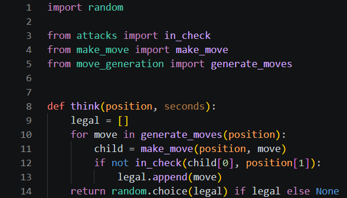
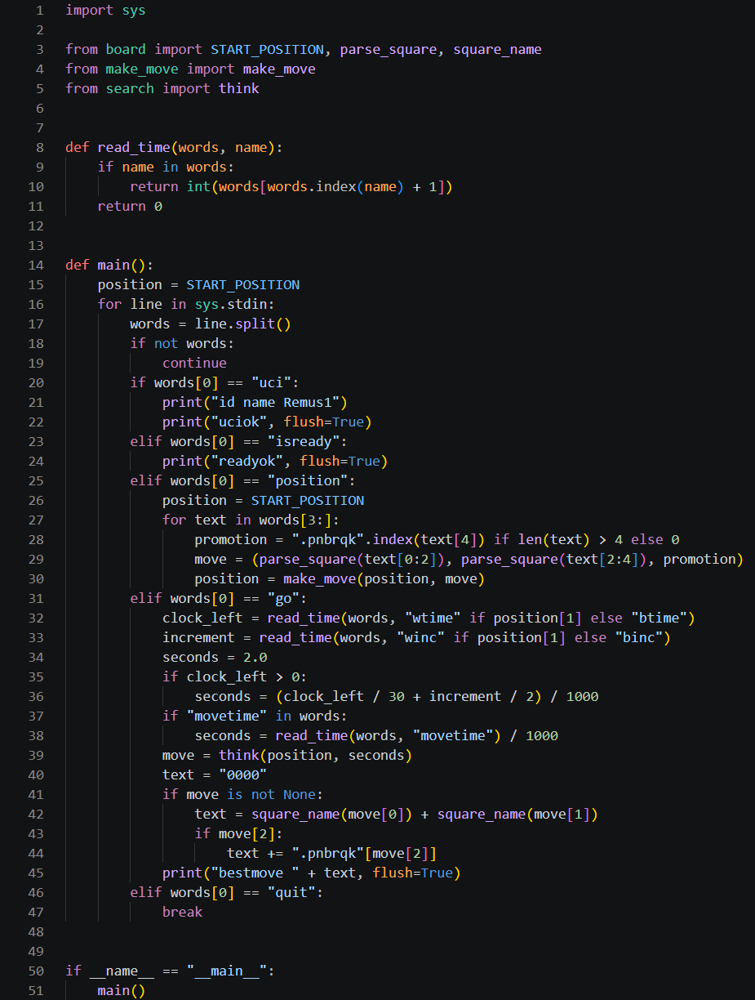

# Day 1, Period 4: The UCI loop, and Remus1 plays

3:00 to 4:30. Part of [Day 1: Remus1, legal chess at random](Day_1_Syllabus.md).

## Goal

Remus1 speaks UCI and plays a random legal move.

## The big picture

The last two files of Remus1 are new files in `Day 1 - Remus1 plays legal chess/Remus1`, like every file of Day 1. With them the engine can play a game.

`search.py` chooses the move. Remus1's choice is as simple as a choice can be: it plays every move on a copy of the board, keeps the moves that leave its own king safe, and picks one of those at random. This is where a move becomes legal: a move is legal only if the mover's king is not attacked after it. On Day 2 the student pair replaces this file's random choice with a real search.

`uci.py` is the engine's voice. Lucas Chess and Remus talk in UCI, the Universal Chess Interface: Lucas Chess sends lines of text such as `position startpos moves e2e4` and `go`, and Remus answers with lines such as `bestmove e7e5`. `uci.py` reads each line, plays the moves of the game on the starting position, asks `search.py` for a move, and prints it.

Lucas Chess runs the student pair's own engines from the day folders. Run the supplied verifier first. Record wins, draws, losses, or unfinished games; a short round illustrates play but does not establish a reliable Elo rating or a controlled speed comparison.

## The period step by step

| Time | Activity |
| --- | --- |
| 3:00 to 3:10 | How Lucas Chess and Remus talk: read [`uci.md`](../docs/uci.md) together. A move is legal only if the mover's own king is not attacked after it. |
| 3:10 to 3:50 | Type `search.py` of `Day 1 - Remus1 plays legal chess/Remus1` (12 code lines), whose `think()` plays a random legal move, then `uci.py` (44 code lines). |
| 3:50 to 4:05 | Press Run Python File in `Day 1 - Remus1 plays legal chess/Remus1/verify_remus1.py` and fix any file it names until the terminal prints `Remus1 passes every test`. |
| 4:05 to 4:30 | One round of the student pair against the student pair's Remus1, two 10-minute games: each student plays one game, one with White and one with Black (Part 3 of the guide). Its moves are legal but chosen at random; watch how it misses threats. |

## What the student pair types this period

| File | New or edited | What it holds | Lines in your file |
| --- | --- | --- | --- |
| `search.py` | New | `think()`: pick a random legal move | 1 to 14 |
| `uci.py` | New | `read_time()` and `main()`, the UCI loop | 1 to 51 |

Type the code shown in the screenshots. The line numbers refer to your own file at this point in the lesson. Work from the top down and preserve the displayed spacing.

## The files, line by line

### `search.py`

Create `search.py` in `Day 1 - Remus1 plays legal chess/Remus1`. It has 14 lines when it is done. Line 1 imports Python's `random` module, and lines 3 to 5 import `in_check()`, `make_move()`, and `generate_moves()` from the files typed earlier today.

`def think(position, seconds):` (line 8) builds the list `legal` (lines 9 to 13): for every move, it makes the move on a copy and keeps it only if `in_check()` says the mover's king is safe. `position[1]` is the second part of the position, `True` when White is to move. `return random.choice(legal) if legal else None` (line 14) picks one legal move, or returns `None` when there is none, which means checkmate or stalemate. Remus1 ignores `seconds`; Remus2 uses it to decide how long to think.

### `uci.py`

Create `uci.py` in `Day 1 - Remus1 plays legal chess/Remus1`. It has 51 lines when it is done, and it is the file `remus1.bat` runs.

`def read_time(words, name):` (line 8) finds a number in a `go` line, such as the 60000 after `wtime` in `go wtime 60000 btime 60000`, and returns 0 when the name is missing.

`def main():` (line 14) reads Lucas Chess's lines one at a time with `for line in sys.stdin:` (line 16), splits each line into words, and answers by the first word. `print("id name Remus1")` (line 21) gives the engine its name. The `position` branch (lines 25 to 30) starts from `START_POSITION` and plays each UCI move of the game, such as `e2e4` or `e7e8q`, turning its text into a move tuple with `parse_square()`. The `go` branch (lines 31 to 45) works out how many seconds to think from the clock, calls `think()`, and prints `bestmove` with the move in UCI text, or `bestmove 0000` when there is no legal move. `flush=True` sends each answer to Lucas Chess at once instead of holding it back.

Lines 50 and 51, `if __name__ == "__main__":` and `main()`, run `main()` only when `uci.py` itself is started, as Java runs `main` in the class it starts.

The terminal prints actual results beside `(expected ...)` references. A `PROBLEM:` message or a traceback means the run has not passed; fix the reported problem and rerun. Continue only after the final success line named in the schedule. These checks cover the listed reference cases, not every position or code branch.

## Done when

The terminal reports `Remus1 passes every test` for the student pair's code, and each student has played the student pair's Remus1 in Lucas Chess.
