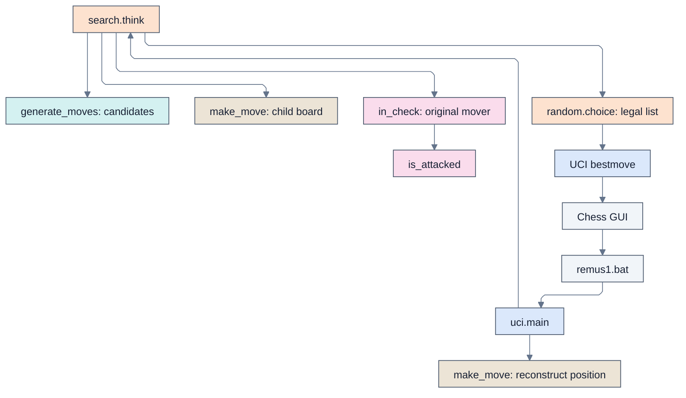

# Remus1: legal chess, picked at random

## Overview

Remus1 is the engine the student pairs finish at the end of Day 1. It generates legal
moves but looks no moves ahead: `think()` lists the legal moves and plays one at random.
The first game in Lucas Chess illustrates random legal play by the engine you wrote. The student pair checks its own move generator with `verify_remus1.py`; a
single game does not establish that all move-generation rules work. It speaks UCI to Lucas Chess through
`remus1.bat` and uses only the standard library.

[Remus2](../../Day%202%20-%20Remus2%20searches%20ahead/Remus2/Remus2.md) holds the same `board.py` , `make_move.py` , `attacks.py`
, and `move_generation.py` , and the same `uci.py` , except that its `id name` line says
Remus2. Remus2 also adds `evaluation.py` and replaces the 12 lines of this `search.py`
with alpha-beta search.

## Enhancements over the previous version

Remus1 is the starting engine. It provides board representation, legal move selection,
and UCI communication, without lookahead or evaluation.

## Source files and lines of code

Remus1 has no previous edition.

Lines of code count nonblank runtime source lines, excluding standalone comments and docstrings. `verify_remus1.py` is supplied, never typed, and excluded from these counts and tables.
Change is the net difference, not lines edited or typed. A zero means that file is
absent from that version. Supporting files and external checks are excluded.

| File | Remus1 lines of code | Previous version lines of code | Change | Responsibility |
| --- | ---: | ---: | ---: | --- |
| `board.py` | 15 | Not applicable | Not applicable | The piece numbers, the starting position, and square names |
| `make_move.py` | 23 | Not applicable | Not applicable | Play a move on a copy of the board |
| `attacks.py` | 38 | Not applicable | Not applicable | Is a square attacked? Is a king in check? |
| `move_generation.py` | 57 | Not applicable | Not applicable | List the moves of the side to move, castling included |
| `search.py` | 12 | Not applicable | Not applicable | Pick a random legal move |
| `uci.py` | 44 | Not applicable | Not applicable | The UCI loop: `uci`, `isready`, `position`, `go`, `quit` |
| **Total** | **189** | **Not applicable** | **Not applicable** | |

### Supporting files

| File | Responsibility |
| --- | --- |
| `remus1.bat` | Launch `uci.py` in the project Python environment |

## Running and configuring

Type the engine modules from the period screenshots into this day's `Remus1` folder. The supplied `remus1.bat` launcher runs `uv run uci.py` using the workspace environment; Lucas Chess starts it with the engine folder as its working directory. The UCI identity is `Remus1`.

Run `verify_remus1.py` beside this guide in VS Code at the scheduled checkpoint. After it passes, select Remus1 in Lucas Chess to play the code you wrote. Registration alone does not test the engine.

Opening `uci.py` with Run Python File starts a silent UCI command loop, not a board window. Close that run's terminal when finished. A helper module normally exits without output; that checks syntax and imports, not whether its functions work. The supplied verifier performs the reference checks, and Lucas Chess displays moves and clocks during a game.

### UCI options

This engine advertises no configurable UCI options.

### Supported commands

`uci` , `isready` , `position startpos moves ...` , timed `go` , and `quit` form the
normal GUI conversation. The Python UCI adapter does not accept arbitrary FEN positions.

## Architecture and call diagrams

Start with the module overview, then open the function view for the module you
want to follow. These diagrams describe the Python Remus1 source; they are
not Rust call graphs or a trace of one particular search.

The diagrams use Mermaid's ELK layout. Each module has a stable box color across Python and Rust: `uci.py` and `main.rs`
share blue, and both search modules use orange. Colors identify source modules,
not execution frequency. An arrow
points from a caller to a callee, and a loop marks recursion. A small bridge at a
crossing means the lines cross without joining. Arrows show possible calls, not
execution order or call frequency.

### Module overview

Each box is a source file. An arrow means a function or initialization in the
first module calls a function in the second. Calls within a module are omitted;
multiple calls between the same two modules share one arrow.

### Function views

A focused view includes calls originating in the named module. External callees
retain their module labels, but their own calls are not expanded. A function with
no outgoing calls appears when a selected caller uses it. The complete graph
contains all recognized connections and recursive calls, and needs more zooming
than the focused views.

| View | Boxes | Arrows | Editable source |
| --- | ---: | ---: | --- |
| [Complete function graph](../../mermaid/Remus1/full_elk.svg) | 15 | 18 | [Mermaid](../../mermaid/Remus1/full_elk.mmd) |
| [Module overview](../../mermaid/Remus1/modules.svg) | 6 | 8 | [Mermaid](../../mermaid/Remus1/modules.mmd) |
| [UCI and move selection](../../mermaid/Remus1/uci.svg) | 7 | 6 | [Mermaid](../../mermaid/Remus1/uci.mmd) |
| [Search](../../mermaid/Remus1/search.svg) | 4 | 3 | [Mermaid](../../mermaid/Remus1/search.mmd) |

### Viewing and editing

Open an SVG in a browser to zoom without losing text quality. SVGs need no
Mermaid installation or online account. Matching `.mmd` files contain editable
diagram text, including layout and colors. Render them with Mermaid CLI 12.2.0
for the supplied layout. Other Mermaid hosts can differ in version and layout
support.

The graph contains statically recognized calls to engine functions, including
module initialization and thread targets. Standard-library internals and function
definitions with no recognized connections are outside its scope.

See [Mermaid layouts](https://mermaid.js.org/config/layouts.html) for ELK settings
and [Mermaid CLI](https://github.com/mermaid-js/mermaid-cli) for local rendering.

## Search and evaluation

`think()` makes each move that `generate_moves()` lists, keeps it only if the mover's
own king is not in check afterward, and returns one of the kept moves with
`random.choice()` . With no legal move, checkmate or stalemate, it returns `None` , and
`uci.py` sends `bestmove 0000` . The supplied verifier checks reference move-generation counts and legal UCI replies.

## Memory and transposition table

This engine has no transposition table. Search state belongs to its single process.

## Opening book and tablebases

This engine has neither an opening book nor tablebase support; move selection is native.

## Time management and pondering

The engine returns a random legal move immediately and does not allocate thinking time
or support pondering.

## Diagnostics and performance

Only the normal UCI result is reported; there is no persistent diagnostic log.

## Verification and limitations

Open `Remus1/verify_remus1.py` in VS Code and press Run Python File at the
scheduled checkpoint. It checks required files and counts legal move sequences
(perft) from six reference positions, comparing them with published counts.
The UCI check looks for the engine
name, `uciok`, `readyok`, and a final `bestmove` line. It checks that move against
independent reference sets for nine legal histories: `1. e4`, castling available
and played, en passant available and played, promotion available, underpromotion
played, checkmate, and stalemate. Terminal positions require `0000`; other positions
reject it. Any legal reply is accepted, without requiring the engine to prefer a
special move. This does not cover every position, protocol exchange, or book choice.

Expect `Verifying` followed by actual and expected results. Success ends with
`Remus1 passes every test` and elapsed time. A mismatch prints `PROBLEM:`;
import or execution errors can show a traceback. Fix the reported problem and
rerun. Passing covers these reference cases, not every position or code branch,
and does not measure playing strength. Games in Lucas Chess run the student pair's code, but a game does not replace the reference checks.

Remus1 has no evaluation or fixed-depth search, so the verifier does not test
those. The engine has no repetition-history or fifty-move search logic.

## Further reading

- [Version guide](../../docs/remus_versions.md): feature progression and comparisons.
- [Lucas Chess guide](../../docs/lucas_chess_guide.md): workshop setup and play.
- [UCI protocol introduction](../../docs/uci.md): engine and GUI communication.

## The complete path from a command to a move

For `position startpos moves e2e4`, uci.py starts with the initial board and converts
`e2e4` to `(52, 36, 0)`. make_move() copies the board, moves the White pawn, sets
e3 as the en passant target, and switches the turn to Black. When the GUI sends
`go`, think() generates Black's candidates, makes each on a copy, rejects any that
leave Black's king attacked, and randomly selects from the remaining moves.
uci.py converts the selected tuple back to text and prints `bestmove ...`.

<!-- module-color-legend -->
Colors identify source modules consistently across Python and Rust: blue is the UCI adapter, orange is search, teal is move generation, tan is move copying, pink is attack checking, and red is evaluation. External programs and launchers use gray. Labels identify each responsibility.

[Open rendered diagram](../../mermaid/Remus1/detail_flow.svg) | [Mermaid source](../../mermaid/Remus1/detail_flow.mmd)

The verifier is a separate entry point. It imports the same runtime modules, counts
legal move sequences, and starts an independent uci.py subprocess for a short
protocol conversation. The playing engine never imports verify_remus1.py.

## Representation and Python concepts used throughout

### Board coordinates and piece numbers

Row 0 is rank 8 and column 0 is file a. A square's index is `row * 8 + col`.
Thus a8=0, h8=7, a1=56, h1=63, e2=52, and e4=36. Integer division `square // 8`
recovers the row, while remainder `square % 8` recovers the column.

| Kind | Black code | White code |
| --- | ---: | ---: |
| Pawn | 1 | 9 |
| Knight | 2 | 10 |
| Bishop | 3 | 11 |
| Rook | 4 | 12 |
| Queen | 5 | 13 |
| King | 6 | 14 |

Empty squares contain 0. White's color flag is 8. For a White knight, binary
`1010 & 0111` is `0010`, so `piece & 7` gives kind 2. The mask `piece & 8`
keeps only its color flag. Piece codes are identifiers, not relative piece values.

A Position is `(board, white, castling, en_passant)`. A Move is
`(from_square, to_square, promotion)`. Castling bits are 1 for White kingside,
2 for White queenside, 4 for Black kingside, and 8 for Black queenside. All rights
sum to 15. The en passant field is the skipped square, or -1 when absent.

### Lists, tuples, annotations, and control flow

- A list is mutable. `board[:]` creates a new list containing the same integer
  values, so modifying the child board cannot modify its parent.
- A tuple's fields cannot be reassigned, but a list inside a tuple remains mutable.
  Copy-make is a programming discipline, not a consequence of the Position type.
- A type hint such as `list[int]`, `Position`, or `Move | None` describes intended
  values to readers and tools. It does not enforce chess validity at runtime.
- `if`, `for`, `while`, and `def` end their headers with a colon; indentation defines
  their bodies. `return` ends the current call, `continue` skips to the next loop
  iteration, and `break` exits the nearest loop.
- `value_if_true if condition else value_if_false` is a conditional expression.
  It evaluates only the selected branch.
- `and` and `or` short-circuit from left to right. Bounds checks before board
  indexing therefore prevent off-board access in the attack and piece-ray loops.
- Empty lists, integer zero, and None are false in conditions. `is None` tests the
  sentinel explicitly rather than relying on general truthiness.
- An import runs module-level initialization once per module in a process and
  creates access to its definitions. Function bodies run only when called.
- A docstring is the first string expression in a module, function, or class.
  It supplies documentation metadata. Comments begin with `#` outside a string
  and have no runtime effect. Blank source lines organize the presentation.

### Chess and testing vocabulary

A **pseudo-legal move** obeys the piece's movement rules but may leave its own king
in check. A **legal move** also survives the final king-safety test. A **ply** is one
move by one side. **Perft** counts all legal sequences to a specified ply depth;
it counts distinct move sequences even when some end at the same board.

**UCI** is the text protocol between the GUI and engine. Standard input carries
commands and standard output carries replies. **FEN** represents an entire
position as text; this verifier converts FEN fixtures, but Remus1's UCI adapter
supports only reconstruction from the starting position and move list. **SAN**,
such as `Nf3`, is not used internally. A **smoke test** checks basic operation without
claiming exhaustive correctness.

## Operating assumptions and limitations

| Area | Actual behavior | Consequence |
| --- | --- | --- |
| Legal selection | think() makes and filters every candidate before random choice | Pins, discovered checks, and en passant exposure are handled on the child board |
| Position ownership | make_move() copies its board before editing | Searching candidates preserves the parent; callers must not mutate START_BOARD directly |
| Playing strength | No evaluation, look-ahead search, or preference for material | Every move tuple in the legal list has equal selection probability, including distinct promotion choices |
| Input trust | position moves and timing tokens receive no comprehensive validation | Malformed or illegal GUI input can raise exceptions or construct invalid positions |
| Castling state | Rights are maintained from legal move history and home-square events | The castling helper assumes the rights imply the correct king and rook are present |
| Draw adjudication | No repetition history, halfmove clock, or insufficient-material adjudicator | Legal move generation is not a complete game-result adjudicator; the GUI handles such game results |
| Terminal positions | No legal moves means None and bestmove 0000 | Remus1 does not distinguish checkmate from stalemate in its returned result |
| Time allowance | The UCI layer computes seconds; think() ignores it | Remus1 responds after move generation/filtering, without enforcing or deliberately spending the requested budget |
| Protocol subset | uci, isready, position startpos moves, go, and quit are recognized | FEN positions and other UCI options are not implemented; unknown commands are ignored |
| Launcher | uv run uci.py uses a relative script path | The engine folder must be the working directory; the verifier bypasses the batch file |
| UCI verification | The checker requires identity, readiness, process success, and legal replies in nine reference cases | Passing does not establish correctness for every position |
| Shared verifier | Later-version fixtures and branches coexist with Remus1 checks | Their constants are initialized, but Remus1 skips evaluation and scored-search verification |

These findings describe the source's contracts and limits. A movement generator
can produce only legal moves under its valid-position assumptions while its UCI
reference check independently tests returned-move legality in its nine supplied cases.

## Worked traces across file boundaries

### Ordinary move: e2-e4

1. `parse_square("e2")` gives 52 and `parse_square("e4")` gives 36.
2. The input adapter constructs `(52, 36, 0)` and supplies the current position.
3. make_move() copies the board, identifies the White pawn as code 9, and sees a
   distance of 16 indices.
4. It sets the en passant target to `(52 + 36) // 2 = 44`, or e3, writes 9 to e4,
   and clears e2. Neither origin nor destination removes a castling right.
5. It returns Black to move. The original starting board remains intact.

### Why a pinned move is rejected

Consider White king e1, White rook e2, and Black rook e8 with the intervening e-file
squares empty and both kings otherwise legally placed. The rook's candidate e2-f2
obeys rook movement geometry, so piece_moves() can append it. After make_move(),
the e-file is open. `in_check(child[0], True)` finds the White king and sees the
Black rook along a straight ray. think() therefore omits e2-f2 from its legal list.
The generator needs no separate 'pinned piece' representation.

### Why en passant requires testing the child board

With White king h5, White pawn g5, Black rook a5, and Black pawn f5 just advanced
from f7, `g5f6` is an en passant candidate. Its copied child removes both the White
pawn from g5 and the Black pawn from f5, exposing the rook's rank-5 line to h5.
The king-safety check rejects that child. Checking only the destination square or
forgetting to remove the off-destination pawn would not establish legality.

### Kingside castling: e1-g1

For a legal White kingside castle, bit 1 is present, f1 and g1 are empty, e1 is not
attacked, and f1 is not attacked. castling_moves() appends `(60, 62, 0)`.
make_move() copies the board, moves the h1 rook to f1, moves the king to g1, and
clears White's castling rights. The final filter tests the White king on g1. This
last test is separate from the origin/transit checks and sees the complete child
position after both pieces move.

### Promotion: e7-e8

For a White pawn on e7 with e8 empty, add_pawn_move() generates `(12, 4, 5)`,
`(12, 4, 4)`, `(12, 4, 3)`, and `(12, 4, 2)`. The final slot selects queen, rook,
bishop, or knight. make_move() adds the White color flag to that kind. Remus1 gives
each surviving promotion tuple equal probability; it has no preference for a
queen. UCI appends q, r, b, or n to identify the chosen promotion.

## Module responsibilities and assumptions

### board.py

The board convention is consistent in both conversion directions: e2 maps to 52 and 52 maps to e2. The module assumes valid indices and piece encodings. Its type aliases are descriptions, not validators, and START_POSITION still contains a mutable list.

### attacks.py

An attack query is not a call to generate the attacking side's fully legal moves. It intentionally examines piece geometry and blockers directly. This avoids recursion between move generation and king-safety checking. Each valid position must contain a king of each color for board.index() to succeed.

### make_move.py

For e2-e4, the result has a White pawn at 36, an empty square at 52, Black to move, unchanged castling rights, and en_passant=44. The parent board retains its pawn on 52. Applying an arbitrary or malformed move is outside this function's contract; copying preserves ownership, not legality.

### move_generation.py

The castling checks are distributed deliberately: this module checks the origin and transit square, while the child-board filter checks the destination after both king and rook move. The pawn and castling helpers assume reachable, correctly encoded positions. Generating candidates alone does not prove that any particular candidate is legal.

### search.py

Both a checkmated king and a stalemated side produce an empty legal list. Remus1 returns None in either case. It does not evaluate material, avoid repetition, recognize insufficient material, or spend a requested thinking budget. Its legal filtering is a movement guarantee under valid-position assumptions, not a strength guarantee.

### uci.py

After reporting bestmove, this loop leaves position unchanged. A GUI must supply the next complete position command. It also cannot process a stop command concurrently with think(); Remus1's chooser is synchronous and normally brief. This interface is intentionally limited, so a generic GUI feature requiring FEN or arbitrary UCI options is outside its supported behavior.

### remus1.bat

The launcher relies on uv being on PATH and on the engine folder being the working directory. The standalone UCI smoke test invokes Python directly, so passing that check does not validate these launcher assumptions. The source also lacks explicit command-echo suppression.
