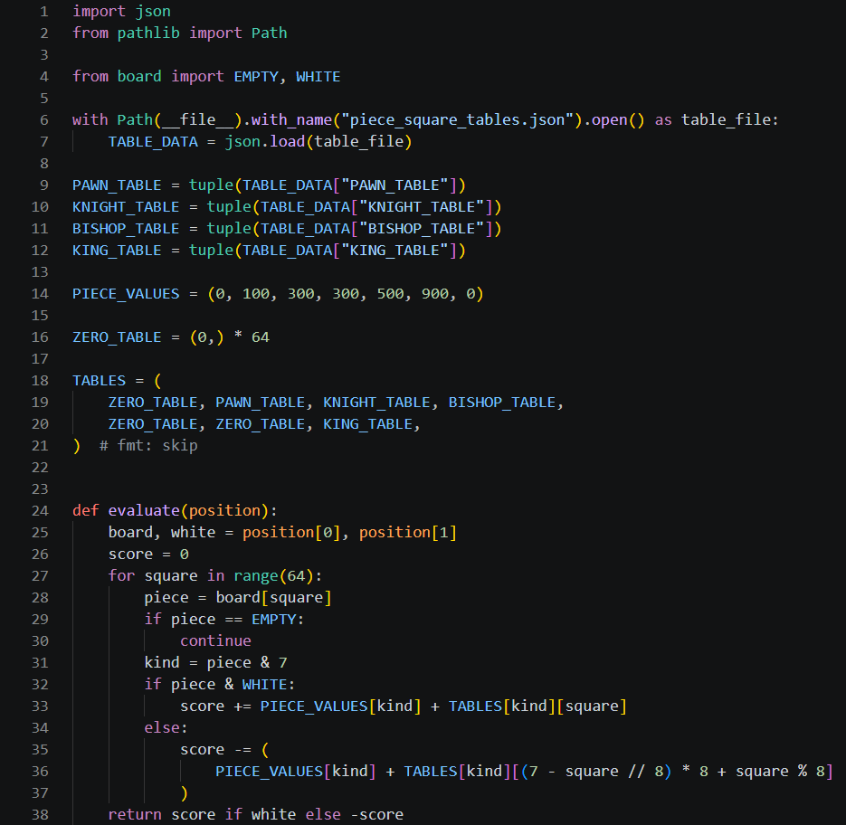

# Day 2, Period 1: The evaluation

8:30 to 10:00. Part of [Day 2: Remus2 searches ahead](Day_2_Syllabus.md).

## Goal

Remus2 can score a position in centipawns.

## The big picture

Today the student pair turns Remus1 into Remus2, and all of Day 2's typing goes into the folder `Day 2 - Remus2 searches ahead/Remus2`. The period opens in File Explorer: copy only the engine `.py` modules from `Day 1 - Remus1 plays legal chess/Remus1` into `Day 2 - Remus2 searches ahead/Remus2`, excluding the verifier. Keep the destination guide, verifier, launcher, and supplied data. From then on, edit only the files in `Day 2 - Remus2 searches ahead/Remus2`. `Day 1 - Remus1 plays legal chess/Remus1` stays as it is.

Remus2 needs a way to tell a good position from a bad one before it can look ahead, so this period adds one new file, `evaluation.py`. It scores a position in centipawns, hundredths of a pawn: a pawn is worth 100, a knight or bishop 300, a rook 500, and a queen 900. On top of the material, each piece gets a bonus or a penalty for the square it stands on, read from a piece-square table: a White knight on e4 gets 20, the same knight on its home square g1 gets -40, and on the corner square a1 it gets -50. The score is from the side to move's point of view, so a position good for White scores above 0 when White is to move and below 0 when Black is to move.

No copied file changes this period. The copied files of Remus1 keep working, and `evaluation.py` waits until Period 2 for `search.py` to use it.

## The period step by step

| Time | Activity |
| --- | --- |
| 8:30 to 8:35 | In File Explorer, copy only the engine `.py` modules from `Day 1 - Remus1 plays legal chess/Remus1` into `Day 2 - Remus2 searches ahead/Remus2`, excluding the verifier. Keep the destination guide, verifier, launcher, and supplied data. The rest of Day 2 edits those copies. |
| 8:35 to 8:45 | A score in centipawns: material, plus a bonus or penalty for where each piece stands. A Black piece reads each table upside down. |
| 8:45 to 9:55 | Type `evaluation.py` (30 code lines): load the supplied JSON tables, set the piece values, and define `evaluate()`. The supplied `piece_square_tables.json` stays beside the module; students type none of its values. Press Run Python File to check syntax, imports, and loading the data file. No output is expected; this does not test evaluation scores. |
| 9:55 to 10:00 | Swap driver and navigator. |

## What changes this period

| File | New or edited | What the student pair does | Lines in your file |
| --- | --- | --- | --- |
| `board.py`, `make_move.py`, `attacks.py`, `move_generation.py`, `search.py`, `uci.py`, `remus2.bat` | Copied from `Day 1 - Remus1 plays legal chess/Remus1` | Copy into `Day 2 - Remus2 searches ahead/Remus2`; no edits this period | Unchanged |
| `piece_square_tables.json` | Supplied in `Day 2 - Remus2 searches ahead/Remus2` | Keep this data file beside `evaluation.py`; do not type or edit its values | Not typed |
| `evaluation.py` | New | Type the whole file | 1 to 38 |

Type the code shown in the screenshots. The line numbers refer to your own file at this point in the lesson. Work from the top down and preserve the displayed spacing.

## The file, line by line

### `evaluation.py`

Create `evaluation.py` in `Day 2 - Remus2 searches ahead/Remus2`. It has 38 lines when it is done. The supplied `piece_square_tables.json` is already in this folder. Leave it there; student pairs do not type its numeric values. The same data file contains the tables used on Days 2, 3, and 4.

Lines 1 and 2 import Python's JSON reader and `Path`. Lines 6 and 7 open the data file beside `evaluation.py` and read its dictionary into `TABLE_DATA`. `with` closes the file after reading. Finding the file relative to `__file__` makes this work regardless of the terminal's current folder. A missing file, invalid JSON, or missing table name causes a startup error; restore the supplied file before continuing.

Lines 9 to 12 assign the pawn, knight, bishop, and king tables by name. `tuple()` converts each JSON list into an immutable sequence. Each table holds 64 values, with rank 8 first and files a to h in each row, as White sees the board. Loading occurs once when the module is imported, not during search.

`PIECE_VALUES = (0, 100, 300, 300, 500, 900, 0)` (line 14) gives each piece kind its material value. Rooks and queens get no placement bonus in Remus2, so `ZERO_TABLE` (line 16) supplies 64 zeros. `TABLES` (lines 18 to 21) puts the tables in piece-kind order. Type the `# fmt: skip` on line 21 to preserve this layout when saving.

`def evaluate(position):` (line 24) adds the material and placement scores. `for square in range(64):` (line 27) visits each square, and line 28 reads its piece from the board. White reads the table at its own square (line 33). Black reads it with the ranks reversed (line 36). `return score if white else -score` (line 38) expresses the result from the side to move's point of view.

## Done when

Press Run Python File in `evaluation.py`. The file loads without an error and prints nothing. This checks syntax, imports, and loading the supplied JSON file, not whether `evaluate()` returns correct scores. The finished Remus2 is tested with `verify_remus2.py` in Period 3.
