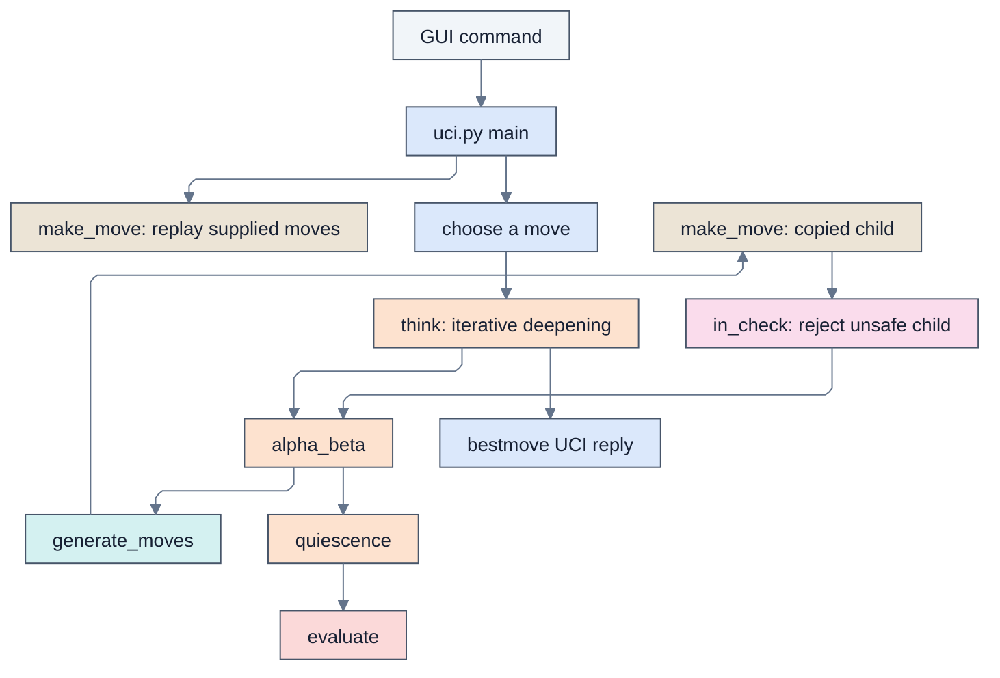

# Remus2: legal chess and alpha-beta

## Overview

Remus2 is [Remus1](../../Day%201%20-%20Remus1%20plays%20legal%20chess/Remus1/Remus1.md) , the random mover the student pairs finish on
Day 1, with `evaluation.py` and a real `search.py` in place of Remus1's random one. It
plays legal chess with an alpha-beta search, a quiescence search that plays out the
captures at the end of each line, MVV-LVA move ordering (most valuable victim, least
valuable attacker), a check extension, and iterative deepening. It speaks UCI to Lucas
Chess through `remus2.bat` and uses only the standard library.

[Remus3](../../Day%203%20-%20Remus3%20adds%20the%20biggest%20gains/Remus3/Remus3.md) adds the biggest gains for the fewest lines, and
[Remus4](../../Day%204%20-%20Remus4%20adds%20everything%20else/Remus4/Remus4.md) adds every other enhancement.
[`remus_versions.md`](../../docs/remus_versions.md) lists each enhancement and the version that
holds it.

## Enhancements over the previous version

Remus2 adds evaluation, alpha-beta search, capture quiescence, MVV-LVA ordering, a check
extension, and iterative deepening. It replaces the 12-line random search with 93 search
lines and adds 30 evaluation lines: 123 new lines to type, but a net increase of 111
lines of code.

## Source files and lines of code

Comparison baseline: [Remus1](../../Day%201%20-%20Remus1%20plays%20legal%20chess/Remus1/Remus1.md) .

Lines of code count nonblank runtime source lines, excluding standalone comments and docstrings. `verify_remus2.py` is supplied, never typed, and excluded from these counts and tables.
Change is the net difference, not lines edited or typed. A zero means that file is
absent from that version. Supporting files and external checks are excluded.

| File | Remus2 lines of code | Remus1 lines of code | Change | Responsibility |
| --- | ---: | ---: | ---: | --- |
| `board.py` | 15 | 15 | 0 | The piece numbers, the starting position, and square names |
| `make_move.py` | 23 | 23 | 0 | Play a move on a copy of the board |
| `attacks.py` | 38 | 38 | 0 | Is a square attacked? Is a king in check? |
| `move_generation.py` | 57 | 57 | 0 | List the moves of the side to move, castling included |
| `evaluation.py` | 30 | 0 | +30 | Material plus four piece-square tables |
| `search.py` | 93 | 12 | +81 | Move ordering, quiescence, alpha-beta, iterative deepening |
| `uci.py` | 44 | 44 | 0 | The UCI loop: `uci`, `isready`, `position`, `go`, `quit` |
| **Total** | **300** | **189** | **+111** | |

### Supporting files

| File | Responsibility |
| --- | --- |
| `remus2.bat` | Launch `uci.py` in the project Python environment |
| `piece_square_tables.json` | Supplied 64-square evaluation tables, loaded once at startup; students do not type these values |

## Running and configuring

Type the engine modules from the period screenshots into this day's `Remus2` folder. The supplied `remus2.bat` launcher runs `uv run uci.py` using the workspace environment; Lucas Chess starts it with the engine folder as its working directory. The UCI identity is `Remus2`.

Run `verify_remus2.py` beside this guide in VS Code at the scheduled checkpoint. After it passes, select Remus2 in Lucas Chess to play the code you wrote. Registration alone does not test the engine.

Opening `uci.py` with Run Python File starts a silent UCI command loop, not a board window. Close that run's terminal when finished. A helper module normally exits without output; that checks syntax and imports, not whether its functions work. The supplied verifier performs the reference checks, and Lucas Chess displays moves and clocks during a game.

Keep the supplied `piece_square_tables.json` beside `evaluation.py`. It is read once at startup; students do not type its values. Missing or malformed data produces a load error.

### UCI options

This engine advertises no configurable UCI options.

### Supported commands

`uci` , `isready` , `position startpos moves ...` , timed `go` , and `quit` form the
normal GUI conversation. The Python UCI adapter does not accept arbitrary FEN positions.

## Architecture and call diagrams

Start with the module overview, then open the function view for the module you
want to follow. These diagrams describe the Python Remus2 source; they are
not Rust call graphs or a trace of one particular search.

The diagrams use Mermaid's ELK layout. Each module has a stable box color across Python and Rust: `uci.py` and `main.rs`
share blue, and both search modules use orange. Colors identify source modules,
not execution frequency. An arrow
points from a caller to a callee, and a loop marks recursion. A small bridge at a
crossing means the lines cross without joining. Arrows show possible calls, not
execution order or call frequency.

### Module overview

Each box is a source file. An arrow means a function or initialization in the
first module calls a function in the second. Calls within a module are omitted;
multiple calls between the same two modules share one arrow.

### Function views

A focused view includes calls originating in the named module. External callees
retain their module labels, but their own calls are not expanded. A function with
no outgoing calls appears when a selected caller uses it. The complete graph
contains all recognized connections and recursive calls, and needs more zooming
than the focused views.

| View | Boxes | Arrows | Editable source |
| --- | ---: | ---: | --- |
| [Complete function graph](../../mermaid/Remus2/full_elk.svg) | 20 | 29 | [Mermaid](../../mermaid/Remus2/full_elk.mmd) |
| [Module overview](../../mermaid/Remus2/modules.svg) | 7 | 9 | [Mermaid](../../mermaid/Remus2/modules.mmd) |
| [UCI and move selection](../../mermaid/Remus2/uci.svg) | 7 | 6 | [Mermaid](../../mermaid/Remus2/uci.mmd) |
| [Search](../../mermaid/Remus2/search.svg) | 9 | 14 | [Mermaid](../../mermaid/Remus2/search.mmd) |

### Viewing and editing

Open an SVG in a browser to zoom without losing text quality. SVGs need no
Mermaid installation or online account. Matching `.mmd` files contain editable
diagram text, including layout and colors. Render them with Mermaid CLI 12.2.0
for the supplied layout. Other Mermaid hosts can differ in version and layout
support.

The graph contains statically recognized calls to engine functions, including
module initialization and thread targets. Standard-library internals and function
definitions with no recognized connections are outside its scope.

See [Mermaid layouts](https://mermaid.js.org/config/layouts.html) for ELK settings
and [Mermaid CLI](https://github.com/mermaid-js/mermaid-cli) for local rendering.

## Search and evaluation

Alpha-beta rejects branches that cannot improve the current choice. Capture quiescence
extends tactical exchanges beyond the nominal depth; material and piece-square tables
score the resulting positions.

### Readable representation and search

- **One function moves every piece but the pawn.** `piece_moves()` takes the steps a
  piece may take and whether it slides: a knight or king takes one step in each
  direction, while a bishop, rook, or queen keeps going until a piece or the edge stops
  it.
- **`is_attacked()` uses the same idea in reverse.** It looks out from the square with
  the steps of each kind of piece, and the first piece it meets on each line attacks
  the square if it is the right kind.
- **`ordered_moves()` generates the moves and sorts them,** and hands each one to the
  search with its priority. Quiescence stops at the first quiet move, whose priority
  is 0.
- **A position is one tuple,** `(board, white, castling, en_passant)`, so
  `make_move()` takes a position and returns the next one, and every search call
  passes one value instead of four.
- **Copy, don't undo.** `make_move()` copies the board with `board[:]` and returns
  the new position, so the search never takes a move back.
- **Pieces are numbers.** A piece is its kind, from 1 for a pawn to 6 for a king, plus
  8 if it is White, so `piece & 7` gives the kind. The castling rights are four bits:
  1 and 2 for White's kingside and queenside, 4 and 8 for Black's. The starting board
  is built from one back rank, `BACK_RANK`, that both sides share, and letters appear
  only in UCI move text such as `e7e8q`.
- **Supplied tables.** `piece_square_tables.json` contains the complete 64-square
  values, rank 8 first and files a to h across each row. The module reads them once
  and assigns named tuples; search reads the tuples without further file access.
- **No legal-move list.** The search makes each pseudo-legal move and skips it if its
  own king is attacked.

## Memory and transposition table

This engine has no transposition table. Search state belongs to its single process.

## Opening book and tablebases

This engine has neither an opening book nor tablebase support; move selection is native.

## Time management and pondering

The move budget is one thirtieth of the remaining clock plus half the increment, or two
seconds without clock information. `movetime` overrides that budget. Iterative deepening
retains a usable move when time expires. There is no separate adaptive hard-budget
policy or pondering.

## Diagnostics and performance

UCI `info` reports search progress. There are no persistent search or ponder logs and no
cache hit counters.

## Verification and limitations

Open `Remus2/verify_remus2.py` in VS Code and press Run Python File at the
scheduled checkpoint. It checks required files and counts legal move sequences
(perft) from six reference positions, comparing them with published counts.
It also compares five evaluation scores and depth-4 search moves, scores, and node
counts with stored reference results. Those searches call the native search
directly. The UCI check looks for the engine
name, `uciok`, `readyok`, and a final `bestmove` line. It checks that move against
independent reference sets for nine legal histories: `1. e4`, castling available
and played, en passant available and played, promotion available, underpromotion
played, checkmate, and stalemate. Terminal positions require `0000`; other positions
reject it. Any legal reply is accepted, without requiring the engine to prefer a
special move. This does not cover every position, protocol exchange, or book choice.

Expect `Verifying` followed by actual and expected results. Success ends with
`Remus2 passes every test` and elapsed time. A mismatch prints `PROBLEM:`;
import or execution errors can show a traceback. Fix the reported problem and
rerun. Passing covers these reference cases, not every position or code branch,
and does not measure playing strength. Games in Lucas Chess run the student pair's code, but a game does not replace the reference checks.

Remus2 has no repetition or fifty-move search logic and reports no principal
variation. Its UCI input supports games from the starting position, not arbitrary
FEN positions. The verifier constructs its reference positions outside that adapter.

## Further reading

- [Version guide](../../docs/remus_versions.md): feature progression and comparisons.
- [Lucas Chess guide](../../docs/lucas_chess_guide.md): workshop setup and play.
- [UCI protocol introduction](../../docs/uci.md): engine and GUI communication.

## The complete path from a command to a move

1. The Windows launcher starts uci.py. Importing modules defines functions and constructs constants; the main guard starts the protocol loop.
2. A position command resets to START_POSITION and replays the supplied coordinate moves. make_move() returns a copied child each time.
3. A go command calculates a time allowance. The search starts immediately.
4. think() searches increasing nominal depths. alpha_beta() orders movement candidates, makes copies, rejects moves that leave the moving king attacked, and recursively examines the remaining continuations.
5. At a normal depth boundary, quiescence() extends selected tactical lines and evaluate() supplies static scores. A child's score is negated to express it for the parent player.
6. Search retains its best legal root move. The adapter prints bestmove plus its UCI token, or 0000 when no move exists. It then waits for the next command.

<!-- module-color-legend -->
Colors identify source modules consistently across Python and Rust: blue is the UCI adapter, orange is search, teal is move generation, tan is move copying, pink is attack checking, and red is evaluation. External programs and launchers use gray. Labels identify each responsibility.

[Open rendered diagram](../../mermaid/Remus2/detail_flow.svg) | [Mermaid source](../../mermaid/Remus2/detail_flow.mmd)

The diagram shows the search path. This engine has no book path.

## Representation and Python concepts used throughout

### Board coordinates and piece numbers

Row 0 is rank 8 and column 0 is file a. Square number is row*8+column, giving a8=0, h8=7, a1=56, and h1=63. For e2, row 6 and column 4 give 52; e4 is 36. White pawns advance toward smaller row numbers.

| Meaning | Value or operation |
| --- | --- |
| Empty square | 0 |
| Pawn, knight, bishop, rook, queen, king | 1, 2, 3, 4, 5, 6 |
| White color flag | 8 |
| White knight / Black knight | 10 / 2 |
| Extract kind | piece & 7 |
| Extract White flag | piece & WHITE |
| Move | (source, target, promotion), with promotion 0 for ordinary moves |
| Castling flags | White kingside 1, White queenside 2, Black kingside 4, Black queenside 8 |
| En passant target | The skipped square after a two-square pawn move, or -1 |

A Position is `(board, white, castling, en_passant)`. It has no reversible-move clock.

### Lists, tuples, annotations, and control flow

Lists can change; tuples fix their sequence of references. A tuple containing a board list does not freeze that list. `board[:]` copies the list so edits to a child do not alter the parent. The tuple returned by make_move() contains that new board and updated scalar state. Search consequently needs no unmake operation.

Type hints describe expected values but do not enforce them at runtime. `Move | None` means either a three-integer move or the absence of a move. `&` masks integer bits; `|` inside a type hint is a type union. `//` is floor division, `%` is remainder, and `~` complements bits for castling-right masks. `and` and `or` short-circuit, so a failed earlier test can avoid an unsafe or expensive later expression.

A function definition creates a callable; its body runs when called. Imports execute module-level initialization once per normal process import. Global declarations allow rebinding shared search counters and root state. A raised SearchTimeout unwinds recursive calls until think() catches it; this is different from an ordinary return or a break that exits only one loop.

### Chess and search vocabulary

A **ply** is one player's move. A nominal depth of four is four plies, not four full move pairs. Check extensions and quiescence can search beyond that nominal depth. A **pseudo-legal move** obeys movement geometry and occupancy but may expose its own king; a legal move also passes the child-board king-safety test.

A **centipawn** is one hundredth of this evaluator's pawn value. A +100 score estimates a one-pawn advantage for the side to move. It is neither a win probability nor an Elo rating. Mate has a separate large magnitude, reduced by distance so a quicker win is preferred.

**Negamax** uses the same maximization code for both players by negating a child's score. **Alpha** is the useful lower bound and **beta** the cutoff threshold. A score reaching beta makes further alternatives at that node unnecessary for the parent's current question. A **bound** can be sufficient even when the exact best score is unknown.

**Stand pat** uses the current static score without another tactical move. It is a search baseline, not a legal pass. **Quiescence** extends tactical continuations beyond the depth boundary to reduce evaluations made halfway through exchanges. **Perft** instead enumerates every legal continuation to a specified depth without evaluation, ordering-based pruning, or strength measurement.

## Operating assumptions and limitations

The rules layer uses native code throughout. generate_moves() supplies candidates; make_move() applies them on copies; in_check() rejects exposed kings. Incoming UCI move histories are trusted, so this legality guarantee concerns moves the engine selects from a valid position. Malformed input and invalid boards are outside the runtime contract.

Quiescence accepts stand pat without first establishing whether the active king is checked or whether any legal move exists. It filters each searched capture for own-king safety, but that does not make standing pat legal in check. Quiet evasions can be omitted after a capture gives check, and a stalemated leaf can receive a nonzero evaluation. Main-search check extensions do not cover checks created within quiescence recursion. En passant is also treated as an empty-destination quiet move by ordering, so it falls outside the tactical prefix. Noncapturing underpromotions are omitted from ordinary quiescence.

Timing is approximate. Recursive checks occur every 1024 node entries and require an established root move. The soft stop is checked after an iteration, so an expensive iteration or terminal path can exceed the intended allowance. A changing best move may be retained from an unfinished depth. Printed scores use the UCI cp label even for the engine's internal mate-scale values.

## Worked traces across file boundaries

### Ordinary move: e2-e4

The UCI parser converts e2 to 52 and e4 to 36, creating `(52,36,0)`. make_move() copies the board, reads the White pawn code 9, recognizes distance 16, and sets the new en passant target to their midpoint 44 (e3). It puts the pawn on e4, empties e2, preserves unrelated castling rights, and switches the turn to Black. There is no halfmove field in this version.

### Why a pinned move is rejected

Consider White's king on e1 and a White rook on e2 shielding it from a Black rook on e8, with the intervening file otherwise empty. Moving the White rook to d2 follows rook geometry, so the generator can supply it. make_move() produces the child; in_check(child_board, True) finds the open e-file attack. Search discards the move before recursively evaluating it. A favorable material or table score cannot make that exposed-king move legal.

### Why en passant needs the changed board

Place White's king on e5 and pawn on f5, Black's pawn on g5 and rook on h5, with the relevant rank squares otherwise clear and g6 as the en passant target. f5-g6 removes the pawn on g5 as well as vacating f5. The rook's line from h5 to e5 opens, so the child-board king test rejects this capture. Testing only the empty landing square would miss the discovered attack.

In this version, en passant is applied correctly by make_move() and filtered correctly when main search examines it, but the search ordering classifies its empty destination as quiet. That classification can exclude it from quiescence.

### Castling and promotion

For White kingside castling, e1-g1 is `(60,62,0)`. The generator checks the castling right, empty path, and king safety on the required squares. make_move() transfers the rook from h1 (63) to f1 (61), moves the king, and clears White's castling rights. The final child-board safety test remains part of legal selection.

A White pawn advancing from e7 to e8 reaches the promotion rank. The generator expands that destination into four moves with promotion kinds 5, 4, 3, and 2. make_move() replaces the pawn with the chosen kind plus White's color flag. UCI adds q, r, b, or n. Main search can examine all four; queen promotions receive a tactical ordering bonus, while an empty-destination underpromotion is outside ordinary nonchecked quiescence.

### Negamax, a cutoff, and quiescence

Suppose one legal root move gives the opponent a score of -80. Negating gives +80 for the root player. A second move whose child returns -120 gives +120 and becomes preferred. For a child entered with alpha=-150 and beta=-80, a continuation returning -60 reaches beta: the child is already good enough for that player's cutoff, and its parent need not know whether an even better child continuation exists.

A capture sequence illustrates why a raw depth-boundary evaluation can mislead. A queen taking a defended pawn momentarily removes 100 enemy centipawns, but a recapture can remove the 900-centipawn queen. Quiescence examines tactical continuations to expose such exchanges. It still has the check-evasion and terminal limitations described above, so extending captures alone does not establish full tactical correctness.

## Module responsibilities and assumptions

### board.py

The board representation is a contract shared by every module. A tuple does not make its nested board list immutable; correctness depends on copy-make. Square conversion assumes valid coordinate text. Position hashes, where present, are compact identifiers rather than collision-proof full positions.

### attacks.py

Attack detection and legal move generation answer different questions. A pinned enemy piece can still attack a square for king-safety purposes. This file assumes valid piece encodings and an existing king of the requested color; it is not an arbitrary-position validator.

### make_move.py

This routine applies a supplied move rather than deciding whether that move is legal. Its callers must supply a valid movement candidate and, when selecting a move, test the moving king afterward. Copying preserves the parent board through recursion, timeouts, and alternate candidate exploration. En passant removes a pawn away from the landing square; castling moves two pieces.

### move_generation.py

The output is pseudo-legal: piece movement and occupancy are checked, but a pinned piece can still produce candidates. Castling has explicit attack restrictions, while all candidates require the final child-board king-safety test. Promotion produces four choices. Search ordering and selective pruning determine which legal candidates receive deeper attention.

### evaluation.py

A positive result favors the player to move, not always White. Material values and square bonuses are estimates; legality and checkmate are separate search concerns. The table rows are White-oriented and vertically reflected for Black. The source reference explains every numeric row and every additional positional term, including approximations and rounding.

### search.py

Move ordering changes how quickly bounds are found; it does not replace legality filtering. With selective pruning, ordering can also change the tree that is actually searched. Node totals count function entries, including repeated positions and the main-search-to-quiescence transition. The recursive clock check occurs only every 1024 nodes after a root move exists, so the budget is not a strict deadline. The retained root move can come from a partially completed iteration.

### uci.py

The adapter is synchronous and implements a limited UCI subset. It assumes position startpos with a complete legal move list, trusts incoming tokens, and does not parse runtime FEN or implement asynchronous stop. It does not advance the live position when emitting bestmove; the GUI supplies the subsequent position command. Unknown commands are ignored by the if/elif chain.

### remus2.bat

The launcher relies on uv being on PATH and the engine folder being the current working directory. The batch file does not anchor uci.py with its own path and does not suppress command echo. The verifier launches uci.py directly, so its UCI test does not exercise this batch-file path.
