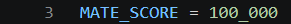
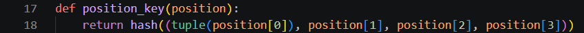
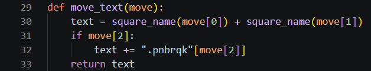
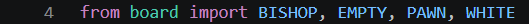
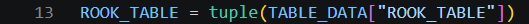
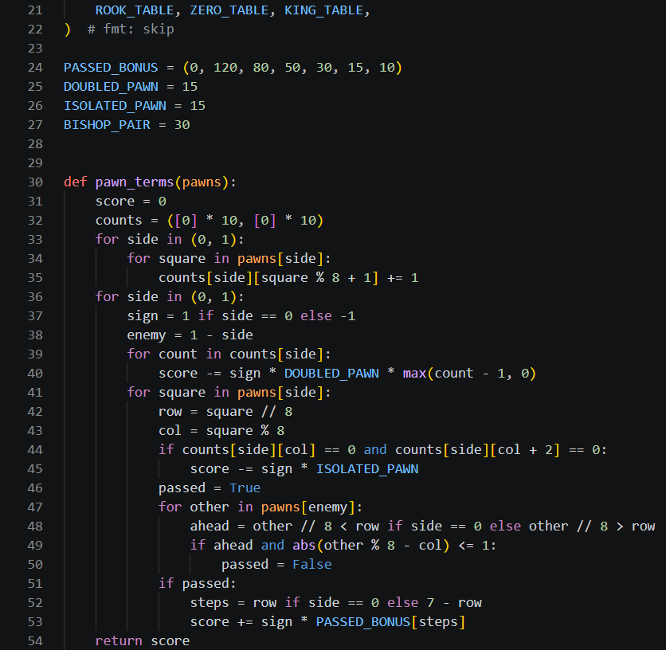
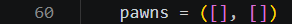
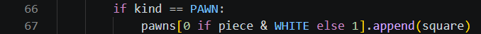
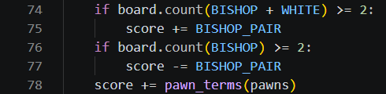
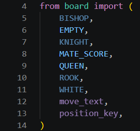

# Day 3, Period 1: Pawn structure, the bishop pair, and the rook table

8:30 to 10:00. Part of [Day 3: Remus3](Day_3_Syllabus.md).

## Goal

Remus3's evaluation knows pawn structure, the bishop pair, and where rooks belong.

## The big picture

Today the student pair turns Remus2 into Remus3, and all of Day 3's typing goes into the folder `Day 3 - Remus3 adds the biggest gains/Remus3`. The period opens in File Explorer: copy only the engine `.py` modules from `Day 2 - Remus2 searches ahead/Remus2` into `Day 3 - Remus3 adds the biggest gains/Remus3`, excluding the verifier. Keep the destination guide, verifier, launcher, and supplied data. From then on, edit only the files in `Day 3 - Remus3 adds the biggest gains/Remus3`. `Day 2 - Remus2 searches ahead/Remus2` stays as it is.

This period teaches the evaluation three ideas a chess player learns early. Two pawns on one file (doubled pawns) and a pawn with no friendly pawn on either neighboring file (an isolated pawn) are weak, and a pawn that no enemy pawn can stop (a passed pawn) grows stronger the closer it gets to promotion. Two bishops together are worth more than a bishop and a knight, because together they cover both colors of square. And a rook belongs on the seventh rank, where it attacks the pawns that have not moved. `evaluation.py` gets all three.

The period also moves `MATE_SCORE` from `search.py` to `board.py` and adds two small helpers to `board.py`, `position_key()` and `move_text()`. The transposition table of Period 2 needs `MATE_SCORE` and `position_key()`, and it cannot import them from `search.py`, because `search.py` imports the table. No new file is added this period.

## The period step by step

| Time | Activity |
| --- | --- |
| 8:30 to 8:35 | In File Explorer, copy only the engine `.py` modules from `Day 2 - Remus2 searches ahead/Remus2` into `Day 3 - Remus3 adds the biggest gains/Remus3`, excluding the verifier. Keep the destination guide, verifier, launcher, and supplied data. |
| 8:35 to 8:45 | Doubled, isolated, and passed pawns, on a position the teacher shows in Lucas Chess. Why two bishops together are worth more than a bishop and a knight. |
| 8:45 to 9:00 | Move `MATE_SCORE` from `search.py` to `board.py`, and add `position_key()` and `move_text()` (8 code lines in `board.py`). |
| 9:00 to 9:55 | In `evaluation.py`, load the supplied rook table, add `pawn_terms()`, the bishop pair, and the lines of `evaluate()` that collect the pawns (38 code lines). Press Run Python File in `uci.py` to check for syntax and import errors. No text is expected while it waits for UCI commands; starting it does not test the engine's chess functions. Close that run's terminal before continuing. |
| 9:55 to 10:00 | Swap driver and navigator. |

## What changes this period

| File | New or edited | What the student pair does | Lines in your file |
| --- | --- | --- | --- |
| `board.py` | Copied from `Day 2 - Remus2 searches ahead/Remus2`, edited | Add `MATE_SCORE`, `position_key()`, and `move_text()` | 3, 17 to 18, 29 to 33 |
| `evaluation.py` | Copied from `Day 2 - Remus2 searches ahead/Remus2`, edited | Add the rook table, the pawn terms, and the bishop pair | 4, 13, 21 to 54, 60, 66 to 67, 74 to 78 |
| `search.py` | Copied from `Day 2 - Remus2 searches ahead/Remus2`, edited | Import `MATE_SCORE` and five more names from `board.py`, and delete its own `MATE_SCORE` | 4 to 14 |
| `make_move.py`, `attacks.py`, `move_generation.py`, `uci.py`, `remus3.bat` | Copied from `Day 2 - Remus2 searches ahead/Remus2` | No edits this period | Unchanged |

Type the code shown in the screenshots. The line numbers refer to your own file at this point in the lesson. Work from the top down and preserve the displayed spacing.

## The edits, file by file

### `board.py`

`board.py` grows from 21 lines to 33. Type `MATE_SCORE = 100_000` (line 3) under `WHITE = 8`; it is the same constant `search.py` holds today.

Between `is_own()` and `parse_square()`, type `def position_key(position):` (line 17) and its one line of code, `return hash((tuple(position[0]), position[1], position[2], position[3]))` (line 18). The key is one number that stands for the whole position: the board, the side to move, the castling rights, and the en passant square. A list cannot be hashed in Python, so `tuple()` turns the board into a tuple first. Two move orders that reach the same position, such as e4 e5 Nf3 and Nf3 e5 e4, get the same key.

At the end of the file, type `def move_text(move):` (line 29) and its four lines (30 to 33). It turns a move tuple into UCI text such as `e7e8q`, the same steps that `uci.py` takes today for `bestmove`. Remus3 needs the text in three places: the `bestmove` answer, the opening book, and the line of moves the engine expects.

### `evaluation.py`

`evaluation.py` grows from 38 lines to 79. Keep the supplied JSON file copied with Remus2; it already contains the rook table.

Change the board import on line 4 to include `BISHOP` and `PAWN`. Below the king table assignment, type `ROOK_TABLE = tuple(TABLE_DATA["ROOK_TABLE"])` (line 13). The supplied values reward rooks on the seventh rank and penalize some edge squares; students do not type a new grid of numbers. In `TABLES`, put `ROOK_TABLE` in the rook's place (line 21).

Below `TABLES`, type the four constants on lines 24 to 27. `PASSED_BONUS` is indexed by how many steps a passed pawn still has to go: 120 for one step, 10 for six steps.

Type `def pawn_terms(pawns):` (line 30), with its body through line 54. Lines 32 to 35 count each side's pawns on each file. Ten places per side leave an empty neighbor beyond each edge file. Lines 39 and 40 penalize doubled pawns; lines 44 and 45 penalize isolated pawns. Lines 46 to 53 award a passed-pawn bonus when no enemy pawn lies ahead on the same or a neighboring file. `sign` is 1 for White and -1 for Black.

In `evaluate()`, add `pawns = ([], [])` (line 60). Lines 66 and 67 collect pawn squares during the existing loop over the board. Lines 74 to 78 add the bishop-pair bonuses and the pawn terms before returning the score.

### `search.py`

`search.py` grows from 110 lines to 118. Replace the import `from board import EMPTY, QUEEN` with the eleven lines from `from board import (` to `)` (lines 4 to 14), one name per line. The block brings in `MATE_SCORE` today and the names that Periods 2 to 4 need: the piece kinds for `has_pieces()`, `position_key()` for the table, and `move_text()` for the line of moves.

VS Code grays out six of these names: `BISHOP`, `KNIGHT`, `ROOK`, `WHITE`, `move_text`, and `position_key`. The gray is temporary and is not an error. `search.py` does not use these names in this period, but it uses them in later periods: all but `move_text` in Period 2, and `move_text` in Period 4. Type all eleven lines now, and each name brightens when the code that uses it arrives.

Then delete `MATE_SCORE = 100_000` and the blank line above it, which stood at line 9 of the copied file: `search.py` now gets `MATE_SCORE` from `board.py`.

## Done when

Press Run Python File in `uci.py`. It loads without an error and waits silently for UCI commands. Close that run's terminal before continuing. This checks startup, including syntax and imports; it does not test evaluation or search, and it does not show that the engine plays correctly. The finished Remus3 is tested with `verify_remus3.py` in Period 4.
