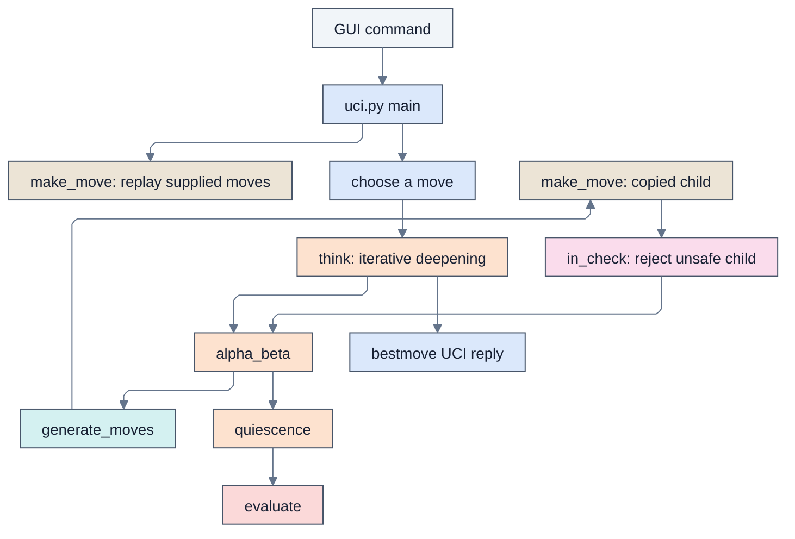

# Remus3: Remus2 with the biggest gains

## Overview

Remus3 is [Remus2](../../Day%202%20-%20Remus2%20searches%20ahead/Remus2/Remus2.md) with the eleven enhancements that buy the most
strength for the fewest lines: killer moves, pawn structure, a position key and a
transposition table, an opening book, aspiration windows, time management, null-move
pruning, the principal variation, the bishop pair, and the rook table. The student pairs
type the 184 new lines into their Remus2. It speaks UCI to Lucas Chess through
`remus3.bat` and uses only the standard library.

[`remus_versions.md`](../../docs/remus_versions.md) explains each step and why Remus3 holds it.
[Remus4](../../Day%204%20-%20Remus4%20adds%20everything%20else/Remus4/Remus4.md) adds every other enhancement.

## Enhancements over the previous version

Remus3 adds eleven workshop enhancements: killer moves, pawn structure, position keys, a
transposition table, an opening book, aspiration windows, time management, null-move
pruning, a principal variation, the bishop pair, and a rook table. The net increase is
184 lines of code.

## Source files and lines of code

Comparison baseline: [Remus2](../../Day%202%20-%20Remus2%20searches%20ahead/Remus2/Remus2.md) .

Lines of code count nonblank runtime source lines, excluding standalone comments and docstrings. `verify_remus3.py` is supplied, never typed, and excluded from these counts and tables.
Change is the net difference, not lines edited or typed. A zero means that file is
absent from that version. Supporting files and external checks are excluded.

| File | Remus3 lines of code | Remus2 lines of code | Change | Responsibility |
| --- | ---: | ---: | ---: | --- |
| `board.py` | 23 | 15 | +8 | The piece numbers, the starting position, square names, the position key, and UCI move text; `MATE_SCORE`, `position_key()`, `move_text()` |
| `make_move.py` | 23 | 23 | 0 | Play a move on a copy of the board |
| `attacks.py` | 38 | 38 | 0 | Is a square attacked? Is a king in check? |
| `move_generation.py` | 57 | 57 | 0 | List the moves of the side to move, castling included |
| `evaluation.py` | 68 | 30 | +38 | Material, five piece-square tables, the pawn structure, and the bishop pair; `ROOK_TABLE`, `pawn_terms()`, the bishop pair |
| `opening_book.py` | 21 | 0 | +21 | Read `opening_book.txt` and find the book moves; New file |
| `transposition_table.py` | 22 | 0 | +22 | Remember each searched position's score, depth, bound, and best move; New file |
| `search.py` | 173 | 93 | +80 | Move ordering with killers, quiescence, alpha-beta with the table and the null move, the principal variation, aspiration windows, and time management; Killers, table, null move, principal variation, window, time |
| `uci.py` | 59 | 44 | +15 | The UCI loop, the book, and the clock; Book, hard time limit |
| **Total** | **484** | **300** | **+184** | |

### Supporting files

| File | Responsibility |
| --- | --- |
| `remus3.bat` | Launch `uci.py` in the project Python environment |
| `piece_square_tables.json` | Supplied 64-square evaluation tables, loaded once at startup; students do not type these values |
| `opening_book.txt` | Opening lines in UCI move notation |

## Running and configuring

Type the engine modules from the period screenshots into this day's `Remus3` folder. The supplied `remus3.bat` launcher runs `uv run uci.py` using the workspace environment; Lucas Chess starts it with the engine folder as its working directory. The UCI identity is `Remus3`.

Run `verify_remus3.py` beside this guide in VS Code at the scheduled checkpoint. After it passes, select Remus3 in Lucas Chess to play the code you wrote. Registration alone does not test the engine.

Opening `uci.py` with Run Python File starts a silent UCI command loop, not a board window. Close that run's terminal when finished. A helper module normally exits without output; that checks syntax and imports, not whether its functions work. The supplied verifier performs the reference checks, and Lucas Chess displays moves and clocks during a game.

Keep the supplied `piece_square_tables.json` beside `evaluation.py`. It is read once at startup; students do not type its values. Missing or malformed data produces a load error.

Keep the supplied `opening_book.txt` beside `opening_book.py`. Students do not type these opening sequences. The engine validates book choices with its own legal-move checks and searches when no usable continuation exists.

### UCI options

This engine advertises no configurable UCI options.

### Supported commands

`uci` , `isready` , `position startpos moves ...` , timed `go` , and `quit` form the
normal GUI conversation. The Python UCI adapter does not accept arbitrary FEN positions.

## Architecture and call diagrams

Start with the module overview, then open the function view for the module you
want to follow. These diagrams describe the Python Remus3 source; they are
not Rust call graphs or a trace of one particular search.

The diagrams use Mermaid's ELK layout. Each module has a stable box color across Python and Rust: `uci.py` and `main.rs`
share blue, and both search modules use orange. Colors identify source modules,
not execution frequency. An arrow
points from a caller to a callee, and a loop marks recursion. A small bridge at a
crossing means the lines cross without joining. Arrows show possible calls, not
execution order or call frequency.

### Module overview

Each box is a source file. An arrow means a function or initialization in the
first module calls a function in the second. Calls within a module are omitted;
multiple calls between the same two modules share one arrow.

### Function views

A focused view includes calls originating in the named module. External callees
retain their module labels, but their own calls are not expanded. A function with
no outgoing calls appears when a selected caller uses it. The complete graph
contains all recognized connections and recursive calls, and needs more zooming
than the focused views.

| View | Boxes | Arrows | Editable source |
| --- | ---: | ---: | --- |
| [Complete function graph](../../mermaid/Remus3/full_elk.svg) | 30 | 48 | [Mermaid](../../mermaid/Remus3/full_elk.mmd) |
| [Module overview](../../mermaid/Remus3/modules.svg) | 9 | 14 | [Mermaid](../../mermaid/Remus3/modules.mmd) |
| [UCI and move selection](../../mermaid/Remus3/uci.svg) | 12 | 13 | [Mermaid](../../mermaid/Remus3/uci.mmd) |
| [Search](../../mermaid/Remus3/search.svg) | 15 | 24 | [Mermaid](../../mermaid/Remus3/search.mmd) |
| [Evaluation](../../mermaid/Remus3/evaluation.svg) | 2 | 1 | [Mermaid](../../mermaid/Remus3/evaluation.mmd) |

### Viewing and editing

Open an SVG in a browser to zoom without losing text quality. SVGs need no
Mermaid installation or online account. Matching `.mmd` files contain editable
diagram text, including layout and colors. Render them with Mermaid CLI 12.2.0
for the supplied layout. Other Mermaid hosts can differ in version and layout
support.

The graph contains statically recognized calls to engine functions, including
module initialization and thread targets. Standard-library internals and function
definitions with no recognized connections are outside its scope.

See [Mermaid layouts](https://mermaid.js.org/config/layouts.html) for ELK settings
and [Mermaid CLI](https://github.com/mermaid-js/mermaid-cli) for local rendering.

## Search and evaluation

- **Killer moves (S1).** A quiet move that causes a cutoff at one ply often causes a
  cutoff in the other positions at that ply. `alpha_beta()` keeps two such moves per
  ply in `killers`, and `ordered_moves()` tries them right after the captures.
- **Pawn structure (E1).** `pawn_terms()` subtracts 15 for each doubled or isolated
  pawn and adds a bonus for a passed pawn, from 10 on its starting rank to 120 one
  step from promotion.
- **Position key and transposition table (N1, N2).** `position_key()` turns a
  position into one number with Python's `hash()`. Before searching a position,
  `alpha_beta()` asks the table what an earlier search learned about it: a deep
  enough score ends the search at once, and the stored best move goes first.
- **Opening book (N3).** While the game follows a line of `opening_book.txt`,
  `uci.py` plays the book move at once, after checking it with the move generator.
- **Aspiration windows (S8).** From depth 4 on, `think()` searches with a window 50
  centipawns either side of the last score, and opens the window only when the score
  falls outside it.
- **Time management (M2).** `think()` spends more time when the best move changes
  between depths, and never more than `longest`, the hard limit `uci.py` sets from the
  clock.
- **Null-move pruning (S2).** `alpha_beta()` lets the opponent move twice with a search
  three plies shallower. If the side to move still stands above beta, its real moves
  will too, and the search cuts off. The null move is the same board with the other
  side to move and no en passant square, so it needs no copy. `has_pieces()` skips
  the null move in a king and pawn ending, where passing can be the only bad move.
- **Principal variation (S4).** After each depth, `principal_variation()` follows the
  table's best moves from the root, and the `info` line shows that line of best play
  after `pv`.
- **Bishop pair and rook table (E4, E6).** `evaluate()` adds 30 for a side that keeps
  both bishops, and `ROOK_TABLE` rewards rooks on the seventh rank and the central
  files.

## Memory and transposition table

The transposition table is a Python dictionary with a two-million-entry limit. It stores
depth, score, bound, and best move under the position key. A matching key is overwritten
directly. On a store, if the dictionary already exceeds 2,000,000 entries, the entire
dictionary is cleared before inserting the result. The limit is an entry count, not a
byte allocation; Python object overhead determines RAM use. Entries otherwise persist
between searches in the same process. There is no `Hash` option or depth/age replacement
among collision buckets.

## Opening book and tablebases

### Opening book

The supplied `opening_book.txt` contains 43 openings and 13 trap defenses in UCI move
notation, with 17 openings restricted to White. Every selected move is checked with the
native generator and king-safety test. Without a legal continuation, the engine uses
native move selection. Set Lucas Chess's external book to `<None>` , including in
tournament entries, so a GUI book cannot override the engine's book.

Python reads the file beside `opening_book.py` at startup. Edit the text file and
restart the process to use revised lines; no compilation is needed. Missing book data
leaves native search available.

This engine has no tablebase support.

## Time management and pondering

### Move budgets

With a supplied clock, the initial plan is one thirtieth of the remaining time plus half
the increment. The hard budget is the smaller of three plans and one fifth of the
remaining time. Without clock information the default is two seconds. `movetime`
supplies both budgets explicitly. Iterative deepening can enlarge the plan when the
preferred move changes, within the hard budget. The soft stopping target at a completed
iteration is half the adjusted plan; an unfinished iteration can continue toward the
hard budget. Periodic clock checks and the time to finish work can cause small timing
overshoots.

Pondering and asynchronous search-command handling are not supported.

## Diagnostics and performance

UCI `info` reports search progress. There are no persistent search or ponder logs and no
cache hit counters.

The search visits far fewer positions for the same depth. To depth 4 from the starting
position Remus2 visits 17,360 positions and Remus3 2,944, and both choose `g1f3` .
`verify_engines.py` checks Remus3's perft counts against the published counts from six
positions, and Remus3 finds a forced mate in all ten of its mate puzzles (the key move
in nine).

## Verification and limitations

Open `Remus3/verify_remus3.py` in VS Code and press Run Python File at the
scheduled checkpoint. It checks required files and counts legal move sequences
(perft) from six reference positions, comparing them with published counts.
It also compares five evaluation scores and depth-4 search moves, scores, and node
counts with stored reference results. Those searches call the native search
directly, bypassing the opening-book choice. The UCI check looks for the engine
name, `uciok`, `readyok`, and a final `bestmove` line. It checks that move against
independent reference sets for nine legal histories: `1. e4`, castling available
and played, en passant available and played, promotion available, underpromotion
played, checkmate, and stalemate. Terminal positions require `0000`; other positions
reject it. Any legal reply is accepted, without requiring the engine to prefer a
special move. This does not cover every position, protocol exchange, or book choice.

Expect `Verifying` followed by actual and expected results. Success ends with
`Remus3 passes every test` and elapsed time. A mismatch prints `PROBLEM:`;
import or execution errors can show a traceback. Fix the reported problem and
rerun. Passing covers these reference cases, not every position or code branch,
and does not measure playing strength. Games in Lucas Chess run the student pair's code, but a game does not replace the reference checks.

Remus3 lacks Remus4's draw sense, endgame terms, late move reductions, principal
variation search, pruning margins, static exchange evaluation, and final evaluation terms.

## Further reading

- [Version guide](../../docs/remus_versions.md): feature progression and comparisons.
- [Lucas Chess guide](../../docs/lucas_chess_guide.md): workshop setup and play.
- [UCI protocol introduction](../../docs/uci.md): engine and GUI communication.

## The complete path from a command to a move

1. The Windows launcher starts uci.py. Importing modules defines functions and constructs constants; the main guard starts the protocol loop.
2. A position command resets to START_POSITION and replays the supplied coordinate moves. make_move() returns a copied child each time.
3. A go command calculates a time allowance. The adapter first asks the optional book for a native, king-safe continuation. If none qualifies, it starts search.
4. think() searches increasing nominal depths. alpha_beta() orders movement candidates, makes copies, rejects moves that leave the moving king attacked, and recursively examines the remaining continuations.
5. At a normal depth boundary, quiescence() extends selected tactical lines and evaluate() supplies static scores. A child's score is negated to express it for the parent player.
6. Search retains its best legal root move. The adapter prints bestmove plus its UCI token, or 0000 when no move exists. It then waits for the next command.

<!-- module-color-legend -->
Colors identify source modules consistently across Python and Rust: blue is the UCI adapter, orange is search, teal is move generation, tan is move copying, pink is attack checking, and red is evaluation. External programs and launchers use gray. Labels identify each responsibility.

[Open rendered diagram](../../mermaid/Remus3/detail_flow.svg) | [Mermaid source](../../mermaid/Remus3/detail_flow.mmd)

The diagram shows the search path. A legal book hit bypasses think(), while cache hits and pruning can shorten the recursive path.

## Representation and Python concepts used throughout

### Board coordinates and piece numbers

Row 0 is rank 8 and column 0 is file a. Square number is row*8+column, giving a8=0, h8=7, a1=56, and h1=63. For e2, row 6 and column 4 give 52; e4 is 36. White pawns advance toward smaller row numbers.

| Meaning | Value or operation |
| --- | --- |
| Empty square | 0 |
| Pawn, knight, bishop, rook, queen, king | 1, 2, 3, 4, 5, 6 |
| White color flag | 8 |
| White knight / Black knight | 10 / 2 |
| Extract kind | piece & 7 |
| Extract White flag | piece & WHITE |
| Move | (source, target, promotion), with promotion 0 for ordinary moves |
| Castling flags | White kingside 1, White queenside 2, Black kingside 4, Black queenside 8 |
| En passant target | The skipped square after a two-square pawn move, or -1 |

A Position is `(board, white, castling, en_passant)`. It has no reversible-move clock.

### Lists, tuples, annotations, and control flow

Lists can change; tuples fix their sequence of references. A tuple containing a board list does not freeze that list. `board[:]` copies the list so edits to a child do not alter the parent. The tuple returned by make_move() contains that new board and updated scalar state. Search consequently needs no unmake operation.

Type hints describe expected values but do not enforce them at runtime. `Move | None` means either a three-integer move or the absence of a move. `&` masks integer bits; `|` inside a type hint is a type union. `//` is floor division, `%` is remainder, and `~` complements bits for castling-right masks. `and` and `or` short-circuit, so a failed earlier test can avoid an unsafe or expensive later expression.

A function definition creates a callable; its body runs when called. Imports execute module-level initialization once per normal process import. Global declarations allow rebinding shared search counters and root state. A raised SearchTimeout unwinds recursive calls until think() catches it; this is different from an ordinary return or a break that exits only one loop.

### Chess and search vocabulary

A **ply** is one player's move. A nominal depth of four is four plies, not four full move pairs. Check extensions and quiescence can search beyond that nominal depth. A **pseudo-legal move** obeys movement geometry and occupancy but may expose its own king; a legal move also passes the child-board king-safety test.

A **centipawn** is one hundredth of this evaluator's pawn value. A +100 score estimates a one-pawn advantage for the side to move. It is neither a win probability nor an Elo rating. Mate has a separate large magnitude, reduced by distance so a quicker win is preferred.

**Negamax** uses the same maximization code for both players by negating a child's score. **Alpha** is the useful lower bound and **beta** the cutoff threshold. A score reaching beta makes further alternatives at that node unnecessary for the parent's current question. A **bound** can be sufficient even when the exact best score is unknown.

**Stand pat** uses the current static score without another tactical move. It is a search baseline, not a legal pass. **Quiescence** extends tactical continuations beyond the depth boundary to reduce evaluations made halfway through exchanges. **Perft** instead enumerates every legal continuation to a specified depth without evaluation, ordering-based pruning, or strength measurement.

## Operating assumptions and limitations

The rules layer uses native code throughout. generate_moves() supplies candidates; make_move() applies them on copies; in_check() rejects exposed kings. Incoming UCI move histories are trusted, so this legality guarantee concerns moves the engine selects from a valid position. Malformed input and invalid boards are outside the runtime contract.

Quiescence accepts stand pat without first establishing whether the active king is checked or whether any legal move exists. It filters each searched capture for own-king safety, but that does not make standing pat legal in check. Quiet evasions can be omitted after a capture gives check, and a stalemated leaf can receive a nonzero evaluation. Main-search check extensions do not cover checks created within quiescence recursion. En passant is also treated as an empty-destination quiet move by ordering, so it falls outside the tactical prefix. Noncapturing underpromotions are omitted from ordinary quiescence.

The table key is a Python hash of board, turn, castling rights, and raw en passant target. It has no full-position collision check. Storage can overwrite a deep entry with a shallow one and clears the dictionary after its count threshold is exceeded. Killer hints and the table persist across move requests. The UCI loop does not clear them on an ignored ucinewgame command.

Null-move pruning assumes a position that remains good after an artificial pass is unlikely to need a complete real-move search. Zugzwang violates that assumption. Requiring a nonpawn piece reduces one common risk but does not eliminate it. Aspiration failures repeat search with an opened bound; a narrow score is not accepted as an exact result just because it returned quickly.

Killer assignment in ordering occurs after capture scoring without a quiet-only guard. A move remembered as quiet in another position can therefore have its current capture priority replaced by a killer priority. Quiescence passes no killers, so that specific overwrite does not occur in its own ordering call.

Timing is approximate. Recursive checks occur every 1024 node entries and require an established root move. The soft stop is checked after an iteration, so an expensive iteration or terminal path can exceed the intended allowance. A changing best move may be retained from an unfinished depth. Printed scores use the UCI cp label even for the engine's internal mate-scale values.

## Worked traces across file boundaries

### Ordinary move: e2-e4

The UCI parser converts e2 to 52 and e4 to 36, creating `(52,36,0)`. make_move() copies the board, reads the White pawn code 9, recognizes distance 16, and sets the new en passant target to their midpoint 44 (e3). It puts the pawn on e4, empties e2, preserves unrelated castling rights, and switches the turn to Black. There is no halfmove field in this version.

### Why a pinned move is rejected

Consider White's king on e1 and a White rook on e2 shielding it from a Black rook on e8, with the intervening file otherwise empty. Moving the White rook to d2 follows rook geometry, so the generator can supply it. make_move() produces the child; in_check(child_board, True) finds the open e-file attack. Search discards the move before recursively evaluating it. A favorable material or table score cannot make that exposed-king move legal.

### Why en passant needs the changed board

Place White's king on e5 and pawn on f5, Black's pawn on g5 and rook on h5, with the relevant rank squares otherwise clear and g6 as the en passant target. f5-g6 removes the pawn on g5 as well as vacating f5. The rook's line from h5 to e5 opens, so the child-board king test rejects this capture. Testing only the empty landing square would miss the discovered attack.

In this version, en passant is applied correctly by make_move() and filtered correctly when main search examines it, but the search ordering classifies its empty destination as quiet. That classification can exclude it from quiescence.

### Castling and promotion

For White kingside castling, e1-g1 is `(60,62,0)`. The generator checks the castling right, empty path, and king safety on the required squares. make_move() transfers the rook from h1 (63) to f1 (61), moves the king, and clears White's castling rights. The final child-board safety test remains part of legal selection.

A White pawn advancing from e7 to e8 reaches the promotion rank. The generator expands that destination into four moves with promotion kinds 5, 4, 3, and 2. make_move() replaces the pawn with the chosen kind plus White's color flag. UCI adds q, r, b, or n. Main search can examine all four; queen promotions receive a tactical ordering bonus, while an empty-destination underpromotion is outside ordinary nonchecked quiescence.

### Negamax, a cutoff, and quiescence

Suppose one legal root move gives the opponent a score of -80. Negating gives +80 for the root player. A second move whose child returns -120 gives +120 and becomes preferred. For a child entered with alpha=-150 and beta=-80, a continuation returning -60 reaches beta: the child is already good enough for that player's cutoff, and its parent need not know whether an even better child continuation exists.

A capture sequence illustrates why a raw depth-boundary evaluation can mislead. A queen taking a defended pawn momentarily removes 100 enemy centipawns, but a recapture can remove the 900-centipawn queen. Quiescence examines tactical continuations to expose such exchanges. It still has the check-evasion and terminal limitations described above, so extending captures alone does not establish full tactical correctness.

### A cache bound and an opening prefix

A stored lower bound of +80 cannot give an exact answer to a window [0,100], but it can immediately satisfy a beta of +50 if its search depth is adequate. A stored upper bound of -20 can settle a fail-low query with alpha=0. The cached move can still improve ordering when the stored depth is too shallow to reuse the score.

If the played list is `["e2e4", "e7e5", "g1f3"]`, a matching book entry contributes its fourth token. Several lines can contribute the same token, so shuffling does not make distinct moves equally likely. legal_book_move() finds a native candidate with that exact text and a safe child king before returning it. An unsupported prefix or illegal token leads to another candidate or to search.

## Module responsibilities and assumptions

### board.py

The board representation is a contract shared by every module. A tuple does not make its nested board list immutable; correctness depends on copy-make. Square conversion assumes valid coordinate text. Position hashes, where present, are compact identifiers rather than collision-proof full positions.

### attacks.py

Attack detection and legal move generation answer different questions. A pinned enemy piece can still attack a square for king-safety purposes. This file assumes valid piece encodings and an existing king of the requested color; it is not an arbitrary-position validator.

### make_move.py

This routine applies a supplied move rather than deciding whether that move is legal. Its callers must supply a valid movement candidate and, when selecting a move, test the moving king afterward. Copying preserves the parent board through recursion, timeouts, and alternate candidate exploration. En passant removes a pawn away from the landing square; castling moves two pieces.

### move_generation.py

The output is pseudo-legal: piece movement and occupancy are checked, but a pinned piece can still produce candidates. Castling has explicit attack restrictions, while all candidates require the final child-board king-safety test. Promotion produces four choices. Search ordering and selective pruning determine which legal candidates receive deeper attention.

### evaluation.py

A positive result favors the player to move, not always White. Material values and square bonuses are estimates; legality and checkmate are separate search concerns. The table rows are White-oriented and vertically reflected for Black. The source reference explains every numeric row and every additional positional term, including approximations and rounding.

### transposition_table.py

The Python table overwrites entries without depth-preferred replacement and clears everything after exceeding its entry-count threshold. Scores carry exact/lower/upper tags, and mate distances are normalized. A stored hash is not checked against the full board. History-dependent scores require care because the key does not encode the full path.

### opening_book.py

The loader accepts optional data, while legal_book_move() enforces native legality before use. Lookup matches exact played prefixes, so a transposed position does not automatically match an entry reached through another move order. Repeated candidate tokens remain repeated after shuffling and therefore affect the probability of the selected move. Loading twice appends duplicates.

### opening_book.txt

There are 56 active sequences: 26 unrestricted openings, 17 openings that Remus plays only as White, and 13 trap-defense entries. All 565 move tokens in those sequences are legal when each line is independently replayed from the starting position. The White-only openings end in positions where Black scores at least 0.40 pawns worse by Stockfish 19, or at least 0.60 pawns worse by Remus's own search; marking them keeps Remus from choosing them as Black while it still answers them as White. This checks the fixed data; it does not measure opening strength or prove the comments' strategic recommendations. A side label restricts selection from that entry, not every possible way the engine could independently choose the same move. SAN shown in the explanation is for the reader only.

### search.py

Move ordering changes how quickly bounds are found; it does not replace legality filtering. With selective pruning, ordering can also change the tree that is actually searched. Node totals count function entries, including repeated positions and the main-search-to-quiescence transition. The recursive clock check occurs only every 1024 nodes after a root move exists, so the budget is not a strict deadline. The retained root move can come from a partially completed iteration.

### uci.py

The adapter is synchronous and implements a limited UCI subset. It assumes position startpos with a complete legal move list, trusts incoming tokens, and does not parse runtime FEN or implement asynchronous stop. It does not advance the live position when emitting bestmove; the GUI supplies the subsequent position command. Unknown commands are ignored by the if/elif chain.

### remus3.bat

The launcher relies on uv being on PATH and the engine folder being the current working directory. The batch file does not anchor uci.py with its own path and does not suppress command echo. The verifier launches uci.py directly, so its UCI test does not exercise this batch-file path.
