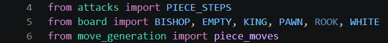
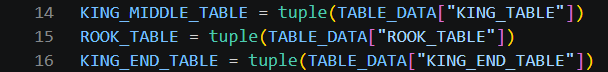
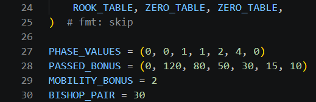
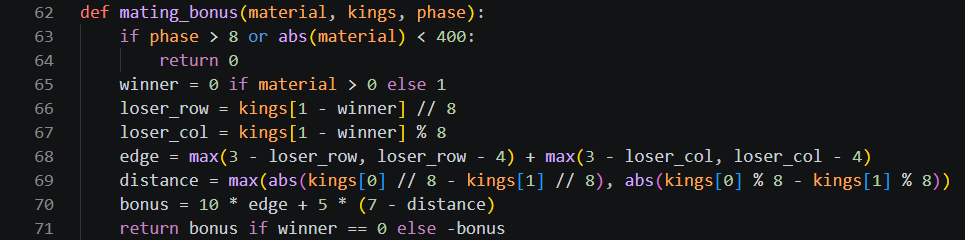
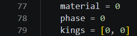
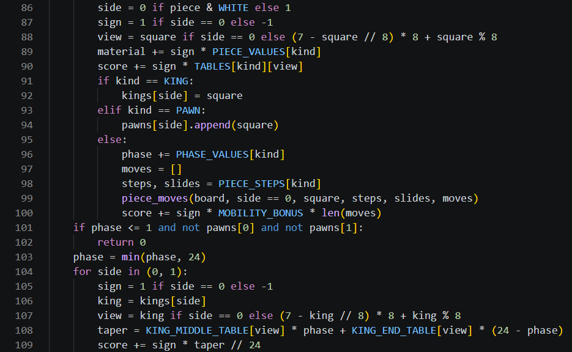
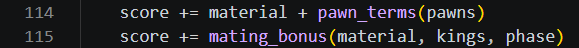

# Day 4, Period 3: The endgame evaluation

1:00 to 2:30. Part of [Day 4: Remus4](Day_4_Syllabus.md).

## Goal

Remus4 plays endgames: the king comes forward, and the side ahead drives the lone king to the edge.

## The big picture

The student pair keeps working in `Day 4 - Remus4 adds everything else/Remus4`. This period edits only `evaluation.py`, and adds no file.

In the middlegame a king hides behind its pawns, but in the endgame, with few pieces left to attack it, the king is a strong piece that belongs in the center. Remus4 keeps two king tables, the middlegame table of Remus2 and a new endgame table, and blends them by the game phase: a number from 24 with every knight, bishop, rook, and queen on the board, down to 0 with none. With half the pieces gone, the king reads each table half and half. The same pass over the board counts each piece's mobility, the squares it can move to, worth 2 centipawns each.

Two endgame rules follow. A side that is ahead by 400 centipawns or more in a late endgame earns a bonus for driving the losing king toward the edge and bringing its own king close, the way every mate against a lone king is won. And a position with no pawns and at most one minor piece, such as king and bishop against king, scores 0, because neither side can mate: this is insufficient material.

## The period step by step

| Time | Activity |
| --- | --- |
| 1:00 to 1:15 | Reminder of insufficient material. In the endgame the king comes to the center, and the side that is ahead drives the lone king to the edge. |
| 1:15 to 2:25 | In `evaluation.py`, load the supplied endgame king table and add the taper that blends the two king tables, mobility, `mating_bonus()`, and insufficient material (about 32 code lines). Press Run Python File in `Day 4 - Remus4 adds everything else/Remus4/verify_remus4.py` until the terminal prints `Remus4 after Period 3 passes every test`. |
| 2:25 to 2:30 | Swap driver and navigator. |

## What changes this period

| File | New or edited | What the student pair does | Lines in your file |
| --- | --- | --- | --- |
| `evaluation.py` | Copied from `Day 3 - Remus3 adds the biggest gains/Remus3`, edited | Add the endgame king table and the taper, mobility, `mating_bonus()`, and insufficient material | 4 to 6, 14 to 16, 24 to 30, 62 to 71, 77 to 79, 86 to 109, 114 to 115 |
| All other files | Unchanged since Period 2 | No edits this period | Unchanged |

Type the code shown in the screenshots. The line numbers refer to your own file at this point in the lesson. Work from the top down and preserve the displayed spacing.

## The edits, file by file

### `evaluation.py`

`evaluation.py` grows from 79 lines to 116. Keep `piece_square_tables.json` beside the module; it already contains both king tables. The edits, from the top down:

1. Update the imports (lines 4 to 6). `PIECE_STEPS` supplies the same movement directions used by move generation, and `piece_moves()` lists the squares counted for mobility.
2. Rename the king assignment to `KING_MIDDLE_TABLE = tuple(TABLE_DATA["KING_TABLE"])` (line 14). The JSON key and values stay the same. Add `KING_END_TABLE = tuple(TABLE_DATA["KING_END_TABLE"])` (line 16); students type no numeric table.
3. Put `ZERO_TABLE` in the king's place in the `TABLES` entry on line 24, because the king receives a blended score after the board loop.
4. Add `PHASE_VALUES` (line 27) and `MOBILITY_BONUS` (line 29), and move `BISHOP_PAIR` beside them (line 30). A knight or bishop contributes 1 to the phase, a rook 2, and a queen 4. The initial phase totals 24.
5. Add `def mating_bonus(material, kings, phase):` (line 62) and its body through line 71. It rewards pushing the losing king toward an edge and bringing the winning king closer.
6. In `evaluate()`, add material, phase, and king-square storage (lines 77 to 79). Lines 86 to 94 use the piece's color to accumulate material and placement scores and remember kings and pawns.
7. Replace the old Black-only `else` body with the phase and mobility calculation (lines 95 to 100). It applies to knights, bishops, rooks, and queens. Both the directions and sliding flag come from `PIECE_STEPS`; bishops, rooks, and queens slide. Count the generated destinations and multiply by `MOBILITY_BONUS`.
8. Add the insufficient-material check and king-table blend (lines 101 to 109). The phase weights the middlegame and endgame values; `//` rounds down to an integer.
9. Change the final additions on lines 114 and 115 to include material, pawn terms, and `mating_bonus()`.

`pawn_terms()` does not change this period; Period 4 gives it the kings and rooks.

## Done when

`verify_remus4.py` in `Day 4 - Remus4 adds everything else/Remus4` reports that Remus4 after Period 3 passes every test. The verifier selects reference results from the modules and functions present. Its fixed-depth test calls the native search directly, without using the opening book. Passing means the listed reference cases match; it does not establish that every line or branch was exercised.
