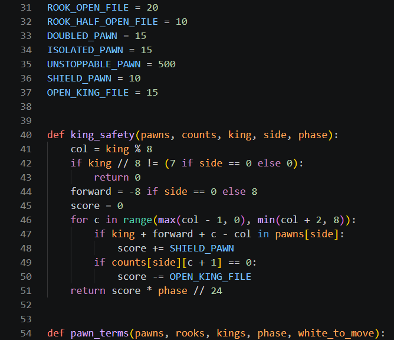
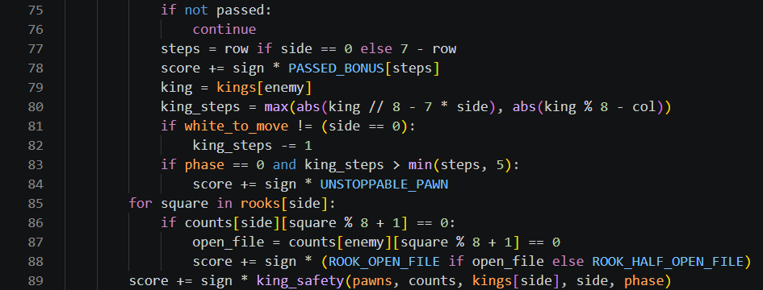
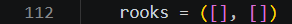
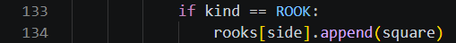
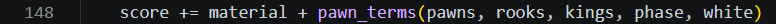
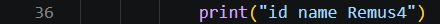

# Day 4, Period 4: The pawn terms, then test Remus4

3:00 to 4:30. Part of [Day 4: Remus4](Day_4_Syllabus.md).

## Goal

The student pair completes Remus4's evaluation and tests its code with `verify_remus4.py`, then observes the student pair's Remus4 playing the student pair's Remus3 and Remus5.

## The big picture

The student pair finishes Remus4 in `Day 4 - Remus4 adds everything else/Remus4` with the last terms of the evaluation, all in `pawn_terms()` and `evaluate()`, gives the engine its name, and tests it. No file is added.

Three terms join `pawn_terms()`, because each one depends on where the pawns stand. The pawn race uses the rule of the square: in a pawn endgame, a passed pawn whose enemy king is too far away to catch it will promote, so it earns a bonus of 500, more than a rook. A rook on a file with no pawns of its own side is on a half-open file, worth 10, and on a file with no pawns at all it is on an open file, worth 20. King safety rewards a king on its home rank for each pawn in front of it and punishes each file next to it with no pawn of its own, scaled by the phase from Period 3 so it fades as the pieces come off.

Lucas Chess runs the student pair's own engines from the day folders. Run the supplied verifier first. Record wins, draws, losses, or unfinished games; a short round illustrates play but does not establish a reliable Elo rating or a controlled speed comparison.

## The period step by step

| Time | Activity |
| --- | --- |
| 3:00 to 3:30 | Reminder of the rule of the square. In `pawn_terms()`, add the pawn race, rooks on open files, and `king_safety()` (about 35 code lines). Change the name line to `id name Remus4`. |
| 3:30 to 4:00 | Press Run Python File in `Day 4 - Remus4 adds everything else/Remus4/verify_remus4.py` until the terminal prints `Remus4 passes every test`. Then play one round of the student pair's Remus4 against the student pair's Remus3, two 10-minute games played at once in two Lucas workers. |
| 4:00 to 4:30 | One round of the student pair's Remus4 against Remus5, two 10-minute games played at once in two Lucas workers. Remus5 is the student pair's Remus4 written in Rust, with the same evaluation and search and a larger table, so compare the reported search depths and game results. This round does not isolate speed from table size or prove a playing-strength difference. |
| If time remains | One round of the student pair against the student pair's Remus4, two 10-minute games: each student plays one game, one with White and one with Black (Part 3 of the guide). |

Play stops at 4:30, the end of the period, even in the middle of a game.

## What changes this period

| File | New or edited | What the student pair does | Lines in your file |
| --- | --- | --- | --- |
| `evaluation.py` | Edited (begun in Period 3) | Add the pawn race, rooks on open files, and `king_safety()` | 31 to 54, 75 to 89, 112, 133 to 134, 148 |
| `uci.py` | Edited (begun in Period 1) | Change the engine's name to Remus4 | 36 |
| All other files | Unchanged since Period 3 | No edits this period | Unchanged |

Type the code shown in the screenshots. The line numbers refer to your own file at this point in the lesson. Work from the top down and preserve the displayed spacing.

## The edits, file by file

### `evaluation.py`

`evaluation.py` grows from 116 lines to 150, the finished Remus4 file. The edits, from the top down:

1. Under `BISHOP_PAIR = 30`, type `ROOK_OPEN_FILE = 20` and `ROOK_HALF_OPEN_FILE = 10` (lines 31 and 32).
2. Under `ISOLATED_PAWN = 15`, type the three lines from `UNSTOPPABLE_PAWN = 500` to `OPEN_KING_FILE = 15` (lines 35 to 37).
3. Above `pawn_terms()`, type `def king_safety(pawns, counts, king, side, phase):` (lines 40 to 51), with two blank lines after it. A king off its home rank gets 0 (lines 42 and 43). The loop on lines 46 to 50 looks at the king's file and the files on each side: a pawn of its own one square in front of the king adds `SHIELD_PAWN`, and a file with no pawn of its own subtracts `OPEN_KING_FILE`.
4. Change the first line of `pawn_terms()` to `def pawn_terms(pawns, rooks, kings, phase, white_to_move):` (line 54).
5. At the end of the loop over a side's pawns, replace the three lines from `if passed:` to `score += sign * PASSED_BONUS[steps]` with the fifteen lines from `if not passed:` to `score += sign * king_safety(pawns, counts, kings[side], side, phase)` (lines 75 to 89). `continue` skips to the next pawn when this one is not passed. `king_steps` (line 80) counts the steps the enemy king needs to reach the pawn's promotion square, one fewer when that king moves next, and a pawn it cannot catch in a pawn endgame (phase 0) is unstoppable. Lines 85 to 88 score each rook's file, and line 89 adds king safety, once per side.
6. In `evaluate()`, type `rooks = ([], [])` (line 112) under `pawns = ([], [])`.
7. In the loop's `else:` branch, under `score += sign * MOBILITY_BONUS * len(moves)`, type `if kind == ROOK:` and `rooks[side].append(square)` (lines 133 and 134).
8. Change the `pawn_terms()` call to `score += material + pawn_terms(pawns, rooks, kings, phase, white)` (line 148).

### `uci.py`

Change the name line to `print("id name Remus4")` (line 36). Remus4 is complete, and every file in `Day 4 - Remus4 adds everything else/Remus4` now contains the completed code shown in the screenshots.

The terminal prints actual results beside `(expected ...)` references. A `PROBLEM:` message or a traceback means the run has not passed; fix the reported problem and rerun. Continue only after the final success line named in the schedule. These checks cover the listed reference cases, not every position or code branch.

## Done when

The terminal reports `Remus4 passes every test` for the student pair's code. The student pair has observed the student pair's Remus4 against the student pair's Remus3 and Remus5 in Lucas Chess and recorded the game results. A round against the student pair follows if time remains.
