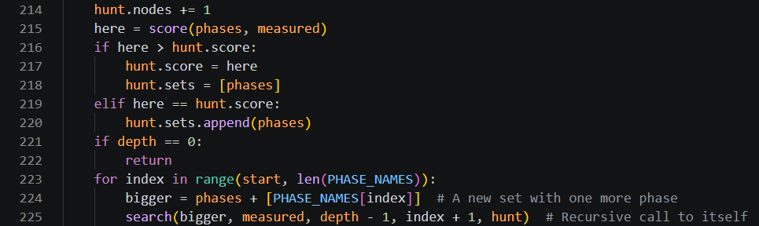
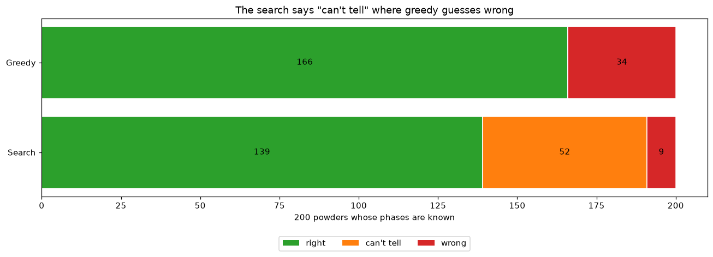
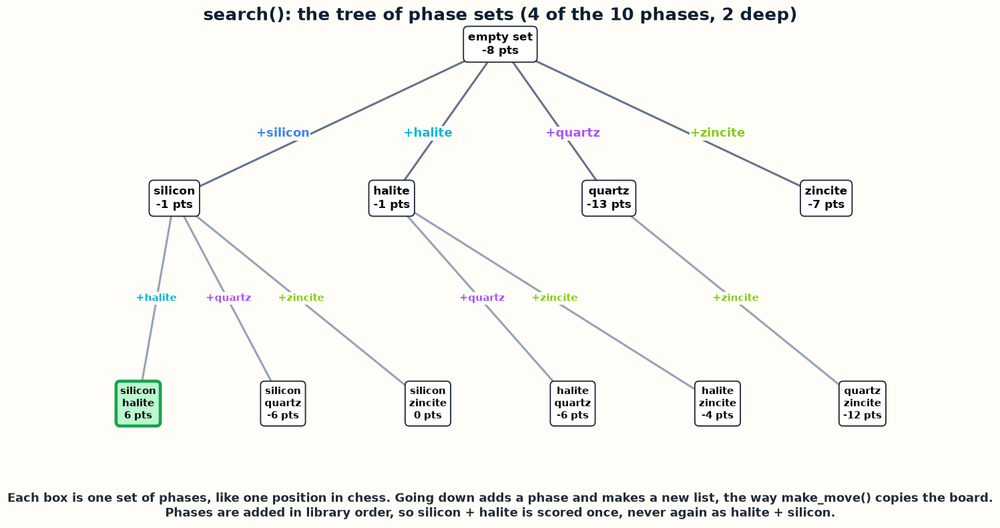
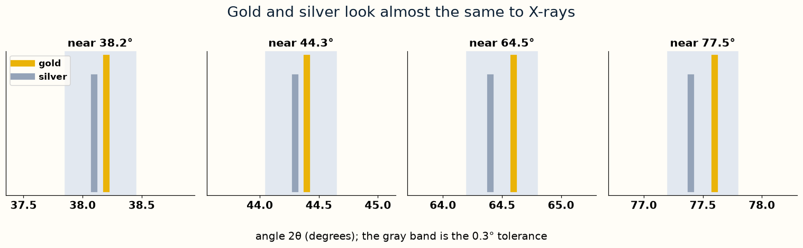

# Day 5, Period 3: Search every set, and verify

1:00 to 2:30. Part of [Day 5: The science project](Day_5_Syllabus.md).

## Goal

The student pair searches every set of up to three phases and compares the printed results with reference counts on 200 generated powders.

## The big picture

No engine file changes today: `Day 1 - Remus1 plays legal chess/Remus1` to `Day 4 - Remus4 adds everything else/Remus4` stay as they were at the end of Day 4. The student pair writes `search()` in `phase_hunt.py`, a science program that reuses the engine's ideas, not its code: `search()` scores every set of up to three phases, the way `alpha_beta()` scores every line of moves. `phase_hunt.py` holds every other line already, so the student pair types only the bodies of these functions, from their docstrings. The student pair edits `Day 5 - Solve a science problem with chess AI/phase_hunt.py`.

## The period step by step

| Time | Activity |
| --- | --- |
| 1:00 to 1:15 | The tree of phase sets beside Remus's game tree: a set is a position and adding a phase is a move. Quartz then rutile is the same set as rutile then quartz, the same idea as the transposition table. |
| 1:15 to 1:50 | Write `search()` (12 code lines), which scores every set of up to three phases and keeps every set that ties for the best score. |
| 1:50 to 2:15 | Press Run Python File in `Day 5 - Solve a science problem with chess AI/phase_hunt.py` with the supplied settings (`PHASE_COST = 1`, `MISSING = 1`). Close the first graph to reach the search results. Manually compare 139 right, 52 "can't tell", and 9 wrong with greedy's 166 right and 34 wrong; expect 176 sets in library order and 821 in every order. Close the second graph to finish. Then change `PHASE_COST` and `MISSING`, save, and rerun; record the new counts rather than expecting the default counts. |
| 2:15 to 2:30 | The programs that search the same tree on real synchrotron data, and the agent that steers measurements at a beamline. |

## The files

| File | Where you work |
| --- | --- |
| `phase_hunt.py` | `phase_hunt.py` in the Day 5 folder |

### `phase_hunt.py`

Type the function bodies shown in these screenshots. In `Day 5 - Solve a science problem with chess AI/phase_hunt.py`, replace the comment and the `raise` line under each docstring with the body. Work from the top of the file down, and the line numbers match when you reach each function.

### The graphs

When `phase_hunt.py` finishes, it has opened two graphs, one window at a time: the graph of powder 12 from Period 2, and this graph of the verdicts. Close each window and the program continues. The student pair types none of the graph code.

These pictures explain the search and the tie between gold and silver.

## Done when

With the supplied settings, the student pair has compared the printed search counts (139 right, 52 "can't tell", 9 wrong), greedy counts (166 right, 0 "can't tell", 34 wrong), and set counts (176 and 821) with the references. Both graph windows have been closed and the program has exited. After changing the settings, the student pair records the new counts, even if the change makes the results worse.
