# Remus

How much chess can fit into 694 lines of Python? Remus4 combines legal move
generation, evaluation, alpha-beta search, and an opening book in that space.
Playing strength depends on the position, time control, and hardware.

Remus is a chess engine written in plain Python, built one lesson at a time for
the "Turning a Chess Engine into Science AI" workshop.

<table>
  <tr>
    <td width="39%" valign="top">
      <a href="docs/lucas_chess/lucas_chess_guide.md"></a>
    </td>
    <td width="61%" valign="top">
      <a href="docs/engines/Remus2/mermaid/modules.svg"></a>
    </td>
  </tr>
  <tr>
    <td valign="top">Remus2 plays Remus1 in <a href="docs/lucas_chess/lucas_chess_guide.md">Lucas Chess</a>.</td>
    <td valign="top">Inside Remus2: which function <a href="docs/engines/Remus2/README.md">calls which</a>.</td>
  </tr>
</table>

Its name reaches back more than four thousand years. Sargon of Akkad (about 2335 to
2279 BC) founded the Akkadian Empire in Mesopotamia, the first known great empire. In
1978 his name went to Sargon, a chess program by Dan and Kathe Spracklen. Written in
Z80 assembly for the Wavemate Jupiter II, Sargon won the first microcomputer chess
tournament, at the West Coast Computer Faire in 1978, with a perfect 5-0. The
Spracklens then published its complete source as a book, *Sargon: A Computer Chess
Program* (Hayden, 1978), so anyone could read a real engine and learn from it. Sargon
II, 2.5, and III followed, and Sargon III ran on the first Macintosh.

Sargon of Akkad's first son and heir was Rimush (about 2279 to 2270 BC), who held the
empire together through widespread revolts. Remus echoes Rimush: a "son of Sargon," an
heir to the small, readable chess programs whose insides lie open for learners,
rebuilt in modern Python.

## The workshop

The workshop runs for one week, five days of four 90-minute periods, for students
who know some coding and know how to play chess, including notation. Twenty students
work in ten student pairs, one Windows 11 laptop per student pair. Each day builds the
engine of its number: Day 1 types in Remus1, Day 2 Remus2, Day 3 Remus3, and Day 4
Remus4. Student pairs test their code with `verify_remus.py`; in the last period of
each day they play and observe the instructor's engines in Lucas Chess.
Day 5 turns the search ideas of the week into a science project.
[`workshop_syllabus.md`](workshop_syllabus.md) holds the plan of the week, and each day has its own folder at the top of the repository.

## The engines

The workshop uses four versions, each in its own folder under `engines_instructor/`. The
student pairs type every line of each one into their own folders, `engines/Remus1` to
`engines/Remus4`, copying the instructor's version file by file. New lines are the
lines a student pair types for that version, and total lines count the whole engine.
Both leave out blank lines, comments, and docstrings:

| Version | What it adds | New lines | Total lines |
| --- | --- | ---: | ---: |
| [Remus1](docs/engines/Remus1/README.md) | Legal chess, a random legal move with no search | 193 | 193 |
| [Remus2](docs/engines/Remus2/README.md) | The evaluation, alpha-beta, quiescence, MVV-LVA ordering, a check extension, and iterative deepening | 161 | 342 |
| [Remus3](docs/engines/Remus3/README.md) | Killer moves, pawn structure, a transposition table, an opening book, aspiration windows, time management, null-move pruning, the principal variation, the bishop pair, and the rook table | 193 | 535 |
| [Remus4](docs/engines/Remus4/README.md) | Every other enhancement: draw sense, the endgame terms, late move reductions, principal variation search, pruning margins, static exchange evaluation, and the last evaluation terms | 159 | 694 |

Each workshop instructor engine folder holds its Python files, `remus.bat`,
which Lucas Chess starts, and for Remus3 and Remus4 `opening_book.txt`, plus a copy of
`verify_remus.py`. Source explanation companions may accompany these files. Each engine's
README and Mermaid call diagrams live in
`docs/engines/Remus1` to `docs/engines/Remus4`.
The four folders in `engines/` start with only `remus.bat` and `verify_remus.py`, which tests a finished version: each student pair
fills `engines/Remus1` on Day 1, then copies its files forward into the next folder at the start of each
day and edits them there.
[`docs/engines/remus_versions.md`](docs/engines/remus_versions.md) lists every
enhancement and the version that holds it.

The compiled [Remus4-Rust](docs/engines/Remus4-Rust/README.md) implements Remus4's
native chess rules, evaluation, and search in Rust, with bitboards and a fixed
512 MiB packed table. Student pairs do not type it. Search speed depends on the position,
hardware, and build; the Rust and Python versions illustrate that implementation
speed and search algorithms are separate considerations.

The full engine family has these runtime capabilities. Remus5 through Remus7
are instructor extensions outside the five-day workshop:

| Engine | Chess search | Transposition table | Pondering and online tablebases |
| --- | --- | --- | --- |
| Remus1 / Remus2 Python | Random legal move / single-threaded alpha-beta | None | Neither |
| Remus3 / Remus4 Python | Single-threaded alpha-beta | Dictionary capped at roughly two million entries; clears when exceeded | Neither |
| [Remus4-Rust](docs/engines/Remus4-Rust/README.md) | Single-threaded alpha-beta | Fixed 512 MiB, no Hash option | Neither |
| [Remus5 Python](docs/engines/Remus5/README.md) | Single-threaded alpha-beta with tactical and positional enhancements | Fixed 512 MiB, no Hash option | Both supported |
| [Remus5-Rust](docs/engines/Remus5-Rust/README.md) | The same native chess algorithms as Python Remus5 | Fixed 512 MiB, no Hash option | Both supported |
| [Remus6-Rust](docs/engines/Remus6-Rust/README.md) | Lazy SMP, 4 workers by default | Shared 512 MiB default; Hash accepts 1024 or 2048 MiB | Both supported |
| [Remus7-Rust](docs/engines/Remus7-Rust/README.md) | YBWC with persistent workers and restricted worker helping, 4 workers by default | Shared 512 MiB default; Hash accepts 1024 or 2048 MiB | Both supported |

Remus6 and Remus7 are Rust-only and are the only versions with parallel chess
search. Each parallel engine's workers share one table. Saved GUI options override
the advertised defaults; an existing Threads=8 selection remains eight workers.

Ponder defaults to false in engines that support it. Enable it explicitly in both
Lucas Chess's external-engine and tournament entries. Pondering starts only when
the GUI sends `go ponder`; a correct prediction can receive credit through either
`ponderhit` or Lucas's matching stop-and-go handoff. Pondering does not require
parallel chess search: Python Remus5 has one search thread and an input-reader thread.

`LichessTablebase` defaults to true in Remus5 and the Rust engines 5 through 7.
Advice is root-only, bounded by the move budget, validated with native legal moves,
and limited to eligible positions with at most seven pieces. Native search remains
available offline. Python engines use only the standard library; Rust engines with
tablebases package their HTTPS and JSON dependencies in their executables.

Remus3 through Remus7 use their supplied `opening_book.txt`. Python reads it at
runtime; Rust embeds it at build time, so Rust book edits require rebuilding.
Disable Lucas's external books, including explicit `<None>` in tournament entries.

Remus4-Rust through Remus7-Rust write search and cache measurements to
`logs/search_<pid>_<session>.txt` beside the executable when SearchDiagnostics is
enabled (default false). Python Remus5's
PonderDiagnostics option (default false) writes separate process/session logs in
`engines_instructor/Remus5/ponder_logs/`, recording commands, predictions, linked
hits, nodes, depth, and clock/CPU timing. Enable it in the GUI for tournament
analysis. Remus5-Rust through Remus7-Rust report ponder diagnostics through UCI
stdout and write `logs/ponder_<pid>_<session>.txt` beside the executable when
PonderDiagnostics is enabled (default false). With diagnostics disabled, no new
diagnostic files are expected; ordinary UCI output still operates. Log records are
measurements, not automatic pass/fail checks.
See each engine README for options and measurement limits.

Everything else sits in the plan of the week, the day folders, `science/`, `science_instructor/`, and `docs/`:

| Place | What it holds |
| --- | --- |
| [`workshop_syllabus.md`](workshop_syllabus.md) | The plan of the five days on one page |
| `Day 1 - ...` to `Day 5 - ...` | One folder per day, such as [`Day 1 - Remus1 plays legal chess`](Day%201%20-%20Remus1%20plays%20legal%20chess/Day_1_Syllabus.md), with a page for the day and a folder for each period |
| [`science/`](science/) | The two Day 5 science programs, with the functions the student pairs write left empty |
| [`science_instructor/`](science_instructor/) | The same two programs, finished |
| [`docs/engines/`](docs/engines/) | One folder per engine with its README and call tree, and [`remus_versions.md`](docs/engines/remus_versions.md), the plan of the versions |
| [`docs/lucas_chess/`](docs/lucas_chess/) | The [Lucas Chess guide](docs/lucas_chess/lucas_chess_guide.md) and its pictures |
| [`docs/chess_tutor/`](docs/chess_tutor/) | [`learn_chess.md`](docs/chess_tutor/learn_chess.md), the rarer rules and how moves are written, [`uci.md`](docs/chess_tutor/uci.md), the conversation between Lucas Chess and Remus, videos on minimax, negamax, and alpha-beta, and [`fide_titles_and_elo_ratings.md`](docs/chess_tutor/fide_titles_and_elo_ratings.md), the FIDE titles and the ratings that go with them |
| [`docs/briefs/`](docs/briefs/) | The [management brief](docs/briefs/Turning_a_Chess_Engine_into_Science_AI_Management_Brief.pdf) and the [student and parent brief](docs/briefs/Turning_a_Chess_Engine_into_Science_AI_Student_and_Parent_Brief.pdf), one page each, as PDFs |

## Setup

Remus runs on Windows 11 with [Git](https://git-scm.com/),
[uv](https://docs.astral.sh/uv/), [VS Code](https://code.visualstudio.com/), and Lucas
Chess. On Day 1, period 1, the teacher walks each student pair through steps 1 to 6
below. A class laptop that already holds VS Code or Lucas Chess skips that install.
After setup, students and teachers use VS Code's Run Python File button for Python
programs, Lucas Chess for games, and File Explorer for copies. They type no further
git or uv commands during the workshop. The same steps set up any other computer,
such as the teacher's laptop or a computer at home.

1. Open **PowerShell** from the Start menu and install Git and VS Code with winget:

   ```powershell
   winget install --id Git.Git -e
   winget install --id Microsoft.VisualStudioCode -e
   ```

2. Install uv, which manages Python and the project's packages:

   ```powershell
   winget install --id astral-sh.uv -e
   ```

   Expect installation progress and a completion message for each package, or a
   message that it is already installed. Resolve any reported installation error
   before continuing. These steps install tools; they do not test Remus.
   Close PowerShell and open a new window, so that it finds `git`, `uv`, and `code`.

3. Clone the repository and change into its folder:

   ```powershell
   git clone https://github.com/dbiersach/remus.git Remus
   cd Remus
   ```

   Cloning a public repository needs no GitHub account, so the students never create
   one. Expect download progress and a new `Remus` folder. `cd Remus` changes the
   current folder and normally prints nothing; cloning does not run the engine.
   When setting up a USB copy at home, use that existing Remus folder instead of
   cloning over it, so the student pair's typed files remain available.

4. Install Python 3.14, `matplotlib` for the Day 5 graphs, and the development tools
   (`python-chess` and `ruff`) into the project:

   ```powershell
   uv sync
   ```

   uv reads `.python-version` and downloads Python 3.14 by itself, so no separate
   Python install is needed. Expect environment and package messages, followed by
   the PowerShell prompt without an error. The project has a `.venv` folder after
   setup. This prepares dependencies; it does not test engine or science functions.

5. Install the VS Code extensions the class uses, then open the Remus workspace:

   ```powershell
   .\install_vscode_extensions.ps1
   code Remus.code-workspace
   ```

   The Python extension (`ms-python.python`) is the one that matters most: it adds
   the Run Python File button. The workspace file sets the font sizes, formats code
   with ruff on save, and points VS Code at the project's `.venv`. If PowerShell
   refuses to run the script, run
   `Set-ExecutionPolicy -Scope CurrentUser RemoteSigned` once and try again.
   Expect extension installation messages; an uninstall message for an extension
   that is absent is harmless. Check any installation failures. The second command
   opens the workspace in VS Code. Open a Python file and confirm that Run Python
   File is available; this checks editor setup, not the program's behavior.

6. Install Lucas Chess, the chess board that plays against Remus. Download the
   Windows installer from
   [lucaschess.pythonanywhere.com/downloads](https://lucaschess.pythonanywhere.com/downloads)
   and run it. Expect the installation wizard to finish; launch Lucas Chess once
   to reach its main window and create its configuration, then close it before
   registration. Lucas Chess comes with Stockfish, so no other engine is needed.

   Every laptop then adds the engines: close Lucas Chess, open
   [`docs/lucas_chess/install_lucas_engines.py`](docs/lucas_chess/install_lucas_engines.py)
   in VS Code, and press the Run button. The program adds the instructor's Remus1 to
   Remus4 and Remus4-Rust to the External engines list, keeps every engine already
   there, and adds no duplicates, so nobody adds an engine by hand. Expect a line
   for each engine, followed by `Saved ... engines in ...` or
   `Nothing changed: every engine is already registered`. A missing installation
   or file message means registration did not finish. Reopen Lucas Chess and check
   **Engines > External engines** for all five names. Registration stores paths
   and settings; it does not launch or test the engines. The
   [Lucas Chess guide](docs/lucas_chess/lucas_chess_guide.md) shows, with screenshots, how
   to play those engines and watch them play.

### Stockfish

Stockfish speaks UCI, like Remus. In class it provides a comparison opponent at a
reduced strength setting, such as 1500 Elo. Record the games' results; a short round
against that setting does not measure Remus's Elo rating. Lucas Chess installs its own copy of Stockfish, so the class laptops
need nothing more.

To get the newest Stockfish at home, download it free from
[stockfishchess.org](https://stockfishchess.org/). On Windows, pick the file
`stockfish-windows-x86-64-universal.exe`. This "universal" build checks which
processor the computer has when it starts and uses that processor's fastest
instructions, such as AVX2, so there is no need to choose among the other builds.
Stockfish has no board of its own: add the `.exe` to Lucas Chess as an external
engine, the way the "Lucas Chess at home" part of the guide adds a `remus.bat`.

### Running the files

For workshop Python files, open the file in VS Code and click Run Python File
(the triangle at the top right). What happens depends on the file:

| File | What to expect | What it checks |
| --- | --- | --- |
| Engine module such as `make_move.py` | It loads and exits without output. A syntax or import error shows a traceback. | Loading imports and definitions; the functions are not exercised. |
| `uci.py` | It waits silently for UCI commands; no board opens. Close that run's terminal before continuing. | Startup only, until commands arrive. Use the verifier for the scheduled behavior checks. |
| `engines/RemusN/verify_remus.py` | It prints `Verifying`, actual and expected results, then `RemusN passes every test` and elapsed time. Day 4 intermediate checks name the period. A mismatch prints `PROBLEM:`; an execution error may show a traceback. | Required files, legal move sequence counts from six reference positions, and a short UCI exchange; Remus2 to Remus4 also compare five evaluation scores and depth-4 search results with stored instructor results. |
| Day 5 programs in `science/` | They print measured results and open graphs; close each graph to continue. | The student functions are called, but printed expectation text is not an automatic pass/fail check. Compare results manually with the Day 5 syllabus for the current period and settings. |

Passing the verifier covers its reference cases, not every position or code branch.
Its UCI check looks for the engine name, `uciok`, `readyok`, and a `bestmove` line;
it does not validate that move's legality or every book choice. Fix a reported
problem and rerun. Lucas Chess uses the registered instructor engines, so games
there do not test the student pair's files.

An unfinished science function raises `NotImplementedError`. At the end of Day 5,
Period 2, `Write search()` is expected after the greedy results and first graph;
an earlier or different error is not the planned stopping point. The
[Day 5 syllabus](Day%205%20-%20Solve%20a%20science%20problem%20with%20chess%20AI/Day_5_Syllabus.md)
gives the reference numbers and explains how parameter changes affect them.

The Python engines use only the standard library. Rust tablebase engines bundle
their HTTPS and JSON dependencies; running their executables needs no Rust installation. The development group adds
`python-chess`, which the workshop designer's engine checks use as an outside
reference, and `ruff`. Lucas Chess talks to Remus over UCI.

## License

BSD 3-Clause. See [`LICENSE`](LICENSE).
