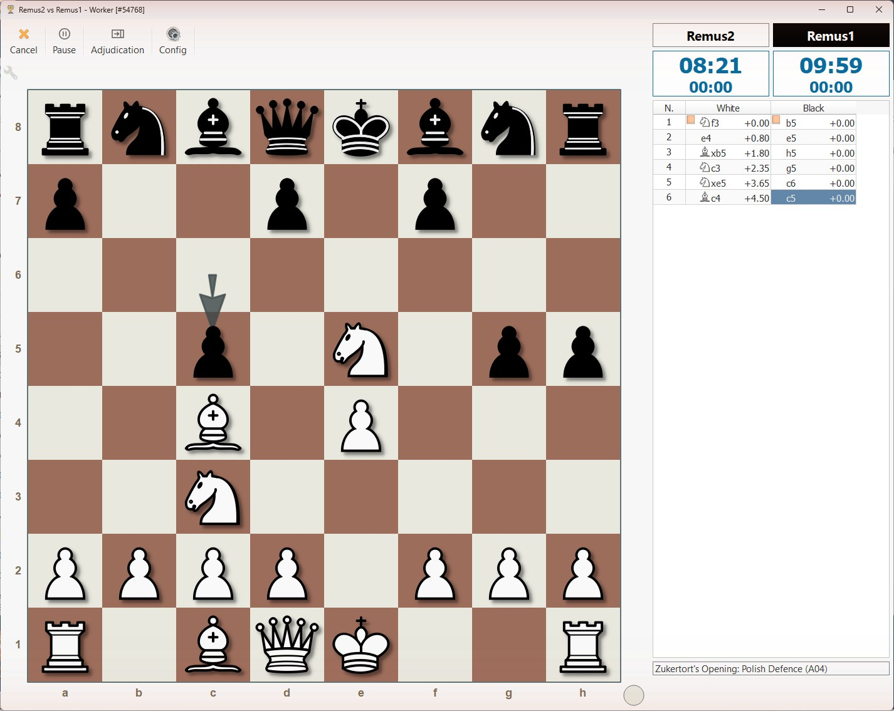

# Remus

How much chess can fit into 630 lines of Python? Remus4 combines legal move
generation, evaluation, alpha-beta search, and an opening book in that space.
Playing strength depends on the position, time control, and hardware.

Remus is a chess engine written in plain Python, built one lesson at a time for
the "Turning a Chess Engine into Science AI" workshop.

<table>
  <tr>
    <td width="39%" valign="top">
      <a href="docs/lucas_chess_guide.md"></a>
    </td>
    <td width="61%" valign="top">
      <a href="mermaid/Remus2/modules.svg"></a>
    </td>
  </tr>
  <tr>
    <td valign="top">Remus2 plays Remus1 in <a href="docs/lucas_chess_guide.md">Lucas Chess</a>.</td>
    <td valign="top">Inside Remus2: which function <a href="Day%202%20-%20Remus2%20searches%20ahead/Remus2/Remus2.md">calls which</a>.</td>
  </tr>
</table>

Its name reaches back more than four thousand years. Sargon of Akkad (about 2335 to
2279 BC) founded the Akkadian Empire in Mesopotamia, the first known great empire. In
1978 his name went to Sargon, a chess program by Dan and Kathe Spracklen. Written in
Z80 assembly for the Wavemate Jupiter II, Sargon won the first microcomputer chess
tournament, at the West Coast Computer Faire in 1978, with a perfect 5-0. The
Spracklens then published its complete source as a book, *Sargon: A Computer Chess
Program* (Hayden, 1978), so anyone could read a real engine and learn from it. Sargon
II, 2.5, and III followed, and Sargon III ran on the first Macintosh.

Sargon of Akkad's first son and heir was Rimush (about 2279 to 2270 BC), who held the
empire together through widespread revolts. Remus echoes Rimush: a "son of Sargon," an
heir to the small, readable chess programs whose insides lie open for learners,
rebuilt in modern Python.

## The workshop

Students work in ten student pairs over five days. Each day has four
90-minute periods. Students type Python from the period screenshots, check their
own code with the supplied verifier, and play their own engine in Lucas Chess.
On Day 5 they apply the same search ideas to science problems.

## Workspace layout

| Place | Contents |
| --- | --- |
| `Day 1 - ...` through `Day 4 - ...` | Day and period syllabuses, with one `RemusN` subfolder for that day's Python engine |
| Each `Day N - .../RemusN` | `RemusN.md`, `remusN.bat`, `verify_remusN.py`, supplied data, and the engine modules the student pair types |
| `Day 5 - Solve a science problem with chess AI` | Day and period syllabuses and the two science starter programs |
| `rust_engines/Remus5` through `Remus8` | Supplied Rust engines, executable files, source, and engine documentation; students do not type Rust |
| `docs` | Shared guides, briefs, and the Lucas Chess engine installer |
| `images` | Code screenshots, science figures, chess illustrations, and guide screenshots, grouped into named subfolders |
| `mermaid` | Diagram sources, rendered SVGs, and manifests, grouped by engine or topic |

The [workshop syllabus](workshop_syllabus.md) leads through each day.
The [version guide](docs/remus_versions.md) explains the engine progression.
Runtime Python totals are 189, 300, 484, and 630 lines of code for Remus1 to Remus4.
These counts omit blank lines, comments, docstrings, and the supplied verifier.
Remus2 to Remus4 receive `piece_square_tables.json`; Remus3 and Remus4 also
receive `opening_book.txt`. Student pairs do not type those data files.

## Setup

Use a fresh student clone on Windows 11. Setup removes the supplied Python engine
modules so students can type them. Do not run initial setup over existing student work.

1. Install Git, VS Code, and uv in PowerShell if they are not already installed:

   ```powershell
   winget install --id Git.Git -e
   winget install --id Microsoft.VisualStudioCode -e
   winget install --id astral-sh.uv -e
   ```

   Expect installation progress and completion messages. Resolve errors, then close
   and reopen PowerShell so it finds the installed commands. This installs tools;
   it does not test Remus.

2. Clone the public repository and enter its folder. No GitHub account is required:

   ```powershell
   git clone https://github.com/dbiersach/remus.git Remus
   cd Remus
   ```

   Expect download progress and a new Remus folder. Changing directory normally
   prints nothing. Cloning does not run an engine.

3. Prepare the student workspace:

   ```powershell
   .\setup_workshop.ps1 -StudentCopy
   ```

   The script installs the VS Code extensions and runs `uv sync` to prepare Python
   3.14 and dependencies in `.venv`. It removes development material, Git history,
   and the temporary Python engine modules. It keeps each engine guide, verifier,
   launcher, and supplied data, and keeps the Day 5 starter programs and Rust engines.
   Expect installation messages and `Workshop setup complete`. On success the script
   deletes itself. On failure it remains available for retry; read the error before
   continuing. Add `-WhatIf` to preview cleanup without installing or deleting anything.
   If script execution is blocked, use
   `Set-ExecutionPolicy -Scope CurrentUser RemoteSigned` and retry.

4. Open the workspace:

   ```powershell
   code Remus.code-workspace
   ```

   VS Code opens with the project interpreter and formatting settings. Open a Python
   file and confirm the Run Python File button is available. This checks editor setup.

5. Install Lucas Chess from its [official download page](https://lucaschess.pythonanywhere.com/downloads)
   if it is not already installed. Open it once to create its configuration, then close it.
   In VS Code, open `docs/install_lucas_engines.py` and press Run Python File.
   Expect messages naming Remus1 through Remus8 and a saved-list or already-registered
   message. Reopen Lucas Chess and confirm those entries under External engines.
   Registration records launch paths; Python engines cannot play until their modules
   have been typed and their verifier passes.

After setup, use VS Code's Run Python File button, Lucas Chess, and File Explorer.
No further Git or uv commands need to be typed during the workshop. The supplied
batch launchers use uv automatically. Follow the [Lucas Chess guide](docs/lucas_chess_guide.md)
for games and tournament settings, with GUI opening books set to None.

## Working through the days

Start Remus1 by typing the screenshots into its Day 1 engine folder. At the start
of Days 2, 3, and 4, copy only the previous engine's runtime `.py` modules to the
next day's engine folder, excluding its verifier. Keep the destination's supplied
launcher, version verifier, guide, and data. Edit the copied modules as the period
screenshots show. Leave the earlier version available for comparison games.

| What you run | Expected result | What it checks |
| --- | --- | --- |
| A helper module such as `make_move.py` | Exits without output, or shows a traceback | Syntax, imports, and any top-level initialization; it does not call the chess functions to test them |
| `uci.py` | Waits silently for UCI commands; no board window | Startup only; close that terminal when finished |
| The day's `verify_remusN.py` | Prints actual and expected results, then `RemusN passes every test` and elapsed time; Day 4 intermediate checks name the period | Reference move counts, UCI legal replies, and version-appropriate evaluation and search checks; not every position, Elo, or Lucas configuration |
| Lucas Chess with a completed Python engine | Board moves and clocks advance | The student pair's engine and launcher operate through the GUI for that game |
| A Day 5 science program | Prints measurements and displays graphs; close each graph to continue | Exercises the completed functions; compare results with the period instructions, since printed expectations are not automatic pass/fail assertions |

`PROBLEM:` or a traceback means a verifier has not passed. Fix the named problem
and rerun it before playing that version. Short games illustrate behavior; they do
not establish a dependable Elo rating or prove correctness for all positions.

For a USB copy on another computer, preserve the typed modules. Install the tools,
run `uv sync` in that copy, install the editor extensions, and register its engines.
Do not apply initial student cleanup to completed work.

## License

See [LICENSE](LICENSE).
