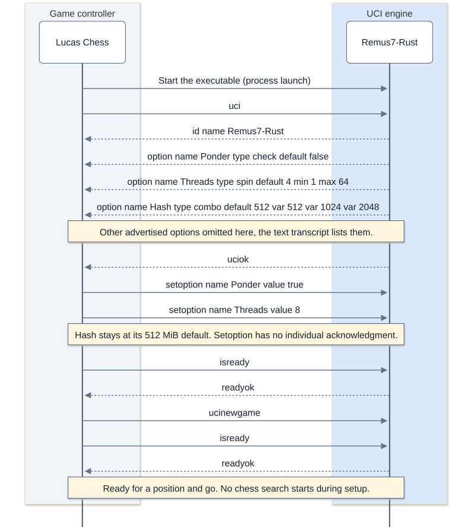
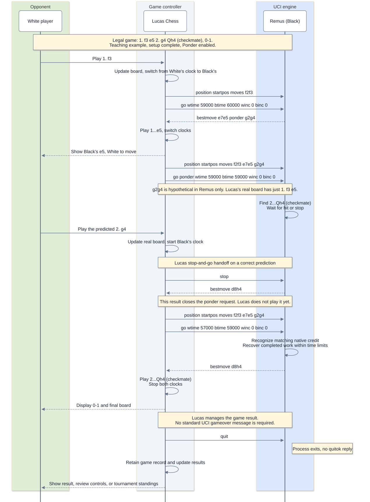
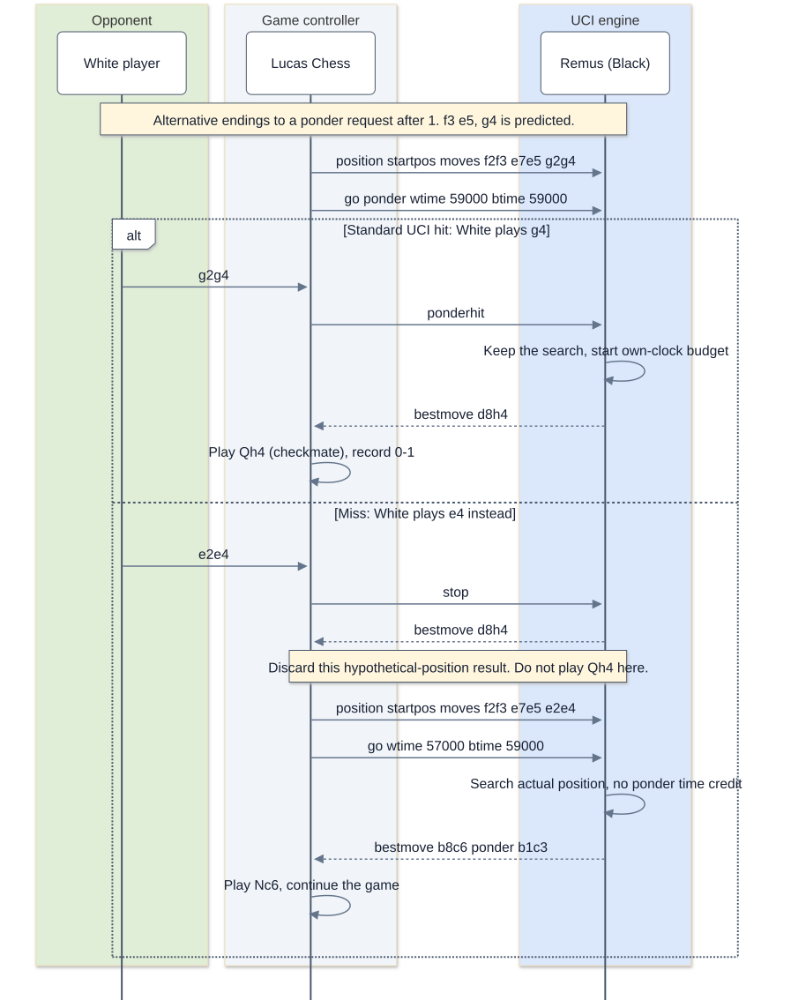

# UCI: How Lucas Chess and Remus talk

## The big picture

Lucas Chess draws the board and runs the clocks. Remus does the thinking. The two
programs talk by sending lines of text, in a language called UCI, the Universal Chess
Interface. `uci.py` reads Lucas Chess's commands and sends back Remus's answers.
Each Python Remus engine has its own `uci.py`, and `remus.bat` starts it.
Rust engines read the same protocol in `main.rs` and run as executables.

## Words to know

- **UCI:** the text language between chess GUIs and chess engines. Stockfish speaks
  it too.
- **GUI:** graphical user interface, the window with the board you click on.
- **Standard input and output:** the lines a program reads in and prints out.
  Lucas Chess writes to Remus's standard input and reads Remus's standard output.

## UCI moves

A UCI move is only the square a piece leaves and the square it lands on, with no
piece letter: `e2e4`, `g1f3`, and `e1g1` for White castling on the king's side. A
promotion adds the new piece in a small letter: `e7e8q`. People write moves in SAN
(`e4`, `Nf3`, `O-O`, `e8=Q`), but a program reads UCI more easily, so Remus reads and
writes only UCI.

## A short conversation

```text
Lucas Chess -> uci                          Remus -> id name Remus2
                                            Remus -> uciok
Lucas Chess -> isready                      Remus -> readyok
Lucas Chess -> position startpos moves e2e4
Lucas Chess -> go wtime 60000 btime 60000   Remus -> info depth 1 score cp 10 nodes 43
                                            Remus -> ...
                                            Remus -> bestmove e7e5
Lucas Chess -> quit
```

## How it works

1. `main()` reads one line at a time and looks at its first word.
2. `uci` asks the engine's name. Remus answers `id name` and `uciok`.
3. `isready` asks whether Remus is ready. Remus answers `readyok`.
4. `position startpos moves e2e4 e7e5 ...` names the game so far. Remus starts from
   `START_POSITION` and plays every move after the word `moves`. Lucas Chess sends
   every game from the starting position, so the workshop Python engines need no FEN input.
5. `go` starts the search. `read_time()` reads the clock (`wtime` or `btime`) and the
   increment (`winc` or `binc`) of the side to move. Remus plans to spend a thirtieth
   of its clock plus half its increment, or exactly `movetime` when Lucas sends one.
6. `think()` in `search.py` searches one move deeper at a time and prints an `info`
   line after each depth: the depth, the score in centipawns, and the positions
   visited. When the time is up, Remus sends `bestmove` and the move.
7. With no legal move (checkmate or stalemate), Remus sends `bestmove 0000`.
8. `quit` ends the program.

Remus prints only UCI lines, and the last line of each answer passes `flush=True` to
`print()`, so the answer reaches Lucas Chess right away instead of waiting in a
buffer.

## What Remus3 and Remus4 add

- **The opening book.** Remus3 and Remus4 call `load_book()` once at the start. On
  `go`, `legal_book_move()` looks for the game's moves at the start of a line of
  `opening_book.txt`, checks the next book move with the move generator, and plays it
  at once without searching.
- **A hard time limit.** Remus3 and Remus4 pass `think()` a planned time and a
  longest time: three times the plan, but never more than a fifth of the clock. The
  search takes longer than planned when its best move keeps changing.
- **The game history.** Remus4 keeps the position key of every position of the game
  in `game_history`, so its search can see a threefold repetition coming.

## A whole conversation to read

This section is extra reading, not a task of any period. This illustrative Remus2 conversation shows a first move with two seconds
to think. Completed depths and timing depend on the computer:

```text
Lucas Chess -> uci                          Remus -> id name Remus2
                                            Remus -> uciok
Lucas Chess -> isready                      Remus -> readyok
Lucas Chess -> position startpos
Lucas Chess -> go movetime 2000             Remus -> info depth 1 score cp 50 nodes 41
                                            Remus -> info depth 2 score cp 0 nodes 266
                                            Remus -> info depth 3 score cp 50 nodes 2505
                                            Remus -> info depth 4 score cp 0 nodes 17360
                                            Remus -> info depth 5 score cp 40 nodes 153457
                                            Remus -> bestmove g1f3
Lucas Chess -> quit
```

Each `info` line reports one finished depth. At depth 1 Remus2 tries each of White's
20 first moves, and the best of them scores 50 centipawns, half a pawn. At depth 2 it
also tries every Black reply, and the score falls to 0. The score swings up at the
odd depths, where White makes the last move, and down at the even ones, where Black
answers. The `nodes` count is cumulative across the search, including earlier iterations.
At the end of depth 5 this example reports 153,457 visited nodes. Remus2 starts a new depth only while less than half of its
time is gone. After depth 5 more than a second has passed, so Remus2 sends its best
move from depth 5: `g1f3`, the knight to f3.

## Puzzle questions

1. Why must every line Remus prints be a UCI line, with nothing else mixed in?
2. What does Remus send when it has no legal move?
3. How does Lucas Chess write the move of a knight from g1 to f3?

## Remus5: optional online endgame advice

The experimental Remus5 and Remus5-Rust engines advertise this UCI option:

```text
option name LichessTablebase type check default true
```

A GUI can disable network lookups with `setoption name LichessTablebase value false`
and enable them with `setoption name LichessTablebase value true`. A successful
lookup prints `info string Lichess tablebase`, followed by the legal `bestmove`.
Failures use the native search and its ordinary `info depth` output.

Only the HTTP boundary serializes the current position as FEN for Lichess. The
Python UCI adapter continues to accept `position startpos moves ...`; it does not
add `position fen` input. Rust retains its designer `position fen`, `go depth`,
`go perft`, and `eval` commands. Fixed-depth and perft checks do not query Lichess.
See [Remus5](../engines/Remus5/README.md) for timing, caching, and draw limitations.

## Search-table memory and search threads

Remus4-Rust and Remus5 Python and Rust use fixed 512 MiB tables and advertise no Hash option.
Remus6-Rust and Remus7-Rust expose Hash with default 512 MiB and
1024/2048 MiB alternatives. Remus6-Rust and Remus7-Rust expose Threads with default
4; all their search threads share the engine process's one table.

## Pondering

Remus5, Remus5-Rust, Remus6-Rust, and Remus7-Rust advertise Ponder with default
false. Enable it in Lucas Chess's external-engine and tournament entries. This
causes the GUI to request `go ponder` while the opponent thinks. A predicted reply
alone does not start a search. Standard `ponderhit` continues the current search;
a matching Lucas stop-and-go handoff can retain credit for completed work. The
hard deadline starts on the engine's clock, with a bounded post-hit time reserve.
Pondering is independent of parallel search: Remus5 uses one chess search thread
and a lightweight input reader.

## Reading the longer conversations

Read each block from top to bottom. `Lucas -> Remus:` labels input to the engine;
`Remus -> Lucas:` labels output. These labels and bracketed notes explain the
conversation and are not transmitted. The examples are teaching transcripts, not
recordings of a tournament. Moves, scores, depths, and node counts illustrate the
protocol; actual search results vary.

The engine sends complete lines and flushes its output so Lucas can read each
reply promptly. Each command travels through a pipe between the two processes,
not through a network connection. Optional Lichess requests use a separate HTTP
connection and do not change the UCI conversation.

## UCI conversations as sequence diagrams

Read these diagrams from top to bottom. Solid arrows carry GUI commands or a
player's action; dashed arrows carry replies. An arrow returning to its own
participant describes internal work, not a UCI message. Every diagram has an
editable Mermaid source beside its rendered SVG.

### Diagram color legend

Participant colors fill the vertical lanes; the white boxes name each participant.
The Remus lane uses the same blue as `uci.py` and `main.rs` in the engine diagrams.
Cream boxes contain explanatory notes, not commands or replies.

| Participant or element | Color | Meaning | Fill |
| --- | --- | --- | --- |
| Lucas Chess |  Gray | The GUI sends commands, maintains the real board and clocks, and records the game result. | `#f1f5f9` |
| Remus |  Blue | The engine's UCI boundary receives commands and returns search information and moves. | `#dbe8fb` |
| Opponent |  Muted green | The opposing player supplies actual moves; a predicted reply is hypothetical until played. | `#e0edd7` |
| Explanatory note |  Cream | Context about timing, pondering, board state, or shutdown; no message is transmitted. | `#fff6dd` |

### Startup: discover, configure, and synchronize



[Open full-size startup diagram](mermaid/uci_startup.svg) |
[Mermaid source](mermaid/uci_startup.mmd)

### A complete game, from the first move to shutdown

The complete legal game is **1. f3 e5 2. g4 Qh4#**, with Remus playing Black.
Fool's Mate keeps every position command visible. This is a teaching example,
not a claim that Remus chooses these moves or predicts g4 in an actual game.
The clocks are illustrative, and optional diagnostic output is omitted.

The startup diagram precedes this one. The game uses Lucas's stop-and-go hit
sequence, which produces two results for two separate searches. Only the final
result supplies Black's actual second move. If native credit is available,
Remus labels the restarted search `hit_kind=stop_go`; book waiting earns no credit.



[Open full-size complete-game diagram](mermaid/uci_complete_game.svg) |
[Mermaid source](mermaid/uci_complete_game.mmd)

Lucas applies the final move and determines that White is checkmated. Remus does
not send `0-1` as a UCI command. No predicted reply follows `bestmove d8h4` because
White has no legal reply. `bestmove 0000` would be appropriate only if an engine
were asked to move from a position with no legal moves; it is not the winner's
way to announce checkmate.

The shutdown shown here occurs when Lucas closes that engine session. A GUI may
instead keep the process for another game and send `ucinewgame`, `isready`, and
a new `position`. Checkmate alone does not instruct Remus to exit. Lucas owns the
result display, saved game, clocks, and tournament bookkeeping in either case.

### Standard ponderhit versus a wrong prediction

These are alternatives to the stop-and-go handoff above. On a standard hit the
existing search continues. On a miss Lucas discards the stopped result and sends
the actual position. In the miss branch the game continues past the diagram.



[Open full-size ponder alternatives](mermaid/uci_ponder_branches.svg) |
[Mermaid source](mermaid/uci_ponder_branches.mmd)

## Discovering options, defaults, and allowed values

Lucas asks an engine what it supports by sending `uci`. The engine replies with
its name and one `option` line per setting, then finishes with `uciok`. Lucas uses
these descriptions to build its engine-options dialog. Here is Remus7-Rust's
advertised configuration:

```text
Lucas -> Remus: uci
Remus -> Lucas: id name Remus7-Rust
Remus -> Lucas: option name Hash type combo default 512 var 512 var 1024 var 2048
Remus -> Lucas: option name LichessTablebase type check default true
Remus -> Lucas: option name Ponder type check default false
Remus -> Lucas: option name PonderHitMinPercent type spin default 25 min 0 max 100
Remus -> Lucas: option name SearchDiagnostics type check default true
Remus -> Lucas: option name Threads type spin default 4 min 1 max 64
Remus -> Lucas: option name PonderDiagnostics type check default true
Remus -> Lucas: uciok
Lucas -> Remus: setoption name Threads value 8
Lucas -> Remus: setoption name Hash value 1024
Lucas -> Remus: setoption name Ponder value true
Lucas -> Remus: isready
Remus -> Lucas: readyok
Lucas -> Remus: ucinewgame
Lucas -> Remus: isready
Remus -> Lucas: readyok
```

Here Lucas requests eight search threads, a 1 GiB table, and pondering. Remus's
compiled defaults remain four threads, 512 MiB, and pondering off. A fresh process
starts with those defaults; Lucas reapplies the saved settings for that entry.
`ucinewgame` announces a different game; it does not restore default options.

| Field | Meaning | Example |
| --- | --- | --- |
| `name` | The setting's name, repeated in `setoption` | `Threads` |
| `type check` | A checkbox with `true` or `false` values | `Ponder` |
| `type spin` | An integer with inclusive bounds | `Threads`, from 1 through 64 |
| `type combo` | A choice among the listed `var` values | `Hash`, 512, 1024, or 2048 MiB |
| `default` | The engine's advertised startup value | `default 4` |
| `min`, `max` | Limits for a spin setting | `min 0 max 100` |
| `var` | One permitted combo choice; repeat for each choice | `var 1024` |

UCI also defines `string` settings for text and `button` settings for actions.
A button uses `setoption name <name>` without `value`. Remus7 does not advertise
these types. Use only the options an engine actually lists; for example, Python
Remus5 has no `Threads` or `Hash` setting, and Remus6-Rust has no
`PonderHitMinPercent` setting. See the individual
[engine READMEs](../engines/remus_versions.md#engine-defaults-and-source-sizes)
for their defaults and supported values.

### Advertising defaults is not reporting active values

An `option` line describes a setting; it does not announce each later change.
After `setoption name Threads value 8`, Remus still advertises `default 4` if
asked for its UCI description. That is the default, not a claim that the current
search uses four threads.

UCI defines no general `getoption` command or automatic acknowledgment for every
`setoption`. `isready` and `readyok` synchronize the conversation, but `readyok`
does not list accepted values. Check the outgoing `setoption` commands and the
engine's runtime diagnostics to verify the settings actually used. An unsupported
option can be ignored, so `readyok` alone does not prove it took effect.

### Why Ponder needs explicit enabling in Lucas

Pondering involves both programs. Remus supplies a predicted reply and accepts
ponder searches; Lucas decides when to launch and end those searches while it
runs the clocks.

| Step | Sender and message | What the message establishes |
| --- | --- | --- |
| Advertise | Remus: `option name Ponder type check default false` | Pondering is supported and starts disabled |
| Enable | Lucas: `setoption name Ponder value true` | Enable pondering for this engine session |
| Predict | Remus: `bestmove e7e5 ponder g1f3` | Play Black's e5; White's Nf3 is the predicted reply |
| Start | Lucas: `position ...` followed by `go ponder ...` | Search Black's next move assuming White plays Nf3 |
| Resolve | Lucas: `ponderhit`, or `stop` and a replacement search | Continue the prediction or finish the speculative search |

The Lucas Chess R6 integration used here activates its pondering controller when
it sends the explicit `Ponder=true` setting. If an entry caches `default true`,
checking the box can look like leaving a default unchanged, so Lucas may omit
that command. Its controller then remains inactive even though the checkbox is
checked. Remus advertises false so checking the box produces an explicit true
override. Enable Ponder in both the external-engine entry and the tournament's
own saved entry. Refresh an entry that retains an incorrect default.

Ordinary settings such as Threads and Hash are applied inside the engine.
Leaving their advertised defaults unchanged needs no command. Ponder additionally
needs Lucas's controller to schedule `go ponder`. Seeing `Ponder=true` or a
`bestmove ... ponder ...` prediction alone is not evidence of an active ponder
search; look for an incoming `go ponder`.

## A normal turn with a book move

This example continues after startup, with Remus playing Black and Ponder enabled.
White has played e4. Remus has a legal e5 continuation in its own book:

```text
Lucas -> Remus: position startpos moves e2e4
Lucas -> Remus: go wtime 900000 btime 900000 winc 0 binc 0
Remus -> Lucas: bestmove e7e5 ponder g1f3
```

Both clocks are in milliseconds: `900000` is 15 minutes. These are remaining
clock totals, not an instruction to think for 15 minutes. Remus computes its own
move budget. `movetime 2000`, by contrast, supplies a two-second budget directly.

Remus's book can answer without iterative-deepening `info depth` lines. The
predicted move after `ponder` belongs to the opponent. Lucas plays only `e7e5` on
the actual board and waits for White's real move.

A book ponder request can also wait with no search: if Remus already has a legal
book response to the predicted move, it holds that response until hit or stop.
Such waiting reports zero native search nodes and earns no native ponder credit.

## A searched turn and a standard ponder hit

The next examples use Remus as Black after White's e4. For a compact native-search
example, the Rust-only `position fen` form bypasses the start-position book.
Lucas's ordinary game messages use `position startpos moves ...` with the whole
move history; the ponder command sequence works the same way outside the book.
Python Remus uses that start-position form and does not accept FEN input.

First, Remus chooses Black's move and predicts White's reply:

```text
Lucas -> Remus: position fen rnbqkbnr/pppppppp/8/8/4P3/8/PPPP1PPP/RNBQKBNR b KQkq e3 0 1
Lucas -> Remus: go wtime 900000 btime 900000 winc 0 binc 0
Remus -> Lucas: info depth 1 score cp -20 nodes 45 time 1 nps 45000 pv e7e5
Remus -> Lucas: info depth 8 score cp -15 nodes 1200000 time 1000 nps 1200000 pv e7e5 g1f3 b8c6
Remus -> Lucas: bestmove e7e5 ponder g1f3
```

The score is from the side to move at the search root, Black here. `cp -15` means
0.15 pawns in White's favor. `depth` counts half-moves in the completed iteration;
`nodes` counts search visits, not distinct positions. `time` is elapsed milliseconds,
`nps` is nodes per second, and `pv` is the principal variation, the suggested line.
Not every Remus version emits every field. Remus6/7 node totals include helper
search threads, while completed depth describes the main search. Higher NPS alone
does not prove a stronger choice.

Lucas sends the hypothetical position including both e5 and the predicted Nf3,
then starts pondering while White's real clock runs:

```text
Lucas -> Remus: position fen rnbqkbnr/pppppppp/8/8/4P3/8/PPPP1PPP/RNBQKBNR b KQkq e3 0 1 moves e7e5 g1f3
Lucas -> Remus: go ponder wtime 900000 btime 899000 winc 0 binc 0
Remus -> Lucas: info depth 8 score cp -12 nodes 1000000 time 900 nps 1111111 pv b8c6 f1b5
Lucas -> Remus: isready
Remus -> Lucas: readyok
[White actually plays g1f3.]
Lucas -> Remus: ponderhit
Remus -> Lucas: info depth 9 score cp -10 nodes 2200000 time 2000 nps 1100000 pv b8c6 f1b5 a7a6
Remus -> Lucas: bestmove b8c6 ponder f1b5
```

This is the standard UCI hit sequence, supported by Remus. `ponderhit` has no
clock arguments and does not start a new search or resend the position. Remus
continues the search and starts charging its own move-time budget from the hit.
`isready` merely checks responsiveness and does not stop pondering.

Even if a ponder search finishes its planned depth or finds mate, Remus waits
for `ponderhit` or `stop` before returning its result. A native hit can spend a
bounded allowance on its own clock to check the choice. It need not move instantly.

## When the prediction misses

Start from the same prediction: Black plays e5 and expects White's Nf3. White
instead plays Nc3. The old search concerns the wrong position:

```text
Lucas -> Remus: position fen rnbqkbnr/pppppppp/8/8/4P3/8/PPPP1PPP/RNBQKBNR b KQkq e3 0 1 moves e7e5 g1f3
Lucas -> Remus: go ponder wtime 900000 btime 899000 winc 0 binc 0
Remus -> Lucas: info depth 8 score cp -12 nodes 1000000 time 900 nps 1111111 pv b8c6 f1b5
[White actually plays b1c3.]
Lucas -> Remus: stop
Remus -> Lucas: bestmove b8c6 ponder f1b5
Lucas -> Remus: position fen rnbqkbnr/pppppppp/8/8/4P3/8/PPPP1PPP/RNBQKBNR b KQkq e3 0 1 moves e7e5 b1c3
Lucas -> Remus: go wtime 895000 btime 899000 winc 0 binc 0
Remus -> Lucas: info depth 8 score cp -18 nodes 1100000 time 1000 nps 1100000 pv g8f6 g1f3
Remus -> Lucas: bestmove g8f6 ponder g1f3
```

The first `bestmove` finishes the canceled speculative search. Lucas discards
that result; it must not play it as Black's actual reply. The second `bestmove`
answers the new position and is the move Lucas uses. Every search ended with
`stop` returns its own result, which lets the GUI keep the conversations aligned.

Remus gives no saved-time credit to this miss. Useful transposition-table entries
can survive and help the replacement search, but the timing policy treats it as
a fresh turn.

## Lucas's stop-and-go sequence when the prediction hits

The Lucas Chess R6 tournament controller used here can send `stop`, `position`,
and a new `go` even when White plays the predicted Nf3. That sequence is distinct
from standard `ponderhit`:

```text
Lucas -> Remus: position startpos moves e2e4 e7e5 g1f3
Lucas -> Remus: go ponder wtime 900000 btime 899000 winc 0 binc 0
[White actually plays g1f3.]
Lucas -> Remus: stop
Remus -> Lucas: bestmove b8c6 ponder f1b5
Lucas -> Remus: position startpos moves e2e4 e7e5 g1f3
Lucas -> Remus: go wtime 895000 btime 899000 winc 0 binc 0
Remus -> Lucas: bestmove b8c6 ponder f1b5
```

This short opening example can be answered from the book. Outside the book,
`info depth` lines accompany native search before each result. The first result
acknowledges the stopped search; the second supplies the real move. Lucas does
not play both results.

Remus5 Python and Rust, Remus6-Rust, and Remus7-Rust recognize an eligible native
stop-and-go hit using these rules:

- The preceding native ponder search ends through an explicit `stop`, without
  already receiving `ponderhit`. Book waiting earns no credit.
- A normal timed `go` follows within two seconds of the stopped ponder result.
- The complete `position` command tokens match, including supplied move history
  and FEN fields when applicable. Whitespace differences do not matter. Equivalent
  boards described by different tokens conservatively receive no time credit.
- `ucinewgame` and `setoption` clear pending credit. Each `go` consumes it, including
  a perft request; it cannot be reused on a later turn.

The replacement native search retains its table and heuristic information. It
must recover the saved completed depth before ponder work satisfies the soft
stopping target, subject to the hard deadline. The saved duration excludes the
idle gap between searches. The credited restart skips tablebase advice and uses
the same post-hit time safeguards as a standard hit. This credit mechanism is
Remus behavior layered on UCI commands, not a separate UCI command.

## Confirming pondering from diagnostics

For Remus6-Rust or Remus7-Rust, enable the diagnostics while the engine is idle:

```text
Lucas -> Remus: setoption name PonderDiagnostics value true
Lucas -> Remus: setoption name SearchDiagnostics value true
Lucas -> Remus: isready
Remus -> Lucas: readyok
```

Both engines append logs beside their executable. Python Remus5 offers
`PonderDiagnostics` and writes per-process JSON logs in `ponder_logs/` beside `uci.py`; it does not expose
these Rust search diagnostics. A diagnostic line beginning `info string` is
engine-specific explanatory text, not an extra UCI control command.

| Evidence | What it proves |
| --- | --- |
| Incoming `go ponder` | Lucas starts a ponder request |
| Increasing native nodes during that request | Remus actually searches while the opponent thinks |
| `hit_kind=uci` | A real `ponderhit` converts the search |
| `hit_kind=stop_go` | A matching explicit stop-and-go earns native search credit |
| `hit_kind=none` | No hit is recognized for that search |
| `ponder_ms` and `own_ms` | Time attributed to pondering and to the engine's own turn |
| `reinvest`, `hit_depth`, `final_depth` | Whether the time policy reinvests and how far the search completes |

A stopped ponder report alone does not classify the prediction as a miss: its
following search may report `hit_kind=stop_go`. Count the matched restart once,
not both lines as hits. A book wait can receive a standard hit with zero native
nodes. Neither a hit count nor ponder duration alone measures exact clock time
saved; that requires a comparison search without ponder work. See
[search logs and table experiments](../engines/search_logging.md) for aggregation
and measurement limits.

## Ending the conversation

When the GUI needs a search result immediately, it sends `stop` and reads the
result before reusing the engine. When it closes the process, it sends `quit`:

```text
Lucas -> Remus: stop
Remus -> Lucas: bestmove b8c6 ponder f1b5
Lucas -> Remus: quit
[The engine process exits.]
```

`quit` has no `quitok` reply. A normal completed search also needs no extra
acknowledgment after `bestmove`; Lucas can send the next position when needed.

## Protocol reference

The [UCI specification by Rudolf Huber and Stefan Meyer-Kahlen](https://backscattering.de/chess/uci/)
defines the message names and direction of communication. Remus's option defaults,
book behavior, diagnostics, and stop-and-go time-credit policy are implementation
choices documented in the engine READMEs. A command present in the general UCI
specification is not automatically implemented by every Remus version.
