# Remus1: legal chess, picked at random

[Overview](#overview) |
[Enhancements over the previous version](#enhancements-over-the-previous-version) |
[Source files and TLOC](#source-files-and-tloc) |
[Running and configuring](#running-and-configuring) |
[Architecture and call diagrams](#architecture-and-call-diagrams) |
[Search and evaluation](#search-and-evaluation) |
[Memory and transposition table](#memory-and-transposition-table) |
[Opening book and tablebases](#opening-book-and-tablebases) |
[Time management and pondering](#time-management-and-pondering) |
[Diagnostics and performance](#diagnostics-and-performance) |
[Verification and limitations](#verification-and-limitations) |
[Further reading](#further-reading)

## Overview

Remus1 is the engine the student pairs finish at the end of Day 1. It generates legal
moves but looks no moves ahead: `think()` lists the legal moves and plays one at random.
It plays legal chess, and it plays it badly, so the first game in Lucas Chess shows that
the move generator works before any search exists. It speaks UCI to Lucas Chess through
`remus.bat` and uses only the standard library.

[Remus2](../Remus2/README.md) holds the same `board.py` , `make_move.py` , `attacks.py`
, and `move_generation.py` , and the same `uci.py` , except that its `id name` line says
Remus2. Remus2 also adds `evaluation.py` and replaces the 12 lines of this `search.py`
with alpha-beta search.

## Enhancements over the previous version

Remus1 is the starting engine. It provides board representation, legal move selection,
and UCI communication, without lookahead or evaluation.

## Source files and TLOC

Remus1 has no previous edition.

TLOC counts nonblank runtime source lines, excluding standalone comments and docstrings.
Change is the net difference, not lines edited or typed. A zero means that file is
absent from that version. Supporting files and external checks are excluded.

| File | Remus1 TLOC | Previous version TLOC | Change | Responsibility |
| --- | ---: | ---: | ---: | --- |
| `board.py` | 15 | Not applicable | Not applicable | The piece numbers, the starting position, and square names |
| `make_move.py` | 23 | Not applicable | Not applicable | Play a move on a copy of the board |
| `attacks.py` | 34 | Not applicable | Not applicable | Is a square attacked? Is a king in check? |
| `move_generation.py` | 65 | Not applicable | Not applicable | List the moves of the side to move, castling included |
| `search.py` | 12 | Not applicable | Not applicable | Pick a random legal move |
| `uci.py` | 44 | Not applicable | Not applicable | The UCI loop: `uci`, `isready`, `position`, `go`, `quit` |
| **Total** | **193** | **Not applicable** | **Not applicable** | |

### Supporting files

| File | Responsibility |
| --- | --- |
| `remus.bat` | Launch `uci.py` in the project Python environment |

## Running and configuring

Select [`remus.bat`](../../../engines_instructor/Remus1/remus.bat) as the UCI engine and
use its engine folder as the working directory. The launcher uses the repository's
Python 3.14 environment. Engine code imports only the standard library. The UCI identity
is `Remus1` .

Lucas Chess holds the instructor's engine, as the
[Lucas Chess guide](../../lucas_chess/lucas_chess_guide.md) shows. It names itself
`Remus1` . It answers at once, whatever the clock.

### UCI options

This engine advertises no configurable UCI options.

### Supported commands

`uci` , `isready` , `position startpos moves ...` , timed `go` , and `quit` form the
normal GUI conversation. The Python UCI adapter does not accept arbitrary FEN positions.

## Architecture and call diagrams

Start with the module overview, then open the function view for the module you
want to follow. These diagrams describe the Python Remus1 source; they are
not Rust call graphs or a trace of one particular search.

The diagrams use Mermaid's ELK layout. Each module has a stable box color across Python and Rust: `uci.py` and `main.rs`
share blue, and both search modules use orange. Colors identify source modules,
not execution frequency. The legend below lists this engine's module colors. An arrow
points from a caller to a callee, and a loop marks recursion. A small bridge at a
crossing means the lines cross without joining. Arrows show possible calls, not
execution order or call frequency.

### Module color legend

The same module keeps its color across engine versions and languages. The UCI adapter is blue (`uci.py` in Python, `main.rs` in Rust). Labels and color names identify each module without relying on color alone.

| Module or role | Color | Fill |
| --- | --- | --- |
| `uci.py` |  Blue | `#dbe8fb` |
| `search.py` |  Orange | `#fde2cf` |
| `move_generation.py` |  Teal | `#d4f1f1` |
| `make_move.py` |  Tan | `#ece4d6` |
| `attacks.py` |  Pink | `#fadcec` |
| `board.py` |  Blue gray | `#e2e5f3` |
| External programs, launchers, and files |  Gray | `#f1f5f9` |

### Module overview

Each box is a source file. An arrow means a function or initialization in the
first module calls a function in the second. Calls within a module are omitted;
multiple calls between the same two modules share one arrow.

### Function views

A focused view includes calls originating in the named module. External callees
retain their module labels, but their own calls are not expanded. A function with
no outgoing calls appears when a selected caller uses it. The complete graph
contains all recognized connections and recursive calls, and needs more zooming
than the focused views.

| View | Boxes | Arrows | Editable source |
| --- | ---: | ---: | --- |
| [Complete function graph](mermaid/full_elk.svg) | 15 | 18 | [Mermaid](mermaid/full_elk.mmd) |
| [Module overview](mermaid/modules.svg) | 6 | 8 | [Mermaid](mermaid/modules.mmd) |
| [UCI and move selection](mermaid/uci.svg) | 7 | 6 | [Mermaid](mermaid/uci.mmd) |
| [Search](mermaid/search.svg) | 4 | 3 | [Mermaid](mermaid/search.mmd) |

### Viewing and editing

Open an SVG in a browser to zoom without losing text quality. SVGs need no
Mermaid installation or online account. Matching `.mmd` files contain editable
diagram text, including layout and colors. Render them with Mermaid CLI 12.2.0
for the supplied layout. Other Mermaid hosts can differ in version and layout
support.

The graph contains statically recognized calls to engine functions, including
module initialization and thread targets. Standard-library internals and function
definitions with no recognized connections are outside its scope.

See [Mermaid layouts](https://mermaid.js.org/config/layouts.html) for ELK settings
and [Mermaid CLI](https://github.com/mermaid-js/mermaid-cli) for local rendering.

## Search and evaluation

`think()` makes each move that `generate_moves()` lists, keeps it only if the mover's
own king is not in check afterward, and returns one of the kept moves with
`random.choice()` . With no legal move, checkmate or stalemate, it returns `None` , and
`uci.py` sends `bestmove 0000` . The workshop designer's `verify_engines.py` checks
Remus1's perft counts against the published counts from six positions, and its UCI
answers.

## Memory and transposition table

This engine has no transposition table. Search state belongs to its single process.

## Opening book and tablebases

This engine has neither an opening book nor tablebase support; move selection is native.

## Time management and pondering

The engine returns a random legal move immediately and does not allocate thinking time
or support pondering.

## Diagnostics and performance

Only the normal UCI result is reported; there is no persistent diagnostic log.

## Verification and limitations

Move generation is checked against published perft positions and UCI conversations.
There is no fixed-depth search or tactical mate solver in this random-move engine. Perft
validates move generation, not playing strength.

There is no evaluation, repetition-history search, or fifty-move search logic. Legal
move generation does not imply strong play.

## Further reading

- [Version guide](../remus_versions.md): feature progression and comparisons.
- [Lucas Chess guide](../../lucas_chess/lucas_chess_guide.md): workshop setup and play.
- [UCI protocol introduction](../../chess_tutor/uci.md): engine and GUI communication.
