# Remus3: Remus2 with the biggest gains

[Overview](#overview) |
[Enhancements over the previous version](#enhancements-over-the-previous-version) |
[Source files and TLOC](#source-files-and-tloc) |
[Running and configuring](#running-and-configuring) |
[Architecture and call diagrams](#architecture-and-call-diagrams) |
[Search and evaluation](#search-and-evaluation) |
[Memory and transposition table](#memory-and-transposition-table) |
[Opening book and tablebases](#opening-book-and-tablebases) |
[Time management and pondering](#time-management-and-pondering) |
[Diagnostics and performance](#diagnostics-and-performance) |
[Verification and limitations](#verification-and-limitations) |
[Further reading](#further-reading)

## Overview

Remus3 is [Remus2](../Remus2/README.md) with the eleven enhancements that buy the most
strength for the fewest lines: killer moves, pawn structure, a position key and a
transposition table, an opening book, aspiration windows, time management, null-move
pruning, the principal variation, the bishop pair, and the rook table. The student pairs
type the 193 new lines into their Remus2. It speaks UCI to Lucas Chess through
`remus.bat` and uses only the standard library.

[`remus_versions.md`](../remus_versions.md) explains each step and why Remus3 holds it.
[Remus4](../Remus4/README.md) adds every other enhancement.

## Enhancements over the previous version

Remus3 adds eleven workshop enhancements: killer moves, pawn structure, position keys, a
transposition table, an opening book, aspiration windows, time management, null-move
pruning, a principal variation, the bishop pair, and a rook table. The net increase is
193 TLOC.

## Source files and TLOC

Comparison baseline: [Remus2](../Remus2/README.md) .

TLOC counts nonblank runtime source lines, excluding standalone comments and docstrings.
Change is the net difference, not lines edited or typed. A zero means that file is
absent from that version. Supporting files and external checks are excluded.

| File | Remus3 TLOC | Remus2 TLOC | Change | Responsibility |
| --- | ---: | ---: | ---: | --- |
| `board.py` | 23 | 15 | +8 | The piece numbers, the starting position, square names, the position key, and UCI move text; `MATE_SCORE`, `position_key()`, `move_text()` |
| `make_move.py` | 23 | 23 | 0 | Play a move on a copy of the board |
| `attacks.py` | 34 | 34 | 0 | Is a square attacked? Is a king in check? |
| `move_generation.py` | 65 | 65 | 0 | List the moves of the side to move, castling included |
| `evaluation.py` | 115 | 68 | +47 | Material, five piece-square tables, the pawn structure, and the bishop pair; `ROOK_TABLE`, `pawn_terms()`, the bishop pair |
| `opening_book.py` | 21 | 0 | +21 | Read `opening_book.txt` and find the book moves; New file |
| `transposition_table.py` | 22 | 0 | +22 | Remember each searched position's score, depth, bound, and best move; New file |
| `search.py` | 173 | 93 | +80 | Move ordering with killers, quiescence, alpha-beta with the table and the null move, the principal variation, aspiration windows, and time management; Killers, table, null move, principal variation, window, time |
| `uci.py` | 59 | 44 | +15 | The UCI loop, the book, and the clock; Book, hard time limit |
| **Total** | **535** | **342** | **+193** | |

### Supporting files

| File | Responsibility |
| --- | --- |
| `remus.bat` | Launch `uci.py` in the project Python environment |
| `opening_book.txt` | Opening lines in UCI move notation |

## Running and configuring

Select [`remus.bat`](../../../engines_instructor/Remus3/remus.bat) as the UCI engine and
use its engine folder as the working directory. The launcher uses the repository's
Python 3.14 environment. Engine code imports only the standard library. The UCI identity
is `Remus3` .

Lucas Chess holds the instructor's engine, as the
[Lucas Chess guide](../../lucas_chess/lucas_chess_guide.md) shows. It names itself
`Remus3` . While a game follows a book line, it plays the book move at once; after that
it searches.

### UCI options

This engine advertises no configurable UCI options.

### Supported commands

`uci` , `isready` , `position startpos moves ...` , timed `go` , and `quit` form the
normal GUI conversation. The Python UCI adapter does not accept arbitrary FEN positions.

## Architecture and call diagrams

Start with the module overview, then open the function view for the module you
want to follow. These diagrams describe the Python Remus3 source; they are
not Rust call graphs or a trace of one particular search.

The diagrams use Mermaid's ELK layout. Each module has a stable box color across Python and Rust: `uci.py` and `main.rs`
share blue, and both search modules use orange. Colors identify source modules,
not execution frequency. An arrow
points from a caller to a callee, and a loop marks recursion. A small bridge at a
crossing means the lines cross without joining. Arrows show possible calls, not
execution order or call frequency.

### Module overview

Each box is a source file. An arrow means a function or initialization in the
first module calls a function in the second. Calls within a module are omitted;
multiple calls between the same two modules share one arrow.

### Function views

A focused view includes calls originating in the named module. External callees
retain their module labels, but their own calls are not expanded. A function with
no outgoing calls appears when a selected caller uses it. The complete graph
contains all recognized connections and recursive calls, and needs more zooming
than the focused views.

| View | Boxes | Arrows | Editable source |
| --- | ---: | ---: | --- |
| [Complete function graph](mermaid/full_elk.svg) | 32 | 49 | [Mermaid](mermaid/full_elk.mmd) |
| [Module overview](mermaid/modules.svg) | 9 | 14 | [Mermaid](mermaid/modules.mmd) |
| [UCI and move selection](mermaid/uci.svg) | 12 | 13 | [Mermaid](mermaid/uci.mmd) |
| [Search](mermaid/search.svg) | 15 | 24 | [Mermaid](mermaid/search.mmd) |
| [Evaluation](mermaid/evaluation.svg) | 4 | 2 | [Mermaid](mermaid/evaluation.mmd) |

### Viewing and editing

Open an SVG in a browser to zoom without losing text quality. SVGs need no
Mermaid installation or online account. Matching `.mmd` files contain editable
diagram text, including layout and colors. Render them with Mermaid CLI 12.2.0
for the supplied layout. Other Mermaid hosts can differ in version and layout
support.

The graph contains statically recognized calls to engine functions, including
module initialization and thread targets. Standard-library internals and function
definitions with no recognized connections are outside its scope.

See [Mermaid layouts](https://mermaid.js.org/config/layouts.html) for ELK settings
and [Mermaid CLI](https://github.com/mermaid-js/mermaid-cli) for local rendering.

## Search and evaluation

- **Killer moves (S1).** A quiet move that causes a cutoff at one ply often causes a
  cutoff in the other positions at that ply. `alpha_beta()` keeps two such moves per
  ply in `killers`, and `ordered_moves()` tries them right after the captures.
- **Pawn structure (E1).** `pawn_terms()` subtracts 15 for each doubled or isolated
  pawn and adds a bonus for a passed pawn, from 10 on its starting rank to 120 one
  step from promotion.
- **Position key and transposition table (N1, N2).** `position_key()` turns a
  position into one number with Python's `hash()`. Before searching a position,
  `alpha_beta()` asks the table what an earlier search learned about it: a deep
  enough score ends the search at once, and the stored best move goes first.
- **Opening book (N3).** While the game follows a line of `opening_book.txt`,
  `uci.py` plays the book move at once, after checking it with the move generator.
- **Aspiration windows (S8).** From depth 4 on, `think()` searches with a window 50
  centipawns either side of the last score, and opens the window only when the score
  falls outside it.
- **Time management (M2).** `think()` spends more time when the best move changes
  between depths, and never more than `longest`, the hard limit `uci.py` sets from the
  clock.
- **Null-move pruning (S2).** `alpha_beta()` lets the opponent move twice with a search
  three plies shallower. If the side to move still stands above beta, its real moves
  will too, and the search cuts off. The null move is the same board with the other
  side to move and no en passant square, so it needs no copy. `has_pieces()` skips
  the null move in a king and pawn ending, where passing can be the only bad move.
- **Principal variation (S4).** After each depth, `principal_variation()` follows the
  table's best moves from the root, and the `info` line shows that line of best play
  after `pv`.
- **Bishop pair and rook table (E4, E6).** `evaluate()` adds 30 for a side that keeps
  both bishops, and `ROOK_TABLE` rewards rooks on the seventh rank and the central
  files.

## Memory and transposition table

The transposition table is a Python dictionary with a two-million-entry limit. It stores
depth, score, bound, and best move under the position key. A matching key is overwritten
directly. On a store, if the dictionary already exceeds 2,000,000 entries, the entire
dictionary is cleared before inserting the result. The limit is an entry count, not a
byte allocation; Python object overhead determines RAM use. Entries otherwise persist
between searches in the same process. There is no `Hash` option or depth/age replacement
among collision buckets.

## Opening book and tablebases

### Opening book

The supplied `opening_book.txt` contains 43 openings and 13 trap defenses in UCI move
notation, with 17 openings restricted to White. Every selected move is checked with the
native generator and king-safety test. Without a legal continuation, the engine uses
native move selection. Set Lucas Chess's external book to `<None>` , including in
tournament entries, so a GUI book cannot override the engine's book.

Python reads the file beside `opening_book.py` at startup. Edit the text file and
restart the process to use revised lines; no compilation is needed. Missing book data
leaves native search available.

This engine has no tablebase support.

## Time management and pondering

### Move budgets

With a supplied clock, the initial plan is one thirtieth of the remaining time plus half
the increment. The hard budget is the smaller of three plans and one fifth of the
remaining time. Without clock information the default is two seconds. `movetime`
supplies both budgets explicitly. Iterative deepening can enlarge the plan when the
preferred move changes, within the hard budget. The soft stopping target at a completed
iteration is half the adjusted plan; an unfinished iteration can continue toward the
hard budget. Periodic clock checks and the time to finish work can cause small timing
overshoots.

Pondering and asynchronous search-command handling are not supported.

## Diagnostics and performance

UCI `info` reports search progress. There are no persistent search or ponder logs and no
cache hit counters.

The search visits far fewer positions for the same depth. To depth 4 from the starting
position Remus2 visits 17,360 positions and Remus3 2,944, and both choose `g1f3` .
`verify_engines.py` checks Remus3's perft counts against the published counts from six
positions, and Remus3 finds a forced mate in all ten of its mate puzzles (the key move
in nine).

## Verification and limitations

Move generation is checked against published perft positions. Fixed-depth searches,
tactical positions, and UCI conversations check native behavior without requiring
tournament games. Perft validates move generation, not playing strength; node counts and
search depth alone do not establish an Elo gain.

Everything Remus4 adds: draw sense, the endgame terms, late move reductions, principal
variation search, pruning margins, static exchange evaluation, and the last evaluation
terms.

## Further reading

- [Version guide](../remus_versions.md): feature progression and comparisons.
- [Lucas Chess guide](../../lucas_chess/lucas_chess_guide.md): workshop setup and play.
- [UCI protocol introduction](../../chess_tutor/uci.md): engine and GUI communication.
