# Remus4-Rust

[Overview](#overview) |
[Enhancements over the previous version](#enhancements-over-the-previous-version) |
[Source files and TLOC](#source-files-and-tloc) |
[Running and configuring](#running-and-configuring) |
[Architecture and call diagrams](#architecture-and-call-diagrams) |
[Search and evaluation](#search-and-evaluation) |
[Memory and transposition table](#memory-and-transposition-table) |
[Opening book and tablebases](#opening-book-and-tablebases) |
[Time management and pondering](#time-management-and-pondering) |
[Diagnostics and performance](#diagnostics-and-performance) |
[Verification and limitations](#verification-and-limitations) |
[Further reading](#further-reading)

## Overview

Remus4-Rust is the instructor's Remus4 written in Rust, with a larger table. It has the
same rules, the same evaluation, the same search, and the same opening book. It shows
the class that speed matters in a chess engine, not just the algorithms. No student pair
types it or edits it, and it lives only in
[`engines_instructor/Remus4-Rust`](../../../engines_instructor/Remus4-Rust) . It
includes a real program, `remus4_rust.exe` , so a laptop needs no Rust installed. Only a
rebuild of the program needs Rust: `rust-toolchain.toml` names the stable compiler and
its parts, and rustup installs them the first time `cargo` runs in the folder.

## Enhancements over the previous version

There is no preceding Rust edition. Compared with its Python Remus4 counterpart, this
engine uses compiled native code, bitboards, stack move lists, incremental position
keys, a fixed 512 MiB bucket table, and persistent search diagnostics. It retains the
workshop rules, evaluation, and search design.

## Source files and TLOC

There is no Remus3-Rust. Previous-version TLOC is not applicable; the Python counterpart
is [Remus4](../Remus4/README.md) .

TLOC counts nonblank runtime source lines, excluding standalone comments and Rust
documentation comments. Change is the net difference, not lines edited or typed. A zero
means that file is absent from that version. Supporting files and external checks are
excluded.

| File | Remus4-Rust TLOC | Previous version TLOC | Change | Responsibility |
| --- | ---: | ---: | ---: | --- |
| `src/board.rs` | 204 | Not applicable | Not applicable | Piece constants, position representation, position keys, and UCI move text |
| `src/make_move.rs` | 75 | Not applicable | Not applicable | Copy-make moves, castling rights, en passant, and the halfmove counter where supported |
| `src/attacks.rs` | 140 | Not applicable | Not applicable | Attack detection and king-safety checks |
| `src/move_generation.rs` | 162 | Not applicable | Not applicable | Pseudo-legal moves, castling, promotions, and en passant |
| `src/evaluation.rs` | 311 | Not applicable | Not applicable | Material, piece-square tables, and the positional and endgame terms supported by this engine |
| `src/exchange.rs` | 95 | Not applicable | Not applicable | Static exchange evaluation |
| `src/opening_book.rs` | 48 | Not applicable | Not applicable | Opening-line loading and candidate book moves |
| `src/transposition_table.rs` | 130 | Not applicable | Not applicable | Search depths, scores, bounds, and best moves |
| `src/search.rs` | 387 | Not applicable | Not applicable | Move selection, search, ordering, and evaluation integration |
| `src/table_metrics.rs` | 34 | Not applicable | Not applicable | Transposition-table probes, hits, cutoffs, stores, and replacements |
| `src/diagnostics.rs` | 72 | Not applicable | Not applicable | Persistent search diagnostics and timing |
| `src/main.rs` | 191 | Not applicable | Not applicable | UCI commands, configuration, root selection, and engine orchestration |
| **Total** | **1,849** | Not applicable | Not applicable | |

### Supporting files

| File | Responsibility |
| --- | --- |
| `Cargo.toml`, `Cargo.lock` | Build settings and locked dependency versions |
| `rust-toolchain.toml`, `.cargo/config.toml` | Compiler selection and CPU target |
| `remus4_rust.exe` | Executable selected by the GUI |
| `opening_book.txt` | Opening lines in UCI move notation |

## Running and configuring

Select [`remus4_rust.exe`](../../../engines_instructor/Remus4-Rust/remus4_rust.exe) as
an external UCI engine. Its identity is `Remus4-Rust` . Set the GUI opening book to
`<None>` , including in each tournament entry.

### UCI options

| Option | Type | Default | Allowed values | Purpose |
| --- | --- | --- | --- | --- |
| `SearchDiagnostics` | check | false | true, false | Write persistent search and cache measurements |

### Requirements and build

The supplied executable runs on Windows 11 without Python or Rust installed. Maintaining
source requires the stable toolchain selected by `rust-toolchain.toml` . From the engine
folder, build with `cargo build --release --locked` ; the result is in `target/release/`
. `cargo fmt` and `cargo clippy` check Rust style and warnings. Changing
`opening_book.txt` requires a rebuild because its text is embedded at compile time. A
normal Cargo build does not itself perform profile-guided training.

Native chess uses the Rust standard library with no external chess implementation.

### Supported commands

The engine accepts `position startpos moves ...` , `position fen ...` , timed `go` ,
`go depth N` , `go perft N` , and `eval` , in addition to the UCI handshake and options.
Fixed-depth and perft commands bypass book and tablebase selection. A FEN-only position
has no repetition history before that FEN. Wait for `bestmove` before starting another
search or sending `quit` .

## Architecture and call diagrams

### Module overview

These diagrams describe the Rust source of Remus4-Rust. A module arrow records
an explicit reference to another engine module, including imported functions,
types, and constants. It is a dependency view, not a complete function call graph.
Every runtime Rust module appears, including modules used only for data types.
Colors identify the same modules across Python and Rust: `main.rs` shares the blue
of `uci.py`, and both search modules use orange. Conceptual nodes use the color of
the module they represent; external files and programs use gray. Labels identify
the module even when colors are difficult to distinguish.

### Search and control views

The search view summarizes selected calls and scheduling responsibilities. The
arrows can collapse intermediate helpers; they are conceptual flow, not execution
frequency or a complete compiler-derived call graph. Named functions are checked
against source definitions. The manifest records source hashes to detect drift.

| View | Boxes | Arrows | Editable source |
| --- | ---: | ---: | --- |
| [Modules](mermaid/modules.svg) | 12 | 27 | [Mermaid](mermaid/modules.mmd) |
| [Search](mermaid/search.svg) | 10 | 11 | [Mermaid](mermaid/search.mmd) |

Open SVGs in a browser to zoom without losing text clarity. Matching `.mmd` files are editable Mermaid sources; render with Mermaid CLI 12.2.0 and the supplied ELK layout settings.

## Search and evaluation

### Native implementation

CPython executes Remus4 bytecode through its interpreter, and every number and list in
it is a separate object in memory. Rust compiles to machine instructions ahead of time,
and Remus4-Rust uses three more tricks:

- **Bitboards.** A 64-bit number holds one yes-or-no per square, so a single instruction
  counts the squares a rook reaches.
- **No allocation in the search.** Copying a position is a copy of one small block of
  memory, and move lists live on the stack.
- **A running position key.** `make_move()` updates the key with a few exclusive-or
  steps instead of reading all 64 squares.

None of these changes which positions the search visits, so they change only the time.

## Memory and transposition table

At millions of positions per second, Remus4's table of 2 million entries fills within
seconds. Remus4-Rust allocates a fixed 512 MiB for 33,554,432 entries, and a full bucket
of four entries replaces its oldest and shallowest entry instead of starting the whole
table over.

The table belongs to this single-threaded engine process and has a fixed 512 MiB
capacity, like Remus5-Rust. There is no `Hash` option or runtime resizing. Stale `Hash`
commands from saved GUI settings are ignored and leave the cache intact. Allocation
failure disables caching; native search remains available. Python Remus4 retains its
fixed two-million-entry dictionary and has no Hash option.

Buckets use low key bits for indexing. Replacement chooses the lowest depth minus eight
times search age, with ages wrapping after 64 searches. Individual bucket replacement
preserves the rest of the table; entries persist between moves.

## Opening book and tablebases

### Opening book

The supplied `opening_book.txt` contains 43 openings and 13 trap defenses in UCI move
notation, with 17 openings restricted to White. Every selected move is checked with the
native generator and king-safety test. Without a legal continuation, the engine uses
native move selection. Set Lucas Chess's external book to `<None>` , including in
tournament entries, so a GUI book cannot override the engine's book.

Rust embeds the text at build time. Editing the external file does not change a running
or already compiled engine; rebuild and restart to use revised lines. Timed moves use
the book automatically. Fixed-depth analysis bypasses it.

This engine has no tablebase support.

## Time management and pondering

### Move budgets

With a supplied clock, the initial plan is one thirtieth of the remaining time plus half
the increment. The hard budget is the smaller of three plans and one fifth of the
remaining time. Without clock information the default is two seconds. `movetime`
supplies both budgets explicitly. Iterative deepening can enlarge the plan when the
preferred move changes, within the hard budget. The soft stopping target at a completed
iteration is half the adjusted plan; an unfinished iteration can continue toward the
hard budget. Periodic clock checks and the time to finish work can cause small timing
overshoots.

This engine does not support pondering or a Ponder option.

## Diagnostics and performance

Each process writes its own files in `engines_instructor/Remus4-Rust/logs/`,
relative to the repository root. When the executable is installed elsewhere, the
`logs` folder stays beside that executable, regardless of Lucas Chess's working folder.
The filename is `search_<pid>_<session>.txt`. This engine does not ponder and
does not create a ponder log.

`pid` is the Windows process ID; `session` is a Unix timestamp in nanoseconds
captured at the first enabled log write. A new launch gets a new session, so
concurrent games and reused process IDs keep separate records. One process can
play several games in the same session; use `ucinewgame`, position commands, and
search IDs to separate them.

Files are created only when the corresponding option is enabled. Disabling an option stops further writes without erasing its
file; re-enabling it resumes the same file. Logs are not automatically rotated or
deleted. Archive completed sessions when their processes have exited. Existing
`search_log.txt` files are retained but receive no new records.

`SearchDiagnostics` defaults to false. When enabled, it appends
`logs/search_<pid>_<session>.txt` beside the executable.
It records timing, nodes per second, and transposition-table counters. Diagnostic output
does not change native search selection. A timed move may use a provisional root choice
from an interrupted iteration, so the result need not match the last completed PV.

### Measured examples

Each search below started from the same position, 1. a3, for 5 seconds:

| Engine | Depth reached | Positions searched |
| --- | ---: | ---: |
| Remus4 | 7 | 44,625 |
| Remus4-Rust | 14 | 21,885,237 |

Searched to the same depth, the two engines report the same score, visit the same number
of positions, and pick the same move, until the larger table starts to matter on long
searches. Kiwipete, a busy test position, to depth 7: both visit 292,713 positions,
Remus4 in 18.25 seconds and Remus4-Rust in 0.12 seconds. In the first table each engine
stops at the last depth it finished, so those two counts are not a pure speed ratio.

These times come from one computer, and another laptop gives other times.

### Cache-size example

On four test positions, 20 seconds of thinking reached one ply deeper than the same
engine with Remus4's table. Kiwipete to depth 13 took 13.9 seconds, against 32.9.

See [Search logs and table experiments](../search_logging.md) for field definitions.
Compare aggregate nodes divided by aggregate native seconds, not the arithmetic mean of
per-move rates. NPS, hit percentage, and fill percentage alone do not establish stronger
play; compare completed depth, time to depth, useful cutoffs, replacement pressure, and
controlled playing results.

## Verification and limitations

Move generation is checked against published perft positions. Fixed-depth searches,
tactical positions, and UCI conversations check native behavior without requiring
tournament games. Perft validates move generation, not playing strength; node counts and
search depth alone do not establish an Elo gain.

The larger table can change collisions and search order relative to the Python
counterpart; identical fixed-depth results are expected only when these differences do
not affect the search.

## Further reading

- [Version guide](../remus_versions.md): feature progression and comparisons.
- [Lucas Chess guide](../../lucas_chess/lucas_chess_guide.md): workshop setup and play.
- [UCI protocol introduction](../../chess_tutor/uci.md): engine and GUI communication.
