# Remus4: the complete workshop engine

[Overview](#overview) |
[Enhancements over the previous version](#enhancements-over-the-previous-version) |
[Source files and TLOC](#source-files-and-tloc) |
[Running and configuring](#running-and-configuring) |
[Architecture and call diagrams](#architecture-and-call-diagrams) |
[Search and evaluation](#search-and-evaluation) |
[Memory and transposition table](#memory-and-transposition-table) |
[Opening book and tablebases](#opening-book-and-tablebases) |
[Time management and pondering](#time-management-and-pondering) |
[Diagnostics and performance](#diagnostics-and-performance) |
[Verification and limitations](#verification-and-limitations) |
[Further reading](#further-reading)

## Overview

Remus4 is [Remus3](../Remus3/README.md) with the remaining workshop enhancements in
[`remus_versions.md`](../remus_versions.md) : draw sense, the mating bonus and tapered
evaluation, late move reductions, principal variation search, delta and futility
pruning, rooks on open files, static exchange evaluation, mobility, the pawn race, and
king safety. The student pairs type the 159 new lines into their Remus3. It speaks UCI
to Lucas Chess through `remus.bat` and uses only the standard library.

## Enhancements over the previous version

Remus4 adds draw handling, mating and tapered endgame terms, late move reductions,
principal variation search, delta and futility pruning, open-file rook terms, static
exchange evaluation, mobility, pawn races, and king safety. The net increase is 159
TLOC.

## Source files and TLOC

Comparison baseline: [Remus3](../Remus3/README.md) .

TLOC counts nonblank runtime source lines, excluding standalone comments and docstrings.
Change is the net difference, not lines edited or typed. A zero means that file is
absent from that version. Supporting files and external checks are excluded.

| File | Remus4 TLOC | Remus3 TLOC | Change | Responsibility |
| --- | ---: | ---: | ---: | --- |
| `board.py` | 23 | 23 | 0 | The piece numbers, the position tuple, the starting position, the position key, and UCI move text; N1, M1 |
| `make_move.py` | 24 | 23 | +1 | Play a move on a copy of the board, and count the fifty-move clock; M1 |
| `attacks.py` | 34 | 34 | 0 | Is a square attacked? Is a king in check? |
| `move_generation.py` | 65 | 65 | 0 | List the moves of the side to move, castling included |
| `evaluation.py` | 195 | 115 | +80 | Material, six piece-square tables (the king's tapered), mobility, the bishop pair, rooks on open files, pawn structure, the pawn race, king safety, the mating bonus, and insufficient material; E1 to E9, M1 |
| `exchange.py` | 36 | 0 | +36 | static exchange evaluation; N4 |
| `opening_book.py` | 21 | 21 | 0 | Read `opening_book.txt` and find the book moves; N3 |
| `transposition_table.py` | 22 | 22 | 0 | The transposition table, a plain dict; N2 |
| `search.py` | 212 | 173 | +39 | Move ordering with killers, quiescence with delta pruning and SEE, alpha-beta with the table, null move, futility, LMR, PVS, draw sense, the principal variation, aspiration windows, and time management; S1 to S8, M1, M2 |
| `uci.py` | 62 | 59 | +3 | The UCI loop, the game's position history, the book, and the clock; M1, M2, N3 |
| **Total** | **694** | **535** | **+159** | |

### Supporting files

| File | Responsibility |
| --- | --- |
| `remus.bat` | Launch `uci.py` in the project Python environment |
| `opening_book.txt` | Opening lines in UCI move notation |

About 50 of the 195 lines of `evaluation.py` are the rows of its six tables.

## Running and configuring

Select [`remus.bat`](../../../engines_instructor/Remus4/remus.bat) as the UCI engine and
use its engine folder as the working directory. The launcher uses the repository's
Python 3.14 environment. Engine code imports only the standard library. The UCI identity
is `Remus4` .

Lucas Chess holds the instructor's engine, as the
[Lucas Chess guide](../../lucas_chess/lucas_chess_guide.md) shows. It names itself
`Remus4` . While a game follows a book line, it plays the book move at once; after that
it searches.

### UCI options

This engine advertises no configurable UCI options.

### Supported commands

`uci` , `isready` , `position startpos moves ...` , timed `go` , and `quit` form the
normal GUI conversation. The Python UCI adapter does not accept arbitrary FEN positions.

## Architecture and call diagrams

Start with the module overview, then open the function view for the module you
want to follow. These diagrams describe the Python Remus4 source; they are
not Rust call graphs or a trace of one particular search.

The diagrams use Mermaid's ELK layout. Each module has a stable box color across Python and Rust: `uci.py` and `main.rs`
share blue, and both search modules use orange. Colors identify source modules,
not execution frequency. The legend below lists this engine's module colors. An arrow
points from a caller to a callee, and a loop marks recursion. A small bridge at a
crossing means the lines cross without joining. Arrows show possible calls, not
execution order or call frequency.

### Module color legend

The same module keeps its color across engine versions and languages. The UCI adapter is blue (`uci.py` in Python, `main.rs` in Rust). Labels and color names identify each module without relying on color alone.

| Module or role | Color | Fill |
| --- | --- | --- |
| `uci.py` |  Blue | `#dbe8fb` |
| `search.py` |  Orange | `#fde2cf` |
| `opening_book.py` |  Light green | `#e3f4d7` |
| `transposition_table.py` |  Lavender | `#efe0f7` |
| `exchange.py` |  Yellow | `#fff1c2` |
| `evaluation.py` |  Light red | `#fbd9d9` |
| `move_generation.py` |  Teal | `#d4f1f1` |
| `make_move.py` |  Tan | `#ece4d6` |
| `attacks.py` |  Pink | `#fadcec` |
| `board.py` |  Blue gray | `#e2e5f3` |
| External programs, launchers, and files |  Gray | `#f1f5f9` |

### Module overview

Each box is a source file. An arrow means a function or initialization in the
first module calls a function in the second. Calls within a module are omitted;
multiple calls between the same two modules share one arrow.

### Function views

A focused view includes calls originating in the named module. External callees
retain their module labels, but their own calls are not expanded. A function with
no outgoing calls appears when a selected caller uses it. The complete graph
contains all recognized connections and recursive calls, and needs more zooming
than the focused views.

| View | Boxes | Arrows | Editable source |
| --- | ---: | ---: | --- |
| [Complete function graph](mermaid/full_elk.svg) | 37 | 57 | [Mermaid](mermaid/full_elk.mmd) |
| [Module overview](mermaid/modules.svg) | 10 | 17 | [Mermaid](mermaid/modules.mmd) |
| [UCI and move selection](mermaid/uci.svg) | 13 | 14 | [Mermaid](mermaid/uci.mmd) |
| [Search](mermaid/search.svg) | 17 | 26 | [Mermaid](mermaid/search.mmd) |
| [Evaluation](mermaid/evaluation.svg) | 7 | 5 | [Mermaid](mermaid/evaluation.mmd) |

### Viewing and editing

Open an SVG in a browser to zoom without losing text quality. SVGs need no
Mermaid installation or online account. Matching `.mmd` files contain editable
diagram text, including layout and colors. Render them with Mermaid CLI 12.2.0
for the supplied layout. Other Mermaid hosts can differ in version and layout
support.

The graph contains statically recognized calls to engine functions, including
module initialization and thread targets. Standard-library internals and function
definitions with no recognized connections are outside its scope.

See [Mermaid layouts](https://mermaid.js.org/config/layouts.html) for ELK settings
and [Mermaid CLI](https://github.com/mermaid-js/mermaid-cli) for local rendering.

## Search and evaluation

The engine combines the inherited Remus3 features with the search and evaluation terms
listed above. See the
[workshop feature catalog](../remus_versions.md#the-enhancements-grouped-by-the-file-they-change)
for each term and its identifier.

### Readable representation and search

- **A position is one tuple**, `(board, white, castling, en_passant, halfmove)`, so
  every search function takes one `position` argument, and `make_move()` returns the
  next position. The halfmove clock counts the moves toward the fifty-move rule.
- **The position key is Python's own `hash()`** of the board, side, castling rights,
  and en passant square, so the table and the repetition check need no Zobrist
  numbers.
- **The principal variation comes from the table:** after each depth,
  `principal_variation()` follows the stored best moves from the root, so the search
  builds no move lists.
- **One pass over the board** collects everything the evaluation needs (material,
  phase, the kings, pawns, rooks, and bishops), and the terms that compare pieces,
  such as passed pawns and open files, work from those lists.
- **Remus2's shortcuts carry through.** `piece_moves()` moves every piece but the
  pawn, `is_attacked()` looks out from the square with the steps of each kind of
  piece, and `ordered_moves()` hands the search each move with
  its priority, so quiescence stops at the first move below `CAPTURE`.
- **Exchanges reuse the move generator.** `cheapest_attacker()` lists the moves of
  the attacking side with `generate_moves()` and keeps the cheapest piece whose move
  lands on the square, so `exchange.py` needs no attack loop of its own.
- **Mobility counts moves.** `evaluate()` lists each piece's moves with
  `piece_moves()` and counts them, so it needs no counting function of its own.
- **Pawn files padded by one.** The pawn counts hold ten files, the eight real ones
  and an empty file on each side, so a pawn on the a or h file needs no edge check to
  look at the files beside it.
- **The null move needs no copy:** the board stays the same, and only the side to
  move and the en passant square change.

## Memory and transposition table

The transposition table is a Python dictionary with a two-million-entry limit. It stores
depth, score, bound, and best move under the position key. A matching key is overwritten
directly. On a store, if the dictionary already exceeds 2,000,000 entries, the entire
dictionary is cleared before inserting the result. The limit is an entry count, not a
byte allocation; Python object overhead determines RAM use. Entries otherwise persist
between searches in the same process. There is no `Hash` option or depth/age replacement
among collision buckets.

## Opening book and tablebases

### Opening book

The supplied `opening_book.txt` contains 43 openings and 13 trap defenses in UCI move
notation, with 17 openings restricted to White. Every selected move is checked with the
native generator and king-safety test. Without a legal continuation, the engine uses
native move selection. Set Lucas Chess's external book to `<None>` , including in
tournament entries, so a GUI book cannot override the engine's book.

Python reads the file beside `opening_book.py` at startup. Edit the text file and
restart the process to use revised lines; no compilation is needed. Missing book data
leaves native search available.

This engine has no tablebase support.

## Time management and pondering

### Move budgets

With a supplied clock, the initial plan is one thirtieth of the remaining time plus half
the increment. The hard budget is the smaller of three plans and one fifth of the
remaining time. Without clock information the default is two seconds. `movetime`
supplies both budgets explicitly. Iterative deepening can enlarge the plan when the
preferred move changes, within the hard budget. The soft stopping target at a completed
iteration is half the adjusted plan; an unfinished iteration can continue toward the
hard budget. Periodic clock checks and the time to finish work can cause small timing
overshoots.

Pondering and asynchronous search-command handling are not supported.

## Diagnostics and performance

UCI `info` reports search progress. There are no persistent search or ponder logs and no
cache hit counters.

### Pruning tradeoffs

To depth 4 from the starting position Remus4 visits 3,005 positions, against 2,944 for
Remus3 and 17,360 for Remus2, and on the Kiwipete position 6,486 against Remus3's
51,527. The pruning has a price: late move reductions search a quiet mating move one ply
shallower, so Remus4 often finds a slower mate first. In seven of the ten mate puzzles
of `verify_engines.py` it plays a move that mates more slowly than the key move, and
`think()` stops as soon as it sees any forced mate. The slower mate still wins the game.

## Verification and limitations

Move generation is checked against published perft positions. Fixed-depth searches,
tactical positions, and UCI conversations check native behavior without requiring
tournament games. Perft validates move generation, not playing strength; node counts and
search depth alone do not establish an Elo gain.

## Further reading

- [Version guide](../remus_versions.md): feature progression and comparisons.
- [Lucas Chess guide](../../lucas_chess/lucas_chess_guide.md): workshop setup and play.
- [UCI protocol introduction](../../chess_tutor/uci.md): engine and GUI communication.
