# Remus5-Rust

[Overview](#overview) |
[Enhancements over the previous version](#enhancements-over-the-previous-version) |
[Source files and TLOC](#source-files-and-tloc) |
[Running and configuring](#running-and-configuring) |
[Architecture and call diagrams](#architecture-and-call-diagrams) |
[Search and evaluation](#search-and-evaluation) |
[Memory and transposition table](#memory-and-transposition-table) |
[Opening book and tablebases](#opening-book-and-tablebases) |
[Time management and pondering](#time-management-and-pondering) |
[Diagnostics and performance](#diagnostics-and-performance) |
[Verification and limitations](#verification-and-limitations) |
[Further reading](#further-reading)

## Overview

Remus5-Rust implements [Remus5](../Remus5/README.md) in native Rust, with the same
single-threaded chess search, positional evaluation, fixed 512 MiB table, optional root
Lichess advice, and GUI-driven pondering. It is an experimental instructor engine
outside the five-day workshop.

## Enhancements over the previous version

Compared with Remus4-Rust, Remus5-Rust adds check-aware quiescence, terminal-position
checks at search leaves, consistent en passant accounting, quiet-move history, and four
positional evaluation terms. It uses a fixed 512 MiB table and adds optional root
tablebase advice and GUI-controlled pondering.

Legal book continuations take priority over native search, including after a ponder hit.
Book ponder requests wait without searching or earning native time credit. Shallow,
deteriorating, or unstable native hits can reinvest more of the saved clock time. See
[Time management and pondering](#time-management-and-pondering) for the thresholds,
safeguards, and examples.

The Rust implementation also uses the six speed techniques described below. The chess
search is single-threaded; an input reader handles incoming commands.

## Source files and TLOC

Comparison baseline: [Remus4-Rust](../Remus4-Rust/README.md) .

TLOC counts nonblank runtime source lines, excluding standalone comments and Rust
documentation comments. Change is the net difference, not lines edited or typed. A zero
means that file is absent from that version. Supporting files and external checks are
excluded.

| File | Remus5-Rust TLOC | Remus4-Rust TLOC | Change | Responsibility |
| --- | ---: | ---: | ---: | --- |
| `src/board.rs` | 204 | 204 | 0 | Native position, bitboards, keys, and UCI move text |
| `src/make_move.rs` | 75 | 75 | 0 | Copy-make moves and halfmove counter |
| `src/attacks.rs` | 147 | 140 | +7 | Attacks and king safety |
| `src/move_generation.rs` | 166 | 162 | +4 | Pseudo-legal moves and special moves |
| `src/evaluation.rs` | 408 | 311 | +97 | Material, positional weaknesses, outposts, and king cover |
| `src/exchange.rs` | 99 | 95 | +4 | Static exchange evaluation |
| `src/opening_book.rs` | 48 | 48 | 0 | Embedded opening lines |
| `src/transposition_table.rs` | 171 | 130 | +41 | Fixed 512 MiB search table, multiply-shift indexing, and Windows allocation |
| `src/search.rs` | 505 | 387 | +118 | Alpha-beta search, cancellation, and ponder timing |
| `src/search_control.rs` | 307 | 0 | +307 | Input queue, cancellation, and the ponder clock |
| `src/table_metrics.rs` | 34 | 34 | 0 | Transposition-table probes, hits, cutoffs, stores, and replacements |
| `src/diagnostics.rs` | 61 | 72 | -11 | Independent persistent search and ponder log writers |
| `src/tablebase.rs` | 253 | 0 | +253 | FEN, HTTPS, JSON validation, cache, cooldown, and bounded wait |
| `src/main.rs` | 319 | 191 | +128 | UCI options, legal predictions, root lookup, and search control |
| **Total** | **2,797** | **1,849** | **+948** | |

### Supporting files

| File | Responsibility |
| --- | --- |
| `Cargo.toml`, `Cargo.lock` | Build settings and locked dependency versions |
| `rust-toolchain.toml`, `.cargo/config.toml` | Compiler selection and CPU target |
| `remus5_rust.exe` | Executable selected by the GUI |
| `opening_book.txt` | Opening lines in UCI move notation |

## Running and configuring

Select [`remus5_rust.exe`](../../../engines_instructor/Remus5-Rust/remus5_rust.exe) as
an external UCI engine. Its identity is `Remus5-Rust` . Set the GUI opening book to
`<None>` , including in each tournament entry.

### UCI options

| Option | Type | Default | Allowed values | Purpose |
| --- | --- | --- | --- | --- |
| `LichessTablebase` | check | true | true, false | Allow bounded root advice |
| `Ponder` | check | false | true, false | Enable predictions and GUI-controlled pondering |
| `SearchDiagnostics` | check | false | true, false | Append search timing, nodes/sec, and cache measurements to `logs/search_<pid>_<session>.txt` |
| `PonderDiagnostics` | check | false | true, false | Report ponder timing through UCI stdout and append `logs/ponder_<pid>_<session>.txt` |

### Requirements and build

The supplied executable runs on Windows 11 without Python or Rust installed. Maintaining
source requires the stable toolchain selected by `rust-toolchain.toml` . From the engine
folder, build with `cargo build --release --locked` ; the result is in `target/release/`
. `cargo fmt` and `cargo clippy` check Rust style and warnings. Changing
`opening_book.txt` requires a rebuild because its text is embedded at compile time. A
normal Cargo build does not itself perform profile-guided training.

`reqwest` provides HTTPS, `serde_json` parses JSON, and `httpdate` handles Retry-After
dates. These crates serve only the tablebase boundary. The distributed Remus5-Rust
executable uses profile-guided optimization.

### Supported commands

The engine accepts `position startpos moves ...` , `position fen ...` , timed `go` ,
`go depth N` , `go perft N` , and `eval` , in addition to the UCI handshake and options.
Fixed-depth and perft commands bypass book and tablebase selection. A FEN-only position
has no repetition history before that FEN. Wait for `bestmove` before starting another
search or sending `quit` . It also supports `go infinite` , `go ponder` , `ponderhit` ,
and live `stop` ; `isready` remains responsive during native search.

## Architecture and call diagrams

### Module color legend

The same module keeps its color across engine versions and languages. The UCI adapter is blue (`uci.py` in Python, `main.rs` in Rust). Labels and color names identify each module without relying on color alone.

| Module or role | Color | Fill |
| --- | --- | --- |
| `src/main.rs` |  Blue | `#dbe8fb` |
| `src/search.rs` |  Orange | `#fde2cf` |
| `src/opening_book.rs` |  Light green | `#e3f4d7` |
| `src/transposition_table.rs` |  Lavender | `#efe0f7` |
| `src/exchange.rs` |  Yellow | `#fff1c2` |
| `src/evaluation.rs` |  Light red | `#fbd9d9` |
| `src/move_generation.rs` |  Teal | `#d4f1f1` |
| `src/make_move.rs` |  Tan | `#ece4d6` |
| `src/attacks.rs` |  Pink | `#fadcec` |
| `src/board.rs` |  Blue gray | `#e2e5f3` |
| `src/tablebase.rs` |  Mint | `#cdeedc` |
| `src/search_control.rs` |  Sage | `#dce8d4` |
| `src/table_metrics.rs` |  Mauve | `#ead8e5` |
| `src/diagnostics.rs` |  Apricot | `#f5d5b8` |

### Module overview

These diagrams describe the Rust source of Remus5-Rust. A module arrow records
an explicit reference to another engine module, including imported functions,
types, and constants. It is a dependency view, not a complete function call graph.
Every runtime Rust module appears, including modules used only for data types.
Colors identify the same modules across Python and Rust: `main.rs` shares the blue
of `uci.py`, and both search modules use orange. Conceptual nodes use the color of
the module they represent; external files and programs use gray. Labels identify
the module even when colors are difficult to distinguish.

### Search and control views

The search view summarizes selected calls and scheduling responsibilities. The
arrows can collapse intermediate helpers; they are conceptual flow, not execution
frequency or a complete compiler-derived call graph. Named functions are checked
against source definitions. The manifest records source hashes to detect drift.

The ponder view shows both UCI hit forms and book waiting. Exact reserve percentages and caps are defined in [Time management and pondering](#time-management-and-pondering).

| View | Boxes | Arrows | Editable source |
| --- | ---: | ---: | --- |
| [Modules](mermaid/modules.svg) | 14 | 34 | [Mermaid](mermaid/modules.mmd) |
| [Search](mermaid/search.svg) | 16 | 19 | [Mermaid](mermaid/search.mmd) |
| [Ponder](mermaid/ponder.svg) | 15 | 18 | [Mermaid](mermaid/ponder.mmd) |

Open SVGs in a browser to zoom without losing text clarity. Matching `.mmd` files are editable Mermaid sources; render with Mermaid CLI 12.2.0 and the supplied ELK layout settings.

## Search and evaluation

The native position combines a square array with bitboards. Copy-make returns a new
position, move lists use stack storage, and incremental keys support the table. The
following tactical and positional features define the engine's search behavior.

### 1. Check-aware quiescence

A capture can give check even after the main search reaches its depth limit. For
example, with White's king on h1 and pawn on g2, and Black's king on f2 and queen on g3,
Black's `g3g2` captures the pawn and gives mate. Quiescence must recognize the mate when
it examines the resulting position.

`quiescence()` checks whether the side to move is in check at every recursive call. In
check, it considers all legal evasions: king moves, blocking moves, captures, and
promotions. It does not accept the static evaluation as a stand-pat score, and it
disables delta pruning and static exchange pruning for those evasions. Ordinary
alpha-beta cutoffs still apply.

Standing pat means accepting the position's static score without searching another move.
That option is useful in a quiet position, but cannot represent a legal response to
check. With White's king on h1, Black's king on f3, and Black's rook on h8, the only
legal response is the quiet move `h1g1` ; quiescence searches it.

The search carries the distance from the root, measured in plies, into quiescence. One
ply is one move by one side. Checkmate scores use `-(MATE_SCORE - ply)` , so the engine
prefers a shorter forced mate and delays a forced loss.

**Expected outcome:** more reliable scores for checking captures and forced responses at
the search boundary. Searching quiet evasions can increase the work per position, so
this enhancement does not guarantee a higher search depth.

### 2. Stalemate detection before stand pat

With White's king on h1, Black's king on f2, and Black's queen on g3, White has no legal
move and is not in check. The score must be zero, regardless of Black's material
advantage or the alpha-beta window.

`has_legal_move()` stops at the first move that leaves the moving king safe. Quiescence
calls it before accepting a static score or pruning moves. If there is no legal move,
quiescence returns a mate score when the king is checked, or zero for stalemate. Finding
no captures alone does not establish stalemate: quiet legal moves also count.

The null-move pruning condition also requires at least one legal move. This keeps a
hypothetical pass from supplying a cutoff in a stalemated position.

**Expected outcome:** the search values stalemate as a draw at its leaves and can
distinguish it from winning material. Checking for a legal move adds work, although the
helper stops as soon as it finds one.

### 3. En passant throughout the search

After Black plays `d7d5` beside a White pawn on e5, `e5d6` captures a pawn even though
d6 is empty. `captured_kind()` returns `PAWN` for that move and supplies the captured
kind to move ordering, delta pruning, and the quiet-move classification.

This gives en passant a capture priority and includes it in quiescence. It also keeps
the move out of quiet-move futility pruning, late move reductions, killer updates, and
quiet-history rewards. A remembered killer move receives its killer priority only when
it is a quiet, nonpromotion move in the current position.

Static exchange evaluation (SEE) estimates material gained or lost by captures and
recaptures on one square. For en passant, `exchange_score()` credits the captured pawn
and removes it from the copied board before finding recaptures. With a Black rook on d4,
removing the pawn on d5 opens the rook's path to d6, where it can recapture White's
pawn. The exchange therefore scores zero rather than a free pawn.

The usual king-safety check applies after making the move. An en passant capture that
opens a rook or bishop attack on the moving side's king is rejected.

**Expected outcome:** en passant receives the same search treatment as other pawn
captures, including material accounting and legality. Its overall Elo contribution is
likely small because the opportunity occurs relatively infrequently.

### 4. History ordering for quiet moves

Suppose `g1f3` repeatedly causes a cutoff in different branches of the search. A cutoff
means the move is already good enough that the remaining alternatives cannot affect the
current alpha-beta decision. Its history score gives the search a reason to try that
quiet move early in another position.

`quiet_history` stores a score for each side and move. A quiet move that causes a beta
cutoff gains `depth * depth` , so deeper cutoffs receive more weight. Scores are capped
at 3,999. At the start of each `think()` call, every score is halved using integer
division, giving recent searches more influence.

The move-ordering priorities are:

1. The transposition-table move, with priority 1,000,000.
2. Captures ordered by victim and attacker value, with an extra bonus for queen
   promotions; noncapturing queen promotions also receive a capture-level priority.
3. The two quiet killer moves for the current ply, with priorities 5,000 and 4,000.
4. Other quiet, nonpromotion moves, with history scores from 0 to 3,999.

Noncapturing underpromotions retain priority zero. Equal priorities use the move's
square numbers and promotion kind as a deterministic tie breaker. History affects
ordering; it does not directly change the evaluation, pruning margins, or reduction
formula. Because reductions depend on move order, it can affect the selected move as
well as the number of positions searched.

**Expected outcome:** earlier cutoffs and fewer unproductive searches, especially when
principal variation search depends on trying a strong move first. A working estimate is
**+20 to +60 Elo** for history ordering alone, subject to equal-time match testing.

### Supporting search safeguards

Quiescence records the position keys along its recursive path and applies the same
repetition and fifty-move checks as the main search. Quiet check evasions can repeat
positions, so capture-only termination is not sufficient. The engine restores quiescence
history before propagating a timeout.

Checkmate takes precedence over a fifty-move draw in both searches. A shared limit of
128 plies bounds long checking sequences and access to the killer table. At that limit,
a nonterminal position that does not qualify as a draw receives its static evaluation.
This is a depth-limit approximation, not proof that the position is quiet. Away from
check, quiescence remains selective: delta pruning and SEE can omit captures, and quiet
moves other than queen promotions are not searched.

### Positional evaluation

A black pawn on d6 can become a lasting target when the e-pawn advances to e5 and the
c-pawn cannot support it. A white pawn on e4 controls d5, making ...d5 difficult. The
evaluation subtracts 18 centipawns for this backward pawn and another 8 when no enemy
pawn screens its file. A neighboring friendly pawn on the same rank or behind the pawn
prevents the penalty, as does direct pawn protection. Isolated pawns retain their
separate penalty without this addition.

An empty central square on the defending side's third or fourth rank costs 12 centipawns
when an enemy pawn protects it, an enemy knight exists, and no friendly pawn on an
adjacent file can advance to attack the square. For example, d5 can become such a hole
after Black plays ...e5. The term covers files c through f. It scores the opportunity;
it does not assert that a knight can reach the square without a tactical problem.

A knight on ranks four through six, viewed from its own side, earns 15 centipawns on
files b through g when no enemy pawn can challenge it, plus 15 for friendly pawn
protection. An occupied square receives the knight bonus instead of the empty-hole
penalty. Potential pawn challenges are conservative: an adjacent pawn behind the square
counts even if another piece currently blocks its advance.

King cover applies on the king's first three ranks. A pawn one rank ahead earns 10
centipawns; a pawn two ranks ahead earns 5. Each nearby file without a friendly pawn
costs 15. These terms fade with the remaining pieces, reaching zero in a pawn-only
endgame. The king's piece-square tables also reflect its location.

The weights are modest heuristics, with 100 centipawns equal to a pawn. Search combines
these terms with material, mobility, passed pawns, and tactical results. The terms do
not force an opening move, and fixed-position checks do not establish a playing-strength
gain.

### Rust search-speed techniques

Six implementation techniques reduce cost per position: branch-free sliding-ray lookups,
an unpinned-pawn shortcut for legal-move existence, lazy ordering of the first three
moves, bitmask selection of central holes, static evaluation only when pruning needs it,
and transposition-table prefetching. These preserve native scores and the sequential
search order. Parallel scheduling can still change visited nodes and results. The
[technique descriptions and measurements](../remus_versions.md#speed-techniques-of-the-rust-engines-5-through-7)
explain the conditions and limits of the reported speedups.

## Memory and transposition table

The engine allocates a fixed 512 MiB table at startup: 8,388,608 buckets of four 16-byte
entries. Multiply-shift indexing selects the bucket. Matching keys update in place; full
buckets replace the entry with the lowest depth minus its search age penalty. Windows
supplies zero-filled pages on first access and releases the region when the table is
dropped. An unsuccessful allocation disables caching while leaving native search
available.

There is no UCI Hash setting. Each engine process owns its 512 MiB allocation, and other
process memory is additional.

The age penalty is eight plies per search, with ages wrapping after 64 searches. Mate
scores are adjusted for root distance. Entries persist across moves; capacity pressure
replaces individual bucket entries, not the whole allocation.

## Opening book and tablebases

### Opening book

The supplied `opening_book.txt` contains 43 openings and 13 trap defenses in UCI move
notation, with 17 openings restricted to White. Every selected move is checked with the
native generator and king-safety test. Without a legal continuation, the engine uses
native move selection. Set Lucas Chess's external book to `<None>` , including in
tournament entries, so a GUI book cannot override the engine's book.

Rust embeds the text at build time. Editing the external file does not change a running
or already compiled engine; rebuild and restart to use revised lines. Timed moves use
the book automatically. Fixed-depth analysis bypasses it.

### Choosing an endgame move

`LichessTablebase` defaults to true. Set `setoption name LichessTablebase value false`
to disable network advice. An accepted response emits `info string Lichess tablebase`
before `bestmove` ; fallback emits ordinary native search information.

With White's king on g7 and pawn on h7, and Black's king on e8, White can promote with
`h7h8q` . The adapter serializes that position as `4k3/6KP/8/8/8/8/8/8 w - - 0 1` and
requests `https://tablebase.lichess.org/standard?fen=<URL-encoded FEN>` .

Lichess lists legal moves best first. The position's category describes the player to
move, while each move's category describes the opponent after that move. A winning root
therefore needs a move labeled `loss` . The engine uses this server order and checks the
first entry; it does not sort signed DTZ values or select the first entry labeled `win`
. DTZ concerns the next pawn move or capture that resets the fifty-move counter, not
necessarily the fastest mate.

The adapter accepts `win` , `loss` , `draw` , `cursed-win` , and `blessed-loss` when the
root and child results agree. Cursed wins and blessed losses count as draws under the
fifty-move rule. `unknown` , `maybe-win` , `maybe-loss` , `syzygy-win` , and
`syzygy-loss` select native search because this adapter requires a definite result with
the current counter. An illegal, empty, malformed, or inconsistent first entry also
selects search. It does not skip a bad first entry and claim a lower-ranked entry is
optimal.

The native search never probes Lichess. The engine makes one root request per uncached
eligible position, subject to its timing and cooldown limits. It can therefore consult
the service on successive turns, not just once when seven pieces remain. No tablebase
score is inserted into the native transposition table.

### FEN and draw history

`tablebase.rs` serializes outbound API FEN from the native position. The UCI adapter
also accepts FEN for analysis. Native search uses the Rust position structure. FEN
includes the side to move, castling rights, en passant target, and actual halfmove
counter. The fullmove number is 1 because it does not affect tablebase results and the
native position does not store it.

Positions with castling rights, more than seven pieces, or a halfmove counter of 100 or
greater use native search. FEN does not carry repetition history. The adapter skips a
lookup if a position repeats within the reversible history, and rejects a candidate that
revisits a recorded position without resetting the halfmove counter. These conservative
guards leave repetition-sensitive decisions to the existing search; a remote result
alone cannot establish the full game's draw status.

### Network behavior and timing

- A lookup waits at most one second and at most one quarter of the move's hard
  time allowance. If that allowance would give the request less than 20 ms, the
  engine searches immediately. Elapsed lookup time is subtracted from both native
  search budgets.
- Each engine process permits one outstanding request. A slow worker cannot block
  the UCI thread beyond the lookup budget or cause another concurrent request in
  that process. Late responses are associated with their original FEN.
- A process caches up to 256 JSON responses by complete API FEN, including the
  halfmove counter. It clears the cache when admitting another entry at capacity.
  Cached moves are validated against the current position and history on each use.
- Successful JSON responses impose a one-second request cooldown. Transport and
  parsing failures impose five seconds. HTTP 429 imposes at least 60 seconds and
  honors a longer `Retry-After` value in seconds or HTTP-date form. Cooldowns never
  make the engine sleep instead of searching.
- Responses larger than 65,536 bytes are rejected. HTTPS certificate validation
  stays enabled. An unavailable service, DNS or TLS failure, timeout, invalid
  JSON, HTTP error, or unsupported position falls back to native search.

The wait limit applies to the tablebase adapter. Native search retains the engine's
periodic clock checks and first-legal-move behavior. The cache and cooldown are local to
one engine process; separate GUI engine instances do not share them. Service
availability and lookup latency can affect how often advice is used.

## Time management and pondering

### Move budgets

With a supplied clock, the initial plan is one thirtieth of the remaining time plus half
the increment. The hard budget is the smaller of three plans and one fifth of the
remaining time. Without clock information the default is two seconds. `movetime`
supplies both budgets explicitly. Iterative deepening can enlarge the plan when the
preferred move changes, within the hard budget. The soft stopping target at a completed
iteration is half the adjusted plan; an unfinished iteration can continue toward the
hard budget. Periodic clock checks and the time to finish work can cause small timing
overshoots.

### Lucas Chess setup and hit handling

Enable **Ponder** in the UCI options for the Remus5-Rust external-engine entry.
Tournament entries keep their own engine settings: enable **Ponder** in that
tournament's Remus5-Rust entry too, or import the configured entry again. Keep Lucas
Chess's external opening book at `<None>` . Restart an engine process to load its code
and options.

For example, after Remus5-Rust chooses `e2e4` , it can report
`bestmove e2e4 ponder e7e5` . The GUI sends the position including both moves, followed
by `go ponder` . Remus5-Rust searches its response to `e7e5` while the opponent thinks.

A standard `ponderhit` continues that search and starts the hard move clock. Lucas Chess
R6 also uses `stop` , the actual `position` , and a fresh `go` when the prediction
matches. Remus5-Rust recognizes this handoff when the position command's tokens,
including the full move history, match exactly and the new search begins within two
seconds of the stopped search ending. Different histories, a new game, an option change,
or an expired handoff receive no credit. Equivalent positions expressed with different
command tokens conservatively miss.

### Adaptive thinking after a hit

The stop-and-go form starts a native search with retained cache and heuristic
information. Completed ponder time counts toward the soft target once the new search
recovers the pondered depth. The gap between commands earns no time credit. Stable hits
reserve 25% of the adjusted move plan on the engine's own clock, capped at 25% of the
hard budget. With at least 60 seconds left on its clock, Remus5-Rust reinvests time when
the hit depth is below 8, the score falls by at least 35 centipawns between completed
iterations of depth 4 or greater, or the best move changes in the latest such iteration.
A deeper cached score is preserved while a Lucas restart replays shallow iterations.
Score deterioration and uncertainty at the hit carry across that restart.

An uncertain hit reserves 50% of the adjusted plan and aims to complete a depth beyond
the hit depth. If that iteration is too expensive, it may return after one full adjusted
plan; both allowances are capped at half the hard budget. For example, a 30-second plan
normally reserves 7.5 seconds after a hit; an uncertain hit reserves 15 seconds and can
try up to 30 seconds for another depth. Clocks below 60 seconds and explicit `movetime`
commands retain the smaller allowance. These thresholds guide time allocation; they do
not establish an Elo gain or guarantee a better move. The hard deadline, explicit
stop/quit, terminal positions, and a proven mate take precedence. The engine returns a
completed iteration when available. Cached results can also help after a missed
prediction, but a miss receives no ponder time credit.

### Predictions, book priority, and finished searches

The standard `Ponder` check option defaults to false. Enable it with
`setoption name Ponder value true` . The predicted reply comes from a legal cached move,
an opening-book continuation, or a legal fallback. A prediction alone never starts a
search. Pondering bypasses online tablebases. A legal book continuation takes priority
on a timed turn, including a Lucas hit. During `go ponder` , Remus5-Rust holds a known
book move until `ponderhit` or `stop` , without searching. Book waiting earns no native
ponder credit. Outside the book, waiting time goes to native analysis. `isready` ,
`stop` , and `quit` remain responsive during search. A finished ponder search, including
mate or stalemate, waits for `ponderhit` or `stop` before returning `bestmove` .

Lucas Chess R6 supplies the required pondering controller. Lucas Chess R2 does not
support this feature. For native-search comparisons, leave `Ponder` disabled; with
pondering enabled, both engines can use CPU at the same time. The search uses the
engine's transposition table and one chess search thread and a separate input reader.

## Diagnostics and performance

Each process writes its own files in `engines_instructor/Remus5-Rust/logs/`,
relative to the repository root. When the executable is installed elsewhere, the
`logs` folder stays beside that executable, regardless of Lucas Chess's working folder.
Search files are `search_<pid>_<session>.txt`; ponder files are
`ponder_<pid>_<session>.txt`. Matching suffixes identify the same engine process.

`pid` is the Windows process ID; `session` is a Unix timestamp in nanoseconds
captured at the first enabled log write. A new launch gets a new session, so
concurrent games and reused process IDs keep separate records. One process can
play several games in the same session; use `ucinewgame`, position commands, and
search IDs to separate them.

Files are created only when the corresponding option is enabled. Disabling an option stops further writes without erasing its
file; re-enabling it resumes the same file. Logs are not automatically rotated or
deleted. Archive completed sessions when their processes have exited. Existing
`search_log.txt` and `ponder_log.txt` files are retained but receive no new records.

`SearchDiagnostics` defaults to false. When enabled, it appends
`logs/search_<pid>_<session>.txt` beside the executable. It records consumed UCI commands, root identity, move budgets, completed
iterations, returned moves and their sources, and a final `serial workers=1` summary
for each native search. The summary includes unfinished-iteration nodes, native elapsed
milliseconds, nodes per second, effective cache size, and table probes, hits, cutoffs,
stores, and replacements. Book and tablebase selections have no native-search summary.

These core fields use the same definitions as Remus4-Rust. `nps` divides all native
nodes, including quiescence, by native search elapsed seconds. It excludes root advice
and waiting after a finished ponder search. Table rates divide hits and cutoffs by
alpha-beta probes, and replacements by store attempts. PV extraction and predicted-reply
lookups do not count as probes; empty-slot inserts and same-key updates do not count as
replacements. To compare a series of searches, divide total nodes by total `native_ms`
in seconds, rather than averaging the per-search rates. See
[Search logs and measurements](../search_logging.md) for field definitions and the
additional parallel-search measurements available in Remus6-Rust and Remus7-Rust.

`PonderDiagnostics` defaults to false and operates independently of search logging.
When enabled, `info string ponder` goes to UCI stdout and
`logs/ponder_<pid>_<session>.txt` beside the executable. It reports `outcome`, `ponder_ms`, `hit_depth`, `hit_nodes`, `final_depth`,
`final_nodes`, `own_ms`, and `hit_kind` (`uci`, `stop_go`, or `none`). `reinvest`,
`shallow_hit`, `deteriorating`, and `unstable` use 1 or 0; `hit_cap_ms` gives the
extra-time cap. The ponder log also records consumed commands and returned moves.

Both files append within one process session and identify the process, monotonic
elapsed time, and `unix_ms`. Search records and final ponder reports carry a per-process search ID.
Search records distinguish invocation `wall_ms`, engine-clock `own_ms`, and completed
depth. A stopped ponder request and its credited restart have separate search IDs;
count the restart as one hit. A stopped request alone can mean a miss, game end, or
cancellation. Ponder time is not a direct measurement of time saved: a controlled
no-ponder comparison is needed to measure causal savings.

Logging writes occur at command, iteration, and search boundaries, never at every
node. Cache counters remain active when search logging is disabled. Instrumentation
and file writes have a cost; compare builds with the same diagnostic settings. An
unavailable log file never stops play. Archive growing logs while the engine is stopped.
Existing Lucas Chess entries can cache the option list; refresh or recreate the engine
entry if `SearchDiagnostics` is absent, and check the tournament's separate entry too.
Enable `Ponder` and `PonderDiagnostics` there to collect ponder evidence.

## Verification and limitations

Move generation is checked against published perft positions. Fixed-depth searches,
tactical positions, and UCI conversations check native behavior without requiring
tournament games. Perft validates move generation, not playing strength; node counts and
search depth alone do not establish an Elo gain.

Verify tablebase fallback, repetition-sensitive positions, standard and Lucas ponder
hits, cancellation, and post-hit deadlines separately from native chess checks. Network
advice is optional and is not inserted into the native transposition table.

## Further reading

- [Version guide](../remus_versions.md): feature progression and comparisons.
- [Lucas Chess guide](../../lucas_chess/lucas_chess_guide.md): workshop setup and play.
- [UCI protocol introduction](../../chess_tutor/uci.md): engine and GUI communication.
- [Lichess API documentation](https://lichess.org/api#tag/Tablebase) describes the public service.
- [Lichess tablebase server](https://github.com/lichess-org/lila-tablebase/blob/main/README.md) documents response categories, move ordering, and DTZ fields.
- [Lichess API guidance](https://lichess.org/page/api-tips) specifies sequential requests and rate-limit backoff.
