# Remus5: tactical search and positional evaluation

Remus5 extends [Remus4](../Remus4/README.md) with four search enhancements:
check-aware quiescence, stalemate detection at the search leaves, consistent en
passant capture handling, and history ordering for quiet moves. Its positional
evaluation adds backward pawns, central holes, knight outposts, and nearby king
cover. The opening book, board representation, and copy-make move generation match
Remus4. Remus6-Rust and Remus7-Rust share this evaluation.
Remus5 also provides optional root tablebase advice and GUI-driven UCI pondering.
The Python engine uses only the standard library and speaks UCI through `remus.bat`.
Its transposition table occupies a fixed 512 MiB allocation in both Python and Rust.

The [Python source](../../../engines_instructor/Remus5/) contains 1430 code lines,
736 more than Remus4's 694. This is a net difference in source length, not a count of
lines to type or replace. Remus5 is an experimental engine for strength comparisons;
the five-day workshop continues to use Remus1 through Remus4.

## Files

| File | Remus5 code lines | Remus4 code lines | Responsibility |
| --- | ---: | ---: | --- |
| `board.py` | 23 | 23 | Piece numbers, the position tuple, starting position, position keys, and UCI move text |
| `make_move.py` | 24 | 24 | Play a move on a copied board and maintain the fifty-move clock |
| `attacks.py` | 34 | 34 | Detect attacks and check |
| `move_generation.py` | 65 | 65 | Generate pseudo-legal moves, including castling, en passant, and promotions |
| `evaluation.py` | 285 | 195 | Material, piece-square tables, mobility, pawn structure, king safety, and endgame terms |
| `exchange.py` | 39 | 36 | Static exchange evaluation, including removal of the captured en passant pawn |
| `transposition_table.py` | 68 | 22 | Store search depths, scores, bounds, and best moves |
| `opening_book.py` | 21 | 21 | Read opening lines and return candidate book moves |
| `search.py` | 283 | 212 | Alpha-beta search, quiescence, terminal-position checks, draw handling, and move ordering |
| `uci.py` | 191 | 62 | UCI commands, game history, legal book moves, and time allocation |
| `search_control.py` | 239 | — | Input queue, cancellation, ponder credit, and move clock |
| `tablebase.py` | 158 | — | Bounded root advice, native legality checks, cache, and fallback |
| **Total** | **1430** | **694** | |

Counts exclude blank lines, comments, and docstrings. An em dash means the file
is absent from Remus4. `remus.bat` starts `uci.py`,
and `opening_book.txt` supplies the opening lines. Neither file contributes to the
Python line count. The engine identifies itself as `Remus5`.

## The call tree

Start with the module overview, then open the function view for the module you
want to follow. These diagrams describe the Python Remus5 source; they are
not Rust call graphs or a trace of one particular search.

The diagrams use Mermaid's ELK layout. Each module has its own box color. An arrow
points from a caller to a callee, and a loop marks recursion. A small bridge at a
crossing means the lines cross without joining. Arrows show possible calls, not
execution order or call frequency.

### Module overview

Each box is a source file. An arrow means a function or initialization in the
first module calls a function in the second. Calls within a module are omitted;
multiple calls between the same two modules share one arrow.



### Function views

A focused view includes calls originating in the named module. External callees
retain their module labels, but their own calls are not expanded. A function with
no outgoing calls appears when a selected caller uses it. The complete graph
contains all recognized connections and recursive calls, and needs more zooming
than the focused views.

| View | Boxes | Arrows | Editable source |
| --- | ---: | ---: | --- |
| [Complete function graph](mermaid/full_elk.svg) | 74 | 128 | [Mermaid](mermaid/full_elk.mmd) |
| [Module overview](mermaid/modules.svg) | 12 | 25 | [Mermaid](mermaid/modules.mmd) |
| [UCI and move selection](mermaid/uci.svg) | 26 | 36 | [Mermaid](mermaid/uci.mmd) |
| [Search](mermaid/search.svg) | 24 | 43 | [Mermaid](mermaid/search.mmd) |
| [Tablebase lookup and validation](mermaid/tablebase.svg) | 13 | 13 | [Mermaid](mermaid/tablebase.mmd) |
| [Evaluation](mermaid/evaluation.svg) | 10 | 8 | [Mermaid](mermaid/evaluation.mmd) |

### Viewing and editing

Open an SVG in a browser to zoom without losing text quality. SVGs need no
Mermaid installation or online account. Matching `.mmd` files contain editable
diagram text, including layout and colors. Render them with Mermaid CLI 12.2.0
for the supplied layout. Other Mermaid hosts can differ in version and layout
support.

The graph contains statically recognized calls to engine functions, including
module initialization and thread targets. Standard-library internals and function
definitions with no recognized connections are outside its scope.

See [Mermaid layouts](https://mermaid.js.org/config/layouts.html) for ELK settings
and [Mermaid CLI](https://github.com/mermaid-js/mermaid-cli) for local rendering.

## 1. Check-aware quiescence

A capture can give check even after the main search reaches its depth limit. For
example, with White's king on h1 and pawn on g2, and Black's king on f2 and queen on
g3, Black's `g3g2` captures the pawn and gives mate. Quiescence must recognize the
mate when it examines the resulting position.

`quiescence()` checks whether the side to move is in check at every recursive call.
In check, it considers all legal evasions: king moves, blocking moves, captures, and
promotions. It does not accept the static evaluation as a stand-pat score, and it
disables delta pruning and static exchange pruning for those evasions. Ordinary
alpha-beta cutoffs still apply.

Standing pat means accepting the position's static score without searching another
move. That option is useful in a quiet position, but cannot represent a legal
response to check. With White's king on h1, Black's king on f3, and Black's rook on
h8, the only legal response is the quiet move `h1g1`; quiescence searches it.

The search carries the distance from the root, measured in plies, into quiescence.
One ply is one move by one side. Checkmate scores use `-(MATE_SCORE - ply)`, so the
engine prefers a shorter forced mate and delays a forced loss.

**Expected outcome:** more reliable scores for checking captures and forced
responses at the search boundary. Searching quiet evasions can increase the work
per position, so this enhancement does not guarantee a higher search depth.

## 2. Stalemate detection before stand pat

With White's king on h1, Black's king on f2, and Black's queen on g3, White has no
legal move and is not in check. The score must be zero, regardless of Black's
material advantage or the alpha-beta window.

`has_legal_move()` stops at the first move that leaves the moving king safe.
Quiescence calls it before accepting a static score or pruning moves. If there is
no legal move, quiescence returns a mate score when the king is checked, or zero
for stalemate. Finding no captures alone does not establish stalemate: quiet legal
moves also count.

The null-move pruning condition also requires at least one legal move. This keeps
a hypothetical pass from supplying a cutoff in a stalemated position.

**Expected outcome:** the search values stalemate as a draw at its leaves and can
distinguish it from winning material. Checking for a legal move adds work, although
the helper stops as soon as it finds one.

## 3. En passant throughout the search

After Black plays `d7d5` beside a White pawn on e5, `e5d6` captures a pawn even though
d6 is empty. `captured_kind()` returns `PAWN` for that move and supplies the captured
kind to move ordering, delta pruning, and the quiet-move classification.

This gives en passant a capture priority and includes it in quiescence. It also
keeps the move out of quiet-move futility pruning, late move reductions, killer
updates, and quiet-history rewards. A remembered killer move receives its killer
priority only when it is a quiet, nonpromotion move in the current position.

Static exchange evaluation (SEE) estimates material gained or lost by captures and
recaptures on one square. For en passant, `exchange_score()` credits the captured
pawn and removes it from the copied board before finding recaptures. With a Black
rook on d4, removing the pawn on d5 opens the rook's path to d6, where it can
recapture White's pawn. The exchange therefore scores zero rather than a free pawn.

The usual king-safety check applies after making the move. An en passant capture
that opens a rook or bishop attack on the moving side's king is rejected.

**Expected outcome:** en passant receives the same search treatment as other pawn
captures, including material accounting and legality. Its overall Elo contribution
is likely small because the opportunity occurs relatively infrequently.

## 4. History ordering for quiet moves

Suppose `g1f3` repeatedly causes a cutoff in different branches of the search.
A cutoff means the move is already good enough that the remaining alternatives
cannot affect the current alpha-beta decision. Its history score gives the search
a reason to try that quiet move early in another position.

`quiet_history` stores a score for each side and move. A quiet move that causes a
beta cutoff gains `depth * depth`, so deeper cutoffs receive more weight. Scores
are capped at 3,999. At the start of each `think()` call, every score is halved using
integer division, giving recent searches more influence.

The move-ordering priorities are:

1. The transposition-table move, with priority 1,000,000.
2. Captures ordered by victim and attacker value, with an extra bonus for queen
   promotions; noncapturing queen promotions also receive a capture-level priority.
3. The two quiet killer moves for the current ply, with priorities 5,000 and 4,000.
4. Other quiet, nonpromotion moves, with history scores from 0 to 3,999.

Noncapturing underpromotions retain priority zero. Equal priorities use the move's
square numbers and promotion kind as a deterministic tie breaker. History affects
ordering; it does not directly change the evaluation, pruning margins, or reduction
formula. Because reductions depend on move order, it can affect the selected move
as well as the number of positions searched.

**Expected outcome:** earlier cutoffs and fewer unproductive searches, especially
when principal variation search depends on trying a strong move first. A working
estimate is **+20 to +60 Elo** for history ordering alone, subject to equal-time
match testing.

## Supporting search safeguards

Quiescence records the position keys along its recursive path and applies the same
repetition and fifty-move checks as the main search. Quiet check evasions can repeat
positions, so capture-only termination is not sufficient. Python restores the
quiescence history with `try` and `finally`, including when the clock interrupts
the search; Rust restores it before propagating a timeout.

Checkmate takes precedence over a fifty-move draw in both searches. A shared limit
of 128 plies bounds long checking sequences and access to the killer table. At that
limit, a nonterminal position that does not qualify as a draw receives its static
evaluation. This is a depth-limit approximation, not proof that the position is
quiet. Away from check, quiescence remains selective: delta pruning and SEE can
omit captures, and quiet moves other than queen promotions are not searched.

## Positional evaluation

A black pawn on d6 can become a lasting target when the e-pawn advances to e5
and the c-pawn cannot support it. A white pawn on e4 controls d5, making ...d5
difficult. The evaluation subtracts 18 centipawns for this backward pawn and
another 8 when no enemy pawn screens its file. A neighboring friendly pawn on
the same rank or behind the pawn prevents the penalty, as does direct pawn
protection. Isolated pawns retain their separate penalty without this addition.

An empty central square on the defending side's third or fourth rank costs
12 centipawns when an enemy pawn protects it, an enemy knight exists, and no
friendly pawn on an adjacent file can advance to attack the square. For example,
d5 can become such a hole after Black plays ...e5. The term covers files c through
f. It scores the opportunity; it does not assert that a knight can reach the square
without a tactical problem.

A knight on ranks four through six, viewed from its own side, earns 15 centipawns
on files b through g when no enemy pawn can challenge it, plus 15 for friendly
pawn protection. An occupied square receives the knight bonus instead of the
empty-hole penalty. Potential pawn challenges are conservative: an adjacent pawn
behind the square counts even if another piece currently blocks its advance.

King cover applies on the king's first three ranks. A pawn one rank ahead earns
10 centipawns; a pawn two ranks ahead earns 5. Each nearby file without a friendly
pawn costs 15. These terms fade with the remaining pieces, reaching zero in a
pawn-only endgame. The king's piece-square tables also reflect its location.

The weights are modest heuristics, with 100 centipawns equal to a pawn. Search
combines these terms with material, mobility, passed pawns, and tactical results.
The terms do not force an opening move, and fixed-position checks do not establish
a playing-strength gain.

## Expected playing strength

The combined search and evaluation terms have no measured Elo gain. More detailed
position scoring costs time per search node. Equal-time, color-balanced games are
needed to determine whether the move-quality gain offsets that cost.

Perft counts establish move-generation correctness, and fixed-depth comparisons
check whether Python and Rust follow the same search. Neither establishes an Elo
gain. For a strength comparison, use the same Stockfish binary and settings,
opening positions, time control, hardware, and color balance for Remus4-Rust and
Remus5-Rust. Report the difference with a statistical uncertainty estimate. Results
against one Stockfish configuration describe that matchup, not a universal rating.

## Remus5-Rust and use

[Remus5-Rust](../../../engines_instructor/Remus5-Rust/) implements the same search and
evaluation in Rust. Its source contains 2472 code lines, including 407 in
`evaluation.rs`, excluding blank lines and comments. Its `search.rs` mirrors the check-aware quiescence, terminal
checks, history rewards, history aging, and en passant classification. Its
`exchange.rs` removes the en passant victim during SEE, and its tactical move
generator includes en passant captures.

Python and Rust each use a fixed 512 MiB search table: 8,388,608 buckets,
with four 16-byte entries per bucket. Multiply-shift indexing selects a bucket.
An empty slot or matching key is preferred; a full bucket replaces the entry
with the lowest stored depth minus eight times its age in searches. Ages wrap
after 64 searches. Mate scores are adjusted for the distance from the root.

Python stores packed entries in an anonymous memory mapping using only `mmap`
and `struct`. Rust allocates the same number of bytes with Windows virtual
memory. Both receive zero-filled pages on access and search without caching if
the allocation fails. Position keys differ between implementations, so collisions
can produce different searches even with the same replacement policy. The fixed
allocation belongs to each engine process; other engine memory is additional.

For Python, select
[`engines_instructor/Remus5/remus.bat`](../../../engines_instructor/Remus5/remus.bat)
as the UCI engine and use its engine folder as the working directory. It requires
Python 3.14 and the repository's configured `uv` environment. The engine itself
imports no third-party libraries.

For the compiled engine, select
[`remus5_rust.exe`](../../../engines_instructor/Remus5-Rust/remus5_rust.exe)
in the chess GUI's external UCI engine settings. It identifies itself as
`Remus5-Rust`, requires no Rust installation, and embeds its opening book. The
executable uses profile-guided optimization. For workshop designer analysis, the
Rust UCI interface also accepts `position fen`, `go depth`, `go perft`, and `eval`.

## Cache capacity in Lucas Chess

Remus5 and Remus5-Rust use 512 MiB per process and advertise no UCI Hash setting.
Select the number of tournament workers with room for both engines in each game,
Lucas Chess, and other applications. The table capacity is independent of the
computer's installed or available RAM.

## Choosing an endgame move

With White's king on g7 and pawn on h7, and Black's king on e8, White can promote
with `h7h8q`. The adapter serializes that position as
`4k3/6KP/8/8/8/8/8/8 w - - 0 1` and requests
`https://tablebase.lichess.org/standard?fen=<URL-encoded FEN>`.

Lichess lists legal moves best first. The position's category describes the player
to move, while each move's category describes the opponent after that move. A
winning root therefore needs a move labeled `loss`. Remus5 uses this server order
and checks the first entry; it does not sort signed DTZ values or select the first
entry labeled `win`. DTZ concerns the next pawn move or capture that resets the
fifty-move counter, not necessarily the fastest mate.

The adapter accepts `win`, `loss`, `draw`, `cursed-win`, and `blessed-loss` when the
root and child results agree. Cursed wins and blessed losses count as draws under
the fifty-move rule. `unknown`, `maybe-win`, `maybe-loss`, `syzygy-win`, and
`syzygy-loss` select native search because this adapter requires a definite result
with the current counter. An illegal, empty, malformed, or inconsistent first entry
also selects search. It does not skip a bad first entry and claim a lower-ranked
entry is optimal.

The native search never probes Lichess. The engine makes one root request per
uncached eligible position, subject to its timing and cooldown limits. It can
therefore consult the service on successive turns, not just once when seven pieces
remain. No tablebase score is inserted into the native transposition table.

## FEN and draw history

FEN exists only at the Python HTTP boundary in `tablebase.py`. The native board,
move generator, evaluation, and search retain the Remus5 representation. FEN
includes the side to move, castling rights, en passant target, and actual halfmove
counter. The fullmove number is 1 because it does not affect tablebase results and
the native position does not store it.

Positions with castling rights, more than seven pieces, or a halfmove counter of
100 or greater use native search. FEN does not carry repetition history. The
adapter skips a lookup if a position repeats within the reversible history, and
rejects a candidate that revisits a recorded position without resetting the
halfmove counter. These conservative guards leave repetition-sensitive decisions
to the existing search; a remote result alone cannot establish the full game's
draw status. A FEN-only Rust input has no history before that FEN.

## Network behavior and timing

- A lookup waits at most one second and at most one quarter of the move's hard
  time allowance. If that allowance would give the request less than 20 ms, the
  engine searches immediately. Elapsed lookup time is subtracted from both native
  search budgets.
- Each engine process permits one outstanding request. A slow worker cannot block
  the UCI thread beyond the lookup budget or cause another concurrent request in
  that process. Late responses are associated with their original FEN.
- A process caches up to 256 JSON responses by complete API FEN, including the
  halfmove counter. It clears the cache when admitting another entry at capacity.
  Cached moves are validated against the current position and history on each use.
- Successful JSON responses impose a one-second request cooldown. Transport and
  parsing failures impose five seconds. HTTP 429 imposes at least 60 seconds and
  honors a longer `Retry-After` value in seconds or HTTP-date form. Cooldowns never
  make the engine sleep instead of searching.
- Responses larger than 65,536 bytes are rejected. HTTPS certificate validation
  stays enabled. An unavailable service, DNS or TLS failure, timeout, invalid
  JSON, HTTP error, or unsupported position falls back to native search.

The wait limit applies to the tablebase adapter. Native search retains Remus5's
periodic clock checks and first-legal-move behavior. The cache and cooldown are
local to one engine process; separate GUI engine instances do not share them.
Service availability and lookup latency can affect how often advice is used.

## Use in a chess GUI

For Python, select
[`engines_instructor/Remus5/remus.bat`](../../../engines_instructor/Remus5/remus.bat)
as an external UCI engine and use its engine folder as the working directory. It
requires the repository's Python 3.14 environment and identifies itself as `Remus5`.
The workshop's setup installer registers the workshop engines; these experimental
versions use separate external-engine entries.

For Rust, select
[`remus5_rust.exe`](../../../engines_instructor/Remus5-Rust/remus5_rust.exe).
It identifies itself as `Remus5-Rust`, embeds its opening book, and requires no
Python, Cargo, or Rust installation.

Both engines advertise `LichessTablebase`, a UCI check option that defaults to true.
Turn it off in the GUI's engine options for offline operation or native-search
comparisons. The equivalent UCI command is:

```text
setoption name LichessTablebase value false
```

Use `true` to enable it. An accepted response produces `info string Lichess
tablebase` before `bestmove`. Native-search fallback produces ordinary search
information. Python continues to accept `position startpos moves ...`. Rust also
accepts the designer commands `position fen`, `go depth`, `go perft`, and `eval`;
fixed-depth and perft requests bypass the service.

## Pondering in Lucas Chess R6

Enable **Ponder** in the UCI options for the Remus5 or Remus5-Rust external-engine
entry. Tournament entries keep their own engine settings: enable **Ponder** in
that tournament's Remus5 entry too, or import the configured entry again. Keep
Lucas Chess's external opening book at **<None>**. Restart an engine process to
load its executable and options.

For example, after Remus5 chooses `e2e4`, it can report `bestmove e2e4 ponder e7e5`.
The GUI sends the position including both moves, followed by `go ponder`.
Remus5 searches its response to `e7e5` while the opponent thinks.

A standard `ponderhit` continues that search and starts the hard move clock.
Lucas Chess R6 also uses `stop`, the actual `position`, and a fresh `go` when the
prediction matches. Both Remus5 implementations recognize this handoff when the
position command's tokens, including the full move history, match exactly and
the new search begins within two seconds of the stopped search ending. Different
histories, a new game, an option change, or an expired handoff receive no credit.
Equivalent positions expressed with different command tokens conservatively miss.

The stop-and-go form starts a native search with retained cache and heuristic
information. Completed ponder time counts toward the soft target once the new
search recovers the pondered depth. The gap between commands earns no time credit.
Stable hits reserve 25% of the adjusted move plan on the engine's own clock,
capped at 25% of the hard budget. With at least 60 seconds left on its clock,
Remus5 in Python and the Rust engines 5 through 7 reinvest time when the hit
depth is below 8, the score falls by
at least 35 centipawns between completed iterations of depth 4 or greater, or
the best move changes in the latest such iteration. A deeper cached score is
preserved while a Lucas restart replays shallow iterations. Score deterioration
and uncertainty at the hit carry across that restart.

An uncertain hit reserves 50% of the adjusted plan and aims to complete a depth
beyond the hit depth. If that iteration is too expensive, it may return after
one full adjusted plan; both allowances are capped at half the hard budget.
For example, a 30-second plan normally reserves 7.5 seconds after a hit; an
uncertain hit reserves 15 seconds and can try up to 30 seconds for another depth.
Clocks below 60 seconds and explicit `movetime` commands retain the smaller
allowance. These thresholds guide time allocation; they do not establish an Elo
gain or guarantee a better move. The hard deadline, explicit stop/quit, terminal
positions, and a proven mate take precedence.
The engine returns a completed iteration when available. Cached results can also
help after a missed prediction, but a miss receives no ponder time credit.

The standard `Ponder` check option defaults to false. Enable it with
`setoption name Ponder value true`. The predicted reply comes from a legal cached
move, an opening-book continuation, or a legal fallback. A prediction alone never
starts a search. Pondering bypasses online tablebases. A legal book continuation
takes priority on a timed turn, including a Lucas hit. During `go ponder`, Remus5
in Python and the Rust engines 5 through 7 hold a known book move until
`ponderhit` or `stop`, without searching.
Book waiting earns no native ponder credit. Outside the book, waiting time goes
to native analysis. `isready`, `stop`, and `quit` remain responsive during search.
A finished ponder search, including mate
or stalemate, waits for `ponderhit` or `stop` before returning `bestmove`.

Lucas Chess R6 supplies the required pondering controller. Lucas Chess R2 does
not support this feature. For native-search comparisons, leave `Ponder` disabled;
with pondering enabled, both engines can use CPU at the same time. The search
uses the existing 512 MiB table and one search thread per engine.

## Ponder diagnostics

`PonderDiagnostics` is a UCI check option, default false. With
`setoption name PonderDiagnostics value true`, each completed ponder request
emits one `info string ponder` line before `bestmove`. It reports:

- `outcome`: `hit`, or `stopped` when cancelled before a hit.
- `ponder_ms`: time before the hit or cancellation; a book result waits without searching.
- `hit_depth` and `hit_nodes`: completed depth and sampled node count at a standard hit.
  A stop-and-go hit records the prior completed depth and zero new-search nodes at handoff.
- `final_depth` and `final_nodes`: completed depth and total work at return.
- `own_ms`: time from a standard hit or matching new `go` to the result.
- `hit_kind`: `uci`, `stop_go`, or `none` for a cancelled ponder without a hit.

The node counter is sampled when input is polled, at most every 1,024 nodes.
A stopped request can mean a prediction miss, game end, or other cancellation;
its count alone is not an exact miss rate. GUI-observed response time also
includes input delivery and polling latency. These measurements describe search
efficiency, not playing strength or Elo.

### Persistent Python logs

With PonderDiagnostics enabled, Python Remus5 appends JSON lines to
`ponder_logs/ponder_<pid>_<session>.jsonl` beside `uci.py`. One file per process
keeps concurrent tournament workers separate; timestamps and search IDs identify
events. The option defaults to false. Enable it together with Ponder in the
external-engine and tournament entries. No log is created while diagnostics are off.

Records include incoming commands, `go ponder` starts, complete position histories,
legal `bestmove ... ponder ...` predictions, standard hits, and linked Lucas
stop-and-go hits. Each search records its initial plan, hard budget, completed
depth, total nodes, charged-clock time, and process CPU timestamps. A restarted
Lucas search identifies the stopped ponder search whose work it credits.
Normal searches are recorded too, so post-hit clock use can be compared with
ordinary moves. Book choices have zero native nodes and are excluded from native
search-rate summaries. `source` distinguishes native, book, and tablebase results.
Book ponder waits are counted separately from native attempts and hits. Native
results record `reinvest`, `shallow_hit`, `deteriorating`, `unstable`, and the
extra-time cap `hit_cap_ms`; the cap applies when `reinvest` is true. This Python
log format is separate from Rust diagnostics. The Rust engines 5 through 7 add
the same five fields to their `info string ponder` line, with 1 for yes and 0
for no.

Count a linked stop-and-go as one hit, not a stopped miss followed by a second
ponder attempt. Unmatched stops can mean a prediction miss, game end, or cancellation.
Ponder time measures work performed before our clock starts; it is not a direct
measurement of time saved. Initial plans and ordinary-move averages are useful
context, but a causal saving requires a matched no-ponder comparison.

Logging occurs at UCI/search boundaries, not at each node. An unavailable log path
prints one UCI warning and leaves native play and stdout diagnostics available.
Logs are retained until removed by the user. Node rates derived from process CPU
time exclude idle waiting; they are not the same as nodes divided by GUI clock time.

## Dependencies and scope

Python uses `urllib`, `json`, queues, and a daemon thread from the standard library.
Rust uses `reqwest` for HTTPS, `serde_json` for JSON, and `httpdate` for retry dates,
with versions recorded in `Cargo.lock`. Those crates serve only the boundary; all
chess rules, legal moves, evaluation, and fallback search remain native. The Rust
executable uses profile-guided optimization. Python and Rust each allocate a fixed
512 MiB transposition table containing 8,388,608 four-entry, 64-byte buckets.
Multiply-shift indexing selects a bucket. Both implementations replace entries
within a full bucket using stored depth and age, with an age penalty of eight
plies per search and ages wrapping after 64 searches. Python uses the standard
library's `mmap` and `struct`; Rust uses Windows virtual memory. Their position
keys differ, so collisions can affect their searches differently.

Both allocate zero-filled memory at startup and search without caching if the
allocation fails. The small HTTP response cache is separate from this search
table. Each engine process owns its own allocation; total process memory also
includes the board, search state, and runtime.

Tablebase support improves access to exact endgame information when a usable
response arrives. It does not establish an Elo gain or guarantee the shortest mate.
The native search and its existing approximations apply whenever the adapter
returns no move.

## API references

- [Lichess API documentation](https://lichess.org/api#tag/Tablebase) describes the public service.
- [Lichess tablebase server](https://github.com/lichess-org/lila-tablebase/blob/main/README.md) documents response categories, move ordering, and DTZ fields.
- [Lichess API guidance](https://lichess.org/page/api-tips) specifies sequential requests and rate-limit backoff.
