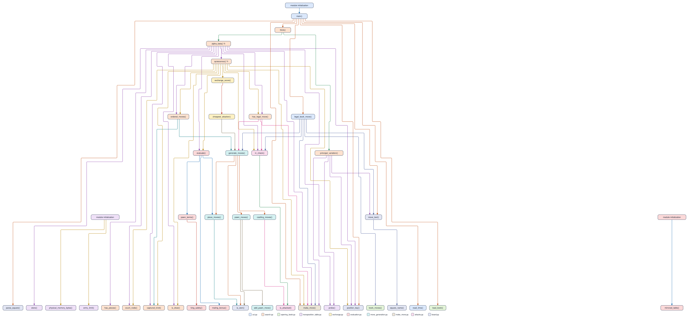

# Remus5: check-aware quiescence and history ordering

Remus5 extends [Remus4](../Remus4/README.md) with four search enhancements:
check-aware quiescence, stalemate detection at the search leaves, consistent en
passant capture handling, and history ordering for quiet moves. Its evaluation,
opening book, board representation, and copy-make move generation match Remus4.
The Python engine uses only the standard library and speaks UCI through `remus.bat`.
Its transposition-table budget is half the installed physical RAM, read at startup.

The [Python source](../../../engines_instructor/Remus5/) contains 760 code lines,
66 more than Remus4's 694. This is a net difference in source length, not a count of
lines to type or replace. Remus5 is an experimental engine for strength comparisons;
the five-day workshop continues to use Remus1 through Remus4.

## Files

| File | Code lines | Responsibility |
| --- | ---: | --- |
| `board.py` | 23 | Piece numbers, the position tuple, starting position, position keys, and UCI move text |
| `make_move.py` | 24 | Play a move on a copied board and maintain the fifty-move clock |
| `attacks.py` | 34 | Detect attacks and check |
| `move_generation.py` | 65 | Generate pseudo-legal moves, including castling, en passant, and promotions |
| `evaluation.py` | 195 | Material, piece-square tables, mobility, pawn structure, king safety, and endgame terms |
| `exchange.py` | 39 | Static exchange evaluation, including removal of the captured en passant pawn |
| `transposition_table.py` | 43 | Store search depths, scores, bounds, and best moves |
| `opening_book.py` | 21 | Read opening lines and return candidate book moves |
| `search.py` | 254 | Alpha-beta search, quiescence, terminal-position checks, draw handling, and move ordering |
| `uci.py` | 62 | UCI commands, game history, legal book moves, and time allocation |
| **Total** | **760** | |

Counts exclude blank lines, comments, and docstrings. `remus.bat` starts `uci.py`,
and `opening_book.txt` supplies the opening lines. Neither file contributes to the
Python line count. The engine identifies itself as `Remus5`.

## The call tree

Each box represents a function and takes the color of its module. An arrow points
from a caller to the function it calls. A circular arrow marks recursion.

Boxes labeled "module initialization" show helper calls made during startup,
including the installed-RAM query and table-capacity calculation at import.

## 1. Check-aware quiescence

A capture can give check even after the main search reaches its depth limit. For
example, with White's king on h1 and pawn on g2, and Black's king on f2 and queen on
g3, Black's `g3g2` captures the pawn and gives mate. Quiescence must recognize the
mate when it examines the resulting position.

`quiescence()` checks whether the side to move is in check at every recursive call.
In check, it considers all legal evasions: king moves, blocking moves, captures, and
promotions. It does not accept the static evaluation as a stand-pat score, and it
disables delta pruning and static exchange pruning for those evasions. Ordinary
alpha-beta cutoffs still apply.

Standing pat means accepting the position's static score without searching another
move. That option is useful in a quiet position, but cannot represent a legal
response to check. With White's king on h1, Black's king on f3, and Black's rook on
h8, the only legal response is the quiet move `h1g1`; quiescence searches it.

The search carries the distance from the root, measured in plies, into quiescence.
One ply is one move by one side. Checkmate scores use `-(MATE_SCORE - ply)`, so the
engine prefers a shorter forced mate and delays a forced loss.

**Expected outcome:** more reliable scores for checking captures and forced
responses at the search boundary. Searching quiet evasions can increase the work
per position, so this enhancement does not guarantee a higher search depth.

## 2. Stalemate detection before stand pat

With White's king on h1, Black's king on f2, and Black's queen on g3, White has no
legal move and is not in check. The score must be zero, regardless of Black's
material advantage or the alpha-beta window.

`has_legal_move()` stops at the first move that leaves the moving king safe.
Quiescence calls it before accepting a static score or pruning moves. If there is
no legal move, quiescence returns a mate score when the king is checked, or zero
for stalemate. Finding no captures alone does not establish stalemate: quiet legal
moves also count.

The null-move pruning condition also requires at least one legal move. This keeps
a hypothetical pass from supplying a cutoff in a stalemated position.

**Expected outcome:** the search values stalemate as a draw at its leaves and can
distinguish it from winning material. Checking for a legal move adds work, although
the helper stops as soon as it finds one.

## 3. En passant throughout the search

After Black plays `d7d5` beside a White pawn on e5, `e5d6` captures a pawn even though
d6 is empty. `captured_kind()` returns `PAWN` for that move and supplies the captured
kind to move ordering, delta pruning, and the quiet-move classification.

This gives en passant a capture priority and includes it in quiescence. It also
keeps the move out of quiet-move futility pruning, late move reductions, killer
updates, and quiet-history rewards. A remembered killer move receives its killer
priority only when it is a quiet, nonpromotion move in the current position.

Static exchange evaluation (SEE) estimates material gained or lost by captures and
recaptures on one square. For en passant, `exchange_score()` credits the captured
pawn and removes it from the copied board before finding recaptures. With a Black
rook on d4, removing the pawn on d5 opens the rook's path to d6, where it can
recapture White's pawn. The exchange therefore scores zero rather than a free pawn.

The usual king-safety check applies after making the move. An en passant capture
that opens a rook or bishop attack on the moving side's king is rejected.

**Expected outcome:** en passant receives the same search treatment as other pawn
captures, including material accounting and legality. Its overall Elo contribution
is likely small because the opportunity occurs relatively infrequently.

## 4. History ordering for quiet moves

Suppose `g1f3` repeatedly causes a cutoff in different branches of the search.
A cutoff means the move is already good enough that the remaining alternatives
cannot affect the current alpha-beta decision. Its history score gives the search
a reason to try that quiet move early in another position.

`quiet_history` stores a score for each side and move. A quiet move that causes a
beta cutoff gains `depth * depth`, so deeper cutoffs receive more weight. Scores
are capped at 3,999. At the start of each `think()` call, every score is halved using
integer division, giving recent searches more influence.

The move-ordering priorities are:

1. The transposition-table move, with priority 1,000,000.
2. Captures ordered by victim and attacker value, with an extra bonus for queen
   promotions; noncapturing queen promotions also receive a capture-level priority.
3. The two quiet killer moves for the current ply, with priorities 5,000 and 4,000.
4. Other quiet, nonpromotion moves, with history scores from 0 to 3,999.

Noncapturing underpromotions retain priority zero. Equal priorities use the move's
square numbers and promotion kind as a deterministic tie breaker. History affects
ordering; it does not directly change the evaluation, pruning margins, or reduction
formula. Because reductions depend on move order, it can affect the selected move
as well as the number of positions searched.

**Expected outcome:** earlier cutoffs and fewer unproductive searches, especially
when principal variation search depends on trying a strong move first. A working
estimate is **+20 to +60 Elo** for history ordering alone, subject to equal-time
match testing.

## Supporting search safeguards

Quiescence records the position keys along its recursive path and applies the same
repetition and fifty-move checks as the main search. Quiet check evasions can repeat
positions, so capture-only termination is not sufficient. Python restores the
quiescence history with `try` and `finally`, including when the clock interrupts
the search; Rust restores it before propagating a timeout.

Checkmate takes precedence over a fifty-move draw in both searches. A shared limit
of 128 plies bounds long checking sequences and access to the killer table. At that
limit, a nonterminal position that does not qualify as a draw receives its static
evaluation. This is a depth-limit approximation, not proof that the position is
quiet. Away from check, quiescence remains selective: delta pruning and SEE can
omit captures, and quiet moves other than queen promotions are not searched.

## Expected playing strength

The planning estimate for the complete package is **about +50 Elo over Remus4**,
with a plausible range of **+20 to +80 Elo** under equal hardware and thinking time.
These are engineering estimates, not measured ratings or statistical confidence
intervals. A neutral result or a loss of strength remains possible.

History ordering is expected to supply most of the consistent gain. Check and
stalemate handling improve decisions in specific tactical and endgame positions,
while en passant handling matters in a narrower set of positions. Their gains are
not additive. Extra legality checks and quiet evasions can consume time that would
otherwise buy another search iteration.

Perft counts establish move-generation correctness, and fixed-depth comparisons
check whether Python and Rust follow the same search. Neither establishes an Elo
gain. For a strength comparison, use the same Stockfish binary and settings,
opening positions, time control, hardware, and color balance for Remus4-Rust and
Remus5-Rust. Report the difference with a statistical uncertainty estimate. Results
against one Stockfish configuration describe that matchup, not a universal rating.

## Remus5-Rust and use

[Remus5-Rust](../../../engines_instructor/Remus5-Rust/) implements the same search and
evaluation in Rust. Its `search.rs` mirrors the check-aware quiescence, terminal
checks, history rewards, history aging, and en passant classification. Its
`exchange.rs` removes the en passant victim during SEE, and its tactical move
generator includes en passant captures.

Python and Rust both target half the installed physical RAM, read once at startup.
Python estimates 260 bytes per dictionary entry, allocates as the table grows, and
clears the dictionary when it exceeds the entry threshold. Rust uses four-entry,
64-byte buckets and multiply-shift indexing, so 24 GiB of installed RAM gives a
12 GiB table without power-of-two rounding. Windows supplies zeroed pages as Rust
accesses them. The capacity belongs to each process separately.

Python's estimate is not a hard memory ceiling. Rust replaces entries within full
buckets, while Python clears its whole dictionary. These replacement differences
and key mappings can produce different searches. Remus4-Rust uses a fixed 512 MiB
table; this experimental engine follows the installed-RAM policy. The
[table-memory guide](../transposition_table_memory.md) explains allocation,
failure handling, examples, and simultaneous engines.

For Python, select
[`engines_instructor/Remus5/remus.bat`](../../../engines_instructor/Remus5/remus.bat)
as the UCI engine and use its engine folder as the working directory. It requires
Python 3.14 and the repository's configured `uv` environment. The engine itself
imports no third-party libraries.

For the compiled engine, select
[`remus5_rust.exe`](../../../engines_instructor/Remus5-Rust/remus5_rust.exe)
in the chess GUI's external UCI engine settings. It identifies itself as
`Remus5-Rust`, requires no Rust installation, and embeds its opening book. The
executable uses profile-guided optimization. For workshop designer analysis, the
Rust UCI interface also accepts `position fen`, `go depth`, `go perft`, and `eval`.
