# Remus6-Rust

[Overview](#overview) |
[Enhancements over the previous version](#enhancements-over-the-previous-version) |
[Source files and TLOC](#source-files-and-tloc) |
[Running and configuring](#running-and-configuring) |
[Architecture and call diagrams](#architecture-and-call-diagrams) |
[Search and evaluation](#search-and-evaluation) |
[Memory and transposition table](#memory-and-transposition-table) |
[Opening book and tablebases](#opening-book-and-tablebases) |
[Time management and pondering](#time-management-and-pondering) |
[Diagnostics and performance](#diagnostics-and-performance) |
[Verification and limitations](#verification-and-limitations) |
[Further reading](#further-reading)

## Overview

Remus6-Rust is an experimental Windows Rust engine using Lazy SMP. Its main worker and
helpers search the same root independently and share one transposition table. The main
worker selects the move. Native rules, evaluation, root-only Lichess advice, embedded
opening book, and GUI-driven pondering follow Remus5's design. Student pairs do not type
this engine.

## Enhancements over the previous version

Remus6-Rust extends the Remus5-Rust design with Lazy SMP: independent root searches
share one transposition table. It adds configurable worker count and Hash capacity,
shared-table depth protection and useful-hit age refresh, and persistent search and
worker metrics. Four workers and 512 MiB are the defaults.

## Source files and TLOC

Comparison baseline: [Remus5-Rust](../Remus5-Rust/README.md) .

TLOC counts nonblank runtime source lines, excluding standalone comments and Rust
documentation comments. Change is the net difference, not lines edited or typed. A zero
means that file is absent from that version. Supporting files and external checks are
excluded.

| File | Remus6-Rust TLOC | Remus5-Rust TLOC | Change | Responsibility |
| --- | ---: | ---: | ---: | --- |
| `src/board.rs` | 204 | 204 | 0 | Piece constants, position representation, position keys, and UCI move text |
| `src/make_move.rs` | 75 | 75 | 0 | Copy-make moves, castling rights, en passant, and the halfmove counter where supported |
| `src/attacks.rs` | 147 | 147 | 0 | Attack detection and king-safety checks |
| `src/move_generation.rs` | 166 | 166 | 0 | Pseudo-legal moves, castling, promotions, and en passant |
| `src/evaluation.rs` | 408 | 408 | 0 | Material, piece-square tables, and the positional and endgame terms supported by this engine |
| `src/exchange.rs` | 99 | 99 | 0 | Static exchange evaluation |
| `src/opening_book.rs` | 48 | 48 | 0 | Opening-line loading and candidate book moves |
| `src/transposition_table.rs` | 253 | 171 | +82 | Search depths, scores, bounds, and best moves |
| `src/search.rs` | 764 | 505 | +259 | Move selection, search, ordering, and evaluation integration |
| `src/search_control.rs` | 357 | 307 | +50 | Input queue, cancellation, pondering, and deadlines |
| `src/search_metrics.rs` | 57 | 0 | +57 | Per-worker timing, nodes, re-search costs, and scheduling counters |
| `src/table_metrics.rs` | 39 | 34 | +5 | Transposition-table probes, hits, cutoffs, stores, and replacements |
| `src/tablebase.rs` | 253 | 253 | 0 | Bounded root advice, native legality validation, response cache, and network fallback |
| `src/main.rs` | 346 | 319 | +27 | UCI commands, configuration, root selection, and engine orchestration |
| `src/diagnostics.rs` | 0 | 61 | -61 | Logging is provided by search_control.rs in this engine |
| **Total** | **3,216** | **2,797** | **+419** | |

### Supporting files

| File | Responsibility |
| --- | --- |
| `Cargo.toml`, `Cargo.lock` | Build settings and locked dependency versions |
| `rust-toolchain.toml`, `.cargo/config.toml` | Compiler selection and CPU target |
| `remus6_rust.exe` | Executable selected by the GUI |
| `opening_book.txt` | Opening lines in UCI move notation |

## Running and configuring

Select [`remus6_rust.exe`](../../../engines_instructor/Remus6-Rust/remus6_rust.exe) as
an external UCI engine. Its identity is `Remus6-Rust` . Set the GUI opening book to
`<None>` , including in each tournament entry.

### UCI options

| Option | Type | Default | Allowed values | Purpose |
| --- | --- | --- | --- | --- |
| `Threads` | spin | 4 | 1 to 64 | Total search threads, including the main worker |
| `Hash` | combo | 512 | 512, 1024, 2048 MiB | Capacity of one table shared by all workers |
| `SearchDiagnostics` | check | false | true, false | Append `logs/search_<pid>_<session>.txt` and report search counters |
| `LichessTablebase` | check | true | true, false | Allow bounded root advice |
| `Ponder` | check | false | true, false | Enable predictions and GUI-controlled pondering |
| `PonderDiagnostics` | check | false | true, false | Report ponder timing and append `logs/ponder_<pid>_<session>.txt` |

### Requirements and build

The supplied executable runs on Windows 11 without Python or Rust installed. Maintaining
source requires the stable toolchain selected by `rust-toolchain.toml` . From the engine
folder, build with `cargo build --release --locked` ; the result is in `target/release/`
. `cargo fmt` and `cargo clippy` check Rust style and warnings. Changing
`opening_book.txt` requires a rebuild because its text is embedded at compile time. A
normal Cargo build does not itself perform profile-guided training.

`reqwest` , `serde_json` , and `httpdate` serve only the HTTPS/JSON tablebase boundary.
Native chess and thread coordination use the standard library.

### Supported commands

The engine accepts `position startpos moves ...` , `position fen ...` , timed `go` ,
`go depth N` , `go perft N` , and `eval` , in addition to the UCI handshake and options.
Fixed-depth and perft commands bypass book and tablebase selection. A FEN-only position
has no repetition history before that FEN. Wait for `bestmove` before starting another
search or sending `quit` . It also supports `go infinite` , `go ponder` , `ponderhit` ,
and live `stop` ; `isready` remains responsive during native search.

## Architecture and call diagrams

### Module overview

These diagrams describe the Rust source of Remus6-Rust. A module arrow records
an explicit reference to another engine module, including imported functions,
types, and constants. It is a dependency view, not a complete function call graph.
Every runtime Rust module appears, including modules used only for data types.
Colors identify the same modules across Python and Rust: `main.rs` shares the blue
of `uci.py`, and both search modules use orange. Conceptual nodes use the color of
the module they represent; external files and programs use gray. Labels identify
the module even when colors are difficult to distinguish.

### Search and control views

The search view summarizes selected calls and scheduling responsibilities. The
arrows can collapse intermediate helpers; they are conceptual flow, not execution
frequency or a complete compiler-derived call graph. Named functions are checked
against source definitions. The manifest records source hashes to detect drift.

The ponder view shows both UCI hit forms and book waiting. Exact reserve percentages and caps are defined in [Time management and pondering](#time-management-and-pondering).

| View | Boxes | Arrows | Editable source |
| --- | ---: | ---: | --- |
| [Modules](mermaid/modules.svg) | 14 | 33 | [Mermaid](mermaid/modules.mmd) |
| [Search](mermaid/search.svg) | 17 | 22 | [Mermaid](mermaid/search.mmd) |
| [Ponder](mermaid/ponder.svg) | 15 | 18 | [Mermaid](mermaid/ponder.mmd) |

Open SVGs in a browser to zoom without losing text clarity. Matching `.mmd` files are editable Mermaid sources; render with Mermaid CLI 12.2.0 and the supplied ELK layout settings.

## Search and evaluation

The native tactical and positional features follow
[Remus5-Rust search and evaluation](../Remus5-Rust/README.md#search-and-evaluation) :
check-aware quiescence, terminal checks, en passant accounting, quiet history, backward
pawns, central holes, knight outposts, and king cover.

### Rust search-speed techniques

Six implementation techniques reduce cost per position: branch-free sliding-ray lookups,
an unpinned-pawn shortcut for legal-move existence, lazy ordering of the first three
moves, bitmask selection of central holes, static evaluation only when pruning needs it,
and transposition-table prefetching. These preserve native scores and the sequential
search order. Parallel scheduling can still change visited nodes and results. The
[technique descriptions and measurements](../remus_versions.md#speed-techniques-of-the-rust-engines-5-through-7)
explain the conditions and limits of the reported speedups.

### Lazy SMP scheduling

The main worker and helpers deepen independent searches of the same root with private
killer moves, quiet history, and repetition paths. They exchange results through the
shared table. The main worker selects the returned move; helper depth is not the
reported main depth. Helpers are created per search, stopped when the main search
finishes, and joined before a new command can replace the table. Ordinary searches can
return a provisional root choice; ponder maturity uses completed work.

## Memory and transposition table

Workers keep private killer moves, quiet history, and repetition paths. A shared
transposition table defaults to 512 MiB and stores four 16-byte entries in each 64-byte
bucket. The table uses atomic words and a key/data consistency check, with depth/age
replacement. Like other hash tables, it relies on finite position keys; a cache entry is
not a proof against a hash collision. Allocation failure disables caching. `Hash`
selects 512, 1024, or 2048 MiB for the entire shared table. Resizing waits for the
current search and its helpers to finish, then releases the old table and allocates the
requested size. A same-size request preserves cached results. Worker stacks, heuristic
tables, and worker state use additional memory.

The shared table protects deeper results for the same position and equal-depth exact
results against weaker bounds. A depth-qualified table cutoff refreshes the entry's age
once per search generation. Plain probes and PV reconstruction do not refresh age.
Collision replacement combines stored depth and search age.

A full bucket minimizes depth minus eight times age in search generations, modulo 64.
Search age is not the number of played moves or a recurrence count. Useful
depth-qualified cutoffs refresh age; ordinary probes do not. Table entries persist
across moves. Changing Hash to a different size creates an empty table; starting a new
process also starts empty.

## Opening book and tablebases

### Opening book

The supplied `opening_book.txt` contains 43 openings and 13 trap defenses in UCI move
notation, with 17 openings restricted to White. Every selected move is checked with the
native generator and king-safety test. Without a legal continuation, the engine uses
native move selection. Set Lucas Chess's external book to `<None>` , including in
tournament entries, so a GUI book cannot override the engine's book.

Rust embeds the text at build time. Editing the external file does not change a running
or already compiled engine; rebuild and restart to use revised lines. Timed moves use
the book automatically. Fixed-depth analysis bypasses it.

### Choosing an endgame move

`LichessTablebase` defaults to true. Set `setoption name LichessTablebase value false`
to disable network advice. An accepted response emits `info string Lichess tablebase`
before `bestmove` ; fallback emits ordinary native search information.

With White's king on g7 and pawn on h7, and Black's king on e8, White can promote with
`h7h8q` . The adapter serializes that position as `4k3/6KP/8/8/8/8/8/8 w - - 0 1` and
requests `https://tablebase.lichess.org/standard?fen=<URL-encoded FEN>` .

Lichess lists legal moves best first. The position's category describes the player to
move, while each move's category describes the opponent after that move. A winning root
therefore needs a move labeled `loss` . The engine uses this server order and checks the
first entry; it does not sort signed DTZ values or select the first entry labeled `win`
. DTZ concerns the next pawn move or capture that resets the fifty-move counter, not
necessarily the fastest mate.

The adapter accepts `win` , `loss` , `draw` , `cursed-win` , and `blessed-loss` when the
root and child results agree. Cursed wins and blessed losses count as draws under the
fifty-move rule. `unknown` , `maybe-win` , `maybe-loss` , `syzygy-win` , and
`syzygy-loss` select native search because this adapter requires a definite result with
the current counter. An illegal, empty, malformed, or inconsistent first entry also
selects search. It does not skip a bad first entry and claim a lower-ranked entry is
optimal.

The native search never probes Lichess. The engine makes one root request per uncached
eligible position, subject to its timing and cooldown limits. It can therefore consult
the service on successive turns, not just once when seven pieces remain. No tablebase
score is inserted into the native transposition table.

### FEN and draw history

`tablebase.rs` serializes outbound API FEN from the native position. The UCI adapter
also accepts FEN for analysis. Native search uses the Rust position structure. FEN
includes the side to move, castling rights, en passant target, and actual halfmove
counter. The fullmove number is 1 because it does not affect tablebase results and the
native position does not store it.

Positions with castling rights, more than seven pieces, or a halfmove counter of 100 or
greater use native search. FEN does not carry repetition history. The adapter skips a
lookup if a position repeats within the reversible history, and rejects a candidate that
revisits a recorded position without resetting the halfmove counter. These conservative
guards leave repetition-sensitive decisions to the existing search; a remote result
alone cannot establish the full game's draw status.

### Network behavior and timing

- A lookup waits at most one second and at most one quarter of the move's hard
  time allowance. If that allowance would give the request less than 20 ms, the
  engine searches immediately. Elapsed lookup time is subtracted from both native
  search budgets.
- Each engine process permits one outstanding request. A slow worker cannot block
  the UCI thread beyond the lookup budget or cause another concurrent request in
  that process. Late responses are associated with their original FEN.
- A process caches up to 256 JSON responses by complete API FEN, including the
  halfmove counter. It clears the cache when admitting another entry at capacity.
  Cached moves are validated against the current position and history on each use.
- Successful JSON responses impose a one-second request cooldown. Transport and
  parsing failures impose five seconds. HTTP 429 imposes at least 60 seconds and
  honors a longer `Retry-After` value in seconds or HTTP-date form. Cooldowns never
  make the engine sleep instead of searching.
- Responses larger than 65,536 bytes are rejected. HTTPS certificate validation
  stays enabled. An unavailable service, DNS or TLS failure, timeout, invalid
  JSON, HTTP error, or unsupported position falls back to native search.

The wait limit applies to the tablebase adapter. Native search retains the engine's
periodic clock checks and first-legal-move behavior. The cache and cooldown are local to
one engine process; separate GUI engine instances do not share them. Service
availability and lookup latency can affect how often advice is used.

## Time management and pondering

### Move budgets

With a supplied clock, the initial plan is one thirtieth of the remaining time plus half
the increment. The hard budget is the smaller of three plans and one fifth of the
remaining time. Without clock information the default is two seconds. `movetime`
supplies both budgets explicitly. Iterative deepening can enlarge the plan when the
preferred move changes, within the hard budget. The soft stopping target at a completed
iteration is half the adjusted plan; an unfinished iteration can continue toward the
hard budget. Periodic clock checks and the time to finish work can cause small timing
overshoots.

### Lucas Chess setup and hit handling

Enable **Ponder** in the UCI options for the Remus6-Rust external-engine entry.
Tournament entries keep their own engine settings: enable **Ponder** in that
tournament's Remus6-Rust entry too, or import the configured entry again. Keep Lucas
Chess's external opening book at `<None>` . Restart an engine process to load its code
and options.

For example, after Remus6-Rust chooses `e2e4` , it can report
`bestmove e2e4 ponder e7e5` . The GUI sends the position including both moves, followed
by `go ponder` . Remus6-Rust searches its response to `e7e5` while the opponent thinks.

A standard `ponderhit` continues that search and starts the hard move clock. Lucas Chess
R6 also uses `stop` , the actual `position` , and a fresh `go` when the prediction
matches. Remus6-Rust recognizes an explicit stop-and-go handoff when the complete
position-command tokens match and the new timed search begins within two seconds of
the stopped ponder result. The comparison includes the supplied move history and all
FEN fields, including the halfmove clock. Whitespace differences are ignored; different
representations of the same board conservatively receive no time credit. New-game and
option commands clear pending credit. Every go consumes it, including perft and
fixed-depth requests, which receive no time credit. Cancellation by a replacement
command without an explicit stop earns no credit. A FEN-only input cannot supply
history before its FEN.

### Adaptive thinking after a hit

The credited stop-and-go form skips tablebase advice and starts a native search with
retained cache and heuristic information. Completed ponder time counts toward the soft
target once the new search recovers the pondered depth. Saved credit holds the ponder
duration; the idle gap between searches adds no credited time. At the default settings, stable hits reserve 25% of the
adjusted move plan on the engine's own clock, capped at 25% of the hard budget. With at
least 60 seconds left on its clock, Remus6-Rust reinvests time when the hit depth is
below 8, the score falls by at least 35 centipawns between completed iterations of depth
4 or greater, or the best move changes in the latest such iteration. A deeper cached
score is preserved while a Lucas restart replays shallow iterations. Score deterioration
and uncertainty at the hit carry across that restart.

An uncertain hit reserves 50% of the adjusted plan and aims to complete a depth beyond
the hit depth. If that iteration is too expensive, it may return after one full adjusted
plan; both allowances are capped at half the hard budget. For example, a 30-second plan
normally reserves 7.5 seconds after a hit; an uncertain hit reserves 15 seconds and can
try up to 30 seconds for another depth. Clocks below 60 seconds and explicit `movetime`
commands retain the smaller allowance. These thresholds guide time allocation; they do
not establish an Elo gain or guarantee a better move. The hard deadline, explicit
stop/quit, terminal positions, and a proven mate take precedence. The engine returns a
completed iteration when available. Cached results can also help after a missed
prediction, but a miss receives no ponder time credit.

### Predictions, book priority, and finished searches

The standard `Ponder` check option defaults to false. Enable it with
`setoption name Ponder value true` . The predicted reply comes from a legal cached move,
an opening-book continuation, or a legal fallback. A prediction alone never starts a
search. `go ponder` and a credited stop-and-go restart bypass online tablebases.
An ordinary uncredited timed turn can perform a bounded root lookup. A legal book continuation takes priority on a timed turn,
including a Lucas hit. During `go ponder` , Remus6-Rust holds a known book move until
`ponderhit` or `stop` , without searching. Book waiting earns no native ponder credit.
Outside the book, waiting time goes to native analysis. `isready` , `stop` , and `quit`
remain responsive during search. A finished ponder search, including mate or stalemate,
waits for `ponderhit` or `stop` before returning `bestmove` .

Lucas Chess R6 supplies the required pondering controller. Lucas Chess R2 does not
support this feature. For native-search comparisons, leave `Ponder` disabled; with
pondering enabled, both engines can use CPU at the same time. The search uses the
engine's transposition table and the configured search threads.

The advertised Ponder default is false. Lucas Chess R6 needs an explicit `Ponder=true` override
in the external-engine and tournament entries to activate its controller. Refresh
entries that cached a different default, then enable Ponder. A predicted reply alone
does not establish pondering; incoming `go ponder` commands do.

## Diagnostics and performance

Each process writes its own files in `engines_instructor/Remus6-Rust/logs/`,
relative to the repository root. When the executable is installed elsewhere, the
`logs` folder stays beside that executable, regardless of Lucas Chess's working folder.
Search files are `search_<pid>_<session>.txt`; ponder files are
`ponder_<pid>_<session>.txt`. Matching suffixes identify the same engine process.

`pid` is the Windows process ID; `session` is a Unix timestamp in nanoseconds
captured at the first enabled log write. A new launch gets a new session, so
concurrent games and reused process IDs keep separate records. One process can
play several games in the same session; use `ucinewgame`, position commands, and
search IDs to separate them.

Files are created only when the corresponding option is enabled. Disabling an option stops further writes without erasing its
file; re-enabling it resumes the same file. Logs are not automatically rotated or
deleted. Archive completed sessions when their processes have exited. Existing
`search_log.txt` and `ponder_log.txt` files are retained but receive no new records.

`SearchDiagnostics`, default false, writes `logs/search_<pid>_<session>.txt` beside
the executable when enabled, independently of `PonderDiagnostics` . The final `lazy_smp` summary includes the actual worker count and
exact total nodes after helpers join. Depth belongs to the main worker; node totals
include helpers. The search log includes `hash_fill_pct` , sampled across the shared
table after each native search. See
[search logs and table experiments](../search_logging.md) for field definitions,
measurement limits, and cache resizing behavior.

Per-worker lines report active elapsed time and nodes. Summaries count PVS, LMR, and
aspiration re-searches and their node costs, and work in interrupted search attempts.
Lazy SMP has no sibling splits: the common-format split-wait and split-cutoff fields
remain zero and do not measure helper joins or operating-system scheduling waits. Active
elapsed time is not CPU time. Shared table entries from interrupted work can remain
useful.

`PonderDiagnostics` , default false, independently reports timing and appends
`logs/ponder_<pid>_<session>.txt` . It includes `reinvest` , `shallow_hit` , `deteriorating` , `unstable`
, and `hit_cap_ms` . `hit_kind` is `uci` for standard ponderhit, `stop_go` for a credited Lucas restart,
and `none` when no hit is recognized. It appears in both ponder reports and search-log
records. A stopped ponder report can precede a credited restart; count the restart
once as a hit. Both log files grow across sessions; archive them with the engine
stopped. File failures do not stop native play.

See [Search logs and table experiments](../search_logging.md) for field definitions.
Compare aggregate nodes divided by aggregate native seconds, not the arithmetic mean of
per-move rates. NPS, hit percentage, and fill percentage alone do not establish stronger
play; compare completed depth, time to depth, useful cutoffs, replacement pressure, and
controlled playing results.

## Verification and limitations

Move generation is checked against published perft positions. Fixed-depth searches,
tactical positions, and UCI conversations check native behavior without requiring
tournament games. Perft validates move generation, not playing strength; node counts and
search depth alone do not establish an Elo gain.

Verify tablebase fallback, repetition-sensitive positions, standard and Lucas ponder
hits, cancellation, and post-hit deadlines separately from native chess checks. Network
advice is optional and is not inserted into the native transposition table.

With one search thread and controlled initial state, fixed-depth searches provide a repeatable
baseline. Multiple workers can visit different nodes, break ties differently, and obtain
different selective-search scores across runs. More workers do not guarantee stronger
play or proportional speedup. Account for all simultaneously searching and pondering
engines when choosing Threads.

## Further reading

- [Version guide](../remus_versions.md): feature progression and comparisons.
- [Lucas Chess guide](../../lucas_chess/lucas_chess_guide.md): workshop setup and play.
- [UCI protocol introduction](../../chess_tutor/uci.md): engine and GUI communication.
- [Lichess API documentation](https://lichess.org/api#tag/Tablebase) describes the public service.
- [Lichess tablebase server](https://github.com/lichess-org/lila-tablebase/blob/main/README.md) documents response categories, move ordering, and DTZ fields.
- [Lichess API guidance](https://lichess.org/page/api-tips) specifies sequential requests and rate-limit backoff.
