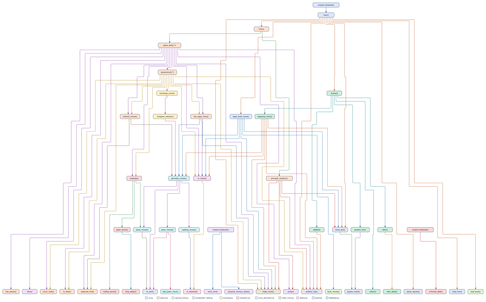

# Remus6: Lichess endgame tablebases with native-search fallback

Remus6 extends [Remus5](../Remus5/README.md) with optional online endgame advice.
With seven or fewer pieces, including both kings, it can ask Lichess for a
Syzygy tablebase move before searching. Every accepted move passes the native
move generator and king-safety check. When no usable answer arrives, Remus6 uses
its opening book or the unchanged Remus5 search and evaluation.

Remus6 and [Remus6-Rust](../Remus6-Rust/README.md) are experimental instructor
engines outside the five-day workshop. Student pairs continue to type Remus1
through Remus4. The Python engine uses only the standard library and plays without
internet access, a Lichess account, an API key, or local tablebase files.

## Files

| File | Code lines | Responsibility |
| --- | ---: | --- |
| `board.py` | 23 | Native position tuple, piece numbers, position keys, and UCI text |
| `make_move.py` | 24 | Copy-make moves and the fifty-move counter |
| `attacks.py` | 34 | Attacks and king-safety checks |
| `move_generation.py` | 65 | Pseudo-legal moves, including special moves |
| `evaluation.py` | 195 | The Remus5 static evaluation and draw material checks |
| `exchange.py` | 39 | Static exchange evaluation |
| `transposition_table.py` | 43 | Native search scores, bounds, depths, and moves |
| `opening_book.py` | 21 | Opening lines and candidate book moves |
| `search.py` | 254 | The complete Remus5 search, unchanged |
| `tablebase.py` | 158 | FEN serialization, HTTPS, response validation, cache, cooldown, and bounded waiting |
| `uci.py` | 82 | UCI option, root lookup, game history, and remaining search time |
| **Total** | **938** | **178 more code lines than Remus5** |

Counts exclude blank lines, comments, and docstrings. `remus.bat` starts the Python
engine, and `opening_book.txt` holds the same opening lines as Remus5. The
[source folder](../../../engines_instructor/Remus6/) contains no external chess
library and no downloaded tablebases.

## The call tree

Each box represents a function and takes the color of its module. Arrows name
calls; circular arrows mark recursion. The lookup starts its HTTP worker on a
background thread, while the native search runs on the UCI thread.

Boxes labeled "module initialization" show helper calls made during startup,
including the installed-RAM query and table-capacity calculation at import.



## Choosing an endgame move

With White's king on g7 and pawn on h7, and Black's king on e8, White can promote
with `h7h8q`. The adapter serializes that position as
`4k3/6KP/8/8/8/8/8/8 w - - 0 1` and requests
`https://tablebase.lichess.org/standard?fen=<URL-encoded FEN>`.

Lichess lists legal moves best first. The position's category describes the player
to move, while each move's category describes the opponent after that move. A
winning root therefore needs a move labeled `loss`. Remus6 uses this server order
and checks the first entry; it does not sort signed DTZ values or select the first
entry labeled `win`. DTZ concerns the next pawn move or capture that resets the
fifty-move counter, not necessarily the fastest mate.

The adapter accepts `win`, `loss`, `draw`, `cursed-win`, and `blessed-loss` when the
root and child results agree. Cursed wins and blessed losses count as draws under
the fifty-move rule. `unknown`, `maybe-win`, `maybe-loss`, `syzygy-win`, and
`syzygy-loss` select native search because this adapter requires a definite result
with the current counter. An illegal, empty, malformed, or inconsistent first entry
also selects search. It does not skip a bad first entry and claim a lower-ranked
entry is optimal.

The native search never probes Lichess. The engine makes one root request per
uncached eligible position, subject to its timing and cooldown limits. It can
therefore consult the service on successive turns, not just once when seven pieces
remain. No tablebase score is inserted into the native transposition table.

## FEN and draw history

FEN exists only at the Python HTTP boundary in `tablebase.py`. The native board,
move generator, evaluation, and search retain the Remus5 representation. FEN
includes the side to move, castling rights, en passant target, and actual halfmove
counter. The fullmove number is 1 because it does not affect tablebase results and
the native position does not store it.

Positions with castling rights, more than seven pieces, or a halfmove counter of
100 or greater use native search. FEN does not carry repetition history. The
adapter skips a lookup if a position repeats within the reversible history, and
rejects a candidate that revisits a recorded position without resetting the
halfmove counter. These conservative guards leave repetition-sensitive decisions
to the existing search; a remote result alone cannot establish the full game's
draw status. A FEN-only Rust input has no history before that FEN.

## Network behavior and timing

- A lookup waits at most one second and at most one quarter of the move's hard
  time allowance. If that allowance would give the request less than 20 ms, the
  engine searches immediately. Elapsed lookup time is subtracted from both native
  search budgets.
- Each engine process permits one outstanding request. A slow worker cannot block
  the UCI thread beyond the lookup budget or cause another concurrent request in
  that process. Late responses are associated with their original FEN.
- A process caches up to 256 JSON responses by complete API FEN, including the
  halfmove counter. It clears the cache when admitting another entry at capacity.
  Cached moves are validated against the current position and history on each use.
- Successful JSON responses impose a one-second request cooldown. Transport and
  parsing failures impose five seconds. HTTP 429 imposes at least 60 seconds and
  honors a longer `Retry-After` value in seconds or HTTP-date form. Cooldowns never
  make the engine sleep instead of searching.
- Responses larger than 65,536 bytes are rejected. HTTPS certificate validation
  stays enabled. An unavailable service, DNS or TLS failure, timeout, invalid
  JSON, HTTP error, or unsupported position falls back to native search.

The wait limit applies to the tablebase adapter. Native search retains Remus5's
periodic clock checks and first-legal-move behavior. The cache and cooldown are
local to one engine process; separate GUI engine instances do not share them.
Service availability and lookup latency can affect how often advice is used.

## Use in a chess GUI

For Python, select
[`engines_instructor/Remus6/remus.bat`](../../../engines_instructor/Remus6/remus.bat)
as an external UCI engine and use its engine folder as the working directory. It
requires the repository's Python 3.14 environment and identifies itself as `Remus6`.
The workshop's setup installer registers the workshop engines; these experimental
versions use separate external-engine entries.

For Rust, select
[`remus6_rust.exe`](../../../engines_instructor/Remus6-Rust/remus6_rust.exe).
It identifies itself as `Remus6-Rust`, embeds its opening book, and requires no
Python, Cargo, or Rust installation.

Both engines advertise `LichessTablebase`, a UCI check option that defaults to true.
Turn it off in the GUI's engine options for offline operation or native-search
comparisons. The equivalent UCI command is:

```text
setoption name LichessTablebase value false
```

Use `true` to enable it. An accepted response produces `info string Lichess
tablebase` before `bestmove`. Native-search fallback produces ordinary search
information. Python continues to accept `position startpos moves ...`. Rust also
accepts the designer commands `position fen`, `go depth`, `go perft`, and `eval`;
fixed-depth and perft requests bypass the service.

## Dependencies and scope

Python uses `urllib`, `json`, queues, and a daemon thread from the standard library.
Rust uses `reqwest` for HTTPS, `serde_json` for JSON, and `httpdate` for retry dates,
with versions recorded in `Cargo.lock`. Those crates serve only the boundary; all
chess rules, legal moves, evaluation, and fallback search remain native. The Rust
executable uses profile-guided optimization. Both Python and Rust share the
Remus5 policy of budgeting half the installed physical RAM for the transposition
table at startup. Python uses an approximate 260-byte cost per dictionary entry;
Rust uses whole 64-byte buckets and multiply-shift indexing. The small HTTP
response cache is separate from this native search table. See the
[table-memory guide](../transposition_table_memory.md) for examples and failure
handling. Each engine process receives its own budget.

Tablebase support improves access to exact endgame information when a usable
response arrives. It does not establish an Elo gain or guarantee the shortest mate.
The native search and its existing approximations apply whenever the adapter
returns no move.

## API references

- [Lichess API documentation](https://lichess.org/api#tag/Tablebase) describes the public service.
- [Lichess tablebase server](https://github.com/lichess-org/lila-tablebase/blob/main/README.md) documents response categories, move ordering, and DTZ fields.
- [Lichess API guidance](https://lichess.org/page/api-tips) specifies sequential requests and rate-limit backoff.
