# Remus7-Rust

Remus7-Rust is a native Rust chess engine for Windows 11. It uses Young Brothers
Wait Concept (YBWC) parallel alpha-beta search: a worker searches the first legal
move at a node, then shares remaining moves with idle helpers when the subtree is
large enough. It retains Remus5's evaluation, legal move generation, opening book,
root Lichess tablebase advice, and UCI pondering.

This experimental instructor engine is outside the five-day workshop. Student
pairs do not type it. Playing requires the supplied executable; Rust and Python are
not runtime requirements for the chess engine.

## Run in Lucas Chess

Select this external UCI executable:

```text
engines_instructor\Remus7-Rust\remus7_rust.exe
```

Disable Lucas Chess's external book for this entry. Tournament entries should use
explicit `<None>` for the GUI book. The engine's own book is embedded in its
executable. Normal timed searches consult it automatically; fixed-depth searches
bypass it.

| UCI option | Default | Purpose |
| --- | --- | --- |
| `Threads` | 4 | Search workers, including the main worker; range 1 to 64 |
| `Ponder` | false | Include a legal predicted reply and accept GUI-driven pondering |
| `PonderHitMinPercent` | 25 | Minimum percentage of the planned move budget spent on the engine's clock after a nonterminal ponder hit; range 0 to 100 |
| `LichessTablebase` | true | Permit bounded root-only advice for eligible endgames |
| `Hash` | 512 | Shared transposition table size: 512, 1024, or 2048 MiB |
| `SearchDiagnostics` | true | Report parallel statistics and append commands, iterations, timing, and results to `search_log.txt` beside the executable |
| `PonderDiagnostics` | true | Report ponder timing and append `ponder_log.txt` beside the executable |

Enable `Ponder` in Lucas Chess's external-engine settings and in the tournament's
own engine entry. The engine advertises false so checking the option saves an
explicit `Ponder=true` override, which activates Lucas Chess R6's ponder controller.
For an existing entry that cached a true default, refresh its UCI options from the
executable before enabling Ponder. Confirm operation by finding `go ponder` in the
engine log; a predicted reply on `bestmove` alone does not mean the GUI started
pondering. See the
[configuration explanation](search_design.md#lucas-chess-default-option-handling).

The engine starts opponent-time
search only after `go ponder`. Standard `ponderhit` continues the existing search.
Lucas Chess's stop-and-go form receives time credit when the position and played
move sequence match the recent ponder search.

After a nonterminal hit, the default policy reserves 25% of the planned move time
for further search. The hard deadline takes precedence. Setting
`PonderHitMinPercent` to 0 allows immediate use of mature completed work. Terminal
and completed mate searches can return on hit without spending a minimum interval.
The percentage is a time policy, not a guarantee of another completed depth.

With at least 60 seconds on the clock and no `movetime`, an uncertain hit reserves
50% of the plan and tries for one more completed depth, within one full plan and
half the hard budget. A hit is uncertain when its depth is below 8, the score fell
35 centipawns between iterations of depth 4 or more, or the best move changed in
the latest such iteration; the score and both signs carry across a Lucas
stop-and-go. A book position answers `go ponder` and a hit from the book: the
engine waits for `ponderhit` or `stop` without searching, and that wait earns no
credit. The `info string ponder` line reports `reinvest`, `shallow_hit`,
`deteriorating`, and `unstable` as 1 or 0, with the extra-time cap `hit_cap_ms`.
A `PonderHitMinPercent` above 50 keeps its larger reserve for an uncertain hit.

One worker provides deterministic fixed-depth behavior with the sequential search
ordering. Multiple workers can choose different equally scored moves and search
different node counts across runs. Selective pruning can also produce different
scores when ordering changes. More workers do not guarantee stronger play or a
proportional speedup. Account for other simultaneously running engines when
choosing `Threads`.

Both diagnostics are enabled for analysis and controlled independently.
`SearchDiagnostics` appends to `search_log.txt` and adds a UCI summary after a native
search. `PonderDiagnostics` appends to `ponder_log.txt` and reports ponder timing.
Neither writes a line per searched node. Both files grow across sessions; archive
them with the engine stopped. An unavailable log file does not stop play.

The search log contains incoming UCI commands, root identity and move budgets,
each completed iteration's depth, score, cumulative nodes and principal variation,
the final worker/split/task/cutoff/node totals, native search duration and node rate,
ponder-hit events, and the returned move with its source (`native`, `book`, or
`tablebase`). Book and tablebase choices have no native-search summary. Scores use
the root side's perspective and the engine's existing `score cp` representation,
including mate-range values.

Each line includes the process ID, milliseconds since process startup, and a Unix
timestamp in milliseconds. Search reports also include a per-process search ID,
`wall_ms` since this `go` began, `own_ms` on the engine's clock, and
`completed_depth`. Wall time includes ponder waiting and any root-advice delay;
`native_ms` and `nps` cover only the native search call. Final node counts include
unfinished-iteration work, while the returned move comes from completed work when
available. A stop before the first iteration can return a legal fallback at depth 0.

For controlled timing measurements, set both options to false and keep the same
settings for every compared engine. Search counters remain active even when their
summary and file output are disabled. Iteration logging adds file I/O at depth
boundaries; its cost depends on storage and security software.

## Search and memory

Workers keep private killer moves, quiet history, and repetition paths. A shared
transposition table defaults to 512 MiB and stores four 16-byte entries in each 64-byte bucket.
The table uses atomic words and a key/data consistency check, with depth/age
replacement. Like other hash tables, it relies on finite position keys; a cache
entry is not a proof against a hash collision. Allocation failure disables caching.
`Hash` selects 512, 1024, or 2048 MiB for the entire shared table. Resizing drains
search work, shuts down helpers, releases the old table, and recreates the pool
with the new allocation. A same-size request preserves cached results. Worker
stacks, heuristic tables, and split metadata use additional memory.

The file summary includes `hash_mib`, `tt_probes`, `tt_hits`, `tt_cutoffs`,
`tt_stores`, and `tt_replacements`. Workers collect counters locally; helpers
publish totals when their jobs finish. The search log includes `hash_fill_pct`, sampled across the shared table after
each native search. See [search logs and table experiments](../search_logging.md)
for definitions, percentages, and concurrent replacement-count limitations.

The shared table protects deeper results for the same position and equal-depth
exact results against weaker bounds. A depth-qualified table cutoff refreshes the
entry's age once per search generation. Plain probes and PV reconstruction do not
refresh age. Collision replacement combines stored depth and search age.

Per-worker log lines report active elapsed time, result-wait and cancellation-wait
time, helped tasks and nodes, and total nodes. Summaries include PVS/LMR/aspiration verification counts and their node
cost, plus work discarded after split cutoffs or search stops. These elapsed-time
measurements are not operating-system CPU time; completed descendant table entries
can remain useful even when their enclosing task is discarded.

Persistent helpers receive channel jobs only after an idle worker has been reserved.
A waiting owner may also claim one unassigned move from a descendant split. It
never helps siblings, ancestors, or unrelated searches. Waiting owners advertise
this restricted availability so descendants can expose work even when no channel
worker is idle. The executing owner remains responsible for its own candidates.
Helping saves and restores repetition history, cancellation scope, root choice,
and verification context; at most two helping calls nest on one worker's stack.
Splits require remaining depth at least 5, root-relative ply at most 16,
and at least two legal siblings after the first move. Shallower work stays local.

The first-child rule applies to internal nodes as well as the root. A full-depth
PVS confirmation uses the same alpha snapshot as its probe. Reduced probes receive
full-depth verification when they exceed that snapshot. Beta cutoffs cancel only
the affected sibling group and descendants. Every split drains its helpers before
its owner returns, including on stop and aspiration retries.

The coordinator owns commands, deadlines, and UCI output. Helpers publish node
counts in batches. A stopped search uses its last completed iteration when one is
available, with a legal fallback before the first iteration completes. Table moves
are checked for legality while constructing the displayed principal variation.

## Commands for analysis

The engine supports `position startpos moves ...`, `position fen ...`, timed `go`,
`go depth N`, `go perft N`, `go infinite`, `go ponder`, `ponderhit`, `stop`, and
`eval`. A fixed-depth search bypasses both opening-book and tablebase selection.
Only UCI protocol output is written to stdout.

For a reproducible single-worker native search:

```text
uci
setoption name Threads value 1
setoption name LichessTablebase value false
position startpos
go depth 7
```

Wait for `bestmove` before sending another search or `quit`. During an active
search, `isready` receives `readyok`; replacement commands cancel and drain the
current search before the next one begins.

## Build

The crate uses stable Rust, edition 2024, with `cargo fmt` and `cargo clippy`.
Its external dependencies are limited to HTTPS/JSON at the tablebase boundary:
`reqwest`, `serde_json`, and `httpdate`. Native chess and scheduling use Rust's
standard library. The locked dependency graph includes the transport's own
dependencies.

From the engine directory, a maintainer can build with:

```text
cargo build --release --locked
```

The output is `target\release\remus7_rust.exe`. The release configuration uses
optimization level 3, fat link-time optimization, one code-generation unit, and
the x86-64-v2 CPU baseline. The executable is portable across the project's
Windows 11 machines rather than optimized for one particular host CPU.

Rebuild after editing `opening_book.txt`, because the book is embedded at compile
time. The engine must remain usable without successful network requests.

## Source files

| File | Rust code lines |
| --- | ---: |
| `attacks.rs` | 147 |
| `board.rs` | 204 |
| `evaluation.rs` | 408 |
| `exchange.rs` | 99 |
| `main.rs` | 343 |
| `make_move.rs` | 75 |
| `move_generation.rs` | 166 |
| `opening_book.rs` | 48 |
| `parallel_search.rs` | 233 |
| `search.rs` | 1,108 |
| `search_control.rs` | 336 |
| `search_metrics.rs` | 72 |
| `table_metrics.rs` | 39 |
| `tablebase.rs` | 253 |
| `transposition_table.rs` | 253 |
| **Total** | **3,784** |

Counts omit blank lines and standalone comments.
The attack lookups, the legal-move test, move ordering, the central-hole term,
the static evaluation, and the table probe use the
[speed techniques of the Rust engines 5 through 7](../remus_versions.md#speed-techniques-of-the-rust-engines-5-through-7),
which leave the searched positions and every score unchanged.


## Call structure



[Mermaid source](mermaid/search.mmd)

See [search design](search_design.md) for state ownership, score bounds,
synchronization decisions, and time-control rationale. Its
[optimization experiments](search_design.md#optimization-experiments) and
[research questions](search_design.md#research-questions) distinguish current
behavior from proposed work. Its [verification guidance](search_design.md#verification-and-development-order)
describes the evidence needed before accepting a search change.
