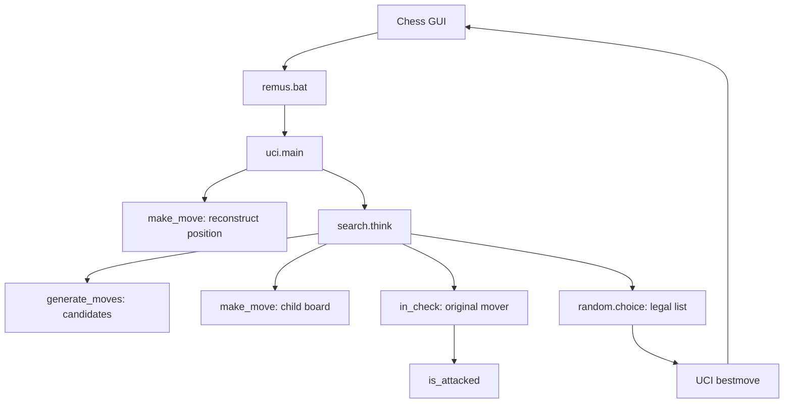

# Remus1: complete line-by-line review and explanation

Remus1 generates legal chess moves and chooses one at random. Its central lesson is
that a program can obey the movement rules without evaluating which move is good.
This document explains every physical line in the six runtime Python modules,
the Windows launcher, and the shared verifier stored beside them. It covers **783
source lines**, including comments, docstrings, blank lines, data, and closing
punctuation. Every code/data line has an individual explanation.

## Cache and call diagrams

Remus1 has no transposition table and allocates no search cache.

The [engine README](../../docs/engines/Remus1/README.md#the-call-tree) contains
the Mermaid module overview and focused function diagrams. Editable `.mmd`
sources and rendered SVGs live beside that README in `mermaid/`.

## Reading guide

Read the files in the order below: representation, attacks, move application,
move generation, move choice, UCI, launcher, and verification. Each source row
retains its original file line number. Section headings group related lines without
omitting any. Blank lines are shown explicitly. Indentation is preserved in the
source column because indentation determines Python's block structure.

Source text is reproduced exactly apart from line-ending normalization and HTML
escaping used to display it. Explanations describe the code's actual behavior,
including assumptions and limitations; they do not silently replace it with a
stronger implementation. The final coverage table gives source hashes for detecting
whether a file still matches these line numbers.

| File | Role | Physical lines | Code/data lines |
| --- | --- | ---: | ---: |
| [board.py](board.py) | Representation and square conversion | 59 | 15 |
| [attacks.py](attacks.py) | Attack and check detection | 59 | 34 |
| [make_move.py](make_move.py) | Apply a candidate to a copied position | 50 | 23 |
| [move_generation.py](move_generation.py) | Generate movement candidates | 103 | 65 |
| [search.py](search.py) | Filter candidates and choose randomly | 29 | 12 |
| [uci.py](uci.py) | Read GUI commands and report a move | 78 | 44 |
| [remus.bat](remus.bat) | Launch the Python UCI process | 1 | 1 |
| [verify_remus.py](verify_remus.py) | Standalone shared verifier | 404 | 293 |
| **Total** | | **783** | **487** |

The runtime Python engine contains **193 code lines**. The other 294 code/data
lines belong to the launcher and verifier. Counts include multiline statement and
data-literal lines but exclude blank lines, comments, and docstrings.
`__pycache__` contains interpreter-generated bytecode, not additional authored
engine source. This explanation document is not an executable engine component.

## The complete path from a command to a move

For `position startpos moves e2e4`, uci.py starts with the initial board and converts
`e2e4` to `(52, 36, 0)`. make_move() copies the board, moves the White pawn, sets
e3 as the en passant target, and switches the turn to Black. When the GUI sends
`go`, think() generates Black's candidates, makes each on a copy, rejects any that
leave Black's king attacked, and randomly selects from the remaining moves.
uci.py converts the selected tuple back to text and prints `bestmove ...`.

The verifier is a separate entry point. It imports the same runtime modules, counts
legal move sequences, and starts an independent uci.py subprocess for a short
protocol conversation. The playing engine never imports verify_remus.py.

## Representation and Python concepts used throughout

### Board coordinates and piece numbers

Row 0 is rank 8 and column 0 is file a. A square's index is `row * 8 + col`.
Thus a8=0, h8=7, a1=56, h1=63, e2=52, and e4=36. Integer division `square // 8`
recovers the row, while remainder `square % 8` recovers the column.

| Kind | Black code | White code |
| --- | ---: | ---: |
| Pawn | 1 | 9 |
| Knight | 2 | 10 |
| Bishop | 3 | 11 |
| Rook | 4 | 12 |
| Queen | 5 | 13 |
| King | 6 | 14 |

Empty squares contain 0. White's color flag is 8. For a White knight, binary
`1010 & 0111` is `0010`, so `piece & 7` gives kind 2. The mask `piece & 8`
keeps only its color flag. Piece codes are identifiers, not relative piece values.

A Position is `(board, white, castling, en_passant)`. A Move is
`(from_square, to_square, promotion)`. Castling bits are 1 for White kingside,
2 for White queenside, 4 for Black kingside, and 8 for Black queenside. All rights
sum to 15. The en passant field is the skipped square, or -1 when absent.

### Lists, tuples, annotations, and control flow

- A list is mutable. `board[:]` creates a new list containing the same integer
  values, so modifying the child board cannot modify its parent.
- A tuple's fields cannot be reassigned, but a list inside a tuple remains mutable.
  Copy-make is a programming discipline, not a consequence of the Position type.
- A type hint such as `list[int]`, `Position`, or `Move | None` describes intended
  values to readers and tools. It does not enforce chess validity at runtime.
- `if`, `for`, `while`, and `def` end their headers with a colon; indentation defines
  their bodies. `return` ends the current call, `continue` skips to the next loop
  iteration, and `break` exits the nearest loop.
- `value_if_true if condition else value_if_false` is a conditional expression.
  It evaluates only the selected branch.
- `and` and `or` short-circuit from left to right. Bounds checks before board
  indexing therefore prevent off-board access in the attack and piece-ray loops.
- Empty lists, integer zero, and None are false in conditions. `is None` tests the
  sentinel explicitly rather than relying on general truthiness.
- An import runs module-level initialization once per module in a process and
  creates access to its definitions. Function bodies run only when called.
- A docstring is the first string expression in a module, function, or class.
  It supplies documentation metadata. Comments begin with `#` outside a string
  and have no runtime effect. Blank source lines organize the presentation.

### Chess and testing vocabulary

A **pseudo-legal move** obeys the piece's movement rules but may leave its own king
in check. A **legal move** also survives the final king-safety test. A **ply** is one
move by one side. **Perft** counts all legal sequences to a specified ply depth;
it counts distinct move sequences even when some end at the same board.

**UCI** is the text protocol between the GUI and engine. Standard input carries
commands and standard output carries replies. **FEN** represents an entire
position as text; this verifier converts FEN fixtures, but Remus1's UCI adapter
supports only reconstruction from the starting position and move list. **SAN**,
such as `Nf3`, is not used internally. A **smoke test** checks basic operation without
claiming exhaustive correctness.

## Review findings and operating assumptions

| Area | Actual behavior | Consequence |
| --- | --- | --- |
| Legal selection | think() makes and filters every candidate before random choice | Pins, discovered checks, and en passant exposure are handled on the child board |
| Position ownership | make_move() copies its board before editing | Searching candidates preserves the parent; callers must not mutate START_BOARD directly |
| Playing strength | No evaluation, look-ahead search, or preference for material | Every move tuple in the legal list has equal selection probability, including distinct promotion choices |
| Input trust | position moves and timing tokens receive no comprehensive validation | Malformed or illegal GUI input can raise exceptions or construct invalid positions |
| Castling state | Rights are maintained from legal move history and home-square events | The castling helper assumes the rights imply the correct king and rook are present |
| Draw adjudication | No repetition history, halfmove clock, or insufficient-material adjudicator | Legal move generation is not a complete game-result adjudicator; the GUI handles such game results |
| Terminal positions | No legal moves means None and bestmove 0000 | Remus1 does not distinguish checkmate from stalemate in its returned result |
| Time allowance | The UCI layer computes seconds; think() ignores it | Remus1 responds after move generation/filtering, without enforcing or deliberately spending the requested budget |
| Protocol subset | uci, isready, position startpos moves, go, and quit are recognized | FEN positions and other UCI options are not implemented; unknown commands are ignored |
| Launcher | uv run uci.py uses a relative script path | The engine folder must be the working directory; the verifier bypasses the batch file |
| UCI verification | The checker requires identity, readiness tokens, and a bestmove prefix | It does not establish that the returned move is syntactically valid or legal |
| Shared verifier | Later-version fixtures and branches coexist with Remus1 checks | Their constants are initialized, but Remus1 skips evaluation and scored-search verification |

These findings describe the source's contracts and limits. A movement generator
can produce only legal moves under its valid-position assumptions while its UCI
smoke test remains too weak to establish that property independently.

### What would make the UCI test verify returned-move legality?

The existing `verify_uci()` does not do this. Its line 382 accepts any last line
beginning with `bestmove` followed by a space, including `bestmove nonsense`. It also accepts
`bestmove 0000` after e2e4 even though Black has legal moves.

A legality assertion would need to reconstruct exactly the position sent to the
child, parse the returned move token, build its legal move list using generation,
copy-make, and king-safety filtering, and require membership in that list. The
special token `0000` should be accepted only when the legal list is empty. For the
existing position after e2e4, Black has 20 legal moves, so `0000` must fail.

Using Remus's own rules for that comparison checks protocol integration and catches
formatting or position-reconstruction errors, but can share a rules defect with the
engine. A designer-side comparison with an independent chess implementation would
supply a stronger cross-check. These are review recommendations, not behavior
implemented by the source explained below.

## Line-by-line source reference

Jump to: [board.py](#board-py) | [attacks.py](#attacks-py) | [make_move.py](#make_move-py) | [move_generation.py](#move_generation-py) | [search.py](#search-py) | [uci.py](#uci-py) | [remus.bat](#remus-bat) | [verify_remus.py](#verify_remus-py).

## board.py

This module establishes the common language of the engine. It defines data and conversion helpers but neither generates moves nor communicates with the GUI. Its initialization constructs the one shared starting board.

### Lines 1 to 38: Representation and starting position

| Line | Exact source | Detailed explanation |
| ---: | --- | --- |
| 1 | <code>"""board.py</code> | Opens the triple-quoted docstring for the module. For a module, the filename identifies its documentation; for a callable or class, the following lines explain its contract. Python treats the whole block as one string. |
| 2 | <em>blank</em> | A blank line inside the docstring for the module. It separates prose paragraphs and belongs to the documentation string; it is not a blank line between executable statements. |
| 3 | <code>The board, the starting position, and the names of the squares.</code> | Docstring prose for the module, describing the flat board, piece encoding, square coordinates, and four-field position. Read it as documentation, not as a Python statement. The operational details and assumptions are explained at the executable lines below. |
| 4 | <em>blank</em> | A blank line inside the docstring for the module. It separates prose paragraphs and belongs to the documentation string; it is not a blank line between executable statements. |
| 5 | <code>The board is a list of 64 numbers, one per square. Row 0 is rank 8</code> | Docstring prose for the module, describing the flat board, piece encoding, square coordinates, and four-field position. Read it as documentation, not as a Python statement. The operational details and assumptions are explained at the executable lines below. |
| 6 | <code>and column 0 is file a, and square number row &#42; 8 + col names a</code> | Docstring prose for the module, describing the flat board, piece encoding, square coordinates, and four-field position. Read it as documentation, not as a Python statement. The operational details and assumptions are explained at the executable lines below. |
| 7 | <code>square: a8 is 0, h8 is 7, a1 is 56, and h1 is 63. A piece is its</code> | Docstring prose for the module, describing the flat board, piece encoding, square coordinates, and four-field position. Read it as documentation, not as a Python statement. The operational details and assumptions are explained at the executable lines below. |
| 8 | <code>kind, from 1 for a pawn to 6 for a king, plus 8 if it is White, so</code> | Docstring prose for the module, describing the flat board, piece encoding, square coordinates, and four-field position. Read it as documentation, not as a Python statement. The operational details and assumptions are explained at the executable lines below. |
| 9 | <code>a White knight is 10 and a Black knight is 2. piece &amp; 7 gives the</code> | Docstring prose for the module, describing the flat board, piece encoding, square coordinates, and four-field position. Read it as documentation, not as a Python statement. The operational details and assumptions are explained at the executable lines below. |
| 10 | <code>kind, and 0 is an empty square.</code> | Docstring prose for the module, describing the flat board, piece encoding, square coordinates, and four-field position. Read it as documentation, not as a Python statement. The operational details and assumptions are explained at the executable lines below. |
| 11 | <em>blank</em> | A blank line inside the docstring for the module. It separates prose paragraphs and belongs to the documentation string; it is not a blank line between executable statements. |
| 12 | <code>A position is the tuple (board, white, castling, en_passant): the</code> | Docstring prose for the module, describing the flat board, piece encoding, square coordinates, and four-field position. Read it as documentation, not as a Python statement. The operational details and assumptions are explained at the executable lines below. |
| 13 | <code>board, True when White is to move, the castling rights as four bits,</code> | Docstring prose for the module, describing the flat board, piece encoding, square coordinates, and four-field position. Read it as documentation, not as a Python statement. The operational details and assumptions are explained at the executable lines below. |
| 14 | <code>and the square a pawn just skipped over, or -1.</code> | Docstring prose for the module, describing the flat board, piece encoding, square coordinates, and four-field position. Read it as documentation, not as a Python statement. The operational details and assumptions are explained at the executable lines below. |
| 15 | <code>"""</code> | Closes the docstring for the module. The prose remains documentation metadata; executable definitions or statements resume after this string. |
| 16 | <em>blank</em> | Blank source line. It visually separates definitions or steps and has no runtime effect. |
| 17 | <code>EMPTY, PAWN, KNIGHT, BISHOP, ROOK, QUEEN, KING = range(7)  # Piece kinds</code> | `range(7)` supplies 0 through 6; assignment unpacks them into EMPTY=0, PAWN=1, KNIGHT=2, BISHOP=3, ROOK=4, QUEEN=5, and KING=6. These are piece kinds, not material values. Every engine module agrees on this numbering, so a move's promotion value can use the same codes. |
| 18 | <code>WHITE = 8  # Added to the kind of a White piece</code> | The color flag is 8, binary `1000`. Add it to kinds 1 through 6 to obtain White pieces 9 through 14. Black keeps kinds 1 through 6. Because the low three bits hold the kind, `piece & 7` removes this color flag and `piece & WHITE` keeps it. The value 8 alone is not a valid piece. |
| 19 | <em>blank</em> | Blank source line. It visually separates definitions or steps and has no runtime effect. |
| 20 | <code>Position = tuple&#91;list&#91;int&#93;, bool, int, int&#93;</code> | Defines the type alias `Position`: a tuple containing a mutable list of piece integers, a Boolean side-to-move flag, castling-right bits, and an en passant square. Type hints help readers and type checkers; they do not validate positions at runtime. The tuple does not make its nested board list immutable. |
| 21 | <code>Move = tuple&#91;int, int, int&#93;  # (from square, to square, promotion or 0)</code> | Defines `Move` as three integers: source square, destination square, and promotion kind. `(52, 36, 0)` means e2-e4; `(12, 4, 5)` means e7-e8 promoting to a queen. A normal move uses 0 in the final slot, and captures need no separate flag because the position supplies the captured piece. |
| 22 | <em>blank</em> | Blank source line. It visually separates definitions or steps and has no runtime effect. |
| 23 | <code># The starting position. Every engine can share this code</code> | Explanatory comment associated with the code beginning at line 25. It records the representation, chess rule, or reason for that step. Python ignores this line; the executable annotation explains how the rule is applied. |
| 24 | <code># Row 0 is rank 8 and column 0 is file a. Both sides use the same back rank.</code> | Explanatory comment associated with the code beginning at line 25. It records the representation, chess rule, or reason for that step. Python ignores this line; the executable annotation explains how the rule is applied. |
| 25 | <code>BACK_RANK = &#91;ROOK, KNIGHT, BISHOP, QUEEN, KING, BISHOP, KNIGHT, ROOK&#93;</code> | Lists piece kinds from file a through h: rook, knight, bishop, queen, king, bishop, knight, rook. The queen is on file d and king on file e. These uncolored values directly describe Black's back rank; adding WHITE later creates White's back rank in the same file order. |
| 26 | <code># &#91;PAWN&#93; &#42; 8 is a list of eight pawns while &#91;EMPTY&#93; &#42; 32 is a list of 32 empty squares.</code> | Explanatory comment associated with the code beginning at line 29. It records the representation, chess rule, or reason for that step. Python ignores this line; the executable annotation explains how the rule is applied. |
| 27 | <code># The starting board is the Black back rank, the Black pawns,</code> | Explanatory comment associated with the code beginning at line 29. It records the representation, chess rule, or reason for that step. Python ignores this line; the executable annotation explains how the rule is applied. |
| 28 | <code># 32 empty squares, the White pawns, and the White back rank.</code> | Explanatory comment associated with the code beginning at line 29. It records the representation, chess rule, or reason for that step. Python ignores this line; the executable annotation explains how the rule is applied. |
| 29 | <code>START_BOARD = BACK_RANK + &#91;PAWN&#93; &#42; 8 + &#91;EMPTY&#93; &#42; 32 + &#91;WHITE + PAWN&#93; &#42; 8</code> | Concatenates five rank groups into a new 56-element list: Black's eight back-rank pieces, eight Black pawns, 32 empty squares, and eight White pawns. The final White back rank is appended below. Multiplying lists of immutable integers is safe here; this is not the problematic case of repeating a mutable row object. |
| 30 | <code># The White pieces are the same as the Black pieces, but with WHITE added to the kind.</code> | Explanatory comment associated with the code beginning at line 31. It records the representation, chess rule, or reason for that step. Python ignores this line; the executable annotation explains how the rule is applied. |
| 31 | <code>for kind in BACK_RANK:</code> | Iterates through the eight kind numbers in BACK_RANK. This loop runs when the module is imported, as part of constructing the starting board, rather than every time a move is searched. |
| 32 | <code>&nbsp;&nbsp;&nbsp;&nbsp;START_BOARD.append(WHITE + kind)</code> | Appends each kind with the White flag added. After eight iterations START_BOARD contains exactly 64 entries, ending with `[12, 10, 11, 13, 14, 11, 10, 12]` on rank 1. `append` mutates this initialization list; move application later copies boards instead of mutating the live position. |
| 33 | <code># True = White moves first</code> | Explanatory comment associated with the code beginning at line 36. It records the representation, chess rule, or reason for that step. Python ignores this line; the executable annotation explains how the rule is applied. |
| 34 | <code># 15 =  All four castling rights: 1 + 2 for White, 4 + 8 for Black</code> | Explanatory comment associated with the code beginning at line 36. It records the representation, chess rule, or reason for that step. Python ignores this line; the executable annotation explains how the rule is applied. |
| 35 | <code># -1 = No pawn has just moved two squares</code> | Explanatory comment associated with the code beginning at line 36. It records the representation, chess rule, or reason for that step. Python ignores this line; the executable annotation explains how the rule is applied. |
| 36 | <code>START_POSITION = (START_BOARD, True, 15, -1)</code> | Builds the starting position: White moves first, 15 enables all four castling rights, and -1 means there is no en passant target. The tuple references START_BOARD rather than copying it. This shared starting object stays safe only because callers treat its board as read-only and make_move() copies before editing. |
| 37 | <em>blank</em> | Blank source line. It visually separates definitions or steps and has no runtime effect. |
| 38 | <em>blank</em> | Blank source line. It visually separates definitions or steps and has no runtime effect. |

### Lines 39 to 43: is_own(): test piece ownership

| Line | Exact source | Detailed explanation |
| ---: | --- | --- |
| 39 | <code>def is_own(piece: int, white: bool) -&gt; bool:</code> | Defines a helper whose inputs are an encoded piece and the color to test. The result is Boolean. Here `white` means 'does this piece belong to White?' rather than always meaning the position's side to move; callers can pass `not white` to ask about an enemy piece. |
| 40 | <code>&nbsp;&nbsp;&nbsp;&nbsp;"""Return True if the piece belongs to White (white is True) or Black."""</code> | A one-line docstring attached to is_own(). It states the callable's contract in prose and is available as documentation metadata; it does not perform the operation described. |
| 41 | <code>&nbsp;&nbsp;&nbsp;&nbsp;return piece &gt; WHITE if white else EMPTY &lt; piece &lt; WHITE</code> | Uses a conditional expression: for White, accept piece values greater than 8; for Black, accept values strictly between 0 and 8. Empty=0 fails both branches. For valid pieces, 10 belongs to White and 2 to Black. This assumes valid encoding: it does not reject every out-of-range integer. |
| 42 | <em>blank</em> | Blank source line. It visually separates definitions or steps and has no runtime effect. |
| 43 | <em>blank</em> | Blank source line. It visually separates definitions or steps and has no runtime effect. |

### Lines 44 to 53: parse_square(): text to index

| Line | Exact source | Detailed explanation |
| ---: | --- | --- |
| 44 | <code>def parse_square(text: str) -&gt; int:</code> | Defines conversion from a two-character algebraic square name to a 0-based board index. The function expects a lowercase file a-h and a rank 1-8; parsing a whole UCI move happens in uci.py instead. |
| 45 | <code>&nbsp;&nbsp;&nbsp;&nbsp;"""Return the square that text such as "e2" names."""</code> | A one-line docstring attached to parse_square(). It states the callable's contract in prose and is available as documentation metadata; it does not perform the operation described. |
| 46 | <code>&nbsp;&nbsp;&nbsp;&nbsp;# text&#91;0&#93; is the file letter and text&#91;1&#93; is the rank digit.</code> | Explanatory comment associated with the code beginning at line 51. It records the representation, chess rule, or reason for that step. Python ignores this line; the executable annotation explains how the rule is applied. |
| 47 | <code>&nbsp;&nbsp;&nbsp;&nbsp;# Row 0 is rank 8, so the ranks are listed from 8 down to 1: the position</code> | Explanatory comment associated with the code beginning at line 51. It records the representation, chess rule, or reason for that step. Python ignores this line; the executable annotation explains how the rule is applied. |
| 48 | <code>&nbsp;&nbsp;&nbsp;&nbsp;# of "2" in "87654321" is 6, so rank 2 is row 6.</code> | Explanatory comment associated with the code beginning at line 51. It records the representation, chess rule, or reason for that step. Python ignores this line; the executable annotation explains how the rule is applied. |
| 49 | <code>&nbsp;&nbsp;&nbsp;&nbsp;# The position of "e" in "abcdefgh" is 4, so file e is column 4.</code> | Explanatory comment associated with the code beginning at line 51. It records the representation, chess rule, or reason for that step. Python ignores this line; the executable annotation explains how the rule is applied. |
| 50 | <code>&nbsp;&nbsp;&nbsp;&nbsp;# Each row holds 8 squares, so e2 is square 6 &#42; 8 + 4 = 52.</code> | Explanatory comment associated with the code beginning at line 51. It records the representation, chess rule, or reason for that step. Python ignores this line; the executable annotation explains how the rule is applied. |
| 51 | <code>&nbsp;&nbsp;&nbsp;&nbsp;return "87654321".index(text&#91;1&#93;) &#42; 8 + "abcdefgh".index(text&#91;0&#93;)</code> | Finds the rank in the reverse string `87654321`, multiplies that row by 8, and adds the file's index in `abcdefgh`. For e2, the row is 6 and column is 4, giving 52. `str.index()` raises ValueError for an unknown character; too-short text can raise IndexError. The function does not validate extra trailing text. |
| 52 | <em>blank</em> | Blank source line. It visually separates definitions or steps and has no runtime effect. |
| 53 | <em>blank</em> | Blank source line. It visually separates definitions or steps and has no runtime effect. |

### Lines 54 to 59: square_name(): index to text

| Line | Exact source | Detailed explanation |
| ---: | --- | --- |
| 54 | <code>def square_name(square: int) -&gt; str:</code> | Defines conversion from a board index to algebraic notation. It expects an integer from 0 through 63 and returns a two-character string. It is used for UCI output and by the verifier when formatting moves. |
| 55 | <code>&nbsp;&nbsp;&nbsp;&nbsp;"""Return the name of a square, such as "e2"."""</code> | A one-line docstring attached to square_name(). It states the callable's contract in prose and is available as documentation metadata; it does not perform the operation described. |
| 56 | <code>&nbsp;&nbsp;&nbsp;&nbsp;# This undoes parse_square(). For square 52, the remainder 52 % 8 = 4 is the</code> | Explanatory comment associated with the code beginning at line 59. It records the representation, chess rule, or reason for that step. Python ignores this line; the executable annotation explains how the rule is applied. |
| 57 | <code>&nbsp;&nbsp;&nbsp;&nbsp;# column, and letter 4 of "abcdefgh" is "e". The whole-number division</code> | Explanatory comment associated with the code beginning at line 59. It records the representation, chess rule, or reason for that step. Python ignores this line; the executable annotation explains how the rule is applied. |
| 58 | <code>&nbsp;&nbsp;&nbsp;&nbsp;# 52 // 8 = 6 is the row, and digit 6 of "87654321" is "2".</code> | Explanatory comment associated with the code beginning at line 59. It records the representation, chess rule, or reason for that step. Python ignores this line; the executable annotation explains how the rule is applied. |
| 59 | <code>&nbsp;&nbsp;&nbsp;&nbsp;return "abcdefgh"&#91;square % 8&#93; + "87654321"&#91;square // 8&#93;</code> | `square % 8` gives the file column and `square // 8` gives the row. The two string lookups turn those numbers into a file and rank, then `+` concatenates them. Index 52 gives `e` plus `2`. Valid board indices round-trip through parse_square(); out-of-range values are outside this function's contract. |

### File review: board.py

The board convention is consistent in both conversion directions: e2 maps to 52 and 52 maps to e2. The module assumes valid indices and piece encodings. Its type aliases are descriptions, not validators, and START_POSITION still contains a mutable list.

## attacks.py

This module answers geometric attack questions without changing the board. Looking outward from the target makes sliding blockers easy to handle and keeps king-safety logic independent of candidate generation.

### Lines 1 to 26: Shared movement geometry

| Line | Exact source | Detailed explanation |
| ---: | --- | --- |
| 1 | <code>"""attacks.py</code> | Opens the triple-quoted docstring for the module. For a module, the filename identifies its documentation; for a callable or class, the following lines explain its contract. Python treats the whole block as one string. |
| 2 | <em>blank</em> | A blank line inside the docstring for the module. It separates prose paragraphs and belongs to the documentation string; it is not a blank line between executable statements. |
| 3 | <code>Find out whether a square is attacked. Remus looks out from the</code> | Docstring prose for the module, describing target-centered attack detection and king-safety queries. Read it as documentation, not as a Python statement. The operational details and assumptions are explained at the executable lines below. |
| 4 | <code>square itself: if a knight's jump away there stands an enemy</code> | Docstring prose for the module, describing target-centered attack detection and king-safety queries. Read it as documentation, not as a Python statement. The operational details and assumptions are explained at the executable lines below. |
| 5 | <code>knight, the knight attacks the square, and the same idea works for</code> | Docstring prose for the module, describing target-centered attack detection and king-safety queries. Read it as documentation, not as a Python statement. The operational details and assumptions are explained at the executable lines below. |
| 6 | <code>every piece.</code> | Docstring prose for the module, describing target-centered attack detection and king-safety queries. Read it as documentation, not as a Python statement. The operational details and assumptions are explained at the executable lines below. |
| 7 | <code>"""</code> | Closes the docstring for the module. The prose remains documentation metadata; executable definitions or statements resume after this string. |
| 8 | <em>blank</em> | Blank source line. It visually separates definitions or steps and has no runtime effect. |
| 9 | <code>from board import BISHOP, EMPTY, KING, KNIGHT, PAWN, QUEEN, ROOK, WHITE</code> | Imports the common piece codes and WHITE flag from board.py. Attack detection compares exact encoded piece values, so it needs the kind codes for all attackers as well as EMPTY for ray traversal. Importing board.py also makes its initialized constants available without starting a game. |
| 10 | <em>blank</em> | Blank source line. It visually separates definitions or steps and has no runtime effect. |
| 11 | <code># The eight knight jumps, as (row change, column change)</code> | Explanatory comment associated with the code beginning at line 12. It records the representation, chess rule, or reason for that step. Python ignores this line; the executable annotation explains how the rule is applied. |
| 12 | <code>KNIGHT_JUMPS = (</code> | Begins an immutable tuple of knight offsets. Each element is another tuple `(row_change, column_change)`, not an absolute square. Offsets can be applied at any square; bounds checks later discard jumps off the board. |
| 13 | <code>&nbsp;&nbsp;&nbsp;&nbsp;(-2, -1), (-2, 1), (-1, -2), (-1, 2),</code> | Lists four knight jumps toward decreasing rows: two ranks and one file, or one rank and two files, in both file directions. Decreasing rows means moving toward rank 8 in this coordinate system. These are geometric offsets and work for either piece color. |
| 14 | <code>&nbsp;&nbsp;&nbsp;&nbsp;(1, -2), (1, 2), (2, -1), (2, 1),</code> | Lists the four corresponding jumps toward increasing rows. Together with the preceding line, this supplies all eight knight destinations before edge checks. A knight does not traverse intermediate squares, so occupied intervening squares are irrelevant. |
| 15 | <code>)  # fmt: skip</code> | Closes KNIGHT_JUMPS. The trailing comma on data entries is legal tuple syntax. `# fmt: skip` asks a supporting formatter to preserve the compact table layout; it is a comment and has no effect on move generation. |
| 16 | <em>blank</em> | Blank source line. It visually separates definitions or steps and has no runtime effect. |
| 17 | <code># The eight directions: rooks use the first four, bishops the last</code> | Explanatory comment associated with the code beginning at line 19. It records the representation, chess rule, or reason for that step. Python ignores this line; the executable annotation explains how the rule is applied. |
| 18 | <code># four, and queens and kings all eight</code> | Explanatory comment associated with the code beginning at line 19. It records the representation, chess rule, or reason for that step. Python ignores this line; the executable annotation explains how the rule is applied. |
| 19 | <code>DIRECTIONS = (</code> | Begins the tuple of eight unit directions used for straight and diagonal attacks. The order is deliberate because the next two constants select its first and last four entries. |
| 20 | <code>&nbsp;&nbsp;&nbsp;&nbsp;(-1, 0), (1, 0), (0, -1), (0, 1),</code> | Stores up, down, left, and right as row/column offsets. Rooks slide repeatedly along these directions; a king uses them for only one step. For example, `(0, 1)` moves one file toward h without changing rank. |
| 21 | <code>&nbsp;&nbsp;&nbsp;&nbsp;(-1, -1), (-1, 1), (1, -1), (1, 1),</code> | Stores the four diagonals: both combinations of decreasing row with left/right, followed by increasing row with left/right. Bishops slide along these directions, and queens combine them with the four straight directions. |
| 22 | <code>)  # fmt: skip</code> | Closes DIRECTIONS and preserves its table formatting with `# fmt: skip`. At runtime DIRECTIONS is an eight-element tuple; the formatting comment contributes no data. |
| 23 | <code>STRAIGHT = DIRECTIONS&#91;0:4&#93;  # The rook's four directions</code> | Slices indices 0 through 3 into STRAIGHT. Python excludes the stop index 4, so this contains exactly the four rook directions. Taking a tuple slice produces another tuple and does not alter DIRECTIONS. |
| 24 | <code>DIAGONAL = DIRECTIONS&#91;4:8&#93;  # The bishop's four directions</code> | Slices indices 4 through 7 into DIAGONAL, giving exactly the bishop directions. The separate names let callers select the right geometry without repeating offset literals. |
| 25 | <em>blank</em> | Blank source line. It visually separates definitions or steps and has no runtime effect. |
| 26 | <em>blank</em> | Blank source line. It visually separates definitions or steps and has no runtime effect. |

### Lines 27 to 56: is_attacked(): look outward from the target

| Line | Exact source | Detailed explanation |
| ---: | --- | --- |
| 27 | <code>def is_attacked(board: list&#91;int&#93;, square: int, by_white: bool) -&gt; bool:</code> | Defines the attack query for an existing board, a target square, and the attacking color. It answers whether that color attacks the square, not whether it has a fully legal move there. It reads the board without changing it and returns as soon as any attacker is found. |
| 28 | <code>&nbsp;&nbsp;&nbsp;&nbsp;"""Return True if a piece of the given color attacks the square."""</code> | A one-line docstring attached to is_attacked(). It states the callable's contract in prose and is available as documentation metadata; it does not perform the operation described. |
| 29 | <code>&nbsp;&nbsp;&nbsp;&nbsp;row = square // 8</code> | Converts the target's square number to a row using integer division by 8. For d4, square 35, this gives row 4. All offset calculations begin from this target square rather than scanning outward from every attacking piece. |
| 30 | <code>&nbsp;&nbsp;&nbsp;&nbsp;col = square % 8</code> | Gets the target's column using remainder modulo 8. For d4 the result is 3. Maintaining row and column separately prevents a ray or jump from wrapping across an edge merely because a linear index stays between 0 and 63. |
| 31 | <code>&nbsp;&nbsp;&nbsp;&nbsp;# Add 8 to each kind when White attacks</code> | Explanatory comment associated with the code beginning at line 32. It records the representation, chess rule, or reason for that step. Python ignores this line; the executable annotation explains how the rule is applied. |
| 32 | <code>&nbsp;&nbsp;&nbsp;&nbsp;side = WHITE if by_white else 0</code> | Selects 8 for White attackers and 0 for Black attackers. Adding `side` to PAWN, KNIGHT, and other kind constants below constructs the exact piece integers that count as attackers. |
| 33 | <code>&nbsp;&nbsp;&nbsp;&nbsp;# A White pawn attacks diagonally forward, so it stands one row</code> | Explanatory comment associated with the code beginning at line 35. It records the representation, chess rule, or reason for that step. Python ignores this line; the executable annotation explains how the rule is applied. |
| 34 | <code>&nbsp;&nbsp;&nbsp;&nbsp;# below the square (row + 1)</code> | Explanatory comment associated with the code beginning at line 35. It records the representation, chess rule, or reason for that step. Python ignores this line; the executable annotation explains how the rule is applied. |
| 35 | <code>&nbsp;&nbsp;&nbsp;&nbsp;pawn_steps = ((1, -1), (1, 1)) if by_white else ((-1, -1), (-1, 1))</code> | Builds the reverse offsets for locating an attacking pawn. To attack a target, a White pawn must stand one row below it, at `(row+1, col-1)` or `(row+1, col+1)`; Black uses one row above. These are opposite to the pawn's forward movement direction because the search begins at the attacked square. |
| 36 | <code>&nbsp;&nbsp;&nbsp;&nbsp;# Each kind of attacker: the steps it takes from the square, whether</code> | Explanatory comment associated with the code beginning at line 38. It records the representation, chess rule, or reason for that step. Python ignores this line; the executable annotation explains how the rule is applied. |
| 37 | <code>&nbsp;&nbsp;&nbsp;&nbsp;# it slides on past empty squares, and the pieces that attack that way</code> | Explanatory comment associated with the code beginning at line 38. It records the representation, chess rule, or reason for that step. Python ignores this line; the executable annotation explains how the rule is applied. |
| 38 | <code>&nbsp;&nbsp;&nbsp;&nbsp;for steps, slides, attackers in (</code> | Begins a loop over attack categories. Each category supplies three values: a tuple of direction offsets, a Boolean telling whether to continue along a ray, and a tuple of acceptable encoded attackers. One shared traversal handles all five categories. |
| 39 | <code>&nbsp;&nbsp;&nbsp;&nbsp;&nbsp;&nbsp;&nbsp;&nbsp;(pawn_steps, False, (PAWN + side,)),</code> | Tests pawns at the two reverse pawn offsets, without sliding. `(PAWN + side,)` is a one-element tuple; the comma is essential. Pawn forward pushes are absent because a pawn attacks diagonally, not straight ahead. |
| 40 | <code>&nbsp;&nbsp;&nbsp;&nbsp;&nbsp;&nbsp;&nbsp;&nbsp;(KNIGHT_JUMPS, False, (KNIGHT + side,)),</code> | Tests all eight knight offsets with no sliding and accepts only a knight of the requested color. A bishop or pawn found on one of these squares does not satisfy the membership test. |
| 41 | <code>&nbsp;&nbsp;&nbsp;&nbsp;&nbsp;&nbsp;&nbsp;&nbsp;(DIRECTIONS, False, (KING + side,)),</code> | Tests the eight neighboring squares for the opposing king of the requested color. Kings attack adjacent squares, so this is a single-step category even though DIRECTIONS also serves sliding pieces. |
| 42 | <code>&nbsp;&nbsp;&nbsp;&nbsp;&nbsp;&nbsp;&nbsp;&nbsp;(STRAIGHT, True, (ROOK + side, QUEEN + side)),</code> | Tests straight rays, passing through empty squares until a blocker or board edge. Either a rook or queen of the requested color on the first occupied square attacks the target along that ray. |
| 43 | <code>&nbsp;&nbsp;&nbsp;&nbsp;&nbsp;&nbsp;&nbsp;&nbsp;(DIAGONAL, True, (BISHOP + side, QUEEN + side)),</code> | Tests diagonal rays in the same way and accepts a bishop or queen. A queen is therefore covered by both ray categories, while every individual ray still stops at the first occupied square. |
| 44 | <code>&nbsp;&nbsp;&nbsp;&nbsp;):</code> | Closes the tuple of five attack categories and ends the for-loop header with a colon. The indented body below runs once for each category, with its own steps, sliding flag, and allowed attackers. |
| 45 | <code>&nbsp;&nbsp;&nbsp;&nbsp;&nbsp;&nbsp;&nbsp;&nbsp;for row_change, col_change in steps:</code> | Unpacks one direction into its row and column changes. The inner body examines one potential line or jump from the target square at a time. |
| 46 | <code>&nbsp;&nbsp;&nbsp;&nbsp;&nbsp;&nbsp;&nbsp;&nbsp;&nbsp;&nbsp;&nbsp;&nbsp;r = row + row_change</code> | Starts at the neighboring row or knight-offset row, excluding the target square itself. For a rook direction this is one row away or the same row; for a knight it can be two rows away. |
| 47 | <code>&nbsp;&nbsp;&nbsp;&nbsp;&nbsp;&nbsp;&nbsp;&nbsp;&nbsp;&nbsp;&nbsp;&nbsp;c = col + col_change</code> | Starts at the corresponding column offset. Combined with the previous line, r and c identify the first candidate attacker square. |
| 48 | <code>&nbsp;&nbsp;&nbsp;&nbsp;&nbsp;&nbsp;&nbsp;&nbsp;&nbsp;&nbsp;&nbsp;&nbsp;while slides and 0 &lt;= r &lt; 8 and 0 &lt;= c &lt; 8 and board&#91;r &#42; 8 + c&#93; == EMPTY:</code> | Continues only for sliding pieces while the coordinates are inside the board and the square is empty. Python evaluates `and` left to right, so it checks bounds before indexing board. Non-sliders skip the loop entirely and test only their single candidate square below. |
| 49 | <code>&nbsp;&nbsp;&nbsp;&nbsp;&nbsp;&nbsp;&nbsp;&nbsp;&nbsp;&nbsp;&nbsp;&nbsp;&nbsp;&nbsp;&nbsp;&nbsp;r += row_change</code> | Advances the row along the ray. A horizontal direction has row_change=0, so the row stays fixed while the next line advances the column. |
| 50 | <code>&nbsp;&nbsp;&nbsp;&nbsp;&nbsp;&nbsp;&nbsp;&nbsp;&nbsp;&nbsp;&nbsp;&nbsp;&nbsp;&nbsp;&nbsp;&nbsp;c += col_change</code> | Advances the column along the ray. A vertical direction leaves the column unchanged. For a diagonal, both coordinates advance; the loop eventually reaches an occupied square or a board edge. |
| 51 | <code>&nbsp;&nbsp;&nbsp;&nbsp;&nbsp;&nbsp;&nbsp;&nbsp;&nbsp;&nbsp;&nbsp;&nbsp;# The first piece on the line attacks if it is the right kind</code> | Explanatory comment associated with the code beginning at line 52. It records the representation, chess rule, or reason for that step. Python ignores this line; the executable annotation explains how the rule is applied. |
| 52 | <code>&nbsp;&nbsp;&nbsp;&nbsp;&nbsp;&nbsp;&nbsp;&nbsp;&nbsp;&nbsp;&nbsp;&nbsp;if 0 &lt;= r &lt; 8 and 0 &lt;= c &lt; 8 and board&#91;r &#42; 8 + c&#93; in attackers:</code> | After traversal, checks bounds again and asks whether the first encountered piece is one of the permitted attackers. A friendly blocker or wrong enemy kind ends this ray without an attack; the function does not look through that piece. |
| 53 | <code>&nbsp;&nbsp;&nbsp;&nbsp;&nbsp;&nbsp;&nbsp;&nbsp;&nbsp;&nbsp;&nbsp;&nbsp;&nbsp;&nbsp;&nbsp;&nbsp;return True</code> | Returns True immediately after finding an attacker. Further directions and piece categories cannot change a positive answer, so this early return avoids unnecessary work. |
| 54 | <code>&nbsp;&nbsp;&nbsp;&nbsp;return False</code> | Returns False only after every attack category and direction has been examined without success. Its indentation puts it outside both loops. |
| 55 | <em>blank</em> | Blank source line. It visually separates definitions or steps and has no runtime effect. |
| 56 | <em>blank</em> | Blank source line. It visually separates definitions or steps and has no runtime effect. |

### Lines 57 to 59: in_check(): locate and test the king

| Line | Exact source | Detailed explanation |
| ---: | --- | --- |
| 57 | <code>def in_check(board: list&#91;int&#93;, white: bool) -&gt; bool:</code> | Defines the check query for a particular king color. This is a convenience wrapper around is_attacked(); it does not depend on whose turn the position tuple says it is. |
| 58 | <code>&nbsp;&nbsp;&nbsp;&nbsp;"""Return True if the king of the given color is attacked."""</code> | A one-line docstring attached to in_check(). It states the callable's contract in prose and is available as documentation metadata; it does not perform the operation described. |
| 59 | <code>&nbsp;&nbsp;&nbsp;&nbsp;return is_attacked(board, board.index(KING + WHITE if white else KING), not white)</code> | Finds the king's square with list.index(): White's king is 14 and Black's is 6. It then asks whether the opposite color attacks that square. A missing king raises ValueError; valid engine positions require one king of each color. The board is only read. |

### File review: attacks.py

An attack query is not a call to generate the attacking side's fully legal moves. It intentionally examines piece geometry and blockers directly. This avoids recursion between move generation and king-safety checking. Each valid position must contain a king of each color for board.index() to succeed.

## make_move.py

This module transforms one position into a child. It assumes the candidate has a valid structure and uses copy-make so the caller can inspect many children without undoing moves. The caller remains responsible for rejecting an exposed king.

### Lines 1 to 20: Copy-make contract and castling masks

| Line | Exact source | Detailed explanation |
| ---: | --- | --- |
| 1 | <code>"""make_move.py</code> | Opens the triple-quoted docstring for the module. For a module, the filename identifies its documentation; for a callable or class, the following lines explain its contract. Python treats the whole block as one string. |
| 2 | <em>blank</em> | A blank line inside the docstring for the module. It separates prose paragraphs and belongs to the documentation string; it is not a blank line between executable statements. |
| 3 | <code>Play a move. Remus never takes a move back: make_move() copies the</code> | Docstring prose for the module, describing copying a position and applying ordinary and special moves. Read it as documentation, not as a Python statement. The operational details and assumptions are explained at the executable lines below. |
| 4 | <code>board, plays the move on the copy, and returns the new position.</code> | Docstring prose for the module, describing copying a position and applying ordinary and special moves. Read it as documentation, not as a Python statement. The operational details and assumptions are explained at the executable lines below. |
| 5 | <code>The search throws the copy away when it is done with it.</code> | Docstring prose for the module, describing copying a position and applying ordinary and special moves. Read it as documentation, not as a Python statement. The operational details and assumptions are explained at the executable lines below. |
| 6 | <code>"""</code> | Closes the docstring for the module. The prose remains documentation metadata; executable definitions or statements resume after this string. |
| 7 | <em>blank</em> | Blank source line. It visually separates definitions or steps and has no runtime effect. |
| 8 | <code>from board import EMPTY, KING, PAWN, WHITE, Move, Position</code> | Imports the piece codes needed for special moves and the Position and Move type aliases. This module does not import the legal move generator: applying a candidate move and deciding whether it is legal are separate responsibilities. |
| 9 | <em>blank</em> | Blank source line. It visually separates definitions or steps and has no runtime effect. |
| 10 | <code># The castling rights are four on-off switches added into one number:</code> | Explanatory comment associated with the code beginning at line 18. It records the representation, chess rule, or reason for that step. Python ignores this line; the executable annotation explains how the rule is applied. |
| 11 | <code># 1 = White may castle kingside, 2 = White queenside, 4 = Black kingside,</code> | Explanatory comment associated with the code beginning at line 18. It records the representation, chess rule, or reason for that step. Python ignores this line; the executable annotation explains how the rule is applied. |
| 12 | <code># 8 = Black queenside. All four on is 1 + 2 + 4 + 8 = 15.</code> | Explanatory comment associated with the code beginning at line 18. It records the representation, chess rule, or reason for that step. Python ignores this line; the executable annotation explains how the rule is applied. |
| 13 | <code># The dictionary below looks up a square and gives the switches that a</code> | Explanatory comment associated with the code beginning at line 18. It records the representation, chess rule, or reason for that step. Python ignores this line; the executable annotation explains how the rule is applied. |
| 14 | <code># move from or to that square turns off for good. The White king leaving</code> | Explanatory comment associated with the code beginning at line 18. It records the representation, chess rule, or reason for that step. Python ignores this line; the executable annotation explains how the rule is applied. |
| 15 | <code># e1 (square 60) turns off 1 + 2 = 3, both of White's rights. A rook</code> | Explanatory comment associated with the code beginning at line 18. It records the representation, chess rule, or reason for that step. Python ignores this line; the executable annotation explains how the rule is applied. |
| 16 | <code># leaving h1 (63), or a capture there, turns off 1.</code> | Explanatory comment associated with the code beginning at line 18. It records the representation, chess rule, or reason for that step. Python ignores this line; the executable annotation explains how the rule is applied. |
| 17 | <code># The squares: e1 60, h1 63, a1 56, e8 4, h8 7, a8 0</code> | Explanatory comment associated with the code beginning at line 18. It records the representation, chess rule, or reason for that step. Python ignores this line; the executable annotation explains how the rule is applied. |
| 18 | <code>RIGHTS_OF_SQUARE = {60: 3, 63: 1, 56: 2, 4: 12, 7: 4, 0: 8}</code> | Maps six home squares to castling rights to clear: e1=60 removes White's 1+2, h1=63 removes 1, a1=56 removes 2, e8=4 removes Black's 4+8, h8=7 removes 4, and a8=0 removes 8. Checking destinations as well as origins handles a rook captured on its home square. |
| 19 | <em>blank</em> | Blank source line. It visually separates definitions or steps and has no runtime effect. |
| 20 | <em>blank</em> | Blank source line. It visually separates definitions or steps and has no runtime effect. |

### Lines 21 to 50: make_move(): construct the child position

| Line | Exact source | Detailed explanation |
| ---: | --- | --- |
| 21 | <code>def make_move(position: Position, move: Move) -&gt; Position:</code> | Defines copy-make: accept one position and a move tuple, and return a new position. The function assumes a structurally valid candidate move; it does not check whose piece moves, movement geometry, or king safety itself. |
| 22 | <code>&nbsp;&nbsp;&nbsp;&nbsp;"""Return the position after the move, including the special moves."""</code> | A one-line docstring attached to make_move(). It states the callable's contract in prose and is available as documentation metadata; it does not perform the operation described. |
| 23 | <code>&nbsp;&nbsp;&nbsp;&nbsp;board, white, castling, en_passant = position</code> | Unpacks the four position fields into local names. At this instant board still references the caller's list; white, castling, and en_passant are immutable Boolean/integer values. |
| 24 | <code>&nbsp;&nbsp;&nbsp;&nbsp;start, target, promotion = move</code> | Unpacks the move's source square, destination square, and optional promotion kind. These integer values are the native representation used throughout the engine, independent of UCI text. |
| 25 | <code>&nbsp;&nbsp;&nbsp;&nbsp;board = board&#91;:&#93;  # The copy: the caller's board stays as it was</code> | Copies the entire 64-element board list and rebinds the local name board to that copy. A shallow copy is sufficient because elements are immutable integers. All subsequent board edits affect the copy, so another candidate move can start from the unchanged parent position. |
| 26 | <code>&nbsp;&nbsp;&nbsp;&nbsp;piece = board&#91;start&#93;</code> | Reads the moving piece from the copied source square before that square is cleared. Its encoded value carries both kind and color; that color must survive promotion. |
| 27 | <code>&nbsp;&nbsp;&nbsp;&nbsp;is_pawn = piece &amp; 7 == PAWN</code> | Masks off the color and compares the low three bits with PAWN. Bitwise `&` binds more tightly than `==`, so the expression means `(piece & 7) == PAWN`. The resulting Boolean controls en passant and double-push handling. |
| 28 | <code>&nbsp;&nbsp;&nbsp;&nbsp;distance = abs(target - start)</code> | Measures absolute linear-index distance. A legal pawn double push spans 16 entries and a legal castling king move spans 2. This is not a general chess distance: those values identify special moves only under the valid-move assumptions of their piece-specific conditions. |
| 29 | <code>&nbsp;&nbsp;&nbsp;&nbsp;# En passant: the captured pawn stands beside the pawn that</code> | Explanatory comment associated with the code beginning at line 31. It records the representation, chess rule, or reason for that step. Python ignores this line; the executable annotation explains how the rule is applied. |
| 30 | <code>&nbsp;&nbsp;&nbsp;&nbsp;# moves, not on the square it lands on</code> | Explanatory comment associated with the code beginning at line 31. It records the representation, chess rule, or reason for that step. Python ignores this line; the executable annotation explains how the rule is applied. |
| 31 | <code>&nbsp;&nbsp;&nbsp;&nbsp;if is_pawn and target == en_passant:</code> | Recognizes an en passant candidate when a pawn's destination equals the position's current en passant target. It relies on the generator or trusted UCI sequence to make that target meaningful; it does not independently verify a capturable enemy pawn. |
| 32 | <code>&nbsp;&nbsp;&nbsp;&nbsp;&nbsp;&nbsp;&nbsp;&nbsp;board&#91;start // 8 &#42; 8 + target % 8&#93; = EMPTY</code> | Clears the captured pawn on the moving pawn's original row and destination file. For e5-d6, start=28 and target=19: `28 // 8 * 8 + 19 % 8` gives d5=27. The victim is removed before king safety is checked, so discovered rook or bishop attacks are visible in the child board. |
| 33 | <code>&nbsp;&nbsp;&nbsp;&nbsp;# Castling: the king moves two squares, and the rook jumps to the</code> | Explanatory comment associated with the code beginning at line 35. It records the representation, chess rule, or reason for that step. Python ignores this line; the executable annotation explains how the rule is applied. |
| 34 | <code>&nbsp;&nbsp;&nbsp;&nbsp;# square the king crossed</code> | Explanatory comment associated with the code beginning at line 35. It records the representation, chess rule, or reason for that step. Python ignores this line; the executable annotation explains how the rule is applied. |
| 35 | <code>&nbsp;&nbsp;&nbsp;&nbsp;if piece &amp; 7 == KING and distance == 2:</code> | Recognizes a castling candidate as a king moving two board indices. Legal generation supplies same-rank e1-g1, e1-c1, e8-g8, or e8-c8 moves; arbitrary two-index king moves are not validated here. |
| 36 | <code>&nbsp;&nbsp;&nbsp;&nbsp;&nbsp;&nbsp;&nbsp;&nbsp;rook = start + 3 if target &gt; start else start - 4</code> | Locates the rook on the appropriate home square. From e1=60, kingside uses 60+3=63 (h1), and queenside uses 60-4=56 (a1). The same offsets work for Black because file order is unchanged on rank 8. |
| 37 | <code>&nbsp;&nbsp;&nbsp;&nbsp;&nbsp;&nbsp;&nbsp;&nbsp;board&#91;(start + target) // 2&#93; = board&#91;rook&#93;</code> | Moves the rook to the square halfway between the king's origin and destination. For e1-g1, `(60+62)//2` is f1=61; for e1-c1 it is d1=59. The king itself is placed on its destination later. |
| 38 | <code>&nbsp;&nbsp;&nbsp;&nbsp;&nbsp;&nbsp;&nbsp;&nbsp;board&#91;rook&#93; = EMPTY</code> | Clears the rook's home square after placing it on the transit square. The source board remains untouched because this is the copied board. The code assumes the castling rights and board actually describe an available rook. |
| 39 | <code>&nbsp;&nbsp;&nbsp;&nbsp;# A two-square pawn move lets an enemy pawn capture it en passant</code> | Explanatory comment associated with the code beginning at line 41. It records the representation, chess rule, or reason for that step. Python ignores this line; the executable annotation explains how the rule is applied. |
| 40 | <code>&nbsp;&nbsp;&nbsp;&nbsp;# on the next move only</code> | Explanatory comment associated with the code beginning at line 41. It records the representation, chess rule, or reason for that step. Python ignores this line; the executable annotation explains how the rule is applied. |
| 41 | <code>&nbsp;&nbsp;&nbsp;&nbsp;en_passant = (start + target) // 2 if is_pawn and distance == 16 else -1</code> | Sets the next position's en passant target to the skipped square only for a pawn move spanning 16 indices. For e2-e4, `(52+36)//2` is e3=44. Every other move assigns -1, making en passant expire after one reply. A target is recorded even when no enemy pawn can use it. |
| 42 | <code>&nbsp;&nbsp;&nbsp;&nbsp;if promotion:</code> | Treats a nonzero promotion kind as a request to replace the pawn. Zero is false in Python and means no promotion. The function trusts the move tuple to supply a valid promotion kind on a valid last-rank move. |
| 43 | <code>&nbsp;&nbsp;&nbsp;&nbsp;&nbsp;&nbsp;&nbsp;&nbsp;piece = promotion + (piece &amp; WHITE)</code> | Builds the promoted piece by adding the original color bit to the requested kind. A White pawn promoting to a queen becomes 5+8=13; Black becomes 5+0=5. `piece & WHITE` preserves color independently of the pawn's original kind. |
| 44 | <code>&nbsp;&nbsp;&nbsp;&nbsp;board&#91;target&#93; = piece</code> | Places the moving or promoted piece on the destination. For an ordinary capture this overwrites the captured piece; en passant's off-destination capture and castling's rook movement are already handled. |
| 45 | <code>&nbsp;&nbsp;&nbsp;&nbsp;board&#91;start&#93; = EMPTY</code> | Empties the original source square. After this line the copied board contains the complete piece placement for the move, including any special-move side effects. |
| 46 | <code>&nbsp;&nbsp;&nbsp;&nbsp;# A move from or to e1, h1, a1, e8, h8, or a8 turns off the rights of that</code> | Explanatory comment associated with the code beginning at line 48. It records the representation, chess rule, or reason for that step. Python ignores this line; the executable annotation explains how the rule is applied. |
| 47 | <code>&nbsp;&nbsp;&nbsp;&nbsp;# square. Turning off a right that is already off changes nothing.</code> | Explanatory comment associated with the code beginning at line 48. It records the representation, chess rule, or reason for that step. Python ignores this line; the executable annotation explains how the rule is applied. |
| 48 | <code>&nbsp;&nbsp;&nbsp;&nbsp;for square in (start, target):</code> | Visits the source and destination squares in order to update castling rights. Leaving a king/rook home square or capturing on a rook home square can remove a right; a right is never restored by returning a piece to that square. |
| 49 | <code>&nbsp;&nbsp;&nbsp;&nbsp;&nbsp;&nbsp;&nbsp;&nbsp;castling &amp;= ~RIGHTS_OF_SQUARE.get(square, 0)</code> | Looks up rights to clear, using 0 for other squares. `~mask` flips the bits; `castling &= ~mask` keeps only rights not named by the mask. For 15 and White kingside mask 1, the result is 14. Python's unbounded negative complement is safe because the AND starts from the four-bit castling value. |
| 50 | <code>&nbsp;&nbsp;&nbsp;&nbsp;return board, not white, castling, en_passant</code> | Returns a four-item tuple without explicit parentheses. The board is the new list, `not white` switches the turn, and the final integers contain updated castling and en passant information. Remus1 has no halfmove clock or position history in this tuple. |

### File review: make_move.py

For e2-e4, the result has a White pawn at 36, an empty square at 52, Black to move, unchanged castling rights, and en_passant=44. The parent board retains its pawn on 52. Applying an arbitrary or malformed move is outside this function's contract; copying preserves ownership, not legality.

## move_generation.py

This module lists candidates for the side to move. Piece-specific movement and special-move preconditions belong here; the final legal filter belongs to its caller. Every helper appends to an explicit list, making the data flow visible.

### Lines 1 to 13: Candidate-generation contract and imports

| Line | Exact source | Detailed explanation |
| ---: | --- | --- |
| 1 | <code>"""move_generation.py</code> | Opens the triple-quoted docstring for the module. For a module, the filename identifies its documentation; for a callable or class, the following lines explain its contract. Python treats the whole block as one string. |
| 2 | <em>blank</em> | A blank line inside the docstring for the module. It separates prose paragraphs and belongs to the documentation string; it is not a blank line between executable statements. |
| 3 | <code>List the moves of the side to move. A move is a tuple</code> | Docstring prose for the module, describing candidate generation, promotions, rays, and castling preconditions. Read it as documentation, not as a Python statement. The operational details and assumptions are explained at the executable lines below. |
| 4 | <code>(from_square, to_square, promotion), such as (52, 36, 0) for e2e4</code> | Docstring prose for the module, describing candidate generation, promotions, rays, and castling preconditions. Read it as documentation, not as a Python statement. The operational details and assumptions are explained at the executable lines below. |
| 5 | <code>or (12, 4, 5) for e7e8q, where 5 is a queen. The list holds pseudo-legal moves: some</code> | Docstring prose for the module, describing candidate generation, promotions, rays, and castling preconditions. Read it as documentation, not as a Python statement. The operational details and assumptions are explained at the executable lines below. |
| 6 | <code>may leave the mover's own king in check, and the search skips those</code> | Docstring prose for the module, describing candidate generation, promotions, rays, and castling preconditions. Read it as documentation, not as a Python statement. The operational details and assumptions are explained at the executable lines below. |
| 7 | <code>after it makes them.</code> | Docstring prose for the module, describing candidate generation, promotions, rays, and castling preconditions. Read it as documentation, not as a Python statement. The operational details and assumptions are explained at the executable lines below. |
| 8 | <code>"""</code> | Closes the docstring for the module. The prose remains documentation metadata; executable definitions or statements resume after this string. |
| 9 | <em>blank</em> | Blank source line. It visually separates definitions or steps and has no runtime effect. |
| 10 | <code>from attacks import DIAGONAL, DIRECTIONS, KNIGHT_JUMPS, STRAIGHT, is_attacked</code> | Imports shared direction tables and is_attacked(). Reusing the tables keeps movement geometry consistent with attack detection. Castling needs the attack query before a move is made because the king may not start in check or cross an attacked transit square. |
| 11 | <code>from board import BISHOP, EMPTY, KNIGHT, PAWN, QUEEN, ROOK, Move, Position, is_own</code> | Imports piece kinds, empty-square and color-membership helpers, and type aliases. KING is not imported because the dispatcher treats the remaining valid piece kind as a king in its final else branch. |
| 12 | <em>blank</em> | Blank source line. It visually separates definitions or steps and has no runtime effect. |
| 13 | <em>blank</em> | Blank source line. It visually separates definitions or steps and has no runtime effect. |

### Lines 14 to 20: add_pawn_move(): expand promotions

| Line | Exact source | Detailed explanation |
| ---: | --- | --- |
| 14 | <code>def add_pawn_move(moves: list&#91;Move&#93;, start: int, target: int):</code> | Defines an accumulator helper: it appends move tuples to the caller's moves list rather than returning a separate list. `list[Move]` describes the list's element type. The function has no explicit return statement, so its return value is None. |
| 15 | <code>&nbsp;&nbsp;&nbsp;&nbsp;"""Add a pawn move, or its four promotions on the last rank."""</code> | A one-line docstring attached to add_pawn_move(). It states the callable's contract in prose and is available as documentation metadata; it does not perform the operation described. |
| 16 | <code>&nbsp;&nbsp;&nbsp;&nbsp;promotions = (QUEEN, ROOK, BISHOP, KNIGHT) if target &lt; 8 or target &gt;= 56 else (0,)</code> | Checks whether the destination is on row 0 (indices 0-7) or row 7 (56-63). On either last rank it offers queen, rook, bishop, and knight promotion; otherwise `(0,)` supplies one ordinary move. The comma makes the ordinary case a one-element tuple. Valid forward pawn movement determines which last rank belongs to the mover. |
| 17 | <code>&nbsp;&nbsp;&nbsp;&nbsp;for promotion in promotions:</code> | Iterates once for an ordinary move and four times for a last-rank move. Promotions to different pieces count as different legal moves even though they share source and destination squares. |
| 18 | <code>&nbsp;&nbsp;&nbsp;&nbsp;&nbsp;&nbsp;&nbsp;&nbsp;moves.append((start, target, promotion))</code> | Appends `(start, target, promotion)` to the shared list. This helper works for both pawn pushes and pawn captures, so both types receive all four promotion choices. |
| 19 | <em>blank</em> | Blank source line. It visually separates definitions or steps and has no runtime effect. |
| 20 | <em>blank</em> | Blank source line. It visually separates definitions or steps and has no runtime effect. |

### Lines 21 to 39: pawn_moves(): pushes and captures

| Line | Exact source | Detailed explanation |
| ---: | --- | --- |
| 21 | <code>def pawn_moves(board, white, en_passant, start, moves):</code> | Defines pawn-specific generation. Inputs include the board, mover's color, current en passant target, pawn square, and shared output list. It generates movement candidates without testing whether the mover's king is exposed. |
| 22 | <code>&nbsp;&nbsp;&nbsp;&nbsp;"""Add the pushes and captures of the pawn on start."""</code> | A one-line docstring attached to pawn_moves(). It states the callable's contract in prose and is available as documentation metadata; it does not perform the operation described. |
| 23 | <code>&nbsp;&nbsp;&nbsp;&nbsp;# White pawns move toward row 0, one row is 8 squares</code> | Explanatory comment associated with the code beginning at line 24. It records the representation, chess rule, or reason for that step. Python ignores this line; the executable annotation explains how the rule is applied. |
| 24 | <code>&nbsp;&nbsp;&nbsp;&nbsp;forward = -8 if white else 8</code> | White's forward step is -8 because its pawns move toward smaller row numbers; Black's is +8. For a White pawn on e2=52, one forward step reaches e3=44. A signed step lets both colors use the same code. |
| 25 | <code>&nbsp;&nbsp;&nbsp;&nbsp;ahead = start + forward</code> | Computes the one-square forward destination. This assumes a valid pawn position: pawns cannot remain unpromoted on their last rank. There is no explicit bounds check before the following list access. |
| 26 | <code>&nbsp;&nbsp;&nbsp;&nbsp;if board&#91;ahead&#93; == EMPTY:</code> | Allows a forward pawn move only when the destination is empty. Pawns cannot capture straight ahead. This condition also gates the later double push, ensuring a pawn cannot jump over a piece. |
| 27 | <code>&nbsp;&nbsp;&nbsp;&nbsp;&nbsp;&nbsp;&nbsp;&nbsp;add_pawn_move(moves, start, ahead)</code> | Adds the single push through add_pawn_move(), which supplies promotion choices if this destination is on the last rank. If the pawn is on its starting rank, the code can also add a double push below. |
| 28 | <code>&nbsp;&nbsp;&nbsp;&nbsp;&nbsp;&nbsp;&nbsp;&nbsp;# From its first row a pawn may move two squares</code> | Explanatory comment associated with the code beginning at line 29. It records the representation, chess rule, or reason for that step. Python ignores this line; the executable annotation explains how the rule is applied. |
| 29 | <code>&nbsp;&nbsp;&nbsp;&nbsp;&nbsp;&nbsp;&nbsp;&nbsp;first_row = 6 if white else 1</code> | Chooses row 6 (rank 2) for a White pawn's starting row and row 1 (rank 7) for Black. There is no separate 'pawn has moved' flag; in legal play a pawn cannot return to its starting row. |
| 30 | <code>&nbsp;&nbsp;&nbsp;&nbsp;&nbsp;&nbsp;&nbsp;&nbsp;if start // 8 == first_row and board&#91;ahead + forward&#93; == EMPTY:</code> | Requires the pawn to be on its starting row and the second forward square to be empty. The first forward square is already known to be empty from line 26. Short-circuit evaluation avoids reading the second square when the row condition fails. |
| 31 | <code>&nbsp;&nbsp;&nbsp;&nbsp;&nbsp;&nbsp;&nbsp;&nbsp;&nbsp;&nbsp;&nbsp;&nbsp;moves.append((start, ahead + forward, 0))</code> | Appends the double push with promotion=0. A two-square move from a starting rank cannot be a promotion. make_move() later records the skipped square as the next position's en passant target. |
| 32 | <code>&nbsp;&nbsp;&nbsp;&nbsp;for side in (-1, 1):</code> | Examines the adjacent file to the left (-1) and right (+1). Here side is a column offset, not the White color flag or side-to-move Boolean. |
| 33 | <code>&nbsp;&nbsp;&nbsp;&nbsp;&nbsp;&nbsp;&nbsp;&nbsp;if not 0 &lt;= start % 8 + side &lt; 8:</code> | Checks the prospective file before converting it to a linear square number. For a pawn on file a, the left offset gives -1 and is invalid; for file h, the right offset gives 8. This prevents diagonal movement from wrapping to a different rank. |
| 34 | <code>&nbsp;&nbsp;&nbsp;&nbsp;&nbsp;&nbsp;&nbsp;&nbsp;&nbsp;&nbsp;&nbsp;&nbsp;continue  # The edge of the board</code> | Skips only the invalid file direction and proceeds to the other direction. `continue` applies to the for-loop over side, not to the entire pawn-generation function. |
| 35 | <code>&nbsp;&nbsp;&nbsp;&nbsp;&nbsp;&nbsp;&nbsp;&nbsp;target = ahead + side</code> | Combines the forward rank step with the adjacent-file step to form the diagonal capture square. From e5=28, White's destinations are d6=19 and f6=21. |
| 36 | <code>&nbsp;&nbsp;&nbsp;&nbsp;&nbsp;&nbsp;&nbsp;&nbsp;if is_own(board&#91;target&#93;, not white) or target == en_passant:</code> | Adds a diagonal candidate if its square contains an enemy piece or equals the current en passant target. Calling is_own() with `not white` asks about enemy ownership. En passant can qualify with an empty destination; the captured pawn is removed by make_move(). |
| 37 | <code>&nbsp;&nbsp;&nbsp;&nbsp;&nbsp;&nbsp;&nbsp;&nbsp;&nbsp;&nbsp;&nbsp;&nbsp;add_pawn_move(moves, start, target)</code> | Passes a qualifying capture through the promotion helper. Captures onto the last rank produce four alternatives. Legal filtering after copy-make rejects candidates that expose the moving side's king, including pinned-pawn and en passant discoveries. |
| 38 | <em>blank</em> | Blank source line. It visually separates definitions or steps and has no runtime effect. |
| 39 | <em>blank</em> | Blank source line. It visually separates definitions or steps and has no runtime effect. |

### Lines 40 to 57: piece_moves(): jumps and rays

| Line | Exact source | Detailed explanation |
| ---: | --- | --- |
| 40 | <code>def piece_moves(board, white, start, steps, slides, moves):</code> | Defines a shared generator for all nonpawn pieces. `steps` supplies offsets and `slides` distinguishes a rook/bishop/queen ray from a king/knight jump. The function appends to moves and leaves board unchanged. |
| 41 | <code>&nbsp;&nbsp;&nbsp;&nbsp;"""</code> | Opens the triple-quoted docstring for piece_moves(). For a module, the filename identifies its documentation; for a callable or class, the following lines explain its contract. Python treats the whole block as one string. |
| 42 | <code>&nbsp;&nbsp;&nbsp;&nbsp;Add the moves of a knight, bishop, rook, queen, or king. Each step</code> | Docstring prose for piece_moves(), describing candidate generation, promotions, rays, and castling preconditions. Read it as documentation, not as a Python statement. The operational details and assumptions are explained at the executable lines below. |
| 43 | <code>&nbsp;&nbsp;&nbsp;&nbsp;goes one square in steps; a piece that slides keeps going until a</code> | Docstring prose for piece_moves(), describing candidate generation, promotions, rays, and castling preconditions. Read it as documentation, not as a Python statement. The operational details and assumptions are explained at the executable lines below. |
| 44 | <code>&nbsp;&nbsp;&nbsp;&nbsp;piece or the edge of the board stops it.</code> | Docstring prose for piece_moves(), describing candidate generation, promotions, rays, and castling preconditions. Read it as documentation, not as a Python statement. The operational details and assumptions are explained at the executable lines below. |
| 45 | <code>&nbsp;&nbsp;&nbsp;&nbsp;"""</code> | Closes the docstring for piece_moves(). The prose remains documentation metadata; executable definitions or statements resume after this string. |
| 46 | <code>&nbsp;&nbsp;&nbsp;&nbsp;for row_change, col_change in steps:</code> | Visits each direction or jump supplied by the caller. A rook gets four directions, a bishop four diagonals, a queen eight directions, a king eight one-step directions, and a knight eight L-shaped offsets. |
| 47 | <code>&nbsp;&nbsp;&nbsp;&nbsp;&nbsp;&nbsp;&nbsp;&nbsp;r = start // 8 + row_change</code> | Computes the first destination row from the source square and row offset. A zero row change keeps the move on its current rank. |
| 48 | <code>&nbsp;&nbsp;&nbsp;&nbsp;&nbsp;&nbsp;&nbsp;&nbsp;c = start % 8 + col_change</code> | Computes the first destination column independently. Keeping columns explicit is essential for recognizing the board edges before indexing board. |
| 49 | <code>&nbsp;&nbsp;&nbsp;&nbsp;&nbsp;&nbsp;&nbsp;&nbsp;while slides and 0 &lt;= r &lt; 8 and 0 &lt;= c &lt; 8 and board&#91;r &#42; 8 + c&#93; == EMPTY:</code> | For sliding pieces only, visits empty on-board squares along a ray. Bounds checks occur before indexing because `and` short-circuits. For kings and knights, slides=False skips this loop and goes directly to the single-destination check below. |
| 50 | <code>&nbsp;&nbsp;&nbsp;&nbsp;&nbsp;&nbsp;&nbsp;&nbsp;&nbsp;&nbsp;&nbsp;&nbsp;moves.append((start, r &#42; 8 + c, 0))</code> | Appends the current empty square as a legal movement candidate for the sliding piece, with promotion=0. A rook on d4, for example, receives each unobstructed square along its rank and file as a separate move. |
| 51 | <code>&nbsp;&nbsp;&nbsp;&nbsp;&nbsp;&nbsp;&nbsp;&nbsp;&nbsp;&nbsp;&nbsp;&nbsp;r += row_change</code> | Moves the ray cursor one row step farther. On a horizontal ray this adds zero, leaving the row fixed. |
| 52 | <code>&nbsp;&nbsp;&nbsp;&nbsp;&nbsp;&nbsp;&nbsp;&nbsp;&nbsp;&nbsp;&nbsp;&nbsp;c += col_change</code> | Moves the ray cursor one column step farther. Both updates together continue the ray until an occupied square or edge stops the while-loop. |
| 53 | <code>&nbsp;&nbsp;&nbsp;&nbsp;&nbsp;&nbsp;&nbsp;&nbsp;# The last square: empty, or an enemy piece to capture</code> | Explanatory comment associated with the code beginning at line 54. It records the representation, chess rule, or reason for that step. Python ignores this line; the executable annotation explains how the rule is applied. |
| 54 | <code>&nbsp;&nbsp;&nbsp;&nbsp;&nbsp;&nbsp;&nbsp;&nbsp;if 0 &lt;= r &lt; 8 and 0 &lt;= c &lt; 8 and not is_own(board&#91;r &#42; 8 + c&#93;, white):</code> | Checks the final ray square, or the single king/knight destination, for board bounds and absence of a friendly piece. For sliders the final square is generally an enemy blocker or the edge; for non-sliders it can also be empty. The opponent's king is not specially excluded here, because legal position invariants prevent a legal side-to-move sequence from offering a king capture. |
| 55 | <code>&nbsp;&nbsp;&nbsp;&nbsp;&nbsp;&nbsp;&nbsp;&nbsp;&nbsp;&nbsp;&nbsp;&nbsp;moves.append((start, r &#42; 8 + c, 0))</code> | Appends that final valid destination. This adds an enemy capture for a slider or an empty/capture destination for a king or knight. It never appends a friendly occupied square, and the ray never continues through an occupied square. |
| 56 | <em>blank</em> | Blank source line. It visually separates definitions or steps and has no runtime effect. |
| 57 | <em>blank</em> | Blank source line. It visually separates definitions or steps and has no runtime effect. |

### Lines 58 to 79: castling_moves(): rights, paths, and attacks

| Line | Exact source | Detailed explanation |
| ---: | --- | --- |
| 58 | <code>def castling_moves(board, white, castling, moves):</code> | Defines castling candidate generation. The function uses castling rights and checks empty squares and attacks on the king's origin/transit square. It relies on final copy-make legality testing to check the landing square. |
| 59 | <code>&nbsp;&nbsp;&nbsp;&nbsp;"""</code> | Opens the triple-quoted docstring for castling_moves(). For a module, the filename identifies its documentation; for a callable or class, the following lines explain its contract. Python treats the whole block as one string. |
| 60 | <code>&nbsp;&nbsp;&nbsp;&nbsp;Add the castling moves.</code> | Docstring prose for castling_moves(), describing candidate generation, promotions, rays, and castling preconditions. Read it as documentation, not as a Python statement. The operational details and assumptions are explained at the executable lines below. |
| 61 | <em>blank</em> | A blank line inside the docstring for castling_moves(). It separates prose paragraphs and belongs to the documentation string; it is not a blank line between executable statements. |
| 62 | <code>&nbsp;&nbsp;&nbsp;&nbsp;A right that remains means the king and rook have not moved. The</code> | Docstring prose for castling_moves(), describing candidate generation, promotions, rays, and castling preconditions. Read it as documentation, not as a Python statement. The operational details and assumptions are explained at the executable lines below. |
| 63 | <code>&nbsp;&nbsp;&nbsp;&nbsp;squares between them must be empty, and the king may not start in</code> | Docstring prose for castling_moves(), describing candidate generation, promotions, rays, and castling preconditions. Read it as documentation, not as a Python statement. The operational details and assumptions are explained at the executable lines below. |
| 64 | <code>&nbsp;&nbsp;&nbsp;&nbsp;check or cross an attacked square. The search checks the square</code> | Docstring prose for castling_moves(), describing candidate generation, promotions, rays, and castling preconditions. Read it as documentation, not as a Python statement. The operational details and assumptions are explained at the executable lines below. |
| 65 | <code>&nbsp;&nbsp;&nbsp;&nbsp;where the king lands.</code> | Docstring prose for castling_moves(), describing candidate generation, promotions, rays, and castling preconditions. Read it as documentation, not as a Python statement. The operational details and assumptions are explained at the executable lines below. |
| 66 | <code>&nbsp;&nbsp;&nbsp;&nbsp;"""</code> | Closes the docstring for castling_moves(). The prose remains documentation metadata; executable definitions or statements resume after this string. |
| 67 | <code>&nbsp;&nbsp;&nbsp;&nbsp;king = 60 if white else 4  # e1 or e8</code> | Selects e1=60 for White and e8=4 for Black. The king's original square is fixed for standard chess; this is not Chess960 castling logic. |
| 68 | <code>&nbsp;&nbsp;&nbsp;&nbsp;kingside = 1 if white else 4</code> | Selects the kingside permission bit: 1 for White and 4 for Black. These values match board.py and RIGHTS_OF_SQUARE in make_move.py. |
| 69 | <code>&nbsp;&nbsp;&nbsp;&nbsp;queenside = kingside &#42; 2</code> | Doubles the kingside bit to obtain the queenside bit: 2 for White and 8 for Black. Each right occupies a distinct bit, so masking can test them independently. |
| 70 | <code>&nbsp;&nbsp;&nbsp;&nbsp;kingside_open = castling &amp; kingside and board&#91;king + 1&#93; == board&#91;king + 2&#93; == EMPTY</code> | Requires the appropriate right and empty f/g squares beside the king. `castling & kingside` is an integer mask result; `and` can yield zero or a Boolean here, both usable as a condition. The chained equality means both squares must equal EMPTY, not merely equal one another. |
| 71 | <code>&nbsp;&nbsp;&nbsp;&nbsp;queenside_open = castling &amp; queenside and board&#91;king - 3 : king&#93; == &#91;EMPTY&#93; &#42; 3</code> | Requires the queenside right and three empty squares b/c/d beside the king. For White, slice `[57:60]` is b1, c1, d1. The king crosses only d1 and lands on c1, but b1 must also be empty so the rook's path is clear. |
| 72 | <code>&nbsp;&nbsp;&nbsp;&nbsp;if not (kingside_open or queenside_open) or is_attacked(board, king, not white):</code> | Rejects castling entirely if neither side has a right plus an open path, or if the king's starting square is attacked. The `or` short-circuits, avoiding an attack query when no open castling route exists. |
| 73 | <code>&nbsp;&nbsp;&nbsp;&nbsp;&nbsp;&nbsp;&nbsp;&nbsp;return</code> | Returns None immediately without adding any castling moves. This does not remove ordinary king moves already generated elsewhere. |
| 74 | <code>&nbsp;&nbsp;&nbsp;&nbsp;if kingside_open and not is_attacked(board, king + 1, not white):</code> | Checks that kingside castling is available and the transit square f1/f8 is not attacked. The target g1/g8 is checked by applying the complete castling move and testing the resulting king position in search.py. |
| 75 | <code>&nbsp;&nbsp;&nbsp;&nbsp;&nbsp;&nbsp;&nbsp;&nbsp;moves.append((king, king + 2, 0))</code> | Appends the king's two-square move with no promotion. No separate rook move is returned; make_move() recognizes the king displacement and moves the rook as part of the same move. |
| 76 | <code>&nbsp;&nbsp;&nbsp;&nbsp;if queenside_open and not is_attacked(board, king - 1, not white):</code> | Checks the corresponding queenside transit square d1/d8. Attacks on b1/b8 do not matter to the king, since it neither crosses nor lands there. |
| 77 | <code>&nbsp;&nbsp;&nbsp;&nbsp;&nbsp;&nbsp;&nbsp;&nbsp;moves.append((king, king - 2, 0))</code> | Appends e1-c1 or e8-c8. The child's king-safety check tests c1/c8 after the rook is moved to d1/d8. Rights are trusted to describe the correct king and rook on their home squares. |
| 78 | <em>blank</em> | Blank source line. It visually separates definitions or steps and has no runtime effect. |
| 79 | <em>blank</em> | Blank source line. It visually separates definitions or steps and has no runtime effect. |

### Lines 80 to 103: generate_moves(): dispatch by piece kind

| Line | Exact source | Detailed explanation |
| ---: | --- | --- |
| 80 | <code>def generate_moves(position: Position) -&gt; list&#91;Move&#93;:</code> | Defines the public candidate generator. It returns a new list of Move tuples for the side to move; 'pseudo-legal' means some candidates still leave that side's king in check. |
| 81 | <code>&nbsp;&nbsp;&nbsp;&nbsp;"""Return the pseudo-legal moves of the side to move."""</code> | A one-line docstring attached to generate_moves(). It states the callable's contract in prose and is available as documentation metadata; it does not perform the operation described. |
| 82 | <code>&nbsp;&nbsp;&nbsp;&nbsp;board, white, castling, en_passant = position</code> | Unpacks the current board, turn, castling rights, and en passant target. It reads these values and does not modify the position. |
| 83 | <code>&nbsp;&nbsp;&nbsp;&nbsp;moves = &#91;&#93;</code> | Creates a fresh empty list for this call. Every piece helper receives the same list and appends its candidates, so the function can return one combined collection. |
| 84 | <code>&nbsp;&nbsp;&nbsp;&nbsp;for start in range(64):</code> | Scans board squares 0 through 63 in order. This deterministic order is part of the generator's behavior even though Remus1 later picks a legal candidate randomly. |
| 85 | <code>&nbsp;&nbsp;&nbsp;&nbsp;&nbsp;&nbsp;&nbsp;&nbsp;piece = board&#91;start&#93;</code> | Reads the encoded piece at the current square. The value can be EMPTY, a Black kind, or a kind with the White flag. |
| 86 | <code>&nbsp;&nbsp;&nbsp;&nbsp;&nbsp;&nbsp;&nbsp;&nbsp;if not is_own(piece, white):</code> | Tests whether the square does not contain a piece belonging to the mover. This rejects both empty squares and the opponent's pieces with the same helper. |
| 87 | <code>&nbsp;&nbsp;&nbsp;&nbsp;&nbsp;&nbsp;&nbsp;&nbsp;&nbsp;&nbsp;&nbsp;&nbsp;continue</code> | Skips the square and continues the scan. Only the mover's occupied squares reach the kind dispatcher below. |
| 88 | <code>&nbsp;&nbsp;&nbsp;&nbsp;&nbsp;&nbsp;&nbsp;&nbsp;kind = piece &amp; 7</code> | Removes the color flag with `& 7`. For example, a White bishop=11 becomes BISHOP=3, allowing both colors to use the same branches. |
| 89 | <code>&nbsp;&nbsp;&nbsp;&nbsp;&nbsp;&nbsp;&nbsp;&nbsp;if kind == PAWN:</code> | Selects the pawn branch. Pawns need distinct movement rules for empty forward squares, diagonal captures, double pushes, en passant, and promotion. |
| 90 | <code>&nbsp;&nbsp;&nbsp;&nbsp;&nbsp;&nbsp;&nbsp;&nbsp;&nbsp;&nbsp;&nbsp;&nbsp;pawn_moves(board, white, en_passant, start, moves)</code> | Calls pawn_moves() with the current en passant target. The helper appends all candidate pawn moves to the shared list. |
| 91 | <code>&nbsp;&nbsp;&nbsp;&nbsp;&nbsp;&nbsp;&nbsp;&nbsp;elif kind == KNIGHT:</code> | Selects the knight branch when the current piece is a knight. Because this is an elif chain, only one piece-type branch runs per occupied square. |
| 92 | <code>&nbsp;&nbsp;&nbsp;&nbsp;&nbsp;&nbsp;&nbsp;&nbsp;&nbsp;&nbsp;&nbsp;&nbsp;piece_moves(board, white, start, KNIGHT_JUMPS, False, moves)</code> | Uses the shared piece generator with KNIGHT_JUMPS and slides=False. Each offset is tested once and intervening squares are irrelevant. |
| 93 | <code>&nbsp;&nbsp;&nbsp;&nbsp;&nbsp;&nbsp;&nbsp;&nbsp;elif kind == BISHOP:</code> | Selects the bishop branch. Bishops use diagonal rays and stop at blockers. |
| 94 | <code>&nbsp;&nbsp;&nbsp;&nbsp;&nbsp;&nbsp;&nbsp;&nbsp;&nbsp;&nbsp;&nbsp;&nbsp;piece_moves(board, white, start, DIAGONAL, True, moves)</code> | Passes DIAGONAL and slides=True, allowing piece_moves() to add every empty square along each diagonal and at most one enemy capture at its end. |
| 95 | <code>&nbsp;&nbsp;&nbsp;&nbsp;&nbsp;&nbsp;&nbsp;&nbsp;elif kind == ROOK:</code> | Selects the rook branch. Rooks use the straight directions along ranks and files. |
| 96 | <code>&nbsp;&nbsp;&nbsp;&nbsp;&nbsp;&nbsp;&nbsp;&nbsp;&nbsp;&nbsp;&nbsp;&nbsp;piece_moves(board, white, start, STRAIGHT, True, moves)</code> | Passes STRAIGHT and slides=True, creating rook movement candidates without duplicating ray-traversal code. |
| 97 | <code>&nbsp;&nbsp;&nbsp;&nbsp;&nbsp;&nbsp;&nbsp;&nbsp;elif kind == QUEEN:</code> | Selects the queen branch. A queen combines straight and diagonal sliding movement. |
| 98 | <code>&nbsp;&nbsp;&nbsp;&nbsp;&nbsp;&nbsp;&nbsp;&nbsp;&nbsp;&nbsp;&nbsp;&nbsp;piece_moves(board, white, start, DIRECTIONS, True, moves)</code> | Passes all eight DIRECTIONS with slides=True. The same ray algorithm therefore covers all queen directions. |
| 99 | <code>&nbsp;&nbsp;&nbsp;&nbsp;&nbsp;&nbsp;&nbsp;&nbsp;else:</code> | Handles the remaining valid piece kind, KING. The engine assumes valid piece codes, so this is not a general error-handling branch for unknown integers. |
| 100 | <code>&nbsp;&nbsp;&nbsp;&nbsp;&nbsp;&nbsp;&nbsp;&nbsp;&nbsp;&nbsp;&nbsp;&nbsp;piece_moves(board, white, start, DIRECTIONS, False, moves)</code> | Passes DIRECTIONS with slides=False to add one-step king candidates. Squares attacked by the opponent are not removed here; search.py checks them on the resulting board. |
| 101 | <code>&nbsp;&nbsp;&nbsp;&nbsp;if castling:</code> | Tests whether at least one castling-right bit remains. Integer zero is false. If no rights remain, castling generation is skipped regardless of piece placement. |
| 102 | <code>&nbsp;&nbsp;&nbsp;&nbsp;&nbsp;&nbsp;&nbsp;&nbsp;castling_moves(board, white, castling, moves)</code> | Appends any castling candidates using the current board and rights. This call is outside the square loop, so it executes at most once for the position. |
| 103 | <code>&nbsp;&nbsp;&nbsp;&nbsp;return moves</code> | Returns the accumulated candidate list. The caller must make each move and test the mover's king before treating the list as fully legal; returning a list also permits inspection and reuse without modifying the board. |

### File review: move_generation.py

The castling checks are distributed deliberately: this module checks the origin and transit square, while the child-board filter checks the destination after both king and rook move. The pawn and castling helpers assume reachable, correctly encoded positions. Generating candidates alone does not prove that any particular candidate is legal.

## search.py

Despite its filename, Remus1 search.py performs no scored look-ahead search. It constructs child boards solely to test legality, then chooses uniformly among the surviving move tuples. The entire runtime chooser is 12 code lines.

### Lines 1 to 14: Random-choice dependencies

| Line | Exact source | Detailed explanation |
| ---: | --- | --- |
| 1 | <code>"""search.py</code> | Opens the triple-quoted docstring for the module. For a module, the filename identifies its documentation; for a callable or class, the following lines explain its contract. Python treats the whole block as one string. |
| 2 | <em>blank</em> | A blank line inside the docstring for the module. It separates prose paragraphs and belongs to the documentation string; it is not a blank line between executable statements. |
| 3 | <code>Choose a move for Remus1: a legal move picked at random. Remus1 looks no</code> | Docstring prose for the module, describing random selection from legal moves without scored look-ahead. Read it as documentation, not as a Python statement. The operational details and assumptions are explained at the executable lines below. |
| 4 | <code>moves ahead, so it plays legal chess, but badly.</code> | Docstring prose for the module, describing random selection from legal moves without scored look-ahead. Read it as documentation, not as a Python statement. The operational details and assumptions are explained at the executable lines below. |
| 5 | <code>"""</code> | Closes the docstring for the module. The prose remains documentation metadata; executable definitions or statements resume after this string. |
| 6 | <em>blank</em> | Blank source line. It visually separates definitions or steps and has no runtime effect. |
| 7 | <code>import random</code> | Imports Python's standard-library pseudorandom generator. The engine does not seed it here, so repeated runs are not designed to choose the same moves. Randomness determines choice only after legality is established. |
| 8 | <em>blank</em> | Blank source line. It visually separates definitions or steps and has no runtime effect. |
| 9 | <code>from attacks import in_check</code> | Imports the king-safety predicate used to filter candidate moves. Calling it on each child board catches pins, moving into check, and captures that uncover an attack. |
| 10 | <code>from board import Move, Position</code> | Imports type aliases for the function signature. They describe the representation but do not validate a position or a returned move at runtime. |
| 11 | <code>from make_move import make_move</code> | Imports copy-make so each candidate is applied to a separate board. No undo operation is needed between candidates because the original position remains unchanged. |
| 12 | <code>from move_generation import generate_moves</code> | Imports pseudo-legal generation. The generator supplies movement candidates; think() supplies the final king-safety filter and random selection. |
| 13 | <em>blank</em> | Blank source line. It visually separates definitions or steps and has no runtime effect. |
| 14 | <em>blank</em> | Blank source line. It visually separates definitions or steps and has no runtime effect. |

### Lines 15 to 29: think(): legal filtering and selection

| Line | Exact source | Detailed explanation |
| ---: | --- | --- |
| 15 | <code>def think(position: Position, seconds: float) -&gt; Move &#124; None:</code> | Defines the entire Remus1 move chooser. It receives the current Position and an allowed time in seconds, then returns either a Move or None. The `\|` in the annotation denotes a union of possible result types. This function does not recurse or compare position scores. |
| 16 | <code>&nbsp;&nbsp;&nbsp;&nbsp;"""</code> | Opens the triple-quoted docstring for think(). For a module, the filename identifies its documentation; for a callable or class, the following lines explain its contract. Python treats the whole block as one string. |
| 17 | <code>&nbsp;&nbsp;&nbsp;&nbsp;Return a random legal move, or None when there is no legal move.</code> | Docstring prose for think(), describing random selection from legal moves without scored look-ahead. Read it as documentation, not as a Python statement. The operational details and assumptions are explained at the executable lines below. |
| 18 | <em>blank</em> | A blank line inside the docstring for think(). It separates prose paragraphs and belongs to the documentation string; it is not a blank line between executable statements. |
| 19 | <code>&nbsp;&nbsp;&nbsp;&nbsp;seconds is the time the GUI allows for the move. Remus1 answers at</code> | Docstring prose for think(), describing random selection from legal moves without scored look-ahead. Read it as documentation, not as a Python statement. The operational details and assumptions are explained at the executable lines below. |
| 20 | <code>&nbsp;&nbsp;&nbsp;&nbsp;once, so it never needs it.</code> | Docstring prose for think(), describing random selection from legal moves without scored look-ahead. Read it as documentation, not as a Python statement. The operational details and assumptions are explained at the executable lines below. |
| 21 | <code>&nbsp;&nbsp;&nbsp;&nbsp;"""</code> | Closes the docstring for think(). The prose remains documentation metadata; executable definitions or statements resume after this string. |
| 22 | <code>&nbsp;&nbsp;&nbsp;&nbsp;legal = &#91;&#93;</code> | Creates an empty list of fully legal moves. Candidate moves that fail the subsequent king-safety test never enter this list. |
| 23 | <code>&nbsp;&nbsp;&nbsp;&nbsp;for move in generate_moves(position):</code> | Visits every candidate returned by generate_moves(). This includes ordinary moves, promotions, and available castling/en passant candidates. Every candidate receives the same legality treatment. |
| 24 | <code>&nbsp;&nbsp;&nbsp;&nbsp;&nbsp;&nbsp;&nbsp;&nbsp;child = make_move(position, move)</code> | Applies the candidate to a copied position and names the result child. This one-ply construction is necessary to test legality; it is not a look-ahead search for better play. |
| 25 | <code>&nbsp;&nbsp;&nbsp;&nbsp;&nbsp;&nbsp;&nbsp;&nbsp;# A move is legal only if the mover's king is not attacked after it</code> | Explanatory comment associated with the code beginning at line 26. It records the representation, chess rule, or reason for that step. Python ignores this line; the executable annotation explains how the rule is applied. |
| 26 | <code>&nbsp;&nbsp;&nbsp;&nbsp;&nbsp;&nbsp;&nbsp;&nbsp;if not in_check(child&#91;0&#93;, position&#91;1&#93;):</code> | Checks the mover's king on the child board. `child[0]` supplies the resulting board, while `position[1]` supplies the original mover's color. Using `child[1]` would test the opponent instead, because make_move() has already switched the turn. |
| 27 | <code>&nbsp;&nbsp;&nbsp;&nbsp;&nbsp;&nbsp;&nbsp;&nbsp;&nbsp;&nbsp;&nbsp;&nbsp;legal.append(move)</code> | Keeps a move only when the original mover's king is safe after the move. This also handles positions where the mover begins in check: only evasions survive. |
| 28 | <code>&nbsp;&nbsp;&nbsp;&nbsp;# With no legal move (checkmate or stalemate), return None</code> | Explanatory comment associated with the code beginning at line 29. It records the representation, chess rule, or reason for that step. Python ignores this line; the executable annotation explains how the rule is applied. |
| 29 | <code>&nbsp;&nbsp;&nbsp;&nbsp;return random.choice(legal) if legal else None</code> | If legal is nonempty, random.choice() selects one element uniformly from the list. Otherwise it returns None without calling choice(), which would fail on an empty sequence. Checkmate and stalemate both yield None; the function does not distinguish them or score them. The seconds argument has no effect. |

### File review: search.py

Both a checkmated king and a stalemated side produce an empty legal list. Remus1 returns None in either case. It does not evaluate material, avoid repetition, recognize insufficient material, or spend a requested thinking budget. Its legal filtering is a movement guarantee under valid-position assumptions, not a strength guarantee.

## uci.py

This module translates between a small UCI command subset and native positions/moves. It trusts the GUI to send valid coordinate moves from startpos. Only running it as an entry script starts the blocking stdin loop.

### Lines 1 to 16: Protocol boundary and imports

| Line | Exact source | Detailed explanation |
| ---: | --- | --- |
| 1 | <code>"""uci.py</code> | Opens the triple-quoted docstring for the module. For a module, the filename identifies its documentation; for a callable or class, the following lines explain its contract. Python treats the whole block as one string. |
| 2 | <em>blank</em> | A blank line inside the docstring for the module. It separates prose paragraphs and belongs to the documentation string; it is not a blank line between executable statements. |
| 3 | <code>Talk to a chess GUI such as Lucas Chess through the Universal Chess</code> | Docstring prose for the module, describing line-oriented UCI commands and coordinate move text. Read it as documentation, not as a Python statement. The operational details and assumptions are explained at the executable lines below. |
| 4 | <code>Interface (UCI). The GUI sends one command per line, and Remus</code> | Docstring prose for the module, describing line-oriented UCI commands and coordinate move text. Read it as documentation, not as a Python statement. The operational details and assumptions are explained at the executable lines below. |
| 5 | <code>answers each one. Moves are written from square to square, such as</code> | Docstring prose for the module, describing line-oriented UCI commands and coordinate move text. Read it as documentation, not as a Python statement. The operational details and assumptions are explained at the executable lines below. |
| 6 | <code>e2e4, with a fifth letter for a promotion, such as e7e8q. The</code> | Docstring prose for the module, describing line-oriented UCI commands and coordinate move text. Read it as documentation, not as a Python statement. The operational details and assumptions are explained at the executable lines below. |
| 7 | <code>promotion letter's place in ".pnbrqk" is the kind of piece.</code> | Docstring prose for the module, describing line-oriented UCI commands and coordinate move text. Read it as documentation, not as a Python statement. The operational details and assumptions are explained at the executable lines below. |
| 8 | <code>"""</code> | Closes the docstring for the module. The prose remains documentation metadata; executable definitions or statements resume after this string. |
| 9 | <em>blank</em> | Blank source line. It visually separates definitions or steps and has no runtime effect. |
| 10 | <code>import sys</code> | Imports sys to access stdin, the incoming text stream from the GUI. Standard print() writes replies to stdout. Keeping engine diagnostics off stdout is important because the GUI interprets that stream as UCI messages. |
| 11 | <em>blank</em> | Blank source line. It visually separates definitions or steps and has no runtime effect. |
| 12 | <code>from board import START_POSITION, parse_square, square_name</code> | Imports the shared starting position and the two square converters. Parsing incoming move text and formatting outgoing move text belong at this protocol boundary rather than inside the move generator. |
| 13 | <code>from make_move import make_move</code> | Imports make_move() so a complete move list from the GUI can reconstruct the position. These incoming moves are trusted; this path does not call generate_moves() or filter king safety. |
| 14 | <code>from search import think</code> | Imports think(), the random legal mover. The UCI loop does not decide which move is strongest or legal itself; it asks the engine for a move. |
| 15 | <em>blank</em> | Blank source line. It visually separates definitions or steps and has no runtime effect. |
| 16 | <em>blank</em> | Blank source line. It visually separates definitions or steps and has no runtime effect. |

### Lines 17 to 23: read_time(): timing-field parser

| Line | Exact source | Detailed explanation |
| ---: | --- | --- |
| 17 | <code>def read_time(words: list&#91;str&#93;, name: str) -&gt; int:</code> | Defines a helper that finds a named timing token and returns the following integer in milliseconds. The input is already split into words, such as `['go', 'wtime', '30000']`. |
| 18 | <code>&nbsp;&nbsp;&nbsp;&nbsp;"""Return the milliseconds after a word of "go", such as wtime, or 0."""</code> | A one-line docstring attached to read_time(). It states the callable's contract in prose and is available as documentation metadata; it does not perform the operation described. |
| 19 | <code>&nbsp;&nbsp;&nbsp;&nbsp;if name in words:</code> | Checks whether the requested token occurs anywhere in the list. Missing timing fields are allowed and use the fallback return below. |
| 20 | <code>&nbsp;&nbsp;&nbsp;&nbsp;&nbsp;&nbsp;&nbsp;&nbsp;return int(words&#91;words.index(name) + 1&#93;)</code> | Finds the first occurrence of name, advances to its next token, and converts that token with int(). For `wtime 30000`, the result is 30000. Malformed input with no following value or a noninteger value can raise IndexError or ValueError because there is no validation or exception handler. |
| 21 | <code>&nbsp;&nbsp;&nbsp;&nbsp;return 0</code> | Returns 0 when the field is absent. This allows the caller to choose a default time budget without special handling for every missing UCI timing field. |
| 22 | <em>blank</em> | Blank source line. It visually separates definitions or steps and has no runtime effect. |
| 23 | <em>blank</em> | Blank source line. It visually separates definitions or steps and has no runtime effect. |

### Lines 24 to 34: main(): input loop and handshake

| Line | Exact source | Detailed explanation |
| ---: | --- | --- |
| 24 | <code>def main():</code> | Defines the protocol loop. Its body does not execute when uci.py is imported by the verifier; the main guard at the end decides when to run it. |
| 25 | <code>&nbsp;&nbsp;&nbsp;&nbsp;position = START_POSITION</code> | Starts from the shared initial Position. Later calls to make_move() return copied boards, so this assignment does not consume or mutate the starting position. |
| 26 | <code>&nbsp;&nbsp;&nbsp;&nbsp;for line in sys.stdin:</code> | Reads stdin one line at a time until the stream closes or a quit command breaks the loop. Waiting for another line blocks the process. The loop is synchronous; there is no separate input thread while think() runs. |
| 27 | <code>&nbsp;&nbsp;&nbsp;&nbsp;&nbsp;&nbsp;&nbsp;&nbsp;words = line.split()</code> | Splits a line on arbitrary whitespace and removes empty whitespace fields. A trailing newline disappears, and a whitespace-only input line produces an empty list. |
| 28 | <code>&nbsp;&nbsp;&nbsp;&nbsp;&nbsp;&nbsp;&nbsp;&nbsp;if not words:</code> | Tests for an empty token list. This protects words[0] from an IndexError on blank input. |
| 29 | <code>&nbsp;&nbsp;&nbsp;&nbsp;&nbsp;&nbsp;&nbsp;&nbsp;&nbsp;&nbsp;&nbsp;&nbsp;continue</code> | Ignores that empty line and waits for the next command. No protocol response is required for blank input. |
| 30 | <code>&nbsp;&nbsp;&nbsp;&nbsp;&nbsp;&nbsp;&nbsp;&nbsp;if words&#91;0&#93; == "uci":</code> | Recognizes the `uci` handshake command by its first token. Later tokens are not inspected in this branch. |
| 31 | <code>&nbsp;&nbsp;&nbsp;&nbsp;&nbsp;&nbsp;&nbsp;&nbsp;&nbsp;&nbsp;&nbsp;&nbsp;print("id name Remus1")</code> | Prints the engine identity exactly as `id name Remus1`. The lack of flush=True on this line is compensated by the explicit flush on the following response, which flushes the output stream including buffered identity text. |
| 32 | <code>&nbsp;&nbsp;&nbsp;&nbsp;&nbsp;&nbsp;&nbsp;&nbsp;&nbsp;&nbsp;&nbsp;&nbsp;print("uciok", flush=True)</code> | Prints `uciok` to complete the handshake and forces the output buffer to the GUI. No configurable engine options are advertised. |
| 33 | <code>&nbsp;&nbsp;&nbsp;&nbsp;&nbsp;&nbsp;&nbsp;&nbsp;elif words&#91;0&#93; == "isready":</code> | Recognizes an `isready` request. This branch runs only if the previous command comparisons fail. |
| 34 | <code>&nbsp;&nbsp;&nbsp;&nbsp;&nbsp;&nbsp;&nbsp;&nbsp;&nbsp;&nbsp;&nbsp;&nbsp;print("readyok", flush=True)</code> | Replies `readyok` and flushes immediately. Remus1 has no background initialization to await, so this response requires no additional work. |

### Lines 35 to 48: main(): reconstruct the supplied position

| Line | Exact source | Detailed explanation |
| ---: | --- | --- |
| 35 | <code>&nbsp;&nbsp;&nbsp;&nbsp;&nbsp;&nbsp;&nbsp;&nbsp;elif words&#91;0&#93; == "position":</code> | Recognizes any line starting with `position`. The implementation assumes the supported `position startpos [moves ...]` layout; it does not inspect the second token to distinguish startpos from FEN. |
| 36 | <code>&nbsp;&nbsp;&nbsp;&nbsp;&nbsp;&nbsp;&nbsp;&nbsp;&nbsp;&nbsp;&nbsp;&nbsp;# "position startpos moves e2e4 e7e5": the starting position,</code> | Explanatory comment associated with the code beginning at line 39. It records the representation, chess rule, or reason for that step. Python ignores this line; the executable annotation explains how the rule is applied. |
| 37 | <code>&nbsp;&nbsp;&nbsp;&nbsp;&nbsp;&nbsp;&nbsp;&nbsp;&nbsp;&nbsp;&nbsp;&nbsp;# then the moves played since. words&#91;3:&#93; is every word from</code> | Explanatory comment associated with the code beginning at line 39. It records the representation, chess rule, or reason for that step. Python ignores this line; the executable annotation explains how the rule is applied. |
| 38 | <code>&nbsp;&nbsp;&nbsp;&nbsp;&nbsp;&nbsp;&nbsp;&nbsp;&nbsp;&nbsp;&nbsp;&nbsp;# the fourth on (words&#91;0&#93; is "position"), so just the moves</code> | Explanatory comment associated with the code beginning at line 39. It records the representation, chess rule, or reason for that step. Python ignores this line; the executable annotation explains how the rule is applied. |
| 39 | <code>&nbsp;&nbsp;&nbsp;&nbsp;&nbsp;&nbsp;&nbsp;&nbsp;&nbsp;&nbsp;&nbsp;&nbsp;position = START_POSITION</code> | Resets the current position to START_POSITION before applying the supplied move list. The GUI sends the moves from the start of the game, so replaying them avoids dependence on what a previous go command returned. |
| 40 | <code>&nbsp;&nbsp;&nbsp;&nbsp;&nbsp;&nbsp;&nbsp;&nbsp;&nbsp;&nbsp;&nbsp;&nbsp;for text in words&#91;3:&#93;:</code> | Iterates over tokens after `position`, `startpos`, and `moves`. For `position startpos moves e2e4 e7e5`, the slice is `['e2e4', 'e7e5']`. For `position startpos` it is empty. A malformed layout or a FEN command is outside the supported protocol subset. |
| 41 | <code>&nbsp;&nbsp;&nbsp;&nbsp;&nbsp;&nbsp;&nbsp;&nbsp;&nbsp;&nbsp;&nbsp;&nbsp;&nbsp;&nbsp;&nbsp;&nbsp;# A move such as "e7e8q" has a fifth letter only for a</code> | Explanatory comment associated with the code beginning at line 44. It records the representation, chess rule, or reason for that step. Python ignores this line; the executable annotation explains how the rule is applied. |
| 42 | <code>&nbsp;&nbsp;&nbsp;&nbsp;&nbsp;&nbsp;&nbsp;&nbsp;&nbsp;&nbsp;&nbsp;&nbsp;&nbsp;&nbsp;&nbsp;&nbsp;# promotion. Its place in ".pnbrqk" is the piece kind:</code> | Explanatory comment associated with the code beginning at line 44. It records the representation, chess rule, or reason for that step. Python ignores this line; the executable annotation explains how the rule is applied. |
| 43 | <code>&nbsp;&nbsp;&nbsp;&nbsp;&nbsp;&nbsp;&nbsp;&nbsp;&nbsp;&nbsp;&nbsp;&nbsp;&nbsp;&nbsp;&nbsp;&nbsp;# "q" is at 5, QUEEN. With no fifth letter, promotion is 0</code> | Explanatory comment associated with the code beginning at line 44. It records the representation, chess rule, or reason for that step. Python ignores this line; the executable annotation explains how the rule is applied. |
| 44 | <code>&nbsp;&nbsp;&nbsp;&nbsp;&nbsp;&nbsp;&nbsp;&nbsp;&nbsp;&nbsp;&nbsp;&nbsp;&nbsp;&nbsp;&nbsp;&nbsp;promotion = ".pnbrqk".index(text&#91;4&#93;) if len(text) &gt; 4 else 0</code> | If a move token has a fifth character, finds that promotion letter's numeric kind in `.pnbrqk`; q maps to 5, r to 4, b to 3, and n to 2. Otherwise it uses 0. This trusts lowercase, well-formed move text and does not restrict every invalid fifth character that happens to occur in the lookup string. |
| 45 | <code>&nbsp;&nbsp;&nbsp;&nbsp;&nbsp;&nbsp;&nbsp;&nbsp;&nbsp;&nbsp;&nbsp;&nbsp;&nbsp;&nbsp;&nbsp;&nbsp;# text&#91;0:2&#93; is the first two letters, the from square</code> | Explanatory comment associated with the code beginning at line 47. It records the representation, chess rule, or reason for that step. Python ignores this line; the executable annotation explains how the rule is applied. |
| 46 | <code>&nbsp;&nbsp;&nbsp;&nbsp;&nbsp;&nbsp;&nbsp;&nbsp;&nbsp;&nbsp;&nbsp;&nbsp;&nbsp;&nbsp;&nbsp;&nbsp;# ("e7"), and text&#91;2:4&#93; the next two, the to square ("e8")</code> | Explanatory comment associated with the code beginning at line 47. It records the representation, chess rule, or reason for that step. Python ignores this line; the executable annotation explains how the rule is applied. |
| 47 | <code>&nbsp;&nbsp;&nbsp;&nbsp;&nbsp;&nbsp;&nbsp;&nbsp;&nbsp;&nbsp;&nbsp;&nbsp;&nbsp;&nbsp;&nbsp;&nbsp;move = (parse_square(text&#91;0:2&#93;), parse_square(text&#91;2:4&#93;), promotion)</code> | Builds the native Move tuple by converting the source substring `[0:2]`, destination substring `[2:4]`, and promotion code. For e2e4 it produces `(52, 36, 0)`; for e7e8q it produces `(12, 4, 5)`. |
| 48 | <code>&nbsp;&nbsp;&nbsp;&nbsp;&nbsp;&nbsp;&nbsp;&nbsp;&nbsp;&nbsp;&nbsp;&nbsp;&nbsp;&nbsp;&nbsp;&nbsp;position = make_move(position, move)</code> | Applies that move and rebinds position to the returned child. Repeating the loop reconstructs the board, turn, castling rights, and immediate en passant state. It does not record earlier positions or a halfmove clock, so Remus1 cannot adjudicate repetition or fifty-move draws itself. |

### Lines 49 to 74: main(): move request, result, and quit

| Line | Exact source | Detailed explanation |
| ---: | --- | --- |
| 49 | <code>&nbsp;&nbsp;&nbsp;&nbsp;&nbsp;&nbsp;&nbsp;&nbsp;elif words&#91;0&#93; == "go":</code> | Recognizes a request to choose a move from the current position. The remaining tokens can supply clock information; the engine does not implement all UCI go options. |
| 50 | <code>&nbsp;&nbsp;&nbsp;&nbsp;&nbsp;&nbsp;&nbsp;&nbsp;&nbsp;&nbsp;&nbsp;&nbsp;clock_left = read_time(words, "wtime" if position&#91;1&#93; else "btime")</code> | Reads the mover's remaining clock: wtime for White or btime for Black, selected from position[1]. The opponent's clock is ignored by this time calculation. |
| 51 | <code>&nbsp;&nbsp;&nbsp;&nbsp;&nbsp;&nbsp;&nbsp;&nbsp;&nbsp;&nbsp;&nbsp;&nbsp;increment = read_time(words, "winc" if position&#91;1&#93; else "binc")</code> | Reads the corresponding per-move increment, winc or binc, in milliseconds. If the field is absent, read_time() supplies 0. |
| 52 | <code>&nbsp;&nbsp;&nbsp;&nbsp;&nbsp;&nbsp;&nbsp;&nbsp;&nbsp;&nbsp;&nbsp;&nbsp;# Spend a thirtieth of the clock plus half the increment,</code> | Explanatory comment associated with the code beginning at line 54. It records the representation, chess rule, or reason for that step. Python ignores this line; the executable annotation explains how the rule is applied. |
| 53 | <code>&nbsp;&nbsp;&nbsp;&nbsp;&nbsp;&nbsp;&nbsp;&nbsp;&nbsp;&nbsp;&nbsp;&nbsp;# or 2 seconds when there is no clock</code> | Explanatory comment associated with the code beginning at line 54. It records the representation, chess rule, or reason for that step. Python ignores this line; the executable annotation explains how the rule is applied. |
| 54 | <code>&nbsp;&nbsp;&nbsp;&nbsp;&nbsp;&nbsp;&nbsp;&nbsp;&nbsp;&nbsp;&nbsp;&nbsp;seconds = 2.0</code> | Sets a default budget of 2.0 seconds. This value is passed through the interface, although Remus1's random chooser does not use it or wait for it. |
| 55 | <code>&nbsp;&nbsp;&nbsp;&nbsp;&nbsp;&nbsp;&nbsp;&nbsp;&nbsp;&nbsp;&nbsp;&nbsp;if clock_left &gt; 0:</code> | Uses a clock-derived budget only when the supplied remaining time is positive. A zero or missing clock keeps the default unless movetime overrides it below. |
| 56 | <code>&nbsp;&nbsp;&nbsp;&nbsp;&nbsp;&nbsp;&nbsp;&nbsp;&nbsp;&nbsp;&nbsp;&nbsp;&nbsp;&nbsp;&nbsp;&nbsp;seconds = (clock_left / 30 + increment / 2) / 1000</code> | Allocates one thirtieth of remaining milliseconds plus half the increment, then divides by 1000 to convert to seconds. With 30,000 ms and a 1,000 ms increment, this gives `(1000+500)/1000 = 1.5` seconds. It is a budget estimate, not a delay or enforced timeout in Remus1. |
| 57 | <code>&nbsp;&nbsp;&nbsp;&nbsp;&nbsp;&nbsp;&nbsp;&nbsp;&nbsp;&nbsp;&nbsp;&nbsp;if "movetime" in words:</code> | Checks for an explicit movetime field. This option has priority over the clock calculation because this branch runs afterward. |
| 58 | <code>&nbsp;&nbsp;&nbsp;&nbsp;&nbsp;&nbsp;&nbsp;&nbsp;&nbsp;&nbsp;&nbsp;&nbsp;&nbsp;&nbsp;&nbsp;&nbsp;seconds = read_time(words, "movetime") / 1000</code> | Converts movetime from milliseconds to seconds and replaces the budget. `go movetime 500` supplies 0.5 seconds to think(), whose Remus1 implementation still returns after generating and filtering moves. |
| 59 | <code>&nbsp;&nbsp;&nbsp;&nbsp;&nbsp;&nbsp;&nbsp;&nbsp;&nbsp;&nbsp;&nbsp;&nbsp;move = think(position, seconds)</code> | Calls think() and waits for its result. The result is a legal move tuple or None. This does not update position with the chosen move; the next position command from the GUI supplies the authoritative game sequence. |
| 60 | <code>&nbsp;&nbsp;&nbsp;&nbsp;&nbsp;&nbsp;&nbsp;&nbsp;&nbsp;&nbsp;&nbsp;&nbsp;# think() returns None when the side to move has no legal</code> | Explanatory comment associated with the code beginning at line 62. It records the representation, chess rule, or reason for that step. Python ignores this line; the executable annotation explains how the rule is applied. |
| 61 | <code>&nbsp;&nbsp;&nbsp;&nbsp;&nbsp;&nbsp;&nbsp;&nbsp;&nbsp;&nbsp;&nbsp;&nbsp;# move (checkmate or stalemate), and UCI then says "0000"</code> | Explanatory comment associated with the code beginning at line 62. It records the representation, chess rule, or reason for that step. Python ignores this line; the executable annotation explains how the rule is applied. |
| 62 | <code>&nbsp;&nbsp;&nbsp;&nbsp;&nbsp;&nbsp;&nbsp;&nbsp;&nbsp;&nbsp;&nbsp;&nbsp;text = "0000"</code> | Starts with UCI's no-move token `0000`. The value remains unchanged if think() returns None because there is no legal move. |
| 63 | <code>&nbsp;&nbsp;&nbsp;&nbsp;&nbsp;&nbsp;&nbsp;&nbsp;&nbsp;&nbsp;&nbsp;&nbsp;if move is not None:</code> | Explicitly distinguishes a real move tuple from None. This check makes indexing move below safe. It is preferable to assuming that the chooser always has a move. |
| 64 | <code>&nbsp;&nbsp;&nbsp;&nbsp;&nbsp;&nbsp;&nbsp;&nbsp;&nbsp;&nbsp;&nbsp;&nbsp;&nbsp;&nbsp;&nbsp;&nbsp;# A move is a tuple of three slots: move&#91;0&#93; is the from</code> | Explanatory comment associated with the code beginning at line 66. It records the representation, chess rule, or reason for that step. Python ignores this line; the executable annotation explains how the rule is applied. |
| 65 | <code>&nbsp;&nbsp;&nbsp;&nbsp;&nbsp;&nbsp;&nbsp;&nbsp;&nbsp;&nbsp;&nbsp;&nbsp;&nbsp;&nbsp;&nbsp;&nbsp;# square, move&#91;1&#93; the to square, move&#91;2&#93; the promotion</code> | Explanatory comment associated with the code beginning at line 66. It records the representation, chess rule, or reason for that step. Python ignores this line; the executable annotation explains how the rule is applied. |
| 66 | <code>&nbsp;&nbsp;&nbsp;&nbsp;&nbsp;&nbsp;&nbsp;&nbsp;&nbsp;&nbsp;&nbsp;&nbsp;&nbsp;&nbsp;&nbsp;&nbsp;text = square_name(move&#91;0&#93;) + square_name(move&#91;1&#93;)</code> | Formats the source and destination squares and concatenates them into four-character UCI text, such as e2e4. Captures use the same source-destination form; there is no `x`, plus sign, or SAN disambiguation in UCI move text. |
| 67 | <code>&nbsp;&nbsp;&nbsp;&nbsp;&nbsp;&nbsp;&nbsp;&nbsp;&nbsp;&nbsp;&nbsp;&nbsp;&nbsp;&nbsp;&nbsp;&nbsp;if move&#91;2&#93;:</code> | Tests for a nonzero promotion kind in the third tuple slot. Ordinary moves skip the suffix; a promotion must include it to identify the selected piece. |
| 68 | <code>&nbsp;&nbsp;&nbsp;&nbsp;&nbsp;&nbsp;&nbsp;&nbsp;&nbsp;&nbsp;&nbsp;&nbsp;&nbsp;&nbsp;&nbsp;&nbsp;&nbsp;&nbsp;&nbsp;&nbsp;# move&#91;2&#93; is 0 with no promotion, else a piece kind</code> | Explanatory comment associated with the code beginning at line 71. It records the representation, chess rule, or reason for that step. Python ignores this line; the executable annotation explains how the rule is applied. |
| 69 | <code>&nbsp;&nbsp;&nbsp;&nbsp;&nbsp;&nbsp;&nbsp;&nbsp;&nbsp;&nbsp;&nbsp;&nbsp;&nbsp;&nbsp;&nbsp;&nbsp;&nbsp;&nbsp;&nbsp;&nbsp;# (2 knight to 5 queen), which picks its letter:</code> | Explanatory comment associated with the code beginning at line 71. It records the representation, chess rule, or reason for that step. Python ignores this line; the executable annotation explains how the rule is applied. |
| 70 | <code>&nbsp;&nbsp;&nbsp;&nbsp;&nbsp;&nbsp;&nbsp;&nbsp;&nbsp;&nbsp;&nbsp;&nbsp;&nbsp;&nbsp;&nbsp;&nbsp;&nbsp;&nbsp;&nbsp;&nbsp;# ".pnbrqk"&#91;5&#93; is "q". The "." fills slot 0, EMPTY</code> | Explanatory comment associated with the code beginning at line 71. It records the representation, chess rule, or reason for that step. Python ignores this line; the executable annotation explains how the rule is applied. |
| 71 | <code>&nbsp;&nbsp;&nbsp;&nbsp;&nbsp;&nbsp;&nbsp;&nbsp;&nbsp;&nbsp;&nbsp;&nbsp;&nbsp;&nbsp;&nbsp;&nbsp;&nbsp;&nbsp;&nbsp;&nbsp;text += ".pnbrqk"&#91;move&#91;2&#93;&#93;</code> | Appends the lowercase promotion letter from `.pnbrqk`. For a queen code of 5 this adds q, giving a token such as e7e8q. The mapping is the inverse of the input conversion at line 44. |
| 72 | <code>&nbsp;&nbsp;&nbsp;&nbsp;&nbsp;&nbsp;&nbsp;&nbsp;&nbsp;&nbsp;&nbsp;&nbsp;print("bestmove " + text, flush=True)</code> | Sends the single result line `bestmove`, a space, and the token and flushes it to the GUI. A completed turn produces either a coordinate move or `bestmove 0000`; the latter does not itself say whether the game is checkmate or stalemate. |
| 73 | <code>&nbsp;&nbsp;&nbsp;&nbsp;&nbsp;&nbsp;&nbsp;&nbsp;elif words&#91;0&#93; == "quit":</code> | Recognizes a quit command after all earlier command branches. Unknown commands reach none of the branches and are silently ignored rather than rejected with an error. |
| 74 | <code>&nbsp;&nbsp;&nbsp;&nbsp;&nbsp;&nbsp;&nbsp;&nbsp;&nbsp;&nbsp;&nbsp;&nbsp;break</code> | Breaks out of the stdin loop. main() then returns and the process can exit normally. No special resource cleanup is needed because Remus1 owns no worker processes or open data files during play. |

### Lines 75 to 78: Entry-point guard

| Line | Exact source | Detailed explanation |
| ---: | --- | --- |
| 75 | <em>blank</em> | Blank source line. It visually separates definitions or steps and has no runtime effect. |
| 76 | <em>blank</em> | Blank source line. It visually separates definitions or steps and has no runtime effect. |
| 77 | <code>if &#95;&#95;name&#95;&#95; == "&#95;&#95;main&#95;&#95;":</code> | Tests whether this module is running as the program entry point. Python sets `__name__` to `__main__` when launching uci.py directly, but to `uci` when importing it, so the verifier can import definitions without entering the blocking input loop. |
| 78 | <code>&nbsp;&nbsp;&nbsp;&nbsp;main()</code> | Calls main() only under the guard. From the batch launcher, this starts the UCI conversation; on import, the line is skipped. |

### File review: uci.py

After reporting bestmove, this loop leaves position unchanged. A GUI must supply the next complete position command. It also cannot process a stop command concurrently with think(); Remus1's chooser is synchronous and normally brief. This interface is intentionally limited, so a generic GUI feature requiring FEN or arbitrary UCI options is outside its supported behavior.

## remus.bat

This is a Windows command file rather than Python. Including its single line is necessary to explain the complete launch path from the GUI to the Python protocol adapter.

### Lines 1 to 1: Windows launcher

| Line | Exact source | Detailed explanation |
| ---: | --- | --- |
| 1 | <code>uv run uci.py</code> | The Windows command interpreter invokes `uv`, whose `run` subcommand starts `uci.py` in the discovered project Python environment. The relative script name requires the engine folder as the working directory; the batch file does not change directories or use `%~dp0` to anchor the script. stdin and stdout remain available to the chess GUI. This line invokes no chess logic itself. It has no `@echo off`, so command echo behavior depends on the command interpreter context. uv must be installed and available on PATH even though the Python engine modules use only the standard library. |

### File review: remus.bat

The launcher relies on uv being on PATH and on the engine folder being the working directory. The standalone UCI smoke test invokes Python directly, so passing that check does not validate these launcher assumptions. The source also lacks explicit command-echo suppression.

## verify_remus.py

This is a standalone checker, not a dependency of the playing engine. Its complete source is covered, including the fixtures and functions for later versions. For Remus1, main() runs file checks, perft, and the UCI smoke test, and explicitly skips evaluation and scored-search checks.

### Lines 1 to 34: Verifier contract, imports, and folder identity

| Line | Exact source | Detailed explanation |
| ---: | --- | --- |
| 1 | <code>"""verify_remus.py</code> | Opens the triple-quoted docstring for the module. For a module, the filename identifies its documentation; for a callable or class, the following lines explain its contract. Python treats the whole block as one string. |
| 2 | <em>blank</em> | A blank line inside the docstring for the module. It separates prose paragraphs and belongs to the documentation string; it is not a blank line between executable statements. |
| 3 | <code>Verify the Remus in this folder without playing a game. Run this file with the Run</code> | Docstring prose for the module, describing the shared verifier, its stage selection, fixtures, and test responsibilities. Read it as documentation, not as a Python statement. The operational details and assumptions are explained at the executable lines below. |
| 4 | <code>Python File button once the student pair has typed every file of this version, and</code> | Docstring prose for the module, describing the shared verifier, its stage selection, fixtures, and test responsibilities. Read it as documentation, not as a Python statement. The operational details and assumptions are explained at the executable lines below. |
| 5 | <code>on Day 4 at the end of every period.</code> | Docstring prose for the module, describing the shared verifier, its stage selection, fixtures, and test responsibilities. Read it as documentation, not as a Python statement. The operational details and assumptions are explained at the executable lines below. |
| 6 | <em>blank</em> | A blank line inside the docstring for the module. It separates prose paragraphs and belongs to the documentation string; it is not a blank line between executable statements. |
| 7 | <code>The test runs in steps and stops at the first step that fails, naming the file</code> | Docstring prose for the module, describing the shared verifier, its stage selection, fixtures, and test responsibilities. Read it as documentation, not as a Python statement. The operational details and assumptions are explained at the executable lines below. |
| 8 | <code>to look at:</code> | Docstring prose for the module, describing the shared verifier, its stage selection, fixtures, and test responsibilities. Read it as documentation, not as a Python statement. The operational details and assumptions are explained at the executable lines below. |
| 9 | <em>blank</em> | A blank line inside the docstring for the module. It separates prose paragraphs and belongs to the documentation string; it is not a blank line between executable statements. |
| 10 | <code>1. Every file of this version is in the folder.</code> | Docstring prose for the module, describing the shared verifier, its stage selection, fixtures, and test responsibilities. Read it as documentation, not as a Python statement. The operational details and assumptions are explained at the executable lines below. |
| 11 | <code>2. Move generation: the number of legal move sequences (perft) from six</code> | Docstring prose for the module, describing the shared verifier, its stage selection, fixtures, and test responsibilities. Read it as documentation, not as a Python statement. The operational details and assumptions are explained at the executable lines below. |
| 12 | <code>&nbsp;&nbsp;&nbsp;published positions matches the published counts.</code> | Docstring prose for the module, describing the shared verifier, its stage selection, fixtures, and test responsibilities. Read it as documentation, not as a Python statement. The operational details and assumptions are explained at the executable lines below. |
| 13 | <code>3. Evaluation (Remus2 to Remus4): the score of five positions matches the</code> | Docstring prose for the module, describing the shared verifier, its stage selection, fixtures, and test responsibilities. Read it as documentation, not as a Python statement. The operational details and assumptions are explained at the executable lines below. |
| 14 | <code>&nbsp;&nbsp;&nbsp;instructor's engine.</code> | Docstring prose for the module, describing the shared verifier, its stage selection, fixtures, and test responsibilities. Read it as documentation, not as a Python statement. The operational details and assumptions are explained at the executable lines below. |
| 15 | <code>4. Search (Remus2 to Remus4): a search four moves deep finds the same move, the</code> | Docstring prose for the module, describing the shared verifier, its stage selection, fixtures, and test responsibilities. Read it as documentation, not as a Python statement. The operational details and assumptions are explained at the executable lines below. |
| 16 | <code>&nbsp;&nbsp;&nbsp;same score, and the same number of positions as the instructor's engine.</code> | Docstring prose for the module, describing the shared verifier, its stage selection, fixtures, and test responsibilities. Read it as documentation, not as a Python statement. The operational details and assumptions are explained at the executable lines below. |
| 17 | <code>5. UCI: uci.py answers the commands Lucas Chess sends.</code> | Docstring prose for the module, describing the shared verifier, its stage selection, fixtures, and test responsibilities. Read it as documentation, not as a Python statement. The operational details and assumptions are explained at the executable lines below. |
| 18 | <em>blank</em> | A blank line inside the docstring for the module. It separates prose paragraphs and belongs to the documentation string; it is not a blank line between executable statements. |
| 19 | <code>The same file sits in engines/Remus1 to engines/Remus4. It reads the name of its</code> | Docstring prose for the module, describing the shared verifier, its stage selection, fixtures, and test responsibilities. Read it as documentation, not as a Python statement. The operational details and assumptions are explained at the executable lines below. |
| 20 | <code>own folder to know which version it tests. Remus4 grows over the four periods of</code> | Docstring prose for the module, describing the shared verifier, its stage selection, fixtures, and test responsibilities. Read it as documentation, not as a Python statement. The operational details and assumptions are explained at the executable lines below. |
| 21 | <code>Day 4, so in engines/Remus4 the file also reads which period the student pair has</code> | Docstring prose for the module, describing the shared verifier, its stage selection, fixtures, and test responsibilities. Read it as documentation, not as a Python statement. The operational details and assumptions are explained at the executable lines below. |
| 22 | <code>reached and compares the engine with the instructor's Remus4 at the end of that</code> | Docstring prose for the module, describing the shared verifier, its stage selection, fixtures, and test responsibilities. Read it as documentation, not as a Python statement. The operational details and assumptions are explained at the executable lines below. |
| 23 | <code>period.</code> | Docstring prose for the module, describing the shared verifier, its stage selection, fixtures, and test responsibilities. Read it as documentation, not as a Python statement. The operational details and assumptions are explained at the executable lines below. |
| 24 | <code>"""</code> | Closes the docstring for the module. The prose remains documentation metadata; executable definitions or statements resume after this string. |
| 25 | <em>blank</em> | Blank source line. It visually separates definitions or steps and has no runtime effect. |
| 26 | <code>import importlib</code> | Imports importlib so load_engine() can import a module whose name comes from a filename string. This is test infrastructure; the engine itself uses ordinary explicit imports. |
| 27 | <code>import subprocess</code> | Imports subprocess to launch a separate uci.py process, send commands through its stdin, and capture replies. A separate process exercises the real entry point and text protocol rather than calling main() directly. |
| 28 | <code>import sys</code> | Imports sys for the current Python executable, import search path, and exit status reporting. Using sys.executable keeps the UCI child on the verifier's interpreter. |
| 29 | <code>import time</code> | Imports the real time module to measure elapsed verification time. The synthetic clock for later-version searches replaces the search module's reference, not this verifier's time binding. |
| 30 | <code>from pathlib import Path</code> | Imports Path for filesystem paths anchored to the verifier's own location, so running it need not depend on the terminal's current directory. |
| 31 | <em>blank</em> | Blank source line. It visually separates definitions or steps and has no runtime effect. |
| 32 | <code>FOLDER = Path(&#95;&#95;file&#95;&#95;).parent  # The engine folder this file sits in</code> | Locates the directory containing this script through `__file__`. In this copy it is engines_instructor/Remus1. Required-file checks and the UCI subprocess working directory use this path. |
| 33 | <code>VERSION = FOLDER.name  # "Remus1", "Remus2", "Remus3", or "Remus4"</code> | Reads FOLDER's final component, yielding Remus1 here. That name selects the required files and applicable tests; the identical verifier supports Remus2, Remus3, and Remus4 folder names too. |
| 34 | <em>blank</em> | Blank source line. It visually separates definitions or steps and has no runtime effect. |

### Lines 35 to 58: Required files by version and stage

| Line | Exact source | Detailed explanation |
| ---: | --- | --- |
| 35 | <code># The files each version holds, beside remus.bat and this file</code> | Explanatory comment associated with the code beginning at line 36. It records the representation, chess rule, or reason for that step. Python ignores this line; the executable annotation explains how the rule is applied. |
| 36 | <code>FILES = {</code> | Starts the dictionary of required runtime files by version. All entries are constructed even during a Remus1 run, although only the selected stage's requirements are used. |
| 37 | <code>&nbsp;&nbsp;&nbsp;&nbsp;"Remus1": &#91;</code> | Starts Remus1's six-file list. The values are filenames relative to FOLDER, not imported module objects. |
| 38 | <code>&nbsp;&nbsp;&nbsp;&nbsp;&nbsp;&nbsp;&nbsp;&nbsp;"board.py",</code> | Requires board.py for piece encoding, the starting position, and square conversion. A missing file is reported before importing the engine. |
| 39 | <code>&nbsp;&nbsp;&nbsp;&nbsp;&nbsp;&nbsp;&nbsp;&nbsp;"attacks.py",</code> | Requires attacks.py. Perft uses its king-safety query to reject candidate moves that leave the mover in check. |
| 40 | <code>&nbsp;&nbsp;&nbsp;&nbsp;&nbsp;&nbsp;&nbsp;&nbsp;"make_move.py",</code> | Requires make_move.py for constructing child positions, including all special-move effects. |
| 41 | <code>&nbsp;&nbsp;&nbsp;&nbsp;&nbsp;&nbsp;&nbsp;&nbsp;"move_generation.py",</code> | Requires move_generation.py for movement candidates. Perft combines these with copy-make and king-safety filtering. |
| 42 | <code>&nbsp;&nbsp;&nbsp;&nbsp;&nbsp;&nbsp;&nbsp;&nbsp;"search.py",</code> | Requires search.py even though Remus1 has no scored-search check. The UCI child imports it to select a random legal reply. |
| 43 | <code>&nbsp;&nbsp;&nbsp;&nbsp;&nbsp;&nbsp;&nbsp;&nbsp;"uci.py",</code> | Requires uci.py, the protocol adapter. Its main guard makes importing definitions safe without entering the stdin loop. |
| 44 | <code>&nbsp;&nbsp;&nbsp;&nbsp;&#93;,</code> | Closes the Remus1 file list. The trailing comma is legal syntax separating this dictionary item from any following item. |
| 45 | <code>}</code> | Closes the initial FILES dictionary. Subsequent assignments supply the other supported version/stage keys. |
| 46 | <code>FILES&#91;"Remus2"&#93; = FILES&#91;"Remus1"&#93; + &#91;"evaluation.py"&#93;</code> | Creates a new Remus2 list by concatenating Remus1's requirements with evaluation.py. Concatenation does not mutate the Remus1 list. |
| 47 | <code>FILES&#91;"Remus3"&#93; = FILES&#91;"Remus2"&#93; + &#91;</code> | Begins Remus3's requirements by concatenating Remus2's list with the following additional filenames. |
| 48 | <code>&nbsp;&nbsp;&nbsp;&nbsp;"transposition_table.py",</code> | Requires transposition_table.py in Remus3. Its presence supports that version's search cache; it is not imported for Remus1. |
| 49 | <code>&nbsp;&nbsp;&nbsp;&nbsp;"opening_book.py",</code> | Requires opening_book.py in Remus3. This is a filename requirement, not a book lookup during a Remus1 run. |
| 50 | <code>&nbsp;&nbsp;&nbsp;&nbsp;"opening_book.txt",</code> | Requires the non-Python opening_book.txt data file. Its existence is checked, but load_engine() skips it because it does not end in `.py`. |
| 51 | <code>&#93;</code> | Closes the list of extra Remus3 files and completes its concatenation assignment. |
| 52 | <code>FILES&#91;"Remus4"&#93; = FILES&#91;"Remus3"&#93; + &#91;"exchange.py"&#93;</code> | Creates Remus4's requirements by adding exchange.py for static exchange evaluation. VERSION determines whether this list is used. |
| 53 | <code># Remus4 as it stands at the end of Day 4, Periods 1 to 3. exchange.py arrives in</code> | Explanatory comment associated with the code beginning at line 55. It records the representation, chess rule, or reason for that step. Python ignores this line; the executable annotation explains how the rule is applied. |
| 54 | <code># Period 2.</code> | Explanatory comment associated with the code beginning at line 55. It records the representation, chess rule, or reason for that step. Python ignores this line; the executable annotation explains how the rule is applied. |
| 55 | <code>FILES&#91;"Remus4 after Period 1"&#93; = FILES&#91;"Remus3"&#93;</code> | Maps the first Remus4 period-stage name to the Remus3 list object. This assignment shares the list rather than copying it, but the verifier does not mutate it afterward. |
| 56 | <code>FILES&#91;"Remus4 after Period 2"&#93; = FILES&#91;"Remus4"&#93;</code> | Maps the second Remus4 stage to the complete Remus4 file list. Source-feature markers distinguish its stage despite matching filenames. |
| 57 | <code>FILES&#91;"Remus4 after Period 3"&#93; = FILES&#91;"Remus4"&#93;</code> | Maps the third Remus4 stage to that same full list. Stage-specific expected results still differ. |
| 58 | <em>blank</em> | Blank source line. It visually separates definitions or steps and has no runtime effect. |

### Lines 59 to 94: Perft fixtures

| Line | Exact source | Detailed explanation |
| ---: | --- | --- |
| 59 | <code># (name, position in FEN, depth, published count). FEN writes a position as</code> | Explanatory comment associated with the code beginning at line 63. It records the representation, chess rule, or reason for that step. Python ignores this line; the executable annotation explains how the rule is applied. |
| 60 | <code># text: the board from rank 8 down to rank 1, the side to move, the castling</code> | Explanatory comment associated with the code beginning at line 63. It records the representation, chess rule, or reason for that step. Python ignores this line; the executable annotation explains how the rule is applied. |
| 61 | <code># rights, and the en passant square. These positions hold castling, en passant,</code> | Explanatory comment associated with the code beginning at line 63. It records the representation, chess rule, or reason for that step. Python ignores this line; the executable annotation explains how the rule is applied. |
| 62 | <code># promotions, pins, and checks, so each rule gets counted.</code> | Explanatory comment associated with the code beginning at line 63. It records the representation, chess rule, or reason for that step. Python ignores this line; the executable annotation explains how the rule is applied. |
| 63 | <code>PERFT_POSITIONS = (</code> | Starts the perft fixtures: each contains a label, FEN position, depth in plies, and expected leaf count. There are nine cases from six distinct positions because the start is checked at four depths. |
| 64 | <code>&nbsp;&nbsp;&nbsp;&nbsp;("start", "rnbqkbnr/pppppppp/8/8/8/8/PPPPPPPP/RNBQKBNR w KQkq -", 1, 20),</code> | Tests the starting position at depth 1, expecting 20 legal moves: 16 pawn pushes and 4 knight moves. `w KQkq -` supplies White's turn, all castling rights, and no en passant target. The parser uses these first four FEN fields. |
| 65 | <code>&nbsp;&nbsp;&nbsp;&nbsp;("start", "rnbqkbnr/pppppppp/8/8/8/8/PPPPPPPP/RNBQKBNR w KQkq -", 2, 400),</code> | Tests the same start at depth 2, expecting 400 two-ply sequences. It counts every legal Black reply to every legal White first move, not just distinct resulting boards. |
| 66 | <code>&nbsp;&nbsp;&nbsp;&nbsp;("start", "rnbqkbnr/pppppppp/8/8/8/8/PPPPPPPP/RNBQKBNR w KQkq -", 3, 8_902),</code> | Tests the start at depth 3, expecting 8,902 sequences. The underscore in the integer literal is a readability separator with no numeric effect. |
| 67 | <code>&nbsp;&nbsp;&nbsp;&nbsp;("start", "rnbqkbnr/pppppppp/8/8/8/8/PPPPPPPP/RNBQKBNR w KQkq -", 4, 197_281),</code> | Tests the start at depth 4, expecting 197,281 leaves. Four plies means White, Black, White, Black. Perft has no random choice, evaluation, or search pruning. |
| 68 | <code>&nbsp;&nbsp;&nbsp;&nbsp;(</code> | Begins Kiwipete's multiline four-field fixture tuple. The parentheses permit line breaks without backslashes. |
| 69 | <code>&nbsp;&nbsp;&nbsp;&nbsp;&nbsp;&nbsp;&nbsp;&nbsp;"kiwipete",</code> | Supplies the display label kiwipete. The label does not determine rules or expected counts. |
| 70 | <code>&nbsp;&nbsp;&nbsp;&nbsp;&nbsp;&nbsp;&nbsp;&nbsp;"r3k2r/p1ppqpb1/bn2pnp1/3PN3/1p2P3/2N2Q1p/PPPBBPPP/R3K2R w KQkq -",</code> | Encodes Kiwipete's board in FEN, followed by White's turn, all castling rights, and no en passant target. Digits count empty squares; slashes separate ranks 8 through 1. from_fen() converts this fixture before the engine sees it. |
| 71 | <code>&nbsp;&nbsp;&nbsp;&nbsp;&nbsp;&nbsp;&nbsp;&nbsp;3,</code> | Sets Kiwipete's traversal depth to three plies. |
| 72 | <code>&nbsp;&nbsp;&nbsp;&nbsp;&nbsp;&nbsp;&nbsp;&nbsp;97_862,</code> | Sets its exact expected leaf count to 97,862. A difference of even one sequence fails the case. |
| 73 | <code>&nbsp;&nbsp;&nbsp;&nbsp;),</code> | Closes the Kiwipete case and separates it from the next tuple. |
| 74 | <code>&nbsp;&nbsp;&nbsp;&nbsp;("position 3", "8/2p5/3p4/KP5r/1R3p1k/8/4P1P1/8 w - -", 4, 43_238),</code> | Adds position 3, a rook-and-pawn ending, at depth 4 with 43,238 expected leaves. Its starting state has no castling or en passant rights; a double pawn push can create en passant in a descendant. |
| 75 | <code>&nbsp;&nbsp;&nbsp;&nbsp;(</code> | Begins the multiline tuple for position 4. |
| 76 | <code>&nbsp;&nbsp;&nbsp;&nbsp;&nbsp;&nbsp;&nbsp;&nbsp;"position 4",</code> | Provides the label position 4. The following FEN and count, not this name, define the case. |
| 77 | <code>&nbsp;&nbsp;&nbsp;&nbsp;&nbsp;&nbsp;&nbsp;&nbsp;"r3k2r/Pppp1ppp/1b3nbN/nP6/BBP1P3/q4N2/Pp1P2PP/R2Q1RK1 w kq -",</code> | Supplies position 4's FEN. `w kq -` means White to move and only Black has both castling rights. Crowded lines and pawns near promotion exercise legal filtering and special moves. |
| 78 | <code>&nbsp;&nbsp;&nbsp;&nbsp;&nbsp;&nbsp;&nbsp;&nbsp;3,</code> | Requests a three-ply traversal for position 4. |
| 79 | <code>&nbsp;&nbsp;&nbsp;&nbsp;&nbsp;&nbsp;&nbsp;&nbsp;9_467,</code> | Sets its expected leaf count to 9,467. |
| 80 | <code>&nbsp;&nbsp;&nbsp;&nbsp;),</code> | Closes the position 4 fixture. |
| 81 | <code>&nbsp;&nbsp;&nbsp;&nbsp;(</code> | Begins position 5's fixture. This position also appears in the later evaluation/search list. |
| 82 | <code>&nbsp;&nbsp;&nbsp;&nbsp;&nbsp;&nbsp;&nbsp;&nbsp;"position 5",</code> | Sets its display label to position 5. |
| 83 | <code>&nbsp;&nbsp;&nbsp;&nbsp;&nbsp;&nbsp;&nbsp;&nbsp;"rnbq1k1r/pp1Pbppp/2p5/8/2B5/8/PPP1NnPP/RNBQK2R w KQ -",</code> | Supplies position 5's FEN, including a White pawn on d7 near promotion. `w KQ -` gives White both castling rights, Black neither, and no immediate en passant target. |
| 84 | <code>&nbsp;&nbsp;&nbsp;&nbsp;&nbsp;&nbsp;&nbsp;&nbsp;3,</code> | Requests a three-ply traversal from position 5. |
| 85 | <code>&nbsp;&nbsp;&nbsp;&nbsp;&nbsp;&nbsp;&nbsp;&nbsp;62_379,</code> | Sets its expected total to 62,379 leaf sequences. |
| 86 | <code>&nbsp;&nbsp;&nbsp;&nbsp;),</code> | Closes the position 5 fixture. |
| 87 | <code>&nbsp;&nbsp;&nbsp;&nbsp;(</code> | Begins the final distinct perft position, position 6. |
| 88 | <code>&nbsp;&nbsp;&nbsp;&nbsp;&nbsp;&nbsp;&nbsp;&nbsp;"position 6",</code> | Supplies its display label. |
| 89 | <code>&nbsp;&nbsp;&nbsp;&nbsp;&nbsp;&nbsp;&nbsp;&nbsp;"r4rk1/1pp1qppp/p1np1n2/2b1p1B1/2B1P1b1/P1NP1N2/1PP1QPPP/R4RK1 w - -",</code> | Supplies a developed middlegame FEN with White to move and no castling or en passant rights. Its full range of piece types exercises rays, blockers, captures, and king safety. |
| 90 | <code>&nbsp;&nbsp;&nbsp;&nbsp;&nbsp;&nbsp;&nbsp;&nbsp;3,</code> | Requests depth 3 for position 6. |
| 91 | <code>&nbsp;&nbsp;&nbsp;&nbsp;&nbsp;&nbsp;&nbsp;&nbsp;89_890,</code> | Sets the expected leaf total to 89,890. |
| 92 | <code>&nbsp;&nbsp;&nbsp;&nbsp;),</code> | Closes the position 6 fixture, retaining an optional trailing comma. |
| 93 | <code>)</code> | Closes PERFT_POSITIONS. These are verifier data, not inputs loaded by the playing engine. |
| 94 | <em>blank</em> | Blank source line. It visually separates definitions or steps and has no runtime effect. |

### Lines 95 to 116: Evaluation positions and expected scores

| Line | Exact source | Detailed explanation |
| ---: | --- | --- |
| 95 | <code># Positions for the evaluation and search tests</code> | Explanatory comment associated with the code beginning at line 96. It records the representation, chess rule, or reason for that step. Python ignores this line; the executable annotation explains how the rule is applied. |
| 96 | <code>TEST_POSITIONS = (</code> | Starts five evaluation/search fixtures for Remus2 through Remus4. Remus1 constructs this constant but skips those verification steps. |
| 97 | <code>&nbsp;&nbsp;&nbsp;&nbsp;("start", "rnbqkbnr/pppppppp/8/8/8/8/PPPPPPPP/RNBQKBNR w KQkq -"),</code> | Adds the starting position. Expected answers live in separate dictionaries and are matched by list index. |
| 98 | <code>&nbsp;&nbsp;&nbsp;&nbsp;("italian", "r1bqk1nr/pppp1ppp/2n5/2b1p3/2B1P3/5N2/PPPP1PPP/RNBQK2R w KQkq -"),</code> | Adds an Italian-opening position with bishops c4/c5 and knights f3/c6. Both sides retain castling rights. Its index determines which expected score and search tuple are used. |
| 99 | <code>&nbsp;&nbsp;&nbsp;&nbsp;(</code> | Begins the multiline Kiwipete entry in this five-position list. |
| 100 | <code>&nbsp;&nbsp;&nbsp;&nbsp;&nbsp;&nbsp;&nbsp;&nbsp;"kiwipete",</code> | Provides the Kiwipete label. |
| 101 | <code>&nbsp;&nbsp;&nbsp;&nbsp;&nbsp;&nbsp;&nbsp;&nbsp;"r3k2r/p1ppqpb1/bn2pnp1/3PN3/1p2P3/2N2Q1p/PPPBBPPP/R3K2R w KQkq -",</code> | Reuses the Kiwipete FEN from the perft cases so later engines evaluate and search a board also covered by movement tests. |
| 102 | <code>&nbsp;&nbsp;&nbsp;&nbsp;),</code> | Closes the name/FEN entry. |
| 103 | <code>&nbsp;&nbsp;&nbsp;&nbsp;("rook ending", "8/8/4k3/8/2R5/4K3/4P3/8 w - -"),</code> | Adds a rook ending: White king e3, rook c4, and pawn e2 against Black king e6, with White to move. It exercises material and endgame terms in later versions. |
| 104 | <code>&nbsp;&nbsp;&nbsp;&nbsp;("position 5", "rnbq1k1r/pp1Pbppp/2p5/8/2B5/8/PPP1NnPP/RNBQK2R w KQ -"),</code> | Adds position 5 with its promotion opportunities. Its expected answers occupy index 4 in each later-version list. |
| 105 | <code>)</code> | Closes TEST_POSITIONS. All parallel expectation lists must match its five entries in both length and order. |
| 106 | <em>blank</em> | Blank source line. It visually separates definitions or steps and has no runtime effect. |
| 107 | <code># The instructor's scores of TEST_POSITIONS, in the same order</code> | Explanatory comment associated with the code beginning at line 108. It records the representation, chess rule, or reason for that step. Python ignores this line; the executable annotation explains how the rule is applied. |
| 108 | <code>EXPECTED_SCORES = {</code> | Starts expected static evaluation scores by engine stage. These are stored reference numbers, not computed here. The fixtures all have White to move, and scores use the evaluator's side-to-move convention. |
| 109 | <code>&nbsp;&nbsp;&nbsp;&nbsp;"Remus2": &#91;0, 0, 100, 580, 65&#93;,</code> | Stores Remus2's start, Italian, Kiwipete, rook-ending, and position-5 scores: 0, 0, 100, 580, 65 centipawns. Centipawns are evaluation units, not Elo or win probabilities. |
| 110 | <code>&nbsp;&nbsp;&nbsp;&nbsp;"Remus3": &#91;0, 0, 100, 575, 185&#93;,</code> | Stores the corresponding Remus3 scores: 0, 0, 100, 575, 185. verify_evaluation() matches them to TEST_POSITIONS by index. |
| 111 | <code>&nbsp;&nbsp;&nbsp;&nbsp;"Remus4 after Period 1": &#91;0, 0, 100, 575, 185&#93;,</code> | Stores the Remus4 Period 1 stage's five scores. Equal values to Remus3 mean equal expectations on these fixtures, not that the modules share evaluator state. |
| 112 | <code>&nbsp;&nbsp;&nbsp;&nbsp;"Remus4 after Period 2": &#91;0, 0, 100, 575, 185&#93;,</code> | Stores the Period 2 stage's expected scores, also equal to the preceding values for these positions. |
| 113 | <code>&nbsp;&nbsp;&nbsp;&nbsp;"Remus4 after Period 3": &#91;0, -6, 110, 632, 195&#93;,</code> | Stores the Period 3 scores: 0, -6, 110, 632, 195. A negative value favors the opponent of the side to move under this convention. |
| 114 | <code>&nbsp;&nbsp;&nbsp;&nbsp;"Remus4": &#91;0, -6, 100, 652, 160&#93;,</code> | Stores the completed Remus4 scores: 0, -6, 100, 652, 160. There is no Remus1 key because Remus1 has no evaluation function. |
| 115 | <code>}</code> | Closes the score dictionary. Its keys apply to the particular supported engine stages. |
| 116 | <em>blank</em> | Blank source line. It visually separates definitions or steps and has no runtime effect. |

### Lines 117 to 165: Fixed-depth search expectations

| Line | Exact source | Detailed explanation |
| ---: | --- | --- |
| 117 | <code># The instructor's search of each of TEST_POSITIONS, four moves deep:</code> | Explanatory comment associated with the code beginning at line 119. It records the representation, chess rule, or reason for that step. Python ignores this line; the executable annotation explains how the rule is applied. |
| 118 | <code># (best move, score, positions searched)</code> | Explanatory comment associated with the code beginning at line 119. It records the representation, chess rule, or reason for that step. Python ignores this line; the executable annotation explains how the rule is applied. |
| 119 | <code>SEARCH_DEPTH = 4</code> | Sets nominal search depth to 4 plies. The source comments say 'moves deep', but a ply is one move by one side; extensions and quiescence in later engines can examine longer lines. |
| 120 | <code>EXPECTED_SEARCHES = {</code> | Starts expected search results by stage. Each result is `(UCI move, centipawn score, nodes)`, in TEST_POSITIONS order. Search-node counts depend on move ordering, pruning, and retained state; they are not perft counts. |
| 121 | <code>&nbsp;&nbsp;&nbsp;&nbsp;"Remus2": &#91;</code> | Begins the five Remus2 search expectations. Remus1 does not use them on its normal path. |
| 122 | <code>&nbsp;&nbsp;&nbsp;&nbsp;&nbsp;&nbsp;&nbsp;&nbsp;("g1f3", 0, 17_360),</code> | For the start, expects g1-f3, score 0, and 17,360 search nodes. Alpha-beta and quiescence traverse a different tree from perft. |
| 123 | <code>&nbsp;&nbsp;&nbsp;&nbsp;&nbsp;&nbsp;&nbsp;&nbsp;("b1c3", 0, 124_924),</code> | For the Italian position, expects b1-c3, score 0, and 124,924 nodes. |
| 124 | <code>&nbsp;&nbsp;&nbsp;&nbsp;&nbsp;&nbsp;&nbsp;&nbsp;("e2a6", 40, 83_574),</code> | For Kiwipete, expects e2-a6, score 40, and 83,574 nodes. A UCI capture has no `x` marker. |
| 125 | <code>&nbsp;&nbsp;&nbsp;&nbsp;&nbsp;&nbsp;&nbsp;&nbsp;("e3f2", 590, 16_451),</code> | For the rook ending, expects e3-f2, score 590, and 16,451 nodes. |
| 126 | <code>&nbsp;&nbsp;&nbsp;&nbsp;&nbsp;&nbsp;&nbsp;&nbsp;("d7c8q", 460, 21_872),</code> | For position 5, expects d7-c8 queen promotion, score 460, and 21,872 nodes. The q suffix belongs to the exact move string. |
| 127 | <code>&nbsp;&nbsp;&nbsp;&nbsp;&#93;,</code> | Closes Remus2's expected-result list. |
| 128 | <code>&nbsp;&nbsp;&nbsp;&nbsp;"Remus3": &#91;</code> | Starts the five Remus3 expectations in the same position order. |
| 129 | <code>&nbsp;&nbsp;&nbsp;&nbsp;&nbsp;&nbsp;&nbsp;&nbsp;("g1f3", 0, 2_944),</code> | For the start, expects g1-f3, score 0, and 2,944 nodes. |
| 130 | <code>&nbsp;&nbsp;&nbsp;&nbsp;&nbsp;&nbsp;&nbsp;&nbsp;("b1c3", 0, 14_139),</code> | For the Italian position, expects b1-c3, score 0, and 14,139 nodes. The verifier retains search state across these ordered fixtures; this is not automatically a fresh-process benchmark. |
| 131 | <code>&nbsp;&nbsp;&nbsp;&nbsp;&nbsp;&nbsp;&nbsp;&nbsp;("e2a6", 70, 51_527),</code> | For Kiwipete, expects e2-a6, score 70, and 51,527 nodes. |
| 132 | <code>&nbsp;&nbsp;&nbsp;&nbsp;&nbsp;&nbsp;&nbsp;&nbsp;("e3f2", 605, 5_196),</code> | For the rook ending, expects e3-f2, score 605, and 5,196 nodes. |
| 133 | <code>&nbsp;&nbsp;&nbsp;&nbsp;&nbsp;&nbsp;&nbsp;&nbsp;("d7c8q", 490, 14_257),</code> | For position 5, expects d7-c8 queen promotion, score 490, and 14,257 nodes. |
| 134 | <code>&nbsp;&nbsp;&nbsp;&nbsp;&#93;,</code> | Closes Remus3's result list. |
| 135 | <code>&nbsp;&nbsp;&nbsp;&nbsp;"Remus4 after Period 1": &#91;</code> | Starts Remus4 Period 1 expectations. The stage key selects results independently of the evolving engine's UCI identity. |
| 136 | <code>&nbsp;&nbsp;&nbsp;&nbsp;&nbsp;&nbsp;&nbsp;&nbsp;("g1f3", 0, 2_233),</code> | For this stage's start, expects g1-f3, score 0, and 2,233 nodes. |
| 137 | <code>&nbsp;&nbsp;&nbsp;&nbsp;&nbsp;&nbsp;&nbsp;&nbsp;("b1c3", 0, 7_723),</code> | For its Italian position, expects b1-c3, score 0, and 7,723 nodes. |
| 138 | <code>&nbsp;&nbsp;&nbsp;&nbsp;&nbsp;&nbsp;&nbsp;&nbsp;("e2a6", 70, 22_130),</code> | For its Kiwipete position, expects e2-a6, score 70, and 22,130 nodes. |
| 139 | <code>&nbsp;&nbsp;&nbsp;&nbsp;&nbsp;&nbsp;&nbsp;&nbsp;("e3f2", 605, 2_673),</code> | For its rook ending, expects e3-f2, score 605, and 2,673 nodes. |
| 140 | <code>&nbsp;&nbsp;&nbsp;&nbsp;&nbsp;&nbsp;&nbsp;&nbsp;("d7c8q", 490, 2_743),</code> | For its position 5, expects d7-c8 queen promotion, score 490, and 2,743 nodes. |
| 141 | <code>&nbsp;&nbsp;&nbsp;&nbsp;&#93;,</code> | Closes the Period 1 result list. |
| 142 | <code>&nbsp;&nbsp;&nbsp;&nbsp;"Remus4 after Period 2": &#91;</code> | Starts the Period 2 expectations. |
| 143 | <code>&nbsp;&nbsp;&nbsp;&nbsp;&nbsp;&nbsp;&nbsp;&nbsp;("g1f3", 0, 2_189),</code> | For that stage's start, expects g1-f3, score 0, and 2,189 nodes. |
| 144 | <code>&nbsp;&nbsp;&nbsp;&nbsp;&nbsp;&nbsp;&nbsp;&nbsp;("b1c3", 0, 5_635),</code> | For its Italian position, expects b1-c3, score 0, and 5,635 nodes. |
| 145 | <code>&nbsp;&nbsp;&nbsp;&nbsp;&nbsp;&nbsp;&nbsp;&nbsp;("e2a6", 70, 7_920),</code> | For its Kiwipete position, expects e2-a6, score 70, and 7,920 nodes. |
| 146 | <code>&nbsp;&nbsp;&nbsp;&nbsp;&nbsp;&nbsp;&nbsp;&nbsp;("e3f2", 605, 2_673),</code> | For its rook ending, expects e3-f2, score 605, and 2,673 nodes. |
| 147 | <code>&nbsp;&nbsp;&nbsp;&nbsp;&nbsp;&nbsp;&nbsp;&nbsp;("d7c8q", 490, 2_151),</code> | For its position 5, expects d7-c8 queen promotion, score 490, and 2,151 nodes. |
| 148 | <code>&nbsp;&nbsp;&nbsp;&nbsp;&#93;,</code> | Closes the Period 2 result list. |
| 149 | <code>&nbsp;&nbsp;&nbsp;&nbsp;"Remus4 after Period 3": &#91;</code> | Starts the Period 3 expectations. |
| 150 | <code>&nbsp;&nbsp;&nbsp;&nbsp;&nbsp;&nbsp;&nbsp;&nbsp;("e2e4", 0, 3_516),</code> | For that stage's start, expects e2-e4, score 0, and 3,516 nodes. A different move at equal score can reflect ordering or evaluation rather than illegal play. |
| 151 | <code>&nbsp;&nbsp;&nbsp;&nbsp;&nbsp;&nbsp;&nbsp;&nbsp;("b1c3", 0, 6_517),</code> | For its Italian position, expects b1-c3, score 0, and 6,517 nodes. |
| 152 | <code>&nbsp;&nbsp;&nbsp;&nbsp;&nbsp;&nbsp;&nbsp;&nbsp;("e2a6", 86, 8_022),</code> | For its Kiwipete position, expects e2-a6, score 86, and 8,022 nodes. |
| 153 | <code>&nbsp;&nbsp;&nbsp;&nbsp;&nbsp;&nbsp;&nbsp;&nbsp;("e3d4", 695, 2_424),</code> | For its rook ending, expects e3-d4, score 695, and 2,424 nodes. |
| 154 | <code>&nbsp;&nbsp;&nbsp;&nbsp;&nbsp;&nbsp;&nbsp;&nbsp;("d7c8q", 519, 2_166),</code> | For its position 5, expects d7-c8 queen promotion, score 519, and 2,166 nodes. |
| 155 | <code>&nbsp;&nbsp;&nbsp;&nbsp;&#93;,</code> | Closes the Period 3 result list. |
| 156 | <code>&nbsp;&nbsp;&nbsp;&nbsp;"Remus4": &#91;</code> | Starts the completed Remus4 expectations. |
| 157 | <code>&nbsp;&nbsp;&nbsp;&nbsp;&nbsp;&nbsp;&nbsp;&nbsp;("g1f3", 0, 3_005),</code> | For its start, expects g1-f3, score 0, and 3,005 nodes. |
| 158 | <code>&nbsp;&nbsp;&nbsp;&nbsp;&nbsp;&nbsp;&nbsp;&nbsp;("b1c3", 0, 6_619),</code> | For its Italian position, expects b1-c3, score 0, and 6,619 nodes in the verifier's sequence. |
| 159 | <code>&nbsp;&nbsp;&nbsp;&nbsp;&nbsp;&nbsp;&nbsp;&nbsp;("e2a6", 71, 6_486),</code> | For its Kiwipete position, expects e2-a6, score 71, and 6,486 nodes. |
| 160 | <code>&nbsp;&nbsp;&nbsp;&nbsp;&nbsp;&nbsp;&nbsp;&nbsp;("e3d4", 715, 2_424),</code> | For its rook ending, expects e3-d4, score 715, and 2,424 nodes. |
| 161 | <code>&nbsp;&nbsp;&nbsp;&nbsp;&nbsp;&nbsp;&nbsp;&nbsp;("d7c8q", 515, 3_585),</code> | For its position 5, expects d7-c8 queen promotion, score 515, and 3,585 nodes. |
| 162 | <code>&nbsp;&nbsp;&nbsp;&nbsp;&#93;,</code> | Closes the completed Remus4 result list. |
| 163 | <code>}</code> | Closes EXPECTED_SEARCHES. Exact results are regression targets, not independent proof that the moves are objectively best. |
| 164 | <em>blank</em> | Blank source line. It visually separates definitions or steps and has no runtime effect. |
| 165 | <em>blank</em> | Blank source line. It visually separates definitions or steps and has no runtime effect. |

### Lines 166 to 172: fail(): report and exit

| Line | Exact source | Detailed explanation |
| ---: | --- | --- |
| 166 | <code>def fail(message: str):</code> | Defines the common failure-report helper. Its message describes the failed expectation and usually names the relevant engine file. |
| 167 | <code>&nbsp;&nbsp;&nbsp;&nbsp;"""Print what went wrong and stop the test."""</code> | A one-line docstring attached to fail(). It states the callable's contract in prose and is available as documentation metadata; it does not perform the operation described. |
| 168 | <code>&nbsp;&nbsp;&nbsp;&nbsp;print()</code> | Prints a blank line to separate the failure from progress output. Unlike a blank source line, this statement executes and changes the displayed output. |
| 169 | <code>&nbsp;&nbsp;&nbsp;&nbsp;print("PROBLEM: " + message)</code> | Prints `PROBLEM:` followed by a space plus the supplied message. It reports the problem without modifying the engine or its inputs. |
| 170 | <code>&nbsp;&nbsp;&nbsp;&nbsp;sys.exit(1)</code> | Raises SystemExit with status 1, ending the run as a failure. Later checks do not execute. Unhandled exceptions elsewhere can also stop verification, but may show a traceback rather than this custom message. |
| 171 | <em>blank</em> | Blank source line. It visually separates definitions or steps and has no runtime effect. |
| 172 | <em>blank</em> | Blank source line. It visually separates definitions or steps and has no runtime effect. |

### Lines 173 to 192: find_stage(): identify the teaching stage

| Line | Exact source | Detailed explanation |
| ---: | --- | --- |
| 173 | <code>def find_stage() -&gt; str:</code> | Defines version/stage detection. The result must be a key in FILES and, for later engines, in the expected score and search dictionaries. |
| 174 | <code>&nbsp;&nbsp;&nbsp;&nbsp;"""</code> | Opens the triple-quoted docstring for find_stage(). For a module, the filename identifies its documentation; for a callable or class, the following lines explain its contract. Python treats the whole block as one string. |
| 175 | <code>&nbsp;&nbsp;&nbsp;&nbsp;Return the name of the engine this folder holds: its version, or in</code> | Docstring prose for find_stage(), describing the shared verifier, its stage selection, fixtures, and test responsibilities. Read it as documentation, not as a Python statement. The operational details and assumptions are explained at the executable lines below. |
| 176 | <code>&nbsp;&nbsp;&nbsp;&nbsp;engines/Remus4 the period of Day 4 the student pair has reached.</code> | Docstring prose for find_stage(), describing the shared verifier, its stage selection, fixtures, and test responsibilities. Read it as documentation, not as a Python statement. The operational details and assumptions are explained at the executable lines below. |
| 177 | <em>blank</em> | A blank line inside the docstring for find_stage(). It separates prose paragraphs and belongs to the documentation string; it is not a blank line between executable statements. |
| 178 | <code>&nbsp;&nbsp;&nbsp;&nbsp;Each period of Day 4 adds something the period before lacks: exchange.py in</code> | Docstring prose for find_stage(), describing the shared verifier, its stage selection, fixtures, and test responsibilities. Read it as documentation, not as a Python statement. The operational details and assumptions are explained at the executable lines below. |
| 179 | <code>&nbsp;&nbsp;&nbsp;&nbsp;Period 2, mating_bonus() in Period 3, and king_safety() in Period 4.</code> | Docstring prose for find_stage(), describing the shared verifier, its stage selection, fixtures, and test responsibilities. Read it as documentation, not as a Python statement. The operational details and assumptions are explained at the executable lines below. |
| 180 | <code>&nbsp;&nbsp;&nbsp;&nbsp;"""</code> | Closes the docstring for find_stage(). The prose remains documentation metadata; executable definitions or statements resume after this string. |
| 181 | <code>&nbsp;&nbsp;&nbsp;&nbsp;if VERSION != "Remus4":</code> | Checks whether the folder name is anything other than Remus4. In this Remus1 copy the condition is true, so stage detection needs no source inspection. |
| 182 | <code>&nbsp;&nbsp;&nbsp;&nbsp;&nbsp;&nbsp;&nbsp;&nbsp;return VERSION</code> | Immediately returns VERSION, which is Remus1 here. This is the full active stage-detection path for Remus1. |
| 183 | <code>&nbsp;&nbsp;&nbsp;&nbsp;if not (FOLDER / "exchange.py").exists():</code> | For Remus4 only, checks whether exchange.py is absent. Path's `/` operator constructs a child path; exists() tests its presence, not whether it imports correctly. |
| 184 | <code>&nbsp;&nbsp;&nbsp;&nbsp;&nbsp;&nbsp;&nbsp;&nbsp;return "Remus4 after Period 1"</code> | Classifies the Remus4 folder as the Period 1 stage when exchange.py is missing. This is a filename-based stage marker rather than semantic analysis. |
| 185 | <code>&nbsp;&nbsp;&nbsp;&nbsp;evaluation_text = (FOLDER / "evaluation.py").read_text(encoding="utf-8")</code> | Reads evaluation.py as UTF-8 text to inspect later-stage markers. A missing/unreadable file can raise before verify_files() runs. Remus1 never reaches this line. |
| 186 | <code>&nbsp;&nbsp;&nbsp;&nbsp;if "def mating_bonus(" not in evaluation_text:</code> | Looks for the literal substring `def mating_bonus(`. It does not parse syntax, so even a matching comment or string can affect classification. |
| 187 | <code>&nbsp;&nbsp;&nbsp;&nbsp;&nbsp;&nbsp;&nbsp;&nbsp;return "Remus4 after Period 2"</code> | Returns the Period 2 stage when that marker is absent. |
| 188 | <code>&nbsp;&nbsp;&nbsp;&nbsp;if "def king_safety(" not in evaluation_text:</code> | Looks for the literal `def king_safety(` after the mating-bonus marker is present. A marker's presence does not establish a correct implementation. |
| 189 | <code>&nbsp;&nbsp;&nbsp;&nbsp;&nbsp;&nbsp;&nbsp;&nbsp;return "Remus4 after Period 3"</code> | Returns the Period 3 stage when king_safety's marker is absent. |
| 190 | <code>&nbsp;&nbsp;&nbsp;&nbsp;return "Remus4"</code> | Otherwise identifies completed Remus4. The selected string controls later expectations and file requirements. |
| 191 | <em>blank</em> | Blank source line. It visually separates definitions or steps and has no runtime effect. |
| 192 | <em>blank</em> | Blank source line. It visually separates definitions or steps and has no runtime effect. |

### Lines 193 to 221: from_fen(): construct test positions

| Line | Exact source | Detailed explanation |
| ---: | --- | --- |
| 193 | <code>def from_fen(fen: str, board_module):</code> | Defines a trusted-fixture FEN adapter. board_module is the imported engine's board module, providing its constants, coordinate parser, and position shape. Runtime Remus1 does not parse FEN; the verifier keeps this conversion outside the engine logic. |
| 194 | <code>&nbsp;&nbsp;&nbsp;&nbsp;"""Turn a FEN text into a Remus position."""</code> | A one-line docstring attached to from_fen(). It states the callable's contract in prose and is available as documentation metadata; it does not perform the operation described. |
| 195 | <code>&nbsp;&nbsp;&nbsp;&nbsp;parts = fen.split()</code> | Splits FEN on whitespace into piece placement, side, castling rights, and en passant fields. These fixtures contain at least four fields; malformed external FEN is not validated here. |
| 196 | <code>&nbsp;&nbsp;&nbsp;&nbsp;squares = &#91;&#93;</code> | Creates an empty square list to fill from a8 through h1. Well-formed fixtures produce 64 entries. |
| 197 | <code>&nbsp;&nbsp;&nbsp;&nbsp;# The board runs from a8 to h1, the same order as Remus's squares 0 to 63.</code> | Explanatory comment associated with the code beginning at line 199. It records the representation, chess rule, or reason for that step. Python ignores this line; the executable annotation explains how the rule is applied. |
| 198 | <code>&nbsp;&nbsp;&nbsp;&nbsp;# A digit counts empty squares, and "/" ends a rank.</code> | Explanatory comment associated with the code beginning at line 199. It records the representation, chess rule, or reason for that step. Python ignores this line; the executable annotation explains how the rule is applied. |
| 199 | <code>&nbsp;&nbsp;&nbsp;&nbsp;for letter in parts&#91;0&#93;:</code> | Visits characters in the piece-placement field: digits mean empty runs, slashes separate ranks, and letters encode pieces. |
| 200 | <code>&nbsp;&nbsp;&nbsp;&nbsp;&nbsp;&nbsp;&nbsp;&nbsp;if letter.isdigit():</code> | Recognizes a digit as an empty-square count. Fixture digits are 1 through 8; isdigit() itself accepts a broader set of characters. |
| 201 | <code>&nbsp;&nbsp;&nbsp;&nbsp;&nbsp;&nbsp;&nbsp;&nbsp;&nbsp;&nbsp;&nbsp;&nbsp;for &#95; in range(int(letter)):</code> | Repeats the next append int(letter) times. `_` is intentionally unused because only the number of repetitions matters. |
| 202 | <code>&nbsp;&nbsp;&nbsp;&nbsp;&nbsp;&nbsp;&nbsp;&nbsp;&nbsp;&nbsp;&nbsp;&nbsp;&nbsp;&nbsp;&nbsp;&nbsp;squares.append(0)</code> | Appends EMPTY's numeric value 0. A FEN digit 3 becomes three board entries. |
| 203 | <code>&nbsp;&nbsp;&nbsp;&nbsp;&nbsp;&nbsp;&nbsp;&nbsp;elif letter != "/":</code> | For nondigits, ignores `/`; every other character is treated as a piece letter. No rank marker is stored in the flat board list. |
| 204 | <code>&nbsp;&nbsp;&nbsp;&nbsp;&nbsp;&nbsp;&nbsp;&nbsp;&nbsp;&nbsp;&nbsp;&nbsp;kind = ".pnbrqk".index(letter.lower())</code> | Lowercases the letter and finds its kind code in `.pnbrqk`. P/p map initially to 1, K/k to 6. Unknown letters can raise ValueError. |
| 205 | <code>&nbsp;&nbsp;&nbsp;&nbsp;&nbsp;&nbsp;&nbsp;&nbsp;&nbsp;&nbsp;&nbsp;&nbsp;if letter.isupper():</code> | Tests whether the original FEN letter is uppercase, meaning White. |
| 206 | <code>&nbsp;&nbsp;&nbsp;&nbsp;&nbsp;&nbsp;&nbsp;&nbsp;&nbsp;&nbsp;&nbsp;&nbsp;&nbsp;&nbsp;&nbsp;&nbsp;kind += board_module.WHITE</code> | Adds board_module.WHITE to White kinds. Lowercase Black pieces keep their kind codes. |
| 207 | <code>&nbsp;&nbsp;&nbsp;&nbsp;&nbsp;&nbsp;&nbsp;&nbsp;&nbsp;&nbsp;&nbsp;&nbsp;squares.append(kind)</code> | Appends the encoded piece to squares. Processing the full placement field produces the board for the fixture. |
| 208 | <code>&nbsp;&nbsp;&nbsp;&nbsp;castling = 0</code> | Starts with zero castling rights before adding any rights named by FEN. |
| 209 | <code>&nbsp;&nbsp;&nbsp;&nbsp;for letter, bit in (("K", 1), ("Q", 2), ("k", 4), ("q", 8)):</code> | Visits the four case-sensitive FEN letters and masks: K=1, Q=2, k=4, q=8. |
| 210 | <code>&nbsp;&nbsp;&nbsp;&nbsp;&nbsp;&nbsp;&nbsp;&nbsp;if letter in parts&#91;2&#93;:</code> | Tests whether the current letter occurs in the rights field. A dash includes none of them. |
| 211 | <code>&nbsp;&nbsp;&nbsp;&nbsp;&nbsp;&nbsp;&nbsp;&nbsp;&nbsp;&nbsp;&nbsp;&nbsp;castling += bit</code> | Adds each present bit once. With distinct bits visited once, addition has the same result as bitwise OR. |
| 212 | <code>&nbsp;&nbsp;&nbsp;&nbsp;en_passant = -1</code> | Uses -1 as the default en passant sentinel, matching Remus's position convention. |
| 213 | <code>&nbsp;&nbsp;&nbsp;&nbsp;if parts&#91;3&#93; != "-":</code> | Checks whether the FEN target is a named square rather than a dash. |
| 214 | <code>&nbsp;&nbsp;&nbsp;&nbsp;&nbsp;&nbsp;&nbsp;&nbsp;en_passant = board_module.parse_square(parts&#91;3&#93;)</code> | Converts the target through the engine's parse_square(), maintaining the same coordinates used by UCI and move generation. |
| 215 | <code>&nbsp;&nbsp;&nbsp;&nbsp;position = (squares, parts&#91;1&#93; == "w", castling, en_passant)</code> | Builds a four-field native position. `parts[1] == 'w'` yields the Boolean turn; all other strings would count as Black, another reason this is a trusted-fixture parser rather than a strict FEN validator. |
| 216 | <code>&nbsp;&nbsp;&nbsp;&nbsp;# A Remus4 position also holds the halfmove clock</code> | Explanatory comment associated with the code beginning at line 217. It records the representation, chess rule, or reason for that step. Python ignores this line; the executable annotation explains how the rule is applied. |
| 217 | <code>&nbsp;&nbsp;&nbsp;&nbsp;if len(board_module.START_POSITION) == 5:</code> | Checks the imported starting position's length to detect the extra halfmove clock in Remus4. Remus1's tuple has four fields and skips the branch. |
| 218 | <code>&nbsp;&nbsp;&nbsp;&nbsp;&nbsp;&nbsp;&nbsp;&nbsp;position = position + (0,)</code> | Appends a zero clock by tuple concatenation. Extra FEN clock fields are not read even if provided. This is sufficient for these fixtures but not a complete converter for draw-rule testing. |
| 219 | <code>&nbsp;&nbsp;&nbsp;&nbsp;return position</code> | Returns the native position. This adapter supplies test data without using a third-party library to implement the engine's rules. |
| 220 | <em>blank</em> | Blank source line. It visually separates definitions or steps and has no runtime effect. |
| 221 | <em>blank</em> | Blank source line. It visually separates definitions or steps and has no runtime effect. |

### Lines 222 to 229: move_name(): format a move

| Line | Exact source | Detailed explanation |
| ---: | --- | --- |
| 222 | <code>def move_name(move, board_module) -&gt; str:</code> | Defines a verifier-side Move-to-UCI formatter so fixed-depth choices can be compared as strings without going through the UCI process. |
| 223 | <code>&nbsp;&nbsp;&nbsp;&nbsp;"""Write a move the way UCI does, such as "e2e4" or "e7e8q"."""</code> | A one-line docstring attached to move_name(). It states the callable's contract in prose and is available as documentation metadata; it does not perform the operation described. |
| 224 | <code>&nbsp;&nbsp;&nbsp;&nbsp;text = board_module.square_name(move&#91;0&#93;) + board_module.square_name(move&#91;1&#93;)</code> | Formats the source and target using board_module.square_name() and concatenates them. The function assumes move is a real tuple, not None. |
| 225 | <code>&nbsp;&nbsp;&nbsp;&nbsp;if move&#91;2&#93;:</code> | Tests for a nonzero promotion kind. |
| 226 | <code>&nbsp;&nbsp;&nbsp;&nbsp;&nbsp;&nbsp;&nbsp;&nbsp;text += ".pnbrqk"&#91;move&#91;2&#93;&#93;</code> | Appends the matching lowercase promotion letter using the same kind numbering as uci.py. |
| 227 | <code>&nbsp;&nbsp;&nbsp;&nbsp;return text</code> | Returns the four- or five-character token without a bestmove prefix. |
| 228 | <em>blank</em> | Blank source line. It visually separates definitions or steps and has no runtime effect. |
| 229 | <em>blank</em> | Blank source line. It visually separates definitions or steps and has no runtime effect. |

### Lines 230 to 241: perft(): count legal sequences

| Line | Exact source | Detailed explanation |
| ---: | --- | --- |
| 230 | <code>def perft(position, depth: int, engine) -&gt; int:</code> | Defines perft: count every legal move sequence to the requested number of plies using the supplied engine modules. It does not score positions, prune lines, or choose random moves. |
| 231 | <code>&nbsp;&nbsp;&nbsp;&nbsp;"""Count the legal move sequences of the given depth from a position."""</code> | A one-line docstring attached to perft(). It states the callable's contract in prose and is available as documentation metadata; it does not perform the operation described. |
| 232 | <code>&nbsp;&nbsp;&nbsp;&nbsp;if depth == 0:</code> | Checks the base case: no remaining plies to enumerate. |
| 233 | <code>&nbsp;&nbsp;&nbsp;&nbsp;&nbsp;&nbsp;&nbsp;&nbsp;return 1</code> | Counts the current leaf as one sequence before generating any moves. A terminal position reached exactly at this depth also counts as one leaf. |
| 234 | <code>&nbsp;&nbsp;&nbsp;&nbsp;count = 0</code> | Initializes this node's leaf count to zero. With positive depth and no legal moves, it stays zero. |
| 235 | <code>&nbsp;&nbsp;&nbsp;&nbsp;for move in engine&#91;"move_generation"&#93;.generate_moves(position):</code> | Generates all movement candidates through the module stored under move_generation and iterates over them. |
| 236 | <code>&nbsp;&nbsp;&nbsp;&nbsp;&nbsp;&nbsp;&nbsp;&nbsp;child = engine&#91;"make_move"&#93;.make_move(position, move)</code> | Applies each candidate with the engine's copy-make function, leaving the shared parent unchanged for the next candidate. |
| 237 | <code>&nbsp;&nbsp;&nbsp;&nbsp;&nbsp;&nbsp;&nbsp;&nbsp;if not engine&#91;"attacks"&#93;.in_check(child&#91;0&#93;, position&#91;1&#93;):</code> | Filters out children where the original mover's king is attacked. The parent's turn flag is required because the child's turn has already switched. |
| 238 | <code>&nbsp;&nbsp;&nbsp;&nbsp;&nbsp;&nbsp;&nbsp;&nbsp;&nbsp;&nbsp;&nbsp;&nbsp;count += perft(child, depth - 1, engine)  # Recursive call to itself</code> | Recurses one ply shallower and adds the child's total. It counts every legal branch and does not deduplicate positions reached by different move orders. |
| 239 | <code>&nbsp;&nbsp;&nbsp;&nbsp;return count</code> | Returns the accumulated leaf count for exact comparison with the published value. |
| 240 | <em>blank</em> | Blank source line. It visually separates definitions or steps and has no runtime effect. |
| 241 | <em>blank</em> | Blank source line. It visually separates definitions or steps and has no runtime effect. |

### Lines 242 to 255: StoppedClock: control search duration

| Line | Exact source | Detailed explanation |
| ---: | --- | --- |
| 242 | <code>class StoppedClock:</code> | Defines a synthetic clock for the later engines' fixed-depth tests. Remus1 does not instantiate it because its chooser has no timed search loop. |
| 243 | <code>&nbsp;&nbsp;&nbsp;&nbsp;"""</code> | Opens the triple-quoted docstring for the StoppedClock class. For a module, the filename identifies its documentation; for a callable or class, the following lines explain its contract. Python treats the whole block as one string. |
| 244 | <code>&nbsp;&nbsp;&nbsp;&nbsp;A clock for the search test. It reads 0 until stop is True, then reads a</code> | Docstring prose for the StoppedClock class, describing the shared verifier, its stage selection, fixtures, and test responsibilities. Read it as documentation, not as a Python statement. The operational details and assumptions are explained at the executable lines below. |
| 245 | <code>&nbsp;&nbsp;&nbsp;&nbsp;time far in the future, so think() ends after the depth the test asks for.</code> | Docstring prose for the StoppedClock class, describing the shared verifier, its stage selection, fixtures, and test responsibilities. Read it as documentation, not as a Python statement. The operational details and assumptions are explained at the executable lines below. |
| 246 | <code>&nbsp;&nbsp;&nbsp;&nbsp;"""</code> | Closes the docstring for the StoppedClock class. The prose remains documentation metadata; executable definitions or statements resume after this string. |
| 247 | <em>blank</em> | Blank source line. It visually separates definitions or steps and has no runtime effect. |
| 248 | <code>&nbsp;&nbsp;&nbsp;&nbsp;stop = False</code> | Sets a class-level default stop flag to False. An instance reads this default until clock.stop is assigned on that instance. |
| 249 | <em>blank</em> | Blank source line. It visually separates definitions or steps and has no runtime effect. |
| 250 | <code>&nbsp;&nbsp;&nbsp;&nbsp;def perf_counter(self) -&gt; float:</code> | Defines perf_counter(self), matching the method name the search expects from its time object. self refers to the individual synthetic clock. |
| 251 | <code>&nbsp;&nbsp;&nbsp;&nbsp;&nbsp;&nbsp;&nbsp;&nbsp;if self.stop:</code> | Checks whether captured search output has announced the requested depth. |
| 252 | <code>&nbsp;&nbsp;&nbsp;&nbsp;&nbsp;&nbsp;&nbsp;&nbsp;&nbsp;&nbsp;&nbsp;&nbsp;return 1e9</code> | Returns 1e9, one billion, when stopped. This artificial time exceeds the large test deadlines and causes the search's ordinary clock checks to end iteration. |
| 253 | <code>&nbsp;&nbsp;&nbsp;&nbsp;&nbsp;&nbsp;&nbsp;&nbsp;return 0.0</code> | Otherwise returns 0.0, making time appear frozen. Actual computer speed therefore does not decide the number of completed search iterations. |
| 254 | <em>blank</em> | Blank source line. It visually separates definitions or steps and has no runtime effect. |
| 255 | <em>blank</em> | Blank source line. It visually separates definitions or steps and has no runtime effect. |

### Lines 256 to 287: search_to_depth(): capture a fixed-depth result

| Line | Exact source | Detailed explanation |
| ---: | --- | --- |
| 256 | <code>def search_to_depth(position, engine) -&gt; tuple&#91;str, int, int&#93;:</code> | Defines the fixed-depth wrapper for Remus2 through Remus4. It returns `(move_text, score, nodes)` and assumes those search implementations emit the expected info fields. |
| 257 | <code>&nbsp;&nbsp;&nbsp;&nbsp;"""</code> | Opens the triple-quoted docstring for search_to_depth(). For a module, the filename identifies its documentation; for a callable or class, the following lines explain its contract. Python treats the whole block as one string. |
| 258 | <code>&nbsp;&nbsp;&nbsp;&nbsp;Search a position SEARCH_DEPTH moves deep and return the best move, the</code> | Docstring prose for search_to_depth(), describing the shared verifier, its stage selection, fixtures, and test responsibilities. Read it as documentation, not as a Python statement. The operational details and assumptions are explained at the executable lines below. |
| 259 | <code>&nbsp;&nbsp;&nbsp;&nbsp;score, and the number of positions searched.</code> | Docstring prose for search_to_depth(), describing the shared verifier, its stage selection, fixtures, and test responsibilities. Read it as documentation, not as a Python statement. The operational details and assumptions are explained at the executable lines below. |
| 260 | <em>blank</em> | A blank line inside the docstring for search_to_depth(). It separates prose paragraphs and belongs to the documentation string; it is not a blank line between executable statements. |
| 261 | <code>&nbsp;&nbsp;&nbsp;&nbsp;think() prints one "info depth" line per depth and stops when its clock runs</code> | Docstring prose for search_to_depth(), describing the shared verifier, its stage selection, fixtures, and test responsibilities. Read it as documentation, not as a Python statement. The operational details and assumptions are explained at the executable lines below. |
| 262 | <code>&nbsp;&nbsp;&nbsp;&nbsp;out. This test hands think() a clock that runs out right after the "info</code> | Docstring prose for search_to_depth(), describing the shared verifier, its stage selection, fixtures, and test responsibilities. Read it as documentation, not as a Python statement. The operational details and assumptions are explained at the executable lines below. |
| 263 | <code>&nbsp;&nbsp;&nbsp;&nbsp;depth 4" line, and reads that line instead of printing it.</code> | Docstring prose for search_to_depth(), describing the shared verifier, its stage selection, fixtures, and test responsibilities. Read it as documentation, not as a Python statement. The operational details and assumptions are explained at the executable lines below. |
| 264 | <code>&nbsp;&nbsp;&nbsp;&nbsp;"""</code> | Closes the docstring for search_to_depth(). The prose remains documentation metadata; executable definitions or statements resume after this string. |
| 265 | <code>&nbsp;&nbsp;&nbsp;&nbsp;search = engine&#91;"search"&#93;</code> | Fetches the search module from the engine dictionary for local instrumentation and calls. |
| 266 | <code>&nbsp;&nbsp;&nbsp;&nbsp;clock = StoppedClock()</code> | Creates a fresh StoppedClock instance for this fixture. |
| 267 | <code>&nbsp;&nbsp;&nbsp;&nbsp;last_line = &#91;&#93;</code> | Creates a list of captured info messages. Despite the name last_line, it stores every captured message; the final element is selected afterward. |
| 268 | <em>blank</em> | Blank source line. It visually separates definitions or steps and has no runtime effect. |
| 269 | <code>&nbsp;&nbsp;&nbsp;&nbsp;def read_info(text, flush=False):</code> | Defines a nested print replacement accepting text and the flush keyword used by engine output. It closes over last_line and clock from this call. |
| 270 | <code>&nbsp;&nbsp;&nbsp;&nbsp;&nbsp;&nbsp;&nbsp;&nbsp;last_line.append(text)</code> | Appends the emitted text instead of writing it to stdout. The verifier can then inspect it while controlling its own report output. |
| 271 | <code>&nbsp;&nbsp;&nbsp;&nbsp;&nbsp;&nbsp;&nbsp;&nbsp;if text.startswith(f"info depth {SEARCH_DEPTH} "):</code> | Recognizes the info prefix for SEARCH_DEPTH. The trailing space prevents depth 4 from accidentally matching a line for depth 40. |
| 272 | <code>&nbsp;&nbsp;&nbsp;&nbsp;&nbsp;&nbsp;&nbsp;&nbsp;&nbsp;&nbsp;&nbsp;&nbsp;clock.stop = True</code> | Sets this clock's stop flag so later perf_counter() calls return the far-future time and end the search after the requested iteration. |
| 273 | <em>blank</em> | Blank source line. It visually separates definitions or steps and has no runtime effect. |
| 274 | <code>&nbsp;&nbsp;&nbsp;&nbsp;search.time = clock</code> | Rebinds the search module's time attribute to the synthetic clock. It does not alter the verifier's real time object or patch the standard-library module globally. |
| 275 | <code>&nbsp;&nbsp;&nbsp;&nbsp;search.print = read_info</code> | Assigns read_info to the search module's global name print, shadowing the built-in for that module. The wrapper leaves this instrumentation installed; its standalone verifier process ends after checking. |
| 276 | <code>&nbsp;&nbsp;&nbsp;&nbsp;if VERSION == "Remus2":</code> | Selects Remus2's call signature from VERSION. Different later versions take different timing/history arguments. |
| 277 | <code>&nbsp;&nbsp;&nbsp;&nbsp;&nbsp;&nbsp;&nbsp;&nbsp;move = search.think(position, 1e6)</code> | Calls Remus2 with a large 1,000,000-second budget. The synthetic clock determines the stopping depth. Remus1 is never routed here by main(). |
| 278 | <code>&nbsp;&nbsp;&nbsp;&nbsp;elif VERSION == "Remus3":</code> | Selects Remus3's signature with two timing budgets. |
| 279 | <code>&nbsp;&nbsp;&nbsp;&nbsp;&nbsp;&nbsp;&nbsp;&nbsp;move = search.think(position, 1e6, 1e6)</code> | Supplies large planned and hard time limits to Remus3 while its synthetic clock controls iteration count. |
| 280 | <code>&nbsp;&nbsp;&nbsp;&nbsp;else:</code> | Uses the remaining supported signature, intended for Remus4, after excluding Remus2 and Remus3. This is not a general fallback for arbitrary engines. |
| 281 | <code>&nbsp;&nbsp;&nbsp;&nbsp;&nbsp;&nbsp;&nbsp;&nbsp;move = search.think(position, &#91;&#93;, 1e6, 1e6)</code> | Supplies an empty prior-position history and two large budgets. main() prevents Remus1 from reaching this incompatible call by skipping its search test. |
| 282 | <code>&nbsp;&nbsp;&nbsp;&nbsp;words = last_line&#91;-1&#93;.split()</code> | Splits the last captured info message into tokens. An empty output list would fail at [-1], so the test assumes a compatible search and these nonterminal fixtures. |
| 283 | <code>&nbsp;&nbsp;&nbsp;&nbsp;score = int(words&#91;words.index("cp") + 1&#93;)</code> | Reads the integer after cp. This is a parser for the engine's centipawn info format, not every possible UCI score representation. |
| 284 | <code>&nbsp;&nbsp;&nbsp;&nbsp;nodes = int(words&#91;words.index("nodes") + 1&#93;)</code> | Reads the integer after nodes, the exact visited-node count used in the regression fixture. |
| 285 | <code>&nbsp;&nbsp;&nbsp;&nbsp;return move_name(move, engine&#91;"board"&#93;), score, nodes</code> | Returns the formatted move plus score and nodes. It assumes think() returns a real move here. Neither transposition tables nor killer moves are reset by this wrapper, so state carries between fixtures. |
| 286 | <em>blank</em> | Blank source line. It visually separates definitions or steps and has no runtime effect. |
| 287 | <em>blank</em> | Blank source line. It visually separates definitions or steps and has no runtime effect. |

### Lines 288 to 300: verify_files(): required-path checks

| Line | Exact source | Detailed explanation |
| ---: | --- | --- |
| 288 | <code>def verify_files(stage: str):</code> | Defines required-file validation for the selected stage before imports. |
| 289 | <code>&nbsp;&nbsp;&nbsp;&nbsp;"""Step 1: every file of this version is in the folder."""</code> | A one-line docstring attached to verify_files(). It states the callable's contract in prose and is available as documentation metadata; it does not perform the operation described. |
| 290 | <code>&nbsp;&nbsp;&nbsp;&nbsp;if stage not in FILES:</code> | Rejects an unsupported stage/folder name that lacks a FILES entry. |
| 291 | <code>&nbsp;&nbsp;&nbsp;&nbsp;&nbsp;&nbsp;&nbsp;&nbsp;fail(f"this file must sit in engines/Remus1 to Remus4, not in {VERSION}")</code> | Reports the required folder naming through fail(). Although the message names engines/Remus1 through Remus4, the actual test checks only the folder's final component and also accepts engines_instructor/Remus1. |
| 292 | <code>&nbsp;&nbsp;&nbsp;&nbsp;missing = &#91;&#93;</code> | Creates a list for missing filenames so a single message can report all missing requirements. |
| 293 | <code>&nbsp;&nbsp;&nbsp;&nbsp;for name in FILES&#91;stage&#93;:</code> | Visits required runtime paths for the stage. This list does not include remus.bat or the verifier itself. |
| 294 | <code>&nbsp;&nbsp;&nbsp;&nbsp;&nbsp;&nbsp;&nbsp;&nbsp;if not (FOLDER / name).exists():</code> | Checks existence beneath FOLDER. exists() does not prove a path is a regular file or valid Python; loading below supplies further checks. |
| 295 | <code>&nbsp;&nbsp;&nbsp;&nbsp;&nbsp;&nbsp;&nbsp;&nbsp;&nbsp;&nbsp;&nbsp;&nbsp;missing.append(name)</code> | Collects a missing filename without stopping immediately. |
| 296 | <code>&nbsp;&nbsp;&nbsp;&nbsp;if missing:</code> | Checks whether the missing list is nonempty. |
| 297 | <code>&nbsp;&nbsp;&nbsp;&nbsp;&nbsp;&nbsp;&nbsp;&nbsp;fail(f"{VERSION} has no {missing} in {FOLDER}")</code> | Stops with the version, missing paths, and folder in the message. It never creates or repairs code automatically. |
| 298 | <code>&nbsp;&nbsp;&nbsp;&nbsp;print(f"1. Files: all {len(FILES&#91;stage&#93;)} files of {stage} are here")</code> | Reports the number of required files present, six for Remus1. This is not the total number of items in the directory. |
| 299 | <em>blank</em> | Blank source line. It visually separates definitions or steps and has no runtime effect. |
| 300 | <em>blank</em> | Blank source line. It visually separates definitions or steps and has no runtime effect. |

### Lines 301 to 313: load_engine(): import the actual modules

| Line | Exact source | Detailed explanation |
| ---: | --- | --- |
| 301 | <code>def load_engine(stage: str) -&gt; dict:</code> | Defines module loading and returns a dictionary from import names to actual module objects. |
| 302 | <code>&nbsp;&nbsp;&nbsp;&nbsp;"""Import every module of the engine in this folder, by name."""</code> | A one-line docstring attached to load_engine(). It states the callable's contract in prose and is available as documentation metadata; it does not perform the operation described. |
| 303 | <code>&nbsp;&nbsp;&nbsp;&nbsp;sys.path.insert(0, str(FOLDER))</code> | Places this engine folder first on sys.path. Python can still reuse an already-imported module from sys.modules, so the verifier expects a fresh process rather than importing several versions into one interpreter. |
| 304 | <code>&nbsp;&nbsp;&nbsp;&nbsp;engine = {}</code> | Creates the dictionary that will hold the modules. |
| 305 | <code>&nbsp;&nbsp;&nbsp;&nbsp;for name in FILES&#91;stage&#93;:</code> | Visits the selected stage's filenames in list order. |
| 306 | <code>&nbsp;&nbsp;&nbsp;&nbsp;&nbsp;&nbsp;&nbsp;&nbsp;if name.endswith(".py"):</code> | Imports only files ending in .py; opening-book data are checked for existence but not imported. |
| 307 | <code>&nbsp;&nbsp;&nbsp;&nbsp;&nbsp;&nbsp;&nbsp;&nbsp;&nbsp;&nbsp;&nbsp;&nbsp;module_name = name&#91;:-3&#93;</code> | Removes the .py suffix to obtain an import name such as board or search. |
| 308 | <code>&nbsp;&nbsp;&nbsp;&nbsp;&nbsp;&nbsp;&nbsp;&nbsp;&nbsp;&nbsp;&nbsp;&nbsp;# A typo that stops a file from loading shows up here, with the</code> | Explanatory comment associated with the code beginning at line 310. It records the representation, chess rule, or reason for that step. Python ignores this line; the executable annotation explains how the rule is applied. |
| 309 | <code>&nbsp;&nbsp;&nbsp;&nbsp;&nbsp;&nbsp;&nbsp;&nbsp;&nbsp;&nbsp;&nbsp;&nbsp;# file name and line number of the problem</code> | Explanatory comment associated with the code beginning at line 310. It records the representation, chess rule, or reason for that step. Python ignores this line; the executable annotation explains how the rule is applied. |
| 310 | <code>&nbsp;&nbsp;&nbsp;&nbsp;&nbsp;&nbsp;&nbsp;&nbsp;&nbsp;&nbsp;&nbsp;&nbsp;engine&#91;module_name&#93; = importlib.import_module(module_name)</code> | Imports that module and saves its object. Top-level constants and definitions execute during import. Syntax/import errors propagate with their file/line traceback rather than being caught by this helper. |
| 311 | <code>&nbsp;&nbsp;&nbsp;&nbsp;return engine</code> | Returns the engine dictionary. Later checks call these real modules; they do not replace the engine's movement rules with a reference implementation. |
| 312 | <em>blank</em> | Blank source line. It visually separates definitions or steps and has no runtime effect. |
| 313 | <em>blank</em> | Blank source line. It visually separates definitions or steps and has no runtime effect. |

### Lines 314 to 332: verify_perft(): compare published counts

| Line | Exact source | Detailed explanation |
| ---: | --- | --- |
| 314 | <code>def verify_perft(engine):</code> | Defines the move-generation verification step, active for every version including Remus1. |
| 315 | <code>&nbsp;&nbsp;&nbsp;&nbsp;"""Step 2: count the legal move sequences and compare with the published."""</code> | A one-line docstring attached to verify_perft(). It states the callable's contract in prose and is available as documentation metadata; it does not perform the operation described. |
| 316 | <code>&nbsp;&nbsp;&nbsp;&nbsp;print("2. Move generation (perft):")</code> | Prints the perft heading in the standalone verifier, not in the UCI process. |
| 317 | <code>&nbsp;&nbsp;&nbsp;&nbsp;for name, fen, depth, expected in PERFT_POSITIONS:</code> | Unpacks each fixture into its label, FEN, depth, and expected count. |
| 318 | <code>&nbsp;&nbsp;&nbsp;&nbsp;&nbsp;&nbsp;&nbsp;&nbsp;started = time.perf_counter()</code> | Starts the real high-resolution elapsed-time measurement for fixture conversion and traversal. |
| 319 | <code>&nbsp;&nbsp;&nbsp;&nbsp;&nbsp;&nbsp;&nbsp;&nbsp;position = from_fen(fen, engine&#91;"board"&#93;)</code> | Converts the FEN using the imported engine's board definitions. |
| 320 | <code>&nbsp;&nbsp;&nbsp;&nbsp;&nbsp;&nbsp;&nbsp;&nbsp;count = perft(position, depth, engine)</code> | Counts all legal sequences through the engine's generator, copy-make, and attack detection. |
| 321 | <code>&nbsp;&nbsp;&nbsp;&nbsp;&nbsp;&nbsp;&nbsp;&nbsp;seconds = time.perf_counter() - started</code> | Subtracts the start timestamp to obtain elapsed seconds. Timing is descriptive and does not decide correctness. |
| 322 | <code>&nbsp;&nbsp;&nbsp;&nbsp;&nbsp;&nbsp;&nbsp;&nbsp;print(</code> | Begins a multiline print() call for the actual count, expected count, and duration. |
| 323 | <code>&nbsp;&nbsp;&nbsp;&nbsp;&nbsp;&nbsp;&nbsp;&nbsp;&nbsp;&nbsp;&nbsp;&nbsp;f"   {name:&lt;10} depth {depth}: {count:&gt;7,} "</code> | Formats the name left-aligned in width 10 and the count right-aligned in width 7 with comma grouping. The trailing space separates the next adjacent f-string. |
| 324 | <code>&nbsp;&nbsp;&nbsp;&nbsp;&nbsp;&nbsp;&nbsp;&nbsp;&nbsp;&nbsp;&nbsp;&nbsp;f"(expected {expected:,}), {seconds:.1f} s"</code> | Appends the expected value with thousands separators and seconds to one decimal place. Adjacent string literals concatenate without a plus sign. |
| 325 | <code>&nbsp;&nbsp;&nbsp;&nbsp;&nbsp;&nbsp;&nbsp;&nbsp;)</code> | Closes print(). The expected number comes from the fixture, independently of the actual result. |
| 326 | <code>&nbsp;&nbsp;&nbsp;&nbsp;&nbsp;&nbsp;&nbsp;&nbsp;if count != expected:</code> | Requires exact equality of counts. There is no tolerance or timing threshold. |
| 327 | <code>&nbsp;&nbsp;&nbsp;&nbsp;&nbsp;&nbsp;&nbsp;&nbsp;&nbsp;&nbsp;&nbsp;&nbsp;fail(</code> | Begins the failure call, which stops further checks on a mismatch. |
| 328 | <code>&nbsp;&nbsp;&nbsp;&nbsp;&nbsp;&nbsp;&nbsp;&nbsp;&nbsp;&nbsp;&nbsp;&nbsp;&nbsp;&nbsp;&nbsp;&nbsp;"the move counts differ. Look at move_generation.py, make_move.py, "</code> | Names movement generation and move application as possible causes. This string continues into the next adjacent literal rather than supplying a second argument. |
| 329 | <code>&nbsp;&nbsp;&nbsp;&nbsp;&nbsp;&nbsp;&nbsp;&nbsp;&nbsp;&nbsp;&nbsp;&nbsp;&nbsp;&nbsp;&nbsp;&nbsp;"attacks.py, and board.py"</code> | Adds attacks.py and board.py because king safety, coordinates, and piece encoding can also alter legal counts. |
| 330 | <code>&nbsp;&nbsp;&nbsp;&nbsp;&nbsp;&nbsp;&nbsp;&nbsp;&nbsp;&nbsp;&nbsp;&nbsp;)</code> | Closes fail(). Matching counts skip this branch and allow the fixture loop to continue. |
| 331 | <em>blank</em> | Blank source line. It visually separates definitions or steps and has no runtime effect. |
| 332 | <em>blank</em> | Blank source line. It visually separates definitions or steps and has no runtime effect. |

### Lines 333 to 344: verify_evaluation(): compare static scores

| Line | Exact source | Detailed explanation |
| ---: | --- | --- |
| 333 | <code>def verify_evaluation(engine, stage: str):</code> | Defines the later engines' static-evaluation check. Remus1 has no evaluator or expected-score entry and skips this function. |
| 334 | <code>&nbsp;&nbsp;&nbsp;&nbsp;"""Step 3: score five positions and compare with the instructor's engine."""</code> | A one-line docstring attached to verify_evaluation(). It states the callable's contract in prose and is available as documentation metadata; it does not perform the operation described. |
| 335 | <code>&nbsp;&nbsp;&nbsp;&nbsp;print("3. Evaluation:")</code> | Prints the evaluation-step heading when called. |
| 336 | <code>&nbsp;&nbsp;&nbsp;&nbsp;for index in range(len(TEST_POSITIONS)):</code> | Visits indices 0 through 4 to align positions with the expected-score list. |
| 337 | <code>&nbsp;&nbsp;&nbsp;&nbsp;&nbsp;&nbsp;&nbsp;&nbsp;name, fen = TEST_POSITIONS&#91;index&#93;</code> | Reads the fixture label and FEN at that index. |
| 338 | <code>&nbsp;&nbsp;&nbsp;&nbsp;&nbsp;&nbsp;&nbsp;&nbsp;score = engine&#91;"evaluation"&#93;.evaluate(from_fen(fen, engine&#91;"board"&#93;))</code> | Converts the fixture and calls the engine's static evaluate(). It does not search or choose a move. |
| 339 | <code>&nbsp;&nbsp;&nbsp;&nbsp;&nbsp;&nbsp;&nbsp;&nbsp;expected = EXPECTED_SCORES&#91;stage&#93;&#91;index&#93;</code> | Retrieves the expected score for this stage at the same position index. |
| 340 | <code>&nbsp;&nbsp;&nbsp;&nbsp;&nbsp;&nbsp;&nbsp;&nbsp;print(f"   {name:&lt;11} score {score:&gt;5} (expected {expected})")</code> | Prints the position label, actual score in a width-five field, and expected value. |
| 341 | <code>&nbsp;&nbsp;&nbsp;&nbsp;&nbsp;&nbsp;&nbsp;&nbsp;if score != expected:</code> | Requires exact integer equality. The expected score is a deterministic regression target, not an approximate result of chess judgment. |
| 342 | <code>&nbsp;&nbsp;&nbsp;&nbsp;&nbsp;&nbsp;&nbsp;&nbsp;&nbsp;&nbsp;&nbsp;&nbsp;fail("the scores differ. Look at evaluation.py and its tables")</code> | Reports a mismatch and directs the reader to evaluation.py and its tables, then exits through fail(). |
| 343 | <em>blank</em> | Blank source line. It visually separates definitions or steps and has no runtime effect. |
| 344 | <em>blank</em> | Blank source line. It visually separates definitions or steps and has no runtime effect. |

### Lines 345 to 359: verify_search(): compare exact search results

| Line | Exact source | Detailed explanation |
| ---: | --- | --- |
| 345 | <code>def verify_search(engine, stage: str):</code> | Defines fixed-depth search checking for the later engines over five fixtures. |
| 346 | <code>&nbsp;&nbsp;&nbsp;&nbsp;"""Step 4: search five positions and compare with the instructor's engine."""</code> | A one-line docstring attached to verify_search(). It states the callable's contract in prose and is available as documentation metadata; it does not perform the operation described. |
| 347 | <code>&nbsp;&nbsp;&nbsp;&nbsp;print(f"4. Search, {SEARCH_DEPTH} moves deep:")</code> | Prints the nominal depth. The source wording 'moves deep' refers to a ply-based depth, not four complete White-and-Black turns. |
| 348 | <code>&nbsp;&nbsp;&nbsp;&nbsp;for index in range(len(TEST_POSITIONS)):</code> | Visits fixture indices in order. Search tables and killers can persist between iterations. |
| 349 | <code>&nbsp;&nbsp;&nbsp;&nbsp;&nbsp;&nbsp;&nbsp;&nbsp;name, fen = TEST_POSITIONS&#91;index&#93;</code> | Unpacks the next fixture label and FEN. |
| 350 | <code>&nbsp;&nbsp;&nbsp;&nbsp;&nbsp;&nbsp;&nbsp;&nbsp;found = search_to_depth(from_fen(fen, engine&#91;"board"&#93;), engine)</code> | Converts the fixture and obtains move text, score, and node count from the instrumented search. |
| 351 | <code>&nbsp;&nbsp;&nbsp;&nbsp;&nbsp;&nbsp;&nbsp;&nbsp;expected = EXPECTED_SEARCHES&#91;stage&#93;&#91;index&#93;</code> | Reads the expected tuple for this stage and fixture index. |
| 352 | <code>&nbsp;&nbsp;&nbsp;&nbsp;&nbsp;&nbsp;&nbsp;&nbsp;print(</code> | Begins a multiline actual-versus-expected report. |
| 353 | <code>&nbsp;&nbsp;&nbsp;&nbsp;&nbsp;&nbsp;&nbsp;&nbsp;&nbsp;&nbsp;&nbsp;&nbsp;f"   {name:&lt;11} {found&#91;0&#93;} score {found&#91;1&#93;} nodes {found&#91;2&#93;:,} "</code> | Formats found[0] as move, found[1] as score, and found[2] as comma-grouped nodes. The fixture name is left-aligned. |
| 354 | <code>&nbsp;&nbsp;&nbsp;&nbsp;&nbsp;&nbsp;&nbsp;&nbsp;&nbsp;&nbsp;&nbsp;&nbsp;f"(expected {expected&#91;0&#93;} score {expected&#91;1&#93;} nodes {expected&#91;2&#93;:,})"</code> | Appends the expected tuple values in parentheses through adjacent f-string concatenation. |
| 355 | <code>&nbsp;&nbsp;&nbsp;&nbsp;&nbsp;&nbsp;&nbsp;&nbsp;)</code> | Closes the print() call. |
| 356 | <code>&nbsp;&nbsp;&nbsp;&nbsp;&nbsp;&nbsp;&nbsp;&nbsp;if found != expected:</code> | Compares all three tuple elements. A different move, score, or node count fails even when an alternative move is legal or equally strong. |
| 357 | <code>&nbsp;&nbsp;&nbsp;&nbsp;&nbsp;&nbsp;&nbsp;&nbsp;&nbsp;&nbsp;&nbsp;&nbsp;fail("the search differs. Look at search.py and the files it imports")</code> | Reports a search mismatch and names search.py and its dependencies. This is consistency testing, not an independent proof of optimal play. |
| 358 | <em>blank</em> | Blank source line. It visually separates definitions or steps and has no runtime effect. |
| 359 | <em>blank</em> | Blank source line. It visually separates definitions or steps and has no runtime effect. |

### Lines 360 to 386: verify_uci(): handshake and response-prefix checks

| Line | Exact source | Detailed explanation |
| ---: | --- | --- |
| 360 | <code>def verify_uci(stage: str):</code> | Defines the protocol smoke test. It launches UCI in a child process but does not receive the loaded engine dictionary or call any legal-move checker. |
| 361 | <code>&nbsp;&nbsp;&nbsp;&nbsp;"""Step 5: send uci.py the commands Lucas Chess sends."""</code> | A one-line docstring attached to verify_uci(). It states the callable's contract in prose and is available as documentation metadata; it does not perform the operation described. |
| 362 | <code>&nbsp;&nbsp;&nbsp;&nbsp;# Remus4 takes its name in Day 4, Period 4, so until then uci.py says Remus3</code> | Explanatory comment associated with the code beginning at line 363. It records the representation, chess rule, or reason for that step. Python ignores this line; the executable annotation explains how the rule is applied. |
| 363 | <code>&nbsp;&nbsp;&nbsp;&nbsp;name = VERSION</code> | Uses VERSION as the expected UCI identity, Remus1 in this folder. |
| 364 | <code>&nbsp;&nbsp;&nbsp;&nbsp;if stage != VERSION:</code> | Checks for an intermediate stage label rather than the completed version name. This condition is false for Remus1. |
| 365 | <code>&nbsp;&nbsp;&nbsp;&nbsp;&nbsp;&nbsp;&nbsp;&nbsp;name = "Remus3"</code> | Expects Remus3 as the identity for intermediate Remus4 stages. This changes the test expectation, not the engine source or executable. |
| 366 | <code>&nbsp;&nbsp;&nbsp;&nbsp;commands = "uci\nisready\nposition startpos moves e2e4\ngo movetime 500\nquit\n"</code> | Builds five newline-terminated commands: uci, isready, the position after e2e4, go movetime 500, and quit. The source's `\n` escapes become real newlines in the child's stdin. This is one move request, not a game or match. |
| 367 | <code>&nbsp;&nbsp;&nbsp;&nbsp;answer = subprocess.run(</code> | Begins a blocking subprocess.run() call. On completion answer is a CompletedProcess holding stdout, stderr, and the exit code. |
| 368 | <code>&nbsp;&nbsp;&nbsp;&nbsp;&nbsp;&nbsp;&nbsp;&nbsp;&#91;sys.executable, "uci.py"&#93;,</code> | Launches the verifier's own interpreter with uci.py. It bypasses remus.bat and uv, so it does not validate the batch launcher. |
| 369 | <code>&nbsp;&nbsp;&nbsp;&nbsp;&nbsp;&nbsp;&nbsp;&nbsp;cwd=FOLDER,</code> | Sets the child working directory to this engine folder so its relative script path and sibling imports resolve correctly. |
| 370 | <code>&nbsp;&nbsp;&nbsp;&nbsp;&nbsp;&nbsp;&nbsp;&nbsp;input=commands,</code> | Supplies the prepared command string on stdin and closes that stream after delivery. |
| 371 | <code>&nbsp;&nbsp;&nbsp;&nbsp;&nbsp;&nbsp;&nbsp;&nbsp;capture_output=True,</code> | Captures stdout and stderr separately rather than displaying them directly. |
| 372 | <code>&nbsp;&nbsp;&nbsp;&nbsp;&nbsp;&nbsp;&nbsp;&nbsp;text=True,</code> | Enables decoded text input/output and newline translation. The verifier receives strings rather than byte arrays. |
| 373 | <code>&nbsp;&nbsp;&nbsp;&nbsp;&nbsp;&nbsp;&nbsp;&nbsp;timeout=60,</code> | Allows up to 60 seconds for the child. This differs from the requested 500 ms move budget. TimeoutExpired propagates because this function does not catch it. |
| 374 | <code>&nbsp;&nbsp;&nbsp;&nbsp;&nbsp;&nbsp;&nbsp;&nbsp;check=False,</code> | Disables automatic CalledProcessError on nonzero exit status. Subsequent checks inspect output text; no explicit assertion tests answer.returncode. |
| 375 | <code>&nbsp;&nbsp;&nbsp;&nbsp;)</code> | Closes the subprocess call and assigns its result to answer. |
| 376 | <code>&nbsp;&nbsp;&nbsp;&nbsp;lines = answer.stdout.split("\n")</code> | Splits stdout into lines. Empty trailing lines do not affect the following exact-membership checks. |
| 377 | <code>&nbsp;&nbsp;&nbsp;&nbsp;if f"id name {name}" not in lines:</code> | Requires an exact `id name` followed by a space line with the expected identity. A substring in a different line is insufficient. |
| 378 | <code>&nbsp;&nbsp;&nbsp;&nbsp;&nbsp;&nbsp;&nbsp;&nbsp;fail(f"uci.py does not answer 'id name {name}'. {answer.stderr}")</code> | Reports missing identity and includes child stderr, potentially exposing an import or syntax traceback. |
| 379 | <code>&nbsp;&nbsp;&nbsp;&nbsp;if "uciok" not in lines or "readyok" not in lines:</code> | Requires both uciok and readyok as exact lines. Their presence is checked, not every detail of timing and order. |
| 380 | <code>&nbsp;&nbsp;&nbsp;&nbsp;&nbsp;&nbsp;&nbsp;&nbsp;fail("uci.py does not answer uciok and readyok")</code> | Reports a missing handshake response and exits without restarting the child. |
| 381 | <code>&nbsp;&nbsp;&nbsp;&nbsp;last = answer.stdout.strip().split("\n")&#91;-1&#93;</code> | Strips surrounding whitespace, splits stdout into lines, and selects the last line. Empty stdout produces an empty string element, so this expression still gives an empty string. |
| 382 | <code>&nbsp;&nbsp;&nbsp;&nbsp;if not last.startswith("bestmove "):</code> | Checks only the prefix `bestmove` followed by a space. It does not parse the token, validate coordinates/promotion, or compare against legal moves. `bestmove nonsense` and `bestmove 0000` after e2e4 can both pass this condition despite being invalid replies for the supplied position. |
| 383 | <code>&nbsp;&nbsp;&nbsp;&nbsp;&nbsp;&nbsp;&nbsp;&nbsp;fail(f"uci.py ends with {last!r} instead of a bestmove")</code> | Reports an unacceptable final-line prefix. `{last!r}` uses repr() to show quotes and escaped control characters clearly. |
| 384 | <code>&nbsp;&nbsp;&nbsp;&nbsp;print(f"5. UCI: uci.py names itself {name} and answers e2e4 with {last}")</code> | Reports accepted identity and text. This is a protocol smoke-test result, not returned-move legality confirmation. search.think() filtering and this verifier's assertions are separate mechanisms. |
| 385 | <em>blank</em> | Blank source line. It visually separates definitions or steps and has no runtime effect. |
| 386 | <em>blank</em> | Blank source line. It visually separates definitions or steps and has no runtime effect. |

### Lines 387 to 404: main(): choose and run applicable checks

| Line | Exact source | Detailed explanation |
| ---: | --- | --- |
| 387 | <code>def main():</code> | Defines the full sequence: detect stage, check files, import the engine, run applicable checks, and report time. |
| 388 | <code>&nbsp;&nbsp;&nbsp;&nbsp;started = time.perf_counter()</code> | Records the real start timestamp for the complete run. |
| 389 | <code>&nbsp;&nbsp;&nbsp;&nbsp;stage = find_stage()</code> | Determines the stage; this folder returns Remus1 immediately. |
| 390 | <code>&nbsp;&nbsp;&nbsp;&nbsp;print(f"Verifying {stage} in {FOLDER}")</code> | Prints the selected stage and full path so the student pair knows which engine copy is under test. |
| 391 | <code>&nbsp;&nbsp;&nbsp;&nbsp;verify_files(stage)</code> | Checks required-file existence before imports. Failure stops the run. |
| 392 | <code>&nbsp;&nbsp;&nbsp;&nbsp;engine = load_engine(stage)</code> | Imports the runtime modules, surfacing syntax and dependency errors. |
| 393 | <code>&nbsp;&nbsp;&nbsp;&nbsp;verify_perft(engine)</code> | Runs nine perft cases from six distinct positions, the main rule check for Remus1. |
| 394 | <code>&nbsp;&nbsp;&nbsp;&nbsp;if VERSION != "Remus1":</code> | Tests for a later engine. It is false for Remus1, so the following two indented checks are skipped. |
| 395 | <code>&nbsp;&nbsp;&nbsp;&nbsp;&nbsp;&nbsp;&nbsp;&nbsp;verify_evaluation(engine, stage)</code> | Checks static evaluation scores for Remus2 through Remus4 only. |
| 396 | <code>&nbsp;&nbsp;&nbsp;&nbsp;&nbsp;&nbsp;&nbsp;&nbsp;verify_search(engine, stage)</code> | Checks fixed-depth search tuples for those later engines only. Remus1 has no comparable evaluated search. |
| 397 | <code>&nbsp;&nbsp;&nbsp;&nbsp;verify_uci(stage)</code> | Runs the UCI smoke test for every supported engine, including Remus1. |
| 398 | <code>&nbsp;&nbsp;&nbsp;&nbsp;print()</code> | Prints a blank output separator. This is executable code, unlike a blank source line. |
| 399 | <code>&nbsp;&nbsp;&nbsp;&nbsp;print(f"{stage} passes every test")</code> | Reports that every applicable check in this verifier passes. For Remus1 this means required files, perft, and the UCI smoke test, not exhaustive adjudication, malformed-input tests, launcher checks, or validation of the returned UCI move. |
| 400 | <code>&nbsp;&nbsp;&nbsp;&nbsp;print(f"Total run time (sec): {time.perf_counter() - started:.3f}")</code> | Reports total elapsed seconds to three decimal places using the real perf_counter(). It includes waiting for the UCI child. |
| 401 | <em>blank</em> | Blank source line. It visually separates definitions or steps and has no runtime effect. |
| 402 | <em>blank</em> | Blank source line. It visually separates definitions or steps and has no runtime effect. |
| 403 | <code>if &#95;&#95;name&#95;&#95; == "&#95;&#95;main&#95;&#95;":</code> | Checks whether the verifier is the entry script. Importing it defines helpers and fixtures without running the checks automatically. |
| 404 | <code>&nbsp;&nbsp;&nbsp;&nbsp;main()</code> | Calls main() under the guard. fail() exits nonzero; normal completion reports success and normally exits with status zero. |

### File review: verify_remus.py

The Remus1 path does not use the later-version score/search fixtures. Perft is checked against fixed external counts, while UCI is checked only for basic response text. The checker does not test whether remus.bat launches correctly, validate every malformed input, or validate the returned bestmove token. Its synthetic clock and print assignments are process-local instrumentation for the later engines.

## Worked traces across file boundaries

### Ordinary move: e2-e4

1. `parse_square("e2")` gives 52 and `parse_square("e4")` gives 36.
2. The input adapter constructs `(52, 36, 0)` and supplies the current position.
3. make_move() copies the board, identifies the White pawn as code 9, and sees a
   distance of 16 indices.
4. It sets the en passant target to `(52 + 36) // 2 = 44`, or e3, writes 9 to e4,
   and clears e2. Neither origin nor destination removes a castling right.
5. It returns Black to move. The original starting board remains intact.

### Why a pinned move is rejected

Consider White king e1, White rook e2, and Black rook e8 with the intervening e-file
squares empty and both kings otherwise legally placed. The rook's candidate e2-f2
obeys rook movement geometry, so piece_moves() can append it. After make_move(),
the e-file is open. `in_check(child[0], True)` finds the White king and sees the
Black rook along a straight ray. think() therefore omits e2-f2 from its legal list.
The generator needs no separate 'pinned piece' representation.

### Why en passant requires testing the child board

With White king h5, White pawn g5, Black rook a5, and Black pawn f5 just advanced
from f7, `g5f6` is an en passant candidate. Its copied child removes both the White
pawn from g5 and the Black pawn from f5, exposing the rook's rank-5 line to h5.
The king-safety check rejects that child. Checking only the destination square or
forgetting to remove the off-destination pawn would not establish legality.

### Kingside castling: e1-g1

For a legal White kingside castle, bit 1 is present, f1 and g1 are empty, e1 is not
attacked, and f1 is not attacked. castling_moves() appends `(60, 62, 0)`.
make_move() copies the board, moves the h1 rook to f1, moves the king to g1, and
clears White's castling rights. The final filter tests the White king on g1. This
last test is separate from the origin/transit checks and sees the complete child
position after both pieces move.

### Promotion: e7-e8

For a White pawn on e7 with e8 empty, add_pawn_move() generates `(12, 4, 5)`,
`(12, 4, 4)`, `(12, 4, 3)`, and `(12, 4, 2)`. The final slot selects queen, rook,
bishop, or knight. make_move() adds the White color flag to that kind. Remus1 gives
each surviving promotion tuple equal probability; it has no preference for a
queen. UCI appends q, r, b, or n to identify the chosen promotion.

## What verification establishes

The supplied Remus1 verifier exercises nine perft cases from six positions and a
short UCI conversation. Its expected leaf totals are 20, 400, 8,902, and 197,281 for
the starting position at depths 1 through 4; 97,862 for Kiwipete at depth 3;
43,238 for position 3 at depth 4; and 9,467, 62,379, and 89,890 for positions 4,
5, and 6 at depth 3. These cases cover many special-move and king-safety paths.
The current Remus1 source matches all nine counts and passes the supplied protocol
smoke test.

Those results are evidence for the tested inputs, not proof about every possible
position or command. No engine games are required for these checks. A future
stronger UCI assertion should explicitly validate the returned token against the
legal moves for the position it sent, as described above.

## Source coverage and identity

Each source line appears exactly once in the line-by-line reference. SHA-256 values
identify the exact file bytes, including original line endings. If a file's hash
changes, check its line numbers and explanations before treating this reference as
an exact source match.

| Source file | Lines covered | SHA-256 |
| --- | --- | --- |
| board.py | 1 through 59 | `34cd9557d40f73c9ec1271c81d43ce1e87174c0cefc616c94317a7566397ed40` |
| attacks.py | 1 through 59 | `fa18e84d579a0bf6b11ea0fa2618ecd8f736eb7786947026d38518144f9f95e7` |
| make_move.py | 1 through 50 | `7f8e58ed2cb5fb56755f5b46282039db4168fbd6f7d324864f64e1399419fa66` |
| move_generation.py | 1 through 103 | `4147368d5c28ce8d322adeab0288bdddc6496ba8c8e29f198f8e813de4086ac9` |
| search.py | 1 through 29 | `e5ad8d23d240bce724afc3efc04a6f0b79c629d7a8614093c78235d7e2305a83` |
| uci.py | 1 through 78 | `26e53028d6f02bb0204f67b49f228d47d7189aeb2d19e0a098dbd52b9ad9cdc5` |
| remus.bat | 1 through 1 | `74bb9baae1f1c7320c2dae93595e0dd69a910c5aa3dbff59a5c30ec7ae0c7db5` |
| verify_remus.py | 1 through 404 | `85ee09f7a5321dec043874c0f2ef5d3271361a8232dacf54ff7becf2d4f912a8` |
