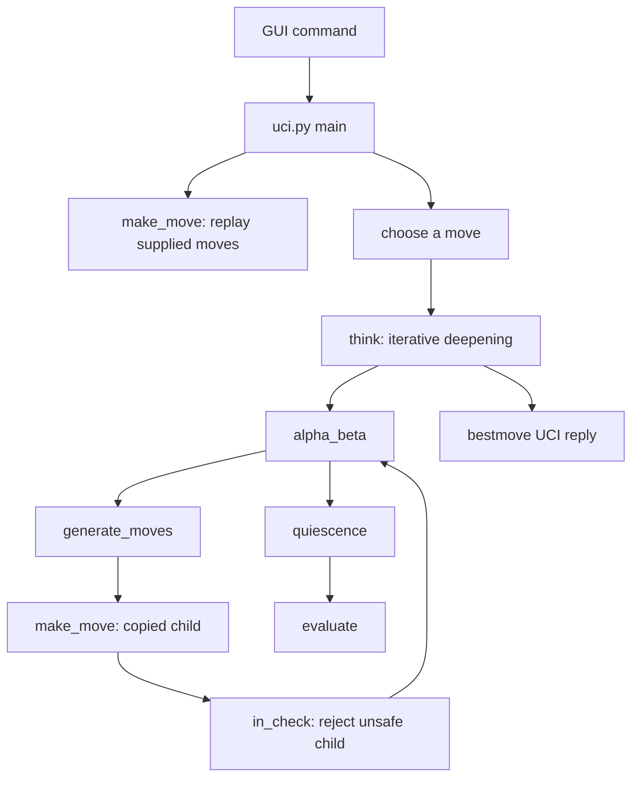

# Remus3: complete line-by-line review and explanation

This is a standalone companion to every source, launcher, support, and data file in `engines_instructor/Remus3`. It explains what each physical line means, how the files work together, and where the implementation makes assumptions or approximations. Shared code is explained here in full; reading another engine's companion is not required.

Remus3 adds a position cache with score bounds and mate-distance handling, two killer moves per ply, null-move pruning, aspiration windows, principal-variation display, and a variable planned time allowance. Its evaluator adds rook placement, bishop-pair bonuses, and doubled, isolated, and passed-pawn terms. An optional opening book supplies validated continuations before search.

## Reading guide

The tables reproduce exact source text with original line numbers. Every blank line, comment, docstring, import, constant, data row, control-flow line, and executable statement receives a row. Indentation is preserved. A multiline statement has one explanation per physical line, including its delimiters. Function sections provide navigation, while the file reviews explain assumptions that span several lines.

The scope is the Python engine folder named above. This document itself and generated `__pycache__` contents are not engine source. Rust sibling folders are separate implementations and are outside this Python companion's file inventory. The bundled verifier is included completely, including its fixtures and branches for other supported versions.

| File | Physical lines | Code or data lines | Responsibility |
| --- | ---: | ---: | --- |
| [board.py](#board-py) | 81 | 23 | Defines piece encoding, board coordinates, the starting position, and conversion helpers. |
| [attacks.py](#attacks-py) | 59 | 34 | Tests whether a square or king is attacked by inspecting piece geometry and blockers. |
| [make_move.py](#make-move-py) | 50 | 23 | Applies a move to a copied board, including special moves and castling rights. |
| [move_generation.py](#move-generation-py) | 103 | 65 | Generates movement candidates, including pawn moves, promotions, and castling. |
| [evaluation.py](#evaluation-py) | 170 | 115 | Converts material and positional features into a centipawn estimate for the side to move. |
| [transposition_table.py](#transposition-table-py) | 38 | 22 | Caches searched depths, scores, bounds, and best moves by position hash. |
| [opening_book.py](#opening-book-py) | 36 | 21 | Loads stored opening sequences and returns shuffled prefix-matching continuations. |
| [opening_book.txt](#opening-book-txt) | 136 | 56 | Contains the complete opening sequences, comments, and defender-only lines used by the loader. |
| [search.py](#search-py) | 241 | 173 | Filters legal moves, searches continuations, controls time, and selects the root reply. |
| [uci.py](#uci-py) | 91 | 59 | Translates the supported UCI commands and native moves between the GUI and engine. |
| [remus.bat](#remus-bat) | 1 | 1 | Launches the Python UCI entry point through uv on Windows. |
| [verify_remus.py](#verify-remus-py) | 404 | 293 | Checks required files, move-generation counts, evaluation fixtures, fixed-depth results, and the UCI conversation from outside the engine. |
| **Total** | **1410** | **885** | Complete source inventory |

Code/data counts exclude blank lines, standalone comments, and Python docstrings. They count physical continuation lines, not abstract Python statements. Opening-book move lines count as data; the batch command counts as one executable line.

## The complete path from a command to a move

1. The Windows launcher starts uci.py. Importing modules defines functions and constructs constants; the main guard starts the protocol loop.
2. A position command resets to START_POSITION and replays the supplied coordinate moves. make_move() returns a copied child each time.
3. A go command calculates a time allowance. The adapter first asks the optional book for a native, king-safe continuation. If none qualifies, it starts search.
4. think() searches increasing nominal depths. alpha_beta() orders movement candidates, makes copies, rejects moves that leave the moving king attacked, and recursively examines the remaining continuations.
5. At a normal depth boundary, quiescence() extends selected tactical lines and evaluate() supplies static scores. A child's score is negated to express it for the parent player.
6. Search retains its best legal root move. The adapter prints bestmove plus its UCI token, or 0000 when no move exists. It then waits for the next command.

The diagram shows the search path. A legal book hit bypasses think(), while cache hits and pruning can shorten the recursive path.

## Representation and Python concepts used throughout

### Board coordinates and piece numbers

Row 0 is rank 8 and column 0 is file a. Square number is row*8+column, giving a8=0, h8=7, a1=56, and h1=63. For e2, row 6 and column 4 give 52; e4 is 36. White pawns advance toward smaller row numbers.

| Meaning | Value or operation |
| --- | --- |
| Empty square | 0 |
| Pawn, knight, bishop, rook, queen, king | 1, 2, 3, 4, 5, 6 |
| White color flag | 8 |
| White knight / Black knight | 10 / 2 |
| Extract kind | piece & 7 |
| Extract White flag | piece & WHITE |
| Move | (source, target, promotion), with promotion 0 for ordinary moves |
| Castling flags | White kingside 1, White queenside 2, Black kingside 4, Black queenside 8 |
| En passant target | The skipped square after a two-square pawn move, or -1 |

A Position is `(board, white, castling, en_passant)`. It has no reversible-move clock.

### Lists, tuples, annotations, and control flow

Lists can change; tuples fix their sequence of references. A tuple containing a board list does not freeze that list. `board[:]` copies the list so edits to a child do not alter the parent. The tuple returned by make_move() contains that new board and updated scalar state. Search consequently needs no unmake operation.

Type hints describe expected values but do not enforce them at runtime. `Move | None` means either a three-integer move or the absence of a move. `&` masks integer bits; `|` inside a type hint is a type union. `//` is floor division, `%` is remainder, and `~` complements bits for castling-right masks. `and` and `or` short-circuit, so a failed earlier test can avoid an unsafe or expensive later expression.

A function definition creates a callable; its body runs when called. Imports execute module-level initialization once per normal process import. Global declarations allow rebinding shared search counters and root state. A raised SearchTimeout unwinds recursive calls until think() catches it; this is different from an ordinary return or a break that exits only one loop.

### Chess and search vocabulary

A **ply** is one player's move. A nominal depth of four is four plies, not four full move pairs. Check extensions and quiescence can search beyond that nominal depth. A **pseudo-legal move** obeys movement geometry and occupancy but may expose its own king; a legal move also passes the child-board king-safety test.

A **centipawn** is one hundredth of this evaluator's pawn value. A +100 score estimates a one-pawn advantage for the side to move. It is neither a win probability nor an Elo rating. Mate has a separate large magnitude, reduced by distance so a quicker win is preferred.

**Negamax** uses the same maximization code for both players by negating a child's score. **Alpha** is the useful lower bound and **beta** the cutoff threshold. A score reaching beta makes further alternatives at that node unnecessary for the parent's current question. A **bound** can be sufficient even when the exact best score is unknown.

**Stand pat** uses the current static score without another tactical move. It is a search baseline, not a legal pass. **Quiescence** extends tactical continuations beyond the depth boundary to reduce evaluations made halfway through exchanges. **Perft** instead enumerates every legal continuation to a specified depth without evaluation, ordering-based pruning, or strength measurement.

## Review findings and operating assumptions

The rules layer uses native code throughout. generate_moves() supplies candidates; make_move() applies them on copies; in_check() rejects exposed kings. Incoming UCI move histories are trusted, so this legality guarantee concerns moves the engine selects from a valid position. Malformed input and invalid boards are outside the runtime contract.

Quiescence accepts stand pat without first establishing whether the active king is checked or whether any legal move exists. It filters each searched capture for own-king safety, but that does not make standing pat legal in check. Quiet evasions can be omitted after a capture gives check, and a stalemated leaf can receive a nonzero evaluation. Main-search check extensions do not cover checks created within quiescence recursion. En passant is also treated as an empty-destination quiet move by ordering, so it falls outside the tactical prefix. Noncapturing underpromotions are omitted from ordinary quiescence.

The table key is a Python hash of board, turn, castling rights, and raw en passant target. It has no full-position collision check. Storage can overwrite a deep entry with a shallow one and clears the dictionary after its count threshold is exceeded. Killer hints and the table persist across move requests. The UCI loop does not clear them on an ignored ucinewgame command.

Null-move pruning assumes a position that remains good after an artificial pass is unlikely to need a complete real-move search. Zugzwang violates that assumption. Requiring a nonpawn piece reduces one common risk but does not eliminate it. Aspiration failures repeat search with an opened bound; a narrow score is not accepted as an exact result just because it returned quickly.

Killer assignment in ordering occurs after capture scoring without a quiet-only guard. A move remembered as quiet in another position can therefore have its current capture priority replaced by a killer priority. Quiescence passes no killers, so that specific overwrite does not occur in its own ordering call.

Timing is approximate. Recursive checks occur every 1024 node entries and require an established root move. The soft stop is checked after an iteration, so an expensive iteration or terminal path can exceed the intended allowance. A changing best move may be retained from an unfinished depth. Printed scores use the UCI cp label even for the engine's internal mate-scale values.

### What would make the UCI test verify returned-move legality?

A successful handshake and a line beginning with bestmove confirm protocol activity, not legal chess. The bundled verify_uci() performs that prefix check without decoding and testing the move.

A legality check must reconstruct the same position, parse the bestmove token into source, target, and promotion, generate candidates, make each candidate, and retain only those whose child board leaves the moving king safe. The returned move must belong to that legal set. The token 0000 is acceptable only when that set is empty. Testing with the engine's own rules checks its adapter against its rules; an independent boundary library can additionally cross-check those rules. No such stronger check is silently attributed to the existing prefix-only test.

## Line-by-line source reference

## board.py

Defines piece encoding, board coordinates, the starting position, and conversion helpers. Source: [board.py](board.py).

### Lines 1 to 39: Module description, imports, and constants

| Line | Exact source | Detailed explanation |
| ---: | --- | --- |
| 1 | <code>"""board.py</code> | Opens the module docstring. This is descriptive text stored as documentation, not a statement that performs the described chess operation. |
| 2 | <em>blank</em> | Blank paragraph separator inside the module docstring. It contributes formatting to documentation and no chess calculation. |
| 3 | <code>The board, the starting position, and the names of squares and moves.</code> | Documentation text for module: The board, the starting position, and the names of squares and moves. This line states the intended meaning; the executable-line review distinguishes implementation details and limitations. |
| 4 | <em>blank</em> | Blank paragraph separator inside the module docstring. It contributes formatting to documentation and no chess calculation. |
| 5 | <code>The board is a list of 64 numbers, one per square. Row 0 is rank 8</code> | Documentation text for module: The board is a list of 64 numbers, one per square. Row 0 is rank 8 This line states the intended meaning; the executable-line review distinguishes implementation details and limitations. |
| 6 | <code>and column 0 is file a, and square number row * 8 + col names a</code> | Documentation text for module: and column 0 is file a, and square number row * 8 + col names a This line states the intended meaning; the executable-line review distinguishes implementation details and limitations. |
| 7 | <code>square: a8 is 0, h8 is 7, a1 is 56, and h1 is 63. A piece is its</code> | Documentation text for module: square: a8 is 0, h8 is 7, a1 is 56, and h1 is 63. A piece is its This line states the intended meaning; the executable-line review distinguishes implementation details and limitations. |
| 8 | <code>kind, from 1 for a pawn to 6 for a king, plus 8 if it is White, so</code> | Documentation text for module: kind, from 1 for a pawn to 6 for a king, plus 8 if it is White, so This line states the intended meaning; the executable-line review distinguishes implementation details and limitations. |
| 9 | <code>a White knight is 10 and a Black knight is 2. piece &amp; 7 gives the</code> | Documentation text for module: a White knight is 10 and a Black knight is 2. piece & 7 gives the This line states the intended meaning; the executable-line review distinguishes implementation details and limitations. |
| 10 | <code>kind, and 0 is an empty square.</code> | Documentation text for module: kind, and 0 is an empty square. This line states the intended meaning; the executable-line review distinguishes implementation details and limitations. |
| 11 | <em>blank</em> | Blank paragraph separator inside the module docstring. It contributes formatting to documentation and no chess calculation. |
| 12 | <code>A position is the tuple (board, white, castling, en_passant): the</code> | Documentation text for module: A position is the tuple (board, white, castling, en_passant): the This line states the intended meaning; the executable-line review distinguishes implementation details and limitations. |
| 13 | <code>board, True when White is to move, the castling rights as four bits,</code> | Documentation text for module: board, True when White is to move, the castling rights as four bits, This line states the intended meaning; the executable-line review distinguishes implementation details and limitations. |
| 14 | <code>and the square a pawn just skipped over, or -1.</code> | Documentation text for module: and the square a pawn just skipped over, or -1. This line states the intended meaning; the executable-line review distinguishes implementation details and limitations. |
| 15 | <code>"""</code> | Closes the module docstring. Execution proceeds to the subsequent definitions or statements, whose individual explanations describe the actual behavior. |
| 16 | <em>blank</em> | Blank line separating related statements, definitions, or paragraphs for readability. It introduces no object, branch, board change, or search operation. |
| 17 | <code>EMPTY, PAWN, KNIGHT, BISHOP, ROOK, QUEEN, KING = range(7)  # Piece kinds</code> | `range(7)` supplies 0 through 6; assignment unpacks them into EMPTY=0, PAWN=1, KNIGHT=2, BISHOP=3, ROOK=4, QUEEN=5, and KING=6. These are piece kinds, not material values. Every engine module agrees on this numbering, so a move's promotion value can use the same codes. |
| 18 | <code>WHITE = 8  # Added to the kind of a White piece</code> | The color flag is 8, binary `1000`. Add it to kinds 1 through 6 to obtain White pieces 9 through 14. Black keeps kinds 1 through 6. Because the low three bits hold the kind, `piece & 7` removes this color flag and `piece & WHITE` keeps it. The value 8 alone is not a valid piece. |
| 19 | <code>MATE_SCORE = 100_000  # Larger than any material count</code> | Sets the shared mate-score magnitude to 100,000. Search uses it for terminal scores, and the transposition table uses it to recognize scores that need mate-distance normalization. |
| 20 | <em>blank</em> | Blank line separating related statements, definitions, or paragraphs for readability. It introduces no object, branch, board change, or search operation. |
| 21 | <code>Position = tuple[list[int], bool, int, int]</code> | Defines the type alias `Position`: a tuple containing a mutable list of piece integers, a Boolean side-to-move flag, castling-right bits, and an en passant square. Type hints help readers and type checkers; they do not validate positions at runtime. The tuple does not make its nested board list immutable. |
| 22 | <code>Move = tuple[int, int, int]  # (from square, to square, promotion or 0)</code> | Defines `Move` as three integers: source square, destination square, and promotion kind. `(52, 36, 0)` means e2-e4; `(12, 4, 5)` means e7-e8 promoting to a queen. A normal move uses 0 in the final slot, and captures need no separate flag because the position supplies the captured piece. |
| 23 | <em>blank</em> | Blank line separating related statements, definitions, or paragraphs for readability. It introduces no object, branch, board change, or search operation. |
| 24 | <code># The starting position. Every engine can share this code</code> | Explanatory source comment: The starting position. Every engine can share this code Python does not execute this text. The adjacent code rows explain the actual operations and any qualifications to this description. |
| 25 | <code># Row 0 is rank 8 and column 0 is file a. Both sides use the same back rank.</code> | Explanatory source comment: Row 0 is rank 8 and column 0 is file a. Both sides use the same back rank. Python does not execute this text. The adjacent code rows explain the actual operations and any qualifications to this description. |
| 26 | <code>BACK_RANK = [ROOK, KNIGHT, BISHOP, QUEEN, KING, BISHOP, KNIGHT, ROOK]</code> | Lists piece kinds from file a through h: rook, knight, bishop, queen, king, bishop, knight, rook. The queen is on file d and king on file e. These uncolored values directly describe Black's back rank; adding WHITE later creates White's back rank in the same file order. |
| 27 | <code># [PAWN] * 8 is a list of eight pawns while [EMPTY] * 32 is a list of 32 empty squares.</code> | Explanatory source comment: [PAWN] * 8 is a list of eight pawns while [EMPTY] * 32 is a list of 32 empty squares. Python does not execute this text. The adjacent code rows explain the actual operations and any qualifications to this description. |
| 28 | <code># The starting board is the Black back rank, the Black pawns,</code> | Explanatory source comment: The starting board is the Black back rank, the Black pawns, Python does not execute this text. The adjacent code rows explain the actual operations and any qualifications to this description. |
| 29 | <code># 32 empty squares, the White pawns, and the White back rank.</code> | Explanatory source comment: 32 empty squares, the White pawns, and the White back rank. Python does not execute this text. The adjacent code rows explain the actual operations and any qualifications to this description. |
| 30 | <code>START_BOARD = BACK_RANK + [PAWN] * 8 + [EMPTY] * 32 + [WHITE + PAWN] * 8</code> | Concatenates five rank groups into a new 56-element list: Black's eight back-rank pieces, eight Black pawns, 32 empty squares, and eight White pawns. The final White back rank is appended below. Multiplying lists of immutable integers is safe here; this is not the problematic case of repeating a mutable row object. |
| 31 | <code># The White pieces are the same as the Black pieces, but with WHITE added to the kind.</code> | Explanatory source comment: The White pieces are the same as the Black pieces, but with WHITE added to the kind. Python does not execute this text. The adjacent code rows explain the actual operations and any qualifications to this description. |
| 32 | <code>for kind in BACK_RANK:</code> | Iterates through the eight kind numbers in BACK_RANK. This loop runs when the module is imported, as part of constructing the starting board, rather than every time a move is searched. |
| 33 | <code>&nbsp;&nbsp;&nbsp;&nbsp;START_BOARD.append(WHITE + kind)</code> | Appends each kind with the White flag added. After eight iterations START_BOARD contains exactly 64 entries, ending with `[12, 10, 11, 13, 14, 11, 10, 12]` on rank 1. `append` mutates this initialization list; move application later copies boards instead of mutating the live position. |
| 34 | <code># True = White moves first</code> | Explanatory source comment: True = White moves first Python does not execute this text. The adjacent code rows explain the actual operations and any qualifications to this description. |
| 35 | <code># 15 =  All four castling rights: 1 + 2 for White, 4 + 8 for Black</code> | Explanatory source comment: 15 =  All four castling rights: 1 + 2 for White, 4 + 8 for Black Python does not execute this text. The adjacent code rows explain the actual operations and any qualifications to this description. |
| 36 | <code># -1 = No pawn has just moved two squares</code> | Explanatory source comment: -1 = No pawn has just moved two squares Python does not execute this text. The adjacent code rows explain the actual operations and any qualifications to this description. |
| 37 | <code>START_POSITION = (START_BOARD, True, 15, -1)</code> | Builds the starting position: White moves first, 15 enables all four castling rights, and -1 means there is no en passant target. The tuple references START_BOARD rather than copying it. This shared starting object stays safe only because callers treat its board as read-only and make_move() copies before editing. |
| 38 | <em>blank</em> | Blank line separating related statements, definitions, or paragraphs for readability. It introduces no object, branch, board change, or search operation. |
| 39 | <em>blank</em> | Blank line separating related statements, definitions, or paragraphs for readability. It introduces no object, branch, board change, or search operation. |

### Lines 40 to 44: is_own()

| Line | Exact source | Detailed explanation |
| ---: | --- | --- |
| 40 | <code>def is_own(piece: int, white: bool) -&gt; bool:</code> | Defines a helper whose inputs are an encoded piece and the color to test. The result is Boolean. Here `white` means 'does this piece belong to White?' rather than always meaning the position's side to move; callers can pass `not white` to ask about an enemy piece. |
| 41 | <code>&nbsp;&nbsp;&nbsp;&nbsp;"""Return True if the piece belongs to White (white is True) or Black."""</code> | One-line docstring for is_own. It records the function or class contract as text; the following executable lines implement that contract. A docstring does not validate inputs or enforce its stated guarantee. |
| 42 | <code>&nbsp;&nbsp;&nbsp;&nbsp;return piece &gt; WHITE if white else EMPTY &lt; piece &lt; WHITE</code> | Uses a conditional expression: for White, accept piece values greater than 8; for Black, accept values strictly between 0 and 8. Empty=0 fails both branches. For valid pieces, 10 belongs to White and 2 to Black. This assumes valid encoding: it does not reject every out-of-range integer. |
| 43 | <em>blank</em> | Blank line separating related statements, definitions, or paragraphs for readability. It introduces no object, branch, board change, or search operation. |
| 44 | <em>blank</em> | Blank line separating related statements, definitions, or paragraphs for readability. It introduces no object, branch, board change, or search operation. |

### Lines 45 to 49: position_key()

| Line | Exact source | Detailed explanation |
| ---: | --- | --- |
| 45 | <code>def position_key(position: Position) -&gt; int:</code> | Defines a compact key for caching a position. The key must include side to move and special-move rights because identical piece placement can allow different legal moves. |
| 46 | <code>&nbsp;&nbsp;&nbsp;&nbsp;"""Return a number that names the position, for the table and repetitions."""</code> | One-line docstring for position_key. It records the function or class contract as text; the following executable lines implement that contract. A docstring does not validate inputs or enforce its stated guarantee. |
| 47 | <code>&nbsp;&nbsp;&nbsp;&nbsp;return hash((tuple(position[0]), position[1], position[2], position[3]))</code> | Converts the board list to a hashable tuple and hashes it with turn, castling rights, and the raw en passant square. This is a hash, not a collision-proof identity: the cache stores no full position for comparison. The raw en passant square is retained even if no capture is available. |
| 48 | <em>blank</em> | Blank line separating related statements, definitions, or paragraphs for readability. It introduces no object, branch, board change, or search operation. |
| 49 | <em>blank</em> | Blank line separating related statements, definitions, or paragraphs for readability. It introduces no object, branch, board change, or search operation. |

### Lines 50 to 59: parse_square()

| Line | Exact source | Detailed explanation |
| ---: | --- | --- |
| 50 | <code>def parse_square(text: str) -&gt; int:</code> | Defines conversion from a two-character algebraic square name to a 0-based board index. The function expects a lowercase file a-h and a rank 1-8; parsing a whole UCI move happens in uci.py instead. |
| 51 | <code>&nbsp;&nbsp;&nbsp;&nbsp;"""Return the square that text such as "e2" names."""</code> | One-line docstring for parse_square. It records the function or class contract as text; the following executable lines implement that contract. A docstring does not validate inputs or enforce its stated guarantee. |
| 52 | <code>&nbsp;&nbsp;&nbsp;&nbsp;# text[0] is the file letter and text[1] is the rank digit.</code> | Explanatory source comment: text[0] is the file letter and text[1] is the rank digit. Python does not execute this text. The adjacent code rows explain the actual operations and any qualifications to this description. |
| 53 | <code>&nbsp;&nbsp;&nbsp;&nbsp;# Row 0 is rank 8, so the ranks are listed from 8 down to 1: the position</code> | Explanatory source comment: Row 0 is rank 8, so the ranks are listed from 8 down to 1: the position Python does not execute this text. The adjacent code rows explain the actual operations and any qualifications to this description. |
| 54 | <code>&nbsp;&nbsp;&nbsp;&nbsp;# of "2" in "87654321" is 6, so rank 2 is row 6.</code> | Explanatory source comment: of "2" in "87654321" is 6, so rank 2 is row 6. Python does not execute this text. The adjacent code rows explain the actual operations and any qualifications to this description. |
| 55 | <code>&nbsp;&nbsp;&nbsp;&nbsp;# The position of "e" in "abcdefgh" is 4, so file e is column 4.</code> | Explanatory source comment: The position of "e" in "abcdefgh" is 4, so file e is column 4. Python does not execute this text. The adjacent code rows explain the actual operations and any qualifications to this description. |
| 56 | <code>&nbsp;&nbsp;&nbsp;&nbsp;# Each row holds 8 squares, so e2 is square 6 * 8 + 4 = 52.</code> | Explanatory source comment: Each row holds 8 squares, so e2 is square 6 * 8 + 4 = 52. Python does not execute this text. The adjacent code rows explain the actual operations and any qualifications to this description. |
| 57 | <code>&nbsp;&nbsp;&nbsp;&nbsp;return "87654321".index(text[1]) * 8 + "abcdefgh".index(text[0])</code> | Finds the rank in the reverse string `87654321`, multiplies that row by 8, and adds the file's index in `abcdefgh`. For e2, the row is 6 and column is 4, giving 52. `str.index()` raises ValueError for an unknown character; too-short text can raise IndexError. The function does not validate extra trailing text. |
| 58 | <em>blank</em> | Blank line separating related statements, definitions, or paragraphs for readability. It introduces no object, branch, board change, or search operation. |
| 59 | <em>blank</em> | Blank line separating related statements, definitions, or paragraphs for readability. It introduces no object, branch, board change, or search operation. |

### Lines 60 to 67: square_name()

| Line | Exact source | Detailed explanation |
| ---: | --- | --- |
| 60 | <code>def square_name(square: int) -&gt; str:</code> | Defines conversion from a board index to algebraic notation. It expects an integer from 0 through 63 and returns a two-character string. It is used for UCI output and by the verifier when formatting moves. |
| 61 | <code>&nbsp;&nbsp;&nbsp;&nbsp;"""Return the name of a square, such as "e2"."""</code> | One-line docstring for square_name. It records the function or class contract as text; the following executable lines implement that contract. A docstring does not validate inputs or enforce its stated guarantee. |
| 62 | <code>&nbsp;&nbsp;&nbsp;&nbsp;# This undoes parse_square(). For square 52, the remainder 52 % 8 = 4 is the</code> | Explanatory source comment: This undoes parse_square(). For square 52, the remainder 52 % 8 = 4 is the Python does not execute this text. The adjacent code rows explain the actual operations and any qualifications to this description. |
| 63 | <code>&nbsp;&nbsp;&nbsp;&nbsp;# column, and letter 4 of "abcdefgh" is "e". The whole-number division</code> | Explanatory source comment: column, and letter 4 of "abcdefgh" is "e". The whole-number division Python does not execute this text. The adjacent code rows explain the actual operations and any qualifications to this description. |
| 64 | <code>&nbsp;&nbsp;&nbsp;&nbsp;# 52 // 8 = 6 is the row, and digit 6 of "87654321" is "2".</code> | Explanatory source comment: 52 // 8 = 6 is the row, and digit 6 of "87654321" is "2". Python does not execute this text. The adjacent code rows explain the actual operations and any qualifications to this description. |
| 65 | <code>&nbsp;&nbsp;&nbsp;&nbsp;return "abcdefgh"[square % 8] + "87654321"[square // 8]</code> | `square % 8` gives the file column and `square // 8` gives the row. The two string lookups turn those numbers into a file and rank, then `+` concatenates them. Index 52 gives `e` plus `2`. Valid board indices round-trip through parse_square(); out-of-range values are outside this function's contract. |
| 66 | <em>blank</em> | Blank line separating related statements, definitions, or paragraphs for readability. It introduces no object, branch, board change, or search operation. |
| 67 | <em>blank</em> | Blank line separating related statements, definitions, or paragraphs for readability. It introduces no object, branch, board change, or search operation. |

### Lines 68 to 81: move_text()

| Line | Exact source | Detailed explanation |
| ---: | --- | --- |
| 68 | <code>def move_text(move: Move) -&gt; str:</code> | Defines the conversion from a native three-integer move to UCI coordinate text. Search uses it for principal-variation output, and the UCI adapter uses it for book matching and bestmove replies. |
| 69 | <code>&nbsp;&nbsp;&nbsp;&nbsp;"""</code> | Opens the move_text docstring. This is descriptive text stored as documentation, not a statement that performs the described chess operation. |
| 70 | <code>&nbsp;&nbsp;&nbsp;&nbsp;Return the UCI text of a move, such as "e7e8q". The promotion</code> | Documentation text for move_text: Return the UCI text of a move, such as "e7e8q". The promotion This line states the intended meaning; the executable-line review distinguishes implementation details and limitations. |
| 71 | <code>&nbsp;&nbsp;&nbsp;&nbsp;letter's place in ".pnbrqk" is the kind of piece.</code> | Documentation text for move_text: letter's place in ".pnbrqk" is the kind of piece. This line states the intended meaning; the executable-line review distinguishes implementation details and limitations. |
| 72 | <code>&nbsp;&nbsp;&nbsp;&nbsp;"""</code> | Closes the move_text docstring. Execution proceeds to the subsequent definitions or statements, whose individual explanations describe the actual behavior. |
| 73 | <code>&nbsp;&nbsp;&nbsp;&nbsp;# A move is a tuple of three slots: move[0] is the from square,</code> | Explanatory source comment: A move is a tuple of three slots: move[0] is the from square, Python does not execute this text. The adjacent code rows explain the actual operations and any qualifications to this description. |
| 74 | <code>&nbsp;&nbsp;&nbsp;&nbsp;# move[1] the to square, move[2] the promotion</code> | Explanatory source comment: move[1] the to square, move[2] the promotion Python does not execute this text. The adjacent code rows explain the actual operations and any qualifications to this description. |
| 75 | <code>&nbsp;&nbsp;&nbsp;&nbsp;text = square_name(move[0]) + square_name(move[1])</code> | Concatenates the source and destination square names. For (52,36,0), square_name() gives e2 and e4, producing e2e4. |
| 76 | <code>&nbsp;&nbsp;&nbsp;&nbsp;if move[2]:</code> | Tests whether the promotion kind is nonzero. Ordinary moves remain four characters; promotions add a fifth character. |
| 77 | <code>&nbsp;&nbsp;&nbsp;&nbsp;&nbsp;&nbsp;&nbsp;&nbsp;# move[2] is 0 with no promotion, else a piece kind (2 knight to</code> | Explanatory source comment: move[2] is 0 with no promotion, else a piece kind (2 knight to Python does not execute this text. The adjacent code rows explain the actual operations and any qualifications to this description. |
| 78 | <code>&nbsp;&nbsp;&nbsp;&nbsp;&nbsp;&nbsp;&nbsp;&nbsp;# 5 queen), which picks its letter: ".pnbrqk"[5] is "q". The "."</code> | Explanatory source comment: 5 queen), which picks its letter: ".pnbrqk"[5] is "q". The "." Python does not execute this text. The adjacent code rows explain the actual operations and any qualifications to this description. |
| 79 | <code>&nbsp;&nbsp;&nbsp;&nbsp;&nbsp;&nbsp;&nbsp;&nbsp;# fills slot 0, EMPTY</code> | Explanatory source comment: fills slot 0, EMPTY Python does not execute this text. The adjacent code rows explain the actual operations and any qualifications to this description. |
| 80 | <code>&nbsp;&nbsp;&nbsp;&nbsp;&nbsp;&nbsp;&nbsp;&nbsp;text += ".pnbrqk"[move[2]]</code> | Selects the promotion letter using the shared kind numbering. Queen kind 5 indexes q in .pnbrqk, so a move from e7 to e8 with kind 5 becomes e7e8q. |
| 81 | <code>&nbsp;&nbsp;&nbsp;&nbsp;return text</code> | Returns the finished UCI token. This function formats the move but neither validates it nor applies it to a position. |

### File review: board.py

The board representation is a contract shared by every module. A tuple does not make its nested board list immutable; correctness depends on copy-make. Square conversion assumes valid coordinate text. Position hashes, where present, are compact identifiers rather than collision-proof full positions.

## attacks.py

Tests whether a square or king is attacked by inspecting piece geometry and blockers. Source: [attacks.py](attacks.py).

### Lines 1 to 26: Module description, imports, and constants

| Line | Exact source | Detailed explanation |
| ---: | --- | --- |
| 1 | <code>"""attacks.py</code> | Opens the module docstring. This is descriptive text stored as documentation, not a statement that performs the described chess operation. |
| 2 | <em>blank</em> | Blank paragraph separator inside the module docstring. It contributes formatting to documentation and no chess calculation. |
| 3 | <code>Find out whether a square is attacked. Remus looks out from the</code> | Documentation text for module: Find out whether a square is attacked. Remus looks out from the This line states the intended meaning; the executable-line review distinguishes implementation details and limitations. |
| 4 | <code>square itself: if a knight's jump away there stands an enemy</code> | Documentation text for module: square itself: if a knight's jump away there stands an enemy This line states the intended meaning; the executable-line review distinguishes implementation details and limitations. |
| 5 | <code>knight, the knight attacks the square, and the same idea works for</code> | Documentation text for module: knight, the knight attacks the square, and the same idea works for This line states the intended meaning; the executable-line review distinguishes implementation details and limitations. |
| 6 | <code>every piece.</code> | Documentation text for module: every piece. This line states the intended meaning; the executable-line review distinguishes implementation details and limitations. |
| 7 | <code>"""</code> | Closes the module docstring. Execution proceeds to the subsequent definitions or statements, whose individual explanations describe the actual behavior. |
| 8 | <em>blank</em> | Blank line separating related statements, definitions, or paragraphs for readability. It introduces no object, branch, board change, or search operation. |
| 9 | <code>from board import BISHOP, EMPTY, KING, KNIGHT, PAWN, QUEEN, ROOK, WHITE</code> | Imports the common piece codes and WHITE flag from board.py. Attack detection compares exact encoded piece values, so it needs the kind codes for all attackers as well as EMPTY for ray traversal. Importing board.py also makes its initialized constants available without starting a game. |
| 10 | <em>blank</em> | Blank line separating related statements, definitions, or paragraphs for readability. It introduces no object, branch, board change, or search operation. |
| 11 | <code># The eight knight jumps, as (row change, column change)</code> | Explanatory source comment: The eight knight jumps, as (row change, column change) Python does not execute this text. The adjacent code rows explain the actual operations and any qualifications to this description. |
| 12 | <code>KNIGHT_JUMPS = (</code> | Begins an immutable tuple of knight offsets. Each element is another tuple `(row_change, column_change)`, not an absolute square. Offsets can be applied at any square; bounds checks later discard jumps off the board. |
| 13 | <code>&nbsp;&nbsp;&nbsp;&nbsp;(-2, -1), (-2, 1), (-1, -2), (-1, 2),</code> | Lists four knight jumps toward decreasing rows: two ranks and one file, or one rank and two files, in both file directions. Decreasing rows means moving toward rank 8 in this coordinate system. These are geometric offsets and work for either piece color. |
| 14 | <code>&nbsp;&nbsp;&nbsp;&nbsp;(1, -2), (1, 2), (2, -1), (2, 1),</code> | Lists the four corresponding jumps toward increasing rows. Together with the preceding line, this supplies all eight knight destinations before edge checks. A knight does not traverse intermediate squares, so occupied intervening squares are irrelevant. |
| 15 | <code>)  # fmt: skip</code> | Closes KNIGHT_JUMPS. The trailing comma on data entries is legal tuple syntax. `# fmt: skip` asks a supporting formatter to preserve the compact table layout; it is a comment and has no effect on move generation. |
| 16 | <em>blank</em> | Blank line separating related statements, definitions, or paragraphs for readability. It introduces no object, branch, board change, or search operation. |
| 17 | <code># The eight directions: rooks use the first four, bishops the last</code> | Explanatory source comment: The eight directions: rooks use the first four, bishops the last Python does not execute this text. The adjacent code rows explain the actual operations and any qualifications to this description. |
| 18 | <code># four, and queens and kings all eight</code> | Explanatory source comment: four, and queens and kings all eight Python does not execute this text. The adjacent code rows explain the actual operations and any qualifications to this description. |
| 19 | <code>DIRECTIONS = (</code> | Begins the tuple of eight unit directions used for straight and diagonal attacks. The order is deliberate because the next two constants select its first and last four entries. |
| 20 | <code>&nbsp;&nbsp;&nbsp;&nbsp;(-1, 0), (1, 0), (0, -1), (0, 1),</code> | Stores up, down, left, and right as row/column offsets. Rooks slide repeatedly along these directions; a king uses them for only one step. For example, `(0, 1)` moves one file toward h without changing rank. |
| 21 | <code>&nbsp;&nbsp;&nbsp;&nbsp;(-1, -1), (-1, 1), (1, -1), (1, 1),</code> | Stores the four diagonals: both combinations of decreasing row with left/right, followed by increasing row with left/right. Bishops slide along these directions, and queens combine them with the four straight directions. |
| 22 | <code>)  # fmt: skip</code> | Closes DIRECTIONS and preserves its table formatting with `# fmt: skip`. At runtime DIRECTIONS is an eight-element tuple; the formatting comment contributes no data. |
| 23 | <code>STRAIGHT = DIRECTIONS[0:4]  # The rook's four directions</code> | Slices indices 0 through 3 into STRAIGHT. Python excludes the stop index 4, so this contains exactly the four rook directions. Taking a tuple slice produces another tuple and does not alter DIRECTIONS. |
| 24 | <code>DIAGONAL = DIRECTIONS[4:8]  # The bishop's four directions</code> | Slices indices 4 through 7 into DIAGONAL, giving exactly the bishop directions. The separate names let callers select the right geometry without repeating offset literals. |
| 25 | <em>blank</em> | Blank line separating related statements, definitions, or paragraphs for readability. It introduces no object, branch, board change, or search operation. |
| 26 | <em>blank</em> | Blank line separating related statements, definitions, or paragraphs for readability. It introduces no object, branch, board change, or search operation. |

### Lines 27 to 56: is_attacked()

| Line | Exact source | Detailed explanation |
| ---: | --- | --- |
| 27 | <code>def is_attacked(board: list[int], square: int, by_white: bool) -&gt; bool:</code> | Defines the attack query for an existing board, a target square, and the attacking color. It answers whether that color attacks the square, not whether it has a fully legal move there. It reads the board without changing it and returns as soon as any attacker is found. |
| 28 | <code>&nbsp;&nbsp;&nbsp;&nbsp;"""Return True if a piece of the given color attacks the square."""</code> | One-line docstring for is_attacked. It records the function or class contract as text; the following executable lines implement that contract. A docstring does not validate inputs or enforce its stated guarantee. |
| 29 | <code>&nbsp;&nbsp;&nbsp;&nbsp;row = square // 8</code> | Converts the target's square number to a row using integer division by 8. For d4, square 35, this gives row 4. All offset calculations begin from this target square rather than scanning outward from every attacking piece. |
| 30 | <code>&nbsp;&nbsp;&nbsp;&nbsp;col = square % 8</code> | Gets the target's column using remainder modulo 8. For d4 the result is 3. Maintaining row and column separately prevents a ray or jump from wrapping across an edge merely because a linear index stays between 0 and 63. |
| 31 | <code>&nbsp;&nbsp;&nbsp;&nbsp;# Add 8 to each kind when White attacks</code> | Explanatory source comment: Add 8 to each kind when White attacks Python does not execute this text. The adjacent code rows explain the actual operations and any qualifications to this description. |
| 32 | <code>&nbsp;&nbsp;&nbsp;&nbsp;side = WHITE if by_white else 0</code> | Selects 8 for White attackers and 0 for Black attackers. Adding `side` to PAWN, KNIGHT, and other kind constants below constructs the exact piece integers that count as attackers. |
| 33 | <code>&nbsp;&nbsp;&nbsp;&nbsp;# A White pawn attacks diagonally forward, so it stands one row</code> | Explanatory source comment: A White pawn attacks diagonally forward, so it stands one row Python does not execute this text. The adjacent code rows explain the actual operations and any qualifications to this description. |
| 34 | <code>&nbsp;&nbsp;&nbsp;&nbsp;# below the square (row + 1)</code> | Explanatory source comment: below the square (row + 1) Python does not execute this text. The adjacent code rows explain the actual operations and any qualifications to this description. |
| 35 | <code>&nbsp;&nbsp;&nbsp;&nbsp;pawn_steps = ((1, -1), (1, 1)) if by_white else ((-1, -1), (-1, 1))</code> | Builds the reverse offsets for locating an attacking pawn. To attack a target, a White pawn must stand one row below it, at `(row+1, col-1)` or `(row+1, col+1)`; Black uses one row above. These are opposite to the pawn's forward movement direction because the search begins at the attacked square. |
| 36 | <code>&nbsp;&nbsp;&nbsp;&nbsp;# Each kind of attacker: the steps it takes from the square, whether</code> | Explanatory source comment: Each kind of attacker: the steps it takes from the square, whether Python does not execute this text. The adjacent code rows explain the actual operations and any qualifications to this description. |
| 37 | <code>&nbsp;&nbsp;&nbsp;&nbsp;# it slides on past empty squares, and the pieces that attack that way</code> | Explanatory source comment: it slides on past empty squares, and the pieces that attack that way Python does not execute this text. The adjacent code rows explain the actual operations and any qualifications to this description. |
| 38 | <code>&nbsp;&nbsp;&nbsp;&nbsp;for steps, slides, attackers in (</code> | Begins a loop over attack categories. Each category supplies three values: a tuple of direction offsets, a Boolean telling whether to continue along a ray, and a tuple of acceptable encoded attackers. One shared traversal handles all five categories. |
| 39 | <code>&nbsp;&nbsp;&nbsp;&nbsp;&nbsp;&nbsp;&nbsp;&nbsp;(pawn_steps, False, (PAWN + side,)),</code> | Tests pawns at the two reverse pawn offsets, without sliding. `(PAWN + side,)` is a one-element tuple; the comma is essential. Pawn forward pushes are absent because a pawn attacks diagonally, not straight ahead. |
| 40 | <code>&nbsp;&nbsp;&nbsp;&nbsp;&nbsp;&nbsp;&nbsp;&nbsp;(KNIGHT_JUMPS, False, (KNIGHT + side,)),</code> | Tests all eight knight offsets with no sliding and accepts only a knight of the requested color. A bishop or pawn found on one of these squares does not satisfy the membership test. |
| 41 | <code>&nbsp;&nbsp;&nbsp;&nbsp;&nbsp;&nbsp;&nbsp;&nbsp;(DIRECTIONS, False, (KING + side,)),</code> | Tests the eight neighboring squares for the opposing king of the requested color. Kings attack adjacent squares, so this is a single-step category even though DIRECTIONS also serves sliding pieces. |
| 42 | <code>&nbsp;&nbsp;&nbsp;&nbsp;&nbsp;&nbsp;&nbsp;&nbsp;(STRAIGHT, True, (ROOK + side, QUEEN + side)),</code> | Tests straight rays, passing through empty squares until a blocker or board edge. Either a rook or queen of the requested color on the first occupied square attacks the target along that ray. |
| 43 | <code>&nbsp;&nbsp;&nbsp;&nbsp;&nbsp;&nbsp;&nbsp;&nbsp;(DIAGONAL, True, (BISHOP + side, QUEEN + side)),</code> | Tests diagonal rays in the same way and accepts a bishop or queen. A queen is therefore covered by both ray categories, while every individual ray still stops at the first occupied square. |
| 44 | <code>&nbsp;&nbsp;&nbsp;&nbsp;):</code> | Closes the tuple of five attack categories and ends the for-loop header with a colon. The indented body below runs once for each category, with its own steps, sliding flag, and allowed attackers. |
| 45 | <code>&nbsp;&nbsp;&nbsp;&nbsp;&nbsp;&nbsp;&nbsp;&nbsp;for row_change, col_change in steps:</code> | Unpacks one direction into its row and column changes. The inner body examines one potential line or jump from the target square at a time. |
| 46 | <code>&nbsp;&nbsp;&nbsp;&nbsp;&nbsp;&nbsp;&nbsp;&nbsp;&nbsp;&nbsp;&nbsp;&nbsp;r = row + row_change</code> | Starts at the neighboring row or knight-offset row, excluding the target square itself. For a rook direction this is one row away or the same row; for a knight it can be two rows away. |
| 47 | <code>&nbsp;&nbsp;&nbsp;&nbsp;&nbsp;&nbsp;&nbsp;&nbsp;&nbsp;&nbsp;&nbsp;&nbsp;c = col + col_change</code> | Starts at the corresponding column offset. Combined with the previous line, r and c identify the first candidate attacker square. |
| 48 | <code>&nbsp;&nbsp;&nbsp;&nbsp;&nbsp;&nbsp;&nbsp;&nbsp;&nbsp;&nbsp;&nbsp;&nbsp;while slides and 0 &lt;= r &lt; 8 and 0 &lt;= c &lt; 8 and board[r * 8 + c] == EMPTY:</code> | Continues only for sliding pieces while the coordinates are inside the board and the square is empty. Python evaluates `and` left to right, so it checks bounds before indexing board. Non-sliders skip the loop entirely and test only their single candidate square below. |
| 49 | <code>&nbsp;&nbsp;&nbsp;&nbsp;&nbsp;&nbsp;&nbsp;&nbsp;&nbsp;&nbsp;&nbsp;&nbsp;&nbsp;&nbsp;&nbsp;&nbsp;r += row_change</code> | Advances the row along the ray. A horizontal direction has row_change=0, so the row stays fixed while the next line advances the column. |
| 50 | <code>&nbsp;&nbsp;&nbsp;&nbsp;&nbsp;&nbsp;&nbsp;&nbsp;&nbsp;&nbsp;&nbsp;&nbsp;&nbsp;&nbsp;&nbsp;&nbsp;c += col_change</code> | Advances the column along the ray. A vertical direction leaves the column unchanged. For a diagonal, both coordinates advance; the loop eventually reaches an occupied square or a board edge. |
| 51 | <code>&nbsp;&nbsp;&nbsp;&nbsp;&nbsp;&nbsp;&nbsp;&nbsp;&nbsp;&nbsp;&nbsp;&nbsp;# The first piece on the line attacks if it is the right kind</code> | Explanatory source comment: The first piece on the line attacks if it is the right kind Python does not execute this text. The adjacent code rows explain the actual operations and any qualifications to this description. |
| 52 | <code>&nbsp;&nbsp;&nbsp;&nbsp;&nbsp;&nbsp;&nbsp;&nbsp;&nbsp;&nbsp;&nbsp;&nbsp;if 0 &lt;= r &lt; 8 and 0 &lt;= c &lt; 8 and board[r * 8 + c] in attackers:</code> | After traversal, checks bounds again and asks whether the first encountered piece is one of the permitted attackers. A friendly blocker or wrong enemy kind ends this ray without an attack; the function does not look through that piece. |
| 53 | <code>&nbsp;&nbsp;&nbsp;&nbsp;&nbsp;&nbsp;&nbsp;&nbsp;&nbsp;&nbsp;&nbsp;&nbsp;&nbsp;&nbsp;&nbsp;&nbsp;return True</code> | Returns True immediately after finding an attacker. Further directions and piece categories cannot change a positive answer, so this early return avoids unnecessary work. |
| 54 | <code>&nbsp;&nbsp;&nbsp;&nbsp;return False</code> | Returns False only after every attack category and direction has been examined without success. Its indentation puts it outside both loops. |
| 55 | <em>blank</em> | Blank line separating related statements, definitions, or paragraphs for readability. It introduces no object, branch, board change, or search operation. |
| 56 | <em>blank</em> | Blank line separating related statements, definitions, or paragraphs for readability. It introduces no object, branch, board change, or search operation. |

### Lines 57 to 59: in_check()

| Line | Exact source | Detailed explanation |
| ---: | --- | --- |
| 57 | <code>def in_check(board: list[int], white: bool) -&gt; bool:</code> | Defines the check query for a particular king color. This is a convenience wrapper around is_attacked(); it does not depend on whose turn the position tuple says it is. |
| 58 | <code>&nbsp;&nbsp;&nbsp;&nbsp;"""Return True if the king of the given color is attacked."""</code> | One-line docstring for in_check. It records the function or class contract as text; the following executable lines implement that contract. A docstring does not validate inputs or enforce its stated guarantee. |
| 59 | <code>&nbsp;&nbsp;&nbsp;&nbsp;return is_attacked(board, board.index(KING + WHITE if white else KING), not white)</code> | Finds the king's square with list.index(): White's king is 14 and Black's is 6. It then asks whether the opposite color attacks that square. A missing king raises ValueError; valid engine positions require one king of each color. The board is only read. |

### File review: attacks.py

Attack detection and legal move generation answer different questions. A pinned enemy piece can still attack a square for king-safety purposes. This file assumes valid piece encodings and an existing king of the requested color; it is not an arbitrary-position validator.

## make_move.py

Applies a move to a copied board, including special moves and castling rights. Source: [make_move.py](make_move.py).

### Lines 1 to 20: Module description, imports, and constants

| Line | Exact source | Detailed explanation |
| ---: | --- | --- |
| 1 | <code>"""make_move.py</code> | Opens the module docstring. This is descriptive text stored as documentation, not a statement that performs the described chess operation. |
| 2 | <em>blank</em> | Blank paragraph separator inside the module docstring. It contributes formatting to documentation and no chess calculation. |
| 3 | <code>Play a move. Remus never takes a move back: make_move() copies the</code> | Documentation text for module: Play a move. Remus never takes a move back: make_move() copies the This line states the intended meaning; the executable-line review distinguishes implementation details and limitations. |
| 4 | <code>board, plays the move on the copy, and returns the new position.</code> | Documentation text for module: board, plays the move on the copy, and returns the new position. This line states the intended meaning; the executable-line review distinguishes implementation details and limitations. |
| 5 | <code>The search throws the copy away when it is done with it.</code> | Documentation text for module: The search throws the copy away when it is done with it. This line states the intended meaning; the executable-line review distinguishes implementation details and limitations. |
| 6 | <code>"""</code> | Closes the module docstring. Execution proceeds to the subsequent definitions or statements, whose individual explanations describe the actual behavior. |
| 7 | <em>blank</em> | Blank line separating related statements, definitions, or paragraphs for readability. It introduces no object, branch, board change, or search operation. |
| 8 | <code>from board import EMPTY, KING, PAWN, WHITE, Move, Position</code> | Imports the piece codes needed for special moves and the Position and Move type aliases. This module does not import the legal move generator: applying a candidate move and deciding whether it is legal are separate responsibilities. |
| 9 | <em>blank</em> | Blank line separating related statements, definitions, or paragraphs for readability. It introduces no object, branch, board change, or search operation. |
| 10 | <code># The castling rights are four on-off switches added into one number:</code> | Explanatory source comment: The castling rights are four on-off switches added into one number: Python does not execute this text. The adjacent code rows explain the actual operations and any qualifications to this description. |
| 11 | <code># 1 = White may castle kingside, 2 = White queenside, 4 = Black kingside,</code> | Explanatory source comment: 1 = White may castle kingside, 2 = White queenside, 4 = Black kingside, Python does not execute this text. The adjacent code rows explain the actual operations and any qualifications to this description. |
| 12 | <code># 8 = Black queenside. All four on is 1 + 2 + 4 + 8 = 15.</code> | Explanatory source comment: 8 = Black queenside. All four on is 1 + 2 + 4 + 8 = 15. Python does not execute this text. The adjacent code rows explain the actual operations and any qualifications to this description. |
| 13 | <code># The dictionary below looks up a square and gives the switches that a</code> | Explanatory source comment: The dictionary below looks up a square and gives the switches that a Python does not execute this text. The adjacent code rows explain the actual operations and any qualifications to this description. |
| 14 | <code># move from or to that square turns off for good. The White king leaving</code> | Explanatory source comment: move from or to that square turns off for good. The White king leaving Python does not execute this text. The adjacent code rows explain the actual operations and any qualifications to this description. |
| 15 | <code># e1 (square 60) turns off 1 + 2 = 3, both of White's rights. A rook</code> | Explanatory source comment: e1 (square 60) turns off 1 + 2 = 3, both of White's rights. A rook Python does not execute this text. The adjacent code rows explain the actual operations and any qualifications to this description. |
| 16 | <code># leaving h1 (63), or a capture there, turns off 1.</code> | Explanatory source comment: leaving h1 (63), or a capture there, turns off 1. Python does not execute this text. The adjacent code rows explain the actual operations and any qualifications to this description. |
| 17 | <code># The squares: e1 60, h1 63, a1 56, e8 4, h8 7, a8 0</code> | Explanatory source comment: The squares: e1 60, h1 63, a1 56, e8 4, h8 7, a8 0 Python does not execute this text. The adjacent code rows explain the actual operations and any qualifications to this description. |
| 18 | <code>RIGHTS_OF_SQUARE = {60: 3, 63: 1, 56: 2, 4: 12, 7: 4, 0: 8}</code> | Maps six home squares to castling rights to clear: e1=60 removes White's 1+2, h1=63 removes 1, a1=56 removes 2, e8=4 removes Black's 4+8, h8=7 removes 4, and a8=0 removes 8. Checking destinations as well as origins handles a rook captured on its home square. |
| 19 | <em>blank</em> | Blank line separating related statements, definitions, or paragraphs for readability. It introduces no object, branch, board change, or search operation. |
| 20 | <em>blank</em> | Blank line separating related statements, definitions, or paragraphs for readability. It introduces no object, branch, board change, or search operation. |

### Lines 21 to 50: make_move()

| Line | Exact source | Detailed explanation |
| ---: | --- | --- |
| 21 | <code>def make_move(position: Position, move: Move) -&gt; Position:</code> | Defines copy-make: accept one position and a move tuple, and return a new position. The function assumes a structurally valid candidate move; it does not check whose piece moves, movement geometry, or king safety itself. |
| 22 | <code>&nbsp;&nbsp;&nbsp;&nbsp;"""Return the position after the move, including the special moves."""</code> | One-line docstring for make_move. It records the function or class contract as text; the following executable lines implement that contract. A docstring does not validate inputs or enforce its stated guarantee. |
| 23 | <code>&nbsp;&nbsp;&nbsp;&nbsp;board, white, castling, en_passant = position</code> | Unpacks the four position fields into local names. At this instant board still references the caller's list; white, castling, and en_passant are immutable Boolean/integer values. |
| 24 | <code>&nbsp;&nbsp;&nbsp;&nbsp;start, target, promotion = move</code> | Unpacks the move's source square, destination square, and optional promotion kind. These integer values are the native representation used throughout the engine, independent of UCI text. |
| 25 | <code>&nbsp;&nbsp;&nbsp;&nbsp;board = board[:]  # The copy: the caller's board stays as it was</code> | Copies the entire 64-element board list and rebinds the local name board to that copy. A shallow copy is sufficient because elements are immutable integers. All subsequent board edits affect the copy, so another candidate move can start from the unchanged parent position. |
| 26 | <code>&nbsp;&nbsp;&nbsp;&nbsp;piece = board[start]</code> | Reads the moving piece from the copied source square before that square is cleared. Its encoded value carries both kind and color; that color must survive promotion. |
| 27 | <code>&nbsp;&nbsp;&nbsp;&nbsp;is_pawn = piece &amp; 7 == PAWN</code> | Masks off the color and compares the low three bits with PAWN. Bitwise `&` binds more tightly than `==`, so the expression means `(piece & 7) == PAWN`. The resulting Boolean controls en passant and double-push handling. |
| 28 | <code>&nbsp;&nbsp;&nbsp;&nbsp;distance = abs(target - start)</code> | Measures absolute linear-index distance. A legal pawn double push spans 16 entries and a legal castling king move spans 2. This is not a general chess distance: those values identify special moves only under the valid-move assumptions of their piece-specific conditions. |
| 29 | <code>&nbsp;&nbsp;&nbsp;&nbsp;# En passant: the captured pawn stands beside the pawn that</code> | Explanatory source comment: En passant: the captured pawn stands beside the pawn that Python does not execute this text. The adjacent code rows explain the actual operations and any qualifications to this description. |
| 30 | <code>&nbsp;&nbsp;&nbsp;&nbsp;# moves, not on the square it lands on</code> | Explanatory source comment: moves, not on the square it lands on Python does not execute this text. The adjacent code rows explain the actual operations and any qualifications to this description. |
| 31 | <code>&nbsp;&nbsp;&nbsp;&nbsp;if is_pawn and target == en_passant:</code> | Recognizes an en passant candidate when a pawn's destination equals the position's current en passant target. It relies on the generator or trusted UCI sequence to make that target meaningful; it does not independently verify a capturable enemy pawn. |
| 32 | <code>&nbsp;&nbsp;&nbsp;&nbsp;&nbsp;&nbsp;&nbsp;&nbsp;board[start // 8 * 8 + target % 8] = EMPTY</code> | Clears the captured pawn on the moving pawn's original row and destination file. For e5-d6, start=28 and target=19: `28 // 8 * 8 + 19 % 8` gives d5=27. The victim is removed before king safety is checked, so discovered rook or bishop attacks are visible in the child board. |
| 33 | <code>&nbsp;&nbsp;&nbsp;&nbsp;# Castling: the king moves two squares, and the rook jumps to the</code> | Explanatory source comment: Castling: the king moves two squares, and the rook jumps to the Python does not execute this text. The adjacent code rows explain the actual operations and any qualifications to this description. |
| 34 | <code>&nbsp;&nbsp;&nbsp;&nbsp;# square the king crossed</code> | Explanatory source comment: square the king crossed Python does not execute this text. The adjacent code rows explain the actual operations and any qualifications to this description. |
| 35 | <code>&nbsp;&nbsp;&nbsp;&nbsp;if piece &amp; 7 == KING and distance == 2:</code> | Recognizes a castling candidate as a king moving two board indices. Legal generation supplies same-rank e1-g1, e1-c1, e8-g8, or e8-c8 moves; arbitrary two-index king moves are not validated here. |
| 36 | <code>&nbsp;&nbsp;&nbsp;&nbsp;&nbsp;&nbsp;&nbsp;&nbsp;rook = start + 3 if target &gt; start else start - 4</code> | Locates the rook on the appropriate home square. From e1=60, kingside uses 60+3=63 (h1), and queenside uses 60-4=56 (a1). The same offsets work for Black because file order is unchanged on rank 8. |
| 37 | <code>&nbsp;&nbsp;&nbsp;&nbsp;&nbsp;&nbsp;&nbsp;&nbsp;board[(start + target) // 2] = board[rook]</code> | Moves the rook to the square halfway between the king's origin and destination. For e1-g1, `(60+62)//2` is f1=61; for e1-c1 it is d1=59. The king itself is placed on its destination later. |
| 38 | <code>&nbsp;&nbsp;&nbsp;&nbsp;&nbsp;&nbsp;&nbsp;&nbsp;board[rook] = EMPTY</code> | Clears the rook's home square after placing it on the transit square. The source board remains untouched because this is the copied board. The code assumes the castling rights and board actually describe an available rook. |
| 39 | <code>&nbsp;&nbsp;&nbsp;&nbsp;# A two-square pawn move lets an enemy pawn capture it en passant</code> | Explanatory source comment: A two-square pawn move lets an enemy pawn capture it en passant Python does not execute this text. The adjacent code rows explain the actual operations and any qualifications to this description. |
| 40 | <code>&nbsp;&nbsp;&nbsp;&nbsp;# on the next move only</code> | Explanatory source comment: on the next move only Python does not execute this text. The adjacent code rows explain the actual operations and any qualifications to this description. |
| 41 | <code>&nbsp;&nbsp;&nbsp;&nbsp;en_passant = (start + target) // 2 if is_pawn and distance == 16 else -1</code> | Sets the next position's en passant target to the skipped square only for a pawn move spanning 16 indices. For e2-e4, `(52+36)//2` is e3=44. Every other move assigns -1, making en passant expire after one reply. A target is recorded even when no enemy pawn can use it. |
| 42 | <code>&nbsp;&nbsp;&nbsp;&nbsp;if promotion:</code> | Treats a nonzero promotion kind as a request to replace the pawn. Zero is false in Python and means no promotion. The function trusts the move tuple to supply a valid promotion kind on a valid last-rank move. |
| 43 | <code>&nbsp;&nbsp;&nbsp;&nbsp;&nbsp;&nbsp;&nbsp;&nbsp;piece = promotion + (piece &amp; WHITE)</code> | Builds the promoted piece by adding the original color bit to the requested kind. A White pawn promoting to a queen becomes 5+8=13; Black becomes 5+0=5. `piece & WHITE` preserves color independently of the pawn's original kind. |
| 44 | <code>&nbsp;&nbsp;&nbsp;&nbsp;board[target] = piece</code> | Places the moving or promoted piece on the destination. For an ordinary capture this overwrites the captured piece; en passant's off-destination capture and castling's rook movement are already handled. |
| 45 | <code>&nbsp;&nbsp;&nbsp;&nbsp;board[start] = EMPTY</code> | Empties the original source square. After this line the copied board contains the complete piece placement for the move, including any special-move side effects. |
| 46 | <code>&nbsp;&nbsp;&nbsp;&nbsp;# A move from or to e1, h1, a1, e8, h8, or a8 turns off the rights of that</code> | Explanatory source comment: A move from or to e1, h1, a1, e8, h8, or a8 turns off the rights of that Python does not execute this text. The adjacent code rows explain the actual operations and any qualifications to this description. |
| 47 | <code>&nbsp;&nbsp;&nbsp;&nbsp;# square. Turning off a right that is already off changes nothing.</code> | Explanatory source comment: square. Turning off a right that is already off changes nothing. Python does not execute this text. The adjacent code rows explain the actual operations and any qualifications to this description. |
| 48 | <code>&nbsp;&nbsp;&nbsp;&nbsp;for square in (start, target):</code> | Visits the source and destination squares in order to update castling rights. Leaving a king/rook home square or capturing on a rook home square can remove a right; a right is never restored by returning a piece to that square. |
| 49 | <code>&nbsp;&nbsp;&nbsp;&nbsp;&nbsp;&nbsp;&nbsp;&nbsp;castling &amp;= ~RIGHTS_OF_SQUARE.get(square, 0)</code> | Looks up rights to clear, using 0 for other squares. `~mask` flips the bits; `castling &= ~mask` keeps only rights not named by the mask. For 15 and White kingside mask 1, the result is 14. Python's unbounded negative complement is safe because the AND starts from the four-bit castling value. |
| 50 | <code>&nbsp;&nbsp;&nbsp;&nbsp;return board, not white, castling, en_passant</code> | Returns a four-field position: the copied board, opposite side to move, updated castling rights, and new en passant target. This version carries no halfmove clock in its position tuple. Search discards each child after examining it; the parent board remains available. |

### File review: make_move.py

This routine applies a supplied move rather than deciding whether that move is legal. Its callers must supply a valid movement candidate and, when selecting a move, test the moving king afterward. Copying preserves the parent board through recursion, timeouts, and alternate candidate exploration. En passant removes a pawn away from the landing square; castling moves two pieces.

## move_generation.py

Generates movement candidates, including pawn moves, promotions, and castling. Source: [move_generation.py](move_generation.py).

### Lines 1 to 13: Module description, imports, and constants

| Line | Exact source | Detailed explanation |
| ---: | --- | --- |
| 1 | <code>"""move_generation.py</code> | Opens the module docstring. This is descriptive text stored as documentation, not a statement that performs the described chess operation. |
| 2 | <em>blank</em> | Blank paragraph separator inside the module docstring. It contributes formatting to documentation and no chess calculation. |
| 3 | <code>List the moves of the side to move. A move is a tuple</code> | Documentation text for module: List the moves of the side to move. A move is a tuple This line states the intended meaning; the executable-line review distinguishes implementation details and limitations. |
| 4 | <code>(from_square, to_square, promotion), such as (52, 36, 0) for e2e4</code> | Documentation text for module: (from_square, to_square, promotion), such as (52, 36, 0) for e2e4 This line states the intended meaning; the executable-line review distinguishes implementation details and limitations. |
| 5 | <code>or (12, 4, 5) for e7e8q, where 5 is a queen. The list holds pseudo-legal moves: some</code> | Documentation text for module: or (12, 4, 5) for e7e8q, where 5 is a queen. The list holds pseudo-legal moves: some This line states the intended meaning; the executable-line review distinguishes implementation details and limitations. |
| 6 | <code>may leave the mover's own king in check, and the search skips those</code> | Documentation text for module: may leave the mover's own king in check, and the search skips those This line states the intended meaning; the executable-line review distinguishes implementation details and limitations. |
| 7 | <code>after it makes them.</code> | Documentation text for module: after it makes them. This line states the intended meaning; the executable-line review distinguishes implementation details and limitations. |
| 8 | <code>"""</code> | Closes the module docstring. Execution proceeds to the subsequent definitions or statements, whose individual explanations describe the actual behavior. |
| 9 | <em>blank</em> | Blank line separating related statements, definitions, or paragraphs for readability. It introduces no object, branch, board change, or search operation. |
| 10 | <code>from attacks import DIAGONAL, DIRECTIONS, KNIGHT_JUMPS, STRAIGHT, is_attacked</code> | Imports shared direction tables and is_attacked(). Reusing the tables keeps movement geometry consistent with attack detection. Castling needs the attack query before a move is made because the king may not start in check or cross an attacked transit square. |
| 11 | <code>from board import BISHOP, EMPTY, KNIGHT, PAWN, QUEEN, ROOK, Move, Position, is_own</code> | Imports piece kinds, empty-square and color-membership helpers, and type aliases. KING is not imported because the dispatcher treats the remaining valid piece kind as a king in its final else branch. |
| 12 | <em>blank</em> | Blank line separating related statements, definitions, or paragraphs for readability. It introduces no object, branch, board change, or search operation. |
| 13 | <em>blank</em> | Blank line separating related statements, definitions, or paragraphs for readability. It introduces no object, branch, board change, or search operation. |

### Lines 14 to 20: add_pawn_move()

| Line | Exact source | Detailed explanation |
| ---: | --- | --- |
| 14 | <code>def add_pawn_move(moves: list[Move], start: int, target: int):</code> | Defines an accumulator helper: it appends move tuples to the caller's moves list rather than returning a separate list. `list[Move]` describes the list's element type. The function has no explicit return statement, so its return value is None. |
| 15 | <code>&nbsp;&nbsp;&nbsp;&nbsp;"""Add a pawn move, or its four promotions on the last rank."""</code> | One-line docstring for add_pawn_move. It records the function or class contract as text; the following executable lines implement that contract. A docstring does not validate inputs or enforce its stated guarantee. |
| 16 | <code>&nbsp;&nbsp;&nbsp;&nbsp;promotions = (QUEEN, ROOK, BISHOP, KNIGHT) if target &lt; 8 or target &gt;= 56 else (0,)</code> | Checks whether the destination is on row 0 (indices 0-7) or row 7 (56-63). On either last rank it offers queen, rook, bishop, and knight promotion; otherwise `(0,)` supplies one ordinary move. The comma makes the ordinary case a one-element tuple. Valid forward pawn movement determines which last rank belongs to the mover. |
| 17 | <code>&nbsp;&nbsp;&nbsp;&nbsp;for promotion in promotions:</code> | Iterates once for an ordinary move and four times for a last-rank move. Promotions to different pieces count as different legal moves even though they share source and destination squares. |
| 18 | <code>&nbsp;&nbsp;&nbsp;&nbsp;&nbsp;&nbsp;&nbsp;&nbsp;moves.append((start, target, promotion))</code> | Appends `(start, target, promotion)` to the shared list. This helper works for both pawn pushes and pawn captures, so both types receive all four promotion choices. |
| 19 | <em>blank</em> | Blank line separating related statements, definitions, or paragraphs for readability. It introduces no object, branch, board change, or search operation. |
| 20 | <em>blank</em> | Blank line separating related statements, definitions, or paragraphs for readability. It introduces no object, branch, board change, or search operation. |

### Lines 21 to 39: pawn_moves()

| Line | Exact source | Detailed explanation |
| ---: | --- | --- |
| 21 | <code>def pawn_moves(board, white, en_passant, start, moves):</code> | Defines pawn-specific generation. Inputs include the board, mover's color, current en passant target, pawn square, and shared output list. It generates movement candidates without testing whether the mover's king is exposed. |
| 22 | <code>&nbsp;&nbsp;&nbsp;&nbsp;"""Add the pushes and captures of the pawn on start."""</code> | One-line docstring for pawn_moves. It records the function or class contract as text; the following executable lines implement that contract. A docstring does not validate inputs or enforce its stated guarantee. |
| 23 | <code>&nbsp;&nbsp;&nbsp;&nbsp;# White pawns move toward row 0, one row is 8 squares</code> | Explanatory source comment: White pawns move toward row 0, one row is 8 squares Python does not execute this text. The adjacent code rows explain the actual operations and any qualifications to this description. |
| 24 | <code>&nbsp;&nbsp;&nbsp;&nbsp;forward = -8 if white else 8</code> | White's forward step is -8 because its pawns move toward smaller row numbers; Black's is +8. For a White pawn on e2=52, one forward step reaches e3=44. A signed step lets both colors use the same code. |
| 25 | <code>&nbsp;&nbsp;&nbsp;&nbsp;ahead = start + forward</code> | Computes the one-square forward destination. This assumes a valid pawn position: pawns cannot remain unpromoted on their last rank. There is no explicit bounds check before the following list access. |
| 26 | <code>&nbsp;&nbsp;&nbsp;&nbsp;if board[ahead] == EMPTY:</code> | Allows a forward pawn move only when the destination is empty. Pawns cannot capture straight ahead. This condition also gates the later double push, ensuring a pawn cannot jump over a piece. |
| 27 | <code>&nbsp;&nbsp;&nbsp;&nbsp;&nbsp;&nbsp;&nbsp;&nbsp;add_pawn_move(moves, start, ahead)</code> | Adds the single push through add_pawn_move(), which supplies promotion choices if this destination is on the last rank. If the pawn is on its starting rank, the code can also add a double push below. |
| 28 | <code>&nbsp;&nbsp;&nbsp;&nbsp;&nbsp;&nbsp;&nbsp;&nbsp;# From its first row a pawn may move two squares</code> | Explanatory source comment: From its first row a pawn may move two squares Python does not execute this text. The adjacent code rows explain the actual operations and any qualifications to this description. |
| 29 | <code>&nbsp;&nbsp;&nbsp;&nbsp;&nbsp;&nbsp;&nbsp;&nbsp;first_row = 6 if white else 1</code> | Chooses row 6 (rank 2) for a White pawn's starting row and row 1 (rank 7) for Black. There is no separate 'pawn has moved' flag; in legal play a pawn cannot return to its starting row. |
| 30 | <code>&nbsp;&nbsp;&nbsp;&nbsp;&nbsp;&nbsp;&nbsp;&nbsp;if start // 8 == first_row and board[ahead + forward] == EMPTY:</code> | Requires the pawn to be on its starting row and the second forward square to be empty. The first forward square is already known to be empty from line 26. Short-circuit evaluation avoids reading the second square when the row condition fails. |
| 31 | <code>&nbsp;&nbsp;&nbsp;&nbsp;&nbsp;&nbsp;&nbsp;&nbsp;&nbsp;&nbsp;&nbsp;&nbsp;moves.append((start, ahead + forward, 0))</code> | Appends the double push with promotion=0. A two-square move from a starting rank cannot be a promotion. make_move() later records the skipped square as the next position's en passant target. |
| 32 | <code>&nbsp;&nbsp;&nbsp;&nbsp;for side in (-1, 1):</code> | Examines the adjacent file to the left (-1) and right (+1). Here side is a column offset, not the White color flag or side-to-move Boolean. |
| 33 | <code>&nbsp;&nbsp;&nbsp;&nbsp;&nbsp;&nbsp;&nbsp;&nbsp;if not 0 &lt;= start % 8 + side &lt; 8:</code> | Checks the prospective file before converting it to a linear square number. For a pawn on file a, the left offset gives -1 and is invalid; for file h, the right offset gives 8. This prevents diagonal movement from wrapping to a different rank. |
| 34 | <code>&nbsp;&nbsp;&nbsp;&nbsp;&nbsp;&nbsp;&nbsp;&nbsp;&nbsp;&nbsp;&nbsp;&nbsp;continue  # The edge of the board</code> | Skips only the invalid file direction and proceeds to the other direction. `continue` applies to the for-loop over side, not to the entire pawn-generation function. |
| 35 | <code>&nbsp;&nbsp;&nbsp;&nbsp;&nbsp;&nbsp;&nbsp;&nbsp;target = ahead + side</code> | Combines the forward rank step with the adjacent-file step to form the diagonal capture square. From e5=28, White's destinations are d6=19 and f6=21. |
| 36 | <code>&nbsp;&nbsp;&nbsp;&nbsp;&nbsp;&nbsp;&nbsp;&nbsp;if is_own(board[target], not white) or target == en_passant:</code> | Adds a diagonal candidate if its square contains an enemy piece or equals the current en passant target. Calling is_own() with `not white` asks about enemy ownership. En passant can qualify with an empty destination; the captured pawn is removed by make_move(). |
| 37 | <code>&nbsp;&nbsp;&nbsp;&nbsp;&nbsp;&nbsp;&nbsp;&nbsp;&nbsp;&nbsp;&nbsp;&nbsp;add_pawn_move(moves, start, target)</code> | Passes a qualifying capture through the promotion helper. Captures onto the last rank produce four alternatives. Legal filtering after copy-make rejects candidates that expose the moving side's king, including pinned-pawn and en passant discoveries. |
| 38 | <em>blank</em> | Blank line separating related statements, definitions, or paragraphs for readability. It introduces no object, branch, board change, or search operation. |
| 39 | <em>blank</em> | Blank line separating related statements, definitions, or paragraphs for readability. It introduces no object, branch, board change, or search operation. |

### Lines 40 to 57: piece_moves()

| Line | Exact source | Detailed explanation |
| ---: | --- | --- |
| 40 | <code>def piece_moves(board, white, start, steps, slides, moves):</code> | Defines a shared generator for all nonpawn pieces. `steps` supplies offsets and `slides` distinguishes a rook/bishop/queen ray from a king/knight jump. The function appends to moves and leaves board unchanged. |
| 41 | <code>&nbsp;&nbsp;&nbsp;&nbsp;"""</code> | Opens the piece_moves docstring. This is descriptive text stored as documentation, not a statement that performs the described chess operation. |
| 42 | <code>&nbsp;&nbsp;&nbsp;&nbsp;Add the moves of a knight, bishop, rook, queen, or king. Each step</code> | Documentation text for piece_moves: Add the moves of a knight, bishop, rook, queen, or king. Each step This line states the intended meaning; the executable-line review distinguishes implementation details and limitations. |
| 43 | <code>&nbsp;&nbsp;&nbsp;&nbsp;goes one square in steps; a piece that slides keeps going until a</code> | Documentation text for piece_moves: goes one square in steps; a piece that slides keeps going until a This line states the intended meaning; the executable-line review distinguishes implementation details and limitations. |
| 44 | <code>&nbsp;&nbsp;&nbsp;&nbsp;piece or the edge of the board stops it.</code> | Documentation text for piece_moves: piece or the edge of the board stops it. This line states the intended meaning; the executable-line review distinguishes implementation details and limitations. |
| 45 | <code>&nbsp;&nbsp;&nbsp;&nbsp;"""</code> | Closes the piece_moves docstring. Execution proceeds to the subsequent definitions or statements, whose individual explanations describe the actual behavior. |
| 46 | <code>&nbsp;&nbsp;&nbsp;&nbsp;for row_change, col_change in steps:</code> | Visits each direction or jump supplied by the caller. A rook gets four directions, a bishop four diagonals, a queen eight directions, a king eight one-step directions, and a knight eight L-shaped offsets. |
| 47 | <code>&nbsp;&nbsp;&nbsp;&nbsp;&nbsp;&nbsp;&nbsp;&nbsp;r = start // 8 + row_change</code> | Computes the first destination row from the source square and row offset. A zero row change keeps the move on its current rank. |
| 48 | <code>&nbsp;&nbsp;&nbsp;&nbsp;&nbsp;&nbsp;&nbsp;&nbsp;c = start % 8 + col_change</code> | Computes the first destination column independently. Keeping columns explicit is essential for recognizing the board edges before indexing board. |
| 49 | <code>&nbsp;&nbsp;&nbsp;&nbsp;&nbsp;&nbsp;&nbsp;&nbsp;while slides and 0 &lt;= r &lt; 8 and 0 &lt;= c &lt; 8 and board[r * 8 + c] == EMPTY:</code> | For sliding pieces only, visits empty on-board squares along a ray. Bounds checks occur before indexing because `and` short-circuits. For kings and knights, slides=False skips this loop and goes directly to the single-destination check below. |
| 50 | <code>&nbsp;&nbsp;&nbsp;&nbsp;&nbsp;&nbsp;&nbsp;&nbsp;&nbsp;&nbsp;&nbsp;&nbsp;moves.append((start, r * 8 + c, 0))</code> | Appends the current empty square as a legal movement candidate for the sliding piece, with promotion=0. A rook on d4, for example, receives each unobstructed square along its rank and file as a separate move. |
| 51 | <code>&nbsp;&nbsp;&nbsp;&nbsp;&nbsp;&nbsp;&nbsp;&nbsp;&nbsp;&nbsp;&nbsp;&nbsp;r += row_change</code> | Moves the ray cursor one row step farther. On a horizontal ray this adds zero, leaving the row fixed. |
| 52 | <code>&nbsp;&nbsp;&nbsp;&nbsp;&nbsp;&nbsp;&nbsp;&nbsp;&nbsp;&nbsp;&nbsp;&nbsp;c += col_change</code> | Moves the ray cursor one column step farther. Both updates together continue the ray until an occupied square or edge stops the while-loop. |
| 53 | <code>&nbsp;&nbsp;&nbsp;&nbsp;&nbsp;&nbsp;&nbsp;&nbsp;# The last square: empty, or an enemy piece to capture</code> | Explanatory source comment: The last square: empty, or an enemy piece to capture Python does not execute this text. The adjacent code rows explain the actual operations and any qualifications to this description. |
| 54 | <code>&nbsp;&nbsp;&nbsp;&nbsp;&nbsp;&nbsp;&nbsp;&nbsp;if 0 &lt;= r &lt; 8 and 0 &lt;= c &lt; 8 and not is_own(board[r * 8 + c], white):</code> | Checks the final ray square, or the single king/knight destination, for board bounds and absence of a friendly piece. For sliders the final square is generally an enemy blocker or the edge; for non-sliders it can also be empty. The opponent's king is not specially excluded here, because legal position invariants prevent a legal side-to-move sequence from offering a king capture. |
| 55 | <code>&nbsp;&nbsp;&nbsp;&nbsp;&nbsp;&nbsp;&nbsp;&nbsp;&nbsp;&nbsp;&nbsp;&nbsp;moves.append((start, r * 8 + c, 0))</code> | Appends that final valid destination. This adds an enemy capture for a slider or an empty/capture destination for a king or knight. It never appends a friendly occupied square, and the ray never continues through an occupied square. |
| 56 | <em>blank</em> | Blank line separating related statements, definitions, or paragraphs for readability. It introduces no object, branch, board change, or search operation. |
| 57 | <em>blank</em> | Blank line separating related statements, definitions, or paragraphs for readability. It introduces no object, branch, board change, or search operation. |

### Lines 58 to 79: castling_moves()

| Line | Exact source | Detailed explanation |
| ---: | --- | --- |
| 58 | <code>def castling_moves(board, white, castling, moves):</code> | Defines castling candidate generation. The function uses castling rights and checks empty squares and attacks on the king's origin/transit square. It relies on final copy-make legality testing to check the landing square. |
| 59 | <code>&nbsp;&nbsp;&nbsp;&nbsp;"""</code> | Opens the castling_moves docstring. This is descriptive text stored as documentation, not a statement that performs the described chess operation. |
| 60 | <code>&nbsp;&nbsp;&nbsp;&nbsp;Add the castling moves.</code> | Documentation text for castling_moves: Add the castling moves. This line states the intended meaning; the executable-line review distinguishes implementation details and limitations. |
| 61 | <em>blank</em> | Blank paragraph separator inside the castling_moves docstring. It contributes formatting to documentation and no chess calculation. |
| 62 | <code>&nbsp;&nbsp;&nbsp;&nbsp;A right that remains means the king and rook have not moved. The</code> | Documentation text for castling_moves: A right that remains means the king and rook have not moved. The This line states the intended meaning; the executable-line review distinguishes implementation details and limitations. |
| 63 | <code>&nbsp;&nbsp;&nbsp;&nbsp;squares between them must be empty, and the king may not start in</code> | Documentation text for castling_moves: squares between them must be empty, and the king may not start in This line states the intended meaning; the executable-line review distinguishes implementation details and limitations. |
| 64 | <code>&nbsp;&nbsp;&nbsp;&nbsp;check or cross an attacked square. The search checks the square</code> | Documentation text for castling_moves: check or cross an attacked square. The search checks the square This line states the intended meaning; the executable-line review distinguishes implementation details and limitations. |
| 65 | <code>&nbsp;&nbsp;&nbsp;&nbsp;where the king lands.</code> | Documentation text for castling_moves: where the king lands. This line states the intended meaning; the executable-line review distinguishes implementation details and limitations. |
| 66 | <code>&nbsp;&nbsp;&nbsp;&nbsp;"""</code> | Closes the castling_moves docstring. Execution proceeds to the subsequent definitions or statements, whose individual explanations describe the actual behavior. |
| 67 | <code>&nbsp;&nbsp;&nbsp;&nbsp;king = 60 if white else 4  # e1 or e8</code> | Selects e1=60 for White and e8=4 for Black. The king's original square is fixed for standard chess; this is not Chess960 castling logic. |
| 68 | <code>&nbsp;&nbsp;&nbsp;&nbsp;kingside = 1 if white else 4</code> | Selects the kingside permission bit: 1 for White and 4 for Black. These values match board.py and RIGHTS_OF_SQUARE in make_move.py. |
| 69 | <code>&nbsp;&nbsp;&nbsp;&nbsp;queenside = kingside * 2</code> | Doubles the kingside bit to obtain the queenside bit: 2 for White and 8 for Black. Each right occupies a distinct bit, so masking can test them independently. |
| 70 | <code>&nbsp;&nbsp;&nbsp;&nbsp;kingside_open = castling &amp; kingside and board[king + 1] == board[king + 2] == EMPTY</code> | Requires the appropriate right and empty f/g squares beside the king. `castling & kingside` is an integer mask result; `and` can yield zero or a Boolean here, both usable as a condition. The chained equality means both squares must equal EMPTY, not merely equal one another. |
| 71 | <code>&nbsp;&nbsp;&nbsp;&nbsp;queenside_open = castling &amp; queenside and board[king - 3 : king] == [EMPTY] * 3</code> | Requires the queenside right and three empty squares b/c/d beside the king. For White, slice `[57:60]` is b1, c1, d1. The king crosses only d1 and lands on c1, but b1 must also be empty so the rook's path is clear. |
| 72 | <code>&nbsp;&nbsp;&nbsp;&nbsp;if not (kingside_open or queenside_open) or is_attacked(board, king, not white):</code> | Rejects castling entirely if neither side has a right plus an open path, or if the king's starting square is attacked. The `or` short-circuits, avoiding an attack query when no open castling route exists. |
| 73 | <code>&nbsp;&nbsp;&nbsp;&nbsp;&nbsp;&nbsp;&nbsp;&nbsp;return</code> | Returns None immediately without adding any castling moves. This does not remove ordinary king moves already generated elsewhere. |
| 74 | <code>&nbsp;&nbsp;&nbsp;&nbsp;if kingside_open and not is_attacked(board, king + 1, not white):</code> | Checks that kingside castling is available and the transit square f1/f8 is not attacked. The target g1/g8 is checked by applying the complete castling move and testing the resulting king position in search.py. |
| 75 | <code>&nbsp;&nbsp;&nbsp;&nbsp;&nbsp;&nbsp;&nbsp;&nbsp;moves.append((king, king + 2, 0))</code> | Appends the king's two-square move with no promotion. No separate rook move is returned; make_move() recognizes the king displacement and moves the rook as part of the same move. |
| 76 | <code>&nbsp;&nbsp;&nbsp;&nbsp;if queenside_open and not is_attacked(board, king - 1, not white):</code> | Checks the corresponding queenside transit square d1/d8. Attacks on b1/b8 do not matter to the king, since it neither crosses nor lands there. |
| 77 | <code>&nbsp;&nbsp;&nbsp;&nbsp;&nbsp;&nbsp;&nbsp;&nbsp;moves.append((king, king - 2, 0))</code> | Appends e1-c1 or e8-c8. The child's king-safety check tests c1/c8 after the rook is moved to d1/d8. Rights are trusted to describe the correct king and rook on their home squares. |
| 78 | <em>blank</em> | Blank line separating related statements, definitions, or paragraphs for readability. It introduces no object, branch, board change, or search operation. |
| 79 | <em>blank</em> | Blank line separating related statements, definitions, or paragraphs for readability. It introduces no object, branch, board change, or search operation. |

### Lines 80 to 103: generate_moves()

| Line | Exact source | Detailed explanation |
| ---: | --- | --- |
| 80 | <code>def generate_moves(position: Position) -&gt; list[Move]:</code> | Defines the public candidate generator. It returns a new list of Move tuples for the side to move; 'pseudo-legal' means some candidates still leave that side's king in check. |
| 81 | <code>&nbsp;&nbsp;&nbsp;&nbsp;"""Return the pseudo-legal moves of the side to move."""</code> | One-line docstring for generate_moves. It records the function or class contract as text; the following executable lines implement that contract. A docstring does not validate inputs or enforce its stated guarantee. |
| 82 | <code>&nbsp;&nbsp;&nbsp;&nbsp;board, white, castling, en_passant = position</code> | Unpacks the current board, turn, castling rights, and en passant target. It reads these values and does not modify the position. |
| 83 | <code>&nbsp;&nbsp;&nbsp;&nbsp;moves = []</code> | Creates a fresh empty list for this call. Every piece helper receives the same list and appends its candidates, so the function can return one combined collection. |
| 84 | <code>&nbsp;&nbsp;&nbsp;&nbsp;for start in range(64):</code> | Scans square numbers 0 through 63 in a fixed order. This creates movement candidates, not a list guaranteed to be legal. Search assigns priorities and then rejects candidates whose child board leaves the moving king attacked. |
| 85 | <code>&nbsp;&nbsp;&nbsp;&nbsp;&nbsp;&nbsp;&nbsp;&nbsp;piece = board[start]</code> | Reads the encoded piece at the current square. The value can be EMPTY, a Black kind, or a kind with the White flag. |
| 86 | <code>&nbsp;&nbsp;&nbsp;&nbsp;&nbsp;&nbsp;&nbsp;&nbsp;if not is_own(piece, white):</code> | Tests whether the square does not contain a piece belonging to the mover. This rejects both empty squares and the opponent's pieces with the same helper. |
| 87 | <code>&nbsp;&nbsp;&nbsp;&nbsp;&nbsp;&nbsp;&nbsp;&nbsp;&nbsp;&nbsp;&nbsp;&nbsp;continue</code> | Skips the square and continues the scan. Only the mover's occupied squares reach the kind dispatcher below. |
| 88 | <code>&nbsp;&nbsp;&nbsp;&nbsp;&nbsp;&nbsp;&nbsp;&nbsp;kind = piece &amp; 7</code> | Removes the color flag with `& 7`. For example, a White bishop=11 becomes BISHOP=3, allowing both colors to use the same branches. |
| 89 | <code>&nbsp;&nbsp;&nbsp;&nbsp;&nbsp;&nbsp;&nbsp;&nbsp;if kind == PAWN:</code> | Selects the pawn branch. Pawns need distinct movement rules for empty forward squares, diagonal captures, double pushes, en passant, and promotion. |
| 90 | <code>&nbsp;&nbsp;&nbsp;&nbsp;&nbsp;&nbsp;&nbsp;&nbsp;&nbsp;&nbsp;&nbsp;&nbsp;pawn_moves(board, white, en_passant, start, moves)</code> | Calls pawn_moves() with the current en passant target. The helper appends all candidate pawn moves to the shared list. |
| 91 | <code>&nbsp;&nbsp;&nbsp;&nbsp;&nbsp;&nbsp;&nbsp;&nbsp;elif kind == KNIGHT:</code> | Selects the knight branch when the current piece is a knight. Because this is an elif chain, only one piece-type branch runs per occupied square. |
| 92 | <code>&nbsp;&nbsp;&nbsp;&nbsp;&nbsp;&nbsp;&nbsp;&nbsp;&nbsp;&nbsp;&nbsp;&nbsp;piece_moves(board, white, start, KNIGHT_JUMPS, False, moves)</code> | Uses the shared piece generator with KNIGHT_JUMPS and slides=False. Each offset is tested once and intervening squares are irrelevant. |
| 93 | <code>&nbsp;&nbsp;&nbsp;&nbsp;&nbsp;&nbsp;&nbsp;&nbsp;elif kind == BISHOP:</code> | Selects the bishop branch. Bishops use diagonal rays and stop at blockers. |
| 94 | <code>&nbsp;&nbsp;&nbsp;&nbsp;&nbsp;&nbsp;&nbsp;&nbsp;&nbsp;&nbsp;&nbsp;&nbsp;piece_moves(board, white, start, DIAGONAL, True, moves)</code> | Passes DIAGONAL and slides=True, allowing piece_moves() to add every empty square along each diagonal and at most one enemy capture at its end. |
| 95 | <code>&nbsp;&nbsp;&nbsp;&nbsp;&nbsp;&nbsp;&nbsp;&nbsp;elif kind == ROOK:</code> | Selects the rook branch. Rooks use the straight directions along ranks and files. |
| 96 | <code>&nbsp;&nbsp;&nbsp;&nbsp;&nbsp;&nbsp;&nbsp;&nbsp;&nbsp;&nbsp;&nbsp;&nbsp;piece_moves(board, white, start, STRAIGHT, True, moves)</code> | Passes STRAIGHT and slides=True, creating rook movement candidates without duplicating ray-traversal code. |
| 97 | <code>&nbsp;&nbsp;&nbsp;&nbsp;&nbsp;&nbsp;&nbsp;&nbsp;elif kind == QUEEN:</code> | Selects the queen branch. A queen combines straight and diagonal sliding movement. |
| 98 | <code>&nbsp;&nbsp;&nbsp;&nbsp;&nbsp;&nbsp;&nbsp;&nbsp;&nbsp;&nbsp;&nbsp;&nbsp;piece_moves(board, white, start, DIRECTIONS, True, moves)</code> | Passes all eight DIRECTIONS with slides=True. The same ray algorithm therefore covers all queen directions. |
| 99 | <code>&nbsp;&nbsp;&nbsp;&nbsp;&nbsp;&nbsp;&nbsp;&nbsp;else:</code> | Handles the remaining valid piece kind, KING. The engine assumes valid piece codes, so this is not a general error-handling branch for unknown integers. |
| 100 | <code>&nbsp;&nbsp;&nbsp;&nbsp;&nbsp;&nbsp;&nbsp;&nbsp;&nbsp;&nbsp;&nbsp;&nbsp;piece_moves(board, white, start, DIRECTIONS, False, moves)</code> | Passes DIRECTIONS with slides=False to add one-step king candidates. Squares attacked by the opponent are not removed here; search.py checks them on the resulting board. |
| 101 | <code>&nbsp;&nbsp;&nbsp;&nbsp;if castling:</code> | Tests whether at least one castling-right bit remains. Integer zero is false. If no rights remain, castling generation is skipped regardless of piece placement. |
| 102 | <code>&nbsp;&nbsp;&nbsp;&nbsp;&nbsp;&nbsp;&nbsp;&nbsp;castling_moves(board, white, castling, moves)</code> | Appends any castling candidates using the current board and rights. This call is outside the square loop, so it executes at most once for the position. |
| 103 | <code>&nbsp;&nbsp;&nbsp;&nbsp;return moves</code> | Returns the accumulated candidate list. The caller must make each move and test the mover's king before treating the list as fully legal; returning a list also permits inspection and reuse without modifying the board. |

### File review: move_generation.py

The output is pseudo-legal: piece movement and occupancy are checked, but a pinned piece can still produce candidates. Castling has explicit attack restrictions, while all candidates require the final child-board king-safety test. Promotion produces four choices. Search ordering and selective pruning determine which legal candidates receive deeper attention.

## evaluation.py

Converts material and positional features into a centipawn estimate for the side to move. Source: [evaluation.py](evaluation.py).

### Lines 1 to 12: Module description, imports, and constants

| Line | Exact source | Detailed explanation |
| ---: | --- | --- |
| 1 | <code>"""evaluation.py</code> | Opens the module docstring. This is descriptive text stored as documentation, not a statement that performs the described chess operation. |
| 2 | <em>blank</em> | Blank paragraph separator inside the module docstring. It contributes formatting to documentation and no chess calculation. |
| 3 | <code>Score a position in centipawns (a pawn is 100): the material each</code> | Documentation text for module: Score a position in centipawns (a pawn is 100): the material each This line states the intended meaning; the executable-line review distinguishes implementation details and limitations. |
| 4 | <code>side has, a bonus or penalty for where each piece stands, and the</code> | Documentation text for module: side has, a bonus or penalty for where each piece stands, and the This line states the intended meaning; the executable-line review distinguishes implementation details and limitations. |
| 5 | <code>pawn structure (doubled, isolated, and passed pawns), and the bishop</code> | Documentation text for module: pawn structure (doubled, isolated, and passed pawns), and the bishop This line states the intended meaning; the executable-line review distinguishes implementation details and limitations. |
| 6 | <code>pair. The tables show White's view with rank 8 on top; a Black piece</code> | Documentation text for module: pair. The tables show White's view with rank 8 on top; a Black piece This line states the intended meaning; the executable-line review distinguishes implementation details and limitations. |
| 7 | <code>reads the table upside down.</code> | Documentation text for module: reads the table upside down. This line states the intended meaning; the executable-line review distinguishes implementation details and limitations. |
| 8 | <code>"""</code> | Closes the module docstring. Execution proceeds to the subsequent definitions or statements, whose individual explanations describe the actual behavior. |
| 9 | <em>blank</em> | Blank line separating related statements, definitions, or paragraphs for readability. It introduces no object, branch, board change, or search operation. |
| 10 | <code>from board import BISHOP, EMPTY, PAWN, WHITE, Position</code> | Imports piece kinds needed for pawn collection and bishop counting, plus board decoding constants and the Position type. Evaluation remains independent of search and UCI. |
| 11 | <em>blank</em> | Blank line separating related statements, definitions, or paragraphs for readability. It introduces no object, branch, board change, or search operation. |
| 12 | <em>blank</em> | Blank line separating related statements, definitions, or paragraphs for readability. It introduces no object, branch, board change, or search operation. |

### Lines 13 to 109: mirrored_table()

| Line | Exact source | Detailed explanation |
| ---: | --- | --- |
| 13 | <code>def mirrored_table(left_half: tuple[int, ...]) -&gt; tuple[int, ...]:</code> | Defines the table-expansion helper. Its input contains four entries per rank, files a through d; its output contains all 64 squares in the board's rank-8-first order. The tuple[int, ...] hint allows any tuple length; it does not enforce 32 inputs. |
| 14 | <code>&nbsp;&nbsp;&nbsp;&nbsp;"""</code> | Opens the mirrored_table docstring. This is descriptive text stored as documentation, not a statement that performs the described chess operation. |
| 15 | <code>&nbsp;&nbsp;&nbsp;&nbsp;Return a 64-square table built from files a to d of every rank.</code> | Documentation text for mirrored_table: Return a 64-square table built from files a to d of every rank. This line states the intended meaning; the executable-line review distinguishes implementation details and limitations. |
| 16 | <em>blank</em> | Blank paragraph separator inside the mirrored_table docstring. It contributes formatting to documentation and no chess calculation. |
| 17 | <code>&nbsp;&nbsp;&nbsp;&nbsp;The tables are the same on both sides of the board: a knight earns</code> | Documentation text for mirrored_table: The tables are the same on both sides of the board: a knight earns This line states the intended meaning; the executable-line review distinguishes implementation details and limitations. |
| 18 | <code>&nbsp;&nbsp;&nbsp;&nbsp;the same bonus on c3 and on f3. So each table lists only files a to</code> | Documentation text for mirrored_table: the same bonus on c3 and on f3. So each table lists only files a to This line states the intended meaning; the executable-line review distinguishes implementation details and limitations. |
| 19 | <code>&nbsp;&nbsp;&nbsp;&nbsp;d, rank 8 first, and files e to h repeat them in reverse order:</code> | Documentation text for mirrored_table: d, rank 8 first, and files e to h repeat them in reverse order: This line states the intended meaning; the executable-line review distinguishes implementation details and limitations. |
| 20 | <code>&nbsp;&nbsp;&nbsp;&nbsp;file e copies d, f copies c, g copies b, and h copies a.</code> | Documentation text for mirrored_table: file e copies d, f copies c, g copies b, and h copies a. This line states the intended meaning; the executable-line review distinguishes implementation details and limitations. |
| 21 | <code>&nbsp;&nbsp;&nbsp;&nbsp;"""</code> | Closes the mirrored_table docstring. Execution proceeds to the subsequent definitions or statements, whose individual explanations describe the actual behavior. |
| 22 | <code>&nbsp;&nbsp;&nbsp;&nbsp;table = []</code> | Starts a separate list for the expanded table. This initialization runs once for each table definition when the module imports. |
| 23 | <code>&nbsp;&nbsp;&nbsp;&nbsp;for row in range(8):</code> | Visits rows 0 through 7, corresponding to ranks 8 through 1. Each pass contributes eight values to the output. |
| 24 | <code>&nbsp;&nbsp;&nbsp;&nbsp;&nbsp;&nbsp;&nbsp;&nbsp;# Columns a, b, c, d, then d, c, b, a again for files e to h</code> | Explanatory source comment: Columns a, b, c, d, then d, c, b, a again for files e to h Python does not execute this text. The adjacent code rows explain the actual operations and any qualifications to this description. |
| 25 | <code>&nbsp;&nbsp;&nbsp;&nbsp;&nbsp;&nbsp;&nbsp;&nbsp;for col in (0, 1, 2, 3, 3, 2, 1, 0):</code> | Reads the input columns in the order a,b,c,d,d,c,b,a. Thus output files e,f,g,h mirror d,c,b,a, giving horizontal symmetry without typing all eight values. |
| 26 | <code>&nbsp;&nbsp;&nbsp;&nbsp;&nbsp;&nbsp;&nbsp;&nbsp;&nbsp;&nbsp;&nbsp;&nbsp;table.append(left_half[row * 4 + col])</code> | Indexes the four-entry input row at row*4+col and appends that bonus. For output file f, col is 2, so f receives the same value as c on that rank. |
| 27 | <code>&nbsp;&nbsp;&nbsp;&nbsp;return tuple(table)</code> | Returns an immutable tuple of the 64 expanded values. Evaluation can then index it with the same square number as the board. |
| 28 | <em>blank</em> | Blank line separating related statements, definitions, or paragraphs for readability. It introduces no object, branch, board change, or search operation. |
| 29 | <em>blank</em> | Blank line separating related statements, definitions, or paragraphs for readability. It introduces no object, branch, board change, or search operation. |
| 30 | <code># Pawns gain as they advance and hold the center</code> | Explanatory source comment: Pawns gain as they advance and hold the center Python does not execute this text. The adjacent code rows explain the actual operations and any qualifications to this description. |
| 31 | <code>PAWN_TABLE = mirrored_table((</code> | Begins PAWN_TABLE, supplying four values for each rank to mirrored_table(). The helper expands files a through d into all eight files; the following rows are listed from rank 8 down to rank 1. Values are centipawn placement bonuses, separate from material. |
| 32 | <code>&nbsp;&nbsp;&nbsp;&nbsp;&nbsp;&nbsp;0,   0,   0,   0,</code> | Sets White-oriented rank 8 of PAWN_TABLE: a8 and h8: +0; b8 and g8: +0; c8 and f8: +0; d8 and e8: +0. Positive entries reward that placement and negative entries penalize it. Black reads the vertically reflected rank, so the same preferences apply from its own side. |
| 33 | <code>&nbsp;&nbsp;&nbsp;&nbsp;&nbsp;50,  50,  50,  50,</code> | Sets White-oriented rank 7 of PAWN_TABLE: a7 and h7: +50; b7 and g7: +50; c7 and f7: +50; d7 and e7: +50. Positive entries reward that placement and negative entries penalize it. Black reads the vertically reflected rank, so the same preferences apply from its own side. |
| 34 | <code>&nbsp;&nbsp;&nbsp;&nbsp;&nbsp;10,  10,  20,  30,</code> | Sets White-oriented rank 6 of PAWN_TABLE: a6 and h6: +10; b6 and g6: +10; c6 and f6: +20; d6 and e6: +30. Positive entries reward that placement and negative entries penalize it. Black reads the vertically reflected rank, so the same preferences apply from its own side. |
| 35 | <code>&nbsp;&nbsp;&nbsp;&nbsp;&nbsp;&nbsp;5,   5,  10,  25,</code> | Sets White-oriented rank 5 of PAWN_TABLE: a5 and h5: +5; b5 and g5: +5; c5 and f5: +10; d5 and e5: +25. Positive entries reward that placement and negative entries penalize it. Black reads the vertically reflected rank, so the same preferences apply from its own side. |
| 36 | <code>&nbsp;&nbsp;&nbsp;&nbsp;&nbsp;&nbsp;0,   0,   0,  20,</code> | Sets White-oriented rank 4 of PAWN_TABLE: a4 and h4: +0; b4 and g4: +0; c4 and f4: +0; d4 and e4: +20. Positive entries reward that placement and negative entries penalize it. Black reads the vertically reflected rank, so the same preferences apply from its own side. |
| 37 | <code>&nbsp;&nbsp;&nbsp;&nbsp;&nbsp;&nbsp;5,  -5, -10,   0,</code> | Sets White-oriented rank 3 of PAWN_TABLE: a3 and h3: +5; b3 and g3: -5; c3 and f3: -10; d3 and e3: +0. Positive entries reward that placement and negative entries penalize it. Black reads the vertically reflected rank, so the same preferences apply from its own side. |
| 38 | <code>&nbsp;&nbsp;&nbsp;&nbsp;&nbsp;&nbsp;5,  10,  10, -20,</code> | Sets White-oriented rank 2 of PAWN_TABLE: a2 and h2: +5; b2 and g2: +10; c2 and f2: +10; d2 and e2: -20. Positive entries reward that placement and negative entries penalize it. Black reads the vertically reflected rank, so the same preferences apply from its own side. |
| 39 | <code>&nbsp;&nbsp;&nbsp;&nbsp;&nbsp;&nbsp;0,   0,   0,   0,</code> | Sets White-oriented rank 1 of PAWN_TABLE: a1 and h1: +0; b1 and g1: +0; c1 and f1: +0; d1 and e1: +0. Positive entries reward that placement and negative entries penalize it. Black reads the vertically reflected rank, so the same preferences apply from its own side. |
| 40 | <code>))  # fmt: skip</code> | Closes the input tuple and calls mirrored_table(), assigning the resulting 64 values to PAWN_TABLE. The fmt: skip comment preserves the compact data layout; it has no chess effect. |
| 41 | <em>blank</em> | Blank line separating related statements, definitions, or paragraphs for readability. It introduces no object, branch, board change, or search operation. |
| 42 | <code># Knights are strongest in the center</code> | Explanatory source comment: Knights are strongest in the center Python does not execute this text. The adjacent code rows explain the actual operations and any qualifications to this description. |
| 43 | <code>KNIGHT_TABLE = mirrored_table((</code> | Begins KNIGHT_TABLE, supplying four values for each rank to mirrored_table(). The helper expands files a through d into all eight files; the following rows are listed from rank 8 down to rank 1. Values are centipawn placement bonuses, separate from material. |
| 44 | <code>&nbsp;&nbsp;&nbsp;&nbsp;-50, -40, -30, -30,</code> | Sets White-oriented rank 8 of KNIGHT_TABLE: a8 and h8: -50; b8 and g8: -40; c8 and f8: -30; d8 and e8: -30. Positive entries reward that placement and negative entries penalize it. Black reads the vertically reflected rank, so the same preferences apply from its own side. |
| 45 | <code>&nbsp;&nbsp;&nbsp;&nbsp;-40, -20,   0,   0,</code> | Sets White-oriented rank 7 of KNIGHT_TABLE: a7 and h7: -40; b7 and g7: -20; c7 and f7: +0; d7 and e7: +0. Positive entries reward that placement and negative entries penalize it. Black reads the vertically reflected rank, so the same preferences apply from its own side. |
| 46 | <code>&nbsp;&nbsp;&nbsp;&nbsp;-30,   0,  10,  15,</code> | Sets White-oriented rank 6 of KNIGHT_TABLE: a6 and h6: -30; b6 and g6: +0; c6 and f6: +10; d6 and e6: +15. Positive entries reward that placement and negative entries penalize it. Black reads the vertically reflected rank, so the same preferences apply from its own side. |
| 47 | <code>&nbsp;&nbsp;&nbsp;&nbsp;-30,   5,  15,  20,</code> | Sets White-oriented rank 5 of KNIGHT_TABLE: a5 and h5: -30; b5 and g5: +5; c5 and f5: +15; d5 and e5: +20. Positive entries reward that placement and negative entries penalize it. Black reads the vertically reflected rank, so the same preferences apply from its own side. |
| 48 | <code>&nbsp;&nbsp;&nbsp;&nbsp;-30,   0,  15,  20,</code> | Sets White-oriented rank 4 of KNIGHT_TABLE: a4 and h4: -30; b4 and g4: +0; c4 and f4: +15; d4 and e4: +20. Positive entries reward that placement and negative entries penalize it. Black reads the vertically reflected rank, so the same preferences apply from its own side. |
| 49 | <code>&nbsp;&nbsp;&nbsp;&nbsp;-30,   5,  10,  15,</code> | Sets White-oriented rank 3 of KNIGHT_TABLE: a3 and h3: -30; b3 and g3: +5; c3 and f3: +10; d3 and e3: +15. Positive entries reward that placement and negative entries penalize it. Black reads the vertically reflected rank, so the same preferences apply from its own side. |
| 50 | <code>&nbsp;&nbsp;&nbsp;&nbsp;-40, -20,   0,   5,</code> | Sets White-oriented rank 2 of KNIGHT_TABLE: a2 and h2: -40; b2 and g2: -20; c2 and f2: +0; d2 and e2: +5. Positive entries reward that placement and negative entries penalize it. Black reads the vertically reflected rank, so the same preferences apply from its own side. |
| 51 | <code>&nbsp;&nbsp;&nbsp;&nbsp;-50, -40, -30, -30,</code> | Sets White-oriented rank 1 of KNIGHT_TABLE: a1 and h1: -50; b1 and g1: -40; c1 and f1: -30; d1 and e1: -30. Positive entries reward that placement and negative entries penalize it. Black reads the vertically reflected rank, so the same preferences apply from its own side. |
| 52 | <code>))  # fmt: skip</code> | Closes the input tuple and calls mirrored_table(), assigning the resulting 64 values to KNIGHT_TABLE. The fmt: skip comment preserves the compact data layout; it has no chess effect. |
| 53 | <em>blank</em> | Blank line separating related statements, definitions, or paragraphs for readability. It introduces no object, branch, board change, or search operation. |
| 54 | <code># Bishops avoid the corners and edges</code> | Explanatory source comment: Bishops avoid the corners and edges Python does not execute this text. The adjacent code rows explain the actual operations and any qualifications to this description. |
| 55 | <code>BISHOP_TABLE = mirrored_table((</code> | Begins BISHOP_TABLE, supplying four values for each rank to mirrored_table(). The helper expands files a through d into all eight files; the following rows are listed from rank 8 down to rank 1. Values are centipawn placement bonuses, separate from material. |
| 56 | <code>&nbsp;&nbsp;&nbsp;&nbsp;-20, -10, -10, -10,</code> | Sets White-oriented rank 8 of BISHOP_TABLE: a8 and h8: -20; b8 and g8: -10; c8 and f8: -10; d8 and e8: -10. Positive entries reward that placement and negative entries penalize it. Black reads the vertically reflected rank, so the same preferences apply from its own side. |
| 57 | <code>&nbsp;&nbsp;&nbsp;&nbsp;-10,   0,   0,   0,</code> | Sets White-oriented rank 7 of BISHOP_TABLE: a7 and h7: -10; b7 and g7: +0; c7 and f7: +0; d7 and e7: +0. Positive entries reward that placement and negative entries penalize it. Black reads the vertically reflected rank, so the same preferences apply from its own side. |
| 58 | <code>&nbsp;&nbsp;&nbsp;&nbsp;-10,   0,   5,  10,</code> | Sets White-oriented rank 6 of BISHOP_TABLE: a6 and h6: -10; b6 and g6: +0; c6 and f6: +5; d6 and e6: +10. Positive entries reward that placement and negative entries penalize it. Black reads the vertically reflected rank, so the same preferences apply from its own side. |
| 59 | <code>&nbsp;&nbsp;&nbsp;&nbsp;-10,   5,   5,  10,</code> | Sets White-oriented rank 5 of BISHOP_TABLE: a5 and h5: -10; b5 and g5: +5; c5 and f5: +5; d5 and e5: +10. Positive entries reward that placement and negative entries penalize it. Black reads the vertically reflected rank, so the same preferences apply from its own side. |
| 60 | <code>&nbsp;&nbsp;&nbsp;&nbsp;-10,   0,  10,  10,</code> | Sets White-oriented rank 4 of BISHOP_TABLE: a4 and h4: -10; b4 and g4: +0; c4 and f4: +10; d4 and e4: +10. Positive entries reward that placement and negative entries penalize it. Black reads the vertically reflected rank, so the same preferences apply from its own side. |
| 61 | <code>&nbsp;&nbsp;&nbsp;&nbsp;-10,  10,  10,  10,</code> | Sets White-oriented rank 3 of BISHOP_TABLE: a3 and h3: -10; b3 and g3: +10; c3 and f3: +10; d3 and e3: +10. Positive entries reward that placement and negative entries penalize it. Black reads the vertically reflected rank, so the same preferences apply from its own side. |
| 62 | <code>&nbsp;&nbsp;&nbsp;&nbsp;-10,   5,   0,   0,</code> | Sets White-oriented rank 2 of BISHOP_TABLE: a2 and h2: -10; b2 and g2: +5; c2 and f2: +0; d2 and e2: +0. Positive entries reward that placement and negative entries penalize it. Black reads the vertically reflected rank, so the same preferences apply from its own side. |
| 63 | <code>&nbsp;&nbsp;&nbsp;&nbsp;-20, -10, -10, -10,</code> | Sets White-oriented rank 1 of BISHOP_TABLE: a1 and h1: -20; b1 and g1: -10; c1 and f1: -10; d1 and e1: -10. Positive entries reward that placement and negative entries penalize it. Black reads the vertically reflected rank, so the same preferences apply from its own side. |
| 64 | <code>))  # fmt: skip</code> | Closes the input tuple and calls mirrored_table(), assigning the resulting 64 values to BISHOP_TABLE. The fmt: skip comment preserves the compact data layout; it has no chess effect. |
| 65 | <em>blank</em> | Blank line separating related statements, definitions, or paragraphs for readability. It introduces no object, branch, board change, or search operation. |
| 66 | <code># The king hides behind its pawns, near a corner</code> | Explanatory source comment: The king hides behind its pawns, near a corner Python does not execute this text. The adjacent code rows explain the actual operations and any qualifications to this description. |
| 67 | <code>KING_TABLE = mirrored_table((</code> | Begins KING_TABLE, supplying four values for each rank to mirrored_table(). The helper expands files a through d into all eight files; the following rows are listed from rank 8 down to rank 1. Values are centipawn placement bonuses, separate from material. |
| 68 | <code>&nbsp;&nbsp;&nbsp;&nbsp;-30, -40, -40, -50,</code> | Sets White-oriented rank 8 of KING_TABLE: a8 and h8: -30; b8 and g8: -40; c8 and f8: -40; d8 and e8: -50. Positive entries reward that placement and negative entries penalize it. Black reads the vertically reflected rank, so the same preferences apply from its own side. |
| 69 | <code>&nbsp;&nbsp;&nbsp;&nbsp;-30, -40, -40, -50,</code> | Sets White-oriented rank 7 of KING_TABLE: a7 and h7: -30; b7 and g7: -40; c7 and f7: -40; d7 and e7: -50. Positive entries reward that placement and negative entries penalize it. Black reads the vertically reflected rank, so the same preferences apply from its own side. |
| 70 | <code>&nbsp;&nbsp;&nbsp;&nbsp;-30, -40, -40, -50,</code> | Sets White-oriented rank 6 of KING_TABLE: a6 and h6: -30; b6 and g6: -40; c6 and f6: -40; d6 and e6: -50. Positive entries reward that placement and negative entries penalize it. Black reads the vertically reflected rank, so the same preferences apply from its own side. |
| 71 | <code>&nbsp;&nbsp;&nbsp;&nbsp;-30, -40, -40, -50,</code> | Sets White-oriented rank 5 of KING_TABLE: a5 and h5: -30; b5 and g5: -40; c5 and f5: -40; d5 and e5: -50. Positive entries reward that placement and negative entries penalize it. Black reads the vertically reflected rank, so the same preferences apply from its own side. |
| 72 | <code>&nbsp;&nbsp;&nbsp;&nbsp;-20, -30, -30, -40,</code> | Sets White-oriented rank 4 of KING_TABLE: a4 and h4: -20; b4 and g4: -30; c4 and f4: -30; d4 and e4: -40. Positive entries reward that placement and negative entries penalize it. Black reads the vertically reflected rank, so the same preferences apply from its own side. |
| 73 | <code>&nbsp;&nbsp;&nbsp;&nbsp;-10, -20, -20, -20,</code> | Sets White-oriented rank 3 of KING_TABLE: a3 and h3: -10; b3 and g3: -20; c3 and f3: -20; d3 and e3: -20. Positive entries reward that placement and negative entries penalize it. Black reads the vertically reflected rank, so the same preferences apply from its own side. |
| 74 | <code>&nbsp;&nbsp;&nbsp;&nbsp;&nbsp;20,  20,   0,   0,</code> | Sets White-oriented rank 2 of KING_TABLE: a2 and h2: +20; b2 and g2: +20; c2 and f2: +0; d2 and e2: +0. Positive entries reward that placement and negative entries penalize it. Black reads the vertically reflected rank, so the same preferences apply from its own side. |
| 75 | <code>&nbsp;&nbsp;&nbsp;&nbsp;&nbsp;20,  30,  10,   0,</code> | Sets White-oriented rank 1 of KING_TABLE: a1 and h1: +20; b1 and g1: +30; c1 and f1: +10; d1 and e1: +0. Positive entries reward that placement and negative entries penalize it. Black reads the vertically reflected rank, so the same preferences apply from its own side. |
| 76 | <code>))  # fmt: skip</code> | Closes the input tuple and calls mirrored_table(), assigning the resulting 64 values to KING_TABLE. The fmt: skip comment preserves the compact data layout; it has no chess effect. |
| 77 | <em>blank</em> | Blank line separating related statements, definitions, or paragraphs for readability. It introduces no object, branch, board change, or search operation. |
| 78 | <code># Rooks like the seventh rank and the central files</code> | Explanatory source comment: Rooks like the seventh rank and the central files Python does not execute this text. The adjacent code rows explain the actual operations and any qualifications to this description. |
| 79 | <code>ROOK_TABLE = mirrored_table((</code> | Begins ROOK_TABLE, supplying four values for each rank to mirrored_table(). The helper expands files a through d into all eight files; the following rows are listed from rank 8 down to rank 1. Values are centipawn placement bonuses, separate from material. |
| 80 | <code>&nbsp;&nbsp;&nbsp;&nbsp;&nbsp;&nbsp;0,   0,   0,   0,</code> | Sets White-oriented rank 8 of ROOK_TABLE: a8 and h8: +0; b8 and g8: +0; c8 and f8: +0; d8 and e8: +0. Positive entries reward that placement and negative entries penalize it. Black reads the vertically reflected rank, so the same preferences apply from its own side. |
| 81 | <code>&nbsp;&nbsp;&nbsp;&nbsp;&nbsp;&nbsp;5,  10,  10,  10,</code> | Sets White-oriented rank 7 of ROOK_TABLE: a7 and h7: +5; b7 and g7: +10; c7 and f7: +10; d7 and e7: +10. Positive entries reward that placement and negative entries penalize it. Black reads the vertically reflected rank, so the same preferences apply from its own side. |
| 82 | <code>&nbsp;&nbsp;&nbsp;&nbsp;&nbsp;-5,   0,   0,   0,</code> | Sets White-oriented rank 6 of ROOK_TABLE: a6 and h6: -5; b6 and g6: +0; c6 and f6: +0; d6 and e6: +0. Positive entries reward that placement and negative entries penalize it. Black reads the vertically reflected rank, so the same preferences apply from its own side. |
| 83 | <code>&nbsp;&nbsp;&nbsp;&nbsp;&nbsp;-5,   0,   0,   0,</code> | Sets White-oriented rank 5 of ROOK_TABLE: a5 and h5: -5; b5 and g5: +0; c5 and f5: +0; d5 and e5: +0. Positive entries reward that placement and negative entries penalize it. Black reads the vertically reflected rank, so the same preferences apply from its own side. |
| 84 | <code>&nbsp;&nbsp;&nbsp;&nbsp;&nbsp;-5,   0,   0,   0,</code> | Sets White-oriented rank 4 of ROOK_TABLE: a4 and h4: -5; b4 and g4: +0; c4 and f4: +0; d4 and e4: +0. Positive entries reward that placement and negative entries penalize it. Black reads the vertically reflected rank, so the same preferences apply from its own side. |
| 85 | <code>&nbsp;&nbsp;&nbsp;&nbsp;&nbsp;-5,   0,   0,   0,</code> | Sets White-oriented rank 3 of ROOK_TABLE: a3 and h3: -5; b3 and g3: +0; c3 and f3: +0; d3 and e3: +0. Positive entries reward that placement and negative entries penalize it. Black reads the vertically reflected rank, so the same preferences apply from its own side. |
| 86 | <code>&nbsp;&nbsp;&nbsp;&nbsp;&nbsp;-5,   0,   0,   0,</code> | Sets White-oriented rank 2 of ROOK_TABLE: a2 and h2: -5; b2 and g2: +0; c2 and f2: +0; d2 and e2: +0. Positive entries reward that placement and negative entries penalize it. Black reads the vertically reflected rank, so the same preferences apply from its own side. |
| 87 | <code>&nbsp;&nbsp;&nbsp;&nbsp;&nbsp;&nbsp;0,   0,   0,   5,</code> | Sets White-oriented rank 1 of ROOK_TABLE: a1 and h1: +0; b1 and g1: +0; c1 and f1: +0; d1 and e1: +5. Positive entries reward that placement and negative entries penalize it. Black reads the vertically reflected rank, so the same preferences apply from its own side. |
| 88 | <code>))  # fmt: skip</code> | Closes the input tuple and calls mirrored_table(), assigning the resulting 64 values to ROOK_TABLE. The fmt: skip comment preserves the compact data layout; it has no chess effect. |
| 89 | <em>blank</em> | Blank line separating related statements, definitions, or paragraphs for readability. It introduces no object, branch, board change, or search operation. |
| 90 | <code># What each kind of piece is worth, from empty (0) to king (6). The king is never</code> | Explanatory source comment: What each kind of piece is worth, from empty (0) to king (6). The king is never Python does not execute this text. The adjacent code rows explain the actual operations and any qualifications to this description. |
| 91 | <code># captured, so it counts 0.</code> | Explanatory source comment: captured, so it counts 0. Python does not execute this text. The adjacent code rows explain the actual operations and any qualifications to this description. |
| 92 | <code>PIECE_VALUES = (0, 100, 300, 300, 500, 900, 0)</code> | Assigns centipawn material values by kind: empty 0, pawn 100, knight 300, bishop 300, rook 500, queen 900, king 0. The king's zero does not mean it is expendable: legal move filtering forbids exposing it, and search scores checkmate separately. |
| 93 | <em>blank</em> | Blank line separating related statements, definitions, or paragraphs for readability. It introduces no object, branch, board change, or search operation. |
| 94 | <code># Queens score the same on every square</code> | Explanatory source comment: Queens score the same on every square Python does not execute this text. The adjacent code rows explain the actual operations and any qualifications to this description. |
| 95 | <code>ZERO_TABLE = (0,) * 64</code> | Creates a 64-entry tuple of zeros for kinds that receive no square bonus. Repeating the immutable integer zero does not create shared mutable rows. |
| 96 | <em>blank</em> | Blank line separating related statements, definitions, or paragraphs for readability. It introduces no object, branch, board change, or search operation. |
| 97 | <code># The table of each kind of piece, from empty (0) to king (6)</code> | Explanatory source comment: The table of each kind of piece, from empty (0) to king (6) Python does not execute this text. The adjacent code rows explain the actual operations and any qualifications to this description. |
| 98 | <code>TABLES = (</code> | Begins the kind-indexed lookup of piece-square tables. TABLES[kind][square] selects the appropriate positional bonus after the square is oriented for that color. |
| 99 | <code>&nbsp;&nbsp;&nbsp;&nbsp;ZERO_TABLE, PAWN_TABLE, KNIGHT_TABLE, BISHOP_TABLE,</code> | Provides entries 0 through 3: empty, pawn, knight, and bishop. The ordering must match the piece-kind constants in board.py. |
| 100 | <code>&nbsp;&nbsp;&nbsp;&nbsp;ROOK_TABLE, ZERO_TABLE, KING_TABLE,</code> | Assigns the rook placement table, zero queen table, and king placement table to kind slots 4, 5, and 6. The seven-entry ordering matches the kind codes used on the board. |
| 101 | <code>)  # fmt: skip</code> | Closes the seven-entry tuple. The formatting directive preserves the layout but does not change the tuple's contents or execution. |
| 102 | <em>blank</em> | Blank line separating related statements, definitions, or paragraphs for readability. It introduces no object, branch, board change, or search operation. |
| 103 | <code># The bonus of a passed pawn by the moves it needs to promote</code> | Explanatory source comment: The bonus of a passed pawn by the moves it needs to promote Python does not execute this text. The adjacent code rows explain the actual operations and any qualifications to this description. |
| 104 | <code>PASSED_BONUS = (0, 120, 80, 50, 30, 15, 10)</code> | Stores passed-pawn bonuses indexed by one-square steps remaining to promotion. A pawn one step away earns 120, two steps 80, three 50, four 30, five 15, and six 10 centipawns. Entry 0 is unused for legal unpromoted pawns. |
| 105 | <code>DOUBLED_PAWN = 15  # For each extra pawn on a file</code> | Sets a 15-centipawn penalty for each pawn beyond the first on one file. Three friendly pawns on a file incur two penalties, totaling 30. |
| 106 | <code>ISOLATED_PAWN = 15  # No friendly pawn on a file beside it</code> | Sets a 15-centipawn penalty per pawn without a friendly pawn on either neighboring file. The test concerns files, not the exact ranks of supporting pawns. |
| 107 | <code>BISHOP_PAIR = 30</code> | Sets a 30-centipawn bonus for having at least two bishops. The code counts bishops, including promoted ones, without checking their square colors. |
| 108 | <em>blank</em> | Blank line separating related statements, definitions, or paragraphs for readability. It introduces no object, branch, board change, or search operation. |
| 109 | <em>blank</em> | Blank line separating related statements, definitions, or paragraphs for readability. It introduces no object, branch, board change, or search operation. |

### Lines 110 to 145: pawn_terms()

| Line | Exact source | Detailed explanation |
| ---: | --- | --- |
| 110 | <code>def pawn_terms(pawns) -&gt; int:</code> | Defines the pawn-structure evaluator. Its input is two lists of square numbers, White first and Black second, and its result is measured from White's perspective. |
| 111 | <code>&nbsp;&nbsp;&nbsp;&nbsp;"""</code> | Opens the pawn_terms docstring. This is descriptive text stored as documentation, not a statement that performs the described chess operation. |
| 112 | <code>&nbsp;&nbsp;&nbsp;&nbsp;Score the doubled, isolated, and passed pawns, from White's side.</code> | Documentation text for pawn_terms: Score the doubled, isolated, and passed pawns, from White's side. This line states the intended meaning; the executable-line review distinguishes implementation details and limitations. |
| 113 | <em>blank</em> | Blank paragraph separator inside the pawn_terms docstring. It contributes formatting to documentation and no chess calculation. |
| 114 | <code>&nbsp;&nbsp;&nbsp;&nbsp;pawns holds the squares of White's pawns, then Black's.</code> | Documentation text for pawn_terms: pawns holds the squares of White's pawns, then Black's. This line states the intended meaning; the executable-line review distinguishes implementation details and limitations. |
| 115 | <code>&nbsp;&nbsp;&nbsp;&nbsp;"""</code> | Closes the pawn_terms docstring. Execution proceeds to the subsequent definitions or statements, whose individual explanations describe the actual behavior. |
| 116 | <code>&nbsp;&nbsp;&nbsp;&nbsp;score = 0</code> | Starts a White-relative pawn score at zero. Favorable White features add points; the same features for Black subtract points. |
| 117 | <code>&nbsp;&nbsp;&nbsp;&nbsp;# The pawns on each file, for each side. Entry col + 1 counts file col,</code> | Explanatory source comment: The pawns on each file, for each side. Entry col + 1 counts file col, Python does not execute this text. The adjacent code rows explain the actual operations and any qualifications to this description. |
| 118 | <code>&nbsp;&nbsp;&nbsp;&nbsp;# so the a and h files have an empty file on each side.</code> | Explanatory source comment: so the a and h files have an empty file on each side. Python does not execute this text. The adjacent code rows explain the actual operations and any qualifications to this description. |
| 119 | <code>&nbsp;&nbsp;&nbsp;&nbsp;counts = ([0] * 10, [0] * 10)</code> | Creates independent ten-entry file-count lists for both colors. Entries 1 through 8 represent files a through h; zero padding on both ends makes neighboring-file checks safe at the board edges. |
| 120 | <code>&nbsp;&nbsp;&nbsp;&nbsp;for side in (0, 1):</code> | Visits White index 0 and Black index 1 to build file counts before evaluating either side. |
| 121 | <code>&nbsp;&nbsp;&nbsp;&nbsp;&nbsp;&nbsp;&nbsp;&nbsp;for square in pawns[side]:</code> | Visits each pawn square belonging to the current color. |
| 122 | <code>&nbsp;&nbsp;&nbsp;&nbsp;&nbsp;&nbsp;&nbsp;&nbsp;&nbsp;&nbsp;&nbsp;&nbsp;counts[side][square % 8 + 1] += 1</code> | Computes file square%8, shifts by one for padding, and increments that file's pawn count. Pawns at c2 and c4 both increase entry 3. |
| 123 | <code>&nbsp;&nbsp;&nbsp;&nbsp;for side in (0, 1):</code> | Starts the evaluation pass after both colors' file counts are complete. Enemy counts and square lists are now available. |
| 124 | <code>&nbsp;&nbsp;&nbsp;&nbsp;&nbsp;&nbsp;&nbsp;&nbsp;sign = 1 if side == 0 else -1</code> | Uses +1 for White features and -1 for Black features so one formula can accumulate both colors into a White-relative score. |
| 125 | <code>&nbsp;&nbsp;&nbsp;&nbsp;&nbsp;&nbsp;&nbsp;&nbsp;enemy = 1 - side</code> | Selects the opposing list index: 1 for a White pawn, 0 for a Black pawn. |
| 126 | <code>&nbsp;&nbsp;&nbsp;&nbsp;&nbsp;&nbsp;&nbsp;&nbsp;for count in counts[side]:</code> | Visits all ten counts, including harmless padded zeros. Only counts above one generate a doubled-pawn penalty. |
| 127 | <code>&nbsp;&nbsp;&nbsp;&nbsp;&nbsp;&nbsp;&nbsp;&nbsp;&nbsp;&nbsp;&nbsp;&nbsp;score -= sign * DOUBLED_PAWN * max(count - 1, 0)</code> | Subtracts 15 for every extra friendly pawn on a file, adjusted for color. max(count-1,0) prevents empty files from creating a spurious bonus. |
| 128 | <code>&nbsp;&nbsp;&nbsp;&nbsp;&nbsp;&nbsp;&nbsp;&nbsp;for square in pawns[side]:</code> | Visits each pawn again to test isolation and passed-pawn status individually. |
| 129 | <code>&nbsp;&nbsp;&nbsp;&nbsp;&nbsp;&nbsp;&nbsp;&nbsp;&nbsp;&nbsp;&nbsp;&nbsp;row = square // 8</code> | Extracts its row with integer division. Row 0 is rank 8, so smaller rows are farther advanced for White. |
| 130 | <code>&nbsp;&nbsp;&nbsp;&nbsp;&nbsp;&nbsp;&nbsp;&nbsp;&nbsp;&nbsp;&nbsp;&nbsp;col = square % 8</code> | Extracts its file index 0 through 7 using the remainder modulo eight. |
| 131 | <code>&nbsp;&nbsp;&nbsp;&nbsp;&nbsp;&nbsp;&nbsp;&nbsp;&nbsp;&nbsp;&nbsp;&nbsp;if counts[side][col] == 0 and counts[side][col + 2] == 0:</code> | Tests the two neighboring file counts. Since the pawn's own file is at col+1, the neighbors are col and col+2; padded boundary entries make a- and h-file tests valid. |
| 132 | <code>&nbsp;&nbsp;&nbsp;&nbsp;&nbsp;&nbsp;&nbsp;&nbsp;&nbsp;&nbsp;&nbsp;&nbsp;&nbsp;&nbsp;&nbsp;&nbsp;score -= sign * ISOLATED_PAWN</code> | Applies the isolated-pawn penalty once to this pawn. Multiple isolated pawns on one file can receive both doubled and isolated penalties. |
| 133 | <code>&nbsp;&nbsp;&nbsp;&nbsp;&nbsp;&nbsp;&nbsp;&nbsp;&nbsp;&nbsp;&nbsp;&nbsp;# An enemy pawn ahead on this file or a file beside it can</code> | Explanatory source comment: An enemy pawn ahead on this file or a file beside it can Python does not execute this text. The adjacent code rows explain the actual operations and any qualifications to this description. |
| 134 | <code>&nbsp;&nbsp;&nbsp;&nbsp;&nbsp;&nbsp;&nbsp;&nbsp;&nbsp;&nbsp;&nbsp;&nbsp;# stop the pawn</code> | Explanatory source comment: stop the pawn Python does not execute this text. The adjacent code rows explain the actual operations and any qualifications to this description. |
| 135 | <code>&nbsp;&nbsp;&nbsp;&nbsp;&nbsp;&nbsp;&nbsp;&nbsp;&nbsp;&nbsp;&nbsp;&nbsp;passed = True</code> | Assumes the pawn is passed until an opposing pawn in a relevant location disproves it. This is a local Boolean, reset for each pawn. |
| 136 | <code>&nbsp;&nbsp;&nbsp;&nbsp;&nbsp;&nbsp;&nbsp;&nbsp;&nbsp;&nbsp;&nbsp;&nbsp;for other in pawns[enemy]:</code> | Scans all enemy pawn squares for a pawn ahead on the same or an adjacent file. |
| 137 | <code>&nbsp;&nbsp;&nbsp;&nbsp;&nbsp;&nbsp;&nbsp;&nbsp;&nbsp;&nbsp;&nbsp;&nbsp;&nbsp;&nbsp;&nbsp;&nbsp;ahead = other // 8 &lt; row if side == 0 else other // 8 &gt; row</code> | Defines ahead relative to movement direction: an enemy pawn has a smaller row for a White passer, or a larger row for a Black passer. |
| 138 | <code>&nbsp;&nbsp;&nbsp;&nbsp;&nbsp;&nbsp;&nbsp;&nbsp;&nbsp;&nbsp;&nbsp;&nbsp;&nbsp;&nbsp;&nbsp;&nbsp;if ahead and abs(other % 8 - col) &lt;= 1:</code> | Combines the ahead test with a file distance at most one. An enemy pawn behind the candidate does not prevent this passed-pawn classification. |
| 139 | <code>&nbsp;&nbsp;&nbsp;&nbsp;&nbsp;&nbsp;&nbsp;&nbsp;&nbsp;&nbsp;&nbsp;&nbsp;&nbsp;&nbsp;&nbsp;&nbsp;&nbsp;&nbsp;&nbsp;&nbsp;passed = False</code> | Marks the pawn as not passed. The loop continues scanning, which is correct though it could stop once a blocker is found. |
| 140 | <code>&nbsp;&nbsp;&nbsp;&nbsp;&nbsp;&nbsp;&nbsp;&nbsp;&nbsp;&nbsp;&nbsp;&nbsp;if passed:</code> | Awards an advancement bonus only when no enemy pawn ahead on the same or adjacent file was found. |
| 141 | <code>&nbsp;&nbsp;&nbsp;&nbsp;&nbsp;&nbsp;&nbsp;&nbsp;&nbsp;&nbsp;&nbsp;&nbsp;&nbsp;&nbsp;&nbsp;&nbsp;steps = row if side == 0 else 7 - row  # Moves to promotion</code> | Counts one-square advances to promotion: row for White and 7-row for Black. This index ignores blockers by nonpawns and a possible initial two-square move. |
| 142 | <code>&nbsp;&nbsp;&nbsp;&nbsp;&nbsp;&nbsp;&nbsp;&nbsp;&nbsp;&nbsp;&nbsp;&nbsp;&nbsp;&nbsp;&nbsp;&nbsp;score += sign * PASSED_BONUS[steps]</code> | Adds the corresponding passed-pawn bonus with the color sign. A White pawn on e7 has one step and receives +120; Black on e2 contributes -120. |
| 143 | <code>&nbsp;&nbsp;&nbsp;&nbsp;return score</code> | Returns the net pawn-structure score from White's perspective. The caller adds it before its final side-to-move sign conversion. |
| 144 | <em>blank</em> | Blank line separating related statements, definitions, or paragraphs for readability. It introduces no object, branch, board change, or search operation. |
| 145 | <em>blank</em> | Blank line separating related statements, definitions, or paragraphs for readability. It introduces no object, branch, board change, or search operation. |

### Lines 146 to 170: evaluate()

| Line | Exact source | Detailed explanation |
| ---: | --- | --- |
| 146 | <code>def evaluate(position: Position) -&gt; int:</code> | Defines the static evaluator: a position estimate without looking ahead. The returned integer is positive for the player to move, so recursive negamax can change perspective by negating the child's score. |
| 147 | <code>&nbsp;&nbsp;&nbsp;&nbsp;"""Return the score for the side to move: positive when it is ahead."""</code> | One-line docstring for evaluate. It records the function or class contract as text; the following executable lines implement that contract. A docstring does not validate inputs or enforce its stated guarantee. |
| 148 | <code>&nbsp;&nbsp;&nbsp;&nbsp;board, white = position[0], position[1]</code> | Reads the board and side to move from the position. Castling rights and the en passant target do not directly affect this evaluator's numerical score. |
| 149 | <code>&nbsp;&nbsp;&nbsp;&nbsp;score = 0  # From White's side</code> | Starts an accumulator measured from White's perspective. White contributions are added and Black contributions subtracted before the final turn-dependent sign change. |
| 150 | <code>&nbsp;&nbsp;&nbsp;&nbsp;pawns = ([], [])  # The squares of White's pawns, then Black's</code> | Creates separate lists for White and Black pawn squares. These are local lists rebuilt on each evaluation, not a persistent pawn hash. |
| 151 | <code>&nbsp;&nbsp;&nbsp;&nbsp;for square in range(64):</code> | Visits all 64 squares once. The evaluator inspects pieces in board order rather than generating legal moves. |
| 152 | <code>&nbsp;&nbsp;&nbsp;&nbsp;&nbsp;&nbsp;&nbsp;&nbsp;piece = board[square]</code> | Reads the encoded piece at this square. An empty square has value 0; colored piece codes contain both kind and color. |
| 153 | <code>&nbsp;&nbsp;&nbsp;&nbsp;&nbsp;&nbsp;&nbsp;&nbsp;if piece == EMPTY:</code> | Tests whether the square is empty so it contributes neither material nor a positional bonus. |
| 154 | <code>&nbsp;&nbsp;&nbsp;&nbsp;&nbsp;&nbsp;&nbsp;&nbsp;&nbsp;&nbsp;&nbsp;&nbsp;continue</code> | Skips the rest of this iteration for an empty square and continues scanning the board. |
| 155 | <code>&nbsp;&nbsp;&nbsp;&nbsp;&nbsp;&nbsp;&nbsp;&nbsp;kind = piece &amp; 7</code> | Masks off the color flag to obtain kind 1 through 6. This kind indexes both PIECE_VALUES and TABLES. |
| 156 | <code>&nbsp;&nbsp;&nbsp;&nbsp;&nbsp;&nbsp;&nbsp;&nbsp;if kind == PAWN:</code> | Checks whether the current piece is a pawn before adding its square to the structural feature lists. |
| 157 | <code>&nbsp;&nbsp;&nbsp;&nbsp;&nbsp;&nbsp;&nbsp;&nbsp;&nbsp;&nbsp;&nbsp;&nbsp;pawns[0 if piece &amp; WHITE else 1].append(square)</code> | Selects White list 0 or Black list 1 from the color bit and appends the pawn square. Ordinary material and placement scoring still follows for this pawn. |
| 158 | <code>&nbsp;&nbsp;&nbsp;&nbsp;&nbsp;&nbsp;&nbsp;&nbsp;if piece &amp; WHITE:</code> | Tests the White color bit. White pieces use the displayed table directly; Black pieces need a vertical rank flip. |
| 159 | <code>&nbsp;&nbsp;&nbsp;&nbsp;&nbsp;&nbsp;&nbsp;&nbsp;&nbsp;&nbsp;&nbsp;&nbsp;score += PIECE_VALUES[kind] + TABLES[kind][square]</code> | Adds the White piece's material and its square bonus. A White knight on c3 receives its 300 material plus KNIGHT_TABLE[42]. |
| 160 | <code>&nbsp;&nbsp;&nbsp;&nbsp;&nbsp;&nbsp;&nbsp;&nbsp;else:</code> | Handles a Black piece. Its favorable placement must reduce White's score, using the same table from Black's orientation. |
| 161 | <code>&nbsp;&nbsp;&nbsp;&nbsp;&nbsp;&nbsp;&nbsp;&nbsp;&nbsp;&nbsp;&nbsp;&nbsp;# Flip the row for Black: Black's a8 is White's a1</code> | Explanatory source comment: Flip the row for Black: Black's a8 is White's a1 Python does not execute this text. The adjacent code rows explain the actual operations and any qualifications to this description. |
| 162 | <code>&nbsp;&nbsp;&nbsp;&nbsp;&nbsp;&nbsp;&nbsp;&nbsp;&nbsp;&nbsp;&nbsp;&nbsp;score -= (</code> | Begins subtracting the Black piece's material plus positional contribution. Parentheses continue this one expression onto the following lines. |
| 163 | <code>&nbsp;&nbsp;&nbsp;&nbsp;&nbsp;&nbsp;&nbsp;&nbsp;&nbsp;&nbsp;&nbsp;&nbsp;&nbsp;&nbsp;&nbsp;&nbsp;PIECE_VALUES[kind] + TABLES[kind][(7 - square // 8) * 8 + square % 8]</code> | Combines material with the vertically mirrored table square. `(7-square//8)*8+square%8` flips the rank and preserves the file: Black's a8 reads White's a1 entry, so both colors receive symmetric placement preferences. |
| 164 | <code>&nbsp;&nbsp;&nbsp;&nbsp;&nbsp;&nbsp;&nbsp;&nbsp;&nbsp;&nbsp;&nbsp;&nbsp;)</code> | Closes the multiline subtraction expression. It adds no independent calculation beyond completing the score update. |
| 165 | <code>&nbsp;&nbsp;&nbsp;&nbsp;if board.count(BISHOP + WHITE) &gt;= 2:</code> | Checks whether at least two White bishops are present. This is a piece-count approximation to the bishop-pair advantage. |
| 166 | <code>&nbsp;&nbsp;&nbsp;&nbsp;&nbsp;&nbsp;&nbsp;&nbsp;score += BISHOP_PAIR</code> | Adds White's 30-centipawn bishop-pair bonus once, even if promotion produced more than two bishops. |
| 167 | <code>&nbsp;&nbsp;&nbsp;&nbsp;if board.count(BISHOP) &gt;= 2:</code> | Performs the same bishop-count threshold for Black's uncolored bishop code. |
| 168 | <code>&nbsp;&nbsp;&nbsp;&nbsp;&nbsp;&nbsp;&nbsp;&nbsp;score -= BISHOP_PAIR</code> | Subtracts Black's bishop-pair bonus from the White-relative score. |
| 169 | <code>&nbsp;&nbsp;&nbsp;&nbsp;score += pawn_terms(pawns)</code> | Adds the net doubled, isolated, and passed-pawn terms calculated from the collected pawn lists. |
| 170 | <code>&nbsp;&nbsp;&nbsp;&nbsp;return score if white else -score</code> | Returns White's accumulated score when White moves and its negative when Black moves. A White advantage of 100 becomes -100 if Black is to move; this convention is essential to negamax. |

### File review: evaluation.py

A positive result favors the player to move, not always White. Material values and square bonuses are estimates; legality and checkmate are separate search concerns. The table rows are White-oriented and vertically reflected for Black. The source reference explains every numeric row and every additional positional term, including approximations and rounding.

## transposition_table.py

Caches searched depths, scores, bounds, and best moves by position hash. Source: [transposition_table.py](transposition_table.py).

### Lines 1 to 16: Module description, imports, and constants

| Line | Exact source | Detailed explanation |
| ---: | --- | --- |
| 1 | <code>"""transposition_table.py</code> | Opens the module docstring. This is descriptive text stored as documentation, not a statement that performs the described chess operation. |
| 2 | <em>blank</em> | Blank paragraph separator inside the module docstring. It contributes formatting to documentation and no chess calculation. |
| 3 | <code>Remember what the search learned about each position: the depth it</code> | Documentation text for module: Remember what the search learned about each position: the depth it This line states the intended meaning; the executable-line review distinguishes implementation details and limitations. |
| 4 | <code>searched, the score, whether that score is exact or only a bound, and</code> | Documentation text for module: searched, the score, whether that score is exact or only a bound, and This line states the intended meaning; the executable-line review distinguishes implementation details and limitations. |
| 5 | <code>the best move. Two move orders often reach the same position, and the</code> | Documentation text for module: the best move. Two move orders often reach the same position, and the This line states the intended meaning; the executable-line review distinguishes implementation details and limitations. |
| 6 | <code>second time the search can reuse the score or try the best move first.</code> | Documentation text for module: second time the search can reuse the score or try the best move first. This line states the intended meaning; the executable-line review distinguishes implementation details and limitations. |
| 7 | <code>"""</code> | Closes the module docstring. Execution proceeds to the subsequent definitions or statements, whose individual explanations describe the actual behavior. |
| 8 | <em>blank</em> | Blank line separating related statements, definitions, or paragraphs for readability. It introduces no object, branch, board change, or search operation. |
| 9 | <code>from board import MATE_SCORE, Move</code> | Imports the mate magnitude and native Move type. Mate scores require adjustment because the same position can be reached at different root distances. |
| 10 | <em>blank</em> | Blank line separating related statements, definitions, or paragraphs for readability. It introduces no object, branch, board change, or search operation. |
| 11 | <code>EXACT, LOWER, UPPER = 0, 1, 2  # The score is exact, at least, or at most</code> | Assigns bound tags EXACT=0, LOWER=1, and UPPER=2. Exact means the searched value within the algorithm's assumptions; lower means at least this score; upper means at most this score. |
| 12 | <code>MAX_ENTRIES = 2_000_000  # Start over when the table grows past this</code> | Sets a count threshold of two million entries. This is not a byte-size limit; Python dictionary and tuple overhead determine actual memory usage. |
| 13 | <em>blank</em> | Blank line separating related statements, definitions, or paragraphs for readability. It introduces no object, branch, board change, or search operation. |
| 14 | <code>table: dict[int, tuple[int, int, int, Move &#124; None]] = {}</code> | Initializes the shared dictionary mapping a position hash to (depth, score, bound, move). The table persists across think() requests within this process, and entries do not include full boards for collision verification. |
| 15 | <em>blank</em> | Blank line separating related statements, definitions, or paragraphs for readability. It introduces no object, branch, board change, or search operation. |
| 16 | <em>blank</em> | Blank line separating related statements, definitions, or paragraphs for readability. It introduces no object, branch, board change, or search operation. |

### Lines 17 to 27: store()

| Line | Exact source | Detailed explanation |
| ---: | --- | --- |
| 17 | <code>def store(key: int, depth: int, score: int, bound: int, move: Move &#124; None, ply: int):</code> | Defines storage of a search result. key identifies the position hash, depth describes search coverage, bound describes score reliability, move improves ordering, and ply normalizes mate distance. |
| 18 | <code>&nbsp;&nbsp;&nbsp;&nbsp;"""Save one search result. A mate score is stored as mate from here."""</code> | One-line docstring for store. It records the function or class contract as text; the following executable lines implement that contract. A docstring does not validate inputs or enforce its stated guarantee. |
| 19 | <code>&nbsp;&nbsp;&nbsp;&nbsp;if score &gt; MATE_SCORE - 1000:</code> | Recognizes a positive mate-like score above 99,000. Ordinary material scores are far smaller, so this band is reserved for mating values. |
| 20 | <code>&nbsp;&nbsp;&nbsp;&nbsp;&nbsp;&nbsp;&nbsp;&nbsp;score += ply</code> | Adds root distance to a winning mate score before storing it. For example, 99995 found at ply 2 becomes 99997, expressing a mate three plies from this position rather than five from the root. |
| 21 | <code>&nbsp;&nbsp;&nbsp;&nbsp;elif score &lt; -MATE_SCORE + 1000:</code> | Recognizes a negative mate-like score below -99,000 using the symmetric threshold. |
| 22 | <code>&nbsp;&nbsp;&nbsp;&nbsp;&nbsp;&nbsp;&nbsp;&nbsp;score -= ply</code> | Subtracts ply from a losing mate score, removing the current root-distance component before caching it. |
| 23 | <code>&nbsp;&nbsp;&nbsp;&nbsp;if len(table) &gt; MAX_ENTRIES:</code> | Checks whether the entry count is already greater than the threshold before insertion. The strict greater-than test permits the dictionary to grow to MAX_ENTRIES+1 before a later store clears it. |
| 24 | <code>&nbsp;&nbsp;&nbsp;&nbsp;&nbsp;&nbsp;&nbsp;&nbsp;table.clear()</code> | Clears the entire cache at once. There is no age, depth, or bucket replacement policy in this Python implementation. |
| 25 | <code>&nbsp;&nbsp;&nbsp;&nbsp;table[key] = (depth, score, bound, move)</code> | Stores or overwrites this key's result unconditionally. A shallower result may replace a deeper one; the depth field later determines whether a score is reusable. |
| 26 | <em>blank</em> | Blank line separating related statements, definitions, or paragraphs for readability. It introduces no object, branch, board change, or search operation. |
| 27 | <em>blank</em> | Blank line separating related statements, definitions, or paragraphs for readability. It introduces no object, branch, board change, or search operation. |

### Lines 28 to 38: probe()

| Line | Exact source | Detailed explanation |
| ---: | --- | --- |
| 28 | <code>def probe(key: int, ply: int) -&gt; tuple[int, int, int, Move &#124; None] &#124; None:</code> | Defines lookup with an optional return: a four-field entry when present or None on a miss. The caller must check for None before unpacking it. |
| 29 | <code>&nbsp;&nbsp;&nbsp;&nbsp;"""Return (depth, score, bound, move) for the position, or None."""</code> | One-line docstring for probe. It records the function or class contract as text; the following executable lines implement that contract. A docstring does not validate inputs or enforce its stated guarantee. |
| 30 | <code>&nbsp;&nbsp;&nbsp;&nbsp;entry = table.get(key)</code> | Looks up the integer hash without raising KeyError if absent. This retrieves the stored tuple, not a mutable entry object. |
| 31 | <code>&nbsp;&nbsp;&nbsp;&nbsp;if entry is None:</code> | Tests for a cache miss explicitly. A legitimate zero evaluation is part of a tuple and is not confused with absence. |
| 32 | <code>&nbsp;&nbsp;&nbsp;&nbsp;&nbsp;&nbsp;&nbsp;&nbsp;return None</code> | Returns None on a miss, leaving the caller to search the position normally. |
| 33 | <code>&nbsp;&nbsp;&nbsp;&nbsp;depth, score, bound, move = entry</code> | Unpacks the stored depth, normalized score, bound tag, and best move into locals. |
| 34 | <code>&nbsp;&nbsp;&nbsp;&nbsp;if score &gt; MATE_SCORE - 1000:</code> | Tests whether the stored value is in the winning-mate band and needs conversion to this root distance. |
| 35 | <code>&nbsp;&nbsp;&nbsp;&nbsp;&nbsp;&nbsp;&nbsp;&nbsp;score -= ply</code> | Subtracts the caller's ply. A stored 99997 probed at ply 4 becomes 99993, consistently representing the same remaining mate distance from a different root. |
| 36 | <code>&nbsp;&nbsp;&nbsp;&nbsp;elif score &lt; -MATE_SCORE + 1000:</code> | Tests the corresponding negative mate band for a losing position. |
| 37 | <code>&nbsp;&nbsp;&nbsp;&nbsp;&nbsp;&nbsp;&nbsp;&nbsp;score += ply</code> | Adds the caller's ply to restore the losing mate score for this search path. |
| 38 | <code>&nbsp;&nbsp;&nbsp;&nbsp;return depth, score, bound, move</code> | Returns a fresh tuple with the adjusted score. The dictionary entry itself remains normalized and unchanged for future probes. |

### File review: transposition_table.py

The Python table overwrites entries without depth-preferred replacement and clears everything after exceeding its entry-count threshold. Scores carry exact/lower/upper tags, and mate distances are normalized. A stored hash is not checked against the full board. History-dependent scores require care because the key does not encode the full path.

## opening_book.py

Loads stored opening sequences and returns shuffled prefix-matching continuations. Source: [opening_book.py](opening_book.py).

### Lines 1 to 14: Module description, imports, and constants

| Line | Exact source | Detailed explanation |
| ---: | --- | --- |
| 1 | <code>"""opening_book.py</code> | Opens the module docstring. This is descriptive text stored as documentation, not a statement that performs the described chess operation. |
| 2 | <em>blank</em> | Blank paragraph separator inside the module docstring. It contributes formatting to documentation and no chess calculation. |
| 3 | <code>Play a stored opening line while the game follows one. Each line of</code> | Documentation text for module: Play a stored opening line while the game follows one. Each line of This line states the intended meaning; the executable-line review distinguishes implementation details and limitations. |
| 4 | <code>opening_book.txt is one opening in UCI moves from the starting position.</code> | Documentation text for module: opening_book.txt is one opening in UCI moves from the starting position. This line states the intended meaning; the executable-line review distinguishes implementation details and limitations. |
| 5 | <code>A line that starts with "White:" or "Black:" shows how that side defends</code> | Documentation text for module: A line that starts with "White:" or "Black:" shows how that side defends This line states the intended meaning; the executable-line review distinguishes implementation details and limitations. |
| 6 | <code>against a trap, and Remus plays its moves only for that side.</code> | Documentation text for module: against a trap, and Remus plays its moves only for that side. This line states the intended meaning; the executable-line review distinguishes implementation details and limitations. |
| 7 | <code>"""</code> | Closes the module docstring. Execution proceeds to the subsequent definitions or statements, whose individual explanations describe the actual behavior. |
| 8 | <em>blank</em> | Blank line separating related statements, definitions, or paragraphs for readability. It introduces no object, branch, board change, or search operation. |
| 9 | <code>import random</code> | Imports the standard random module for shuffling matching book continuations. No random seed is set here, so book choices can vary across runs. |
| 10 | <code>from pathlib import Path</code> | Imports Path to locate book data relative to this module rather than the caller's working directory. |
| 11 | <em>blank</em> | Blank line separating related statements, definitions, or paragraphs for readability. It introduces no object, branch, board change, or search operation. |
| 12 | <code>book: list[tuple[str, list[str]]] = []  # (side, moves) for each line</code> | Creates the shared list of (side, moves) entries. side is an empty string for unrestricted lines, or White/Black for a defender-only entry; moves is a list of UCI strings. |
| 13 | <em>blank</em> | Blank line separating related statements, definitions, or paragraphs for readability. It introduces no object, branch, board change, or search operation. |
| 14 | <em>blank</em> | Blank line separating related statements, definitions, or paragraphs for readability. It introduces no object, branch, board change, or search operation. |

### Lines 15 to 27: load_book()

| Line | Exact source | Detailed explanation |
| ---: | --- | --- |
| 15 | <code>def load_book():</code> | Defines the loader called at UCI startup. It appends entries to the module list and does not clear that list, so calling it twice duplicates the data. |
| 16 | <code>&nbsp;&nbsp;&nbsp;&nbsp;"""Read opening_book.txt beside this file. A missing book is no error."""</code> | One-line docstring for load_book. It records the function or class contract as text; the following executable lines implement that contract. A docstring does not validate inputs or enforce its stated guarantee. |
| 17 | <code>&nbsp;&nbsp;&nbsp;&nbsp;file_path = Path(__file__).parent / "opening_book.txt"</code> | Builds the book path beside opening_book.py using __file__. This remains valid when the engine is launched with a different working directory. |
| 18 | <code>&nbsp;&nbsp;&nbsp;&nbsp;if not file_path.exists():</code> | Tests whether the optional book file is present before trying to read it. |
| 19 | <code>&nbsp;&nbsp;&nbsp;&nbsp;&nbsp;&nbsp;&nbsp;&nbsp;return</code> | Returns without error if the book is absent. An empty book causes the UCI adapter to fall back to search. |
| 20 | <code>&nbsp;&nbsp;&nbsp;&nbsp;for line in file_path.read_text().splitlines():</code> | Reads the text and iterates over its physical lines without newline terminators. Other I/O errors are not caught; absence is the only explicitly tolerated read failure. |
| 21 | <code>&nbsp;&nbsp;&nbsp;&nbsp;&nbsp;&nbsp;&nbsp;&nbsp;side = ""</code> | Defaults each new line to unrestricted use by either color. |
| 22 | <code>&nbsp;&nbsp;&nbsp;&nbsp;&nbsp;&nbsp;&nbsp;&nbsp;if line.startswith(("White:", "Black:")):</code> | Recognizes an exact White: or Black: prefix at column zero. Leading whitespace or different capitalization is not accepted as a defender marker. |
| 23 | <code>&nbsp;&nbsp;&nbsp;&nbsp;&nbsp;&nbsp;&nbsp;&nbsp;&nbsp;&nbsp;&nbsp;&nbsp;side, line = line.split(":")</code> | Splits the side label from its move text at the colon. The code expects exactly two fields, so extra colons in malformed data would raise a ValueError. |
| 24 | <code>&nbsp;&nbsp;&nbsp;&nbsp;&nbsp;&nbsp;&nbsp;&nbsp;if line.strip() and not line.startswith("#"):</code> | Keeps nonblank lines that do not start with #. Comment recognition is at column zero; a space before # would not be treated as a comment by this test. |
| 25 | <code>&nbsp;&nbsp;&nbsp;&nbsp;&nbsp;&nbsp;&nbsp;&nbsp;&nbsp;&nbsp;&nbsp;&nbsp;book.append((side, line.split()))</code> | Splits the move text on whitespace and stores it with the side restriction. This loader does not validate chess legality; the UCI adapter validates candidates when using the book. |
| 26 | <em>blank</em> | Blank line separating related statements, definitions, or paragraphs for readability. It introduces no object, branch, board change, or search operation. |
| 27 | <em>blank</em> | Blank line separating related statements, definitions, or paragraphs for readability. It introduces no object, branch, board change, or search operation. |

### Lines 28 to 36: book_moves()

| Line | Exact source | Detailed explanation |
| ---: | --- | --- |
| 28 | <code>def book_moves(played: list[str], white: bool) -&gt; list[str]:</code> | Defines book lookup from the full played UCI sequence and the current side. Matching is by exact move-order prefix, not by board-position transposition. |
| 29 | <code>&nbsp;&nbsp;&nbsp;&nbsp;"""Return the book's next moves after the moves played, in random order."""</code> | One-line docstring for book_moves. It records the function or class contract as text; the following executable lines implement that contract. A docstring does not validate inputs or enforce its stated guarantee. |
| 30 | <code>&nbsp;&nbsp;&nbsp;&nbsp;moves = []</code> | Starts the candidate continuation list for this lookup. |
| 31 | <code>&nbsp;&nbsp;&nbsp;&nbsp;for side, line in book:</code> | Scans every loaded opening entry, including entries that share the same opening prefix. |
| 32 | <code>&nbsp;&nbsp;&nbsp;&nbsp;&nbsp;&nbsp;&nbsp;&nbsp;defends = side == "" or (side == "White") == white</code> | Allows unrestricted entries or entries labeled for the current side. A Black-only defense line can supply Black's moves but cannot supply its White setup moves. |
| 33 | <code>&nbsp;&nbsp;&nbsp;&nbsp;&nbsp;&nbsp;&nbsp;&nbsp;if defends and len(line) &gt; len(played) and line[: len(played)] == played:</code> | Requires an allowed side, at least one unplayed token, and exact equality between the stored prefix and the game history. Once a game deviates from every prefix, lookup produces no continuation. |
| 34 | <code>&nbsp;&nbsp;&nbsp;&nbsp;&nbsp;&nbsp;&nbsp;&nbsp;&nbsp;&nbsp;&nbsp;&nbsp;moves.append(line[len(played)])</code> | Appends the next token after the played prefix. The same move can be appended from several entries; duplicates are retained and therefore influence random selection probability. |
| 35 | <code>&nbsp;&nbsp;&nbsp;&nbsp;random.shuffle(moves)</code> | Shuffles candidates in place. It changes their order, not their legality, and does not deduplicate repeated moves. |
| 36 | <code>&nbsp;&nbsp;&nbsp;&nbsp;return moves</code> | Returns the shuffled UCI strings. legal_book_move() must find a matching native candidate and confirm king safety before any token is played. |

### File review: opening_book.py

The loader accepts optional data, while legal_book_move() enforces native legality before use. Lookup matches exact played prefixes, so a transposed position does not automatically match an entry reached through another move order. Repeated candidate tokens remain repeated after shuffling and therefore affect the probability of the selected move. Loading twice appends duplicates.

## opening_book.txt

Contains the complete opening sequences, comments, and defender-only lines used by the loader. Source: [opening_book.txt](opening_book.txt).

### Lines 1 to 9: Opening-book format

| Line | Exact source | Detailed explanation |
| ---: | --- | --- |
| 1 | <code># Remus opening book: one opening per line, in UCI moves from the starting</code> | Book-file comment, ignored by load_book() because # is the first character. It labels the following sequence or explains its intended use; the next data-line explanation decodes the actual moves and side restriction. |
| 2 | <code># position. Lines starting with "#" are comments, and the comment above each</code> | Book-file comment, ignored by load_book() because # is the first character. It labels the following sequence or explains its intended use; the next data-line explanation decodes the actual moves and side restriction. |
| 3 | <code># line names its opening. Remus checks every move with its own move generator,</code> | Book-file comment, ignored by load_book() because # is the first character. It labels the following sequence or explains its intended use; the next data-line explanation decodes the actual moves and side restriction. |
| 4 | <code># so a typo here is skipped, never played.</code> | Book-file comment, ignored by load_book() because # is the first character. It labels the following sequence or explains its intended use; the next data-line explanation decodes the actual moves and side restriction. |
| 5 | <code>#</code> | Book-file comment, ignored by load_book() because # is the first character. It labels the following sequence or explains its intended use; the next data-line explanation decodes the actual moves and side restriction. |
| 6 | <code># A line that starts with "White:" or "Black:" shows how that side defends</code> | Book-file comment, ignored by load_book() because # is the first character. It labels the following sequence or explains its intended use; the next data-line explanation decodes the actual moves and side restriction. |
| 7 | <code># against a trap that snags beginners. Remus plays only the defender's moves</code> | Book-file comment, ignored by load_book() because # is the first character. It labels the following sequence or explains its intended use; the next data-line explanation decodes the actual moves and side restriction. |
| 8 | <code># from it, so Remus answers the trap at once but never sets the trap itself.</code> | Book-file comment, ignored by load_book() because # is the first character. It labels the following sequence or explains its intended use; the next data-line explanation decodes the actual moves and side restriction. |
| 9 | <em>blank</em> | Blank line separating related statements, definitions, or paragraphs for readability. It introduces no object, branch, board change, or search operation. |

### Lines 10 to 31: Opening sequences and their moves

| Line | Exact source | Detailed explanation |
| ---: | --- | --- |
| 10 | <code># 1. e4 e5: open games</code> | Book-file comment, ignored by load_book() because # is the first character. It labels the following sequence or explains its intended use; the next data-line explanation decodes the actual moves and side restriction. |
| 11 | <code># Ruy Lopez, Closed Variation</code> | Book-file comment, ignored by load_book() because # is the first character. It labels the following sequence or explains its intended use; the next data-line explanation decodes the actual moves and side restriction. |
| 12 | <code>e2e4 e7e5 g1f3 b8c6 f1b5 a7a6 b5a4 g8f6 e1g1 f8e7</code> | The preceding comment labels this entry "Ruy Lopez, Closed Variation". Either side may obtain the next move from this entry when its exact played prefix matches. It contains 10 plies, all legal when replayed from the starting position. 1. White pawn e2 to e4 (`e2e4`, e4); 2. Black pawn e7 to e5 (`e7e5`, e5); 3. White knight g1 to f3 (`g1f3`, Nf3); 4. Black knight b8 to c6 (`b8c6`, Nc6); 5. White bishop f1 to b5 (`f1b5`, Bb5); 6. Black pawn a7 to a6 (`a7a6`, a6); 7. White bishop b5 to a4 (`b5a4`, Ba4); 8. Black knight g8 to f6 (`g8f6`, Nf6); 9. White castles kingside (`e1g1`, O-O); 10. Black bishop f8 to e7 (`f8e7`, Be7). SAN in parentheses is explanatory notation only; the engine stores and compares the UCI tokens. The entry ends here, so it supplies no further move after its full sequence. |
| 13 | <code># Ruy Lopez, Berlin Defense</code> | Book-file comment, ignored by load_book() because # is the first character. It labels the following sequence or explains its intended use; the next data-line explanation decodes the actual moves and side restriction. |
| 14 | <code>e2e4 e7e5 g1f3 b8c6 f1b5 g8f6 e1g1 f6e4 d2d4 e4d6</code> | The preceding comment labels this entry "Ruy Lopez, Berlin Defense". Either side may obtain the next move from this entry when its exact played prefix matches. It contains 10 plies, all legal when replayed from the starting position. 1. White pawn e2 to e4 (`e2e4`, e4); 2. Black pawn e7 to e5 (`e7e5`, e5); 3. White knight g1 to f3 (`g1f3`, Nf3); 4. Black knight b8 to c6 (`b8c6`, Nc6); 5. White bishop f1 to b5 (`f1b5`, Bb5); 6. Black knight g8 to f6 (`g8f6`, Nf6); 7. White castles kingside (`e1g1`, O-O); 8. Black knight f6 to e4 capturing a pawn (`f6e4`, Nxe4); 9. White pawn d2 to d4 (`d2d4`, d4); 10. Black knight e4 to d6 (`e4d6`, Nd6). SAN in parentheses is explanatory notation only; the engine stores and compares the UCI tokens. The entry ends here, so it supplies no further move after its full sequence. |
| 15 | <code># Ruy Lopez, Exchange Variation</code> | Book-file comment, ignored by load_book() because # is the first character. It labels the following sequence or explains its intended use; the next data-line explanation decodes the actual moves and side restriction. |
| 16 | <code>e2e4 e7e5 g1f3 b8c6 f1b5 a7a6 b5c6 d7c6 e1g1 f7f6</code> | The preceding comment labels this entry "Ruy Lopez, Exchange Variation". Either side may obtain the next move from this entry when its exact played prefix matches. It contains 10 plies, all legal when replayed from the starting position. 1. White pawn e2 to e4 (`e2e4`, e4); 2. Black pawn e7 to e5 (`e7e5`, e5); 3. White knight g1 to f3 (`g1f3`, Nf3); 4. Black knight b8 to c6 (`b8c6`, Nc6); 5. White bishop f1 to b5 (`f1b5`, Bb5); 6. Black pawn a7 to a6 (`a7a6`, a6); 7. White bishop b5 to c6 capturing a knight (`b5c6`, Bxc6); 8. Black pawn d7 to c6 capturing a bishop (`d7c6`, dxc6); 9. White castles kingside (`e1g1`, O-O); 10. Black pawn f7 to f6 (`f7f6`, f6). SAN in parentheses is explanatory notation only; the engine stores and compares the UCI tokens. The entry ends here, so it supplies no further move after its full sequence. |
| 17 | <code># Italian Game, Giuoco Pianissimo</code> | Book-file comment, ignored by load_book() because # is the first character. It labels the following sequence or explains its intended use; the next data-line explanation decodes the actual moves and side restriction. |
| 18 | <code>e2e4 e7e5 g1f3 b8c6 f1c4 f8c5 c2c3 g8f6 d2d3 d7d6</code> | The preceding comment labels this entry "Italian Game, Giuoco Pianissimo". Either side may obtain the next move from this entry when its exact played prefix matches. It contains 10 plies, all legal when replayed from the starting position. 1. White pawn e2 to e4 (`e2e4`, e4); 2. Black pawn e7 to e5 (`e7e5`, e5); 3. White knight g1 to f3 (`g1f3`, Nf3); 4. Black knight b8 to c6 (`b8c6`, Nc6); 5. White bishop f1 to c4 (`f1c4`, Bc4); 6. Black bishop f8 to c5 (`f8c5`, Bc5); 7. White pawn c2 to c3 (`c2c3`, c3); 8. Black knight g8 to f6 (`g8f6`, Nf6); 9. White pawn d2 to d3 (`d2d3`, d3); 10. Black pawn d7 to d6 (`d7d6`, d6). SAN in parentheses is explanatory notation only; the engine stores and compares the UCI tokens. The entry ends here, so it supplies no further move after its full sequence. |
| 19 | <code># Italian Game, Two Knights Defense, quiet line</code> | Book-file comment, ignored by load_book() because # is the first character. It labels the following sequence or explains its intended use; the next data-line explanation decodes the actual moves and side restriction. |
| 20 | <code>e2e4 e7e5 g1f3 b8c6 f1c4 g8f6 d2d3 f8e7 e1g1 e8g8</code> | The preceding comment labels this entry "Italian Game, Two Knights Defense, quiet line". Either side may obtain the next move from this entry when its exact played prefix matches. It contains 10 plies, all legal when replayed from the starting position. 1. White pawn e2 to e4 (`e2e4`, e4); 2. Black pawn e7 to e5 (`e7e5`, e5); 3. White knight g1 to f3 (`g1f3`, Nf3); 4. Black knight b8 to c6 (`b8c6`, Nc6); 5. White bishop f1 to c4 (`f1c4`, Bc4); 6. Black knight g8 to f6 (`g8f6`, Nf6); 7. White pawn d2 to d3 (`d2d3`, d3); 8. Black bishop f8 to e7 (`f8e7`, Be7); 9. White castles kingside (`e1g1`, O-O); 10. Black castles kingside (`e8g8`, O-O). SAN in parentheses is explanatory notation only; the engine stores and compares the UCI tokens. The entry ends here, so it supplies no further move after its full sequence. |
| 21 | <code># Scotch Game</code> | Book-file comment, ignored by load_book() because # is the first character. It labels the following sequence or explains its intended use; the next data-line explanation decodes the actual moves and side restriction. |
| 22 | <code>e2e4 e7e5 g1f3 b8c6 d2d4 e5d4 f3d4 g8f6 d4c6 b7c6</code> | The preceding comment labels this entry "Scotch Game". Either side may obtain the next move from this entry when its exact played prefix matches. It contains 10 plies, all legal when replayed from the starting position. 1. White pawn e2 to e4 (`e2e4`, e4); 2. Black pawn e7 to e5 (`e7e5`, e5); 3. White knight g1 to f3 (`g1f3`, Nf3); 4. Black knight b8 to c6 (`b8c6`, Nc6); 5. White pawn d2 to d4 (`d2d4`, d4); 6. Black pawn e5 to d4 capturing a pawn (`e5d4`, exd4); 7. White knight f3 to d4 capturing a pawn (`f3d4`, Nxd4); 8. Black knight g8 to f6 (`g8f6`, Nf6); 9. White knight d4 to c6 capturing a knight (`d4c6`, Nxc6); 10. Black pawn b7 to c6 capturing a knight (`b7c6`, bxc6). SAN in parentheses is explanatory notation only; the engine stores and compares the UCI tokens. The entry ends here, so it supplies no further move after its full sequence. |
| 23 | <code># Four Knights Game, Spanish Variation</code> | Book-file comment, ignored by load_book() because # is the first character. It labels the following sequence or explains its intended use; the next data-line explanation decodes the actual moves and side restriction. |
| 24 | <code>e2e4 e7e5 g1f3 b8c6 b1c3 g8f6 f1b5 f8b4 e1g1 e8g8</code> | The preceding comment labels this entry "Four Knights Game, Spanish Variation". Either side may obtain the next move from this entry when its exact played prefix matches. It contains 10 plies, all legal when replayed from the starting position. 1. White pawn e2 to e4 (`e2e4`, e4); 2. Black pawn e7 to e5 (`e7e5`, e5); 3. White knight g1 to f3 (`g1f3`, Nf3); 4. Black knight b8 to c6 (`b8c6`, Nc6); 5. White knight b1 to c3 (`b1c3`, Nc3); 6. Black knight g8 to f6 (`g8f6`, Nf6); 7. White bishop f1 to b5 (`f1b5`, Bb5); 8. Black bishop f8 to b4 (`f8b4`, Bb4); 9. White castles kingside (`e1g1`, O-O); 10. Black castles kingside (`e8g8`, O-O). SAN in parentheses is explanatory notation only; the engine stores and compares the UCI tokens. The entry ends here, so it supplies no further move after its full sequence. |
| 25 | <code># Petrov Defense</code> | Book-file comment, ignored by load_book() because # is the first character. It labels the following sequence or explains its intended use; the next data-line explanation decodes the actual moves and side restriction. |
| 26 | <code>e2e4 e7e5 g1f3 g8f6 f3e5 d7d6 e5f3 f6e4 d2d4 d6d5</code> | The preceding comment labels this entry "Petrov Defense". Either side may obtain the next move from this entry when its exact played prefix matches. It contains 10 plies, all legal when replayed from the starting position. 1. White pawn e2 to e4 (`e2e4`, e4); 2. Black pawn e7 to e5 (`e7e5`, e5); 3. White knight g1 to f3 (`g1f3`, Nf3); 4. Black knight g8 to f6 (`g8f6`, Nf6); 5. White knight f3 to e5 capturing a pawn (`f3e5`, Nxe5); 6. Black pawn d7 to d6 (`d7d6`, d6); 7. White knight e5 to f3 (`e5f3`, Nf3); 8. Black knight f6 to e4 capturing a pawn (`f6e4`, Nxe4); 9. White pawn d2 to d4 (`d2d4`, d4); 10. Black pawn d6 to d5 (`d6d5`, d5). SAN in parentheses is explanatory notation only; the engine stores and compares the UCI tokens. The entry ends here, so it supplies no further move after its full sequence. |
| 27 | <code># Philidor Defense</code> | Book-file comment, ignored by load_book() because # is the first character. It labels the following sequence or explains its intended use; the next data-line explanation decodes the actual moves and side restriction. |
| 28 | <code>e2e4 e7e5 g1f3 d7d6 d2d4 g8f6 b1c3 b8d7 f1c4 f8e7</code> | The preceding comment labels this entry "Philidor Defense". Either side may obtain the next move from this entry when its exact played prefix matches. It contains 10 plies, all legal when replayed from the starting position. 1. White pawn e2 to e4 (`e2e4`, e4); 2. Black pawn e7 to e5 (`e7e5`, e5); 3. White knight g1 to f3 (`g1f3`, Nf3); 4. Black pawn d7 to d6 (`d7d6`, d6); 5. White pawn d2 to d4 (`d2d4`, d4); 6. Black knight g8 to f6 (`g8f6`, Nf6); 7. White knight b1 to c3 (`b1c3`, Nc3); 8. Black knight b8 to d7 (`b8d7`, Nbd7); 9. White bishop f1 to c4 (`f1c4`, Bc4); 10. Black bishop f8 to e7 (`f8e7`, Be7). SAN in parentheses is explanatory notation only; the engine stores and compares the UCI tokens. The entry ends here, so it supplies no further move after its full sequence. |
| 29 | <code># Vienna Game</code> | Book-file comment, ignored by load_book() because # is the first character. It labels the following sequence or explains its intended use; the next data-line explanation decodes the actual moves and side restriction. |
| 30 | <code>e2e4 e7e5 b1c3 g8f6 g2g3 d7d5 e4d5 f6d5 f1g2 d5c3</code> | The preceding comment labels this entry "Vienna Game". Either side may obtain the next move from this entry when its exact played prefix matches. It contains 10 plies, all legal when replayed from the starting position. 1. White pawn e2 to e4 (`e2e4`, e4); 2. Black pawn e7 to e5 (`e7e5`, e5); 3. White knight b1 to c3 (`b1c3`, Nc3); 4. Black knight g8 to f6 (`g8f6`, Nf6); 5. White pawn g2 to g3 (`g2g3`, g3); 6. Black pawn d7 to d5 (`d7d5`, d5); 7. White pawn e4 to d5 capturing a pawn (`e4d5`, exd5); 8. Black knight f6 to d5 capturing a pawn (`f6d5`, Nxd5); 9. White bishop f1 to g2 (`f1g2`, Bg2); 10. Black knight d5 to c3 capturing a knight (`d5c3`, Nxc3). SAN in parentheses is explanatory notation only; the engine stores and compares the UCI tokens. The entry ends here, so it supplies no further move after its full sequence. |
| 31 | <em>blank</em> | Blank line separating related statements, definitions, or paragraphs for readability. It introduces no object, branch, board change, or search operation. |

### Lines 32 to 47: Opening sequences and their moves

| Line | Exact source | Detailed explanation |
| ---: | --- | --- |
| 32 | <code># 1. e4 c5: Sicilian Defense</code> | Book-file comment, ignored by load_book() because # is the first character. It labels the following sequence or explains its intended use; the next data-line explanation decodes the actual moves and side restriction. |
| 33 | <code># Sicilian Defense, Najdorf Variation</code> | Book-file comment, ignored by load_book() because # is the first character. It labels the following sequence or explains its intended use; the next data-line explanation decodes the actual moves and side restriction. |
| 34 | <code>e2e4 c7c5 g1f3 d7d6 d2d4 c5d4 f3d4 g8f6 b1c3 a7a6</code> | The preceding comment labels this entry "Sicilian Defense, Najdorf Variation". Either side may obtain the next move from this entry when its exact played prefix matches. It contains 10 plies, all legal when replayed from the starting position. 1. White pawn e2 to e4 (`e2e4`, e4); 2. Black pawn c7 to c5 (`c7c5`, c5); 3. White knight g1 to f3 (`g1f3`, Nf3); 4. Black pawn d7 to d6 (`d7d6`, d6); 5. White pawn d2 to d4 (`d2d4`, d4); 6. Black pawn c5 to d4 capturing a pawn (`c5d4`, cxd4); 7. White knight f3 to d4 capturing a pawn (`f3d4`, Nxd4); 8. Black knight g8 to f6 (`g8f6`, Nf6); 9. White knight b1 to c3 (`b1c3`, Nc3); 10. Black pawn a7 to a6 (`a7a6`, a6). SAN in parentheses is explanatory notation only; the engine stores and compares the UCI tokens. The entry ends here, so it supplies no further move after its full sequence. |
| 35 | <code># Sicilian Defense, Classical Variation</code> | Book-file comment, ignored by load_book() because # is the first character. It labels the following sequence or explains its intended use; the next data-line explanation decodes the actual moves and side restriction. |
| 36 | <code>e2e4 c7c5 g1f3 d7d6 d2d4 c5d4 f3d4 g8f6 b1c3 b8c6</code> | The preceding comment labels this entry "Sicilian Defense, Classical Variation". Either side may obtain the next move from this entry when its exact played prefix matches. It contains 10 plies, all legal when replayed from the starting position. 1. White pawn e2 to e4 (`e2e4`, e4); 2. Black pawn c7 to c5 (`c7c5`, c5); 3. White knight g1 to f3 (`g1f3`, Nf3); 4. Black pawn d7 to d6 (`d7d6`, d6); 5. White pawn d2 to d4 (`d2d4`, d4); 6. Black pawn c5 to d4 capturing a pawn (`c5d4`, cxd4); 7. White knight f3 to d4 capturing a pawn (`f3d4`, Nxd4); 8. Black knight g8 to f6 (`g8f6`, Nf6); 9. White knight b1 to c3 (`b1c3`, Nc3); 10. Black knight b8 to c6 (`b8c6`, Nc6). SAN in parentheses is explanatory notation only; the engine stores and compares the UCI tokens. The entry ends here, so it supplies no further move after its full sequence. |
| 37 | <code># Sicilian Defense, Scheveningen Variation</code> | Book-file comment, ignored by load_book() because # is the first character. It labels the following sequence or explains its intended use; the next data-line explanation decodes the actual moves and side restriction. |
| 38 | <code>e2e4 c7c5 g1f3 e7e6 d2d4 c5d4 f3d4 g8f6 b1c3 d7d6</code> | The preceding comment labels this entry "Sicilian Defense, Scheveningen Variation". Either side may obtain the next move from this entry when its exact played prefix matches. It contains 10 plies, all legal when replayed from the starting position. 1. White pawn e2 to e4 (`e2e4`, e4); 2. Black pawn c7 to c5 (`c7c5`, c5); 3. White knight g1 to f3 (`g1f3`, Nf3); 4. Black pawn e7 to e6 (`e7e6`, e6); 5. White pawn d2 to d4 (`d2d4`, d4); 6. Black pawn c5 to d4 capturing a pawn (`c5d4`, cxd4); 7. White knight f3 to d4 capturing a pawn (`f3d4`, Nxd4); 8. Black knight g8 to f6 (`g8f6`, Nf6); 9. White knight b1 to c3 (`b1c3`, Nc3); 10. Black pawn d7 to d6 (`d7d6`, d6). SAN in parentheses is explanatory notation only; the engine stores and compares the UCI tokens. The entry ends here, so it supplies no further move after its full sequence. |
| 39 | <code># Sicilian Defense, Taimanov Variation</code> | Book-file comment, ignored by load_book() because # is the first character. It labels the following sequence or explains its intended use; the next data-line explanation decodes the actual moves and side restriction. |
| 40 | <code>e2e4 c7c5 g1f3 e7e6 d2d4 c5d4 f3d4 b8c6 b1c3 d8c7</code> | The preceding comment labels this entry "Sicilian Defense, Taimanov Variation". Either side may obtain the next move from this entry when its exact played prefix matches. It contains 10 plies, all legal when replayed from the starting position. 1. White pawn e2 to e4 (`e2e4`, e4); 2. Black pawn c7 to c5 (`c7c5`, c5); 3. White knight g1 to f3 (`g1f3`, Nf3); 4. Black pawn e7 to e6 (`e7e6`, e6); 5. White pawn d2 to d4 (`d2d4`, d4); 6. Black pawn c5 to d4 capturing a pawn (`c5d4`, cxd4); 7. White knight f3 to d4 capturing a pawn (`f3d4`, Nxd4); 8. Black knight b8 to c6 (`b8c6`, Nc6); 9. White knight b1 to c3 (`b1c3`, Nc3); 10. Black queen d8 to c7 (`d8c7`, Qc7). SAN in parentheses is explanatory notation only; the engine stores and compares the UCI tokens. The entry ends here, so it supplies no further move after its full sequence. |
| 41 | <code># Sicilian Defense, Sveshnikov (Lasker-Pelikan) Variation</code> | Book-file comment, ignored by load_book() because # is the first character. It labels the following sequence or explains its intended use; the next data-line explanation decodes the actual moves and side restriction. |
| 42 | <code>e2e4 c7c5 g1f3 b8c6 d2d4 c5d4 f3d4 g8f6 b1c3 e7e5</code> | The preceding comment labels this entry "Sicilian Defense, Sveshnikov (Lasker-Pelikan) Variation". Either side may obtain the next move from this entry when its exact played prefix matches. It contains 10 plies, all legal when replayed from the starting position. 1. White pawn e2 to e4 (`e2e4`, e4); 2. Black pawn c7 to c5 (`c7c5`, c5); 3. White knight g1 to f3 (`g1f3`, Nf3); 4. Black knight b8 to c6 (`b8c6`, Nc6); 5. White pawn d2 to d4 (`d2d4`, d4); 6. Black pawn c5 to d4 capturing a pawn (`c5d4`, cxd4); 7. White knight f3 to d4 capturing a pawn (`f3d4`, Nxd4); 8. Black knight g8 to f6 (`g8f6`, Nf6); 9. White knight b1 to c3 (`b1c3`, Nc3); 10. Black pawn e7 to e5 (`e7e5`, e5). SAN in parentheses is explanatory notation only; the engine stores and compares the UCI tokens. The entry ends here, so it supplies no further move after its full sequence. |
| 43 | <code># Sicilian Defense, Accelerated Dragon</code> | Book-file comment, ignored by load_book() because # is the first character. It labels the following sequence or explains its intended use; the next data-line explanation decodes the actual moves and side restriction. |
| 44 | <code>e2e4 c7c5 g1f3 b8c6 d2d4 c5d4 f3d4 g7g6 b1c3 f8g7</code> | The preceding comment labels this entry "Sicilian Defense, Accelerated Dragon". Either side may obtain the next move from this entry when its exact played prefix matches. It contains 10 plies, all legal when replayed from the starting position. 1. White pawn e2 to e4 (`e2e4`, e4); 2. Black pawn c7 to c5 (`c7c5`, c5); 3. White knight g1 to f3 (`g1f3`, Nf3); 4. Black knight b8 to c6 (`b8c6`, Nc6); 5. White pawn d2 to d4 (`d2d4`, d4); 6. Black pawn c5 to d4 capturing a pawn (`c5d4`, cxd4); 7. White knight f3 to d4 capturing a pawn (`f3d4`, Nxd4); 8. Black pawn g7 to g6 (`g7g6`, g6); 9. White knight b1 to c3 (`b1c3`, Nc3); 10. Black bishop f8 to g7 (`f8g7`, Bg7). SAN in parentheses is explanatory notation only; the engine stores and compares the UCI tokens. The entry ends here, so it supplies no further move after its full sequence. |
| 45 | <code># Sicilian Defense, Alapin Variation</code> | Book-file comment, ignored by load_book() because # is the first character. It labels the following sequence or explains its intended use; the next data-line explanation decodes the actual moves and side restriction. |
| 46 | <code>e2e4 c7c5 c2c3 g8f6 e4e5 f6d5 d2d4 c5d4 g1f3 b8c6</code> | The preceding comment labels this entry "Sicilian Defense, Alapin Variation". Either side may obtain the next move from this entry when its exact played prefix matches. It contains 10 plies, all legal when replayed from the starting position. 1. White pawn e2 to e4 (`e2e4`, e4); 2. Black pawn c7 to c5 (`c7c5`, c5); 3. White pawn c2 to c3 (`c2c3`, c3); 4. Black knight g8 to f6 (`g8f6`, Nf6); 5. White pawn e4 to e5 (`e4e5`, e5); 6. Black knight f6 to d5 (`f6d5`, Nd5); 7. White pawn d2 to d4 (`d2d4`, d4); 8. Black pawn c5 to d4 capturing a pawn (`c5d4`, cxd4); 9. White knight g1 to f3 (`g1f3`, Nf3); 10. Black knight b8 to c6 (`b8c6`, Nc6). SAN in parentheses is explanatory notation only; the engine stores and compares the UCI tokens. The entry ends here, so it supplies no further move after its full sequence. |
| 47 | <em>blank</em> | Blank line separating related statements, definitions, or paragraphs for readability. It introduces no object, branch, board change, or search operation. |

### Lines 48 to 67: Opening sequences and their moves

| Line | Exact source | Detailed explanation |
| ---: | --- | --- |
| 48 | <code># 1. e4, other defenses</code> | Book-file comment, ignored by load_book() because # is the first character. It labels the following sequence or explains its intended use; the next data-line explanation decodes the actual moves and side restriction. |
| 49 | <code># French Defense, Classical Variation</code> | Book-file comment, ignored by load_book() because # is the first character. It labels the following sequence or explains its intended use; the next data-line explanation decodes the actual moves and side restriction. |
| 50 | <code>e2e4 e7e6 d2d4 d7d5 b1c3 g8f6 c1g5 f8e7 e4e5 f6d7</code> | The preceding comment labels this entry "French Defense, Classical Variation". Either side may obtain the next move from this entry when its exact played prefix matches. It contains 10 plies, all legal when replayed from the starting position. 1. White pawn e2 to e4 (`e2e4`, e4); 2. Black pawn e7 to e6 (`e7e6`, e6); 3. White pawn d2 to d4 (`d2d4`, d4); 4. Black pawn d7 to d5 (`d7d5`, d5); 5. White knight b1 to c3 (`b1c3`, Nc3); 6. Black knight g8 to f6 (`g8f6`, Nf6); 7. White bishop c1 to g5 (`c1g5`, Bg5); 8. Black bishop f8 to e7 (`f8e7`, Be7); 9. White pawn e4 to e5 (`e4e5`, e5); 10. Black knight f6 to d7 (`f6d7`, Nfd7). SAN in parentheses is explanatory notation only; the engine stores and compares the UCI tokens. The entry ends here, so it supplies no further move after its full sequence. |
| 51 | <code># French Defense, Winawer Variation</code> | Book-file comment, ignored by load_book() because # is the first character. It labels the following sequence or explains its intended use; the next data-line explanation decodes the actual moves and side restriction. |
| 52 | <code>e2e4 e7e6 d2d4 d7d5 b1c3 f8b4 e4e5 c7c5 a2a3 b4c3</code> | The preceding comment labels this entry "French Defense, Winawer Variation". Either side may obtain the next move from this entry when its exact played prefix matches. It contains 10 plies, all legal when replayed from the starting position. 1. White pawn e2 to e4 (`e2e4`, e4); 2. Black pawn e7 to e6 (`e7e6`, e6); 3. White pawn d2 to d4 (`d2d4`, d4); 4. Black pawn d7 to d5 (`d7d5`, d5); 5. White knight b1 to c3 (`b1c3`, Nc3); 6. Black bishop f8 to b4 (`f8b4`, Bb4); 7. White pawn e4 to e5 (`e4e5`, e5); 8. Black pawn c7 to c5 (`c7c5`, c5); 9. White pawn a2 to a3 (`a2a3`, a3); 10. Black bishop b4 to c3 capturing a knight (`b4c3`, Bxc3+). SAN in parentheses is explanatory notation only; the engine stores and compares the UCI tokens. The entry ends here, so it supplies no further move after its full sequence. |
| 53 | <code># French Defense, Tarrasch Variation</code> | Book-file comment, ignored by load_book() because # is the first character. It labels the following sequence or explains its intended use; the next data-line explanation decodes the actual moves and side restriction. |
| 54 | <code>e2e4 e7e6 d2d4 d7d5 b1d2 g8f6 e4e5 f6d7 f1d3 c7c5</code> | The preceding comment labels this entry "French Defense, Tarrasch Variation". Either side may obtain the next move from this entry when its exact played prefix matches. It contains 10 plies, all legal when replayed from the starting position. 1. White pawn e2 to e4 (`e2e4`, e4); 2. Black pawn e7 to e6 (`e7e6`, e6); 3. White pawn d2 to d4 (`d2d4`, d4); 4. Black pawn d7 to d5 (`d7d5`, d5); 5. White knight b1 to d2 (`b1d2`, Nd2); 6. Black knight g8 to f6 (`g8f6`, Nf6); 7. White pawn e4 to e5 (`e4e5`, e5); 8. Black knight f6 to d7 (`f6d7`, Nfd7); 9. White bishop f1 to d3 (`f1d3`, Bd3); 10. Black pawn c7 to c5 (`c7c5`, c5). SAN in parentheses is explanatory notation only; the engine stores and compares the UCI tokens. The entry ends here, so it supplies no further move after its full sequence. |
| 55 | <code># French Defense, Advance Variation</code> | Book-file comment, ignored by load_book() because # is the first character. It labels the following sequence or explains its intended use; the next data-line explanation decodes the actual moves and side restriction. |
| 56 | <code>e2e4 e7e6 d2d4 d7d5 e4e5 c7c5 c2c3 b8c6 g1f3 d8b6</code> | The preceding comment labels this entry "French Defense, Advance Variation". Either side may obtain the next move from this entry when its exact played prefix matches. It contains 10 plies, all legal when replayed from the starting position. 1. White pawn e2 to e4 (`e2e4`, e4); 2. Black pawn e7 to e6 (`e7e6`, e6); 3. White pawn d2 to d4 (`d2d4`, d4); 4. Black pawn d7 to d5 (`d7d5`, d5); 5. White pawn e4 to e5 (`e4e5`, e5); 6. Black pawn c7 to c5 (`c7c5`, c5); 7. White pawn c2 to c3 (`c2c3`, c3); 8. Black knight b8 to c6 (`b8c6`, Nc6); 9. White knight g1 to f3 (`g1f3`, Nf3); 10. Black queen d8 to b6 (`d8b6`, Qb6). SAN in parentheses is explanatory notation only; the engine stores and compares the UCI tokens. The entry ends here, so it supplies no further move after its full sequence. |
| 57 | <code># Caro-Kann Defense, Classical Variation</code> | Book-file comment, ignored by load_book() because # is the first character. It labels the following sequence or explains its intended use; the next data-line explanation decodes the actual moves and side restriction. |
| 58 | <code>e2e4 c7c6 d2d4 d7d5 b1c3 d5e4 c3e4 c8f5 e4g3 f5g6</code> | The preceding comment labels this entry "Caro-Kann Defense, Classical Variation". Either side may obtain the next move from this entry when its exact played prefix matches. It contains 10 plies, all legal when replayed from the starting position. 1. White pawn e2 to e4 (`e2e4`, e4); 2. Black pawn c7 to c6 (`c7c6`, c6); 3. White pawn d2 to d4 (`d2d4`, d4); 4. Black pawn d7 to d5 (`d7d5`, d5); 5. White knight b1 to c3 (`b1c3`, Nc3); 6. Black pawn d5 to e4 capturing a pawn (`d5e4`, dxe4); 7. White knight c3 to e4 capturing a pawn (`c3e4`, Nxe4); 8. Black bishop c8 to f5 (`c8f5`, Bf5); 9. White knight e4 to g3 (`e4g3`, Ng3); 10. Black bishop f5 to g6 (`f5g6`, Bg6). SAN in parentheses is explanatory notation only; the engine stores and compares the UCI tokens. The entry ends here, so it supplies no further move after its full sequence. |
| 59 | <code># Caro-Kann Defense, Advance Variation</code> | Book-file comment, ignored by load_book() because # is the first character. It labels the following sequence or explains its intended use; the next data-line explanation decodes the actual moves and side restriction. |
| 60 | <code>e2e4 c7c6 d2d4 d7d5 e4e5 c8f5 g1f3 e7e6 f1e2 c6c5</code> | The preceding comment labels this entry "Caro-Kann Defense, Advance Variation". Either side may obtain the next move from this entry when its exact played prefix matches. It contains 10 plies, all legal when replayed from the starting position. 1. White pawn e2 to e4 (`e2e4`, e4); 2. Black pawn c7 to c6 (`c7c6`, c6); 3. White pawn d2 to d4 (`d2d4`, d4); 4. Black pawn d7 to d5 (`d7d5`, d5); 5. White pawn e4 to e5 (`e4e5`, e5); 6. Black bishop c8 to f5 (`c8f5`, Bf5); 7. White knight g1 to f3 (`g1f3`, Nf3); 8. Black pawn e7 to e6 (`e7e6`, e6); 9. White bishop f1 to e2 (`f1e2`, Be2); 10. Black pawn c6 to c5 (`c6c5`, c5). SAN in parentheses is explanatory notation only; the engine stores and compares the UCI tokens. The entry ends here, so it supplies no further move after its full sequence. |
| 61 | <code># Pirc Defense, Classical Variation</code> | Book-file comment, ignored by load_book() because # is the first character. It labels the following sequence or explains its intended use; the next data-line explanation decodes the actual moves and side restriction. |
| 62 | <code>e2e4 d7d6 d2d4 g8f6 b1c3 g7g6 g1f3 f8g7 f1e2 e8g8</code> | The preceding comment labels this entry "Pirc Defense, Classical Variation". Either side may obtain the next move from this entry when its exact played prefix matches. It contains 10 plies, all legal when replayed from the starting position. 1. White pawn e2 to e4 (`e2e4`, e4); 2. Black pawn d7 to d6 (`d7d6`, d6); 3. White pawn d2 to d4 (`d2d4`, d4); 4. Black knight g8 to f6 (`g8f6`, Nf6); 5. White knight b1 to c3 (`b1c3`, Nc3); 6. Black pawn g7 to g6 (`g7g6`, g6); 7. White knight g1 to f3 (`g1f3`, Nf3); 8. Black bishop f8 to g7 (`f8g7`, Bg7); 9. White bishop f1 to e2 (`f1e2`, Be2); 10. Black castles kingside (`e8g8`, O-O). SAN in parentheses is explanatory notation only; the engine stores and compares the UCI tokens. The entry ends here, so it supplies no further move after its full sequence. |
| 63 | <code># Scandinavian Defense</code> | Book-file comment, ignored by load_book() because # is the first character. It labels the following sequence or explains its intended use; the next data-line explanation decodes the actual moves and side restriction. |
| 64 | <code>e2e4 d7d5 e4d5 d8d5 b1c3 d5a5 d2d4 g8f6 g1f3 c7c6</code> | The preceding comment labels this entry "Scandinavian Defense". Either side may obtain the next move from this entry when its exact played prefix matches. It contains 10 plies, all legal when replayed from the starting position. 1. White pawn e2 to e4 (`e2e4`, e4); 2. Black pawn d7 to d5 (`d7d5`, d5); 3. White pawn e4 to d5 capturing a pawn (`e4d5`, exd5); 4. Black queen d8 to d5 capturing a pawn (`d8d5`, Qxd5); 5. White knight b1 to c3 (`b1c3`, Nc3); 6. Black queen d5 to a5 (`d5a5`, Qa5); 7. White pawn d2 to d4 (`d2d4`, d4); 8. Black knight g8 to f6 (`g8f6`, Nf6); 9. White knight g1 to f3 (`g1f3`, Nf3); 10. Black pawn c7 to c6 (`c7c6`, c6). SAN in parentheses is explanatory notation only; the engine stores and compares the UCI tokens. The entry ends here, so it supplies no further move after its full sequence. |
| 65 | <code># Alekhine Defense, Modern Variation</code> | Book-file comment, ignored by load_book() because # is the first character. It labels the following sequence or explains its intended use; the next data-line explanation decodes the actual moves and side restriction. |
| 66 | <code>e2e4 g8f6 e4e5 f6d5 d2d4 d7d6 g1f3 c8g4 f1e2 e7e6</code> | The preceding comment labels this entry "Alekhine Defense, Modern Variation". Either side may obtain the next move from this entry when its exact played prefix matches. It contains 10 plies, all legal when replayed from the starting position. 1. White pawn e2 to e4 (`e2e4`, e4); 2. Black knight g8 to f6 (`g8f6`, Nf6); 3. White pawn e4 to e5 (`e4e5`, e5); 4. Black knight f6 to d5 (`f6d5`, Nd5); 5. White pawn d2 to d4 (`d2d4`, d4); 6. Black pawn d7 to d6 (`d7d6`, d6); 7. White knight g1 to f3 (`g1f3`, Nf3); 8. Black bishop c8 to g4 (`c8g4`, Bg4); 9. White bishop f1 to e2 (`f1e2`, Be2); 10. Black pawn e7 to e6 (`e7e6`, e6). SAN in parentheses is explanatory notation only; the engine stores and compares the UCI tokens. The entry ends here, so it supplies no further move after its full sequence. |
| 67 | <em>blank</em> | Blank line separating related statements, definitions, or paragraphs for readability. It introduces no object, branch, board change, or search operation. |

### Lines 68 to 81: Opening sequences and their moves

| Line | Exact source | Detailed explanation |
| ---: | --- | --- |
| 68 | <code># 1. d4 d5: closed games</code> | Book-file comment, ignored by load_book() because # is the first character. It labels the following sequence or explains its intended use; the next data-line explanation decodes the actual moves and side restriction. |
| 69 | <code># Queen's Gambit Declined, Orthodox Defense</code> | Book-file comment, ignored by load_book() because # is the first character. It labels the following sequence or explains its intended use; the next data-line explanation decodes the actual moves and side restriction. |
| 70 | <code>d2d4 d7d5 c2c4 e7e6 b1c3 g8f6 c1g5 f8e7 e2e3 e8g8</code> | The preceding comment labels this entry "Queen's Gambit Declined, Orthodox Defense". Either side may obtain the next move from this entry when its exact played prefix matches. It contains 10 plies, all legal when replayed from the starting position. 1. White pawn d2 to d4 (`d2d4`, d4); 2. Black pawn d7 to d5 (`d7d5`, d5); 3. White pawn c2 to c4 (`c2c4`, c4); 4. Black pawn e7 to e6 (`e7e6`, e6); 5. White knight b1 to c3 (`b1c3`, Nc3); 6. Black knight g8 to f6 (`g8f6`, Nf6); 7. White bishop c1 to g5 (`c1g5`, Bg5); 8. Black bishop f8 to e7 (`f8e7`, Be7); 9. White pawn e2 to e3 (`e2e3`, e3); 10. Black castles kingside (`e8g8`, O-O). SAN in parentheses is explanatory notation only; the engine stores and compares the UCI tokens. The entry ends here, so it supplies no further move after its full sequence. |
| 71 | <code># Queen's Gambit Declined, Exchange Variation</code> | Book-file comment, ignored by load_book() because # is the first character. It labels the following sequence or explains its intended use; the next data-line explanation decodes the actual moves and side restriction. |
| 72 | <code>d2d4 d7d5 c2c4 e7e6 b1c3 g8f6 c4d5 e6d5 c1g5 f8e7</code> | The preceding comment labels this entry "Queen's Gambit Declined, Exchange Variation". Either side may obtain the next move from this entry when its exact played prefix matches. It contains 10 plies, all legal when replayed from the starting position. 1. White pawn d2 to d4 (`d2d4`, d4); 2. Black pawn d7 to d5 (`d7d5`, d5); 3. White pawn c2 to c4 (`c2c4`, c4); 4. Black pawn e7 to e6 (`e7e6`, e6); 5. White knight b1 to c3 (`b1c3`, Nc3); 6. Black knight g8 to f6 (`g8f6`, Nf6); 7. White pawn c4 to d5 capturing a pawn (`c4d5`, cxd5); 8. Black pawn e6 to d5 capturing a pawn (`e6d5`, exd5); 9. White bishop c1 to g5 (`c1g5`, Bg5); 10. Black bishop f8 to e7 (`f8e7`, Be7). SAN in parentheses is explanatory notation only; the engine stores and compares the UCI tokens. The entry ends here, so it supplies no further move after its full sequence. |
| 73 | <code># Queen's Gambit Accepted</code> | Book-file comment, ignored by load_book() because # is the first character. It labels the following sequence or explains its intended use; the next data-line explanation decodes the actual moves and side restriction. |
| 74 | <code>d2d4 d7d5 c2c4 d5c4 g1f3 g8f6 e2e3 e7e6 f1c4 c7c5</code> | The preceding comment labels this entry "Queen's Gambit Accepted". Either side may obtain the next move from this entry when its exact played prefix matches. It contains 10 plies, all legal when replayed from the starting position. 1. White pawn d2 to d4 (`d2d4`, d4); 2. Black pawn d7 to d5 (`d7d5`, d5); 3. White pawn c2 to c4 (`c2c4`, c4); 4. Black pawn d5 to c4 capturing a pawn (`d5c4`, dxc4); 5. White knight g1 to f3 (`g1f3`, Nf3); 6. Black knight g8 to f6 (`g8f6`, Nf6); 7. White pawn e2 to e3 (`e2e3`, e3); 8. Black pawn e7 to e6 (`e7e6`, e6); 9. White bishop f1 to c4 capturing a pawn (`f1c4`, Bxc4); 10. Black pawn c7 to c5 (`c7c5`, c5). SAN in parentheses is explanatory notation only; the engine stores and compares the UCI tokens. The entry ends here, so it supplies no further move after its full sequence. |
| 75 | <code># Slav Defense, Main Line</code> | Book-file comment, ignored by load_book() because # is the first character. It labels the following sequence or explains its intended use; the next data-line explanation decodes the actual moves and side restriction. |
| 76 | <code>d2d4 d7d5 c2c4 c7c6 g1f3 g8f6 b1c3 d5c4 a2a4 c8f5</code> | The preceding comment labels this entry "Slav Defense, Main Line". Either side may obtain the next move from this entry when its exact played prefix matches. It contains 10 plies, all legal when replayed from the starting position. 1. White pawn d2 to d4 (`d2d4`, d4); 2. Black pawn d7 to d5 (`d7d5`, d5); 3. White pawn c2 to c4 (`c2c4`, c4); 4. Black pawn c7 to c6 (`c7c6`, c6); 5. White knight g1 to f3 (`g1f3`, Nf3); 6. Black knight g8 to f6 (`g8f6`, Nf6); 7. White knight b1 to c3 (`b1c3`, Nc3); 8. Black pawn d5 to c4 capturing a pawn (`d5c4`, dxc4); 9. White pawn a2 to a4 (`a2a4`, a4); 10. Black bishop c8 to f5 (`c8f5`, Bf5). SAN in parentheses is explanatory notation only; the engine stores and compares the UCI tokens. The entry ends here, so it supplies no further move after its full sequence. |
| 77 | <code># Semi-Slav Defense</code> | Book-file comment, ignored by load_book() because # is the first character. It labels the following sequence or explains its intended use; the next data-line explanation decodes the actual moves and side restriction. |
| 78 | <code>d2d4 d7d5 c2c4 c7c6 g1f3 g8f6 b1c3 e7e6 e2e3 b8d7</code> | The preceding comment labels this entry "Semi-Slav Defense". Either side may obtain the next move from this entry when its exact played prefix matches. It contains 10 plies, all legal when replayed from the starting position. 1. White pawn d2 to d4 (`d2d4`, d4); 2. Black pawn d7 to d5 (`d7d5`, d5); 3. White pawn c2 to c4 (`c2c4`, c4); 4. Black pawn c7 to c6 (`c7c6`, c6); 5. White knight g1 to f3 (`g1f3`, Nf3); 6. Black knight g8 to f6 (`g8f6`, Nf6); 7. White knight b1 to c3 (`b1c3`, Nc3); 8. Black pawn e7 to e6 (`e7e6`, e6); 9. White pawn e2 to e3 (`e2e3`, e3); 10. Black knight b8 to d7 (`b8d7`, Nbd7). SAN in parentheses is explanatory notation only; the engine stores and compares the UCI tokens. The entry ends here, so it supplies no further move after its full sequence. |
| 79 | <code># London System</code> | Book-file comment, ignored by load_book() because # is the first character. It labels the following sequence or explains its intended use; the next data-line explanation decodes the actual moves and side restriction. |
| 80 | <code>d2d4 d7d5 c1f4 g8f6 e2e3 e7e6 g1f3 c7c5 c2c3 b8c6</code> | The preceding comment labels this entry "London System". Either side may obtain the next move from this entry when its exact played prefix matches. It contains 10 plies, all legal when replayed from the starting position. 1. White pawn d2 to d4 (`d2d4`, d4); 2. Black pawn d7 to d5 (`d7d5`, d5); 3. White bishop c1 to f4 (`c1f4`, Bf4); 4. Black knight g8 to f6 (`g8f6`, Nf6); 5. White pawn e2 to e3 (`e2e3`, e3); 6. Black pawn e7 to e6 (`e7e6`, e6); 7. White knight g1 to f3 (`g1f3`, Nf3); 8. Black pawn c7 to c5 (`c7c5`, c5); 9. White pawn c2 to c3 (`c2c3`, c3); 10. Black knight b8 to c6 (`b8c6`, Nc6). SAN in parentheses is explanatory notation only; the engine stores and compares the UCI tokens. The entry ends here, so it supplies no further move after its full sequence. |
| 81 | <em>blank</em> | Blank line separating related statements, definitions, or paragraphs for readability. It introduces no object, branch, board change, or search operation. |

### Lines 82 to 97: Opening sequences and their moves

| Line | Exact source | Detailed explanation |
| ---: | --- | --- |
| 82 | <code># 1. d4 Nf6: Indian defenses</code> | Book-file comment, ignored by load_book() because # is the first character. It labels the following sequence or explains its intended use; the next data-line explanation decodes the actual moves and side restriction. |
| 83 | <code># Nimzo-Indian Defense, Rubinstein Variation</code> | Book-file comment, ignored by load_book() because # is the first character. It labels the following sequence or explains its intended use; the next data-line explanation decodes the actual moves and side restriction. |
| 84 | <code>d2d4 g8f6 c2c4 e7e6 b1c3 f8b4 e2e3 e8g8 f1d3 d7d5</code> | The preceding comment labels this entry "Nimzo-Indian Defense, Rubinstein Variation". Either side may obtain the next move from this entry when its exact played prefix matches. It contains 10 plies, all legal when replayed from the starting position. 1. White pawn d2 to d4 (`d2d4`, d4); 2. Black knight g8 to f6 (`g8f6`, Nf6); 3. White pawn c2 to c4 (`c2c4`, c4); 4. Black pawn e7 to e6 (`e7e6`, e6); 5. White knight b1 to c3 (`b1c3`, Nc3); 6. Black bishop f8 to b4 (`f8b4`, Bb4); 7. White pawn e2 to e3 (`e2e3`, e3); 8. Black castles kingside (`e8g8`, O-O); 9. White bishop f1 to d3 (`f1d3`, Bd3); 10. Black pawn d7 to d5 (`d7d5`, d5). SAN in parentheses is explanatory notation only; the engine stores and compares the UCI tokens. The entry ends here, so it supplies no further move after its full sequence. |
| 85 | <code># Queen's Indian Defense</code> | Book-file comment, ignored by load_book() because # is the first character. It labels the following sequence or explains its intended use; the next data-line explanation decodes the actual moves and side restriction. |
| 86 | <code>d2d4 g8f6 c2c4 e7e6 g1f3 b7b6 g2g3 c8a6 b2b3 f8b4</code> | The preceding comment labels this entry "Queen's Indian Defense". Either side may obtain the next move from this entry when its exact played prefix matches. It contains 10 plies, all legal when replayed from the starting position. 1. White pawn d2 to d4 (`d2d4`, d4); 2. Black knight g8 to f6 (`g8f6`, Nf6); 3. White pawn c2 to c4 (`c2c4`, c4); 4. Black pawn e7 to e6 (`e7e6`, e6); 5. White knight g1 to f3 (`g1f3`, Nf3); 6. Black pawn b7 to b6 (`b7b6`, b6); 7. White pawn g2 to g3 (`g2g3`, g3); 8. Black bishop c8 to a6 (`c8a6`, Ba6); 9. White pawn b2 to b3 (`b2b3`, b3); 10. Black bishop f8 to b4 (`f8b4`, Bb4+). SAN in parentheses is explanatory notation only; the engine stores and compares the UCI tokens. The entry ends here, so it supplies no further move after its full sequence. |
| 87 | <code># Bogo-Indian Defense</code> | Book-file comment, ignored by load_book() because # is the first character. It labels the following sequence or explains its intended use; the next data-line explanation decodes the actual moves and side restriction. |
| 88 | <code>d2d4 g8f6 c2c4 e7e6 g1f3 f8b4 c1d2 d8e7 g2g3 b8c6</code> | The preceding comment labels this entry "Bogo-Indian Defense". Either side may obtain the next move from this entry when its exact played prefix matches. It contains 10 plies, all legal when replayed from the starting position. 1. White pawn d2 to d4 (`d2d4`, d4); 2. Black knight g8 to f6 (`g8f6`, Nf6); 3. White pawn c2 to c4 (`c2c4`, c4); 4. Black pawn e7 to e6 (`e7e6`, e6); 5. White knight g1 to f3 (`g1f3`, Nf3); 6. Black bishop f8 to b4 (`f8b4`, Bb4+); 7. White bishop c1 to d2 (`c1d2`, Bd2); 8. Black queen d8 to e7 (`d8e7`, Qe7); 9. White pawn g2 to g3 (`g2g3`, g3); 10. Black knight b8 to c6 (`b8c6`, Nc6). SAN in parentheses is explanatory notation only; the engine stores and compares the UCI tokens. The entry ends here, so it supplies no further move after its full sequence. |
| 89 | <code># Catalan Opening</code> | Book-file comment, ignored by load_book() because # is the first character. It labels the following sequence or explains its intended use; the next data-line explanation decodes the actual moves and side restriction. |
| 90 | <code>d2d4 g8f6 c2c4 e7e6 g2g3 d7d5 f1g2 f8e7 g1f3 e8g8</code> | The preceding comment labels this entry "Catalan Opening". Either side may obtain the next move from this entry when its exact played prefix matches. It contains 10 plies, all legal when replayed from the starting position. 1. White pawn d2 to d4 (`d2d4`, d4); 2. Black knight g8 to f6 (`g8f6`, Nf6); 3. White pawn c2 to c4 (`c2c4`, c4); 4. Black pawn e7 to e6 (`e7e6`, e6); 5. White pawn g2 to g3 (`g2g3`, g3); 6. Black pawn d7 to d5 (`d7d5`, d5); 7. White bishop f1 to g2 (`f1g2`, Bg2); 8. Black bishop f8 to e7 (`f8e7`, Be7); 9. White knight g1 to f3 (`g1f3`, Nf3); 10. Black castles kingside (`e8g8`, O-O). SAN in parentheses is explanatory notation only; the engine stores and compares the UCI tokens. The entry ends here, so it supplies no further move after its full sequence. |
| 91 | <code># King's Indian Defense, Normal Variation</code> | Book-file comment, ignored by load_book() because # is the first character. It labels the following sequence or explains its intended use; the next data-line explanation decodes the actual moves and side restriction. |
| 92 | <code>d2d4 g8f6 c2c4 g7g6 b1c3 f8g7 e2e4 d7d6 g1f3 e8g8</code> | The preceding comment labels this entry "King's Indian Defense, Normal Variation". Either side may obtain the next move from this entry when its exact played prefix matches. It contains 10 plies, all legal when replayed from the starting position. 1. White pawn d2 to d4 (`d2d4`, d4); 2. Black knight g8 to f6 (`g8f6`, Nf6); 3. White pawn c2 to c4 (`c2c4`, c4); 4. Black pawn g7 to g6 (`g7g6`, g6); 5. White knight b1 to c3 (`b1c3`, Nc3); 6. Black bishop f8 to g7 (`f8g7`, Bg7); 7. White pawn e2 to e4 (`e2e4`, e4); 8. Black pawn d7 to d6 (`d7d6`, d6); 9. White knight g1 to f3 (`g1f3`, Nf3); 10. Black castles kingside (`e8g8`, O-O). SAN in parentheses is explanatory notation only; the engine stores and compares the UCI tokens. The entry ends here, so it supplies no further move after its full sequence. |
| 93 | <code># Grunfeld Defense, Exchange Variation</code> | Book-file comment, ignored by load_book() because # is the first character. It labels the following sequence or explains its intended use; the next data-line explanation decodes the actual moves and side restriction. |
| 94 | <code>d2d4 g8f6 c2c4 g7g6 b1c3 d7d5 c4d5 f6d5 e2e4 d5c3</code> | The preceding comment labels this entry "Grunfeld Defense, Exchange Variation". Either side may obtain the next move from this entry when its exact played prefix matches. It contains 10 plies, all legal when replayed from the starting position. 1. White pawn d2 to d4 (`d2d4`, d4); 2. Black knight g8 to f6 (`g8f6`, Nf6); 3. White pawn c2 to c4 (`c2c4`, c4); 4. Black pawn g7 to g6 (`g7g6`, g6); 5. White knight b1 to c3 (`b1c3`, Nc3); 6. Black pawn d7 to d5 (`d7d5`, d5); 7. White pawn c4 to d5 capturing a pawn (`c4d5`, cxd5); 8. Black knight f6 to d5 capturing a pawn (`f6d5`, Nxd5); 9. White pawn e2 to e4 (`e2e4`, e4); 10. Black knight d5 to c3 capturing a knight (`d5c3`, Nxc3). SAN in parentheses is explanatory notation only; the engine stores and compares the UCI tokens. The entry ends here, so it supplies no further move after its full sequence. |
| 95 | <code># Modern Benoni Defense</code> | Book-file comment, ignored by load_book() because # is the first character. It labels the following sequence or explains its intended use; the next data-line explanation decodes the actual moves and side restriction. |
| 96 | <code>d2d4 g8f6 c2c4 c7c5 d4d5 e7e6 b1c3 e6d5 c4d5 d7d6</code> | The preceding comment labels this entry "Modern Benoni Defense". Either side may obtain the next move from this entry when its exact played prefix matches. It contains 10 plies, all legal when replayed from the starting position. 1. White pawn d2 to d4 (`d2d4`, d4); 2. Black knight g8 to f6 (`g8f6`, Nf6); 3. White pawn c2 to c4 (`c2c4`, c4); 4. Black pawn c7 to c5 (`c7c5`, c5); 5. White pawn d4 to d5 (`d4d5`, d5); 6. Black pawn e7 to e6 (`e7e6`, e6); 7. White knight b1 to c3 (`b1c3`, Nc3); 8. Black pawn e6 to d5 capturing a pawn (`e6d5`, exd5); 9. White pawn c4 to d5 capturing a pawn (`c4d5`, cxd5); 10. Black pawn d7 to d6 (`d7d6`, d6). SAN in parentheses is explanatory notation only; the engine stores and compares the UCI tokens. The entry ends here, so it supplies no further move after its full sequence. |
| 97 | <em>blank</em> | Blank line separating related statements, definitions, or paragraphs for readability. It introduces no object, branch, board change, or search operation. |

### Lines 98 to 101: Opening sequences and their moves

| Line | Exact source | Detailed explanation |
| ---: | --- | --- |
| 98 | <code># 1. d4, other defenses</code> | Book-file comment, ignored by load_book() because # is the first character. It labels the following sequence or explains its intended use; the next data-line explanation decodes the actual moves and side restriction. |
| 99 | <code># Dutch Defense, Classical Variation</code> | Book-file comment, ignored by load_book() because # is the first character. It labels the following sequence or explains its intended use; the next data-line explanation decodes the actual moves and side restriction. |
| 100 | <code>d2d4 f7f5 g2g3 g8f6 f1g2 e7e6 g1f3 f8e7 e1g1 e8g8</code> | The preceding comment labels this entry "Dutch Defense, Classical Variation". Either side may obtain the next move from this entry when its exact played prefix matches. It contains 10 plies, all legal when replayed from the starting position. 1. White pawn d2 to d4 (`d2d4`, d4); 2. Black pawn f7 to f5 (`f7f5`, f5); 3. White pawn g2 to g3 (`g2g3`, g3); 4. Black knight g8 to f6 (`g8f6`, Nf6); 5. White bishop f1 to g2 (`f1g2`, Bg2); 6. Black pawn e7 to e6 (`e7e6`, e6); 7. White knight g1 to f3 (`g1f3`, Nf3); 8. Black bishop f8 to e7 (`f8e7`, Be7); 9. White castles kingside (`e1g1`, O-O); 10. Black castles kingside (`e8g8`, O-O). SAN in parentheses is explanatory notation only; the engine stores and compares the UCI tokens. The entry ends here, so it supplies no further move after its full sequence. |
| 101 | <em>blank</em> | Blank line separating related statements, definitions, or paragraphs for readability. It introduces no object, branch, board change, or search operation. |

### Lines 102 to 109: Opening sequences and their moves

| Line | Exact source | Detailed explanation |
| ---: | --- | --- |
| 102 | <code># Flank openings</code> | Book-file comment, ignored by load_book() because # is the first character. It labels the following sequence or explains its intended use; the next data-line explanation decodes the actual moves and side restriction. |
| 103 | <code># English Opening, Four Knights Variation</code> | Book-file comment, ignored by load_book() because # is the first character. It labels the following sequence or explains its intended use; the next data-line explanation decodes the actual moves and side restriction. |
| 104 | <code>c2c4 e7e5 b1c3 g8f6 g1f3 b8c6 g2g3 d7d5 c4d5 f6d5</code> | The preceding comment labels this entry "English Opening, Four Knights Variation". Either side may obtain the next move from this entry when its exact played prefix matches. It contains 10 plies, all legal when replayed from the starting position. 1. White pawn c2 to c4 (`c2c4`, c4); 2. Black pawn e7 to e5 (`e7e5`, e5); 3. White knight b1 to c3 (`b1c3`, Nc3); 4. Black knight g8 to f6 (`g8f6`, Nf6); 5. White knight g1 to f3 (`g1f3`, Nf3); 6. Black knight b8 to c6 (`b8c6`, Nc6); 7. White pawn g2 to g3 (`g2g3`, g3); 8. Black pawn d7 to d5 (`d7d5`, d5); 9. White pawn c4 to d5 capturing a pawn (`c4d5`, cxd5); 10. Black knight f6 to d5 capturing a pawn (`f6d5`, Nxd5). SAN in parentheses is explanatory notation only; the engine stores and compares the UCI tokens. The entry ends here, so it supplies no further move after its full sequence. |
| 105 | <code># English Opening, Symmetrical Variation</code> | Book-file comment, ignored by load_book() because # is the first character. It labels the following sequence or explains its intended use; the next data-line explanation decodes the actual moves and side restriction. |
| 106 | <code>c2c4 c7c5 b1c3 b8c6 g2g3 g7g6 f1g2 f8g7 g1f3 e7e6</code> | The preceding comment labels this entry "English Opening, Symmetrical Variation". Either side may obtain the next move from this entry when its exact played prefix matches. It contains 10 plies, all legal when replayed from the starting position. 1. White pawn c2 to c4 (`c2c4`, c4); 2. Black pawn c7 to c5 (`c7c5`, c5); 3. White knight b1 to c3 (`b1c3`, Nc3); 4. Black knight b8 to c6 (`b8c6`, Nc6); 5. White pawn g2 to g3 (`g2g3`, g3); 6. Black pawn g7 to g6 (`g7g6`, g6); 7. White bishop f1 to g2 (`f1g2`, Bg2); 8. Black bishop f8 to g7 (`f8g7`, Bg7); 9. White knight g1 to f3 (`g1f3`, Nf3); 10. Black pawn e7 to e6 (`e7e6`, e6). SAN in parentheses is explanatory notation only; the engine stores and compares the UCI tokens. The entry ends here, so it supplies no further move after its full sequence. |
| 107 | <code># Reti Opening, King's Indian Attack setup</code> | Book-file comment, ignored by load_book() because # is the first character. It labels the following sequence or explains its intended use; the next data-line explanation decodes the actual moves and side restriction. |
| 108 | <code>g1f3 d7d5 g2g3 g8f6 f1g2 c7c6 e1g1 c8g4 d2d3 b8d7</code> | The preceding comment labels this entry "Reti Opening, King's Indian Attack setup". Either side may obtain the next move from this entry when its exact played prefix matches. It contains 10 plies, all legal when replayed from the starting position. 1. White knight g1 to f3 (`g1f3`, Nf3); 2. Black pawn d7 to d5 (`d7d5`, d5); 3. White pawn g2 to g3 (`g2g3`, g3); 4. Black knight g8 to f6 (`g8f6`, Nf6); 5. White bishop f1 to g2 (`f1g2`, Bg2); 6. Black pawn c7 to c6 (`c7c6`, c6); 7. White castles kingside (`e1g1`, O-O); 8. Black bishop c8 to g4 (`c8g4`, Bg4); 9. White pawn d2 to d3 (`d2d3`, d3); 10. Black knight b8 to d7 (`b8d7`, Nbd7). SAN in parentheses is explanatory notation only; the engine stores and compares the UCI tokens. The entry ends here, so it supplies no further move after its full sequence. |
| 109 | <em>blank</em> | Blank line separating related statements, definitions, or paragraphs for readability. It introduces no object, branch, board change, or search operation. |

### Lines 110 to 136: Opening sequences and their moves

| Line | Exact source | Detailed explanation |
| ---: | --- | --- |
| 110 | <code># Traps that snag beginners, and how to defend against them</code> | Book-file comment, ignored by load_book() because # is the first character. It labels the following sequence or explains its intended use; the next data-line explanation decodes the actual moves and side restriction. |
| 111 | <code># Scholar's Mate try with Qh5: g6 blocks, then Nf6 guards f7 again</code> | Book-file comment, ignored by load_book() because # is the first character. It labels the following sequence or explains its intended use; the next data-line explanation decodes the actual moves and side restriction. |
| 112 | <code>Black: e2e4 e7e5 f1c4 b8c6 d1h5 g7g6 h5f3 g8f6</code> | The preceding comment labels this entry "Scholar's Mate try with Qh5: g6 blocks, then Nf6 guards f7 again". Only Black may obtain continuations from this entry; the other side's tokens are required prefix context. It contains 8 plies, all legal when replayed from the starting position. 1. White pawn e2 to e4 (`e2e4`, e4); 2. Black pawn e7 to e5 (`e7e5`, e5); 3. White bishop f1 to c4 (`f1c4`, Bc4); 4. Black knight b8 to c6 (`b8c6`, Nc6); 5. White queen d1 to h5 (`d1h5`, Qh5); 6. Black pawn g7 to g6 (`g7g6`, g6); 7. White queen h5 to f3 (`h5f3`, Qf3); 8. Black knight g8 to f6 (`g8f6`, Nf6). SAN in parentheses is explanatory notation only; the engine stores and compares the UCI tokens. The entry ends here, so it supplies no further move after its full sequence. |
| 113 | <code># Wayward Queen Attack: the same defense when the queen comes out first</code> | Book-file comment, ignored by load_book() because # is the first character. It labels the following sequence or explains its intended use; the next data-line explanation decodes the actual moves and side restriction. |
| 114 | <code>Black: e2e4 e7e5 d1h5 b8c6 f1c4 g7g6 h5f3 g8f6</code> | The preceding comment labels this entry "Wayward Queen Attack: the same defense when the queen comes out first". Only Black may obtain continuations from this entry; the other side's tokens are required prefix context. It contains 8 plies, all legal when replayed from the starting position. 1. White pawn e2 to e4 (`e2e4`, e4); 2. Black pawn e7 to e5 (`e7e5`, e5); 3. White queen d1 to h5 (`d1h5`, Qh5); 4. Black knight b8 to c6 (`b8c6`, Nc6); 5. White bishop f1 to c4 (`f1c4`, Bc4); 6. Black pawn g7 to g6 (`g7g6`, g6); 7. White queen h5 to f3 (`h5f3`, Qf3); 8. Black knight g8 to f6 (`g8f6`, Nf6). SAN in parentheses is explanatory notation only; the engine stores and compares the UCI tokens. The entry ends here, so it supplies no further move after its full sequence. |
| 115 | <code># Scholar's Mate try with Qf3: Nf6 blocks the queen's path to f7</code> | Book-file comment, ignored by load_book() because # is the first character. It labels the following sequence or explains its intended use; the next data-line explanation decodes the actual moves and side restriction. |
| 116 | <code>Black: e2e4 e7e5 f1c4 b8c6 d1f3 g8f6</code> | The preceding comment labels this entry "Scholar's Mate try with Qf3: Nf6 blocks the queen's path to f7". Only Black may obtain continuations from this entry; the other side's tokens are required prefix context. It contains 6 plies, all legal when replayed from the starting position. 1. White pawn e2 to e4 (`e2e4`, e4); 2. Black pawn e7 to e5 (`e7e5`, e5); 3. White bishop f1 to c4 (`f1c4`, Bc4); 4. Black knight b8 to c6 (`b8c6`, Nc6); 5. White queen d1 to f3 (`d1f3`, Qf3); 6. Black knight g8 to f6 (`g8f6`, Nf6). SAN in parentheses is explanatory notation only; the engine stores and compares the UCI tokens. The entry ends here, so it supplies no further move after its full sequence. |
| 117 | <code># Fried Liver Attack: 5... Na5 instead of 5... Nxd5, which lets White sac on f7</code> | Book-file comment, ignored by load_book() because # is the first character. It labels the following sequence or explains its intended use; the next data-line explanation decodes the actual moves and side restriction. |
| 118 | <code>Black: e2e4 e7e5 g1f3 b8c6 f1c4 g8f6 f3g5 d7d5 e4d5 c6a5 c4b5 c7c6 d5c6 b7c6 b5e2 h7h6</code> | The preceding comment labels this entry "Fried Liver Attack: 5... Na5 instead of 5... Nxd5, which lets White sac on f7". Only Black may obtain continuations from this entry; the other side's tokens are required prefix context. It contains 16 plies, all legal when replayed from the starting position. 1. White pawn e2 to e4 (`e2e4`, e4); 2. Black pawn e7 to e5 (`e7e5`, e5); 3. White knight g1 to f3 (`g1f3`, Nf3); 4. Black knight b8 to c6 (`b8c6`, Nc6); 5. White bishop f1 to c4 (`f1c4`, Bc4); 6. Black knight g8 to f6 (`g8f6`, Nf6); 7. White knight f3 to g5 (`f3g5`, Ng5); 8. Black pawn d7 to d5 (`d7d5`, d5); 9. White pawn e4 to d5 capturing a pawn (`e4d5`, exd5); 10. Black knight c6 to a5 (`c6a5`, Na5); 11. White bishop c4 to b5 (`c4b5`, Bb5+); 12. Black pawn c7 to c6 (`c7c6`, c6); 13. White pawn d5 to c6 capturing a pawn (`d5c6`, dxc6); 14. Black pawn b7 to c6 capturing a pawn (`b7c6`, bxc6); 15. White bishop b5 to e2 (`b5e2`, Be2); 16. Black pawn h7 to h6 (`h7h6`, h6). SAN in parentheses is explanatory notation only; the engine stores and compares the UCI tokens. The entry ends here, so it supplies no further move after its full sequence. |
| 119 | <code># Legal's Mate: after Nxe5, Black takes the knight, never the queen on d1</code> | Book-file comment, ignored by load_book() because # is the first character. It labels the following sequence or explains its intended use; the next data-line explanation decodes the actual moves and side restriction. |
| 120 | <code>Black: e2e4 e7e5 g1f3 d7d6 f1c4 c8g4 b1c3 b8c6 f3e5 c6e5</code> | The preceding comment labels this entry "Legal's Mate: after Nxe5, Black takes the knight, never the queen on d1". Only Black may obtain continuations from this entry; the other side's tokens are required prefix context. It contains 10 plies, all legal when replayed from the starting position. 1. White pawn e2 to e4 (`e2e4`, e4); 2. Black pawn e7 to e5 (`e7e5`, e5); 3. White knight g1 to f3 (`g1f3`, Nf3); 4. Black pawn d7 to d6 (`d7d6`, d6); 5. White bishop f1 to c4 (`f1c4`, Bc4); 6. Black bishop c8 to g4 (`c8g4`, Bg4); 7. White knight b1 to c3 (`b1c3`, Nc3); 8. Black knight b8 to c6 (`b8c6`, Nc6); 9. White knight f3 to e5 capturing a pawn (`f3e5`, Nxe5); 10. Black knight c6 to e5 capturing a knight (`c6e5`, Nxe5). SAN in parentheses is explanatory notation only; the engine stores and compares the UCI tokens. The entry ends here, so it supplies no further move after its full sequence. |
| 121 | <code># Smothered mate in the Caro-Kann: 5... Ndf6, because 5... Ngf6 allows Nd6 mate</code> | Book-file comment, ignored by load_book() because # is the first character. It labels the following sequence or explains its intended use; the next data-line explanation decodes the actual moves and side restriction. |
| 122 | <code>Black: e2e4 c7c6 d2d4 d7d5 b1c3 d5e4 c3e4 b8d7 d1e2 d7f6</code> | The preceding comment labels this entry "Smothered mate in the Caro-Kann: 5... Ndf6, because 5... Ngf6 allows Nd6 mate". Only Black may obtain continuations from this entry; the other side's tokens are required prefix context. It contains 10 plies, all legal when replayed from the starting position. 1. White pawn e2 to e4 (`e2e4`, e4); 2. Black pawn c7 to c6 (`c7c6`, c6); 3. White pawn d2 to d4 (`d2d4`, d4); 4. Black pawn d7 to d5 (`d7d5`, d5); 5. White knight b1 to c3 (`b1c3`, Nc3); 6. Black pawn d5 to e4 capturing a pawn (`d5e4`, dxe4); 7. White knight c3 to e4 capturing a pawn (`c3e4`, Nxe4); 8. Black knight b8 to d7 (`b8d7`, Nd7); 9. White queen d1 to e2 (`d1e2`, Qe2); 10. Black knight d7 to f6 (`d7f6`, Ndf6). SAN in parentheses is explanatory notation only; the engine stores and compares the UCI tokens. The entry ends here, so it supplies no further move after its full sequence. |
| 123 | <code># Blackburne Shilling Gambit: Nxd4, because Nxe5 runs into Qg5</code> | Book-file comment, ignored by load_book() because # is the first character. It labels the following sequence or explains its intended use; the next data-line explanation decodes the actual moves and side restriction. |
| 124 | <code>White: e2e4 e7e5 g1f3 b8c6 f1c4 c6d4 f3d4 e5d4 e1g1</code> | The preceding comment labels this entry "Blackburne Shilling Gambit: Nxd4, because Nxe5 runs into Qg5". Only White may obtain continuations from this entry; the other side's tokens are required prefix context. It contains 9 plies, all legal when replayed from the starting position. 1. White pawn e2 to e4 (`e2e4`, e4); 2. Black pawn e7 to e5 (`e7e5`, e5); 3. White knight g1 to f3 (`g1f3`, Nf3); 4. Black knight b8 to c6 (`b8c6`, Nc6); 5. White bishop f1 to c4 (`f1c4`, Bc4); 6. Black knight c6 to d4 (`c6d4`, Nd4); 7. White knight f3 to d4 capturing a knight (`f3d4`, Nxd4); 8. Black pawn e5 to d4 capturing a knight (`e5d4`, exd4); 9. White castles kingside (`e1g1`, O-O). SAN in parentheses is explanatory notation only; the engine stores and compares the UCI tokens. The entry ends here, so it supplies no further move after its full sequence. |
| 125 | <code># Stafford Gambit: d3 and Be2 shut the traps on f2 and the e-file</code> | Book-file comment, ignored by load_book() because # is the first character. It labels the following sequence or explains its intended use; the next data-line explanation decodes the actual moves and side restriction. |
| 126 | <code>White: e2e4 e7e5 g1f3 g8f6 f3e5 b8c6 e5c6 d7c6 d2d3 f8c5 f1e2</code> | The preceding comment labels this entry "Stafford Gambit: d3 and Be2 shut the traps on f2 and the e-file". Only White may obtain continuations from this entry; the other side's tokens are required prefix context. It contains 11 plies, all legal when replayed from the starting position. 1. White pawn e2 to e4 (`e2e4`, e4); 2. Black pawn e7 to e5 (`e7e5`, e5); 3. White knight g1 to f3 (`g1f3`, Nf3); 4. Black knight g8 to f6 (`g8f6`, Nf6); 5. White knight f3 to e5 capturing a pawn (`f3e5`, Nxe5); 6. Black knight b8 to c6 (`b8c6`, Nc6); 7. White knight e5 to c6 capturing a knight (`e5c6`, Nxc6); 8. Black pawn d7 to c6 capturing a knight (`d7c6`, dxc6); 9. White pawn d2 to d3 (`d2d3`, d3); 10. Black bishop f8 to c5 (`f8c5`, Bc5); 11. White bishop f1 to e2 (`f1e2`, Be2). SAN in parentheses is explanatory notation only; the engine stores and compares the UCI tokens. The entry ends here, so it supplies no further move after its full sequence. |
| 127 | <code># Fishing Pole Trap: never take hxg4, which opens the h-file for Black's rook</code> | Book-file comment, ignored by load_book() because # is the first character. It labels the following sequence or explains its intended use; the next data-line explanation decodes the actual moves and side restriction. |
| 128 | <code>White: e2e4 e7e5 g1f3 b8c6 f1b5 g8f6 e1g1 f6g4 h2h3 h7h5 c2c3</code> | The preceding comment labels this entry "Fishing Pole Trap: never take hxg4, which opens the h-file for Black's rook". Only White may obtain continuations from this entry; the other side's tokens are required prefix context. It contains 11 plies, all legal when replayed from the starting position. 1. White pawn e2 to e4 (`e2e4`, e4); 2. Black pawn e7 to e5 (`e7e5`, e5); 3. White knight g1 to f3 (`g1f3`, Nf3); 4. Black knight b8 to c6 (`b8c6`, Nc6); 5. White bishop f1 to b5 (`f1b5`, Bb5); 6. Black knight g8 to f6 (`g8f6`, Nf6); 7. White castles kingside (`e1g1`, O-O); 8. Black knight f6 to g4 (`f6g4`, Ng4); 9. White pawn h2 to h3 (`h2h3`, h3); 10. Black pawn h7 to h5 (`h7h5`, h5); 11. White pawn c2 to c3 (`c2c3`, c3). SAN in parentheses is explanatory notation only; the engine stores and compares the UCI tokens. The entry ends here, so it supplies no further move after its full sequence. |
| 129 | <code># Noah's Ark Trap: Bd5, because Qxd4 lets c5 and c4 trap the bishop</code> | Book-file comment, ignored by load_book() because # is the first character. It labels the following sequence or explains its intended use; the next data-line explanation decodes the actual moves and side restriction. |
| 130 | <code>White: e2e4 e7e5 g1f3 b8c6 f1b5 a7a6 b5a4 d7d6 d2d4 b7b5 a4b3 c6d4 f3d4 e5d4 b3d5</code> | The preceding comment labels this entry "Noah's Ark Trap: Bd5, because Qxd4 lets c5 and c4 trap the bishop". Only White may obtain continuations from this entry; the other side's tokens are required prefix context. It contains 15 plies, all legal when replayed from the starting position. 1. White pawn e2 to e4 (`e2e4`, e4); 2. Black pawn e7 to e5 (`e7e5`, e5); 3. White knight g1 to f3 (`g1f3`, Nf3); 4. Black knight b8 to c6 (`b8c6`, Nc6); 5. White bishop f1 to b5 (`f1b5`, Bb5); 6. Black pawn a7 to a6 (`a7a6`, a6); 7. White bishop b5 to a4 (`b5a4`, Ba4); 8. Black pawn d7 to d6 (`d7d6`, d6); 9. White pawn d2 to d4 (`d2d4`, d4); 10. Black pawn b7 to b5 (`b7b5`, b5); 11. White bishop a4 to b3 (`a4b3`, Bb3); 12. Black knight c6 to d4 capturing a pawn (`c6d4`, Nxd4); 13. White knight f3 to d4 capturing a knight (`f3d4`, Nxd4); 14. Black pawn e5 to d4 capturing a knight (`e5d4`, exd4); 15. White bishop b3 to d5 (`b3d5`, Bd5). SAN in parentheses is explanatory notation only; the engine stores and compares the UCI tokens. The entry ends here, so it supplies no further move after its full sequence. |
| 131 | <code># Elephant Trap: e3, because Nxd5 loses a piece to Nxd5</code> | Book-file comment, ignored by load_book() because # is the first character. It labels the following sequence or explains its intended use; the next data-line explanation decodes the actual moves and side restriction. |
| 132 | <code>White: d2d4 d7d5 c2c4 e7e6 b1c3 g8f6 c1g5 b8d7 c4d5 e6d5 e2e3</code> | The preceding comment labels this entry "Elephant Trap: e3, because Nxd5 loses a piece to Nxd5". Only White may obtain continuations from this entry; the other side's tokens are required prefix context. It contains 11 plies, all legal when replayed from the starting position. 1. White pawn d2 to d4 (`d2d4`, d4); 2. Black pawn d7 to d5 (`d7d5`, d5); 3. White pawn c2 to c4 (`c2c4`, c4); 4. Black pawn e7 to e6 (`e7e6`, e6); 5. White knight b1 to c3 (`b1c3`, Nc3); 6. Black knight g8 to f6 (`g8f6`, Nf6); 7. White bishop c1 to g5 (`c1g5`, Bg5); 8. Black knight b8 to d7 (`b8d7`, Nbd7); 9. White pawn c4 to d5 capturing a pawn (`c4d5`, cxd5); 10. Black pawn e6 to d5 capturing a pawn (`e6d5`, exd5); 11. White pawn e2 to e3 (`e2e3`, e3). SAN in parentheses is explanatory notation only; the engine stores and compares the UCI tokens. The entry ends here, so it supplies no further move after its full sequence. |
| 133 | <code># Lasker Trap in the Albin Countergambit: Nf3 and g3, never an early e3</code> | Book-file comment, ignored by load_book() because # is the first character. It labels the following sequence or explains its intended use; the next data-line explanation decodes the actual moves and side restriction. |
| 134 | <code>White: d2d4 d7d5 c2c4 e7e5 d4e5 d5d4 g1f3 b8c6 g2g3</code> | The preceding comment labels this entry "Lasker Trap in the Albin Countergambit: Nf3 and g3, never an early e3". Only White may obtain continuations from this entry; the other side's tokens are required prefix context. It contains 9 plies, all legal when replayed from the starting position. 1. White pawn d2 to d4 (`d2d4`, d4); 2. Black pawn d7 to d5 (`d7d5`, d5); 3. White pawn c2 to c4 (`c2c4`, c4); 4. Black pawn e7 to e5 (`e7e5`, e5); 5. White pawn d4 to e5 capturing a pawn (`d4e5`, dxe5); 6. Black pawn d5 to d4 (`d5d4`, d4); 7. White knight g1 to f3 (`g1f3`, Nf3); 8. Black knight b8 to c6 (`b8c6`, Nc6); 9. White pawn g2 to g3 (`g2g3`, g3). SAN in parentheses is explanatory notation only; the engine stores and compares the UCI tokens. The entry ends here, so it supplies no further move after its full sequence. |
| 135 | <code># Englund Gambit Trap: Nc3, because Bc3 loses to Bb4</code> | Book-file comment, ignored by load_book() because # is the first character. It labels the following sequence or explains its intended use; the next data-line explanation decodes the actual moves and side restriction. |
| 136 | <code>White: d2d4 e7e5 d4e5 b8c6 g1f3 d8e7 c1f4 e7b4 f4d2 b4b2 b1c3</code> | The preceding comment labels this entry "Englund Gambit Trap: Nc3, because Bc3 loses to Bb4". Only White may obtain continuations from this entry; the other side's tokens are required prefix context. It contains 11 plies, all legal when replayed from the starting position. 1. White pawn d2 to d4 (`d2d4`, d4); 2. Black pawn e7 to e5 (`e7e5`, e5); 3. White pawn d4 to e5 capturing a pawn (`d4e5`, dxe5); 4. Black knight b8 to c6 (`b8c6`, Nc6); 5. White knight g1 to f3 (`g1f3`, Nf3); 6. Black queen d8 to e7 (`d8e7`, Qe7); 7. White bishop c1 to f4 (`c1f4`, Bf4); 8. Black queen e7 to b4 (`e7b4`, Qb4+); 9. White bishop f4 to d2 (`f4d2`, Bd2); 10. Black queen b4 to b2 capturing a pawn (`b4b2`, Qxb2); 11. White knight b1 to c3 (`b1c3`, Nc3). SAN in parentheses is explanatory notation only; the engine stores and compares the UCI tokens. The entry ends here, so it supplies no further move after its full sequence. |

### File review: opening_book.txt

There are 56 active sequences: 43 unrestricted openings and 13 defender-only entries. All 565 move tokens in those sequences are legal when each line is independently replayed from the starting position. This checks the fixed data; it does not measure opening strength or prove the comments' strategic recommendations. A side label restricts selection from that entry, not every possible way the engine could independently choose the same move. SAN shown in the explanation is for the reader only.

## search.py

Filters legal moves, searches continuations, controls time, and selects the root reply. Source: [search.py](search.py).

### Lines 1 to 33: Module description, imports, and constants

| Line | Exact source | Detailed explanation |
| ---: | --- | --- |
| 1 | <code>"""search.py</code> | Opens the module docstring. This is descriptive text stored as documentation, not a statement that performs the described chess operation. |
| 2 | <em>blank</em> | Blank paragraph separator inside the module docstring. It contributes formatting to documentation and no chess calculation. |
| 3 | <code>Choose a move by alpha-beta search with a transposition table, killer</code> | Documentation text for module: Choose a move by alpha-beta search with a transposition table, killer This line states the intended meaning; the executable-line review distinguishes implementation details and limitations. |
| 4 | <code>moves, and null-move pruning. Quiescence search plays out the captures</code> | Documentation text for module: moves, and null-move pruning. Quiescence search plays out the captures This line states the intended meaning; the executable-line review distinguishes implementation details and limitations. |
| 5 | <code>at the end of each line, and iterative deepening searches one move</code> | Documentation text for module: at the end of each line, and iterative deepening searches one move This line states the intended meaning; the executable-line review distinguishes implementation details and limitations. |
| 6 | <code>deeper at a time inside an aspiration window, and stops by the clock.</code> | Documentation text for module: deeper at a time inside an aspiration window, and stops by the clock. This line states the intended meaning; the executable-line review distinguishes implementation details and limitations. |
| 7 | <code>"""</code> | Closes the module docstring. Execution proceeds to the subsequent definitions or statements, whose individual explanations describe the actual behavior. |
| 8 | <em>blank</em> | Blank line separating related statements, definitions, or paragraphs for readability. It introduces no object, branch, board change, or search operation. |
| 9 | <code>import time</code> | Imports the standard time module for perf_counter(), a monotonic elapsed-time clock used to set and inspect the search deadline. |
| 10 | <em>blank</em> | Blank line separating related statements, definitions, or paragraphs for readability. It introduces no object, branch, board change, or search operation. |
| 11 | <code>import transposition_table as tt</code> | Imports the transposition-table module under the short name tt. Search probes its cached scores and moves, then stores results with bound tags and normalized mate distances. |
| 12 | <code>from attacks import in_check</code> | Imports the king-attack test used after making candidate moves and before extending a checked position. It tests attacks, not the opponent's fully legal move list. |
| 13 | <code>from board import (</code> | Begins a grouped import of board constants, types, formatting, and hashing helpers used by the search. |
| 14 | <code>&nbsp;&nbsp;&nbsp;&nbsp;BISHOP,</code> | Imports BISHOP for the nonpawn-piece test that restricts null-move pruning. |
| 15 | <code>&nbsp;&nbsp;&nbsp;&nbsp;EMPTY,</code> | Imports EMPTY to identify destination occupancy when ordering and classifying captures. |
| 16 | <code>&nbsp;&nbsp;&nbsp;&nbsp;KNIGHT,</code> | Imports KNIGHT for the null-move nonpawn-piece test. |
| 17 | <code>&nbsp;&nbsp;&nbsp;&nbsp;MATE_SCORE,</code> | Imports the shared mate magnitude so search and table storage use the same score convention. |
| 18 | <code>&nbsp;&nbsp;&nbsp;&nbsp;QUEEN,</code> | Imports QUEEN to recognize promotions and to count nonpawn pieces. |
| 19 | <code>&nbsp;&nbsp;&nbsp;&nbsp;ROOK,</code> | Imports ROOK for the nonpawn-piece test. |
| 20 | <code>&nbsp;&nbsp;&nbsp;&nbsp;WHITE,</code> | Imports the White color flag for converting a kind into its colored piece code. |
| 21 | <code>&nbsp;&nbsp;&nbsp;&nbsp;Move,</code> | Imports the three-integer Move type used by the root move and killer slots. |
| 22 | <code>&nbsp;&nbsp;&nbsp;&nbsp;Position,</code> | Imports the Position type used by search helpers. |
| 23 | <code>&nbsp;&nbsp;&nbsp;&nbsp;move_text,</code> | Imports move_text() to format the table's principal variation as UCI tokens. |
| 24 | <code>&nbsp;&nbsp;&nbsp;&nbsp;position_key,</code> | Imports position_key() to identify cache entries for the current board, turn, and special rights. |
| 25 | <code>)</code> | Closes the grouped import. It defines no extra runtime search step. |
| 26 | <code>from evaluation import PIECE_VALUES, evaluate</code> | Imports material values for move ordering and evaluate() for static leaf scores. Ordering scores and position scores serve different purposes despite both using material values. |
| 27 | <code>from make_move import make_move</code> | Imports copy-make move application. Every recursive child has its own board list, so returning or timing out requires no board undo operation. |
| 28 | <code>from move_generation import generate_moves</code> | Imports pseudo-legal candidates. Search must still reject any child that leaves the moving side's king attacked. |
| 29 | <em>blank</em> | Blank line separating related statements, definitions, or paragraphs for readability. It introduces no object, branch, board change, or search operation. |
| 30 | <code>ASPIRATION_WINDOW = 50  # The first window around the last score</code> | Sets the aspiration half-width to 50 centipawns. From depth four, search initially asks whether the new score lies within half a pawn of the previous iteration's result. |
| 31 | <code>CAPTURE = 10_000  # Every capture and queen promotion scores above this</code> | Reserves 10,000 as the tactical-ordering threshold. Ordinary captures receive this base plus a victim/attacker term, while quiet killers stay below it. |
| 32 | <em>blank</em> | Blank line separating related statements, definitions, or paragraphs for readability. It introduces no object, branch, board change, or search operation. |
| 33 | <em>blank</em> | Blank line separating related statements, definitions, or paragraphs for readability. It introduces no object, branch, board change, or search operation. |

### Lines 34 to 35: SearchTimeout class

| Line | Exact source | Detailed explanation |
| ---: | --- | --- |
| 34 | <code>class SearchTimeout(Exception):</code> | Defines a dedicated exception type for ending a deep recursive search. Raising it unwinds calls to the handler in think() without requiring every function to return a special timeout value. |
| 35 | <code>&nbsp;&nbsp;&nbsp;&nbsp;"""Raised when the time for a move is up."""</code> | One-line docstring for SearchTimeout. It records the function or class contract as text; the following executable lines implement that contract. A docstring does not validate inputs or enforce its stated guarantee. |

### Lines 36 to 45: Shared search state

| Line | Exact source | Detailed explanation |
| ---: | --- | --- |
| 36 | <em>blank</em> | Blank line separating related statements, definitions, or paragraphs for readability. It introduces no object, branch, board change, or search operation. |
| 37 | <em>blank</em> | Blank line separating related statements, definitions, or paragraphs for readability. It introduces no object, branch, board change, or search operation. |
| 38 | <code>nodes = 0  # Positions searched</code> | Initializes the cumulative node counter, reset by think() for each move request. It includes main and quiescence function entries across depth iterations. |
| 39 | <code>deadline = 0.0  # The clock time to stop</code> | Initializes the absolute stopping clock, which think() replaces with start+longest before searching. |
| 40 | <code>best_move: Move &#124; None = None  # The best root move so far</code> | Initializes the retained legal root move to None. It provides a playable fallback when recursive search times out. |
| 41 | <code>killers: list[list[Move &#124; None]] = []  # Two quiet cutoff moves per ply</code> | Creates storage for two quiet cutoff moves at each ply. These killer moves are ordering hints based on success in sibling positions, not cached position evaluations. |
| 42 | <code>for _ in range(128):</code> | Allocates entries for root distances 0 through 127. This version does not explicitly guard against deeper recursive paths before indexing this list. |
| 43 | <code>&nbsp;&nbsp;&nbsp;&nbsp;killers.append([None, None])</code> | Appends a new independent two-slot list. Creating a fresh list each time avoids accidentally sharing one mutable killer pair across all plies. |
| 44 | <em>blank</em> | Blank line separating related statements, definitions, or paragraphs for readability. It introduces no object, branch, board change, or search operation. |
| 45 | <em>blank</em> | Blank line separating related statements, definitions, or paragraphs for readability. It introduces no object, branch, board change, or search operation. |

### Lines 46 to 75: ordered_moves()

| Line | Exact source | Detailed explanation |
| ---: | --- | --- |
| 46 | <code>def ordered_moves(position: Position, first: Move &#124; None, killer_pair):</code> | Defines ordering with a table move and two killer candidates. It produces ranked pseudo-legal moves; the caller still filters king safety. |
| 47 | <code>&nbsp;&nbsp;&nbsp;&nbsp;"""</code> | Opens the ordered_moves docstring. This is descriptive text stored as documentation, not a statement that performs the described chess operation. |
| 48 | <code>&nbsp;&nbsp;&nbsp;&nbsp;Return the moves, the likely best first, each as a pair (priority,</code> | Documentation text for ordered_moves: Return the moves, the likely best first, each as a pair (priority, This line states the intended meaning; the executable-line review distinguishes implementation details and limitations. |
| 49 | <code>&nbsp;&nbsp;&nbsp;&nbsp;move): the move first (from the table), then captures by MVV-LVA</code> | Documentation text for ordered_moves: move): the move first (from the table), then captures by MVV-LVA This line states the intended meaning; the executable-line review distinguishes implementation details and limitations. |
| 50 | <code>&nbsp;&nbsp;&nbsp;&nbsp;(pawn takes queen before queen takes pawn), then the killer moves,</code> | Documentation text for ordered_moves: (pawn takes queen before queen takes pawn), then the killer moves, This line states the intended meaning; the executable-line review distinguishes implementation details and limitations. |
| 51 | <code>&nbsp;&nbsp;&nbsp;&nbsp;then quiet moves. Every capture and queen promotion has a priority</code> | Documentation text for ordered_moves: then quiet moves. Every capture and queen promotion has a priority This line states the intended meaning; the executable-line review distinguishes implementation details and limitations. |
| 52 | <code>&nbsp;&nbsp;&nbsp;&nbsp;from CAPTURE up, and only the move first scores higher.</code> | Documentation text for ordered_moves: from CAPTURE up, and only the move first scores higher. This line states the intended meaning; the executable-line review distinguishes implementation details and limitations. |
| 53 | <code>&nbsp;&nbsp;&nbsp;&nbsp;"""</code> | Closes the ordered_moves docstring. Execution proceeds to the subsequent definitions or statements, whose individual explanations describe the actual behavior. |
| 54 | <code>&nbsp;&nbsp;&nbsp;&nbsp;board = position[0]</code> | Obtains the current board for attacker and victim lookup. The list is read here, not modified. |
| 55 | <code>&nbsp;&nbsp;&nbsp;&nbsp;scored = []</code> | Starts a list of (priority, move) tuples that can be sorted without a key function. |
| 56 | <code>&nbsp;&nbsp;&nbsp;&nbsp;for move in generate_moves(position):</code> | Visits every movement candidate from the native generator. Ranking a candidate does not make it legal. |
| 57 | <code>&nbsp;&nbsp;&nbsp;&nbsp;&nbsp;&nbsp;&nbsp;&nbsp;start, target, promotion = move</code> | Unpacks source, destination, and promotion kind. Destination occupancy normally identifies a capture, but en passant lands on an empty square. |
| 58 | <code>&nbsp;&nbsp;&nbsp;&nbsp;&nbsp;&nbsp;&nbsp;&nbsp;priority = 0</code> | Gives an ordinary quiet move priority zero. Later conditions increase the value for captures, queen promotions, and the preferred first move. |
| 59 | <code>&nbsp;&nbsp;&nbsp;&nbsp;&nbsp;&nbsp;&nbsp;&nbsp;if board[target] != EMPTY:</code> | Identifies ordinary captures by a nonempty destination. En passant is not recognized by this test and remains classified as quiet unless another priority rule applies. |
| 60 | <code>&nbsp;&nbsp;&nbsp;&nbsp;&nbsp;&nbsp;&nbsp;&nbsp;&nbsp;&nbsp;&nbsp;&nbsp;victim = board[target] &amp; 7</code> | Extracts the captured piece's kind. The color bit is irrelevant when looking up its material value. |
| 61 | <code>&nbsp;&nbsp;&nbsp;&nbsp;&nbsp;&nbsp;&nbsp;&nbsp;&nbsp;&nbsp;&nbsp;&nbsp;attacker = board[start] &amp; 7</code> | Extracts the moving piece's kind for the attacker cost. This is a move-ordering preference, not a complete calculation of an exchange. |
| 62 | <code>&nbsp;&nbsp;&nbsp;&nbsp;&nbsp;&nbsp;&nbsp;&nbsp;&nbsp;&nbsp;&nbsp;&nbsp;priority = CAPTURE + 10 * PIECE_VALUES[victim] - PIECE_VALUES[attacker]</code> | Adds the capture base to ten times victim value minus attacker value. A pawn taking a queen scores 18,900, keeping captures above ordinary quiet killers. |
| 63 | <code>&nbsp;&nbsp;&nbsp;&nbsp;&nbsp;&nbsp;&nbsp;&nbsp;if promotion == QUEEN:</code> | Recognizes a queen promotion. Noncapturing knight, bishop, and rook promotions receive no special priority in this implementation. |
| 64 | <code>&nbsp;&nbsp;&nbsp;&nbsp;&nbsp;&nbsp;&nbsp;&nbsp;&nbsp;&nbsp;&nbsp;&nbsp;priority += CAPTURE + 9000</code> | Adds 19,000 for queen promotion, in addition to any capture priority. Underpromotions on empty destinations still receive no tactical bonus. |
| 65 | <code>&nbsp;&nbsp;&nbsp;&nbsp;&nbsp;&nbsp;&nbsp;&nbsp;if move in killer_pair:</code> | Checks whether the move tuple matches either stored killer at this ply. This check is unconditional: a historical quiet killer that is a capture in the present position can have its capture priority overwritten. |
| 66 | <code>&nbsp;&nbsp;&nbsp;&nbsp;&nbsp;&nbsp;&nbsp;&nbsp;&nbsp;&nbsp;&nbsp;&nbsp;priority = 5000 if move == killer_pair[0] else 4000</code> | Assigns 5000 to the primary killer and 4000 to the secondary. These are ordering scores, not centipawn evaluations, and are below the tactical threshold. |
| 67 | <code>&nbsp;&nbsp;&nbsp;&nbsp;&nbsp;&nbsp;&nbsp;&nbsp;if move == first:</code> | Checks whether this candidate matches the caller's preferred move tuple. In the main root search this is the best move retained from the preceding work. |
| 68 | <code>&nbsp;&nbsp;&nbsp;&nbsp;&nbsp;&nbsp;&nbsp;&nbsp;&nbsp;&nbsp;&nbsp;&nbsp;priority = 1_000_000</code> | Gives the table move top priority of one million, overriding capture or killer rankings. Even a shallow cached move can be useful for ordering. |
| 69 | <code>&nbsp;&nbsp;&nbsp;&nbsp;&nbsp;&nbsp;&nbsp;&nbsp;scored.append((priority, move))</code> | Appends both the numerical priority and the move. Keeping the move in the tuple supplies a deterministic tie-breaker. |
| 70 | <code>&nbsp;&nbsp;&nbsp;&nbsp;# Python sorts pairs by their first item, and by the move when two</code> | Explanatory source comment: Python sorts pairs by their first item, and by the move when two Python does not execute this text. The adjacent code rows explain the actual operations and any qualifications to this description. |
| 71 | <code>&nbsp;&nbsp;&nbsp;&nbsp;# priorities are equal</code> | Explanatory source comment: priorities are equal Python does not execute this text. The adjacent code rows explain the actual operations and any qualifications to this description. |
| 72 | <code>&nbsp;&nbsp;&nbsp;&nbsp;scored.sort(reverse=True)</code> | Sorts descending lexicographically: priority first, then source square, destination square, and promotion kind. Ties therefore favor larger square numbers, not generator order. |
| 73 | <code>&nbsp;&nbsp;&nbsp;&nbsp;return scored</code> | Returns the complete ranked candidate list. Legality filtering occurs in the caller after make_move(). |
| 74 | <em>blank</em> | Blank line separating related statements, definitions, or paragraphs for readability. It introduces no object, branch, board change, or search operation. |
| 75 | <em>blank</em> | Blank line separating related statements, definitions, or paragraphs for readability. It introduces no object, branch, board change, or search operation. |

### Lines 76 to 84: count_node()

| Line | Exact source | Detailed explanation |
| ---: | --- | --- |
| 76 | <code>def count_node():</code> | Defines the common node-count and periodic timeout helper. Both main search and quiescence call it, so a transition into quiescence can count the same position twice. |
| 77 | <code>&nbsp;&nbsp;&nbsp;&nbsp;"""Count one more position, and look at the clock every 1,024."""</code> | One-line docstring for count_node. It records the function or class contract as text; the following executable lines implement that contract. A docstring does not validate inputs or enforce its stated guarantee. |
| 78 | <code>&nbsp;&nbsp;&nbsp;&nbsp;global nodes</code> | Declares that increments modify the module-level nodes counter rather than a new local variable. |
| 79 | <code>&nbsp;&nbsp;&nbsp;&nbsp;nodes += 1</code> | Counts this search-function entry. This metric is useful for comparing identical search settings, but it is not a count of unique board positions. |
| 80 | <code>&nbsp;&nbsp;&nbsp;&nbsp;# Remus never stops before it has a move to play</code> | Explanatory source comment: Remus never stops before it has a move to play Python does not execute this text. The adjacent code rows explain the actual operations and any qualifications to this description. |
| 81 | <code>&nbsp;&nbsp;&nbsp;&nbsp;if nodes % 1024 == 0 and best_move is not None and time.perf_counter() &gt; deadline:</code> | Checks the clock only at multiples of 1024 nodes and only after a root move exists. This avoids returning no move merely because a tiny allowance elapsed, but permits time overshoot, especially in expensive nodes or terminal positions. |
| 82 | <code>&nbsp;&nbsp;&nbsp;&nbsp;&nbsp;&nbsp;&nbsp;&nbsp;raise SearchTimeout</code> | Raises the timeout exception. Control unwinds to think(); copied boards need no restoration. |
| 83 | <em>blank</em> | Blank line separating related statements, definitions, or paragraphs for readability. It introduces no object, branch, board change, or search operation. |
| 84 | <em>blank</em> | Blank line separating related statements, definitions, or paragraphs for readability. It introduces no object, branch, board change, or search operation. |

### Lines 85 to 108: quiescence()

| Line | Exact source | Detailed explanation |
| ---: | --- | --- |
| 85 | <code>def quiescence(position: Position, alpha: int, beta: int) -&gt; int:</code> | Defines quiescence with the current alpha-beta window. This routine extends tactical captures beyond the normal depth limit; it does not run a fixed number of extra plies. |
| 86 | <code>&nbsp;&nbsp;&nbsp;&nbsp;"""</code> | Opens the quiescence docstring. This is descriptive text stored as documentation, not a statement that performs the described chess operation. |
| 87 | <code>&nbsp;&nbsp;&nbsp;&nbsp;Search only captures and queen promotions until the position is</code> | Documentation text for quiescence: Search only captures and queen promotions until the position is This line states the intended meaning; the executable-line review distinguishes implementation details and limitations. |
| 88 | <code>&nbsp;&nbsp;&nbsp;&nbsp;quiet, so Remus never stops in the middle of an exchange. The side</code> | Documentation text for quiescence: quiet, so Remus never stops in the middle of an exchange. The side This line states the intended meaning; the executable-line review distinguishes implementation details and limitations. |
| 89 | <code>&nbsp;&nbsp;&nbsp;&nbsp;to move may also "stand pat": keep the score it has.</code> | Documentation text for quiescence: to move may also "stand pat": keep the score it has. This line states the intended meaning; the executable-line review distinguishes implementation details and limitations. |
| 90 | <code>&nbsp;&nbsp;&nbsp;&nbsp;"""</code> | Closes the quiescence docstring. Execution proceeds to the subsequent definitions or statements, whose individual explanations describe the actual behavior. |
| 91 | <code>&nbsp;&nbsp;&nbsp;&nbsp;count_node()</code> | Counts a quiescence node and gives the periodic clock check a chance to stop the recursion. |
| 92 | <code>&nbsp;&nbsp;&nbsp;&nbsp;stand_pat = evaluate(position)</code> | Evaluates the current position as a stand-pat estimate, meaning the score accepted without making another tactical move. This routine does not first test whether the current player is checked or has any legal move. |
| 93 | <code>&nbsp;&nbsp;&nbsp;&nbsp;if stand_pat &gt;= beta:</code> | Tests whether stand pat already reaches the upper cutoff bound. The parent need not examine more of a line that is at least this good for the current player. |
| 94 | <code>&nbsp;&nbsp;&nbsp;&nbsp;&nbsp;&nbsp;&nbsp;&nbsp;return stand_pat</code> | Returns the actual stand-pat score on this cutoff. Because check and terminal status were not established first, this path can misvalue checked positions or stalemate. |
| 95 | <code>&nbsp;&nbsp;&nbsp;&nbsp;alpha = max(alpha, stand_pat)</code> | Raises the lower bound if standing pat improves it. A stand-pat option is appropriate only outside check; the implementation does not enforce that restriction here. |
| 96 | <code>&nbsp;&nbsp;&nbsp;&nbsp;for priority, move in ordered_moves(position, None, ()):</code> | Generates ranked tactical candidates without a table move or killers. This keeps the CAPTURE threshold meaningful for selecting the quiescence prefix. |
| 97 | <code>&nbsp;&nbsp;&nbsp;&nbsp;&nbsp;&nbsp;&nbsp;&nbsp;if priority &lt; CAPTURE:</code> | Stops at a priority below 10,000. In this version en passant and noncapturing underpromotions fall below that threshold and are omitted. |
| 98 | <code>&nbsp;&nbsp;&nbsp;&nbsp;&nbsp;&nbsp;&nbsp;&nbsp;&nbsp;&nbsp;&nbsp;&nbsp;break  # Only quiet moves remain</code> | Ends the tactical scan because all following candidates have at most this priority. The routine does not add quiet evasions when the side is in check. |
| 99 | <code>&nbsp;&nbsp;&nbsp;&nbsp;&nbsp;&nbsp;&nbsp;&nbsp;child = make_move(position, move)</code> | Creates the child position for this tactical candidate. Copy-make keeps the original position intact for the next candidate. |
| 100 | <code>&nbsp;&nbsp;&nbsp;&nbsp;&nbsp;&nbsp;&nbsp;&nbsp;if in_check(child[0], position[1]):</code> | Checks the moving player's king on the child board. Use the parent's side-to-move flag, because the child's flag already names the opponent. |
| 101 | <code>&nbsp;&nbsp;&nbsp;&nbsp;&nbsp;&nbsp;&nbsp;&nbsp;&nbsp;&nbsp;&nbsp;&nbsp;continue  # Illegal: it leaves the king attacked</code> | Rejects the candidate if it leaves its own king attacked. Pins and discovered attacks, including lines opened by en passant in callers that search it, are handled by this post-move test. |
| 102 | <code>&nbsp;&nbsp;&nbsp;&nbsp;&nbsp;&nbsp;&nbsp;&nbsp;score = -quiescence(child, -beta, -alpha)  # Recursive call to itself</code> | Recursively searches the child's tactical continuation, reverses the window to (-beta,-alpha), and negates the result back to the current player's perspective. |
| 103 | <code>&nbsp;&nbsp;&nbsp;&nbsp;&nbsp;&nbsp;&nbsp;&nbsp;if score &gt;= beta:</code> | Tests whether the tactical continuation reaches beta and can end this node early. |
| 104 | <code>&nbsp;&nbsp;&nbsp;&nbsp;&nbsp;&nbsp;&nbsp;&nbsp;&nbsp;&nbsp;&nbsp;&nbsp;return score</code> | Returns the found score on a beta cutoff. A fail-high result establishes a lower bound; it need not be the exact best score among all moves. |
| 105 | <code>&nbsp;&nbsp;&nbsp;&nbsp;&nbsp;&nbsp;&nbsp;&nbsp;alpha = max(alpha, score)</code> | Retains the better lower bound after a continuation that does not cut off. |
| 106 | <code>&nbsp;&nbsp;&nbsp;&nbsp;return alpha</code> | Returns alpha after all selected captures or promotions. This is a bound if no candidate improved the incoming alpha, not necessarily an exact static value. |
| 107 | <em>blank</em> | Blank line separating related statements, definitions, or paragraphs for readability. It introduces no object, branch, board change, or search operation. |
| 108 | <em>blank</em> | Blank line separating related statements, definitions, or paragraphs for readability. It introduces no object, branch, board change, or search operation. |

### Lines 109 to 117: has_pieces()

| Line | Exact source | Detailed explanation |
| ---: | --- | --- |
| 109 | <code>def has_pieces(board: list[int], white: bool) -&gt; bool:</code> | Defines the nonpawn-piece guard for null-move pruning. Passing this guard reduces common pawn-endgame zugzwang problems but cannot prove that passing is safe. |
| 110 | <code>&nbsp;&nbsp;&nbsp;&nbsp;"""Return True if the side has a piece other than its king and pawns."""</code> | One-line docstring for has_pieces. It records the function or class contract as text; the following executable lines implement that contract. A docstring does not validate inputs or enforce its stated guarantee. |
| 111 | <code>&nbsp;&nbsp;&nbsp;&nbsp;count = 0</code> | Starts the count of knights, bishops, rooks, and queens owned by the requested color. |
| 112 | <code>&nbsp;&nbsp;&nbsp;&nbsp;side = WHITE if white else 0</code> | Selects color offset 8 for White or 0 for Black to construct encoded piece values. |
| 113 | <code>&nbsp;&nbsp;&nbsp;&nbsp;for kind in (KNIGHT, BISHOP, ROOK, QUEEN):</code> | Visits the four nonpawn, nonking kinds. Pawns and kings deliberately do not satisfy this guard. |
| 114 | <code>&nbsp;&nbsp;&nbsp;&nbsp;&nbsp;&nbsp;&nbsp;&nbsp;count += board.count(kind + side)</code> | Adds the number of pieces with this exact kind and color found on the board. |
| 115 | <code>&nbsp;&nbsp;&nbsp;&nbsp;return count &gt; 0</code> | Returns whether at least one such piece exists. It is a Boolean eligibility test, not a material score. |
| 116 | <em>blank</em> | Blank line separating related statements, definitions, or paragraphs for readability. It introduces no object, branch, board change, or search operation. |
| 117 | <em>blank</em> | Blank line separating related statements, definitions, or paragraphs for readability. It introduces no object, branch, board change, or search operation. |

### Lines 118 to 190: alpha_beta()

| Line | Exact source | Detailed explanation |
| ---: | --- | --- |
| 118 | <code>def alpha_beta(position, depth, ply, alpha, beta, can_null=True) -&gt; int:</code> | Defines cached negamax alpha-beta with an optional null-move permission. A null move is a search experiment that passes the turn; it is never emitted as a legal chess move. |
| 119 | <code>&nbsp;&nbsp;&nbsp;&nbsp;"""</code> | Opens the alpha_beta docstring. This is descriptive text stored as documentation, not a statement that performs the described chess operation. |
| 120 | <code>&nbsp;&nbsp;&nbsp;&nbsp;Return the score for the side to move, searching depth moves ahead.</code> | Documentation text for alpha_beta: Return the score for the side to move, searching depth moves ahead. This line states the intended meaning; the executable-line review distinguishes implementation details and limitations. |
| 121 | <em>blank</em> | Blank paragraph separator inside the alpha_beta docstring. It contributes formatting to documentation and no chess calculation. |
| 122 | <code>&nbsp;&nbsp;&nbsp;&nbsp;ply counts the moves from the root. alpha is the score the side to</code> | Documentation text for alpha_beta: ply counts the moves from the root. alpha is the score the side to This line states the intended meaning; the executable-line review distinguishes implementation details and limitations. |
| 123 | <code>&nbsp;&nbsp;&nbsp;&nbsp;move is already sure of, and beta the score the opponent will not</code> | Documentation text for alpha_beta: move is already sure of, and beta the score the opponent will not This line states the intended meaning; the executable-line review distinguishes implementation details and limitations. |
| 124 | <code>&nbsp;&nbsp;&nbsp;&nbsp;allow. can_null is False right after a null move.</code> | Documentation text for alpha_beta: allow. can_null is False right after a null move. This line states the intended meaning; the executable-line review distinguishes implementation details and limitations. |
| 125 | <code>&nbsp;&nbsp;&nbsp;&nbsp;"""</code> | Closes the alpha_beta docstring. Execution proceeds to the subsequent definitions or statements, whose individual explanations describe the actual behavior. |
| 126 | <code>&nbsp;&nbsp;&nbsp;&nbsp;global best_move</code> | Allows root improvements to replace the shared best_move. Deeper calls use local scores and do not directly select the root reply. |
| 127 | <code>&nbsp;&nbsp;&nbsp;&nbsp;count_node()</code> | Counts the main-search entry and checks for periodic timeout. |
| 128 | <code>&nbsp;&nbsp;&nbsp;&nbsp;board, white = position[0], position[1]</code> | Reads the board and active color into locals used by attack tests, capture classification, and null-move construction. |
| 129 | <code>&nbsp;&nbsp;&nbsp;&nbsp;check = in_check(board, white)</code> | Tests the active king for check before selecting depth extensions and null-move eligibility. |
| 130 | <code>&nbsp;&nbsp;&nbsp;&nbsp;if check:</code> | Branches for a checked position so its forced response receives additional search depth. |
| 131 | <code>&nbsp;&nbsp;&nbsp;&nbsp;&nbsp;&nbsp;&nbsp;&nbsp;depth += 1  # Never stop the search in check</code> | Extends main search by one ply when checked. This does not repair checks encountered after recursion has entered quiescence itself. |
| 132 | <code>&nbsp;&nbsp;&nbsp;&nbsp;if depth &lt;= 0:</code> | Tests whether the remaining nominal depth has run out after the check extension. |
| 133 | <code>&nbsp;&nbsp;&nbsp;&nbsp;&nbsp;&nbsp;&nbsp;&nbsp;return quiescence(position, alpha, beta)</code> | Delegates a leaf to quiescence rather than returning a raw material estimate while captures remain. The current window carries through unchanged. |
| 134 | <code>&nbsp;&nbsp;&nbsp;&nbsp;key = position_key(position)</code> | Hashes the full four-field position for table lookup. Hash collisions are not checked against stored boards. |
| 135 | <code>&nbsp;&nbsp;&nbsp;&nbsp;stored = tt.probe(key, ply)</code> | Probes the table with the current root distance so cached mate scores are converted to the current path's ply convention. |
| 136 | <code>&nbsp;&nbsp;&nbsp;&nbsp;first = None</code> | Defaults the preferred ordering move to None in case the cache has no entry. |
| 137 | <code>&nbsp;&nbsp;&nbsp;&nbsp;if stored is not None:</code> | Checks for a cache hit before unpacking the optional result. |
| 138 | <code>&nbsp;&nbsp;&nbsp;&nbsp;&nbsp;&nbsp;&nbsp;&nbsp;stored_depth, score, bound, first = stored</code> | Extracts cached search depth, score, bound type, and best move. first is useful for ordering even if the score is too shallow to reuse. |
| 139 | <code>&nbsp;&nbsp;&nbsp;&nbsp;&nbsp;&nbsp;&nbsp;&nbsp;if ply &gt; 0 and stored_depth &gt;= depth:</code> | Requires a nonroot node and stored depth at least the requested depth before accepting a cached score. The root still searches moves so best_move is established for this request. |
| 140 | <code>&nbsp;&nbsp;&nbsp;&nbsp;&nbsp;&nbsp;&nbsp;&nbsp;&nbsp;&nbsp;&nbsp;&nbsp;if bound == tt.EXACT:</code> | Recognizes a cached exact-score tag. Exactness refers to this search algorithm and its pruning assumptions. |
| 141 | <code>&nbsp;&nbsp;&nbsp;&nbsp;&nbsp;&nbsp;&nbsp;&nbsp;&nbsp;&nbsp;&nbsp;&nbsp;&nbsp;&nbsp;&nbsp;&nbsp;return score</code> | Returns the depth-sufficient exact cached score without expanding the node's moves. |
| 142 | <code>&nbsp;&nbsp;&nbsp;&nbsp;&nbsp;&nbsp;&nbsp;&nbsp;&nbsp;&nbsp;&nbsp;&nbsp;if (bound == tt.LOWER and score &gt;= beta) or (</code> | Begins testing useful one-sided cache bounds: a stored lower bound at or above beta is sufficient for a fail-high cutoff. |
| 143 | <code>&nbsp;&nbsp;&nbsp;&nbsp;&nbsp;&nbsp;&nbsp;&nbsp;&nbsp;&nbsp;&nbsp;&nbsp;&nbsp;&nbsp;&nbsp;&nbsp;bound == tt.UPPER and score &lt;= alpha</code> | Also accepts an upper bound at or below alpha as sufficient for a fail-low return. Bounds inside the window do not settle the node. |
| 144 | <code>&nbsp;&nbsp;&nbsp;&nbsp;&nbsp;&nbsp;&nbsp;&nbsp;&nbsp;&nbsp;&nbsp;&nbsp;):</code> | Closes the combined bound condition. Either qualifying one-sided comparison permits reuse. |
| 145 | <code>&nbsp;&nbsp;&nbsp;&nbsp;&nbsp;&nbsp;&nbsp;&nbsp;&nbsp;&nbsp;&nbsp;&nbsp;&nbsp;&nbsp;&nbsp;&nbsp;return score</code> | Returns the cached bound score, which need not be the exact minimax value of this node. |
| 146 | <code>&nbsp;&nbsp;&nbsp;&nbsp;static = evaluate(position)</code> | Computes the static position estimate for pruning eligibility. This score by itself does not replace the normal move search. |
| 147 | <code>&nbsp;&nbsp;&nbsp;&nbsp;# Null move: let the opponent move twice. If the side to move still</code> | Explanatory source comment: Null move: let the opponent move twice. If the side to move still Python does not execute this text. The adjacent code rows explain the actual operations and any qualifications to this description. |
| 148 | <code>&nbsp;&nbsp;&nbsp;&nbsp;# stands above beta with a shallower search, its real moves will too.</code> | Explanatory source comment: stands above beta with a shallower search, its real moves will too. Python does not execute this text. The adjacent code rows explain the actual operations and any qualifications to this description. |
| 149 | <code>&nbsp;&nbsp;&nbsp;&nbsp;if can_null and not check and ply &gt; 0 and depth &gt;= 3 and static &gt;= beta:</code> | Allows a null probe only when permitted, not checked, below the root, at depth at least three, and statically at or above beta. These are safeguards for a heuristic, not a proof that every real move preserves the advantage. |
| 150 | <code>&nbsp;&nbsp;&nbsp;&nbsp;&nbsp;&nbsp;&nbsp;&nbsp;null = (board, not white, position[2], -1)</code> | Constructs a hypothetical pass: same board and castling rights, opposite turn, no en passant opportunity. Reusing the board is safe because subsequent make_move() calls copy it. |
| 151 | <code>&nbsp;&nbsp;&nbsp;&nbsp;&nbsp;&nbsp;&nbsp;&nbsp;if has_pieces(board, white):</code> | Requires a nonpawn piece before trying the pass. A stalemated position with such a piece can still pass this test because no legal-move existence check is made here. |
| 152 | <code>&nbsp;&nbsp;&nbsp;&nbsp;&nbsp;&nbsp;&nbsp;&nbsp;&nbsp;&nbsp;&nbsp;&nbsp;score = -alpha_beta(null, depth - 3, ply + 1, -beta, -beta + 1, False)</code> | Searches the passed position at depth-3 with a one-point window around beta, negates the result, and disables another immediate null move. This asks whether giving the opponent an extra turn still fails to lower the score enough. |
| 153 | <code>&nbsp;&nbsp;&nbsp;&nbsp;&nbsp;&nbsp;&nbsp;&nbsp;&nbsp;&nbsp;&nbsp;&nbsp;if score &gt;= beta:</code> | Tests whether the null probe reaches beta. The result is a heuristic indication that searching real moves can be skipped. |
| 154 | <code>&nbsp;&nbsp;&nbsp;&nbsp;&nbsp;&nbsp;&nbsp;&nbsp;&nbsp;&nbsp;&nbsp;&nbsp;&nbsp;&nbsp;&nbsp;&nbsp;return beta</code> | Returns beta on a null cutoff. Zugzwang can invalidate the passing assumption, so this pruning is selective rather than exhaustive. |
| 155 | <code>&nbsp;&nbsp;&nbsp;&nbsp;original_alpha = alpha</code> | Saves the incoming alpha for deciding later whether the result is exact, a lower bound, or an upper bound. |
| 156 | <code>&nbsp;&nbsp;&nbsp;&nbsp;best_score = -MATE_SCORE - 1</code> | Initializes the best searched score below every ordinary or mate score so the first legal result can replace it. |
| 157 | <code>&nbsp;&nbsp;&nbsp;&nbsp;best = None</code> | Initializes the local best move to None. Unlike the global root move, this records the best continuation of this particular node. |
| 158 | <code>&nbsp;&nbsp;&nbsp;&nbsp;# The underscore _ takes the priority, which only quiescence() needs</code> | Explanatory source comment: The underscore _ takes the priority, which only quiescence() needs Python does not execute this text. The adjacent code rows explain the actual operations and any qualifications to this description. |
| 159 | <code>&nbsp;&nbsp;&nbsp;&nbsp;for _, move in ordered_moves(position, first, killers[ply]):</code> | Visits candidates ordered by cached move, captures, killers, and remaining quiet moves. killers[ply] assumes the path stays within the allocated 128 slots. |
| 160 | <code>&nbsp;&nbsp;&nbsp;&nbsp;&nbsp;&nbsp;&nbsp;&nbsp;child = make_move(position, move)</code> | Applies a candidate to a copied board so search can examine it without changing the parent position. |
| 161 | <code>&nbsp;&nbsp;&nbsp;&nbsp;&nbsp;&nbsp;&nbsp;&nbsp;if in_check(child[0], white):</code> | Checks the moving player's king on the copied child board. white is the parent color; the child turn already names the opponent. A candidate that exposes its own king is rejected before search or pruning can select it. |
| 162 | <code>&nbsp;&nbsp;&nbsp;&nbsp;&nbsp;&nbsp;&nbsp;&nbsp;&nbsp;&nbsp;&nbsp;&nbsp;continue  # Illegal: it leaves the king attacked</code> | Skips an illegal candidate before recursion, so it cannot influence the selected move or score. |
| 163 | <code>&nbsp;&nbsp;&nbsp;&nbsp;&nbsp;&nbsp;&nbsp;&nbsp;# Recursive call to itself</code> | Explanatory source comment: Recursive call to itself Python does not execute this text. The adjacent code rows explain the actual operations and any qualifications to this description. |
| 164 | <code>&nbsp;&nbsp;&nbsp;&nbsp;&nbsp;&nbsp;&nbsp;&nbsp;score = -alpha_beta(child, depth - 1, ply + 1, -beta, -alpha)</code> | Performs a full-window negamax child search at depth-1. This version does not yet use a separate narrow principal-variation-search probe for later moves. |
| 165 | <code>&nbsp;&nbsp;&nbsp;&nbsp;&nbsp;&nbsp;&nbsp;&nbsp;if score &gt; best_score:</code> | Checks whether this child's result improves the best actual searched score, independently of the incoming alpha bound. |
| 166 | <code>&nbsp;&nbsp;&nbsp;&nbsp;&nbsp;&nbsp;&nbsp;&nbsp;&nbsp;&nbsp;&nbsp;&nbsp;best_score = score</code> | Retains the better searched score for returning and cache storage. |
| 167 | <code>&nbsp;&nbsp;&nbsp;&nbsp;&nbsp;&nbsp;&nbsp;&nbsp;&nbsp;&nbsp;&nbsp;&nbsp;best = move</code> | Remembers which move produced that local best score, even when the score does not raise alpha. |
| 168 | <code>&nbsp;&nbsp;&nbsp;&nbsp;&nbsp;&nbsp;&nbsp;&nbsp;if score &gt; alpha:</code> | Tests whether this legal move improves the best lower bound found at this node. |
| 169 | <code>&nbsp;&nbsp;&nbsp;&nbsp;&nbsp;&nbsp;&nbsp;&nbsp;&nbsp;&nbsp;&nbsp;&nbsp;alpha = score</code> | Updates alpha to the improved score. Subsequent child searches receive a tighter reversed window and can prune more work. |
| 170 | <code>&nbsp;&nbsp;&nbsp;&nbsp;&nbsp;&nbsp;&nbsp;&nbsp;&nbsp;&nbsp;&nbsp;&nbsp;if ply == 0:</code> | Restricts updating the actual reply to root nodes, where ply is zero. |
| 171 | <code>&nbsp;&nbsp;&nbsp;&nbsp;&nbsp;&nbsp;&nbsp;&nbsp;&nbsp;&nbsp;&nbsp;&nbsp;&nbsp;&nbsp;&nbsp;&nbsp;best_move = move</code> | Saves the legal candidate as the root's best move so far. A later timeout can return this move even when the current depth is incomplete. |
| 172 | <code>&nbsp;&nbsp;&nbsp;&nbsp;&nbsp;&nbsp;&nbsp;&nbsp;if score &gt;= beta:</code> | Tests for a beta cutoff after updating the local best score and root move. One continuation is sufficient to establish that this node reaches the upper bound; remaining candidates need not be searched. |
| 173 | <code>&nbsp;&nbsp;&nbsp;&nbsp;&nbsp;&nbsp;&nbsp;&nbsp;&nbsp;&nbsp;&nbsp;&nbsp;# A quiet move that cuts off here may cut off in the</code> | Explanatory source comment: A quiet move that cuts off here may cut off in the Python does not execute this text. The adjacent code rows explain the actual operations and any qualifications to this description. |
| 174 | <code>&nbsp;&nbsp;&nbsp;&nbsp;&nbsp;&nbsp;&nbsp;&nbsp;&nbsp;&nbsp;&nbsp;&nbsp;# positions beside this one too</code> | Explanatory source comment: positions beside this one too Python does not execute this text. The adjacent code rows explain the actual operations and any qualifications to this description. |
| 175 | <code>&nbsp;&nbsp;&nbsp;&nbsp;&nbsp;&nbsp;&nbsp;&nbsp;&nbsp;&nbsp;&nbsp;&nbsp;quiet = board[move[1]] == EMPTY and not move[2]</code> | Calls a move quiet when its destination is empty and it is not a promotion. This definition incorrectly includes en passant, whose captured pawn is on a different square. |
| 176 | <code>&nbsp;&nbsp;&nbsp;&nbsp;&nbsp;&nbsp;&nbsp;&nbsp;&nbsp;&nbsp;&nbsp;&nbsp;if quiet and killers[ply][0] != move:</code> | On a quiet beta cutoff, avoids recording the same primary killer twice. |
| 177 | <code>&nbsp;&nbsp;&nbsp;&nbsp;&nbsp;&nbsp;&nbsp;&nbsp;&nbsp;&nbsp;&nbsp;&nbsp;&nbsp;&nbsp;&nbsp;&nbsp;killers[ply] = [move, killers[ply][0]]</code> | Moves the cutoff move into the primary slot and shifts the former primary into the secondary slot, dropping the previous secondary. |
| 178 | <code>&nbsp;&nbsp;&nbsp;&nbsp;&nbsp;&nbsp;&nbsp;&nbsp;&nbsp;&nbsp;&nbsp;&nbsp;break</code> | Ends the move loop after a beta cutoff. Cache-bound classification still runs below. |
| 179 | <code>&nbsp;&nbsp;&nbsp;&nbsp;if best is None:</code> | Detects that no legal move supplied a score, because best remains None. There is no futility-skipped first move in this version. |
| 180 | <code>&nbsp;&nbsp;&nbsp;&nbsp;&nbsp;&nbsp;&nbsp;&nbsp;# Checkmate, worse the sooner it comes, or stalemate</code> | Explanatory source comment: Checkmate, worse the sooner it comes, or stalemate Python does not execute this text. The adjacent code rows explain the actual operations and any qualifications to this description. |
| 181 | <code>&nbsp;&nbsp;&nbsp;&nbsp;&nbsp;&nbsp;&nbsp;&nbsp;return -(MATE_SCORE - ply) if check else 0</code> | Returns a ply-adjusted losing mate score if checked, otherwise zero for stalemate. This terminal check occurs in main search, not before quiescence stand pat or the null probe. |
| 182 | <code>&nbsp;&nbsp;&nbsp;&nbsp;bound = tt.EXACT</code> | Starts with the exact bound tag, appropriate when the result lies strictly inside the original search window. |
| 183 | <code>&nbsp;&nbsp;&nbsp;&nbsp;if best_score &gt;= beta:</code> | Tests whether the best searched score reaches beta; an unsearched alternative might be even better. |
| 184 | <code>&nbsp;&nbsp;&nbsp;&nbsp;&nbsp;&nbsp;&nbsp;&nbsp;bound = tt.LOWER</code> | Labels that result as a lower bound rather than an exact value. |
| 185 | <code>&nbsp;&nbsp;&nbsp;&nbsp;elif best_score &lt;= original_alpha:</code> | Tests whether all searched results failed to exceed the original alpha. |
| 186 | <code>&nbsp;&nbsp;&nbsp;&nbsp;&nbsp;&nbsp;&nbsp;&nbsp;bound = tt.UPPER</code> | Labels a fail-low result as an upper bound for subsequent table reuse. |
| 187 | <code>&nbsp;&nbsp;&nbsp;&nbsp;tt.store(key, depth, best_score, bound, best, ply)</code> | Stores the node's key, depth, score, bound, best move, and root distance. The storage helper normalizes mate scores and may clear an oversized table. |
| 188 | <code>&nbsp;&nbsp;&nbsp;&nbsp;return best_score</code> | Returns best_score, preserving the found value even when it lies outside the input window. This is commonly called fail-soft behavior. |
| 189 | <em>blank</em> | Blank line separating related statements, definitions, or paragraphs for readability. It introduces no object, branch, board change, or search operation. |
| 190 | <em>blank</em> | Blank line separating related statements, definitions, or paragraphs for readability. It introduces no object, branch, board change, or search operation. |

### Lines 191 to 202: principal_variation()

| Line | Exact source | Detailed explanation |
| ---: | --- | --- |
| 191 | <code>def principal_variation(position: Position, depth: int) -&gt; str:</code> | Defines principal-variation reconstruction: follow the cached best move repeatedly to show a plausible searched continuation in UCI output. |
| 192 | <code>&nbsp;&nbsp;&nbsp;&nbsp;"""Return the line of best play that the table holds, as UCI text."""</code> | One-line docstring for principal_variation. It records the function or class contract as text; the following executable lines implement that contract. A docstring does not validate inputs or enforce its stated guarantee. |
| 193 | <code>&nbsp;&nbsp;&nbsp;&nbsp;line = ""</code> | Starts an empty string. Each appended move includes a leading space so the caller can print pv immediately before the text. |
| 194 | <code>&nbsp;&nbsp;&nbsp;&nbsp;for _ in range(depth):</code> | Follows at most the requested nominal number of moves, preventing an endless display loop even if table moves cycle. |
| 195 | <code>&nbsp;&nbsp;&nbsp;&nbsp;&nbsp;&nbsp;&nbsp;&nbsp;stored = tt.probe(position_key(position), 0)</code> | Probes the current position at ply zero. Only the stored move is used here, so the score's mate-distance adjustment is irrelevant to this display. |
| 196 | <code>&nbsp;&nbsp;&nbsp;&nbsp;&nbsp;&nbsp;&nbsp;&nbsp;if stored is None or stored[3] is None:</code> | Stops if no entry or no best move exists at the next position. A table path may therefore be shorter than the reported search depth. |
| 197 | <code>&nbsp;&nbsp;&nbsp;&nbsp;&nbsp;&nbsp;&nbsp;&nbsp;&nbsp;&nbsp;&nbsp;&nbsp;break</code> | Leaves reconstruction at the first missing continuation. |
| 198 | <code>&nbsp;&nbsp;&nbsp;&nbsp;&nbsp;&nbsp;&nbsp;&nbsp;line += " " + move_text(stored[3])</code> | Appends the cached move in UCI coordinate notation, preceded by a space. |
| 199 | <code>&nbsp;&nbsp;&nbsp;&nbsp;&nbsp;&nbsp;&nbsp;&nbsp;position = make_move(position, stored[3])</code> | Advances a local position copy along that move. This display routine does not independently check legality or bound depth; it trusts table entries, including the hash identity. |
| 200 | <code>&nbsp;&nbsp;&nbsp;&nbsp;return line</code> | Returns the accumulated display line. It is informational output, not a sequence committed to the live game. |
| 201 | <em>blank</em> | Blank line separating related statements, definitions, or paragraphs for readability. It introduces no object, branch, board change, or search operation. |
| 202 | <em>blank</em> | Blank line separating related statements, definitions, or paragraphs for readability. It introduces no object, branch, board change, or search operation. |

### Lines 203 to 241: think()

| Line | Exact source | Detailed explanation |
| ---: | --- | --- |
| 203 | <code>def think(position: Position, seconds: float, longest: float) -&gt; Move &#124; None:</code> | Defines iterative deepening with a planned time and a maximum time. Move instability can enlarge the planned allowance while the deadline uses the maximum. |
| 204 | <code>&nbsp;&nbsp;&nbsp;&nbsp;"""</code> | Opens the think docstring. This is descriptive text stored as documentation, not a statement that performs the described chess operation. |
| 205 | <code>&nbsp;&nbsp;&nbsp;&nbsp;Search one move deeper at a time and return the best move, or None</code> | Documentation text for think: Search one move deeper at a time and return the best move, or None This line states the intended meaning; the executable-line review distinguishes implementation details and limitations. |
| 206 | <code>&nbsp;&nbsp;&nbsp;&nbsp;when there is no legal move. The search plans to use seconds, takes</code> | Documentation text for think: when there is no legal move. The search plans to use seconds, takes This line states the intended meaning; the executable-line review distinguishes implementation details and limitations. |
| 207 | <code>&nbsp;&nbsp;&nbsp;&nbsp;longer when the best move keeps changing, and never runs past longest.</code> | Documentation text for think: longer when the best move keeps changing, and never runs past longest. This line states the intended meaning; the executable-line review distinguishes implementation details and limitations. |
| 208 | <code>&nbsp;&nbsp;&nbsp;&nbsp;"""</code> | Closes the think docstring. Execution proceeds to the subsequent definitions or statements, whose individual explanations describe the actual behavior. |
| 209 | <code>&nbsp;&nbsp;&nbsp;&nbsp;global nodes, deadline, best_move</code> | Declares the shared node count, deadline, and root move as globals because this function resets them for each request. |
| 210 | <code>&nbsp;&nbsp;&nbsp;&nbsp;start = time.perf_counter()</code> | Records the monotonic starting time once for deadline and soft-budget calculations. |
| 211 | <code>&nbsp;&nbsp;&nbsp;&nbsp;deadline = start + longest</code> | Sets the recursive stopping deadline from longest, rather than from the initial smaller plan. Clock checks remain periodic, so the source docstring's never-runs-past wording is not a strict guarantee. |
| 212 | <code>&nbsp;&nbsp;&nbsp;&nbsp;nodes = 0</code> | Resets node accounting for the new move request. All completed and incomplete depth iterations accumulate into this counter. |
| 213 | <code>&nbsp;&nbsp;&nbsp;&nbsp;best_move = None</code> | Clears the prior request's root move. The first legal root improvement establishes the fallback needed before timed interruption is allowed. |
| 214 | <code>&nbsp;&nbsp;&nbsp;&nbsp;score = 0</code> | Initializes the prior iteration score. The first three depths use full windows, so this initial zero is not an aspiration constraint. |
| 215 | <code>&nbsp;&nbsp;&nbsp;&nbsp;for depth in range(1, 65):</code> | Tries nominal depths 1 through 64. Check extensions and quiescence mean this number is not a hard maximum path length. |
| 216 | <code>&nbsp;&nbsp;&nbsp;&nbsp;&nbsp;&nbsp;&nbsp;&nbsp;previous = best_move</code> | Remembers the current root move before searching the next depth, allowing later detection of a changed preference. |
| 217 | <code>&nbsp;&nbsp;&nbsp;&nbsp;&nbsp;&nbsp;&nbsp;&nbsp;alpha, beta = -MATE_SCORE - 1, MATE_SCORE + 1</code> | Begins each iteration with a window beyond both mate extremes. This is retained for depths one through three. |
| 218 | <code>&nbsp;&nbsp;&nbsp;&nbsp;&nbsp;&nbsp;&nbsp;&nbsp;if depth &gt;= 4:</code> | Uses aspiration only from nominal depth four onward, when a previous iteration offers a useful score estimate. |
| 219 | <code>&nbsp;&nbsp;&nbsp;&nbsp;&nbsp;&nbsp;&nbsp;&nbsp;&nbsp;&nbsp;&nbsp;&nbsp;alpha, beta = score - ASPIRATION_WINDOW, score + ASPIRATION_WINDOW</code> | Narrows the initial window to previous score plus or minus 50. A narrow window can cause earlier cutoffs, but a failed bound requires another search. |
| 220 | <code>&nbsp;&nbsp;&nbsp;&nbsp;&nbsp;&nbsp;&nbsp;&nbsp;try:</code> | Starts a timeout boundary around all aspiration attempts for this depth. |
| 221 | <code>&nbsp;&nbsp;&nbsp;&nbsp;&nbsp;&nbsp;&nbsp;&nbsp;&nbsp;&nbsp;&nbsp;&nbsp;while True:</code> | Repeats root search until the score lies strictly within the current window or a timeout occurs. |
| 222 | <code>&nbsp;&nbsp;&nbsp;&nbsp;&nbsp;&nbsp;&nbsp;&nbsp;&nbsp;&nbsp;&nbsp;&nbsp;&nbsp;&nbsp;&nbsp;&nbsp;score = alpha_beta(position, depth, 0, alpha, beta)</code> | Searches this depth with the current aspiration bounds. Root move updates and cache entries can improve ordering for any required repeat. |
| 223 | <code>&nbsp;&nbsp;&nbsp;&nbsp;&nbsp;&nbsp;&nbsp;&nbsp;&nbsp;&nbsp;&nbsp;&nbsp;&nbsp;&nbsp;&nbsp;&nbsp;# Outside the window: search again with that side open</code> | Explanatory source comment: Outside the window: search again with that side open Python does not execute this text. The adjacent code rows explain the actual operations and any qualifications to this description. |
| 224 | <code>&nbsp;&nbsp;&nbsp;&nbsp;&nbsp;&nbsp;&nbsp;&nbsp;&nbsp;&nbsp;&nbsp;&nbsp;&nbsp;&nbsp;&nbsp;&nbsp;if score &lt;= alpha:</code> | Recognizes fail-low: the returned score did not exceed alpha, so the lower edge was too optimistic. |
| 225 | <code>&nbsp;&nbsp;&nbsp;&nbsp;&nbsp;&nbsp;&nbsp;&nbsp;&nbsp;&nbsp;&nbsp;&nbsp;&nbsp;&nbsp;&nbsp;&nbsp;&nbsp;&nbsp;&nbsp;&nbsp;alpha = -MATE_SCORE - 1</code> | Opens the lower edge to the negative mate extreme, leaving the upper edge as it was. |
| 226 | <code>&nbsp;&nbsp;&nbsp;&nbsp;&nbsp;&nbsp;&nbsp;&nbsp;&nbsp;&nbsp;&nbsp;&nbsp;&nbsp;&nbsp;&nbsp;&nbsp;elif score &gt;= beta:</code> | Recognizes fail-high: the result reached the upper edge, so that edge was too restrictive. |
| 227 | <code>&nbsp;&nbsp;&nbsp;&nbsp;&nbsp;&nbsp;&nbsp;&nbsp;&nbsp;&nbsp;&nbsp;&nbsp;&nbsp;&nbsp;&nbsp;&nbsp;&nbsp;&nbsp;&nbsp;&nbsp;beta = MATE_SCORE + 1</code> | Opens the upper edge to the positive mate extreme. If necessary both sides can be opened in successive attempts. |
| 228 | <code>&nbsp;&nbsp;&nbsp;&nbsp;&nbsp;&nbsp;&nbsp;&nbsp;&nbsp;&nbsp;&nbsp;&nbsp;&nbsp;&nbsp;&nbsp;&nbsp;else:</code> | Handles the score strictly between the two bounds, where no further aspiration repeat is required. |
| 229 | <code>&nbsp;&nbsp;&nbsp;&nbsp;&nbsp;&nbsp;&nbsp;&nbsp;&nbsp;&nbsp;&nbsp;&nbsp;&nbsp;&nbsp;&nbsp;&nbsp;&nbsp;&nbsp;&nbsp;&nbsp;break</code> | Leaves the repeat loop after an in-window result. |
| 230 | <code>&nbsp;&nbsp;&nbsp;&nbsp;&nbsp;&nbsp;&nbsp;&nbsp;except SearchTimeout:</code> | Catches only the intentional SearchTimeout exception. Unexpected coding errors are not hidden by this handler. |
| 231 | <code>&nbsp;&nbsp;&nbsp;&nbsp;&nbsp;&nbsp;&nbsp;&nbsp;&nbsp;&nbsp;&nbsp;&nbsp;break</code> | Ends deepening immediately on timeout, retaining the best root move already recorded. |
| 232 | <code>&nbsp;&nbsp;&nbsp;&nbsp;&nbsp;&nbsp;&nbsp;&nbsp;if best_move is None:</code> | Tests whether search found no legal root move. A terminal root does not need a deeper search. |
| 233 | <code>&nbsp;&nbsp;&nbsp;&nbsp;&nbsp;&nbsp;&nbsp;&nbsp;&nbsp;&nbsp;&nbsp;&nbsp;break  # No legal move</code> | Stops deepening at a checkmated or stalemated root, leaving None for UCI to convert to 0000. |
| 234 | <code>&nbsp;&nbsp;&nbsp;&nbsp;&nbsp;&nbsp;&nbsp;&nbsp;line = principal_variation(position, depth)</code> | Reconstructs the table's principal variation for this completed depth. It can be shorter than depth if a continuation is missing. |
| 235 | <code>&nbsp;&nbsp;&nbsp;&nbsp;&nbsp;&nbsp;&nbsp;&nbsp;print(f"info depth {depth} score cp {score} nodes {nodes} pv{line}", flush=True)</code> | Prints depth, centipawn score, cumulative nodes, and the cached principal variation, flushing stdout. Mate-encoded scores still use the cp label in this compact adapter. |
| 236 | <code>&nbsp;&nbsp;&nbsp;&nbsp;&nbsp;&nbsp;&nbsp;&nbsp;# A best move that changes needs more time to settle</code> | Explanatory source comment: A best move that changes needs more time to settle Python does not execute this text. The adjacent code rows explain the actual operations and any qualifications to this description. |
| 237 | <code>&nbsp;&nbsp;&nbsp;&nbsp;&nbsp;&nbsp;&nbsp;&nbsp;if previous is not None and best_move != previous:</code> | Checks whether an established preferred root move changed during this iteration. The first move found does not count as instability. |
| 238 | <code>&nbsp;&nbsp;&nbsp;&nbsp;&nbsp;&nbsp;&nbsp;&nbsp;&nbsp;&nbsp;&nbsp;&nbsp;seconds = min(seconds * 1.5, longest)</code> | Increases the planned allowance by 50 percent, capped at longest. The already-set maximum deadline is unchanged. |
| 239 | <code>&nbsp;&nbsp;&nbsp;&nbsp;&nbsp;&nbsp;&nbsp;&nbsp;if abs(score) &gt; MATE_SCORE - 100 or time.perf_counter() &gt; start + seconds / 2:</code> | Stops after a near-mate score or once half the current planned allowance has elapsed. This is a heuristic about whether to begin another iteration, not a timing guarantee or measured prediction of its cost. |
| 240 | <code>&nbsp;&nbsp;&nbsp;&nbsp;&nbsp;&nbsp;&nbsp;&nbsp;&nbsp;&nbsp;&nbsp;&nbsp;break</code> | Leaves iterative deepening after that stopping condition succeeds. |
| 241 | <code>&nbsp;&nbsp;&nbsp;&nbsp;return best_move</code> | Returns the best root move retained across the search, possibly from a partially completed final iteration. None means the root search found no legal move. |

### File review: search.py

Move ordering changes how quickly bounds are found; it does not replace legality filtering. With selective pruning, ordering can also change the tree that is actually searched. Node totals count function entries, including repeated positions and the main-search-to-quiescence transition. The recursive clock check occurs only every 1024 nodes after a root move exists, so the budget is not a strict deadline. The retained root move can come from a partially completed iteration.

## uci.py

Translates the supported UCI commands and native moves between the GUI and engine. Source: [uci.py](uci.py).

### Lines 1 to 19: Module description, imports, and constants

| Line | Exact source | Detailed explanation |
| ---: | --- | --- |
| 1 | <code>"""uci.py</code> | Opens the module docstring. This is descriptive text stored as documentation, not a statement that performs the described chess operation. |
| 2 | <em>blank</em> | Blank paragraph separator inside the module docstring. It contributes formatting to documentation and no chess calculation. |
| 3 | <code>Talk to a chess GUI such as Lucas Chess through the Universal Chess</code> | Documentation text for module: Talk to a chess GUI such as Lucas Chess through the Universal Chess This line states the intended meaning; the executable-line review distinguishes implementation details and limitations. |
| 4 | <code>Interface (UCI). The GUI sends one command per line, and Remus answers</code> | Documentation text for module: Interface (UCI). The GUI sends one command per line, and Remus answers This line states the intended meaning; the executable-line review distinguishes implementation details and limitations. |
| 5 | <code>each one. Moves are written from square to square, such as e2e4, with a</code> | Documentation text for module: each one. Moves are written from square to square, such as e2e4, with a This line states the intended meaning; the executable-line review distinguishes implementation details and limitations. |
| 6 | <code>fifth letter for a promotion, such as e7e8q. The promotion letter's</code> | Documentation text for module: fifth letter for a promotion, such as e7e8q. The promotion letter's This line states the intended meaning; the executable-line review distinguishes implementation details and limitations. |
| 7 | <code>place in ".pnbrqk" is the kind of piece.</code> | Documentation text for module: place in ".pnbrqk" is the kind of piece. This line states the intended meaning; the executable-line review distinguishes implementation details and limitations. |
| 8 | <code>"""</code> | Closes the module docstring. Execution proceeds to the subsequent definitions or statements, whose individual explanations describe the actual behavior. |
| 9 | <em>blank</em> | Blank line separating related statements, definitions, or paragraphs for readability. It introduces no object, branch, board change, or search operation. |
| 10 | <code>import sys</code> | Imports sys to access stdin, the incoming text stream from the GUI. Standard print() writes replies to stdout. Keeping engine diagnostics off stdout is important because the GUI interprets that stream as UCI messages. |
| 11 | <em>blank</em> | Blank line separating related statements, definitions, or paragraphs for readability. It introduces no object, branch, board change, or search operation. |
| 12 | <code>from attacks import in_check</code> | Imports the native king-attack test so book candidates receive the same post-move king-safety check as searched candidates. |
| 13 | <code>from board import START_POSITION, move_text, parse_square</code> | Imports the starting position, shared move formatter, and square parser. Protocol text is converted only at the boundary; search uses integer move tuples. |
| 14 | <code>from make_move import make_move</code> | Imports make_move() so a complete move list from the GUI can reconstruct the position. These incoming moves are trusted; this path does not call generate_moves() or filter king safety. |
| 15 | <code>from move_generation import generate_moves</code> | Imports pseudo-legal move generation for validating book strings against actual movement candidates. |
| 16 | <code>from opening_book import book_moves, load_book</code> | Imports the optional book loader and shuffled continuation lookup. Book data does not replace the engine's move rules. |
| 17 | <code>from search import think</code> | Imports the timed scored search used when no legal book continuation is available. |
| 18 | <em>blank</em> | Blank line separating related statements, definitions, or paragraphs for readability. It introduces no object, branch, board change, or search operation. |
| 19 | <em>blank</em> | Blank line separating related statements, definitions, or paragraphs for readability. It introduces no object, branch, board change, or search operation. |

### Lines 20 to 26: read_time()

| Line | Exact source | Detailed explanation |
| ---: | --- | --- |
| 20 | <code>def read_time(words: list[str], name: str) -&gt; int:</code> | Defines a helper that finds a named timing token and returns the following integer in milliseconds. The input is already split into words, such as `['go', 'wtime', '30000']`. |
| 21 | <code>&nbsp;&nbsp;&nbsp;&nbsp;"""Return the milliseconds after a word of "go", such as wtime, or 0."""</code> | One-line docstring for read_time. It records the function or class contract as text; the following executable lines implement that contract. A docstring does not validate inputs or enforce its stated guarantee. |
| 22 | <code>&nbsp;&nbsp;&nbsp;&nbsp;if name in words:</code> | Checks whether the requested token occurs anywhere in the list. Missing timing fields are allowed and use the fallback return below. |
| 23 | <code>&nbsp;&nbsp;&nbsp;&nbsp;&nbsp;&nbsp;&nbsp;&nbsp;return int(words[words.index(name) + 1])</code> | Finds the first occurrence of name, advances to its next token, and converts that token with int(). For `wtime 30000`, the result is 30000. Malformed input with no following value or a noninteger value can raise IndexError or ValueError because there is no validation or exception handler. |
| 24 | <code>&nbsp;&nbsp;&nbsp;&nbsp;return 0</code> | Returns 0 when the field is absent. This allows the caller to choose a default time budget without special handling for every missing UCI timing field. |
| 25 | <em>blank</em> | Blank line separating related statements, definitions, or paragraphs for readability. It introduces no object, branch, board change, or search operation. |
| 26 | <em>blank</em> | Blank line separating related statements, definitions, or paragraphs for readability. It introduces no object, branch, board change, or search operation. |

### Lines 27 to 36: legal_book_move()

| Line | Exact source | Detailed explanation |
| ---: | --- | --- |
| 27 | <code>def legal_book_move(position, played: list[str]):</code> | Defines the legality boundary for opening-book suggestions. The book supplies text; the engine supplies and validates the actual move tuple. |
| 28 | <code>&nbsp;&nbsp;&nbsp;&nbsp;"""Return a legal move from the opening book, or None."""</code> | One-line docstring for legal_book_move. It records the function or class contract as text; the following executable lines implement that contract. A docstring does not validate inputs or enforce its stated guarantee. |
| 29 | <code>&nbsp;&nbsp;&nbsp;&nbsp;for text in book_moves(played, position[1]):</code> | Visits matching book continuations in shuffled order. The current side flag enforces defender-only entries before this loop begins. |
| 30 | <code>&nbsp;&nbsp;&nbsp;&nbsp;&nbsp;&nbsp;&nbsp;&nbsp;for move in generate_moves(position):</code> | Generates native movement candidates for each book token. This repeats generation for multiple tokens but keeps the validation straightforward. |
| 31 | <code>&nbsp;&nbsp;&nbsp;&nbsp;&nbsp;&nbsp;&nbsp;&nbsp;&nbsp;&nbsp;&nbsp;&nbsp;child = make_move(position, move)</code> | Makes each candidate on a copy. In this implementation the copy is made even before checking whether its text matches the book token. |
| 32 | <code>&nbsp;&nbsp;&nbsp;&nbsp;&nbsp;&nbsp;&nbsp;&nbsp;&nbsp;&nbsp;&nbsp;&nbsp;if move_text(move) == text and not in_check(child[0], position[1]):</code> | Requires both exact UCI text equality and a safe moving king on the child board. Short-circuit and avoids the attack test for text mismatches. A malformed or illegal book token cannot pass merely by appearing in the file. |
| 33 | <code>&nbsp;&nbsp;&nbsp;&nbsp;&nbsp;&nbsp;&nbsp;&nbsp;&nbsp;&nbsp;&nbsp;&nbsp;&nbsp;&nbsp;&nbsp;&nbsp;return move</code> | Returns the first native legal move matching a shuffled candidate. Its tuple is suitable for ordinary engine use and bestmove formatting. |
| 34 | <code>&nbsp;&nbsp;&nbsp;&nbsp;return None</code> | Returns None if no book suggestion is legal and matched. The UCI go branch then calls think(). |
| 35 | <em>blank</em> | Blank line separating related statements, definitions, or paragraphs for readability. It introduces no object, branch, board change, or search operation. |
| 36 | <em>blank</em> | Blank line separating related statements, definitions, or paragraphs for readability. It introduces no object, branch, board change, or search operation. |

### Lines 37 to 91: main()

| Line | Exact source | Detailed explanation |
| ---: | --- | --- |
| 37 | <code>def main():</code> | Defines the protocol loop. Its body does not execute when uci.py is imported by the verifier; the main guard at the end decides when to run it. |
| 38 | <code>&nbsp;&nbsp;&nbsp;&nbsp;load_book()</code> | Loads optional opening data once before processing input. A missing file leaves the book empty and search remains available. |
| 39 | <code>&nbsp;&nbsp;&nbsp;&nbsp;position = START_POSITION</code> | Starts from the shared initial Position. Later calls to make_move() return copied boards, so this assignment does not consume or mutate the starting position. |
| 40 | <code>&nbsp;&nbsp;&nbsp;&nbsp;played = []  # The moves of the game, as UCI text</code> | Initializes the complete played-move token list for book-prefix matching. This list is replaced by each position command. |
| 41 | <code>&nbsp;&nbsp;&nbsp;&nbsp;for line in sys.stdin:</code> | Reads stdin one line at a time until the stream closes or a quit command breaks the loop. Waiting for another line blocks the process. The loop is synchronous; there is no separate input thread while think() runs. |
| 42 | <code>&nbsp;&nbsp;&nbsp;&nbsp;&nbsp;&nbsp;&nbsp;&nbsp;words = line.split()</code> | Splits a line on arbitrary whitespace and removes empty whitespace fields. A trailing newline disappears, and a whitespace-only input line produces an empty list. |
| 43 | <code>&nbsp;&nbsp;&nbsp;&nbsp;&nbsp;&nbsp;&nbsp;&nbsp;if not words:</code> | Tests for an empty token list. This protects words[0] from an IndexError on blank input. |
| 44 | <code>&nbsp;&nbsp;&nbsp;&nbsp;&nbsp;&nbsp;&nbsp;&nbsp;&nbsp;&nbsp;&nbsp;&nbsp;continue</code> | Ignores that empty line and waits for the next command. No protocol response is required for blank input. |
| 45 | <code>&nbsp;&nbsp;&nbsp;&nbsp;&nbsp;&nbsp;&nbsp;&nbsp;if words[0] == "uci":</code> | Recognizes the `uci` handshake command by its first token. Later tokens are not inspected in this branch. |
| 46 | <code>&nbsp;&nbsp;&nbsp;&nbsp;&nbsp;&nbsp;&nbsp;&nbsp;&nbsp;&nbsp;&nbsp;&nbsp;print("id name Remus3")</code> | Prints the exact identity id name Remus3. The flushed uciok response that follows ensures delivery to the GUI. |
| 47 | <code>&nbsp;&nbsp;&nbsp;&nbsp;&nbsp;&nbsp;&nbsp;&nbsp;&nbsp;&nbsp;&nbsp;&nbsp;print("uciok", flush=True)</code> | Prints `uciok` to complete the handshake and forces the output buffer to the GUI. No configurable engine options are advertised. |
| 48 | <code>&nbsp;&nbsp;&nbsp;&nbsp;&nbsp;&nbsp;&nbsp;&nbsp;elif words[0] == "isready":</code> | Recognizes an `isready` request. This branch runs only if the previous command comparisons fail. |
| 49 | <code>&nbsp;&nbsp;&nbsp;&nbsp;&nbsp;&nbsp;&nbsp;&nbsp;&nbsp;&nbsp;&nbsp;&nbsp;print("readyok", flush=True)</code> | Replies readyok and flushes stdout. The synchronous engine has no background initialization to wait for. |
| 50 | <code>&nbsp;&nbsp;&nbsp;&nbsp;&nbsp;&nbsp;&nbsp;&nbsp;elif words[0] == "position":</code> | Recognizes any line starting with `position`. The implementation assumes the supported `position startpos [moves ...]` layout; it does not inspect the second token to distinguish startpos from FEN. |
| 51 | <code>&nbsp;&nbsp;&nbsp;&nbsp;&nbsp;&nbsp;&nbsp;&nbsp;&nbsp;&nbsp;&nbsp;&nbsp;# "position startpos moves e2e4 e7e5": the starting position,</code> | Explanatory source comment: "position startpos moves e2e4 e7e5": the starting position, Python does not execute this text. The adjacent code rows explain the actual operations and any qualifications to this description. |
| 52 | <code>&nbsp;&nbsp;&nbsp;&nbsp;&nbsp;&nbsp;&nbsp;&nbsp;&nbsp;&nbsp;&nbsp;&nbsp;# then the moves played since. words[3:] is every word from</code> | Explanatory source comment: then the moves played since. words[3:] is every word from Python does not execute this text. The adjacent code rows explain the actual operations and any qualifications to this description. |
| 53 | <code>&nbsp;&nbsp;&nbsp;&nbsp;&nbsp;&nbsp;&nbsp;&nbsp;&nbsp;&nbsp;&nbsp;&nbsp;# the fourth on (words[0] is "position"), so just the moves</code> | Explanatory source comment: the fourth on (words[0] is "position"), so just the moves Python does not execute this text. The adjacent code rows explain the actual operations and any qualifications to this description. |
| 54 | <code>&nbsp;&nbsp;&nbsp;&nbsp;&nbsp;&nbsp;&nbsp;&nbsp;&nbsp;&nbsp;&nbsp;&nbsp;position = START_POSITION</code> | Resets the current position to START_POSITION before applying the supplied move list. The GUI sends the moves from the start of the game, so replaying them avoids dependence on what a previous go command returned. |
| 55 | <code>&nbsp;&nbsp;&nbsp;&nbsp;&nbsp;&nbsp;&nbsp;&nbsp;&nbsp;&nbsp;&nbsp;&nbsp;played = words[3:]</code> | Stores all tokens after position startpos moves as the played sequence. The adapter assumes this command form; it does not support position fen or validate the supplied move history. |
| 56 | <code>&nbsp;&nbsp;&nbsp;&nbsp;&nbsp;&nbsp;&nbsp;&nbsp;&nbsp;&nbsp;&nbsp;&nbsp;for text in played:</code> | Replays the played sequence from START_POSITION to reconstruct the current board and special-move rights. |
| 57 | <code>&nbsp;&nbsp;&nbsp;&nbsp;&nbsp;&nbsp;&nbsp;&nbsp;&nbsp;&nbsp;&nbsp;&nbsp;&nbsp;&nbsp;&nbsp;&nbsp;# A move such as "e7e8q" has a fifth letter only for a</code> | Explanatory source comment: A move such as "e7e8q" has a fifth letter only for a Python does not execute this text. The adjacent code rows explain the actual operations and any qualifications to this description. |
| 58 | <code>&nbsp;&nbsp;&nbsp;&nbsp;&nbsp;&nbsp;&nbsp;&nbsp;&nbsp;&nbsp;&nbsp;&nbsp;&nbsp;&nbsp;&nbsp;&nbsp;# promotion. Its place in ".pnbrqk" is the piece kind:</code> | Explanatory source comment: promotion. Its place in ".pnbrqk" is the piece kind: Python does not execute this text. The adjacent code rows explain the actual operations and any qualifications to this description. |
| 59 | <code>&nbsp;&nbsp;&nbsp;&nbsp;&nbsp;&nbsp;&nbsp;&nbsp;&nbsp;&nbsp;&nbsp;&nbsp;&nbsp;&nbsp;&nbsp;&nbsp;# "q" is at 5, QUEEN. With no fifth letter, promotion is 0</code> | Explanatory source comment: "q" is at 5, QUEEN. With no fifth letter, promotion is 0 Python does not execute this text. The adjacent code rows explain the actual operations and any qualifications to this description. |
| 60 | <code>&nbsp;&nbsp;&nbsp;&nbsp;&nbsp;&nbsp;&nbsp;&nbsp;&nbsp;&nbsp;&nbsp;&nbsp;&nbsp;&nbsp;&nbsp;&nbsp;promotion = ".pnbrqk".index(text[4]) if len(text) &gt; 4 else 0</code> | If a move token has a fifth character, finds that promotion letter's numeric kind in `.pnbrqk`; q maps to 5, r to 4, b to 3, and n to 2. Otherwise it uses 0. This trusts lowercase, well-formed move text and does not restrict every invalid fifth character that happens to occur in the lookup string. |
| 61 | <code>&nbsp;&nbsp;&nbsp;&nbsp;&nbsp;&nbsp;&nbsp;&nbsp;&nbsp;&nbsp;&nbsp;&nbsp;&nbsp;&nbsp;&nbsp;&nbsp;# text[0:2] is the first two letters, the from square</code> | Explanatory source comment: text[0:2] is the first two letters, the from square Python does not execute this text. The adjacent code rows explain the actual operations and any qualifications to this description. |
| 62 | <code>&nbsp;&nbsp;&nbsp;&nbsp;&nbsp;&nbsp;&nbsp;&nbsp;&nbsp;&nbsp;&nbsp;&nbsp;&nbsp;&nbsp;&nbsp;&nbsp;# ("e7"), and text[2:4] the next two, the to square ("e8")</code> | Explanatory source comment: ("e7"), and text[2:4] the next two, the to square ("e8") Python does not execute this text. The adjacent code rows explain the actual operations and any qualifications to this description. |
| 63 | <code>&nbsp;&nbsp;&nbsp;&nbsp;&nbsp;&nbsp;&nbsp;&nbsp;&nbsp;&nbsp;&nbsp;&nbsp;&nbsp;&nbsp;&nbsp;&nbsp;move = (parse_square(text[0:2]), parse_square(text[2:4]), promotion)</code> | Builds the native Move tuple by converting the source substring `[0:2]`, destination substring `[2:4]`, and promotion code. For e2e4 it produces `(52, 36, 0)`; for e7e8q it produces `(12, 4, 5)`. |
| 64 | <code>&nbsp;&nbsp;&nbsp;&nbsp;&nbsp;&nbsp;&nbsp;&nbsp;&nbsp;&nbsp;&nbsp;&nbsp;&nbsp;&nbsp;&nbsp;&nbsp;position = make_move(position, move)</code> | Applies the trusted incoming move to a copied board. This version does not retain a halfmove clock or a repetition-key list while replaying. |
| 65 | <code>&nbsp;&nbsp;&nbsp;&nbsp;&nbsp;&nbsp;&nbsp;&nbsp;elif words[0] == "go":</code> | Recognizes a request to choose a move from the current position. The remaining tokens can supply clock information; the engine does not implement all UCI go options. |
| 66 | <code>&nbsp;&nbsp;&nbsp;&nbsp;&nbsp;&nbsp;&nbsp;&nbsp;&nbsp;&nbsp;&nbsp;&nbsp;white = position[1]</code> | Reads the side to move so the correct clock and increment are selected. |
| 67 | <code>&nbsp;&nbsp;&nbsp;&nbsp;&nbsp;&nbsp;&nbsp;&nbsp;&nbsp;&nbsp;&nbsp;&nbsp;clock_left = read_time(words, "wtime" if white else "btime")</code> | Reads wtime for White or btime for Black, in milliseconds. An absent field returns zero, allowing the default budget. |
| 68 | <code>&nbsp;&nbsp;&nbsp;&nbsp;&nbsp;&nbsp;&nbsp;&nbsp;&nbsp;&nbsp;&nbsp;&nbsp;increment = read_time(words, "winc" if white else "binc")</code> | Reads winc or binc for the current player. The increment is extra clock time per move, in milliseconds, and half of it enters the planned allowance. |
| 69 | <code>&nbsp;&nbsp;&nbsp;&nbsp;&nbsp;&nbsp;&nbsp;&nbsp;&nbsp;&nbsp;&nbsp;&nbsp;# Plan a thirtieth of the clock plus half the increment, and</code> | Explanatory source comment: Plan a thirtieth of the clock plus half the increment, and Python does not execute this text. The adjacent code rows explain the actual operations and any qualifications to this description. |
| 70 | <code>&nbsp;&nbsp;&nbsp;&nbsp;&nbsp;&nbsp;&nbsp;&nbsp;&nbsp;&nbsp;&nbsp;&nbsp;# never more than three times that or a fifth of the clock</code> | Explanatory source comment: never more than three times that or a fifth of the clock Python does not execute this text. The adjacent code rows explain the actual operations and any qualifications to this description. |
| 71 | <code>&nbsp;&nbsp;&nbsp;&nbsp;&nbsp;&nbsp;&nbsp;&nbsp;&nbsp;&nbsp;&nbsp;&nbsp;seconds = longest = 2.0</code> | Defaults both the planned search allowance and maximum allowance to 2.0 seconds when no clock or explicit movetime is supplied. |
| 72 | <code>&nbsp;&nbsp;&nbsp;&nbsp;&nbsp;&nbsp;&nbsp;&nbsp;&nbsp;&nbsp;&nbsp;&nbsp;if clock_left &gt; 0:</code> | Uses a clock-derived budget only when the supplied remaining time is positive. A zero or missing clock keeps the default unless movetime overrides it below. |
| 73 | <code>&nbsp;&nbsp;&nbsp;&nbsp;&nbsp;&nbsp;&nbsp;&nbsp;&nbsp;&nbsp;&nbsp;&nbsp;&nbsp;&nbsp;&nbsp;&nbsp;seconds = (clock_left / 30 + increment / 2) / 1000</code> | Allocates one thirtieth of remaining milliseconds plus half the increment, then converts to seconds. For 30,000 ms remaining and a 1,000 ms increment the allowance is 1.5 seconds. The search checks its clock periodically, so this is not an exact wall-clock guarantee. |
| 74 | <code>&nbsp;&nbsp;&nbsp;&nbsp;&nbsp;&nbsp;&nbsp;&nbsp;&nbsp;&nbsp;&nbsp;&nbsp;&nbsp;&nbsp;&nbsp;&nbsp;longest = min(3 * seconds, clock_left / 5000)</code> | Caps the maximum allowance at the smaller of three times the plan or one fifth of the remaining clock. Dividing clock_left milliseconds by 5000 gives one fifth of its value in seconds. |
| 75 | <code>&nbsp;&nbsp;&nbsp;&nbsp;&nbsp;&nbsp;&nbsp;&nbsp;&nbsp;&nbsp;&nbsp;&nbsp;if "movetime" in words:</code> | Checks for an explicit movetime field. This option has priority over the clock calculation because this branch runs afterward. |
| 76 | <code>&nbsp;&nbsp;&nbsp;&nbsp;&nbsp;&nbsp;&nbsp;&nbsp;&nbsp;&nbsp;&nbsp;&nbsp;&nbsp;&nbsp;&nbsp;&nbsp;seconds = longest = read_time(words, "movetime") / 1000</code> | Overrides both allowances with movetime converted to seconds. Search can still overshoot because its recursive clock check is periodic. |
| 77 | <code>&nbsp;&nbsp;&nbsp;&nbsp;&nbsp;&nbsp;&nbsp;&nbsp;&nbsp;&nbsp;&nbsp;&nbsp;move = legal_book_move(position, played)</code> | Asks for a validated legal book continuation before starting recursive search. A successful book lookup can reply immediately without evaluating candidate strength. |
| 78 | <code>&nbsp;&nbsp;&nbsp;&nbsp;&nbsp;&nbsp;&nbsp;&nbsp;&nbsp;&nbsp;&nbsp;&nbsp;if move is None:</code> | Tests whether book lookup failed. An absent file, unmatched prefix, exhausted line, or illegal candidate can lead here. |
| 79 | <code>&nbsp;&nbsp;&nbsp;&nbsp;&nbsp;&nbsp;&nbsp;&nbsp;&nbsp;&nbsp;&nbsp;&nbsp;&nbsp;&nbsp;&nbsp;&nbsp;move = think(position, seconds, longest)</code> | Searches using the planned allowance and maximum allowance. Iterative deepening can enlarge its plan when the preferred move changes, up to the supplied maximum. |
| 80 | <code>&nbsp;&nbsp;&nbsp;&nbsp;&nbsp;&nbsp;&nbsp;&nbsp;&nbsp;&nbsp;&nbsp;&nbsp;# think() returns None when the side to move has no legal</code> | Explanatory source comment: think() returns None when the side to move has no legal Python does not execute this text. The adjacent code rows explain the actual operations and any qualifications to this description. |
| 81 | <code>&nbsp;&nbsp;&nbsp;&nbsp;&nbsp;&nbsp;&nbsp;&nbsp;&nbsp;&nbsp;&nbsp;&nbsp;# move (checkmate or stalemate), and UCI then says "0000"</code> | Explanatory source comment: move (checkmate or stalemate), and UCI then says "0000" Python does not execute this text. The adjacent code rows explain the actual operations and any qualifications to this description. |
| 82 | <code>&nbsp;&nbsp;&nbsp;&nbsp;&nbsp;&nbsp;&nbsp;&nbsp;&nbsp;&nbsp;&nbsp;&nbsp;text = "0000"</code> | Starts with UCI's no-move token `0000`. The value remains unchanged if think() returns None because there is no legal move. |
| 83 | <code>&nbsp;&nbsp;&nbsp;&nbsp;&nbsp;&nbsp;&nbsp;&nbsp;&nbsp;&nbsp;&nbsp;&nbsp;if move is not None:</code> | Explicitly distinguishes a real move tuple from None. This check makes indexing move below safe. It is preferable to assuming that the chooser always has a move. |
| 84 | <code>&nbsp;&nbsp;&nbsp;&nbsp;&nbsp;&nbsp;&nbsp;&nbsp;&nbsp;&nbsp;&nbsp;&nbsp;&nbsp;&nbsp;&nbsp;&nbsp;text = move_text(move)</code> | Formats the selected native move using the shared move_text() helper, including a promotion suffix when needed. |
| 85 | <code>&nbsp;&nbsp;&nbsp;&nbsp;&nbsp;&nbsp;&nbsp;&nbsp;&nbsp;&nbsp;&nbsp;&nbsp;print("bestmove " + text, flush=True)</code> | Sends the single result line `bestmove ` plus the token and flushes it to the GUI. A completed turn produces either a coordinate move or `bestmove 0000`; the latter does not itself say whether the game is checkmate or stalemate. |
| 86 | <code>&nbsp;&nbsp;&nbsp;&nbsp;&nbsp;&nbsp;&nbsp;&nbsp;elif words[0] == "quit":</code> | Recognizes a quit command after all earlier command branches. Unknown commands reach none of the branches and are silently ignored rather than rejected with an error. |
| 87 | <code>&nbsp;&nbsp;&nbsp;&nbsp;&nbsp;&nbsp;&nbsp;&nbsp;&nbsp;&nbsp;&nbsp;&nbsp;break</code> | Leaves the synchronous input loop on quit. A queued quit or stop command cannot interrupt think() while this same thread is searching. |
| 88 | <em>blank</em> | Blank line separating related statements, definitions, or paragraphs for readability. It introduces no object, branch, board change, or search operation. |
| 89 | <em>blank</em> | Blank line separating related statements, definitions, or paragraphs for readability. It introduces no object, branch, board change, or search operation. |
| 90 | <code>if __name__ == "__main__":</code> | Tests whether this module is running as the program entry point. Python sets __name__ to `__main__` when launching uci.py directly, but to `uci` when importing it, so the verifier can import definitions without entering the blocking input loop. |
| 91 | <code>&nbsp;&nbsp;&nbsp;&nbsp;main()</code> | Calls main() only under the guard. From the batch launcher, this starts the UCI conversation; on import, the line is skipped. |

### File review: uci.py

The adapter is synchronous and implements a limited UCI subset. It assumes position startpos with a complete legal move list, trusts incoming tokens, and does not parse runtime FEN or implement asynchronous stop. It does not advance the live position when emitting bestmove; the GUI supplies the subsequent position command. Unknown commands are ignored by the if/elif chain.

## remus.bat

Launches the Python UCI entry point through uv on Windows. Source: [remus.bat](remus.bat).

### Lines 1 to 1: Windows launcher

| Line | Exact source | Detailed explanation |
| ---: | --- | --- |
| 1 | <code>uv run uci.py</code> | The Windows command interpreter invokes `uv`, whose `run` subcommand starts `uci.py` in the discovered project Python environment. The relative script name requires the engine folder as the working directory; the batch file does not change directories or use `%~dp0` to anchor the script. stdin and stdout remain available to the chess GUI. This line invokes no chess logic itself. It has no `@echo off`, so command echo behavior depends on the command interpreter context. uv must be installed and available on PATH even though the Python engine modules use only the standard library. |

### File review: remus.bat

The launcher relies on uv being on PATH and the engine folder being the current working directory. The batch file does not anchor uci.py with its own path and does not suppress command echo. The verifier launches uci.py directly, so its UCI test does not exercise this batch-file path.

## verify_remus.py

Checks required files, move-generation counts, evaluation fixtures, fixed-depth results, and the UCI conversation from outside the engine. Source: [verify_remus.py](verify_remus.py).

### Lines 1 to 34: Module description, imports, and constants

| Line | Exact source | Detailed explanation |
| ---: | --- | --- |
| 1 | <code>"""verify_remus.py</code> | Opens the module docstring. This is descriptive text stored as documentation, not a statement that performs the described chess operation. |
| 2 | <em>blank</em> | Blank paragraph separator inside the module docstring. It contributes formatting to documentation and no chess calculation. |
| 3 | <code>Verify the Remus in this folder without playing a game. Run this file with the Run</code> | Documentation text for module: Verify the Remus in this folder without playing a game. Run this file with the Run This line states the intended meaning; the executable-line review distinguishes implementation details and limitations. |
| 4 | <code>Python File button once the student pair has typed every file of this version, and</code> | Documentation text for module: Python File button once the student pair has typed every file of this version, and This line states the intended meaning; the executable-line review distinguishes implementation details and limitations. |
| 5 | <code>on Day 4 at the end of every period.</code> | Documentation text for module: on Day 4 at the end of every period. This line states the intended meaning; the executable-line review distinguishes implementation details and limitations. |
| 6 | <em>blank</em> | Blank paragraph separator inside the module docstring. It contributes formatting to documentation and no chess calculation. |
| 7 | <code>The test runs in steps and stops at the first step that fails, naming the file</code> | Documentation text for module: The test runs in steps and stops at the first step that fails, naming the file This line states the intended meaning; the executable-line review distinguishes implementation details and limitations. |
| 8 | <code>to look at:</code> | Documentation text for module: to look at: This line states the intended meaning; the executable-line review distinguishes implementation details and limitations. |
| 9 | <em>blank</em> | Blank paragraph separator inside the module docstring. It contributes formatting to documentation and no chess calculation. |
| 10 | <code>1. Every file of this version is in the folder.</code> | Documentation text for module: 1. Every file of this version is in the folder. This line states the intended meaning; the executable-line review distinguishes implementation details and limitations. |
| 11 | <code>2. Move generation: the number of legal move sequences (perft) from six</code> | Documentation text for module: 2. Move generation: the number of legal move sequences (perft) from six This line states the intended meaning; the executable-line review distinguishes implementation details and limitations. |
| 12 | <code>&nbsp;&nbsp;&nbsp;published positions matches the published counts.</code> | Documentation text for module: published positions matches the published counts. This line states the intended meaning; the executable-line review distinguishes implementation details and limitations. |
| 13 | <code>3. Evaluation (Remus2 to Remus4): the score of five positions matches the</code> | Documentation text for module: 3. Evaluation (Remus2 to Remus4): the score of five positions matches the This line states the intended meaning; the executable-line review distinguishes implementation details and limitations. |
| 14 | <code>&nbsp;&nbsp;&nbsp;instructor's engine.</code> | Documentation text for module: instructor's engine. This line states the intended meaning; the executable-line review distinguishes implementation details and limitations. |
| 15 | <code>4. Search (Remus2 to Remus4): a search four moves deep finds the same move, the</code> | Documentation text for module: 4. Search (Remus2 to Remus4): a search four moves deep finds the same move, the This line states the intended meaning; the executable-line review distinguishes implementation details and limitations. |
| 16 | <code>&nbsp;&nbsp;&nbsp;same score, and the same number of positions as the instructor's engine.</code> | Documentation text for module: same score, and the same number of positions as the instructor's engine. This line states the intended meaning; the executable-line review distinguishes implementation details and limitations. |
| 17 | <code>5. UCI: uci.py answers the commands Lucas Chess sends.</code> | Documentation text for module: 5. UCI: uci.py answers the commands Lucas Chess sends. This line states the intended meaning; the executable-line review distinguishes implementation details and limitations. |
| 18 | <em>blank</em> | Blank paragraph separator inside the module docstring. It contributes formatting to documentation and no chess calculation. |
| 19 | <code>The same file sits in engines/Remus1 to engines/Remus4. It reads the name of its</code> | Documentation text for module: The same file sits in engines/Remus1 to engines/Remus4. It reads the name of its This line states the intended meaning; the executable-line review distinguishes implementation details and limitations. |
| 20 | <code>own folder to know which version it tests. Remus4 grows over the four periods of</code> | Documentation text for module: own folder to know which version it tests. Remus4 grows over the four periods of This line states the intended meaning; the executable-line review distinguishes implementation details and limitations. |
| 21 | <code>Day 4, so in engines/Remus4 the file also reads which period the student pair has</code> | Documentation text for module: Day 4, so in engines/Remus4 the file also reads which period the student pair has This line states the intended meaning; the executable-line review distinguishes implementation details and limitations. |
| 22 | <code>reached and compares the engine with the instructor's Remus4 at the end of that</code> | Documentation text for module: reached and compares the engine with the instructor's Remus4 at the end of that This line states the intended meaning; the executable-line review distinguishes implementation details and limitations. |
| 23 | <code>period.</code> | Documentation text for module: period. This line states the intended meaning; the executable-line review distinguishes implementation details and limitations. |
| 24 | <code>"""</code> | Closes the module docstring. Execution proceeds to the subsequent definitions or statements, whose individual explanations describe the actual behavior. |
| 25 | <em>blank</em> | Blank line separating related statements, definitions, or paragraphs for readability. It introduces no object, branch, board change, or search operation. |
| 26 | <code>import importlib</code> | Imports importlib so load_engine() can import a module whose name comes from a filename string. This is test infrastructure; the engine itself uses ordinary explicit imports. |
| 27 | <code>import subprocess</code> | Imports subprocess to launch a separate uci.py process, send commands through its stdin, and capture replies. A separate process exercises the real entry point and text protocol rather than calling main() directly. |
| 28 | <code>import sys</code> | Imports sys for the current Python executable, import search path, and exit status reporting. Using sys.executable keeps the UCI child on the verifier's interpreter. |
| 29 | <code>import time</code> | Imports the real time module to measure elapsed verification time. The synthetic clock for later-version searches replaces the search module's reference, not this verifier's time binding. |
| 30 | <code>from pathlib import Path</code> | Imports Path for filesystem paths anchored to the verifier's own location, so running it need not depend on the terminal's current directory. |
| 31 | <em>blank</em> | Blank line separating related statements, definitions, or paragraphs for readability. It introduces no object, branch, board change, or search operation. |
| 32 | <code>FOLDER = Path(__file__).parent  # The engine folder this file sits in</code> | Locates the directory containing this script through __file__. In this copy it is engines_instructor/Remus3. Required-file checks and the UCI subprocess working directory use this path. |
| 33 | <code>VERSION = FOLDER.name  # "Remus1", "Remus2", "Remus3", or "Remus4"</code> | Reads FOLDER's final component, yielding Remus3 here. That name selects the required files and applicable tests; the identical verifier supports Remus2, Remus3, and Remus4 folder names too. |
| 34 | <em>blank</em> | Blank line separating related statements, definitions, or paragraphs for readability. It introduces no object, branch, board change, or search operation. |

### Lines 35 to 58: Required files by version and stage

| Line | Exact source | Detailed explanation |
| ---: | --- | --- |
| 35 | <code># The files each version holds, beside remus.bat and this file</code> | Explanatory source comment: The files each version holds, beside remus.bat and this file Python does not execute this text. The adjacent code rows explain the actual operations and any qualifications to this description. |
| 36 | <code>FILES = {</code> | Starts the required-file dictionary. All version entries exist at import time; verify_files() selects only the detected stage. These strings describe files, not imported engine implementations. |
| 37 | <code>&nbsp;&nbsp;&nbsp;&nbsp;"Remus1": [</code> | Starts Remus1's six-file list. The values are filenames relative to FOLDER, not imported module objects. |
| 38 | <code>&nbsp;&nbsp;&nbsp;&nbsp;&nbsp;&nbsp;&nbsp;&nbsp;"board.py",</code> | Requires board.py for piece encoding, the starting position, and square conversion. A missing file is reported before importing the engine. |
| 39 | <code>&nbsp;&nbsp;&nbsp;&nbsp;&nbsp;&nbsp;&nbsp;&nbsp;"attacks.py",</code> | Requires attacks.py. Perft uses its king-safety query to reject candidate moves that leave the mover in check. |
| 40 | <code>&nbsp;&nbsp;&nbsp;&nbsp;&nbsp;&nbsp;&nbsp;&nbsp;"make_move.py",</code> | Requires make_move.py for constructing child positions, including all special-move effects. |
| 41 | <code>&nbsp;&nbsp;&nbsp;&nbsp;&nbsp;&nbsp;&nbsp;&nbsp;"move_generation.py",</code> | Requires move_generation.py for movement candidates. Perft combines these with copy-make and king-safety filtering. |
| 42 | <code>&nbsp;&nbsp;&nbsp;&nbsp;&nbsp;&nbsp;&nbsp;&nbsp;"search.py",</code> | Requires search.py even though Remus1 has no scored-search check. The UCI child imports it to select a random legal reply. |
| 43 | <code>&nbsp;&nbsp;&nbsp;&nbsp;&nbsp;&nbsp;&nbsp;&nbsp;"uci.py",</code> | Requires uci.py, the protocol adapter. Its main guard makes importing definitions safe without entering the stdin loop. |
| 44 | <code>&nbsp;&nbsp;&nbsp;&nbsp;],</code> | Closes the Remus1 file list. The trailing comma is legal syntax separating this dictionary item from any following item. |
| 45 | <code>}</code> | Closes the initial FILES dictionary. Subsequent assignments supply the other supported version/stage keys. |
| 46 | <code>FILES["Remus2"] = FILES["Remus1"] + ["evaluation.py"]</code> | Creates a new Remus2 list by concatenating Remus1's requirements with evaluation.py. Concatenation does not mutate the Remus1 list. |
| 47 | <code>FILES["Remus3"] = FILES["Remus2"] + [</code> | Begins Remus3's requirements by concatenating Remus2's list with the following additional filenames. |
| 48 | <code>&nbsp;&nbsp;&nbsp;&nbsp;"transposition_table.py",</code> | Requires transposition_table.py in Remus3. Its presence supports that version's search cache; it is not imported for Remus1. |
| 49 | <code>&nbsp;&nbsp;&nbsp;&nbsp;"opening_book.py",</code> | Requires opening_book.py in Remus3. This is a filename requirement, not a book lookup during a Remus1 run. |
| 50 | <code>&nbsp;&nbsp;&nbsp;&nbsp;"opening_book.txt",</code> | Requires the non-Python opening_book.txt data file. Its existence is checked, but load_engine() skips it because it does not end in `.py`. |
| 51 | <code>]</code> | Closes the list of extra Remus3 files and completes its concatenation assignment. |
| 52 | <code>FILES["Remus4"] = FILES["Remus3"] + ["exchange.py"]</code> | Creates Remus4's requirements by adding exchange.py for static exchange evaluation. VERSION determines whether this list is used. |
| 53 | <code># Remus4 as it stands at the end of Day 4, Periods 1 to 3. exchange.py arrives in</code> | Explanatory source comment: Remus4 as it stands at the end of Day 4, Periods 1 to 3. exchange.py arrives in Python does not execute this text. The adjacent code rows explain the actual operations and any qualifications to this description. |
| 54 | <code># Period 2.</code> | Explanatory source comment: Period 2. Python does not execute this text. The adjacent code rows explain the actual operations and any qualifications to this description. |
| 55 | <code>FILES["Remus4 after Period 1"] = FILES["Remus3"]</code> | Maps the first Remus4 period-stage name to the Remus3 list object. This assignment shares the list rather than copying it, but the verifier does not mutate it afterward. |
| 56 | <code>FILES["Remus4 after Period 2"] = FILES["Remus4"]</code> | Maps the second Remus4 stage to the complete Remus4 file list. Source-feature markers distinguish its stage despite matching filenames. |
| 57 | <code>FILES["Remus4 after Period 3"] = FILES["Remus4"]</code> | Maps the third Remus4 stage to that same full list. Stage-specific expected results still differ. |
| 58 | <em>blank</em> | Blank line separating related statements, definitions, or paragraphs for readability. It introduces no object, branch, board change, or search operation. |

### Lines 59 to 94: Perft fixtures

| Line | Exact source | Detailed explanation |
| ---: | --- | --- |
| 59 | <code># (name, position in FEN, depth, published count). FEN writes a position as</code> | Explanatory source comment: (name, position in FEN, depth, published count). FEN writes a position as Python does not execute this text. The adjacent code rows explain the actual operations and any qualifications to this description. |
| 60 | <code># text: the board from rank 8 down to rank 1, the side to move, the castling</code> | Explanatory source comment: text: the board from rank 8 down to rank 1, the side to move, the castling Python does not execute this text. The adjacent code rows explain the actual operations and any qualifications to this description. |
| 61 | <code># rights, and the en passant square. These positions hold castling, en passant,</code> | Explanatory source comment: rights, and the en passant square. These positions hold castling, en passant, Python does not execute this text. The adjacent code rows explain the actual operations and any qualifications to this description. |
| 62 | <code># promotions, pins, and checks, so each rule gets counted.</code> | Explanatory source comment: promotions, pins, and checks, so each rule gets counted. Python does not execute this text. The adjacent code rows explain the actual operations and any qualifications to this description. |
| 63 | <code>PERFT_POSITIONS = (</code> | Starts the perft fixtures: each contains a label, FEN position, depth in plies, and expected leaf count. There are nine cases from six distinct positions because the start is checked at four depths. |
| 64 | <code>&nbsp;&nbsp;&nbsp;&nbsp;("start", "rnbqkbnr/pppppppp/8/8/8/8/PPPPPPPP/RNBQKBNR w KQkq -", 1, 20),</code> | Tests the starting position at depth 1, expecting 20 legal moves: 16 pawn pushes and 4 knight moves. `w KQkq -` supplies White's turn, all castling rights, and no en passant target. The parser uses these first four FEN fields. |
| 65 | <code>&nbsp;&nbsp;&nbsp;&nbsp;("start", "rnbqkbnr/pppppppp/8/8/8/8/PPPPPPPP/RNBQKBNR w KQkq -", 2, 400),</code> | Tests the same start at depth 2, expecting 400 two-ply sequences. It counts every legal Black reply to every legal White first move, not just distinct resulting boards. |
| 66 | <code>&nbsp;&nbsp;&nbsp;&nbsp;("start", "rnbqkbnr/pppppppp/8/8/8/8/PPPPPPPP/RNBQKBNR w KQkq -", 3, 8_902),</code> | Tests the start at depth 3, expecting 8,902 sequences. The underscore in the integer literal is a readability separator with no numeric effect. |
| 67 | <code>&nbsp;&nbsp;&nbsp;&nbsp;("start", "rnbqkbnr/pppppppp/8/8/8/8/PPPPPPPP/RNBQKBNR w KQkq -", 4, 197_281),</code> | Tests the start at depth 4, expecting 197,281 leaves. Four plies means White, Black, White, Black. Perft has no random choice, evaluation, or search pruning. |
| 68 | <code>&nbsp;&nbsp;&nbsp;&nbsp;(</code> | Begins Kiwipete's multiline four-field fixture tuple. The parentheses permit line breaks without backslashes. |
| 69 | <code>&nbsp;&nbsp;&nbsp;&nbsp;&nbsp;&nbsp;&nbsp;&nbsp;"kiwipete",</code> | Supplies the display label kiwipete. The label does not determine rules or expected counts. |
| 70 | <code>&nbsp;&nbsp;&nbsp;&nbsp;&nbsp;&nbsp;&nbsp;&nbsp;"r3k2r/p1ppqpb1/bn2pnp1/3PN3/1p2P3/2N2Q1p/PPPBBPPP/R3K2R w KQkq -",</code> | Encodes Kiwipete's board in FEN, followed by White's turn, all castling rights, and no en passant target. Digits count empty squares; slashes separate ranks 8 through 1. from_fen() converts this fixture before the engine sees it. |
| 71 | <code>&nbsp;&nbsp;&nbsp;&nbsp;&nbsp;&nbsp;&nbsp;&nbsp;3,</code> | Sets Kiwipete's traversal depth to three plies. |
| 72 | <code>&nbsp;&nbsp;&nbsp;&nbsp;&nbsp;&nbsp;&nbsp;&nbsp;97_862,</code> | Sets its exact expected leaf count to 97,862. A difference of even one sequence fails the case. |
| 73 | <code>&nbsp;&nbsp;&nbsp;&nbsp;),</code> | Closes the Kiwipete case and separates it from the next tuple. |
| 74 | <code>&nbsp;&nbsp;&nbsp;&nbsp;("position 3", "8/2p5/3p4/KP5r/1R3p1k/8/4P1P1/8 w - -", 4, 43_238),</code> | Adds position 3, a rook-and-pawn ending, at depth 4 with 43,238 expected leaves. Its starting state has no castling or en passant rights; a double pawn push can create en passant in a descendant. |
| 75 | <code>&nbsp;&nbsp;&nbsp;&nbsp;(</code> | Begins the multiline tuple for position 4. |
| 76 | <code>&nbsp;&nbsp;&nbsp;&nbsp;&nbsp;&nbsp;&nbsp;&nbsp;"position 4",</code> | Provides the label position 4. The following FEN and count, not this name, define the case. |
| 77 | <code>&nbsp;&nbsp;&nbsp;&nbsp;&nbsp;&nbsp;&nbsp;&nbsp;"r3k2r/Pppp1ppp/1b3nbN/nP6/BBP1P3/q4N2/Pp1P2PP/R2Q1RK1 w kq -",</code> | Supplies position 4's FEN. `w kq -` means White to move and only Black has both castling rights. Crowded lines and pawns near promotion exercise legal filtering and special moves. |
| 78 | <code>&nbsp;&nbsp;&nbsp;&nbsp;&nbsp;&nbsp;&nbsp;&nbsp;3,</code> | Requests a three-ply traversal for position 4. |
| 79 | <code>&nbsp;&nbsp;&nbsp;&nbsp;&nbsp;&nbsp;&nbsp;&nbsp;9_467,</code> | Sets its expected leaf count to 9,467. |
| 80 | <code>&nbsp;&nbsp;&nbsp;&nbsp;),</code> | Closes the position 4 fixture. |
| 81 | <code>&nbsp;&nbsp;&nbsp;&nbsp;(</code> | Begins position 5's fixture. This position also appears in the later evaluation/search list. |
| 82 | <code>&nbsp;&nbsp;&nbsp;&nbsp;&nbsp;&nbsp;&nbsp;&nbsp;"position 5",</code> | Sets its display label to position 5. |
| 83 | <code>&nbsp;&nbsp;&nbsp;&nbsp;&nbsp;&nbsp;&nbsp;&nbsp;"rnbq1k1r/pp1Pbppp/2p5/8/2B5/8/PPP1NnPP/RNBQK2R w KQ -",</code> | Supplies position 5's FEN, including a White pawn on d7 near promotion. `w KQ -` gives White both castling rights, Black neither, and no immediate en passant target. |
| 84 | <code>&nbsp;&nbsp;&nbsp;&nbsp;&nbsp;&nbsp;&nbsp;&nbsp;3,</code> | Requests a three-ply traversal from position 5. |
| 85 | <code>&nbsp;&nbsp;&nbsp;&nbsp;&nbsp;&nbsp;&nbsp;&nbsp;62_379,</code> | Sets its expected total to 62,379 leaf sequences. |
| 86 | <code>&nbsp;&nbsp;&nbsp;&nbsp;),</code> | Closes the position 5 fixture. |
| 87 | <code>&nbsp;&nbsp;&nbsp;&nbsp;(</code> | Begins the final distinct perft position, position 6. |
| 88 | <code>&nbsp;&nbsp;&nbsp;&nbsp;&nbsp;&nbsp;&nbsp;&nbsp;"position 6",</code> | Supplies its display label. |
| 89 | <code>&nbsp;&nbsp;&nbsp;&nbsp;&nbsp;&nbsp;&nbsp;&nbsp;"r4rk1/1pp1qppp/p1np1n2/2b1p1B1/2B1P1b1/P1NP1N2/1PP1QPPP/R4RK1 w - -",</code> | Supplies a developed middlegame FEN with White to move and no castling or en passant rights. Its full range of piece types exercises rays, blockers, captures, and king safety. |
| 90 | <code>&nbsp;&nbsp;&nbsp;&nbsp;&nbsp;&nbsp;&nbsp;&nbsp;3,</code> | Requests depth 3 for position 6. |
| 91 | <code>&nbsp;&nbsp;&nbsp;&nbsp;&nbsp;&nbsp;&nbsp;&nbsp;89_890,</code> | Sets the expected leaf total to 89,890. |
| 92 | <code>&nbsp;&nbsp;&nbsp;&nbsp;),</code> | Closes the position 6 fixture, retaining an optional trailing comma. |
| 93 | <code>)</code> | Closes PERFT_POSITIONS. These are verifier data, not inputs loaded by the playing engine. |
| 94 | <em>blank</em> | Blank line separating related statements, definitions, or paragraphs for readability. It introduces no object, branch, board change, or search operation. |

### Lines 95 to 116: Evaluation fixtures

| Line | Exact source | Detailed explanation |
| ---: | --- | --- |
| 95 | <code># Positions for the evaluation and search tests</code> | Explanatory source comment: Positions for the evaluation and search tests Python does not execute this text. The adjacent code rows explain the actual operations and any qualifications to this description. |
| 96 | <code>TEST_POSITIONS = (</code> | Starts five evaluation/search fixtures for Remus2 through Remus4. Remus1 constructs this constant but skips those verification steps. |
| 97 | <code>&nbsp;&nbsp;&nbsp;&nbsp;("start", "rnbqkbnr/pppppppp/8/8/8/8/PPPPPPPP/RNBQKBNR w KQkq -"),</code> | Adds the starting position. Expected answers live in separate dictionaries and are matched by list index. |
| 98 | <code>&nbsp;&nbsp;&nbsp;&nbsp;("italian", "r1bqk1nr/pppp1ppp/2n5/2b1p3/2B1P3/5N2/PPPP1PPP/RNBQK2R w KQkq -"),</code> | Adds an Italian-opening position with bishops c4/c5 and knights f3/c6. Both sides retain castling rights. Its index determines which expected score and search tuple are used. |
| 99 | <code>&nbsp;&nbsp;&nbsp;&nbsp;(</code> | Begins the multiline Kiwipete entry in this five-position list. |
| 100 | <code>&nbsp;&nbsp;&nbsp;&nbsp;&nbsp;&nbsp;&nbsp;&nbsp;"kiwipete",</code> | Provides the Kiwipete label. |
| 101 | <code>&nbsp;&nbsp;&nbsp;&nbsp;&nbsp;&nbsp;&nbsp;&nbsp;"r3k2r/p1ppqpb1/bn2pnp1/3PN3/1p2P3/2N2Q1p/PPPBBPPP/R3K2R w KQkq -",</code> | Reuses the Kiwipete FEN from the perft cases so later engines evaluate and search a board also covered by movement tests. |
| 102 | <code>&nbsp;&nbsp;&nbsp;&nbsp;),</code> | Closes the name/FEN entry. |
| 103 | <code>&nbsp;&nbsp;&nbsp;&nbsp;("rook ending", "8/8/4k3/8/2R5/4K3/4P3/8 w - -"),</code> | Adds a rook ending: White king e3, rook c4, and pawn e2 against Black king e6, with White to move. It exercises material and endgame terms in later versions. |
| 104 | <code>&nbsp;&nbsp;&nbsp;&nbsp;("position 5", "rnbq1k1r/pp1Pbppp/2p5/8/2B5/8/PPP1NnPP/RNBQK2R w KQ -"),</code> | Adds position 5 with its promotion opportunities. Its expected answers occupy index 4 in each later-version list. |
| 105 | <code>)</code> | Closes TEST_POSITIONS. All parallel expectation lists must match its five entries in both length and order. |
| 106 | <em>blank</em> | Blank line separating related statements, definitions, or paragraphs for readability. It introduces no object, branch, board change, or search operation. |
| 107 | <code># The instructor's scores of TEST_POSITIONS, in the same order</code> | Explanatory source comment: The instructor's scores of TEST_POSITIONS, in the same order Python does not execute this text. The adjacent code rows explain the actual operations and any qualifications to this description. |
| 108 | <code>EXPECTED_SCORES = {</code> | Starts expected static evaluation scores by engine stage. These are stored reference numbers, not computed here. The fixtures all have White to move, and scores use the evaluator's side-to-move convention. |
| 109 | <code>&nbsp;&nbsp;&nbsp;&nbsp;"Remus2": [0, 0, 100, 580, 65],</code> | Stores Remus2's start, Italian, Kiwipete, rook-ending, and position-5 scores: 0, 0, 100, 580, 65 centipawns. Centipawns are evaluation units, not Elo or win probabilities. |
| 110 | <code>&nbsp;&nbsp;&nbsp;&nbsp;"Remus3": [0, 0, 100, 575, 185],</code> | Stores the corresponding Remus3 scores: 0, 0, 100, 575, 185. verify_evaluation() matches them to TEST_POSITIONS by index. |
| 111 | <code>&nbsp;&nbsp;&nbsp;&nbsp;"Remus4 after Period 1": [0, 0, 100, 575, 185],</code> | Stores the Remus4 Period 1 stage's five scores. Equal values to Remus3 mean equal expectations on these fixtures, not that the modules share evaluator state. |
| 112 | <code>&nbsp;&nbsp;&nbsp;&nbsp;"Remus4 after Period 2": [0, 0, 100, 575, 185],</code> | Stores the Period 2 stage's expected scores, also equal to the preceding values for these positions. |
| 113 | <code>&nbsp;&nbsp;&nbsp;&nbsp;"Remus4 after Period 3": [0, -6, 110, 632, 195],</code> | Stores the Period 3 scores: 0, -6, 110, 632, 195. A negative value favors the opponent of the side to move under this convention. |
| 114 | <code>&nbsp;&nbsp;&nbsp;&nbsp;"Remus4": [0, -6, 100, 652, 160],</code> | Stores the completed Remus4 scores: 0, -6, 100, 652, 160. There is no Remus1 key because Remus1 has no evaluation function. |
| 115 | <code>}</code> | Closes the score dictionary. Its keys apply to the particular supported engine stages. |
| 116 | <em>blank</em> | Blank line separating related statements, definitions, or paragraphs for readability. It introduces no object, branch, board change, or search operation. |

### Lines 117 to 165: Fixed-depth search expectations

| Line | Exact source | Detailed explanation |
| ---: | --- | --- |
| 117 | <code># The instructor's search of each of TEST_POSITIONS, four moves deep:</code> | Explanatory source comment: The instructor's search of each of TEST_POSITIONS, four moves deep: Python does not execute this text. The adjacent code rows explain the actual operations and any qualifications to this description. |
| 118 | <code># (best move, score, positions searched)</code> | Explanatory source comment: (best move, score, positions searched) Python does not execute this text. The adjacent code rows explain the actual operations and any qualifications to this description. |
| 119 | <code>SEARCH_DEPTH = 4</code> | Sets nominal search depth to 4 plies. The source comments say 'moves deep', but a ply is one move by one side; extensions and quiescence in later engines can examine longer lines. |
| 120 | <code>EXPECTED_SEARCHES = {</code> | Starts expected search results by stage. Each result is `(UCI move, centipawn score, nodes)`, in TEST_POSITIONS order. Search-node counts depend on move ordering, pruning, and retained state; they are not perft counts. |
| 121 | <code>&nbsp;&nbsp;&nbsp;&nbsp;"Remus2": [</code> | Begins the five Remus2 search expectations. Remus1 does not use them on its normal path. |
| 122 | <code>&nbsp;&nbsp;&nbsp;&nbsp;&nbsp;&nbsp;&nbsp;&nbsp;("g1f3", 0, 17_360),</code> | For the start, expects g1-f3, score 0, and 17,360 search nodes. Alpha-beta and quiescence traverse a different tree from perft. |
| 123 | <code>&nbsp;&nbsp;&nbsp;&nbsp;&nbsp;&nbsp;&nbsp;&nbsp;("b1c3", 0, 124_924),</code> | For the Italian position, expects b1-c3, score 0, and 124,924 nodes. |
| 124 | <code>&nbsp;&nbsp;&nbsp;&nbsp;&nbsp;&nbsp;&nbsp;&nbsp;("e2a6", 40, 83_574),</code> | For Kiwipete, expects e2-a6, score 40, and 83,574 nodes. A UCI capture has no `x` marker. |
| 125 | <code>&nbsp;&nbsp;&nbsp;&nbsp;&nbsp;&nbsp;&nbsp;&nbsp;("e3f2", 590, 16_451),</code> | For the rook ending, expects e3-f2, score 590, and 16,451 nodes. |
| 126 | <code>&nbsp;&nbsp;&nbsp;&nbsp;&nbsp;&nbsp;&nbsp;&nbsp;("d7c8q", 460, 21_872),</code> | For position 5, expects d7-c8 queen promotion, score 460, and 21,872 nodes. The q suffix belongs to the exact move string. |
| 127 | <code>&nbsp;&nbsp;&nbsp;&nbsp;],</code> | Closes Remus2's expected-result list. |
| 128 | <code>&nbsp;&nbsp;&nbsp;&nbsp;"Remus3": [</code> | Starts the five Remus3 expectations in the same position order. |
| 129 | <code>&nbsp;&nbsp;&nbsp;&nbsp;&nbsp;&nbsp;&nbsp;&nbsp;("g1f3", 0, 2_944),</code> | For the start, expects g1-f3, score 0, and 2,944 nodes. |
| 130 | <code>&nbsp;&nbsp;&nbsp;&nbsp;&nbsp;&nbsp;&nbsp;&nbsp;("b1c3", 0, 14_139),</code> | For the Italian position, expects b1-c3, score 0, and 14,139 nodes. The verifier retains search state across these ordered fixtures; this is not automatically a fresh-process benchmark. |
| 131 | <code>&nbsp;&nbsp;&nbsp;&nbsp;&nbsp;&nbsp;&nbsp;&nbsp;("e2a6", 70, 51_527),</code> | For Kiwipete, expects e2-a6, score 70, and 51,527 nodes. |
| 132 | <code>&nbsp;&nbsp;&nbsp;&nbsp;&nbsp;&nbsp;&nbsp;&nbsp;("e3f2", 605, 5_196),</code> | For the rook ending, expects e3-f2, score 605, and 5,196 nodes. |
| 133 | <code>&nbsp;&nbsp;&nbsp;&nbsp;&nbsp;&nbsp;&nbsp;&nbsp;("d7c8q", 490, 14_257),</code> | For position 5, expects d7-c8 queen promotion, score 490, and 14,257 nodes. |
| 134 | <code>&nbsp;&nbsp;&nbsp;&nbsp;],</code> | Closes Remus3's result list. |
| 135 | <code>&nbsp;&nbsp;&nbsp;&nbsp;"Remus4 after Period 1": [</code> | Starts Remus4 Period 1 expectations. The stage key selects results independently of the evolving engine's UCI identity. |
| 136 | <code>&nbsp;&nbsp;&nbsp;&nbsp;&nbsp;&nbsp;&nbsp;&nbsp;("g1f3", 0, 2_233),</code> | For this stage's start, expects g1-f3, score 0, and 2,233 nodes. |
| 137 | <code>&nbsp;&nbsp;&nbsp;&nbsp;&nbsp;&nbsp;&nbsp;&nbsp;("b1c3", 0, 7_723),</code> | For its Italian position, expects b1-c3, score 0, and 7,723 nodes. |
| 138 | <code>&nbsp;&nbsp;&nbsp;&nbsp;&nbsp;&nbsp;&nbsp;&nbsp;("e2a6", 70, 22_130),</code> | For its Kiwipete position, expects e2-a6, score 70, and 22,130 nodes. |
| 139 | <code>&nbsp;&nbsp;&nbsp;&nbsp;&nbsp;&nbsp;&nbsp;&nbsp;("e3f2", 605, 2_673),</code> | For its rook ending, expects e3-f2, score 605, and 2,673 nodes. |
| 140 | <code>&nbsp;&nbsp;&nbsp;&nbsp;&nbsp;&nbsp;&nbsp;&nbsp;("d7c8q", 490, 2_743),</code> | For its position 5, expects d7-c8 queen promotion, score 490, and 2,743 nodes. |
| 141 | <code>&nbsp;&nbsp;&nbsp;&nbsp;],</code> | Closes the Period 1 result list. |
| 142 | <code>&nbsp;&nbsp;&nbsp;&nbsp;"Remus4 after Period 2": [</code> | Starts the Period 2 expectations. |
| 143 | <code>&nbsp;&nbsp;&nbsp;&nbsp;&nbsp;&nbsp;&nbsp;&nbsp;("g1f3", 0, 2_189),</code> | For that stage's start, expects g1-f3, score 0, and 2,189 nodes. |
| 144 | <code>&nbsp;&nbsp;&nbsp;&nbsp;&nbsp;&nbsp;&nbsp;&nbsp;("b1c3", 0, 5_635),</code> | For its Italian position, expects b1-c3, score 0, and 5,635 nodes. |
| 145 | <code>&nbsp;&nbsp;&nbsp;&nbsp;&nbsp;&nbsp;&nbsp;&nbsp;("e2a6", 70, 7_920),</code> | For its Kiwipete position, expects e2-a6, score 70, and 7,920 nodes. |
| 146 | <code>&nbsp;&nbsp;&nbsp;&nbsp;&nbsp;&nbsp;&nbsp;&nbsp;("e3f2", 605, 2_673),</code> | For its rook ending, expects e3-f2, score 605, and 2,673 nodes. |
| 147 | <code>&nbsp;&nbsp;&nbsp;&nbsp;&nbsp;&nbsp;&nbsp;&nbsp;("d7c8q", 490, 2_151),</code> | For its position 5, expects d7-c8 queen promotion, score 490, and 2,151 nodes. |
| 148 | <code>&nbsp;&nbsp;&nbsp;&nbsp;],</code> | Closes the Period 2 result list. |
| 149 | <code>&nbsp;&nbsp;&nbsp;&nbsp;"Remus4 after Period 3": [</code> | Starts the Period 3 expectations. |
| 150 | <code>&nbsp;&nbsp;&nbsp;&nbsp;&nbsp;&nbsp;&nbsp;&nbsp;("e2e4", 0, 3_516),</code> | For that stage's start, expects e2-e4, score 0, and 3,516 nodes. A different move at equal score can reflect ordering or evaluation rather than illegal play. |
| 151 | <code>&nbsp;&nbsp;&nbsp;&nbsp;&nbsp;&nbsp;&nbsp;&nbsp;("b1c3", 0, 6_517),</code> | For its Italian position, expects b1-c3, score 0, and 6,517 nodes. |
| 152 | <code>&nbsp;&nbsp;&nbsp;&nbsp;&nbsp;&nbsp;&nbsp;&nbsp;("e2a6", 86, 8_022),</code> | For its Kiwipete position, expects e2-a6, score 86, and 8,022 nodes. |
| 153 | <code>&nbsp;&nbsp;&nbsp;&nbsp;&nbsp;&nbsp;&nbsp;&nbsp;("e3d4", 695, 2_424),</code> | For its rook ending, expects e3-d4, score 695, and 2,424 nodes. |
| 154 | <code>&nbsp;&nbsp;&nbsp;&nbsp;&nbsp;&nbsp;&nbsp;&nbsp;("d7c8q", 519, 2_166),</code> | For its position 5, expects d7-c8 queen promotion, score 519, and 2,166 nodes. |
| 155 | <code>&nbsp;&nbsp;&nbsp;&nbsp;],</code> | Closes the Period 3 result list. |
| 156 | <code>&nbsp;&nbsp;&nbsp;&nbsp;"Remus4": [</code> | Starts the completed Remus4 expectations. |
| 157 | <code>&nbsp;&nbsp;&nbsp;&nbsp;&nbsp;&nbsp;&nbsp;&nbsp;("g1f3", 0, 3_005),</code> | For its start, expects g1-f3, score 0, and 3,005 nodes. |
| 158 | <code>&nbsp;&nbsp;&nbsp;&nbsp;&nbsp;&nbsp;&nbsp;&nbsp;("b1c3", 0, 6_619),</code> | For its Italian position, expects b1-c3, score 0, and 6,619 nodes in the verifier's sequence. |
| 159 | <code>&nbsp;&nbsp;&nbsp;&nbsp;&nbsp;&nbsp;&nbsp;&nbsp;("e2a6", 71, 6_486),</code> | For its Kiwipete position, expects e2-a6, score 71, and 6,486 nodes. |
| 160 | <code>&nbsp;&nbsp;&nbsp;&nbsp;&nbsp;&nbsp;&nbsp;&nbsp;("e3d4", 715, 2_424),</code> | For its rook ending, expects e3-d4, score 715, and 2,424 nodes. |
| 161 | <code>&nbsp;&nbsp;&nbsp;&nbsp;&nbsp;&nbsp;&nbsp;&nbsp;("d7c8q", 515, 3_585),</code> | For its position 5, expects d7-c8 queen promotion, score 515, and 3,585 nodes. |
| 162 | <code>&nbsp;&nbsp;&nbsp;&nbsp;],</code> | Closes the completed Remus4 result list. |
| 163 | <code>}</code> | Closes EXPECTED_SEARCHES. Exact results are regression targets, not independent proof that the moves are objectively best. |
| 164 | <em>blank</em> | Blank line separating related statements, definitions, or paragraphs for readability. It introduces no object, branch, board change, or search operation. |
| 165 | <em>blank</em> | Blank line separating related statements, definitions, or paragraphs for readability. It introduces no object, branch, board change, or search operation. |

### Lines 166 to 172: fail()

| Line | Exact source | Detailed explanation |
| ---: | --- | --- |
| 166 | <code>def fail(message: str):</code> | Defines the common failure-report helper. Its message describes the failed expectation and usually names the relevant engine file. |
| 167 | <code>&nbsp;&nbsp;&nbsp;&nbsp;"""Print what went wrong and stop the test."""</code> | One-line docstring for fail. It records the function or class contract as text; the following executable lines implement that contract. A docstring does not validate inputs or enforce its stated guarantee. |
| 168 | <code>&nbsp;&nbsp;&nbsp;&nbsp;print()</code> | Prints a blank line to separate the failure from progress output. Unlike a blank source line, this statement executes and changes the displayed output. |
| 169 | <code>&nbsp;&nbsp;&nbsp;&nbsp;print("PROBLEM: " + message)</code> | Prints `PROBLEM: ` plus the supplied message. It reports the problem without modifying the engine or its inputs. |
| 170 | <code>&nbsp;&nbsp;&nbsp;&nbsp;sys.exit(1)</code> | Raises SystemExit with status 1, ending the run as a failure. Later checks do not execute. Unhandled exceptions elsewhere can also stop verification, but may show a traceback rather than this custom message. |
| 171 | <em>blank</em> | Blank line separating related statements, definitions, or paragraphs for readability. It introduces no object, branch, board change, or search operation. |
| 172 | <em>blank</em> | Blank line separating related statements, definitions, or paragraphs for readability. It introduces no object, branch, board change, or search operation. |

### Lines 173 to 192: find_stage()

| Line | Exact source | Detailed explanation |
| ---: | --- | --- |
| 173 | <code>def find_stage() -&gt; str:</code> | Defines version/stage detection. The result must be a key in FILES and, for later engines, in the expected score and search dictionaries. |
| 174 | <code>&nbsp;&nbsp;&nbsp;&nbsp;"""</code> | Opens the find_stage docstring. This is descriptive text stored as documentation, not a statement that performs the described chess operation. |
| 175 | <code>&nbsp;&nbsp;&nbsp;&nbsp;Return the name of the engine this folder holds: its version, or in</code> | Documentation text for find_stage: Return the name of the engine this folder holds: its version, or in This line states the intended meaning; the executable-line review distinguishes implementation details and limitations. |
| 176 | <code>&nbsp;&nbsp;&nbsp;&nbsp;engines/Remus4 the period of Day 4 the student pair has reached.</code> | Documentation text for find_stage: engines/Remus4 the period of Day 4 the student pair has reached. This line states the intended meaning; the executable-line review distinguishes implementation details and limitations. |
| 177 | <em>blank</em> | Blank paragraph separator inside the find_stage docstring. It contributes formatting to documentation and no chess calculation. |
| 178 | <code>&nbsp;&nbsp;&nbsp;&nbsp;Each period of Day 4 adds something the period before lacks: exchange.py in</code> | Documentation text for find_stage: Each period of Day 4 adds something the period before lacks: exchange.py in This line states the intended meaning; the executable-line review distinguishes implementation details and limitations. |
| 179 | <code>&nbsp;&nbsp;&nbsp;&nbsp;Period 2, mating_bonus() in Period 3, and king_safety() in Period 4.</code> | Documentation text for find_stage: Period 2, mating_bonus() in Period 3, and king_safety() in Period 4. This line states the intended meaning; the executable-line review distinguishes implementation details and limitations. |
| 180 | <code>&nbsp;&nbsp;&nbsp;&nbsp;"""</code> | Closes the find_stage docstring. Execution proceeds to the subsequent definitions or statements, whose individual explanations describe the actual behavior. |
| 181 | <code>&nbsp;&nbsp;&nbsp;&nbsp;if VERSION != "Remus4":</code> | Tests whether the containing folder is Remus4. In this Remus3 folder the condition is true, so the version name itself determines the stage. |
| 182 | <code>&nbsp;&nbsp;&nbsp;&nbsp;&nbsp;&nbsp;&nbsp;&nbsp;return VERSION</code> | Returns the folder version immediately for Remus1, Remus2, and Remus3. Remus4 continues to the source-inspection branches below. |
| 183 | <code>&nbsp;&nbsp;&nbsp;&nbsp;if not (FOLDER / "exchange.py").exists():</code> | For Remus4 only, checks whether exchange.py is absent. Path's `/` operator constructs a child path; exists() tests its presence, not whether it imports correctly. |
| 184 | <code>&nbsp;&nbsp;&nbsp;&nbsp;&nbsp;&nbsp;&nbsp;&nbsp;return "Remus4 after Period 1"</code> | Classifies the Remus4 folder as the Period 1 stage when exchange.py is missing. This is a filename-based stage marker rather than semantic analysis. |
| 185 | <code>&nbsp;&nbsp;&nbsp;&nbsp;evaluation_text = (FOLDER / "evaluation.py").read_text(encoding="utf-8")</code> | Reads evaluation.py as UTF-8 text to identify the Remus4 teaching stage. This branch is reached only for a Remus4 folder. The presence of particular function names selects fixture expectations; it does not execute those functions. |
| 186 | <code>&nbsp;&nbsp;&nbsp;&nbsp;if "def mating_bonus(" not in evaluation_text:</code> | Looks for the literal substring `def mating_bonus(`. It does not parse syntax, so even a matching comment or string can affect classification. |
| 187 | <code>&nbsp;&nbsp;&nbsp;&nbsp;&nbsp;&nbsp;&nbsp;&nbsp;return "Remus4 after Period 2"</code> | Returns the Period 2 stage when that marker is absent. |
| 188 | <code>&nbsp;&nbsp;&nbsp;&nbsp;if "def king_safety(" not in evaluation_text:</code> | Looks for the literal `def king_safety(` after the mating-bonus marker is present. A marker's presence does not establish a correct implementation. |
| 189 | <code>&nbsp;&nbsp;&nbsp;&nbsp;&nbsp;&nbsp;&nbsp;&nbsp;return "Remus4 after Period 3"</code> | Returns the Period 3 stage when king_safety's marker is absent. |
| 190 | <code>&nbsp;&nbsp;&nbsp;&nbsp;return "Remus4"</code> | Otherwise identifies completed Remus4. The selected string controls later expectations and file requirements. |
| 191 | <em>blank</em> | Blank line separating related statements, definitions, or paragraphs for readability. It introduces no object, branch, board change, or search operation. |
| 192 | <em>blank</em> | Blank line separating related statements, definitions, or paragraphs for readability. It introduces no object, branch, board change, or search operation. |

### Lines 193 to 221: from_fen()

| Line | Exact source | Detailed explanation |
| ---: | --- | --- |
| 193 | <code>def from_fen(fen: str, board_module):</code> | Defines a trusted-fixture FEN adapter. board_module is the imported engine's board module, providing its constants, coordinate parser, and position shape. Runtime Remus1 does not parse FEN; the verifier keeps this conversion outside the engine logic. |
| 194 | <code>&nbsp;&nbsp;&nbsp;&nbsp;"""Turn a FEN text into a Remus position."""</code> | One-line docstring for from_fen. It records the function or class contract as text; the following executable lines implement that contract. A docstring does not validate inputs or enforce its stated guarantee. |
| 195 | <code>&nbsp;&nbsp;&nbsp;&nbsp;parts = fen.split()</code> | Splits FEN on whitespace into piece placement, side, castling rights, and en passant fields. These fixtures contain at least four fields; malformed external FEN is not validated here. |
| 196 | <code>&nbsp;&nbsp;&nbsp;&nbsp;squares = []</code> | Creates an empty square list to fill from a8 through h1. Well-formed fixtures produce 64 entries. |
| 197 | <code>&nbsp;&nbsp;&nbsp;&nbsp;# The board runs from a8 to h1, the same order as Remus's squares 0 to 63.</code> | Explanatory source comment: The board runs from a8 to h1, the same order as Remus's squares 0 to 63. Python does not execute this text. The adjacent code rows explain the actual operations and any qualifications to this description. |
| 198 | <code>&nbsp;&nbsp;&nbsp;&nbsp;# A digit counts empty squares, and "/" ends a rank.</code> | Explanatory source comment: A digit counts empty squares, and "/" ends a rank. Python does not execute this text. The adjacent code rows explain the actual operations and any qualifications to this description. |
| 199 | <code>&nbsp;&nbsp;&nbsp;&nbsp;for letter in parts[0]:</code> | Visits characters in the piece-placement field: digits mean empty runs, slashes separate ranks, and letters encode pieces. |
| 200 | <code>&nbsp;&nbsp;&nbsp;&nbsp;&nbsp;&nbsp;&nbsp;&nbsp;if letter.isdigit():</code> | Recognizes a digit as an empty-square count. Fixture digits are 1 through 8; isdigit() itself accepts a broader set of characters. |
| 201 | <code>&nbsp;&nbsp;&nbsp;&nbsp;&nbsp;&nbsp;&nbsp;&nbsp;&nbsp;&nbsp;&nbsp;&nbsp;for _ in range(int(letter)):</code> | Repeats the next append int(letter) times. `_` is intentionally unused because only the number of repetitions matters. |
| 202 | <code>&nbsp;&nbsp;&nbsp;&nbsp;&nbsp;&nbsp;&nbsp;&nbsp;&nbsp;&nbsp;&nbsp;&nbsp;&nbsp;&nbsp;&nbsp;&nbsp;squares.append(0)</code> | Appends EMPTY's numeric value 0. A FEN digit 3 becomes three board entries. |
| 203 | <code>&nbsp;&nbsp;&nbsp;&nbsp;&nbsp;&nbsp;&nbsp;&nbsp;elif letter != "/":</code> | For nondigits, ignores `/`; every other character is treated as a piece letter. No rank marker is stored in the flat board list. |
| 204 | <code>&nbsp;&nbsp;&nbsp;&nbsp;&nbsp;&nbsp;&nbsp;&nbsp;&nbsp;&nbsp;&nbsp;&nbsp;kind = ".pnbrqk".index(letter.lower())</code> | Lowercases the letter and finds its kind code in `.pnbrqk`. P/p map initially to 1, K/k to 6. Unknown letters can raise ValueError. |
| 205 | <code>&nbsp;&nbsp;&nbsp;&nbsp;&nbsp;&nbsp;&nbsp;&nbsp;&nbsp;&nbsp;&nbsp;&nbsp;if letter.isupper():</code> | Tests whether the original FEN letter is uppercase, meaning White. |
| 206 | <code>&nbsp;&nbsp;&nbsp;&nbsp;&nbsp;&nbsp;&nbsp;&nbsp;&nbsp;&nbsp;&nbsp;&nbsp;&nbsp;&nbsp;&nbsp;&nbsp;kind += board_module.WHITE</code> | Adds board_module.WHITE to White kinds. Lowercase Black pieces keep their kind codes. |
| 207 | <code>&nbsp;&nbsp;&nbsp;&nbsp;&nbsp;&nbsp;&nbsp;&nbsp;&nbsp;&nbsp;&nbsp;&nbsp;squares.append(kind)</code> | Appends the encoded piece to squares. Processing the full placement field produces the board for the fixture. |
| 208 | <code>&nbsp;&nbsp;&nbsp;&nbsp;castling = 0</code> | Starts with zero castling rights before adding any rights named by FEN. |
| 209 | <code>&nbsp;&nbsp;&nbsp;&nbsp;for letter, bit in (("K", 1), ("Q", 2), ("k", 4), ("q", 8)):</code> | Visits the four case-sensitive FEN letters and masks: K=1, Q=2, k=4, q=8. |
| 210 | <code>&nbsp;&nbsp;&nbsp;&nbsp;&nbsp;&nbsp;&nbsp;&nbsp;if letter in parts[2]:</code> | Tests whether the current letter occurs in the rights field. A dash includes none of them. |
| 211 | <code>&nbsp;&nbsp;&nbsp;&nbsp;&nbsp;&nbsp;&nbsp;&nbsp;&nbsp;&nbsp;&nbsp;&nbsp;castling += bit</code> | Adds each present bit once. With distinct bits visited once, addition has the same result as bitwise OR. |
| 212 | <code>&nbsp;&nbsp;&nbsp;&nbsp;en_passant = -1</code> | Uses -1 as the default en passant sentinel, matching Remus's position convention. |
| 213 | <code>&nbsp;&nbsp;&nbsp;&nbsp;if parts[3] != "-":</code> | Checks whether the FEN target is a named square rather than a dash. |
| 214 | <code>&nbsp;&nbsp;&nbsp;&nbsp;&nbsp;&nbsp;&nbsp;&nbsp;en_passant = board_module.parse_square(parts[3])</code> | Converts the target through the engine's parse_square(), maintaining the same coordinates used by UCI and move generation. |
| 215 | <code>&nbsp;&nbsp;&nbsp;&nbsp;position = (squares, parts[1] == "w", castling, en_passant)</code> | Builds a four-field native position. `parts[1] == 'w'` yields the Boolean turn; all other strings would count as Black, another reason this is a trusted-fixture parser rather than a strict FEN validator. |
| 216 | <code>&nbsp;&nbsp;&nbsp;&nbsp;# A Remus4 position also holds the halfmove clock</code> | Explanatory source comment: A Remus4 position also holds the halfmove clock Python does not execute this text. The adjacent code rows explain the actual operations and any qualifications to this description. |
| 217 | <code>&nbsp;&nbsp;&nbsp;&nbsp;if len(board_module.START_POSITION) == 5:</code> | Checks the position tuple length before adding the FEN halfmove clock. Four-field versions skip the branch; five-field versions include the fifth value. This verifier adapter supports both layouts without adding FEN parsing to the engine. |
| 218 | <code>&nbsp;&nbsp;&nbsp;&nbsp;&nbsp;&nbsp;&nbsp;&nbsp;position = position + (0,)</code> | Appends a zero clock by tuple concatenation. Extra FEN clock fields are not read even if provided. This is sufficient for these fixtures but not a complete converter for draw-rule testing. |
| 219 | <code>&nbsp;&nbsp;&nbsp;&nbsp;return position</code> | Returns the native position. This adapter supplies test data without using a third-party library to implement the engine's rules. |
| 220 | <em>blank</em> | Blank line separating related statements, definitions, or paragraphs for readability. It introduces no object, branch, board change, or search operation. |
| 221 | <em>blank</em> | Blank line separating related statements, definitions, or paragraphs for readability. It introduces no object, branch, board change, or search operation. |

### Lines 222 to 229: move_name()

| Line | Exact source | Detailed explanation |
| ---: | --- | --- |
| 222 | <code>def move_name(move, board_module) -&gt; str:</code> | Defines a verifier-side Move-to-UCI formatter so fixed-depth choices can be compared as strings without going through the UCI process. |
| 223 | <code>&nbsp;&nbsp;&nbsp;&nbsp;"""Write a move the way UCI does, such as "e2e4" or "e7e8q"."""</code> | One-line docstring for move_name. It records the function or class contract as text; the following executable lines implement that contract. A docstring does not validate inputs or enforce its stated guarantee. |
| 224 | <code>&nbsp;&nbsp;&nbsp;&nbsp;text = board_module.square_name(move[0]) + board_module.square_name(move[1])</code> | Formats the source and target using board_module.square_name() and concatenates them. The function assumes move is a real tuple, not None. |
| 225 | <code>&nbsp;&nbsp;&nbsp;&nbsp;if move[2]:</code> | Tests for a nonzero promotion kind. |
| 226 | <code>&nbsp;&nbsp;&nbsp;&nbsp;&nbsp;&nbsp;&nbsp;&nbsp;text += ".pnbrqk"[move[2]]</code> | Appends the matching lowercase promotion letter using the same kind numbering as uci.py. |
| 227 | <code>&nbsp;&nbsp;&nbsp;&nbsp;return text</code> | Returns the four- or five-character token without a bestmove prefix. |
| 228 | <em>blank</em> | Blank line separating related statements, definitions, or paragraphs for readability. It introduces no object, branch, board change, or search operation. |
| 229 | <em>blank</em> | Blank line separating related statements, definitions, or paragraphs for readability. It introduces no object, branch, board change, or search operation. |

### Lines 230 to 241: perft()

| Line | Exact source | Detailed explanation |
| ---: | --- | --- |
| 230 | <code>def perft(position, depth: int, engine) -&gt; int:</code> | Defines perft: count every legal move sequence to the requested number of plies using the supplied engine modules. It does not score positions, prune lines, or choose random moves. |
| 231 | <code>&nbsp;&nbsp;&nbsp;&nbsp;"""Count the legal move sequences of the given depth from a position."""</code> | One-line docstring for perft. It records the function or class contract as text; the following executable lines implement that contract. A docstring does not validate inputs or enforce its stated guarantee. |
| 232 | <code>&nbsp;&nbsp;&nbsp;&nbsp;if depth == 0:</code> | Checks the base case: no remaining plies to enumerate. |
| 233 | <code>&nbsp;&nbsp;&nbsp;&nbsp;&nbsp;&nbsp;&nbsp;&nbsp;return 1</code> | Counts the current leaf as one sequence before generating any moves. A terminal position reached exactly at this depth also counts as one leaf. |
| 234 | <code>&nbsp;&nbsp;&nbsp;&nbsp;count = 0</code> | Initializes this node's leaf count to zero. With positive depth and no legal moves, it stays zero. |
| 235 | <code>&nbsp;&nbsp;&nbsp;&nbsp;for move in engine["move_generation"].generate_moves(position):</code> | Generates all movement candidates through the module stored under move_generation and iterates over them. |
| 236 | <code>&nbsp;&nbsp;&nbsp;&nbsp;&nbsp;&nbsp;&nbsp;&nbsp;child = engine["make_move"].make_move(position, move)</code> | Applies each candidate with the engine's copy-make function, leaving the shared parent unchanged for the next candidate. |
| 237 | <code>&nbsp;&nbsp;&nbsp;&nbsp;&nbsp;&nbsp;&nbsp;&nbsp;if not engine["attacks"].in_check(child[0], position[1]):</code> | Filters out children where the original mover's king is attacked. The parent's turn flag is required because the child's turn has already switched. |
| 238 | <code>&nbsp;&nbsp;&nbsp;&nbsp;&nbsp;&nbsp;&nbsp;&nbsp;&nbsp;&nbsp;&nbsp;&nbsp;count += perft(child, depth - 1, engine)  # Recursive call to itself</code> | Recurses one ply shallower and adds the child's total. It counts every legal branch and does not deduplicate positions reached by different move orders. |
| 239 | <code>&nbsp;&nbsp;&nbsp;&nbsp;return count</code> | Returns the accumulated leaf count for exact comparison with the published value. |
| 240 | <em>blank</em> | Blank line separating related statements, definitions, or paragraphs for readability. It introduces no object, branch, board change, or search operation. |
| 241 | <em>blank</em> | Blank line separating related statements, definitions, or paragraphs for readability. It introduces no object, branch, board change, or search operation. |

### Lines 242 to 255: StoppedClock class

| Line | Exact source | Detailed explanation |
| ---: | --- | --- |
| 242 | <code>class StoppedClock:</code> | Defines a synthetic clock for the later engines' fixed-depth tests. Remus1 does not instantiate it because its chooser has no timed search loop. |
| 243 | <code>&nbsp;&nbsp;&nbsp;&nbsp;"""</code> | Opens the StoppedClock docstring. This is descriptive text stored as documentation, not a statement that performs the described chess operation. |
| 244 | <code>&nbsp;&nbsp;&nbsp;&nbsp;A clock for the search test. It reads 0 until stop is True, then reads a</code> | Documentation text for StoppedClock: A clock for the search test. It reads 0 until stop is True, then reads a This line states the intended meaning; the executable-line review distinguishes implementation details and limitations. |
| 245 | <code>&nbsp;&nbsp;&nbsp;&nbsp;time far in the future, so think() ends after the depth the test asks for.</code> | Documentation text for StoppedClock: time far in the future, so think() ends after the depth the test asks for. This line states the intended meaning; the executable-line review distinguishes implementation details and limitations. |
| 246 | <code>&nbsp;&nbsp;&nbsp;&nbsp;"""</code> | Closes the StoppedClock docstring. Execution proceeds to the subsequent definitions or statements, whose individual explanations describe the actual behavior. |
| 247 | <em>blank</em> | Blank line separating related statements, definitions, or paragraphs for readability. It introduces no object, branch, board change, or search operation. |
| 248 | <code>&nbsp;&nbsp;&nbsp;&nbsp;stop = False</code> | Sets a class-level default stop flag to False. An instance reads this default until clock.stop is assigned on that instance. |
| 249 | <em>blank</em> | Blank line separating related statements, definitions, or paragraphs for readability. It introduces no object, branch, board change, or search operation. |
| 250 | <code>&nbsp;&nbsp;&nbsp;&nbsp;def perf_counter(self) -&gt; float:</code> | Defines perf_counter(self), matching the method name the search expects from its time object. self refers to the individual synthetic clock. |
| 251 | <code>&nbsp;&nbsp;&nbsp;&nbsp;&nbsp;&nbsp;&nbsp;&nbsp;if self.stop:</code> | Checks whether captured search output has announced the requested depth. |
| 252 | <code>&nbsp;&nbsp;&nbsp;&nbsp;&nbsp;&nbsp;&nbsp;&nbsp;&nbsp;&nbsp;&nbsp;&nbsp;return 1e9</code> | Returns 1e9, one billion, when stopped. This artificial time exceeds the large test deadlines and causes the search's ordinary clock checks to end iteration. |
| 253 | <code>&nbsp;&nbsp;&nbsp;&nbsp;&nbsp;&nbsp;&nbsp;&nbsp;return 0.0</code> | Otherwise returns 0.0, making time appear frozen. Actual computer speed therefore does not decide the number of completed search iterations. |
| 254 | <em>blank</em> | Blank line separating related statements, definitions, or paragraphs for readability. It introduces no object, branch, board change, or search operation. |
| 255 | <em>blank</em> | Blank line separating related statements, definitions, or paragraphs for readability. It introduces no object, branch, board change, or search operation. |

### Lines 256 to 287: search_to_depth()

| Line | Exact source | Detailed explanation |
| ---: | --- | --- |
| 256 | <code>def search_to_depth(position, engine) -&gt; tuple[str, int, int]:</code> | Defines the fixed-depth wrapper for Remus2 through Remus4. It returns `(move_text, score, nodes)` and assumes those search implementations emit the expected info fields. |
| 257 | <code>&nbsp;&nbsp;&nbsp;&nbsp;"""</code> | Opens the search_to_depth docstring. This is descriptive text stored as documentation, not a statement that performs the described chess operation. |
| 258 | <code>&nbsp;&nbsp;&nbsp;&nbsp;Search a position SEARCH_DEPTH moves deep and return the best move, the</code> | Documentation text for search_to_depth: Search a position SEARCH_DEPTH moves deep and return the best move, the This line states the intended meaning; the executable-line review distinguishes implementation details and limitations. |
| 259 | <code>&nbsp;&nbsp;&nbsp;&nbsp;score, and the number of positions searched.</code> | Documentation text for search_to_depth: score, and the number of positions searched. This line states the intended meaning; the executable-line review distinguishes implementation details and limitations. |
| 260 | <em>blank</em> | Blank paragraph separator inside the search_to_depth docstring. It contributes formatting to documentation and no chess calculation. |
| 261 | <code>&nbsp;&nbsp;&nbsp;&nbsp;think() prints one "info depth" line per depth and stops when its clock runs</code> | Documentation text for search_to_depth: think() prints one "info depth" line per depth and stops when its clock runs This line states the intended meaning; the executable-line review distinguishes implementation details and limitations. |
| 262 | <code>&nbsp;&nbsp;&nbsp;&nbsp;out. This test hands think() a clock that runs out right after the "info</code> | Documentation text for search_to_depth: out. This test hands think() a clock that runs out right after the "info This line states the intended meaning; the executable-line review distinguishes implementation details and limitations. |
| 263 | <code>&nbsp;&nbsp;&nbsp;&nbsp;depth 4" line, and reads that line instead of printing it.</code> | Documentation text for search_to_depth: depth 4" line, and reads that line instead of printing it. This line states the intended meaning; the executable-line review distinguishes implementation details and limitations. |
| 264 | <code>&nbsp;&nbsp;&nbsp;&nbsp;"""</code> | Closes the search_to_depth docstring. Execution proceeds to the subsequent definitions or statements, whose individual explanations describe the actual behavior. |
| 265 | <code>&nbsp;&nbsp;&nbsp;&nbsp;search = engine["search"]</code> | Fetches the search module from the engine dictionary for local instrumentation and calls. |
| 266 | <code>&nbsp;&nbsp;&nbsp;&nbsp;clock = StoppedClock()</code> | Creates a fresh StoppedClock instance for this fixture. |
| 267 | <code>&nbsp;&nbsp;&nbsp;&nbsp;last_line = []</code> | Creates a list of captured info messages. Despite the name last_line, it stores every captured message; the final element is selected afterward. |
| 268 | <em>blank</em> | Blank line separating related statements, definitions, or paragraphs for readability. It introduces no object, branch, board change, or search operation. |
| 269 | <code>&nbsp;&nbsp;&nbsp;&nbsp;def read_info(text, flush=False):</code> | Defines a nested print replacement accepting text and the flush keyword used by engine output. It closes over last_line and clock from this call. |
| 270 | <code>&nbsp;&nbsp;&nbsp;&nbsp;&nbsp;&nbsp;&nbsp;&nbsp;last_line.append(text)</code> | Appends the emitted text instead of writing it to stdout. The verifier can then inspect it while controlling its own report output. |
| 271 | <code>&nbsp;&nbsp;&nbsp;&nbsp;&nbsp;&nbsp;&nbsp;&nbsp;if text.startswith(f"info depth {SEARCH_DEPTH} "):</code> | Recognizes the info prefix for SEARCH_DEPTH. The trailing space prevents depth 4 from accidentally matching a line for depth 40. |
| 272 | <code>&nbsp;&nbsp;&nbsp;&nbsp;&nbsp;&nbsp;&nbsp;&nbsp;&nbsp;&nbsp;&nbsp;&nbsp;clock.stop = True</code> | Sets this clock's stop flag so later perf_counter() calls return the far-future time and end the search after the requested iteration. |
| 273 | <em>blank</em> | Blank line separating related statements, definitions, or paragraphs for readability. It introduces no object, branch, board change, or search operation. |
| 274 | <code>&nbsp;&nbsp;&nbsp;&nbsp;search.time = clock</code> | Rebinds the search module's time attribute to the synthetic clock. It does not alter the verifier's real time object or patch the standard-library module globally. |
| 275 | <code>&nbsp;&nbsp;&nbsp;&nbsp;search.print = read_info</code> | Assigns read_info to the search module's global name print, shadowing the built-in for that module. The wrapper leaves this instrumentation installed; its standalone verifier process ends after checking. |
| 276 | <code>&nbsp;&nbsp;&nbsp;&nbsp;if VERSION == "Remus2":</code> | Selects Remus2's call signature from VERSION. Different later versions take different timing/history arguments. |
| 277 | <code>&nbsp;&nbsp;&nbsp;&nbsp;&nbsp;&nbsp;&nbsp;&nbsp;move = search.think(position, 1e6)</code> | Calls Remus2 with a large 1,000,000-second budget. The synthetic clock determines the stopping depth. Remus1 is never routed here by main(). |
| 278 | <code>&nbsp;&nbsp;&nbsp;&nbsp;elif VERSION == "Remus3":</code> | Selects Remus3's signature with two timing budgets. |
| 279 | <code>&nbsp;&nbsp;&nbsp;&nbsp;&nbsp;&nbsp;&nbsp;&nbsp;move = search.think(position, 1e6, 1e6)</code> | Supplies large planned and hard time limits to Remus3 while its synthetic clock controls iteration count. |
| 280 | <code>&nbsp;&nbsp;&nbsp;&nbsp;else:</code> | Uses the remaining supported signature, intended for Remus4, after excluding Remus2 and Remus3. This is not a general fallback for arbitrary engines. |
| 281 | <code>&nbsp;&nbsp;&nbsp;&nbsp;&nbsp;&nbsp;&nbsp;&nbsp;move = search.think(position, [], 1e6, 1e6)</code> | Supplies an empty prior-position history and two large budgets. main() prevents Remus1 from reaching this incompatible call by skipping its search test. |
| 282 | <code>&nbsp;&nbsp;&nbsp;&nbsp;words = last_line[-1].split()</code> | Splits the last captured info message into tokens. An empty output list would fail at [-1], so the test assumes a compatible search and these nonterminal fixtures. |
| 283 | <code>&nbsp;&nbsp;&nbsp;&nbsp;score = int(words[words.index("cp") + 1])</code> | Reads the integer after cp. This is a parser for the engine's centipawn info format, not every possible UCI score representation. |
| 284 | <code>&nbsp;&nbsp;&nbsp;&nbsp;nodes = int(words[words.index("nodes") + 1])</code> | Reads the integer after nodes, the exact visited-node count used in the regression fixture. |
| 285 | <code>&nbsp;&nbsp;&nbsp;&nbsp;return move_name(move, engine["board"]), score, nodes</code> | Returns the formatted move plus score and nodes. It assumes think() returns a real move here. Neither transposition tables nor killer moves are reset by this wrapper, so state carries between fixtures. |
| 286 | <em>blank</em> | Blank line separating related statements, definitions, or paragraphs for readability. It introduces no object, branch, board change, or search operation. |
| 287 | <em>blank</em> | Blank line separating related statements, definitions, or paragraphs for readability. It introduces no object, branch, board change, or search operation. |

### Lines 288 to 300: verify_files()

| Line | Exact source | Detailed explanation |
| ---: | --- | --- |
| 288 | <code>def verify_files(stage: str):</code> | Defines required-file validation for the selected stage before imports. |
| 289 | <code>&nbsp;&nbsp;&nbsp;&nbsp;"""Step 1: every file of this version is in the folder."""</code> | One-line docstring for verify_files. It records the function or class contract as text; the following executable lines implement that contract. A docstring does not validate inputs or enforce its stated guarantee. |
| 290 | <code>&nbsp;&nbsp;&nbsp;&nbsp;if stage not in FILES:</code> | Rejects an unsupported stage/folder name that lacks a FILES entry. |
| 291 | <code>&nbsp;&nbsp;&nbsp;&nbsp;&nbsp;&nbsp;&nbsp;&nbsp;fail(f"this file must sit in engines/Remus1 to Remus4, not in {VERSION}")</code> | Reports the required folder naming through fail(). Although the message names engines/Remus1 through Remus4, the actual test checks only the folder's final component and also accepts engines_instructor/Remus1. |
| 292 | <code>&nbsp;&nbsp;&nbsp;&nbsp;missing = []</code> | Creates a list for missing filenames so a single message can report all missing requirements. |
| 293 | <code>&nbsp;&nbsp;&nbsp;&nbsp;for name in FILES[stage]:</code> | Visits required runtime paths for the stage. This list does not include remus.bat or the verifier itself. |
| 294 | <code>&nbsp;&nbsp;&nbsp;&nbsp;&nbsp;&nbsp;&nbsp;&nbsp;if not (FOLDER / name).exists():</code> | Checks existence beneath FOLDER. exists() does not prove a path is a regular file or valid Python; loading below supplies further checks. |
| 295 | <code>&nbsp;&nbsp;&nbsp;&nbsp;&nbsp;&nbsp;&nbsp;&nbsp;&nbsp;&nbsp;&nbsp;&nbsp;missing.append(name)</code> | Collects a missing filename without stopping immediately. |
| 296 | <code>&nbsp;&nbsp;&nbsp;&nbsp;if missing:</code> | Checks whether the missing list is nonempty. |
| 297 | <code>&nbsp;&nbsp;&nbsp;&nbsp;&nbsp;&nbsp;&nbsp;&nbsp;fail(f"{VERSION} has no {missing} in {FOLDER}")</code> | Stops with the version, missing paths, and folder in the message. It never creates or repairs code automatically. |
| 298 | <code>&nbsp;&nbsp;&nbsp;&nbsp;print(f"1. Files: all {len(FILES[stage])} files of {stage} are here")</code> | Reports how many runtime files the selected stage requires. This counts the required-file list, not every item in the folder and not the newly added explanation document. |
| 299 | <em>blank</em> | Blank line separating related statements, definitions, or paragraphs for readability. It introduces no object, branch, board change, or search operation. |
| 300 | <em>blank</em> | Blank line separating related statements, definitions, or paragraphs for readability. It introduces no object, branch, board change, or search operation. |

### Lines 301 to 313: load_engine()

| Line | Exact source | Detailed explanation |
| ---: | --- | --- |
| 301 | <code>def load_engine(stage: str) -&gt; dict:</code> | Defines module loading and returns a dictionary from import names to actual module objects. |
| 302 | <code>&nbsp;&nbsp;&nbsp;&nbsp;"""Import every module of the engine in this folder, by name."""</code> | One-line docstring for load_engine. It records the function or class contract as text; the following executable lines implement that contract. A docstring does not validate inputs or enforce its stated guarantee. |
| 303 | <code>&nbsp;&nbsp;&nbsp;&nbsp;sys.path.insert(0, str(FOLDER))</code> | Places this engine folder first on sys.path. Python can still reuse an already-imported module from sys.modules, so the verifier expects a fresh process rather than importing several versions into one interpreter. |
| 304 | <code>&nbsp;&nbsp;&nbsp;&nbsp;engine = {}</code> | Creates the dictionary that will hold the modules. |
| 305 | <code>&nbsp;&nbsp;&nbsp;&nbsp;for name in FILES[stage]:</code> | Visits the selected stage's filenames in list order. |
| 306 | <code>&nbsp;&nbsp;&nbsp;&nbsp;&nbsp;&nbsp;&nbsp;&nbsp;if name.endswith(".py"):</code> | Imports only files ending in .py; opening-book data are checked for existence but not imported. |
| 307 | <code>&nbsp;&nbsp;&nbsp;&nbsp;&nbsp;&nbsp;&nbsp;&nbsp;&nbsp;&nbsp;&nbsp;&nbsp;module_name = name[:-3]</code> | Removes the .py suffix to obtain an import name such as board or search. |
| 308 | <code>&nbsp;&nbsp;&nbsp;&nbsp;&nbsp;&nbsp;&nbsp;&nbsp;&nbsp;&nbsp;&nbsp;&nbsp;# A typo that stops a file from loading shows up here, with the</code> | Explanatory source comment: A typo that stops a file from loading shows up here, with the Python does not execute this text. The adjacent code rows explain the actual operations and any qualifications to this description. |
| 309 | <code>&nbsp;&nbsp;&nbsp;&nbsp;&nbsp;&nbsp;&nbsp;&nbsp;&nbsp;&nbsp;&nbsp;&nbsp;# file name and line number of the problem</code> | Explanatory source comment: file name and line number of the problem Python does not execute this text. The adjacent code rows explain the actual operations and any qualifications to this description. |
| 310 | <code>&nbsp;&nbsp;&nbsp;&nbsp;&nbsp;&nbsp;&nbsp;&nbsp;&nbsp;&nbsp;&nbsp;&nbsp;engine[module_name] = importlib.import_module(module_name)</code> | Imports that module and saves its object. Top-level constants and definitions execute during import. Syntax/import errors propagate with their file/line traceback rather than being caught by this helper. |
| 311 | <code>&nbsp;&nbsp;&nbsp;&nbsp;return engine</code> | Returns the engine dictionary. Later checks call these real modules; they do not replace the engine's movement rules with a reference implementation. |
| 312 | <em>blank</em> | Blank line separating related statements, definitions, or paragraphs for readability. It introduces no object, branch, board change, or search operation. |
| 313 | <em>blank</em> | Blank line separating related statements, definitions, or paragraphs for readability. It introduces no object, branch, board change, or search operation. |

### Lines 314 to 332: verify_perft()

| Line | Exact source | Detailed explanation |
| ---: | --- | --- |
| 314 | <code>def verify_perft(engine):</code> | Defines the move-generation verification step, active for every version including Remus1. |
| 315 | <code>&nbsp;&nbsp;&nbsp;&nbsp;"""Step 2: count the legal move sequences and compare with the published."""</code> | One-line docstring for verify_perft. It records the function or class contract as text; the following executable lines implement that contract. A docstring does not validate inputs or enforce its stated guarantee. |
| 316 | <code>&nbsp;&nbsp;&nbsp;&nbsp;print("2. Move generation (perft):")</code> | Prints the perft heading in the standalone verifier, not in the UCI process. |
| 317 | <code>&nbsp;&nbsp;&nbsp;&nbsp;for name, fen, depth, expected in PERFT_POSITIONS:</code> | Unpacks each fixture into its label, FEN, depth, and expected count. |
| 318 | <code>&nbsp;&nbsp;&nbsp;&nbsp;&nbsp;&nbsp;&nbsp;&nbsp;started = time.perf_counter()</code> | Starts the real high-resolution elapsed-time measurement for fixture conversion and traversal. |
| 319 | <code>&nbsp;&nbsp;&nbsp;&nbsp;&nbsp;&nbsp;&nbsp;&nbsp;position = from_fen(fen, engine["board"])</code> | Converts the FEN using the imported engine's board definitions. |
| 320 | <code>&nbsp;&nbsp;&nbsp;&nbsp;&nbsp;&nbsp;&nbsp;&nbsp;count = perft(position, depth, engine)</code> | Counts all legal sequences through the engine's generator, copy-make, and attack detection. |
| 321 | <code>&nbsp;&nbsp;&nbsp;&nbsp;&nbsp;&nbsp;&nbsp;&nbsp;seconds = time.perf_counter() - started</code> | Subtracts the start timestamp to obtain elapsed seconds. Timing is descriptive and does not decide correctness. |
| 322 | <code>&nbsp;&nbsp;&nbsp;&nbsp;&nbsp;&nbsp;&nbsp;&nbsp;print(</code> | Begins a multiline print() call for the actual count, expected count, and duration. |
| 323 | <code>&nbsp;&nbsp;&nbsp;&nbsp;&nbsp;&nbsp;&nbsp;&nbsp;&nbsp;&nbsp;&nbsp;&nbsp;f"   {name:&lt;10} depth {depth}: {count:&gt;7,} "</code> | Formats the name left-aligned in width 10 and the count right-aligned in width 7 with comma grouping. The trailing space separates the next adjacent f-string. |
| 324 | <code>&nbsp;&nbsp;&nbsp;&nbsp;&nbsp;&nbsp;&nbsp;&nbsp;&nbsp;&nbsp;&nbsp;&nbsp;f"(expected {expected:,}), {seconds:.1f} s"</code> | Appends the expected value with thousands separators and seconds to one decimal place. Adjacent string literals concatenate without a plus sign. |
| 325 | <code>&nbsp;&nbsp;&nbsp;&nbsp;&nbsp;&nbsp;&nbsp;&nbsp;)</code> | Closes print(). The expected number comes from the fixture, independently of the actual result. |
| 326 | <code>&nbsp;&nbsp;&nbsp;&nbsp;&nbsp;&nbsp;&nbsp;&nbsp;if count != expected:</code> | Requires exact equality of counts. There is no tolerance or timing threshold. |
| 327 | <code>&nbsp;&nbsp;&nbsp;&nbsp;&nbsp;&nbsp;&nbsp;&nbsp;&nbsp;&nbsp;&nbsp;&nbsp;fail(</code> | Begins the failure call, which stops further checks on a mismatch. |
| 328 | <code>&nbsp;&nbsp;&nbsp;&nbsp;&nbsp;&nbsp;&nbsp;&nbsp;&nbsp;&nbsp;&nbsp;&nbsp;&nbsp;&nbsp;&nbsp;&nbsp;"the move counts differ. Look at move_generation.py, make_move.py, "</code> | Names movement generation and move application as possible causes. This string continues into the next adjacent literal rather than supplying a second argument. |
| 329 | <code>&nbsp;&nbsp;&nbsp;&nbsp;&nbsp;&nbsp;&nbsp;&nbsp;&nbsp;&nbsp;&nbsp;&nbsp;&nbsp;&nbsp;&nbsp;&nbsp;"attacks.py, and board.py"</code> | Adds attacks.py and board.py because king safety, coordinates, and piece encoding can also alter legal counts. |
| 330 | <code>&nbsp;&nbsp;&nbsp;&nbsp;&nbsp;&nbsp;&nbsp;&nbsp;&nbsp;&nbsp;&nbsp;&nbsp;)</code> | Closes fail(). Matching counts skip this branch and allow the fixture loop to continue. |
| 331 | <em>blank</em> | Blank line separating related statements, definitions, or paragraphs for readability. It introduces no object, branch, board change, or search operation. |
| 332 | <em>blank</em> | Blank line separating related statements, definitions, or paragraphs for readability. It introduces no object, branch, board change, or search operation. |

### Lines 333 to 344: verify_evaluation()

| Line | Exact source | Detailed explanation |
| ---: | --- | --- |
| 333 | <code>def verify_evaluation(engine, stage: str):</code> | Defines static-evaluation verification for Remus2, Remus3, and Remus4. It compares exact centipawn scores for the stored positions against the selected stage fixtures; it does not measure playing strength. |
| 334 | <code>&nbsp;&nbsp;&nbsp;&nbsp;"""Step 3: score five positions and compare with the instructor's engine."""</code> | One-line docstring for verify_evaluation. It records the function or class contract as text; the following executable lines implement that contract. A docstring does not validate inputs or enforce its stated guarantee. |
| 335 | <code>&nbsp;&nbsp;&nbsp;&nbsp;print("3. Evaluation:")</code> | Prints the evaluation-step heading when called. |
| 336 | <code>&nbsp;&nbsp;&nbsp;&nbsp;for index in range(len(TEST_POSITIONS)):</code> | Visits indices 0 through 4 to align positions with the expected-score list. |
| 337 | <code>&nbsp;&nbsp;&nbsp;&nbsp;&nbsp;&nbsp;&nbsp;&nbsp;name, fen = TEST_POSITIONS[index]</code> | Reads the fixture label and FEN at that index. |
| 338 | <code>&nbsp;&nbsp;&nbsp;&nbsp;&nbsp;&nbsp;&nbsp;&nbsp;score = engine["evaluation"].evaluate(from_fen(fen, engine["board"]))</code> | Converts the fixture and calls the engine's static evaluate(). It does not search or choose a move. |
| 339 | <code>&nbsp;&nbsp;&nbsp;&nbsp;&nbsp;&nbsp;&nbsp;&nbsp;expected = EXPECTED_SCORES[stage][index]</code> | Retrieves the expected score for this stage at the same position index. |
| 340 | <code>&nbsp;&nbsp;&nbsp;&nbsp;&nbsp;&nbsp;&nbsp;&nbsp;print(f"   {name:&lt;11} score {score:&gt;5} (expected {expected})")</code> | Prints the position label, actual score in a width-five field, and expected value. |
| 341 | <code>&nbsp;&nbsp;&nbsp;&nbsp;&nbsp;&nbsp;&nbsp;&nbsp;if score != expected:</code> | Requires exact integer equality. The expected score is a deterministic regression target, not an approximate result of chess judgment. |
| 342 | <code>&nbsp;&nbsp;&nbsp;&nbsp;&nbsp;&nbsp;&nbsp;&nbsp;&nbsp;&nbsp;&nbsp;&nbsp;fail("the scores differ. Look at evaluation.py and its tables")</code> | Reports a mismatch and directs the reader to evaluation.py and its tables, then exits through fail(). |
| 343 | <em>blank</em> | Blank line separating related statements, definitions, or paragraphs for readability. It introduces no object, branch, board change, or search operation. |
| 344 | <em>blank</em> | Blank line separating related statements, definitions, or paragraphs for readability. It introduces no object, branch, board change, or search operation. |

### Lines 345 to 359: verify_search()

| Line | Exact source | Detailed explanation |
| ---: | --- | --- |
| 345 | <code>def verify_search(engine, stage: str):</code> | Defines fixed-depth search checking for the later engines over five fixtures. |
| 346 | <code>&nbsp;&nbsp;&nbsp;&nbsp;"""Step 4: search five positions and compare with the instructor's engine."""</code> | One-line docstring for verify_search. It records the function or class contract as text; the following executable lines implement that contract. A docstring does not validate inputs or enforce its stated guarantee. |
| 347 | <code>&nbsp;&nbsp;&nbsp;&nbsp;print(f"4. Search, {SEARCH_DEPTH} moves deep:")</code> | Prints the nominal depth. The source wording 'moves deep' refers to a ply-based depth, not four complete White-and-Black turns. |
| 348 | <code>&nbsp;&nbsp;&nbsp;&nbsp;for index in range(len(TEST_POSITIONS)):</code> | Visits fixture indices in order. Search tables and killers can persist between iterations. |
| 349 | <code>&nbsp;&nbsp;&nbsp;&nbsp;&nbsp;&nbsp;&nbsp;&nbsp;name, fen = TEST_POSITIONS[index]</code> | Unpacks the next fixture label and FEN. |
| 350 | <code>&nbsp;&nbsp;&nbsp;&nbsp;&nbsp;&nbsp;&nbsp;&nbsp;found = search_to_depth(from_fen(fen, engine["board"]), engine)</code> | Converts the fixture and obtains move text, score, and node count from the instrumented search. |
| 351 | <code>&nbsp;&nbsp;&nbsp;&nbsp;&nbsp;&nbsp;&nbsp;&nbsp;expected = EXPECTED_SEARCHES[stage][index]</code> | Reads the expected tuple for this stage and fixture index. |
| 352 | <code>&nbsp;&nbsp;&nbsp;&nbsp;&nbsp;&nbsp;&nbsp;&nbsp;print(</code> | Begins a multiline actual-versus-expected report. |
| 353 | <code>&nbsp;&nbsp;&nbsp;&nbsp;&nbsp;&nbsp;&nbsp;&nbsp;&nbsp;&nbsp;&nbsp;&nbsp;f"   {name:&lt;11} {found[0]} score {found[1]} nodes {found[2]:,} "</code> | Formats found[0] as move, found[1] as score, and found[2] as comma-grouped nodes. The fixture name is left-aligned. |
| 354 | <code>&nbsp;&nbsp;&nbsp;&nbsp;&nbsp;&nbsp;&nbsp;&nbsp;&nbsp;&nbsp;&nbsp;&nbsp;f"(expected {expected[0]} score {expected[1]} nodes {expected[2]:,})"</code> | Appends the expected tuple values in parentheses through adjacent f-string concatenation. |
| 355 | <code>&nbsp;&nbsp;&nbsp;&nbsp;&nbsp;&nbsp;&nbsp;&nbsp;)</code> | Closes the multiline print() call that reports the actual search result beside its expected fixture. Completing this call displays evidence for the comparison performed immediately afterward. |
| 356 | <code>&nbsp;&nbsp;&nbsp;&nbsp;&nbsp;&nbsp;&nbsp;&nbsp;if found != expected:</code> | Compares all three tuple elements. A different move, score, or node count fails even when an alternative move is legal or equally strong. |
| 357 | <code>&nbsp;&nbsp;&nbsp;&nbsp;&nbsp;&nbsp;&nbsp;&nbsp;&nbsp;&nbsp;&nbsp;&nbsp;fail("the search differs. Look at search.py and the files it imports")</code> | Reports a search mismatch and names search.py and its dependencies. This is consistency testing, not an independent proof of optimal play. |
| 358 | <em>blank</em> | Blank line separating related statements, definitions, or paragraphs for readability. It introduces no object, branch, board change, or search operation. |
| 359 | <em>blank</em> | Blank line separating related statements, definitions, or paragraphs for readability. It introduces no object, branch, board change, or search operation. |

### Lines 360 to 386: verify_uci()

| Line | Exact source | Detailed explanation |
| ---: | --- | --- |
| 360 | <code>def verify_uci(stage: str):</code> | Defines the protocol smoke test. It launches UCI in a child process but does not receive the loaded engine dictionary or call any legal-move checker. |
| 361 | <code>&nbsp;&nbsp;&nbsp;&nbsp;"""Step 5: send uci.py the commands Lucas Chess sends."""</code> | One-line docstring for verify_uci. It records the function or class contract as text; the following executable lines implement that contract. A docstring does not validate inputs or enforce its stated guarantee. |
| 362 | <code>&nbsp;&nbsp;&nbsp;&nbsp;# Remus4 takes its name in Day 4, Period 4, so until then uci.py says Remus3</code> | Explanatory source comment: Remus4 takes its name in Day 4, Period 4, so until then uci.py says Remus3 Python does not execute this text. The adjacent code rows explain the actual operations and any qualifications to this description. |
| 363 | <code>&nbsp;&nbsp;&nbsp;&nbsp;name = VERSION</code> | Uses VERSION as the expected UCI identity, Remus3 in this folder. |
| 364 | <code>&nbsp;&nbsp;&nbsp;&nbsp;if stage != VERSION:</code> | Checks whether the detected stage is an intermediate Remus4 stage. Only then does the identity expectation need adjustment; the completed engines use their ordinary version name. |
| 365 | <code>&nbsp;&nbsp;&nbsp;&nbsp;&nbsp;&nbsp;&nbsp;&nbsp;name = "Remus3"</code> | Expects Remus3 as the identity for intermediate Remus4 stages. This changes the test expectation, not the engine source or executable. |
| 366 | <code>&nbsp;&nbsp;&nbsp;&nbsp;commands = "uci\nisready\nposition startpos moves e2e4\ngo movetime 500\nquit\n"</code> | Builds five newline-terminated commands: uci, isready, the position after e2e4, go movetime 500, and quit. The source's `\n` escapes become real newlines in the child's stdin. This is one move request, not a game or match. |
| 367 | <code>&nbsp;&nbsp;&nbsp;&nbsp;answer = subprocess.run(</code> | Begins a blocking subprocess.run() call. On completion answer is a CompletedProcess holding stdout, stderr, and the exit code. |
| 368 | <code>&nbsp;&nbsp;&nbsp;&nbsp;&nbsp;&nbsp;&nbsp;&nbsp;[sys.executable, "uci.py"],</code> | Launches the verifier's own interpreter with uci.py. It bypasses remus.bat and uv, so it does not validate the batch launcher. |
| 369 | <code>&nbsp;&nbsp;&nbsp;&nbsp;&nbsp;&nbsp;&nbsp;&nbsp;cwd=FOLDER,</code> | Sets the child working directory to this engine folder so its relative script path and sibling imports resolve correctly. |
| 370 | <code>&nbsp;&nbsp;&nbsp;&nbsp;&nbsp;&nbsp;&nbsp;&nbsp;input=commands,</code> | Supplies the prepared command string on stdin and closes that stream after delivery. |
| 371 | <code>&nbsp;&nbsp;&nbsp;&nbsp;&nbsp;&nbsp;&nbsp;&nbsp;capture_output=True,</code> | Captures stdout and stderr separately rather than displaying them directly. |
| 372 | <code>&nbsp;&nbsp;&nbsp;&nbsp;&nbsp;&nbsp;&nbsp;&nbsp;text=True,</code> | Enables decoded text input/output and newline translation. The verifier receives strings rather than byte arrays. |
| 373 | <code>&nbsp;&nbsp;&nbsp;&nbsp;&nbsp;&nbsp;&nbsp;&nbsp;timeout=60,</code> | Allows up to 60 seconds for the child. This differs from the requested 500 ms move budget. TimeoutExpired propagates because this function does not catch it. |
| 374 | <code>&nbsp;&nbsp;&nbsp;&nbsp;&nbsp;&nbsp;&nbsp;&nbsp;check=False,</code> | Disables automatic CalledProcessError on nonzero exit status. Subsequent checks inspect output text; no explicit assertion tests answer.returncode. |
| 375 | <code>&nbsp;&nbsp;&nbsp;&nbsp;)</code> | Closes the subprocess call and assigns its result to answer. |
| 376 | <code>&nbsp;&nbsp;&nbsp;&nbsp;lines = answer.stdout.split("\n")</code> | Splits stdout into lines. Empty trailing lines do not affect the following exact-membership checks. |
| 377 | <code>&nbsp;&nbsp;&nbsp;&nbsp;if f"id name {name}" not in lines:</code> | Requires an exact `id name ` line with the expected identity. A substring in a different line is insufficient. |
| 378 | <code>&nbsp;&nbsp;&nbsp;&nbsp;&nbsp;&nbsp;&nbsp;&nbsp;fail(f"uci.py does not answer 'id name {name}'. {answer.stderr}")</code> | Reports missing identity and includes child stderr, potentially exposing an import or syntax traceback. |
| 379 | <code>&nbsp;&nbsp;&nbsp;&nbsp;if "uciok" not in lines or "readyok" not in lines:</code> | Requires both uciok and readyok as exact lines. Their presence is checked, not every detail of timing and order. |
| 380 | <code>&nbsp;&nbsp;&nbsp;&nbsp;&nbsp;&nbsp;&nbsp;&nbsp;fail("uci.py does not answer uciok and readyok")</code> | Reports a missing handshake response and exits without restarting the child. |
| 381 | <code>&nbsp;&nbsp;&nbsp;&nbsp;last = answer.stdout.strip().split("\n")[-1]</code> | Strips surrounding whitespace, splits stdout into lines, and selects the last line. Empty stdout produces an empty string element, so this expression still gives an empty string. |
| 382 | <code>&nbsp;&nbsp;&nbsp;&nbsp;if not last.startswith("bestmove "):</code> | Checks only the prefix `bestmove `. It does not parse the token, validate coordinates/promotion, or compare against legal moves. `bestmove nonsense` and `bestmove 0000` after e2e4 can both pass this condition despite being invalid replies for the supplied position. |
| 383 | <code>&nbsp;&nbsp;&nbsp;&nbsp;&nbsp;&nbsp;&nbsp;&nbsp;fail(f"uci.py ends with {last!r} instead of a bestmove")</code> | Reports an unacceptable final-line prefix. `{last!r}` uses repr() to show quotes and escaped control characters clearly. |
| 384 | <code>&nbsp;&nbsp;&nbsp;&nbsp;print(f"5. UCI: uci.py names itself {name} and answers e2e4 with {last}")</code> | Reports accepted identity and text. This is a protocol smoke-test result, not returned-move legality confirmation. search.think() filtering and this verifier's assertions are separate mechanisms. |
| 385 | <em>blank</em> | Blank line separating related statements, definitions, or paragraphs for readability. It introduces no object, branch, board change, or search operation. |
| 386 | <em>blank</em> | Blank line separating related statements, definitions, or paragraphs for readability. It introduces no object, branch, board change, or search operation. |

### Lines 387 to 404: main()

| Line | Exact source | Detailed explanation |
| ---: | --- | --- |
| 387 | <code>def main():</code> | Defines the full sequence: detect stage, check files, import the engine, run applicable checks, and report time. |
| 388 | <code>&nbsp;&nbsp;&nbsp;&nbsp;started = time.perf_counter()</code> | Records the real start timestamp for the complete run. |
| 389 | <code>&nbsp;&nbsp;&nbsp;&nbsp;stage = find_stage()</code> | Determines the stage from the folder name and, for Remus4, the presence of exchange.py and evaluator function markers. The result selects the required files and numerical fixtures used below. |
| 390 | <code>&nbsp;&nbsp;&nbsp;&nbsp;print(f"Verifying {stage} in {FOLDER}")</code> | Prints the selected stage and full path so the student pair knows which engine copy is under test. |
| 391 | <code>&nbsp;&nbsp;&nbsp;&nbsp;verify_files(stage)</code> | Checks required-file existence before imports. Failure stops the run. |
| 392 | <code>&nbsp;&nbsp;&nbsp;&nbsp;engine = load_engine(stage)</code> | Imports the runtime modules, surfacing syntax and dependency errors. |
| 393 | <code>&nbsp;&nbsp;&nbsp;&nbsp;verify_perft(engine)</code> | Runs nine perft cases from six distinct positions, the main rule check for Remus1. |
| 394 | <code>&nbsp;&nbsp;&nbsp;&nbsp;if VERSION != "Remus1":</code> | Checks that the version is not Remus1. This condition is true in this folder, so both evaluation and fixed-depth search verification execute. |
| 395 | <code>&nbsp;&nbsp;&nbsp;&nbsp;&nbsp;&nbsp;&nbsp;&nbsp;verify_evaluation(engine, stage)</code> | Checks static evaluation scores for Remus2 through Remus4 only. |
| 396 | <code>&nbsp;&nbsp;&nbsp;&nbsp;&nbsp;&nbsp;&nbsp;&nbsp;verify_search(engine, stage)</code> | Checks fixed-depth search tuples for those later engines only. Remus1 has no comparable evaluated search. |
| 397 | <code>&nbsp;&nbsp;&nbsp;&nbsp;verify_uci(stage)</code> | Runs the UCI smoke test for every supported engine, including Remus1. |
| 398 | <code>&nbsp;&nbsp;&nbsp;&nbsp;print()</code> | Prints a blank output separator. This is executable code, unlike a blank source line. |
| 399 | <code>&nbsp;&nbsp;&nbsp;&nbsp;print(f"{stage} passes every test")</code> | Reports success after all applicable checks: required files, perft, exact evaluation fixtures, fixed-depth search tuples, and a UCI conversation. This does not establish an Elo rating or prove the legality of the text returned after bestmove. |
| 400 | <code>&nbsp;&nbsp;&nbsp;&nbsp;print(f"Total run time (sec): {time.perf_counter() - started:.3f}")</code> | Reports total elapsed seconds to three decimal places using the real perf_counter(). It includes waiting for the UCI child. |
| 401 | <em>blank</em> | Blank line separating related statements, definitions, or paragraphs for readability. It introduces no object, branch, board change, or search operation. |
| 402 | <em>blank</em> | Blank line separating related statements, definitions, or paragraphs for readability. It introduces no object, branch, board change, or search operation. |
| 403 | <code>if __name__ == "__main__":</code> | Checks whether the verifier is the entry script. Importing it defines helpers and fixtures without running the checks automatically. |
| 404 | <code>&nbsp;&nbsp;&nbsp;&nbsp;main()</code> | Calls main() under the guard. fail() exits nonzero; normal completion reports success and normally exits with status zero. |

### File review: verify_remus.py

The verifier is support code, not part of move choice. Its exact fixtures test behavior rather than Elo. The synthetic clock and captured info output control the fixed-depth check; test setup mutates imported search-module bindings. The UCI smoke check verifies identity, readiness, and a bestmove prefix but does not parse the returned move or test membership in a legal-move set. Every version branch and fixture is included below, even if this folder does not execute that branch.

## Worked traces across file boundaries

### Ordinary move: e2-e4

The UCI parser converts e2 to 52 and e4 to 36, creating `(52,36,0)`. make_move() copies the board, reads the White pawn code 9, recognizes distance 16, and sets the new en passant target to their midpoint 44 (e3). It puts the pawn on e4, empties e2, preserves unrelated castling rights, and switches the turn to Black. There is no halfmove field in this version.

### Why a pinned move is rejected

Consider White's king on e1 and a White rook on e2 shielding it from a Black rook on e8, with the intervening file otherwise empty. Moving the White rook to d2 follows rook geometry, so the generator can supply it. make_move() produces the child; in_check(child_board, True) finds the open e-file attack. Search discards the move before recursively evaluating it. A favorable material or table score cannot make that exposed-king move legal.

### Why en passant needs the changed board

Place White's king on e5 and pawn on f5, Black's pawn on g5 and rook on h5, with the relevant rank squares otherwise clear and g6 as the en passant target. f5-g6 removes the pawn on g5 as well as vacating f5. The rook's line from h5 to e5 opens, so the child-board king test rejects this capture. Testing only the empty landing square would miss the discovered attack.

In this version, en passant is applied correctly by make_move() and filtered correctly when main search examines it, but the search ordering classifies its empty destination as quiet. That classification can exclude it from quiescence.

### Castling and promotion

For White kingside castling, e1-g1 is `(60,62,0)`. The generator checks the castling right, empty path, and king safety on the required squares. make_move() transfers the rook from h1 (63) to f1 (61), moves the king, and clears White's castling rights. The final child-board safety test remains part of legal selection.

A White pawn advancing from e7 to e8 reaches the promotion rank. The generator expands that destination into four moves with promotion kinds 5, 4, 3, and 2. make_move() replaces the pawn with the chosen kind plus White's color flag. UCI adds q, r, b, or n. Main search can examine all four; queen promotions receive a tactical ordering bonus, while an empty-destination underpromotion is outside ordinary nonchecked quiescence.

### Negamax, a cutoff, and quiescence

Suppose one legal root move gives the opponent a score of -80. Negating gives +80 for the root player. A second move whose child returns -120 gives +120 and becomes preferred. For a child entered with alpha=-150 and beta=-80, a continuation returning -60 reaches beta: the child is already good enough for that player's cutoff, and its parent need not know whether an even better child continuation exists.

A capture sequence illustrates why a raw depth-boundary evaluation can mislead. A queen taking a defended pawn momentarily removes 100 enemy centipawns, but a recapture can remove the 900-centipawn queen. Quiescence examines tactical continuations to expose such exchanges. It still has the check-evasion and terminal limitations described above, so extending captures alone does not establish full tactical correctness.

### A cache bound and an opening prefix

A stored lower bound of +80 cannot give an exact answer to a window [0,100], but it can immediately satisfy a beta of +50 if its search depth is adequate. A stored upper bound of -20 can settle a fail-low query with alpha=0. The cached move can still improve ordering when the stored depth is too shallow to reuse the score.

If the played list is `["e2e4", "e7e5", "g1f3"]`, a matching book entry contributes its fourth token. Several lines can contribute the same token, so shuffling does not make distinct moves equally likely. legal_book_move() finds a native candidate with that exact text and a safe child king before returning it. An unsupported prefix or illegal token leads to another candidate or to search.

## What verification establishes

Perft compares the number of legal continuations with published fixture counts and is aimed at movement rules, castling, en passant, promotion, and own-king safety. Exact evaluation fixtures check the implemented numerical terms. Fixed-depth search tuples detect changes in scores, moves, or counted work under a controlled clock. A UCI conversation checks the executable protocol boundary only to the extent of its assertions. None of these alone measures Elo, guarantees correct behavior on every position, or turns a prefix-only bestmove check into a legality check.

The opening data, where present, is a fixed collection of sequences rather than an engine match. Each active line is independently replayable from the starting position. Strategic labels in comments describe intended use; legality of those sequences does not establish that every move is optimal.

## Source coverage and identity

Each listed file has exactly one source-reference row per physical line, in original order. The code cells preserve every source character apart from displaying indentation as nonbreaking spaces. The following SHA-256 values identify the source bytes represented by this companion. If a source changes, its line references and explanations require review.

| Source | Physical lines | SHA-256 |
| --- | ---: | --- |
| [board.py](board.py) | 81 | `ff9d6f98436ed201fecc4ffea9664bfc6d3d44720d16a8e8189ea6deb9ca1497` |
| [attacks.py](attacks.py) | 59 | `fa18e84d579a0bf6b11ea0fa2618ecd8f736eb7786947026d38518144f9f95e7` |
| [make_move.py](make_move.py) | 50 | `7f8e58ed2cb5fb56755f5b46282039db4168fbd6f7d324864f64e1399419fa66` |
| [move_generation.py](move_generation.py) | 103 | `4147368d5c28ce8d322adeab0288bdddc6496ba8c8e29f198f8e813de4086ac9` |
| [evaluation.py](evaluation.py) | 170 | `6fcab0747fa050a0be9ad5cd898f3b5b687fca8c4ac5dfe5cc63cd7caccc27e0` |
| [transposition_table.py](transposition_table.py) | 38 | `09b83ef36ed65cf7984b93c03e8b67f58d3fbd1b934de6452c1c5d7880e05181` |
| [opening_book.py](opening_book.py) | 36 | `008d0f07cf9e6e61b60d016febd0ebdabc9f782afcd1833406cf31211ea209a2` |
| [opening_book.txt](opening_book.txt) | 136 | `ba7934cc4a335e4c284c1aa2f36f3b3a97b16e464a3a4d40e9f6cbdeea5e46c5` |
| [search.py](search.py) | 241 | `324ae810f778bfff37e9b271d66159cddd42014fb22f70979390910afeb47bad` |
| [uci.py](uci.py) | 91 | `2f19d934dfc64a6c9876df0de42d619d16d0ebc8703ed3cfd4383edc04a3b18b` |
| [remus.bat](remus.bat) | 1 | `74bb9baae1f1c7320c2dae93595e0dd69a910c5aa3dbff59a5c30ec7ae0c7db5` |
| [verify_remus.py](verify_remus.py) | 404 | `85ee09f7a5321dec043874c0f2ef5d3271361a8232dacf54ff7becf2d4f912a8` |
