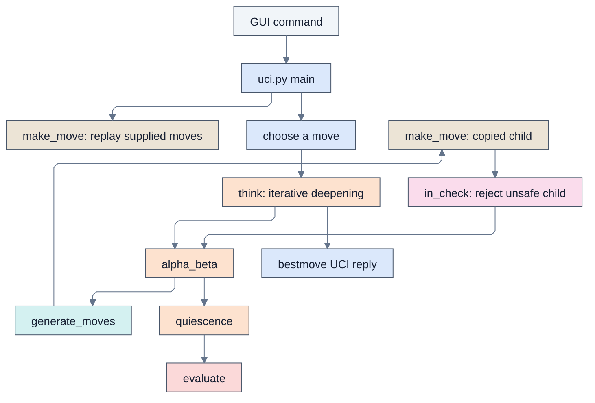

# Remus5: complete line-by-line review and explanation

This is a standalone companion to every source, launcher, support, and data file in `engines_instructor/Remus5`. It explains what each physical line means, how the files work together, and where the implementation makes assumptions or approximations. Shared code is explained here in full; reading another engine's companion is not required.

Remus5 includes the Remus4 evaluation and search framework, with terminal-aware quiescence, legal check evasions, en passant-aware capture classification and exchange occupancy, a legal-move guard on null pruning, and bounded quiet-history move ordering. Quiescence tracks repetition paths, preserves mate-distance ply, and uses an explicit 128-ply guard. The explanations describe the search rules and their approximations.

## Root advice and search control

Remus5 supports optional Lichess tablebase advice and UCI pondering in both Python
and Rust. `tablebase.py` handles only root lookups, with native move validation,
repetition guards, bounded waits, and native-search fallback. `search_control.py`
uses a lightweight input-reader thread so one chess search thread can respond to
`stop`, `ponderhit`, and Lucas stop-and-go handoffs. A bounded post-hit time reserve
protects thinking time on the engine's own clock. Pondering never queries tablebases.

The [engine README](../../docs/engines/Remus5/README.md) describes these boundaries,
their options, and their function diagrams. `Ponder` defaults to false and must be
enabled in Lucas's external and tournament entries; `LichessTablebase` defaults to
true. The engine remains usable offline.

## Cache and call diagrams

Remus5 and Remus5-Rust each use a fixed 512 MiB cache with four 16-byte
entries per bucket. Both use multiply-shift indexing and age/depth replacement.
Python uses an anonymous memory mapping; Rust uses Windows virtual memory.
Neither exposes a UCI Hash option.

The [engine README](../../docs/engines/Remus5/README.md#the-call-tree) contains
the Mermaid module overview and focused function diagrams. Editable `.mmd`
sources and rendered SVGs live beside that README in `mermaid/`.

## Reading guide

The tables reproduce exact source text with original line numbers. Every blank line, comment, docstring, import, constant, data row, control-flow line, and executable statement receives a row. Indentation is preserved. A multiline statement has one explanation per physical line, including its delimiters. Function sections provide navigation, while the file reviews explain assumptions that span several lines.

The scope is the Python engine folder named above. This document itself and generated `__pycache__` contents are not engine source. Rust sibling folders are separate implementations and are outside this Python companion's file inventory. There is no verify_remus.py in this Remus5 folder, so no verifier file is invented or copied into it. Verification concepts are explained separately below.

| File | Physical lines | Code or data lines | Responsibility |
| --- | ---: | ---: | --- |
| [board.py](#board-py) | 83 | 23 | Defines piece encoding, board coordinates, the starting position, and conversion helpers. |
| [attacks.py](#attacks-py) | 59 | 34 | Tests whether a square or king is attacked by inspecting piece geometry and blockers. |
| [make_move.py](#make-move-py) | 52 | 24 | Applies a move to a copied board, including special moves and castling rights. |
| [move_generation.py](#move-generation-py) | 103 | 65 | Generates movement candidates, including pawn moves, promotions, and castling. |
| [evaluation.py](#evaluation-py) | 273 | 195 | Converts material and positional features into a centipawn estimate for the side to move. |
| [exchange.py](#exchange-py) | 61 | 39 | Estimates the material result of alternating captures on one square. |
| [transposition_table.py](#transposition-table-py) | 90 | 68 | Caches searched depths, scores, bounds, and best moves by position hash. |
| [opening_book.py](#opening-book-py) | 36 | 21 | Loads stored opening sequences and returns shuffled prefix-matching continuations. |
| [opening_book.txt](#opening-book-txt) | 140 | 56 | Contains the complete opening sequences, comments, and side-restricted lines used by the loader. |
| [search.py](#search-py) | 331 | 255 | Filters legal moves, searches continuations, controls time, and selects the root reply. |
| [uci.py](#uci-py) | 94 | 62 | Translates the supported UCI commands and native moves between the GUI and engine. |
| [remus.bat](#remus-bat) | 1 | 1 | Launches the Python UCI entry point through uv on Windows. |
| **Total** | **1319** | **843** | Complete source inventory |

Code/data counts exclude blank lines, standalone comments, and Python docstrings. They count physical continuation lines, not abstract Python statements. Opening-book move lines count as data; the batch command counts as one executable line.

## The complete path from a command to a move

1. The Windows launcher starts uci.py. Importing modules defines functions, constructs constants, and allocates the fixed 512 MiB search table; the main guard starts the protocol loop.
2. A position command resets to START_POSITION and replays the supplied coordinate moves. make_move() returns a copied child each time.
3. A go command calculates a time allowance. The adapter first asks the optional book for a native, king-safe continuation. If none qualifies, it starts search.
4. think() searches increasing nominal depths. alpha_beta() orders movement candidates, makes copies, rejects moves that leave the moving king attacked, and recursively examines the remaining continuations.
5. At a normal depth boundary, quiescence() extends selected tactical lines and evaluate() supplies static scores. A child's score is negated to express it for the parent player.
6. Search retains its best legal root move. The adapter prints bestmove plus its UCI token, or 0000 when no move exists. It then waits for the next command.

<!-- module-color-legend -->
Colors identify source modules consistently across Python and Rust: blue is the UCI adapter, orange is search, teal is move generation, tan is move copying, pink is attack checking, and red is evaluation. External programs and launchers use gray. Labels identify each responsibility.

[Open rendered diagram](../../docs/engines/Remus5/mermaid/detail_flow.svg) | [Mermaid source](../../docs/engines/Remus5/mermaid/detail_flow.mmd)

The diagram shows the search path. A legal book hit bypasses think(), while cache hits and pruning can shorten the recursive path.

## Representation and Python concepts used throughout

### Board coordinates and piece numbers

Row 0 is rank 8 and column 0 is file a. Square number is row*8+column, giving a8=0, h8=7, a1=56, and h1=63. For e2, row 6 and column 4 give 52; e4 is 36. White pawns advance toward smaller row numbers.

| Meaning | Value or operation |
| --- | --- |
| Empty square | 0 |
| Pawn, knight, bishop, rook, queen, king | 1, 2, 3, 4, 5, 6 |
| White color flag | 8 |
| White knight / Black knight | 10 / 2 |
| Extract kind | piece & 7 |
| Extract White flag | piece & WHITE |
| Move | (source, target, promotion), with promotion 0 for ordinary moves |
| Castling flags | White kingside 1, White queenside 2, Black kingside 4, Black queenside 8 |
| En passant target | The skipped square after a two-square pawn move, or -1 |

A Position is `(board, white, castling, en_passant, halfmove)`. halfmove counts plies since a pawn move or capture; 100 plies represent fifty moves by each player. Earlier position keys live in a separate history list, not inside this tuple.

### Lists, tuples, annotations, and control flow

Lists can change; tuples fix their sequence of references. A tuple containing a board list does not freeze that list. `board[:]` copies the list so edits to a child do not alter the parent. The tuple returned by make_move() contains that new board and updated scalar state. Search consequently needs no unmake operation.

Type hints describe expected values but do not enforce them at runtime. `Move | None` means either a three-integer move or the absence of a move. `&` masks integer bits; `|` inside a type hint is a type union. `//` is floor division, `%` is remainder, and `~` complements bits for castling-right masks. `and` and `or` short-circuit, so a failed earlier test can avoid an unsafe or expensive later expression.

A function definition creates a callable; its body runs when called. Imports execute module-level initialization once per normal process import. Global declarations allow rebinding shared search counters and root state. A raised SearchTimeout unwinds recursive calls until think() catches it; this is different from an ordinary return or a break that exits only one loop.

### Chess and search vocabulary

A **ply** is one player's move. A nominal depth of four is four plies, not four full move pairs. Check extensions and quiescence can search beyond that nominal depth. A **pseudo-legal move** obeys movement geometry and occupancy but may expose its own king; a legal move also passes the child-board king-safety test.

A **centipawn** is one hundredth of this evaluator's pawn value. A +100 score estimates a one-pawn advantage for the side to move. It is neither a win probability nor an Elo rating. Mate has a separate large magnitude, reduced by distance so a quicker win is preferred.

**Negamax** uses the same maximization code for both players by negating a child's score. **Alpha** is the useful lower bound and **beta** the cutoff threshold. A score reaching beta makes further alternatives at that node unnecessary for the parent's current question. A **bound** can be sufficient even when the exact best score is unknown.

**Stand pat** uses the current static score without another tactical move. It is a search baseline, not a legal pass. **Quiescence** extends tactical continuations beyond the depth boundary to reduce evaluations made halfway through exchanges. **Perft** instead enumerates every legal continuation to a specified depth without evaluation, ordering-based pruning, or strength measurement.

## Review findings and operating assumptions

The rules layer uses native code throughout. generate_moves() supplies candidates; make_move() applies them on copies; in_check() rejects exposed kings. Incoming UCI move histories are trusted, so this legality guarantee concerns moves the engine selects from a valid position. Malformed input and invalid boards are outside the runtime contract.

Quiescence determines check and legal-move existence before stand pat or pruning. No legal move means mate when checked and stalemate otherwise. A checked node searches every legal evasion, bypassing stand pat, delta pruning, and SEE pruning. At the explicit 128-ply guard, a nonterminal position returns static evaluation even if checked; this is the bounded-search exception. Outside check, noncapturing underpromotions remain outside the tactical prefix.

En passant contributes a pawn victim to ordering and delta pruning, cannot be classified as quiet for reductions or history rewards, and removes its victim from the temporary SEE board. A null probe requires a legal move, protecting stalemate. Quiet cutoff history is keyed by color and move, gains depth squared, is capped at 3999, and is halved at each think() call. It changes ordering rather than adding a positional evaluation term.

The table key is a Python hash of board, turn, castling rights, and raw en passant target. It has no full-position collision check. A matching key can overwrite a deep entry with a shallow one. Each full four-entry bucket replaces its lowest depth-minus-age entry within the fixed 512 MiB allocation. Killer hints and the table persist across move requests. The UCI loop does not clear them on an ignored ucinewgame command.

Null-move pruning assumes a position that remains good after an artificial pass is unlikely to need a complete real-move search. Zugzwang violates that assumption. Requiring a nonpawn piece reduces one common risk but does not eliminate it. Aspiration failures repeat search with an opened bound; a narrow score is not accepted as an exact result just because it returned quickly.

The draw predicate treats one prior matching key as a search-cycle draw rather than requiring two prior occurrences for literal threefold repetition. It also returns zero at 100 reversible plies, without modeling claim decisions or every automatic draw rule. Raw en passant state can distinguish positions whose legal move sets are effectively the same. The history slice assumes the supplied reversible history is adequate; an incomplete external history can expose negative-slice behavior. Null probes also place artificial positions and clock increments into this search machinery.

The cache key excludes both the halfmove clock and full prior path. Checking the current node for a draw before probing does not make every cached descendant value independent of history. Main-search append/pop blocks are not protected by finally; a timeout can leave their path entries until think() resets the list from game_history. Quiescence uses try/finally for its own entries, and a checked draw candidate receives a legal-move test to preserve checkmate precedence.

Futility, late move reductions, delta pruning, and SEE are selective approximations. They can miss an unexpectedly strong quiet move or sacrifice. Mobility counts pseudo-legal destinations; pawn races use a geometric king-distance estimate; king safety considers only a back-rank pawn shield; insufficient-material scoring recognizes only a subset of drawn material. Phase blending uses floor division, so small rounding asymmetries are possible. None of these feature weights alone establishes an Elo gain.

Timing is approximate. Recursive checks occur every 1024 node entries and require an established root move. The soft stop is checked after an iteration, so an expensive iteration or terminal path can exceed the intended allowance. A changing best move may be retained from an unfinished depth. Printed scores use the UCI cp label even for the engine's internal mate-scale values.

### What would make the UCI test verify returned-move legality?

A successful handshake and a line beginning with bestmove confirm protocol activity, not legal chess. This folder has no bundled verify_uci() implementation. A surrounding UCI test must explicitly check the returned token if it is intended to establish legality.

A legality check must reconstruct the same position, parse the bestmove token into source, target, and promotion, generate candidates, make each candidate, and retain only those whose child board leaves the moving king safe. The returned move must belong to that legal set. The token 0000 is acceptable only when that set is empty. Testing with the engine's own rules checks its adapter against its rules; an independent boundary library can additionally cross-check those rules. No such stronger check is silently attributed to the existing prefix-only test.

## Line-by-line source reference

## board.py

Defines piece encoding, board coordinates, the starting position, and conversion helpers. Source: [board.py](board.py).

### Lines 1 to 41: Module description, imports, and constants

| Line | Exact source | Detailed explanation |
| ---: | --- | --- |
| 1 | <code>"""board.py</code> | Opens the module docstring. This is descriptive text stored as documentation, not a statement that performs the described chess operation. |
| 2 | <em>blank</em> | Blank paragraph separator inside the module docstring. It contributes formatting to documentation and no chess calculation. |
| 3 | <code>The position, the starting position, and the names of squares and moves.</code> | Documentation text for module: The position, the starting position, and the names of squares and moves. This line states the intended meaning; the executable-line review distinguishes implementation details and limitations. |
| 4 | <em>blank</em> | Blank paragraph separator inside the module docstring. It contributes formatting to documentation and no chess calculation. |
| 5 | <code>The board is a list of 64 numbers, one per square. Row 0 is rank 8 and</code> | Documentation text for module: The board is a list of 64 numbers, one per square. Row 0 is rank 8 and This line states the intended meaning; the executable-line review distinguishes implementation details and limitations. |
| 6 | <code>column 0 is file a, and square number row &#42; 8 + col names a square: a8</code> | Documentation text for module: column 0 is file a, and square number row * 8 + col names a square: a8 This line states the intended meaning; the executable-line review distinguishes implementation details and limitations. |
| 7 | <code>is 0, h8 is 7, a1 is 56, and h1 is 63. A piece is its kind, from 1 for</code> | Documentation text for module: is 0, h8 is 7, a1 is 56, and h1 is 63. A piece is its kind, from 1 for This line states the intended meaning; the executable-line review distinguishes implementation details and limitations. |
| 8 | <code>a pawn to 6 for a king, plus 8 if it is White, so a White knight is 10</code> | Documentation text for module: a pawn to 6 for a king, plus 8 if it is White, so a White knight is 10 This line states the intended meaning; the executable-line review distinguishes implementation details and limitations. |
| 9 | <code>and a Black knight is 2. piece &amp; 7 gives the kind, and 0 is an empty</code> | Documentation text for module: and a Black knight is 2. piece & 7 gives the kind, and 0 is an empty This line states the intended meaning; the executable-line review distinguishes implementation details and limitations. |
| 10 | <code>square.</code> | Documentation text for module: square. This line states the intended meaning; the executable-line review distinguishes implementation details and limitations. |
| 11 | <em>blank</em> | Blank paragraph separator inside the module docstring. It contributes formatting to documentation and no chess calculation. |
| 12 | <code>A position is the tuple (board, white, castling, en_passant, halfmove):</code> | Documentation text for module: A position is the tuple (board, white, castling, en_passant, halfmove): This line states the intended meaning; the executable-line review distinguishes implementation details and limitations. |
| 13 | <code>the board, True when White is to move, the castling rights as four</code> | Documentation text for module: the board, True when White is to move, the castling rights as four This line states the intended meaning; the executable-line review distinguishes implementation details and limitations. |
| 14 | <code>bits, the square a pawn just skipped over or -1, and the moves since</code> | Documentation text for module: bits, the square a pawn just skipped over or -1, and the moves since This line states the intended meaning; the executable-line review distinguishes implementation details and limitations. |
| 15 | <code>the last capture or pawn move.</code> | Documentation text for module: the last capture or pawn move. This line states the intended meaning; the executable-line review distinguishes implementation details and limitations. |
| 16 | <code>"""</code> | Closes the module docstring. Execution proceeds to the subsequent definitions or statements, whose individual explanations describe the actual behavior. |
| 17 | <em>blank</em> | Blank line separating related statements, definitions, or paragraphs for readability. It introduces no object, branch, board change, or search operation. |
| 18 | <code>EMPTY, PAWN, KNIGHT, BISHOP, ROOK, QUEEN, KING = range(7)  # Piece kinds</code> | `range(7)` supplies 0 through 6; assignment unpacks them into EMPTY=0, PAWN=1, KNIGHT=2, BISHOP=3, ROOK=4, QUEEN=5, and KING=6. These are piece kinds, not material values. Every engine module agrees on this numbering, so a move's promotion value can use the same codes. |
| 19 | <code>WHITE = 8  # Added to the kind of a White piece</code> | The color flag is 8, binary `1000`. Add it to kinds 1 through 6 to obtain White pieces 9 through 14. Black keeps kinds 1 through 6. Because the low three bits hold the kind, `piece & 7` removes this color flag and `piece & WHITE` keeps it. The value 8 alone is not a valid piece. |
| 20 | <code>MATE_SCORE = 100_000  # Larger than any material count</code> | Sets the shared mate-score magnitude to 100,000. Search uses it for terminal scores, and the transposition table uses it to recognize scores that need mate-distance normalization. |
| 21 | <em>blank</em> | Blank line separating related statements, definitions, or paragraphs for readability. It introduces no object, branch, board change, or search operation. |
| 22 | <code>Position = tuple&#91;list&#91;int&#93;, bool, int, int, int&#93;</code> | Defines the five-field Position type: board list, side-to-move Boolean, castling bits, en passant target, and halfmove clock. The clock counts individual plies since the last pawn move or capture, not full move pairs. |
| 23 | <code>Move = tuple&#91;int, int, int&#93;  # (from square, to square, promotion or 0)</code> | Defines `Move` as three integers: source square, destination square, and promotion kind. `(52, 36, 0)` means e2-e4; `(12, 4, 5)` means e7-e8 promoting to a queen. A normal move uses 0 in the final slot, and captures need no separate flag because the position supplies the captured piece. |
| 24 | <em>blank</em> | Blank line separating related statements, definitions, or paragraphs for readability. It introduces no object, branch, board change, or search operation. |
| 25 | <code># The starting position. Every engine can share this code</code> | Explanatory source comment: The starting position. Every engine can share this code Python does not execute this text. The adjacent code rows explain the actual operations and any qualifications to this description. |
| 26 | <code># Row 0 is rank 8 and column 0 is file a. Both sides use the same back rank.</code> | Explanatory source comment: Row 0 is rank 8 and column 0 is file a. Both sides use the same back rank. Python does not execute this text. The adjacent code rows explain the actual operations and any qualifications to this description. |
| 27 | <code>BACK_RANK = &#91;ROOK, KNIGHT, BISHOP, QUEEN, KING, BISHOP, KNIGHT, ROOK&#93;</code> | Lists piece kinds from file a through h: rook, knight, bishop, queen, king, bishop, knight, rook. The queen is on file d and king on file e. These uncolored values directly describe Black's back rank; adding WHITE later creates White's back rank in the same file order. |
| 28 | <code># &#91;PAWN&#93; &#42; 8 is a list of eight pawns while &#91;EMPTY&#93; &#42; 32 is a list of 32 empty squares.</code> | Explanatory source comment: `[PAWN] * 8` is a list of eight pawns while `[EMPTY] * 32` is a list of 32 empty squares. Python does not execute this text. The adjacent code rows explain the actual operations and any qualifications to this description. |
| 29 | <code># The starting board is the Black back rank, the Black pawns,</code> | Explanatory source comment: The starting board is the Black back rank, the Black pawns, Python does not execute this text. The adjacent code rows explain the actual operations and any qualifications to this description. |
| 30 | <code># 32 empty squares, the White pawns, and the White back rank.</code> | Explanatory source comment: 32 empty squares, the White pawns, and the White back rank. Python does not execute this text. The adjacent code rows explain the actual operations and any qualifications to this description. |
| 31 | <code>START_BOARD = BACK_RANK + &#91;PAWN&#93; &#42; 8 + &#91;EMPTY&#93; &#42; 32 + &#91;WHITE + PAWN&#93; &#42; 8</code> | Concatenates five rank groups into a new 56-element list: Black's eight back-rank pieces, eight Black pawns, 32 empty squares, and eight White pawns. The final White back rank is appended below. Multiplying lists of immutable integers is safe here; this is not the problematic case of repeating a mutable row object. |
| 32 | <code># The White pieces are the same as the Black pieces, but with WHITE added to the kind.</code> | Explanatory source comment: The White pieces are the same as the Black pieces, but with WHITE added to the kind. Python does not execute this text. The adjacent code rows explain the actual operations and any qualifications to this description. |
| 33 | <code>for kind in BACK_RANK:</code> | Iterates through the eight kind numbers in BACK_RANK. This loop runs when the module is imported, as part of constructing the starting board, rather than every time a move is searched. |
| 34 | <code>&nbsp;&nbsp;&nbsp;&nbsp;START_BOARD.append(WHITE + kind)</code> | Appends each kind with the White flag added. After eight iterations START_BOARD contains exactly 64 entries, ending with `[12, 10, 11, 13, 14, 11, 10, 12]` on rank 1. `append` mutates this initialization list; move application later copies boards instead of mutating the live position. |
| 35 | <code># True = White moves first</code> | Explanatory source comment: True = White moves first Python does not execute this text. The adjacent code rows explain the actual operations and any qualifications to this description. |
| 36 | <code># 15 =  All four castling rights: 1 + 2 for White, 4 + 8 for Black</code> | Explanatory source comment: 15 =  All four castling rights: 1 + 2 for White, 4 + 8 for Black Python does not execute this text. The adjacent code rows explain the actual operations and any qualifications to this description. |
| 37 | <code># -1 = No pawn has just moved two squares</code> | Explanatory source comment: -1 = No pawn has just moved two squares Python does not execute this text. The adjacent code rows explain the actual operations and any qualifications to this description. |
| 38 | <code># 0 = No moves yet toward the fifty-move rule</code> | Explanatory source comment: 0 = No moves yet toward the fifty-move rule Python does not execute this text. The adjacent code rows explain the actual operations and any qualifications to this description. |
| 39 | <code>START_POSITION = (START_BOARD, True, 15, -1, 0)</code> | Constructs the starting position with White to move, all four castling rights, no en passant square, and halfmove clock zero. START_BOARD is shared until make_move() makes its own copy. |
| 40 | <em>blank</em> | Blank line separating related statements, definitions, or paragraphs for readability. It introduces no object, branch, board change, or search operation. |
| 41 | <em>blank</em> | Blank line separating related statements, definitions, or paragraphs for readability. It introduces no object, branch, board change, or search operation. |

### Lines 42 to 46: is_own()

| Line | Exact source | Detailed explanation |
| ---: | --- | --- |
| 42 | <code>def is_own(piece: int, white: bool) -&gt; bool:</code> | Defines a helper whose inputs are an encoded piece and the color to test. The result is Boolean. Here `white` means 'does this piece belong to White?' rather than always meaning the position's side to move; callers can pass `not white` to ask about an enemy piece. |
| 43 | <code>&nbsp;&nbsp;&nbsp;&nbsp;"""Return True if the piece belongs to White (white is True) or Black."""</code> | One-line docstring for is_own. It records the function or class contract as text; the following executable lines implement that contract. A docstring does not validate inputs or enforce its stated guarantee. |
| 44 | <code>&nbsp;&nbsp;&nbsp;&nbsp;return piece &gt; WHITE if white else EMPTY &lt; piece &lt; WHITE</code> | Uses a conditional expression: for White, accept piece values greater than 8; for Black, accept values strictly between 0 and 8. Empty=0 fails both branches. For valid pieces, 10 belongs to White and 2 to Black. This assumes valid encoding: it does not reject every out-of-range integer. |
| 45 | <em>blank</em> | Blank line separating related statements, definitions, or paragraphs for readability. It introduces no object, branch, board change, or search operation. |
| 46 | <em>blank</em> | Blank line separating related statements, definitions, or paragraphs for readability. It introduces no object, branch, board change, or search operation. |

### Lines 47 to 51: position_key()

| Line | Exact source | Detailed explanation |
| ---: | --- | --- |
| 47 | <code>def position_key(position: Position) -&gt; int:</code> | Defines a compact key for caching a position. The key must include side to move and special-move rights because identical piece placement can allow different legal moves. |
| 48 | <code>&nbsp;&nbsp;&nbsp;&nbsp;"""Return a number that names the position, for the table and repetitions."""</code> | One-line docstring for position_key. It records the function or class contract as text; the following executable lines implement that contract. A docstring does not validate inputs or enforce its stated guarantee. |
| 49 | <code>&nbsp;&nbsp;&nbsp;&nbsp;return hash((tuple(position&#91;0&#93;), position&#91;1&#93;, position&#91;2&#93;, position&#91;3&#93;))</code> | Hashes board contents, turn, castling rights, and raw en passant square. The halfmove clock is deliberately absent, allowing transpositions but making score reuse near the fifty-move threshold history-sensitive. A hash collision is not verified against full position data. |
| 50 | <em>blank</em> | Blank line separating related statements, definitions, or paragraphs for readability. It introduces no object, branch, board change, or search operation. |
| 51 | <em>blank</em> | Blank line separating related statements, definitions, or paragraphs for readability. It introduces no object, branch, board change, or search operation. |

### Lines 52 to 61: parse_square()

| Line | Exact source | Detailed explanation |
| ---: | --- | --- |
| 52 | <code>def parse_square(text: str) -&gt; int:</code> | Defines conversion from a two-character algebraic square name to a 0-based board index. The function expects a lowercase file a-h and a rank 1-8; parsing a whole UCI move happens in uci.py instead. |
| 53 | <code>&nbsp;&nbsp;&nbsp;&nbsp;"""Return the square that text such as "e2" names."""</code> | One-line docstring for parse_square. It records the function or class contract as text; the following executable lines implement that contract. A docstring does not validate inputs or enforce its stated guarantee. |
| 54 | <code>&nbsp;&nbsp;&nbsp;&nbsp;# text&#91;0&#93; is the file letter and text&#91;1&#93; is the rank digit.</code> | Explanatory source comment: text[0] is the file letter and text[1] is the rank digit. Python does not execute this text. The adjacent code rows explain the actual operations and any qualifications to this description. |
| 55 | <code>&nbsp;&nbsp;&nbsp;&nbsp;# Row 0 is rank 8, so the ranks are listed from 8 down to 1: the position</code> | Explanatory source comment: Row 0 is rank 8, so the ranks are listed from 8 down to 1: the position Python does not execute this text. The adjacent code rows explain the actual operations and any qualifications to this description. |
| 56 | <code>&nbsp;&nbsp;&nbsp;&nbsp;# of "2" in "87654321" is 6, so rank 2 is row 6.</code> | Explanatory source comment: of "2" in "87654321" is 6, so rank 2 is row 6. Python does not execute this text. The adjacent code rows explain the actual operations and any qualifications to this description. |
| 57 | <code>&nbsp;&nbsp;&nbsp;&nbsp;# The position of "e" in "abcdefgh" is 4, so file e is column 4.</code> | Explanatory source comment: The position of "e" in "abcdefgh" is 4, so file e is column 4. Python does not execute this text. The adjacent code rows explain the actual operations and any qualifications to this description. |
| 58 | <code>&nbsp;&nbsp;&nbsp;&nbsp;# Each row holds 8 squares, so e2 is square 6 &#42; 8 + 4 = 52.</code> | Explanatory source comment: Each row holds 8 squares, so e2 is square 6 * 8 + 4 = 52. Python does not execute this text. The adjacent code rows explain the actual operations and any qualifications to this description. |
| 59 | <code>&nbsp;&nbsp;&nbsp;&nbsp;return "87654321".index(text&#91;1&#93;) &#42; 8 + "abcdefgh".index(text&#91;0&#93;)</code> | Finds the rank in the reverse string `87654321`, multiplies that row by 8, and adds the file's index in `abcdefgh`. For e2, the row is 6 and column is 4, giving 52. `str.index()` raises ValueError for an unknown character; too-short text can raise IndexError. The function does not validate extra trailing text. |
| 60 | <em>blank</em> | Blank line separating related statements, definitions, or paragraphs for readability. It introduces no object, branch, board change, or search operation. |
| 61 | <em>blank</em> | Blank line separating related statements, definitions, or paragraphs for readability. It introduces no object, branch, board change, or search operation. |

### Lines 62 to 69: square_name()

| Line | Exact source | Detailed explanation |
| ---: | --- | --- |
| 62 | <code>def square_name(square: int) -&gt; str:</code> | Defines conversion from a board index to algebraic notation. It expects an integer from 0 through 63 and returns a two-character string. It is used for UCI output and by the verifier when formatting moves. |
| 63 | <code>&nbsp;&nbsp;&nbsp;&nbsp;"""Return the name of a square, such as "e2"."""</code> | One-line docstring for square_name. It records the function or class contract as text; the following executable lines implement that contract. A docstring does not validate inputs or enforce its stated guarantee. |
| 64 | <code>&nbsp;&nbsp;&nbsp;&nbsp;# This undoes parse_square(). For square 52, the remainder 52 % 8 = 4 is the</code> | Explanatory source comment: This undoes parse_square(). For square 52, the remainder 52 % 8 = 4 is the Python does not execute this text. The adjacent code rows explain the actual operations and any qualifications to this description. |
| 65 | <code>&nbsp;&nbsp;&nbsp;&nbsp;# column, and letter 4 of "abcdefgh" is "e". The whole-number division</code> | Explanatory source comment: column, and letter 4 of "abcdefgh" is "e". The whole-number division Python does not execute this text. The adjacent code rows explain the actual operations and any qualifications to this description. |
| 66 | <code>&nbsp;&nbsp;&nbsp;&nbsp;# 52 // 8 = 6 is the row, and digit 6 of "87654321" is "2".</code> | Explanatory source comment: 52 // 8 = 6 is the row, and digit 6 of "87654321" is "2". Python does not execute this text. The adjacent code rows explain the actual operations and any qualifications to this description. |
| 67 | <code>&nbsp;&nbsp;&nbsp;&nbsp;return "abcdefgh"&#91;square % 8&#93; + "87654321"&#91;square // 8&#93;</code> | `square % 8` gives the file column and `square // 8` gives the row. The two string lookups turn those numbers into a file and rank, then `+` concatenates them. Index 52 gives `e` plus `2`. Valid board indices round-trip through parse_square(); out-of-range values are outside this function's contract. |
| 68 | <em>blank</em> | Blank line separating related statements, definitions, or paragraphs for readability. It introduces no object, branch, board change, or search operation. |
| 69 | <em>blank</em> | Blank line separating related statements, definitions, or paragraphs for readability. It introduces no object, branch, board change, or search operation. |

### Lines 70 to 83: move_text()

| Line | Exact source | Detailed explanation |
| ---: | --- | --- |
| 70 | <code>def move_text(move: Move) -&gt; str:</code> | Defines the conversion from a native three-integer move to UCI coordinate text. Search uses it for principal-variation output, and the UCI adapter uses it for book matching and bestmove replies. |
| 71 | <code>&nbsp;&nbsp;&nbsp;&nbsp;"""</code> | Opens the move_text docstring. This is descriptive text stored as documentation, not a statement that performs the described chess operation. |
| 72 | <code>&nbsp;&nbsp;&nbsp;&nbsp;Return the UCI text of a move, such as "e7e8q". The promotion</code> | Documentation text for move_text: Return the UCI text of a move, such as "e7e8q". The promotion This line states the intended meaning; the executable-line review distinguishes implementation details and limitations. |
| 73 | <code>&nbsp;&nbsp;&nbsp;&nbsp;letter's place in ".pnbrqk" is the kind of piece.</code> | Documentation text for move_text: letter's place in ".pnbrqk" is the kind of piece. This line states the intended meaning; the executable-line review distinguishes implementation details and limitations. |
| 74 | <code>&nbsp;&nbsp;&nbsp;&nbsp;"""</code> | Closes the move_text docstring. Execution proceeds to the subsequent definitions or statements, whose individual explanations describe the actual behavior. |
| 75 | <code>&nbsp;&nbsp;&nbsp;&nbsp;# A move is a tuple of three slots: move&#91;0&#93; is the from square,</code> | Explanatory source comment: A move is a tuple of three slots: move[0] is the from square, Python does not execute this text. The adjacent code rows explain the actual operations and any qualifications to this description. |
| 76 | <code>&nbsp;&nbsp;&nbsp;&nbsp;# move&#91;1&#93; the to square, move&#91;2&#93; the promotion</code> | Explanatory source comment: move[1] the to square, move[2] the promotion Python does not execute this text. The adjacent code rows explain the actual operations and any qualifications to this description. |
| 77 | <code>&nbsp;&nbsp;&nbsp;&nbsp;text = square_name(move&#91;0&#93;) + square_name(move&#91;1&#93;)</code> | Concatenates the source and destination square names. For (52,36,0), square_name() gives e2 and e4, producing e2e4. |
| 78 | <code>&nbsp;&nbsp;&nbsp;&nbsp;if move&#91;2&#93;:</code> | Tests whether the promotion kind is nonzero. Ordinary moves remain four characters; promotions add a fifth character. |
| 79 | <code>&nbsp;&nbsp;&nbsp;&nbsp;&nbsp;&nbsp;&nbsp;&nbsp;# move&#91;2&#93; is 0 with no promotion, else a piece kind (2 knight to</code> | Explanatory source comment: move[2] is 0 with no promotion, else a piece kind (2 knight to Python does not execute this text. The adjacent code rows explain the actual operations and any qualifications to this description. |
| 80 | <code>&nbsp;&nbsp;&nbsp;&nbsp;&nbsp;&nbsp;&nbsp;&nbsp;# 5 queen), which picks its letter: ".pnbrqk"&#91;5&#93; is "q". The "."</code> | Explanatory source comment: 5 queen), which picks its letter: ".pnbrqk"[5] is "q". The "." Python does not execute this text. The adjacent code rows explain the actual operations and any qualifications to this description. |
| 81 | <code>&nbsp;&nbsp;&nbsp;&nbsp;&nbsp;&nbsp;&nbsp;&nbsp;# fills slot 0, EMPTY</code> | Explanatory source comment: fills slot 0, EMPTY Python does not execute this text. The adjacent code rows explain the actual operations and any qualifications to this description. |
| 82 | <code>&nbsp;&nbsp;&nbsp;&nbsp;&nbsp;&nbsp;&nbsp;&nbsp;text += ".pnbrqk"&#91;move&#91;2&#93;&#93;</code> | Selects the promotion letter using the shared kind numbering. Queen kind 5 indexes q in .pnbrqk, so a move from e7 to e8 with kind 5 becomes e7e8q. |
| 83 | <code>&nbsp;&nbsp;&nbsp;&nbsp;return text</code> | Returns the finished UCI token. This function formats the move but neither validates it nor applies it to a position. |

### File review: board.py

The board representation is a contract shared by every module. A tuple does not make its nested board list immutable; correctness depends on copy-make. Square conversion assumes valid coordinate text. Position hashes, where present, are compact identifiers rather than collision-proof full positions.

## attacks.py

Tests whether a square or king is attacked by inspecting piece geometry and blockers. Source: [attacks.py](attacks.py).

### Lines 1 to 26: Module description, imports, and constants

| Line | Exact source | Detailed explanation |
| ---: | --- | --- |
| 1 | <code>"""attacks.py</code> | Opens the module docstring. This is descriptive text stored as documentation, not a statement that performs the described chess operation. |
| 2 | <em>blank</em> | Blank paragraph separator inside the module docstring. It contributes formatting to documentation and no chess calculation. |
| 3 | <code>Find out whether a square is attacked. Remus looks out from the</code> | Documentation text for module: Find out whether a square is attacked. Remus looks out from the This line states the intended meaning; the executable-line review distinguishes implementation details and limitations. |
| 4 | <code>square itself: if a knight's jump away there stands an enemy</code> | Documentation text for module: square itself: if a knight's jump away there stands an enemy This line states the intended meaning; the executable-line review distinguishes implementation details and limitations. |
| 5 | <code>knight, the knight attacks the square, and the same idea works for</code> | Documentation text for module: knight, the knight attacks the square, and the same idea works for This line states the intended meaning; the executable-line review distinguishes implementation details and limitations. |
| 6 | <code>every piece.</code> | Documentation text for module: every piece. This line states the intended meaning; the executable-line review distinguishes implementation details and limitations. |
| 7 | <code>"""</code> | Closes the module docstring. Execution proceeds to the subsequent definitions or statements, whose individual explanations describe the actual behavior. |
| 8 | <em>blank</em> | Blank line separating related statements, definitions, or paragraphs for readability. It introduces no object, branch, board change, or search operation. |
| 9 | <code>from board import BISHOP, EMPTY, KING, KNIGHT, PAWN, QUEEN, ROOK, WHITE</code> | Imports the common piece codes and WHITE flag from board.py. Attack detection compares exact encoded piece values, so it needs the kind codes for all attackers as well as EMPTY for ray traversal. Importing board.py also makes its initialized constants available without starting a game. |
| 10 | <em>blank</em> | Blank line separating related statements, definitions, or paragraphs for readability. It introduces no object, branch, board change, or search operation. |
| 11 | <code># The eight knight jumps, as (row change, column change)</code> | Explanatory source comment: The eight knight jumps, as (row change, column change) Python does not execute this text. The adjacent code rows explain the actual operations and any qualifications to this description. |
| 12 | <code>KNIGHT_JUMPS = (</code> | Begins an immutable tuple of knight offsets. Each element is another tuple `(row_change, column_change)`, not an absolute square. Offsets can be applied at any square; bounds checks later discard jumps off the board. |
| 13 | <code>&nbsp;&nbsp;&nbsp;&nbsp;(-2, -1), (-2, 1), (-1, -2), (-1, 2),</code> | Lists four knight jumps toward decreasing rows: two ranks and one file, or one rank and two files, in both file directions. Decreasing rows means moving toward rank 8 in this coordinate system. These are geometric offsets and work for either piece color. |
| 14 | <code>&nbsp;&nbsp;&nbsp;&nbsp;(1, -2), (1, 2), (2, -1), (2, 1),</code> | Lists the four corresponding jumps toward increasing rows. Together with the preceding line, this supplies all eight knight destinations before edge checks. A knight does not traverse intermediate squares, so occupied intervening squares are irrelevant. |
| 15 | <code>)  # fmt: skip</code> | Closes KNIGHT_JUMPS. The trailing comma on data entries is legal tuple syntax. `# fmt: skip` asks a supporting formatter to preserve the compact table layout; it is a comment and has no effect on move generation. |
| 16 | <em>blank</em> | Blank line separating related statements, definitions, or paragraphs for readability. It introduces no object, branch, board change, or search operation. |
| 17 | <code># The eight directions: rooks use the first four, bishops the last</code> | Explanatory source comment: The eight directions: rooks use the first four, bishops the last Python does not execute this text. The adjacent code rows explain the actual operations and any qualifications to this description. |
| 18 | <code># four, and queens and kings all eight</code> | Explanatory source comment: four, and queens and kings all eight Python does not execute this text. The adjacent code rows explain the actual operations and any qualifications to this description. |
| 19 | <code>DIRECTIONS = (</code> | Begins the tuple of eight unit directions used for straight and diagonal attacks. The order is deliberate because the next two constants select its first and last four entries. |
| 20 | <code>&nbsp;&nbsp;&nbsp;&nbsp;(-1, 0), (1, 0), (0, -1), (0, 1),</code> | Stores up, down, left, and right as row/column offsets. Rooks slide repeatedly along these directions; a king uses them for only one step. For example, `(0, 1)` moves one file toward h without changing rank. |
| 21 | <code>&nbsp;&nbsp;&nbsp;&nbsp;(-1, -1), (-1, 1), (1, -1), (1, 1),</code> | Stores the four diagonals: both combinations of decreasing row with left/right, followed by increasing row with left/right. Bishops slide along these directions, and queens combine them with the four straight directions. |
| 22 | <code>)  # fmt: skip</code> | Closes DIRECTIONS and preserves its table formatting with `# fmt: skip`. At runtime DIRECTIONS is an eight-element tuple; the formatting comment contributes no data. |
| 23 | <code>STRAIGHT = DIRECTIONS&#91;0:4&#93;  # The rook's four directions</code> | Slices indices 0 through 3 into STRAIGHT. Python excludes the stop index 4, so this contains exactly the four rook directions. Taking a tuple slice produces another tuple and does not alter DIRECTIONS. |
| 24 | <code>DIAGONAL = DIRECTIONS&#91;4:8&#93;  # The bishop's four directions</code> | Slices indices 4 through 7 into DIAGONAL, giving exactly the bishop directions. The separate names let callers select the right geometry without repeating offset literals. |
| 25 | <em>blank</em> | Blank line separating related statements, definitions, or paragraphs for readability. It introduces no object, branch, board change, or search operation. |
| 26 | <em>blank</em> | Blank line separating related statements, definitions, or paragraphs for readability. It introduces no object, branch, board change, or search operation. |

### Lines 27 to 56: is_attacked()

| Line | Exact source | Detailed explanation |
| ---: | --- | --- |
| 27 | <code>def is_attacked(board: list&#91;int&#93;, square: int, by_white: bool) -&gt; bool:</code> | Defines the attack query for an existing board, a target square, and the attacking color. It answers whether that color attacks the square, not whether it has a fully legal move there. It reads the board without changing it and returns as soon as any attacker is found. |
| 28 | <code>&nbsp;&nbsp;&nbsp;&nbsp;"""Return True if a piece of the given color attacks the square."""</code> | One-line docstring for is_attacked. It records the function or class contract as text; the following executable lines implement that contract. A docstring does not validate inputs or enforce its stated guarantee. |
| 29 | <code>&nbsp;&nbsp;&nbsp;&nbsp;row = square // 8</code> | Converts the target's square number to a row using integer division by 8. For d4, square 35, this gives row 4. All offset calculations begin from this target square rather than scanning outward from every attacking piece. |
| 30 | <code>&nbsp;&nbsp;&nbsp;&nbsp;col = square % 8</code> | Gets the target's column using remainder modulo 8. For d4 the result is 3. Maintaining row and column separately prevents a ray or jump from wrapping across an edge merely because a linear index stays between 0 and 63. |
| 31 | <code>&nbsp;&nbsp;&nbsp;&nbsp;# Add 8 to each kind when White attacks</code> | Explanatory source comment: Add 8 to each kind when White attacks Python does not execute this text. The adjacent code rows explain the actual operations and any qualifications to this description. |
| 32 | <code>&nbsp;&nbsp;&nbsp;&nbsp;side = WHITE if by_white else 0</code> | Selects 8 for White attackers and 0 for Black attackers. Adding `side` to PAWN, KNIGHT, and other kind constants below constructs the exact piece integers that count as attackers. |
| 33 | <code>&nbsp;&nbsp;&nbsp;&nbsp;# A White pawn attacks diagonally forward, so it stands one row</code> | Explanatory source comment: A White pawn attacks diagonally forward, so it stands one row Python does not execute this text. The adjacent code rows explain the actual operations and any qualifications to this description. |
| 34 | <code>&nbsp;&nbsp;&nbsp;&nbsp;# below the square (row + 1)</code> | Explanatory source comment: below the square (row + 1) Python does not execute this text. The adjacent code rows explain the actual operations and any qualifications to this description. |
| 35 | <code>&nbsp;&nbsp;&nbsp;&nbsp;pawn_steps = ((1, -1), (1, 1)) if by_white else ((-1, -1), (-1, 1))</code> | Builds the reverse offsets for locating an attacking pawn. To attack a target, a White pawn must stand one row below it, at `(row+1, col-1)` or `(row+1, col+1)`; Black uses one row above. These are opposite to the pawn's forward movement direction because the search begins at the attacked square. |
| 36 | <code>&nbsp;&nbsp;&nbsp;&nbsp;# Each kind of attacker: the steps it takes from the square, whether</code> | Explanatory source comment: Each kind of attacker: the steps it takes from the square, whether Python does not execute this text. The adjacent code rows explain the actual operations and any qualifications to this description. |
| 37 | <code>&nbsp;&nbsp;&nbsp;&nbsp;# it slides on past empty squares, and the pieces that attack that way</code> | Explanatory source comment: it slides on past empty squares, and the pieces that attack that way Python does not execute this text. The adjacent code rows explain the actual operations and any qualifications to this description. |
| 38 | <code>&nbsp;&nbsp;&nbsp;&nbsp;for steps, slides, attackers in (</code> | Begins a loop over attack categories. Each category supplies three values: a tuple of direction offsets, a Boolean telling whether to continue along a ray, and a tuple of acceptable encoded attackers. One shared traversal handles all five categories. |
| 39 | <code>&nbsp;&nbsp;&nbsp;&nbsp;&nbsp;&nbsp;&nbsp;&nbsp;(pawn_steps, False, (PAWN + side,)),</code> | Tests pawns at the two reverse pawn offsets, without sliding. `(PAWN + side,)` is a one-element tuple; the comma is essential. Pawn forward pushes are absent because a pawn attacks diagonally, not straight ahead. |
| 40 | <code>&nbsp;&nbsp;&nbsp;&nbsp;&nbsp;&nbsp;&nbsp;&nbsp;(KNIGHT_JUMPS, False, (KNIGHT + side,)),</code> | Tests all eight knight offsets with no sliding and accepts only a knight of the requested color. A bishop or pawn found on one of these squares does not satisfy the membership test. |
| 41 | <code>&nbsp;&nbsp;&nbsp;&nbsp;&nbsp;&nbsp;&nbsp;&nbsp;(DIRECTIONS, False, (KING + side,)),</code> | Tests the eight neighboring squares for the opposing king of the requested color. Kings attack adjacent squares, so this is a single-step category even though DIRECTIONS also serves sliding pieces. |
| 42 | <code>&nbsp;&nbsp;&nbsp;&nbsp;&nbsp;&nbsp;&nbsp;&nbsp;(STRAIGHT, True, (ROOK + side, QUEEN + side)),</code> | Tests straight rays, passing through empty squares until a blocker or board edge. Either a rook or queen of the requested color on the first occupied square attacks the target along that ray. |
| 43 | <code>&nbsp;&nbsp;&nbsp;&nbsp;&nbsp;&nbsp;&nbsp;&nbsp;(DIAGONAL, True, (BISHOP + side, QUEEN + side)),</code> | Tests diagonal rays in the same way and accepts a bishop or queen. A queen is therefore covered by both ray categories, while every individual ray still stops at the first occupied square. |
| 44 | <code>&nbsp;&nbsp;&nbsp;&nbsp;):</code> | Closes the tuple of five attack categories and ends the for-loop header with a colon. The indented body below runs once for each category, with its own steps, sliding flag, and allowed attackers. |
| 45 | <code>&nbsp;&nbsp;&nbsp;&nbsp;&nbsp;&nbsp;&nbsp;&nbsp;for row_change, col_change in steps:</code> | Unpacks one direction into its row and column changes. The inner body examines one potential line or jump from the target square at a time. |
| 46 | <code>&nbsp;&nbsp;&nbsp;&nbsp;&nbsp;&nbsp;&nbsp;&nbsp;&nbsp;&nbsp;&nbsp;&nbsp;r = row + row_change</code> | Starts at the neighboring row or knight-offset row, excluding the target square itself. For a rook direction this is one row away or the same row; for a knight it can be two rows away. |
| 47 | <code>&nbsp;&nbsp;&nbsp;&nbsp;&nbsp;&nbsp;&nbsp;&nbsp;&nbsp;&nbsp;&nbsp;&nbsp;c = col + col_change</code> | Starts at the corresponding column offset. Combined with the previous line, r and c identify the first candidate attacker square. |
| 48 | <code>&nbsp;&nbsp;&nbsp;&nbsp;&nbsp;&nbsp;&nbsp;&nbsp;&nbsp;&nbsp;&nbsp;&nbsp;while slides and 0 &lt;= r &lt; 8 and 0 &lt;= c &lt; 8 and board&#91;r &#42; 8 + c&#93; == EMPTY:</code> | Continues only for sliding pieces while the coordinates are inside the board and the square is empty. Python evaluates `and` left to right, so it checks bounds before indexing board. Non-sliders skip the loop entirely and test only their single candidate square below. |
| 49 | <code>&nbsp;&nbsp;&nbsp;&nbsp;&nbsp;&nbsp;&nbsp;&nbsp;&nbsp;&nbsp;&nbsp;&nbsp;&nbsp;&nbsp;&nbsp;&nbsp;r += row_change</code> | Advances the row along the ray. A horizontal direction has row_change=0, so the row stays fixed while the next line advances the column. |
| 50 | <code>&nbsp;&nbsp;&nbsp;&nbsp;&nbsp;&nbsp;&nbsp;&nbsp;&nbsp;&nbsp;&nbsp;&nbsp;&nbsp;&nbsp;&nbsp;&nbsp;c += col_change</code> | Advances the column along the ray. A vertical direction leaves the column unchanged. For a diagonal, both coordinates advance; the loop eventually reaches an occupied square or a board edge. |
| 51 | <code>&nbsp;&nbsp;&nbsp;&nbsp;&nbsp;&nbsp;&nbsp;&nbsp;&nbsp;&nbsp;&nbsp;&nbsp;# The first piece on the line attacks if it is the right kind</code> | Explanatory source comment: The first piece on the line attacks if it is the right kind Python does not execute this text. The adjacent code rows explain the actual operations and any qualifications to this description. |
| 52 | <code>&nbsp;&nbsp;&nbsp;&nbsp;&nbsp;&nbsp;&nbsp;&nbsp;&nbsp;&nbsp;&nbsp;&nbsp;if 0 &lt;= r &lt; 8 and 0 &lt;= c &lt; 8 and board&#91;r &#42; 8 + c&#93; in attackers:</code> | After traversal, checks bounds again and asks whether the first encountered piece is one of the permitted attackers. A friendly blocker or wrong enemy kind ends this ray without an attack; the function does not look through that piece. |
| 53 | <code>&nbsp;&nbsp;&nbsp;&nbsp;&nbsp;&nbsp;&nbsp;&nbsp;&nbsp;&nbsp;&nbsp;&nbsp;&nbsp;&nbsp;&nbsp;&nbsp;return True</code> | Returns True immediately after finding an attacker. Further directions and piece categories cannot change a positive answer, so this early return avoids unnecessary work. |
| 54 | <code>&nbsp;&nbsp;&nbsp;&nbsp;return False</code> | Returns False only after every attack category and direction has been examined without success. Its indentation puts it outside both loops. |
| 55 | <em>blank</em> | Blank line separating related statements, definitions, or paragraphs for readability. It introduces no object, branch, board change, or search operation. |
| 56 | <em>blank</em> | Blank line separating related statements, definitions, or paragraphs for readability. It introduces no object, branch, board change, or search operation. |

### Lines 57 to 59: in_check()

| Line | Exact source | Detailed explanation |
| ---: | --- | --- |
| 57 | <code>def in_check(board: list&#91;int&#93;, white: bool) -&gt; bool:</code> | Defines the check query for a particular king color. This is a convenience wrapper around is_attacked(); it does not depend on whose turn the position tuple says it is. |
| 58 | <code>&nbsp;&nbsp;&nbsp;&nbsp;"""Return True if the king of the given color is attacked."""</code> | One-line docstring for in_check. It records the function or class contract as text; the following executable lines implement that contract. A docstring does not validate inputs or enforce its stated guarantee. |
| 59 | <code>&nbsp;&nbsp;&nbsp;&nbsp;return is_attacked(board, board.index(KING + WHITE if white else KING), not white)</code> | Finds the king's square with list.index(): White's king is 14 and Black's is 6. It then asks whether the opposite color attacks that square. A missing king raises ValueError; valid engine positions require one king of each color. The board is only read. |

### File review: attacks.py

Attack detection and legal move generation answer different questions. A pinned enemy piece can still attack a square for king-safety purposes. This file assumes valid piece encodings and an existing king of the requested color; it is not an arbitrary-position validator.

## make_move.py

Applies a move to a copied board, including special moves and castling rights. Source: [make_move.py](make_move.py).

### Lines 1 to 20: Module description, imports, and constants

| Line | Exact source | Detailed explanation |
| ---: | --- | --- |
| 1 | <code>"""make_move.py</code> | Opens the module docstring. This is descriptive text stored as documentation, not a statement that performs the described chess operation. |
| 2 | <em>blank</em> | Blank paragraph separator inside the module docstring. It contributes formatting to documentation and no chess calculation. |
| 3 | <code>Play a move. Remus never takes a move back: make_move() copies the</code> | Documentation text for module: Play a move. Remus never takes a move back: make_move() copies the This line states the intended meaning; the executable-line review distinguishes implementation details and limitations. |
| 4 | <code>board, plays the move on the copy, and returns the new position.</code> | Documentation text for module: board, plays the move on the copy, and returns the new position. This line states the intended meaning; the executable-line review distinguishes implementation details and limitations. |
| 5 | <code>The search throws the copy away when it is done with it.</code> | Documentation text for module: The search throws the copy away when it is done with it. This line states the intended meaning; the executable-line review distinguishes implementation details and limitations. |
| 6 | <code>"""</code> | Closes the module docstring. Execution proceeds to the subsequent definitions or statements, whose individual explanations describe the actual behavior. |
| 7 | <em>blank</em> | Blank line separating related statements, definitions, or paragraphs for readability. It introduces no object, branch, board change, or search operation. |
| 8 | <code>from board import EMPTY, KING, PAWN, WHITE, Move, Position</code> | Imports the piece codes needed for special moves and the Position and Move type aliases. This module does not import the legal move generator: applying a candidate move and deciding whether it is legal are separate responsibilities. |
| 9 | <em>blank</em> | Blank line separating related statements, definitions, or paragraphs for readability. It introduces no object, branch, board change, or search operation. |
| 10 | <code># The castling rights are four on-off switches added into one number:</code> | Explanatory source comment: The castling rights are four on-off switches added into one number: Python does not execute this text. The adjacent code rows explain the actual operations and any qualifications to this description. |
| 11 | <code># 1 = White may castle kingside, 2 = White queenside, 4 = Black kingside,</code> | Explanatory source comment: 1 = White may castle kingside, 2 = White queenside, 4 = Black kingside, Python does not execute this text. The adjacent code rows explain the actual operations and any qualifications to this description. |
| 12 | <code># 8 = Black queenside. All four on is 1 + 2 + 4 + 8 = 15.</code> | Explanatory source comment: 8 = Black queenside. All four on is 1 + 2 + 4 + 8 = 15. Python does not execute this text. The adjacent code rows explain the actual operations and any qualifications to this description. |
| 13 | <code># The dictionary below looks up a square and gives the switches that a</code> | Explanatory source comment: The dictionary below looks up a square and gives the switches that a Python does not execute this text. The adjacent code rows explain the actual operations and any qualifications to this description. |
| 14 | <code># move from or to that square turns off for good. The White king leaving</code> | Explanatory source comment: move from or to that square turns off for good. The White king leaving Python does not execute this text. The adjacent code rows explain the actual operations and any qualifications to this description. |
| 15 | <code># e1 (square 60) turns off 1 + 2 = 3, both of White's rights. A rook</code> | Explanatory source comment: e1 (square 60) turns off 1 + 2 = 3, both of White's rights. A rook Python does not execute this text. The adjacent code rows explain the actual operations and any qualifications to this description. |
| 16 | <code># leaving h1 (63), or a capture there, turns off 1.</code> | Explanatory source comment: leaving h1 (63), or a capture there, turns off 1. Python does not execute this text. The adjacent code rows explain the actual operations and any qualifications to this description. |
| 17 | <code># The squares: e1 60, h1 63, a1 56, e8 4, h8 7, a8 0</code> | Explanatory source comment: The squares: e1 60, h1 63, a1 56, e8 4, h8 7, a8 0 Python does not execute this text. The adjacent code rows explain the actual operations and any qualifications to this description. |
| 18 | <code>RIGHTS_OF_SQUARE = {60: 3, 63: 1, 56: 2, 4: 12, 7: 4, 0: 8}</code> | Maps six home squares to castling rights to clear: e1=60 removes White's 1+2, h1=63 removes 1, a1=56 removes 2, e8=4 removes Black's 4+8, h8=7 removes 4, and a8=0 removes 8. Checking destinations as well as origins handles a rook captured on its home square. |
| 19 | <em>blank</em> | Blank line separating related statements, definitions, or paragraphs for readability. It introduces no object, branch, board change, or search operation. |
| 20 | <em>blank</em> | Blank line separating related statements, definitions, or paragraphs for readability. It introduces no object, branch, board change, or search operation. |

### Lines 21 to 52: make_move()

| Line | Exact source | Detailed explanation |
| ---: | --- | --- |
| 21 | <code>def make_move(position: Position, move: Move) -&gt; Position:</code> | Defines copy-make: accept one position and a move tuple, and return a new position. The function assumes a structurally valid candidate move; it does not check whose piece moves, movement geometry, or king safety itself. |
| 22 | <code>&nbsp;&nbsp;&nbsp;&nbsp;"""Return the position after the move, including the special moves."""</code> | One-line docstring for make_move. It records the function or class contract as text; the following executable lines implement that contract. A docstring does not validate inputs or enforce its stated guarantee. |
| 23 | <code>&nbsp;&nbsp;&nbsp;&nbsp;board, white, castling, en_passant, halfmove = position</code> | Unpacks all five position fields, including the reversible-move clock. The board variable initially refers to the parent's list, which the next copy step replaces locally. |
| 24 | <code>&nbsp;&nbsp;&nbsp;&nbsp;start, target, promotion = move</code> | Unpacks the move's source square, destination square, and optional promotion kind. These integer values are the native representation used throughout the engine, independent of UCI text. |
| 25 | <code>&nbsp;&nbsp;&nbsp;&nbsp;board = board&#91;:&#93;  # The copy: the caller's board stays as it was</code> | Copies the entire 64-element board list and rebinds the local name board to that copy. A shallow copy is sufficient because elements are immutable integers. All subsequent board edits affect the copy, so another candidate move can start from the unchanged parent position. |
| 26 | <code>&nbsp;&nbsp;&nbsp;&nbsp;piece = board&#91;start&#93;</code> | Reads the moving piece from the copied source square before that square is cleared. Its encoded value carries both kind and color; that color must survive promotion. |
| 27 | <code>&nbsp;&nbsp;&nbsp;&nbsp;is_pawn = piece &amp; 7 == PAWN</code> | Masks off the color and compares the low three bits with PAWN. Bitwise `&` binds more tightly than `==`, so the expression means `(piece & 7) == PAWN`. The resulting Boolean controls en passant and double-push handling. |
| 28 | <code>&nbsp;&nbsp;&nbsp;&nbsp;distance = abs(target - start)</code> | Measures absolute linear-index distance. A legal pawn double push spans 16 entries and a legal castling king move spans 2. This is not a general chess distance: those values identify special moves only under the valid-move assumptions of their piece-specific conditions. |
| 29 | <code>&nbsp;&nbsp;&nbsp;&nbsp;# A capture or pawn move restarts the fifty-move count</code> | Explanatory source comment: A capture or pawn move restarts the fifty-move count Python does not execute this text. The adjacent code rows explain the actual operations and any qualifications to this description. |
| 30 | <code>&nbsp;&nbsp;&nbsp;&nbsp;halfmove = 0 if is_pawn or board&#91;target&#93; != EMPTY else halfmove + 1</code> | Resets the clock to zero for any pawn move or ordinary capture; otherwise increments it by one ply. En passant also resets it because is_pawn is true, even though the destination is empty. The test occurs before destination occupancy changes. |
| 31 | <code>&nbsp;&nbsp;&nbsp;&nbsp;# En passant: the captured pawn stands beside the pawn that</code> | Explanatory source comment: En passant: the captured pawn stands beside the pawn that Python does not execute this text. The adjacent code rows explain the actual operations and any qualifications to this description. |
| 32 | <code>&nbsp;&nbsp;&nbsp;&nbsp;# moves, not on the square it lands on</code> | Explanatory source comment: moves, not on the square it lands on Python does not execute this text. The adjacent code rows explain the actual operations and any qualifications to this description. |
| 33 | <code>&nbsp;&nbsp;&nbsp;&nbsp;if is_pawn and target == en_passant:</code> | Recognizes an en passant candidate when a pawn's destination equals the position's current en passant target. It relies on the generator or trusted UCI sequence to make that target meaningful; it does not independently verify a capturable enemy pawn. |
| 34 | <code>&nbsp;&nbsp;&nbsp;&nbsp;&nbsp;&nbsp;&nbsp;&nbsp;board&#91;start // 8 &#42; 8 + target % 8&#93; = EMPTY</code> | Clears the captured pawn on the moving pawn's original row and destination file. For e5-d6, start=28 and target=19: `28 // 8 * 8 + 19 % 8` gives d5=27. The victim is removed before king safety is checked, so discovered rook or bishop attacks are visible in the child board. |
| 35 | <code>&nbsp;&nbsp;&nbsp;&nbsp;# Castling: the king moves two squares, and the rook jumps to the</code> | Explanatory source comment: Castling: the king moves two squares, and the rook jumps to the Python does not execute this text. The adjacent code rows explain the actual operations and any qualifications to this description. |
| 36 | <code>&nbsp;&nbsp;&nbsp;&nbsp;# square the king crossed</code> | Explanatory source comment: square the king crossed Python does not execute this text. The adjacent code rows explain the actual operations and any qualifications to this description. |
| 37 | <code>&nbsp;&nbsp;&nbsp;&nbsp;if piece &amp; 7 == KING and distance == 2:</code> | Recognizes a castling candidate as a king moving two board indices. Legal generation supplies same-rank e1-g1, e1-c1, e8-g8, or e8-c8 moves; arbitrary two-index king moves are not validated here. |
| 38 | <code>&nbsp;&nbsp;&nbsp;&nbsp;&nbsp;&nbsp;&nbsp;&nbsp;rook = start + 3 if target &gt; start else start - 4</code> | Locates the rook on the appropriate home square. From e1=60, kingside uses 60+3=63 (h1), and queenside uses 60-4=56 (a1). The same offsets work for Black because file order is unchanged on rank 8. |
| 39 | <code>&nbsp;&nbsp;&nbsp;&nbsp;&nbsp;&nbsp;&nbsp;&nbsp;board&#91;(start + target) // 2&#93; = board&#91;rook&#93;</code> | Moves the rook to the square halfway between the king's origin and destination. For e1-g1, `(60+62)//2` is f1=61; for e1-c1 it is d1=59. The king itself is placed on its destination later. |
| 40 | <code>&nbsp;&nbsp;&nbsp;&nbsp;&nbsp;&nbsp;&nbsp;&nbsp;board&#91;rook&#93; = EMPTY</code> | Clears the rook's home square after placing it on the transit square. The source board remains untouched because this is the copied board. The code assumes the castling rights and board actually describe an available rook. |
| 41 | <code>&nbsp;&nbsp;&nbsp;&nbsp;# A two-square pawn move lets an enemy pawn capture it en passant</code> | Explanatory source comment: A two-square pawn move lets an enemy pawn capture it en passant Python does not execute this text. The adjacent code rows explain the actual operations and any qualifications to this description. |
| 42 | <code>&nbsp;&nbsp;&nbsp;&nbsp;# on the next move only</code> | Explanatory source comment: on the next move only Python does not execute this text. The adjacent code rows explain the actual operations and any qualifications to this description. |
| 43 | <code>&nbsp;&nbsp;&nbsp;&nbsp;en_passant = (start + target) // 2 if is_pawn and distance == 16 else -1</code> | Sets the next position's en passant target to the skipped square only for a pawn move spanning 16 indices. For e2-e4, `(52+36)//2` is e3=44. Every other move assigns -1, making en passant expire after one reply. A target is recorded even when no enemy pawn can use it. |
| 44 | <code>&nbsp;&nbsp;&nbsp;&nbsp;if promotion:</code> | Treats a nonzero promotion kind as a request to replace the pawn. Zero is false in Python and means no promotion. The function trusts the move tuple to supply a valid promotion kind on a valid last-rank move. |
| 45 | <code>&nbsp;&nbsp;&nbsp;&nbsp;&nbsp;&nbsp;&nbsp;&nbsp;piece = promotion + (piece &amp; WHITE)</code> | Builds the promoted piece by adding the original color bit to the requested kind. A White pawn promoting to a queen becomes 5+8=13; Black becomes 5+0=5. `piece & WHITE` preserves color independently of the pawn's original kind. |
| 46 | <code>&nbsp;&nbsp;&nbsp;&nbsp;board&#91;target&#93; = piece</code> | Places the moving or promoted piece on the destination. For an ordinary capture this overwrites the captured piece; en passant's off-destination capture and castling's rook movement are already handled. |
| 47 | <code>&nbsp;&nbsp;&nbsp;&nbsp;board&#91;start&#93; = EMPTY</code> | Empties the original source square. After this line the copied board contains the complete piece placement for the move, including any special-move side effects. |
| 48 | <code>&nbsp;&nbsp;&nbsp;&nbsp;# A move from or to e1, h1, a1, e8, h8, or a8 turns off the rights of that</code> | Explanatory source comment: A move from or to e1, h1, a1, e8, h8, or a8 turns off the rights of that Python does not execute this text. The adjacent code rows explain the actual operations and any qualifications to this description. |
| 49 | <code>&nbsp;&nbsp;&nbsp;&nbsp;# square. Turning off a right that is already off changes nothing.</code> | Explanatory source comment: square. Turning off a right that is already off changes nothing. Python does not execute this text. The adjacent code rows explain the actual operations and any qualifications to this description. |
| 50 | <code>&nbsp;&nbsp;&nbsp;&nbsp;for square in (start, target):</code> | Visits the source and destination squares in order to update castling rights. Leaving a king/rook home square or capturing on a rook home square can remove a right; a right is never restored by returning a piece to that square. |
| 51 | <code>&nbsp;&nbsp;&nbsp;&nbsp;&nbsp;&nbsp;&nbsp;&nbsp;castling &amp;= ~RIGHTS_OF_SQUARE.get(square, 0)</code> | Looks up rights to clear, using 0 for other squares. `~mask` flips the bits; `castling &= ~mask` keeps only rights not named by the mask. For 15 and White kingside mask 1, the result is 14. Python's unbounded negative complement is safe because the AND starts from the four-bit castling value. |
| 52 | <code>&nbsp;&nbsp;&nbsp;&nbsp;return board, not white, castling, en_passant, halfmove</code> | Returns the new five-field position and switches the side to move. It includes the updated halfmove clock, which search uses for draw checks. Parent board and parent tuple remain unchanged. |

### File review: make_move.py

This routine applies a supplied move rather than deciding whether that move is legal. Its callers must supply a valid movement candidate and, when selecting a move, test the moving king afterward. Copying preserves the parent board through recursion, timeouts, and alternate candidate exploration. En passant removes a pawn away from the landing square; castling moves two pieces.

## move_generation.py

Generates movement candidates, including pawn moves, promotions, and castling. Source: [move_generation.py](move_generation.py).

### Lines 1 to 13: Module description, imports, and constants

| Line | Exact source | Detailed explanation |
| ---: | --- | --- |
| 1 | <code>"""move_generation.py</code> | Opens the module docstring. This is descriptive text stored as documentation, not a statement that performs the described chess operation. |
| 2 | <em>blank</em> | Blank paragraph separator inside the module docstring. It contributes formatting to documentation and no chess calculation. |
| 3 | <code>List the moves of the side to move. A move is a tuple</code> | Documentation text for module: List the moves of the side to move. A move is a tuple This line states the intended meaning; the executable-line review distinguishes implementation details and limitations. |
| 4 | <code>(from_square, to_square, promotion), such as (52, 36, 0) for e2e4</code> | Documentation text for module: (from_square, to_square, promotion), such as (52, 36, 0) for e2e4 This line states the intended meaning; the executable-line review distinguishes implementation details and limitations. |
| 5 | <code>or (12, 4, 5) for e7e8q, where 5 is a queen. The list holds pseudo-legal moves: some</code> | Documentation text for module: or (12, 4, 5) for e7e8q, where 5 is a queen. The list holds pseudo-legal moves: some This line states the intended meaning; the executable-line review distinguishes implementation details and limitations. |
| 6 | <code>may leave the mover's own king in check, and the search skips those</code> | Documentation text for module: may leave the mover's own king in check, and the search skips those This line states the intended meaning; the executable-line review distinguishes implementation details and limitations. |
| 7 | <code>after it makes them.</code> | Documentation text for module: after it makes them. This line states the intended meaning; the executable-line review distinguishes implementation details and limitations. |
| 8 | <code>"""</code> | Closes the module docstring. Execution proceeds to the subsequent definitions or statements, whose individual explanations describe the actual behavior. |
| 9 | <em>blank</em> | Blank line separating related statements, definitions, or paragraphs for readability. It introduces no object, branch, board change, or search operation. |
| 10 | <code>from attacks import DIAGONAL, DIRECTIONS, KNIGHT_JUMPS, STRAIGHT, is_attacked</code> | Imports shared direction tables and is_attacked(). Reusing the tables keeps movement geometry consistent with attack detection. Castling needs the attack query before a move is made because the king may not start in check or cross an attacked transit square. |
| 11 | <code>from board import BISHOP, EMPTY, KNIGHT, PAWN, QUEEN, ROOK, Move, Position, is_own</code> | Imports piece kinds, empty-square and color-membership helpers, and type aliases. KING is not imported because the dispatcher treats the remaining valid piece kind as a king in its final else branch. |
| 12 | <em>blank</em> | Blank line separating related statements, definitions, or paragraphs for readability. It introduces no object, branch, board change, or search operation. |
| 13 | <em>blank</em> | Blank line separating related statements, definitions, or paragraphs for readability. It introduces no object, branch, board change, or search operation. |

### Lines 14 to 20: add_pawn_move()

| Line | Exact source | Detailed explanation |
| ---: | --- | --- |
| 14 | <code>def add_pawn_move(moves: list&#91;Move&#93;, start: int, target: int):</code> | Defines an accumulator helper: it appends move tuples to the caller's moves list rather than returning a separate list. `list[Move]` describes the list's element type. The function has no explicit return statement, so its return value is None. |
| 15 | <code>&nbsp;&nbsp;&nbsp;&nbsp;"""Add a pawn move, or its four promotions on the last rank."""</code> | One-line docstring for add_pawn_move. It records the function or class contract as text; the following executable lines implement that contract. A docstring does not validate inputs or enforce its stated guarantee. |
| 16 | <code>&nbsp;&nbsp;&nbsp;&nbsp;promotions = (QUEEN, ROOK, BISHOP, KNIGHT) if target &lt; 8 or target &gt;= 56 else (0,)</code> | Checks whether the destination is on row 0 (indices 0-7) or row 7 (56-63). On either last rank it offers queen, rook, bishop, and knight promotion; otherwise `(0,)` supplies one ordinary move. The comma makes the ordinary case a one-element tuple. Valid forward pawn movement determines which last rank belongs to the mover. |
| 17 | <code>&nbsp;&nbsp;&nbsp;&nbsp;for promotion in promotions:</code> | Iterates once for an ordinary move and four times for a last-rank move. Promotions to different pieces count as different legal moves even though they share source and destination squares. |
| 18 | <code>&nbsp;&nbsp;&nbsp;&nbsp;&nbsp;&nbsp;&nbsp;&nbsp;moves.append((start, target, promotion))</code> | Appends `(start, target, promotion)` to the shared list. This helper works for both pawn pushes and pawn captures, so both types receive all four promotion choices. |
| 19 | <em>blank</em> | Blank line separating related statements, definitions, or paragraphs for readability. It introduces no object, branch, board change, or search operation. |
| 20 | <em>blank</em> | Blank line separating related statements, definitions, or paragraphs for readability. It introduces no object, branch, board change, or search operation. |

### Lines 21 to 39: pawn_moves()

| Line | Exact source | Detailed explanation |
| ---: | --- | --- |
| 21 | <code>def pawn_moves(board, white, en_passant, start, moves):</code> | Defines pawn-specific generation. Inputs include the board, mover's color, current en passant target, pawn square, and shared output list. It generates movement candidates without testing whether the mover's king is exposed. |
| 22 | <code>&nbsp;&nbsp;&nbsp;&nbsp;"""Add the pushes and captures of the pawn on start."""</code> | One-line docstring for pawn_moves. It records the function or class contract as text; the following executable lines implement that contract. A docstring does not validate inputs or enforce its stated guarantee. |
| 23 | <code>&nbsp;&nbsp;&nbsp;&nbsp;# White pawns move toward row 0, one row is 8 squares</code> | Explanatory source comment: White pawns move toward row 0, one row is 8 squares Python does not execute this text. The adjacent code rows explain the actual operations and any qualifications to this description. |
| 24 | <code>&nbsp;&nbsp;&nbsp;&nbsp;forward = -8 if white else 8</code> | White's forward step is -8 because its pawns move toward smaller row numbers; Black's is +8. For a White pawn on e2=52, one forward step reaches e3=44. A signed step lets both colors use the same code. |
| 25 | <code>&nbsp;&nbsp;&nbsp;&nbsp;ahead = start + forward</code> | Computes the one-square forward destination. This assumes a valid pawn position: pawns cannot remain unpromoted on their last rank. There is no explicit bounds check before the following list access. |
| 26 | <code>&nbsp;&nbsp;&nbsp;&nbsp;if board&#91;ahead&#93; == EMPTY:</code> | Allows a forward pawn move only when the destination is empty. Pawns cannot capture straight ahead. This condition also gates the later double push, ensuring a pawn cannot jump over a piece. |
| 27 | <code>&nbsp;&nbsp;&nbsp;&nbsp;&nbsp;&nbsp;&nbsp;&nbsp;add_pawn_move(moves, start, ahead)</code> | Adds the single push through add_pawn_move(), which supplies promotion choices if this destination is on the last rank. If the pawn is on its starting rank, the code can also add a double push below. |
| 28 | <code>&nbsp;&nbsp;&nbsp;&nbsp;&nbsp;&nbsp;&nbsp;&nbsp;# From its first row a pawn may move two squares</code> | Explanatory source comment: From its first row a pawn may move two squares Python does not execute this text. The adjacent code rows explain the actual operations and any qualifications to this description. |
| 29 | <code>&nbsp;&nbsp;&nbsp;&nbsp;&nbsp;&nbsp;&nbsp;&nbsp;first_row = 6 if white else 1</code> | Chooses row 6 (rank 2) for a White pawn's starting row and row 1 (rank 7) for Black. There is no separate 'pawn has moved' flag; in legal play a pawn cannot return to its starting row. |
| 30 | <code>&nbsp;&nbsp;&nbsp;&nbsp;&nbsp;&nbsp;&nbsp;&nbsp;if start // 8 == first_row and board&#91;ahead + forward&#93; == EMPTY:</code> | Requires the pawn to be on its starting row and the second forward square to be empty. The first forward square is already known to be empty from line 26. Short-circuit evaluation avoids reading the second square when the row condition fails. |
| 31 | <code>&nbsp;&nbsp;&nbsp;&nbsp;&nbsp;&nbsp;&nbsp;&nbsp;&nbsp;&nbsp;&nbsp;&nbsp;moves.append((start, ahead + forward, 0))</code> | Appends the double push with promotion=0. A two-square move from a starting rank cannot be a promotion. make_move() later records the skipped square as the next position's en passant target. |
| 32 | <code>&nbsp;&nbsp;&nbsp;&nbsp;for side in (-1, 1):</code> | Examines the adjacent file to the left (-1) and right (+1). Here side is a column offset, not the White color flag or side-to-move Boolean. |
| 33 | <code>&nbsp;&nbsp;&nbsp;&nbsp;&nbsp;&nbsp;&nbsp;&nbsp;if not 0 &lt;= start % 8 + side &lt; 8:</code> | Checks the prospective file before converting it to a linear square number. For a pawn on file a, the left offset gives -1 and is invalid; for file h, the right offset gives 8. This prevents diagonal movement from wrapping to a different rank. |
| 34 | <code>&nbsp;&nbsp;&nbsp;&nbsp;&nbsp;&nbsp;&nbsp;&nbsp;&nbsp;&nbsp;&nbsp;&nbsp;continue  # The edge of the board</code> | Skips only the invalid file direction and proceeds to the other direction. `continue` applies to the for-loop over side, not to the entire pawn-generation function. |
| 35 | <code>&nbsp;&nbsp;&nbsp;&nbsp;&nbsp;&nbsp;&nbsp;&nbsp;target = ahead + side</code> | Combines the forward rank step with the adjacent-file step to form the diagonal capture square. From e5=28, White's destinations are d6=19 and f6=21. |
| 36 | <code>&nbsp;&nbsp;&nbsp;&nbsp;&nbsp;&nbsp;&nbsp;&nbsp;if is_own(board&#91;target&#93;, not white) or target == en_passant:</code> | Adds a diagonal candidate if its square contains an enemy piece or equals the current en passant target. Calling is_own() with `not white` asks about enemy ownership. En passant can qualify with an empty destination; the captured pawn is removed by make_move(). |
| 37 | <code>&nbsp;&nbsp;&nbsp;&nbsp;&nbsp;&nbsp;&nbsp;&nbsp;&nbsp;&nbsp;&nbsp;&nbsp;add_pawn_move(moves, start, target)</code> | Passes a qualifying capture through the promotion helper. Captures onto the last rank produce four alternatives. Legal filtering after copy-make rejects candidates that expose the moving side's king, including pinned-pawn and en passant discoveries. |
| 38 | <em>blank</em> | Blank line separating related statements, definitions, or paragraphs for readability. It introduces no object, branch, board change, or search operation. |
| 39 | <em>blank</em> | Blank line separating related statements, definitions, or paragraphs for readability. It introduces no object, branch, board change, or search operation. |

### Lines 40 to 57: piece_moves()

| Line | Exact source | Detailed explanation |
| ---: | --- | --- |
| 40 | <code>def piece_moves(board, white, start, steps, slides, moves):</code> | Defines a shared generator for all nonpawn pieces. `steps` supplies offsets and `slides` distinguishes a rook/bishop/queen ray from a king/knight jump. The function appends to moves and leaves board unchanged. |
| 41 | <code>&nbsp;&nbsp;&nbsp;&nbsp;"""</code> | Opens the piece_moves docstring. This is descriptive text stored as documentation, not a statement that performs the described chess operation. |
| 42 | <code>&nbsp;&nbsp;&nbsp;&nbsp;Add the moves of a knight, bishop, rook, queen, or king. Each step</code> | Documentation text for piece_moves: Add the moves of a knight, bishop, rook, queen, or king. Each step This line states the intended meaning; the executable-line review distinguishes implementation details and limitations. |
| 43 | <code>&nbsp;&nbsp;&nbsp;&nbsp;goes one square in steps; a piece that slides keeps going until a</code> | Documentation text for piece_moves: goes one square in steps; a piece that slides keeps going until a This line states the intended meaning; the executable-line review distinguishes implementation details and limitations. |
| 44 | <code>&nbsp;&nbsp;&nbsp;&nbsp;piece or the edge of the board stops it.</code> | Documentation text for piece_moves: piece or the edge of the board stops it. This line states the intended meaning; the executable-line review distinguishes implementation details and limitations. |
| 45 | <code>&nbsp;&nbsp;&nbsp;&nbsp;"""</code> | Closes the piece_moves docstring. Execution proceeds to the subsequent definitions or statements, whose individual explanations describe the actual behavior. |
| 46 | <code>&nbsp;&nbsp;&nbsp;&nbsp;for row_change, col_change in steps:</code> | Visits each direction or jump supplied by the caller. A rook gets four directions, a bishop four diagonals, a queen eight directions, a king eight one-step directions, and a knight eight L-shaped offsets. |
| 47 | <code>&nbsp;&nbsp;&nbsp;&nbsp;&nbsp;&nbsp;&nbsp;&nbsp;r = start // 8 + row_change</code> | Computes the first destination row from the source square and row offset. A zero row change keeps the move on its current rank. |
| 48 | <code>&nbsp;&nbsp;&nbsp;&nbsp;&nbsp;&nbsp;&nbsp;&nbsp;c = start % 8 + col_change</code> | Computes the first destination column independently. Keeping columns explicit is essential for recognizing the board edges before indexing board. |
| 49 | <code>&nbsp;&nbsp;&nbsp;&nbsp;&nbsp;&nbsp;&nbsp;&nbsp;while slides and 0 &lt;= r &lt; 8 and 0 &lt;= c &lt; 8 and board&#91;r &#42; 8 + c&#93; == EMPTY:</code> | For sliding pieces only, visits empty on-board squares along a ray. Bounds checks occur before indexing because `and` short-circuits. For kings and knights, slides=False skips this loop and goes directly to the single-destination check below. |
| 50 | <code>&nbsp;&nbsp;&nbsp;&nbsp;&nbsp;&nbsp;&nbsp;&nbsp;&nbsp;&nbsp;&nbsp;&nbsp;moves.append((start, r &#42; 8 + c, 0))</code> | Appends the current empty square as a legal movement candidate for the sliding piece, with promotion=0. A rook on d4, for example, receives each unobstructed square along its rank and file as a separate move. |
| 51 | <code>&nbsp;&nbsp;&nbsp;&nbsp;&nbsp;&nbsp;&nbsp;&nbsp;&nbsp;&nbsp;&nbsp;&nbsp;r += row_change</code> | Moves the ray cursor one row step farther. On a horizontal ray this adds zero, leaving the row fixed. |
| 52 | <code>&nbsp;&nbsp;&nbsp;&nbsp;&nbsp;&nbsp;&nbsp;&nbsp;&nbsp;&nbsp;&nbsp;&nbsp;c += col_change</code> | Moves the ray cursor one column step farther. Both updates together continue the ray until an occupied square or edge stops the while-loop. |
| 53 | <code>&nbsp;&nbsp;&nbsp;&nbsp;&nbsp;&nbsp;&nbsp;&nbsp;# The last square: empty, or an enemy piece to capture</code> | Explanatory source comment: The last square: empty, or an enemy piece to capture Python does not execute this text. The adjacent code rows explain the actual operations and any qualifications to this description. |
| 54 | <code>&nbsp;&nbsp;&nbsp;&nbsp;&nbsp;&nbsp;&nbsp;&nbsp;if 0 &lt;= r &lt; 8 and 0 &lt;= c &lt; 8 and not is_own(board&#91;r &#42; 8 + c&#93;, white):</code> | Checks the final ray square, or the single king/knight destination, for board bounds and absence of a friendly piece. For sliders the final square is generally an enemy blocker or the edge; for non-sliders it can also be empty. The opponent's king is not specially excluded here, because legal position invariants prevent a legal side-to-move sequence from offering a king capture. |
| 55 | <code>&nbsp;&nbsp;&nbsp;&nbsp;&nbsp;&nbsp;&nbsp;&nbsp;&nbsp;&nbsp;&nbsp;&nbsp;moves.append((start, r &#42; 8 + c, 0))</code> | Appends that final valid destination. This adds an enemy capture for a slider or an empty/capture destination for a king or knight. It never appends a friendly occupied square, and the ray never continues through an occupied square. |
| 56 | <em>blank</em> | Blank line separating related statements, definitions, or paragraphs for readability. It introduces no object, branch, board change, or search operation. |
| 57 | <em>blank</em> | Blank line separating related statements, definitions, or paragraphs for readability. It introduces no object, branch, board change, or search operation. |

### Lines 58 to 79: castling_moves()

| Line | Exact source | Detailed explanation |
| ---: | --- | --- |
| 58 | <code>def castling_moves(board, white, castling, moves):</code> | Defines castling candidate generation. The function uses castling rights and checks empty squares and attacks on the king's origin/transit square. It relies on final copy-make legality testing to check the landing square. |
| 59 | <code>&nbsp;&nbsp;&nbsp;&nbsp;"""</code> | Opens the castling_moves docstring. This is descriptive text stored as documentation, not a statement that performs the described chess operation. |
| 60 | <code>&nbsp;&nbsp;&nbsp;&nbsp;Add the castling moves.</code> | Documentation text for castling_moves: Add the castling moves. This line states the intended meaning; the executable-line review distinguishes implementation details and limitations. |
| 61 | <em>blank</em> | Blank paragraph separator inside the castling_moves docstring. It contributes formatting to documentation and no chess calculation. |
| 62 | <code>&nbsp;&nbsp;&nbsp;&nbsp;A right that remains means the king and rook have not moved. The</code> | Documentation text for castling_moves: A right that remains means the king and rook have not moved. The This line states the intended meaning; the executable-line review distinguishes implementation details and limitations. |
| 63 | <code>&nbsp;&nbsp;&nbsp;&nbsp;squares between them must be empty, and the king may not start in</code> | Documentation text for castling_moves: squares between them must be empty, and the king may not start in This line states the intended meaning; the executable-line review distinguishes implementation details and limitations. |
| 64 | <code>&nbsp;&nbsp;&nbsp;&nbsp;check or cross an attacked square. The search checks the square</code> | Documentation text for castling_moves: check or cross an attacked square. The search checks the square This line states the intended meaning; the executable-line review distinguishes implementation details and limitations. |
| 65 | <code>&nbsp;&nbsp;&nbsp;&nbsp;where the king lands.</code> | Documentation text for castling_moves: where the king lands. This line states the intended meaning; the executable-line review distinguishes implementation details and limitations. |
| 66 | <code>&nbsp;&nbsp;&nbsp;&nbsp;"""</code> | Closes the castling_moves docstring. Execution proceeds to the subsequent definitions or statements, whose individual explanations describe the actual behavior. |
| 67 | <code>&nbsp;&nbsp;&nbsp;&nbsp;king = 60 if white else 4  # e1 or e8</code> | Selects e1=60 for White and e8=4 for Black. The king's original square is fixed for standard chess; this is not Chess960 castling logic. |
| 68 | <code>&nbsp;&nbsp;&nbsp;&nbsp;kingside = 1 if white else 4</code> | Selects the kingside permission bit: 1 for White and 4 for Black. These values match board.py and RIGHTS_OF_SQUARE in make_move.py. |
| 69 | <code>&nbsp;&nbsp;&nbsp;&nbsp;queenside = kingside &#42; 2</code> | Doubles the kingside bit to obtain the queenside bit: 2 for White and 8 for Black. Each right occupies a distinct bit, so masking can test them independently. |
| 70 | <code>&nbsp;&nbsp;&nbsp;&nbsp;kingside_open = castling &amp; kingside and board&#91;king + 1&#93; == board&#91;king + 2&#93; == EMPTY</code> | Requires the appropriate right and empty f/g squares beside the king. `castling & kingside` is an integer mask result; `and` can yield zero or a Boolean here, both usable as a condition. The chained equality means both squares must equal EMPTY, not merely equal one another. |
| 71 | <code>&nbsp;&nbsp;&nbsp;&nbsp;queenside_open = castling &amp; queenside and board&#91;king - 3 : king&#93; == &#91;EMPTY&#93; &#42; 3</code> | Requires the queenside right and three empty squares b/c/d beside the king. For White, slice `[57:60]` is b1, c1, d1. The king crosses only d1 and lands on c1, but b1 must also be empty so the rook's path is clear. |
| 72 | <code>&nbsp;&nbsp;&nbsp;&nbsp;if not (kingside_open or queenside_open) or is_attacked(board, king, not white):</code> | Rejects castling entirely if neither side has a right plus an open path, or if the king's starting square is attacked. The `or` short-circuits, avoiding an attack query when no open castling route exists. |
| 73 | <code>&nbsp;&nbsp;&nbsp;&nbsp;&nbsp;&nbsp;&nbsp;&nbsp;return</code> | Returns None immediately without adding any castling moves. This does not remove ordinary king moves already generated elsewhere. |
| 74 | <code>&nbsp;&nbsp;&nbsp;&nbsp;if kingside_open and not is_attacked(board, king + 1, not white):</code> | Checks that kingside castling is available and the transit square f1/f8 is not attacked. The target g1/g8 is checked by applying the complete castling move and testing the resulting king position in search.py. |
| 75 | <code>&nbsp;&nbsp;&nbsp;&nbsp;&nbsp;&nbsp;&nbsp;&nbsp;moves.append((king, king + 2, 0))</code> | Appends the king's two-square move with no promotion. No separate rook move is returned; make_move() recognizes the king displacement and moves the rook as part of the same move. |
| 76 | <code>&nbsp;&nbsp;&nbsp;&nbsp;if queenside_open and not is_attacked(board, king - 1, not white):</code> | Checks the corresponding queenside transit square d1/d8. Attacks on b1/b8 do not matter to the king, since it neither crosses nor lands there. |
| 77 | <code>&nbsp;&nbsp;&nbsp;&nbsp;&nbsp;&nbsp;&nbsp;&nbsp;moves.append((king, king - 2, 0))</code> | Appends e1-c1 or e8-c8. The child's king-safety check tests c1/c8 after the rook is moved to d1/d8. Rights are trusted to describe the correct king and rook on their home squares. |
| 78 | <em>blank</em> | Blank line separating related statements, definitions, or paragraphs for readability. It introduces no object, branch, board change, or search operation. |
| 79 | <em>blank</em> | Blank line separating related statements, definitions, or paragraphs for readability. It introduces no object, branch, board change, or search operation. |

### Lines 80 to 103: generate_moves()

| Line | Exact source | Detailed explanation |
| ---: | --- | --- |
| 80 | <code>def generate_moves(position: Position) -&gt; list&#91;Move&#93;:</code> | Defines the public candidate generator. It returns a new list of Move tuples for the side to move; 'pseudo-legal' means some candidates still leave that side's king in check. |
| 81 | <code>&nbsp;&nbsp;&nbsp;&nbsp;"""Return the pseudo-legal moves of the side to move."""</code> | One-line docstring for generate_moves. It records the function or class contract as text; the following executable lines implement that contract. A docstring does not validate inputs or enforce its stated guarantee. |
| 82 | <code>&nbsp;&nbsp;&nbsp;&nbsp;board, white, castling, en_passant = position&#91;0:4&#93;</code> | Extracts the first four position fields by slicing. The fifth halfmove clock affects draw scoring but not geometric move generation, so the generator does not unpack or modify it. |
| 83 | <code>&nbsp;&nbsp;&nbsp;&nbsp;moves = &#91;&#93;</code> | Creates a fresh empty list for this call. Every piece helper receives the same list and appends its candidates, so the function can return one combined collection. |
| 84 | <code>&nbsp;&nbsp;&nbsp;&nbsp;for start in range(64):</code> | Scans square numbers 0 through 63 in a fixed order. This creates movement candidates, not a list guaranteed to be legal. Search assigns priorities and then rejects candidates whose child board leaves the moving king attacked. |
| 85 | <code>&nbsp;&nbsp;&nbsp;&nbsp;&nbsp;&nbsp;&nbsp;&nbsp;piece = board&#91;start&#93;</code> | Reads the encoded piece at the current square. The value can be EMPTY, a Black kind, or a kind with the White flag. |
| 86 | <code>&nbsp;&nbsp;&nbsp;&nbsp;&nbsp;&nbsp;&nbsp;&nbsp;if not is_own(piece, white):</code> | Tests whether the square does not contain a piece belonging to the mover. This rejects both empty squares and the opponent's pieces with the same helper. |
| 87 | <code>&nbsp;&nbsp;&nbsp;&nbsp;&nbsp;&nbsp;&nbsp;&nbsp;&nbsp;&nbsp;&nbsp;&nbsp;continue</code> | Skips the square and continues the scan. Only the mover's occupied squares reach the kind dispatcher below. |
| 88 | <code>&nbsp;&nbsp;&nbsp;&nbsp;&nbsp;&nbsp;&nbsp;&nbsp;kind = piece &amp; 7</code> | Removes the color flag with `& 7`. For example, a White bishop=11 becomes BISHOP=3, allowing both colors to use the same branches. |
| 89 | <code>&nbsp;&nbsp;&nbsp;&nbsp;&nbsp;&nbsp;&nbsp;&nbsp;if kind == PAWN:</code> | Selects the pawn branch. Pawns need distinct movement rules for empty forward squares, diagonal captures, double pushes, en passant, and promotion. |
| 90 | <code>&nbsp;&nbsp;&nbsp;&nbsp;&nbsp;&nbsp;&nbsp;&nbsp;&nbsp;&nbsp;&nbsp;&nbsp;pawn_moves(board, white, en_passant, start, moves)</code> | Calls pawn_moves() with the current en passant target. The helper appends all candidate pawn moves to the shared list. |
| 91 | <code>&nbsp;&nbsp;&nbsp;&nbsp;&nbsp;&nbsp;&nbsp;&nbsp;elif kind == KNIGHT:</code> | Selects the knight branch when the current piece is a knight. Because this is an elif chain, only one piece-type branch runs per occupied square. |
| 92 | <code>&nbsp;&nbsp;&nbsp;&nbsp;&nbsp;&nbsp;&nbsp;&nbsp;&nbsp;&nbsp;&nbsp;&nbsp;piece_moves(board, white, start, KNIGHT_JUMPS, False, moves)</code> | Uses the shared piece generator with KNIGHT_JUMPS and slides=False. Each offset is tested once and intervening squares are irrelevant. |
| 93 | <code>&nbsp;&nbsp;&nbsp;&nbsp;&nbsp;&nbsp;&nbsp;&nbsp;elif kind == BISHOP:</code> | Selects the bishop branch. Bishops use diagonal rays and stop at blockers. |
| 94 | <code>&nbsp;&nbsp;&nbsp;&nbsp;&nbsp;&nbsp;&nbsp;&nbsp;&nbsp;&nbsp;&nbsp;&nbsp;piece_moves(board, white, start, DIAGONAL, True, moves)</code> | Passes DIAGONAL and slides=True, allowing piece_moves() to add every empty square along each diagonal and at most one enemy capture at its end. |
| 95 | <code>&nbsp;&nbsp;&nbsp;&nbsp;&nbsp;&nbsp;&nbsp;&nbsp;elif kind == ROOK:</code> | Selects the rook branch. Rooks use the straight directions along ranks and files. |
| 96 | <code>&nbsp;&nbsp;&nbsp;&nbsp;&nbsp;&nbsp;&nbsp;&nbsp;&nbsp;&nbsp;&nbsp;&nbsp;piece_moves(board, white, start, STRAIGHT, True, moves)</code> | Passes STRAIGHT and slides=True, creating rook movement candidates without duplicating ray-traversal code. |
| 97 | <code>&nbsp;&nbsp;&nbsp;&nbsp;&nbsp;&nbsp;&nbsp;&nbsp;elif kind == QUEEN:</code> | Selects the queen branch. A queen combines straight and diagonal sliding movement. |
| 98 | <code>&nbsp;&nbsp;&nbsp;&nbsp;&nbsp;&nbsp;&nbsp;&nbsp;&nbsp;&nbsp;&nbsp;&nbsp;piece_moves(board, white, start, DIRECTIONS, True, moves)</code> | Passes all eight DIRECTIONS with slides=True. The same ray algorithm therefore covers all queen directions. |
| 99 | <code>&nbsp;&nbsp;&nbsp;&nbsp;&nbsp;&nbsp;&nbsp;&nbsp;else:</code> | Handles the remaining valid piece kind, KING. The engine assumes valid piece codes, so this is not a general error-handling branch for unknown integers. |
| 100 | <code>&nbsp;&nbsp;&nbsp;&nbsp;&nbsp;&nbsp;&nbsp;&nbsp;&nbsp;&nbsp;&nbsp;&nbsp;piece_moves(board, white, start, DIRECTIONS, False, moves)</code> | Passes DIRECTIONS with slides=False to add one-step king candidates. Squares attacked by the opponent are not removed here; search.py checks them on the resulting board. |
| 101 | <code>&nbsp;&nbsp;&nbsp;&nbsp;if castling:</code> | Tests whether at least one castling-right bit remains. Integer zero is false. If no rights remain, castling generation is skipped regardless of piece placement. |
| 102 | <code>&nbsp;&nbsp;&nbsp;&nbsp;&nbsp;&nbsp;&nbsp;&nbsp;castling_moves(board, white, castling, moves)</code> | Appends any castling candidates using the current board and rights. This call is outside the square loop, so it executes at most once for the position. |
| 103 | <code>&nbsp;&nbsp;&nbsp;&nbsp;return moves</code> | Returns the accumulated candidate list. The caller must make each move and test the mover's king before treating the list as fully legal; returning a list also permits inspection and reuse without modifying the board. |

### File review: move_generation.py

The output is pseudo-legal: piece movement and occupancy are checked, but a pinned piece can still produce candidates. Castling has explicit attack restrictions, while all candidates require the final child-board king-safety test. Promotion produces four choices. Search ordering and selective pruning determine which legal candidates receive deeper attention.

## evaluation.py

Converts material and positional features into a centipawn estimate for the side to move. Source: [evaluation.py](evaluation.py).

### Lines 1 to 16: Module description, imports, and constants

| Line | Exact source | Detailed explanation |
| ---: | --- | --- |
| 1 | <code>"""evaluation.py</code> | Opens the module docstring. This is descriptive text stored as documentation, not a statement that performs the described chess operation. |
| 2 | <em>blank</em> | Blank paragraph separator inside the module docstring. It contributes formatting to documentation and no chess calculation. |
| 3 | <code>Score a position in centipawns (a pawn is 100) for the side to move.</code> | Documentation text for module: Score a position in centipawns (a pawn is 100) for the side to move. This line states the intended meaning; the executable-line review distinguishes implementation details and limitations. |
| 4 | <code>White's score adds up material, piece-square tables, mobility, the</code> | Documentation text for module: White's score adds up material, piece-square tables, mobility, the This line states the intended meaning; the executable-line review distinguishes implementation details and limitations. |
| 5 | <code>bishop pair, rooks on open files, pawn structure, the pawn race, king</code> | Documentation text for module: bishop pair, rooks on open files, pawn structure, the pawn race, king This line states the intended meaning; the executable-line review distinguishes implementation details and limitations. |
| 6 | <code>safety, and a mating bonus; Black's score is subtracted. The tables show</code> | Documentation text for module: safety, and a mating bonus; Black's score is subtracted. The tables show This line states the intended meaning; the executable-line review distinguishes implementation details and limitations. |
| 7 | <code>White's view with rank 8 on top, and a Black piece reads them upside</code> | Documentation text for module: White's view with rank 8 on top, and a Black piece reads them upside This line states the intended meaning; the executable-line review distinguishes implementation details and limitations. |
| 8 | <code>down. The king's table tapers from its middlegame table to its endgame</code> | Documentation text for module: down. The king's table tapers from its middlegame table to its endgame This line states the intended meaning; the executable-line review distinguishes implementation details and limitations. |
| 9 | <code>table as the pieces come off.</code> | Documentation text for module: table as the pieces come off. This line states the intended meaning; the executable-line review distinguishes implementation details and limitations. |
| 10 | <code>"""</code> | Closes the module docstring. Execution proceeds to the subsequent definitions or statements, whose individual explanations describe the actual behavior. |
| 11 | <em>blank</em> | Blank line separating related statements, definitions, or paragraphs for readability. It introduces no object, branch, board change, or search operation. |
| 12 | <code>from attacks import DIAGONAL, DIRECTIONS, KNIGHT_JUMPS, STRAIGHT</code> | Imports movement direction tables used to count the reachable squares of knights, bishops, rooks, and queens for mobility. |
| 13 | <code>from board import BISHOP, EMPTY, KING, KNIGHT, PAWN, QUEEN, ROOK, WHITE, Position</code> | Imports all piece kinds, the empty marker, color flag, and Position type for decoding material, phase, pawns, rooks, and kings. |
| 14 | <code>from move_generation import piece_moves</code> | Imports the native piece-movement helper for mobility. Its generated moves are pseudo-legal; this feature does not filter pins or squares unsafe to occupy. |
| 15 | <em>blank</em> | Blank line separating related statements, definitions, or paragraphs for readability. It introduces no object, branch, board change, or search operation. |
| 16 | <em>blank</em> | Blank line separating related statements, definitions, or paragraphs for readability. It introduces no object, branch, board change, or search operation. |

### Lines 17 to 139: mirrored_table()

| Line | Exact source | Detailed explanation |
| ---: | --- | --- |
| 17 | <code>def mirrored_table(left_half: tuple&#91;int, ...&#93;) -&gt; tuple&#91;int, ...&#93;:</code> | Defines the table-expansion helper. Its input contains four entries per rank, files a through d; its output contains all 64 squares in the board's rank-8-first order. The tuple[int, ...] hint allows any tuple length; it does not enforce 32 inputs. |
| 18 | <code>&nbsp;&nbsp;&nbsp;&nbsp;"""</code> | Opens the mirrored_table docstring. This is descriptive text stored as documentation, not a statement that performs the described chess operation. |
| 19 | <code>&nbsp;&nbsp;&nbsp;&nbsp;Return a 64-square table built from files a to d of every rank.</code> | Documentation text for mirrored_table: Return a 64-square table built from files a to d of every rank. This line states the intended meaning; the executable-line review distinguishes implementation details and limitations. |
| 20 | <em>blank</em> | Blank paragraph separator inside the mirrored_table docstring. It contributes formatting to documentation and no chess calculation. |
| 21 | <code>&nbsp;&nbsp;&nbsp;&nbsp;The tables are the same on both sides of the board: a knight earns</code> | Documentation text for mirrored_table: The tables are the same on both sides of the board: a knight earns This line states the intended meaning; the executable-line review distinguishes implementation details and limitations. |
| 22 | <code>&nbsp;&nbsp;&nbsp;&nbsp;the same bonus on c3 and on f3. So each table lists only files a to</code> | Documentation text for mirrored_table: the same bonus on c3 and on f3. So each table lists only files a to This line states the intended meaning; the executable-line review distinguishes implementation details and limitations. |
| 23 | <code>&nbsp;&nbsp;&nbsp;&nbsp;d, rank 8 first, and files e to h repeat them in reverse order:</code> | Documentation text for mirrored_table: d, rank 8 first, and files e to h repeat them in reverse order: This line states the intended meaning; the executable-line review distinguishes implementation details and limitations. |
| 24 | <code>&nbsp;&nbsp;&nbsp;&nbsp;file e copies d, f copies c, g copies b, and h copies a.</code> | Documentation text for mirrored_table: file e copies d, f copies c, g copies b, and h copies a. This line states the intended meaning; the executable-line review distinguishes implementation details and limitations. |
| 25 | <code>&nbsp;&nbsp;&nbsp;&nbsp;"""</code> | Closes the mirrored_table docstring. Execution proceeds to the subsequent definitions or statements, whose individual explanations describe the actual behavior. |
| 26 | <code>&nbsp;&nbsp;&nbsp;&nbsp;table = &#91;&#93;</code> | Starts a separate list for the expanded table. This initialization runs once for each table definition when the module imports. |
| 27 | <code>&nbsp;&nbsp;&nbsp;&nbsp;for row in range(8):</code> | Visits rows 0 through 7, corresponding to ranks 8 through 1. Each pass contributes eight values to the output. |
| 28 | <code>&nbsp;&nbsp;&nbsp;&nbsp;&nbsp;&nbsp;&nbsp;&nbsp;# Columns a, b, c, d, then d, c, b, a again for files e to h</code> | Explanatory source comment: Columns a, b, c, d, then d, c, b, a again for files e to h Python does not execute this text. The adjacent code rows explain the actual operations and any qualifications to this description. |
| 29 | <code>&nbsp;&nbsp;&nbsp;&nbsp;&nbsp;&nbsp;&nbsp;&nbsp;for col in (0, 1, 2, 3, 3, 2, 1, 0):</code> | Reads the input columns in the order a,b,c,d,d,c,b,a. Thus output files e,f,g,h mirror d,c,b,a, giving horizontal symmetry without typing all eight values. |
| 30 | <code>&nbsp;&nbsp;&nbsp;&nbsp;&nbsp;&nbsp;&nbsp;&nbsp;&nbsp;&nbsp;&nbsp;&nbsp;table.append(left_half&#91;row &#42; 4 + col&#93;)</code> | Indexes the four-entry input row at row*4+col and appends that bonus. For output file f, col is 2, so f receives the same value as c on that rank. |
| 31 | <code>&nbsp;&nbsp;&nbsp;&nbsp;return tuple(table)</code> | Returns an immutable tuple of the 64 expanded values. Evaluation can then index it with the same square number as the board. |
| 32 | <em>blank</em> | Blank line separating related statements, definitions, or paragraphs for readability. It introduces no object, branch, board change, or search operation. |
| 33 | <em>blank</em> | Blank line separating related statements, definitions, or paragraphs for readability. It introduces no object, branch, board change, or search operation. |
| 34 | <code># Pawns gain as they advance and hold the center</code> | Explanatory source comment: Pawns gain as they advance and hold the center Python does not execute this text. The adjacent code rows explain the actual operations and any qualifications to this description. |
| 35 | <code>PAWN_TABLE = mirrored_table((</code> | Begins PAWN_TABLE, supplying four values for each rank to mirrored_table(). The helper expands files a through d into all eight files; the following rows are listed from rank 8 down to rank 1. Values are centipawn placement bonuses, separate from material. |
| 36 | <code>&nbsp;&nbsp;&nbsp;&nbsp;&nbsp;&nbsp;0,   0,   0,   0,</code> | Sets White-oriented rank 8 of PAWN_TABLE: a8 and h8: +0; b8 and g8: +0; c8 and f8: +0; d8 and e8: +0. Positive entries reward that placement and negative entries penalize it. Black reads the vertically reflected rank, so the same preferences apply from its own side. |
| 37 | <code>&nbsp;&nbsp;&nbsp;&nbsp;&nbsp;50,  50,  50,  50,</code> | Sets White-oriented rank 7 of PAWN_TABLE: a7 and h7: +50; b7 and g7: +50; c7 and f7: +50; d7 and e7: +50. Positive entries reward that placement and negative entries penalize it. Black reads the vertically reflected rank, so the same preferences apply from its own side. |
| 38 | <code>&nbsp;&nbsp;&nbsp;&nbsp;&nbsp;10,  10,  20,  30,</code> | Sets White-oriented rank 6 of PAWN_TABLE: a6 and h6: +10; b6 and g6: +10; c6 and f6: +20; d6 and e6: +30. Positive entries reward that placement and negative entries penalize it. Black reads the vertically reflected rank, so the same preferences apply from its own side. |
| 39 | <code>&nbsp;&nbsp;&nbsp;&nbsp;&nbsp;&nbsp;5,   5,  10,  25,</code> | Sets White-oriented rank 5 of PAWN_TABLE: a5 and h5: +5; b5 and g5: +5; c5 and f5: +10; d5 and e5: +25. Positive entries reward that placement and negative entries penalize it. Black reads the vertically reflected rank, so the same preferences apply from its own side. |
| 40 | <code>&nbsp;&nbsp;&nbsp;&nbsp;&nbsp;&nbsp;0,   0,   0,  20,</code> | Sets White-oriented rank 4 of PAWN_TABLE: a4 and h4: +0; b4 and g4: +0; c4 and f4: +0; d4 and e4: +20. Positive entries reward that placement and negative entries penalize it. Black reads the vertically reflected rank, so the same preferences apply from its own side. |
| 41 | <code>&nbsp;&nbsp;&nbsp;&nbsp;&nbsp;&nbsp;5,  -5, -10,   0,</code> | Sets White-oriented rank 3 of PAWN_TABLE: a3 and h3: +5; b3 and g3: -5; c3 and f3: -10; d3 and e3: +0. Positive entries reward that placement and negative entries penalize it. Black reads the vertically reflected rank, so the same preferences apply from its own side. |
| 42 | <code>&nbsp;&nbsp;&nbsp;&nbsp;&nbsp;&nbsp;5,  10,  10, -20,</code> | Sets White-oriented rank 2 of PAWN_TABLE: a2 and h2: +5; b2 and g2: +10; c2 and f2: +10; d2 and e2: -20. Positive entries reward that placement and negative entries penalize it. Black reads the vertically reflected rank, so the same preferences apply from its own side. |
| 43 | <code>&nbsp;&nbsp;&nbsp;&nbsp;&nbsp;&nbsp;0,   0,   0,   0,</code> | Sets White-oriented rank 1 of PAWN_TABLE: a1 and h1: +0; b1 and g1: +0; c1 and f1: +0; d1 and e1: +0. Positive entries reward that placement and negative entries penalize it. Black reads the vertically reflected rank, so the same preferences apply from its own side. |
| 44 | <code>))  # fmt: skip</code> | Closes the input tuple and calls mirrored_table(), assigning the resulting 64 values to PAWN_TABLE. The fmt: skip comment preserves the compact data layout; it has no chess effect. |
| 45 | <em>blank</em> | Blank line separating related statements, definitions, or paragraphs for readability. It introduces no object, branch, board change, or search operation. |
| 46 | <code># Knights are strongest in the center</code> | Explanatory source comment: Knights are strongest in the center Python does not execute this text. The adjacent code rows explain the actual operations and any qualifications to this description. |
| 47 | <code>KNIGHT_TABLE = mirrored_table((</code> | Begins KNIGHT_TABLE, supplying four values for each rank to mirrored_table(). The helper expands files a through d into all eight files; the following rows are listed from rank 8 down to rank 1. Values are centipawn placement bonuses, separate from material. |
| 48 | <code>&nbsp;&nbsp;&nbsp;&nbsp;-50, -40, -30, -30,</code> | Sets White-oriented rank 8 of KNIGHT_TABLE: a8 and h8: -50; b8 and g8: -40; c8 and f8: -30; d8 and e8: -30. Positive entries reward that placement and negative entries penalize it. Black reads the vertically reflected rank, so the same preferences apply from its own side. |
| 49 | <code>&nbsp;&nbsp;&nbsp;&nbsp;-40, -20,   0,   0,</code> | Sets White-oriented rank 7 of KNIGHT_TABLE: a7 and h7: -40; b7 and g7: -20; c7 and f7: +0; d7 and e7: +0. Positive entries reward that placement and negative entries penalize it. Black reads the vertically reflected rank, so the same preferences apply from its own side. |
| 50 | <code>&nbsp;&nbsp;&nbsp;&nbsp;-30,   0,  10,  15,</code> | Sets White-oriented rank 6 of KNIGHT_TABLE: a6 and h6: -30; b6 and g6: +0; c6 and f6: +10; d6 and e6: +15. Positive entries reward that placement and negative entries penalize it. Black reads the vertically reflected rank, so the same preferences apply from its own side. |
| 51 | <code>&nbsp;&nbsp;&nbsp;&nbsp;-30,   5,  15,  20,</code> | Sets White-oriented rank 5 of KNIGHT_TABLE: a5 and h5: -30; b5 and g5: +5; c5 and f5: +15; d5 and e5: +20. Positive entries reward that placement and negative entries penalize it. Black reads the vertically reflected rank, so the same preferences apply from its own side. |
| 52 | <code>&nbsp;&nbsp;&nbsp;&nbsp;-30,   0,  15,  20,</code> | Sets White-oriented rank 4 of KNIGHT_TABLE: a4 and h4: -30; b4 and g4: +0; c4 and f4: +15; d4 and e4: +20. Positive entries reward that placement and negative entries penalize it. Black reads the vertically reflected rank, so the same preferences apply from its own side. |
| 53 | <code>&nbsp;&nbsp;&nbsp;&nbsp;-30,   5,  10,  15,</code> | Sets White-oriented rank 3 of KNIGHT_TABLE: a3 and h3: -30; b3 and g3: +5; c3 and f3: +10; d3 and e3: +15. Positive entries reward that placement and negative entries penalize it. Black reads the vertically reflected rank, so the same preferences apply from its own side. |
| 54 | <code>&nbsp;&nbsp;&nbsp;&nbsp;-40, -20,   0,   5,</code> | Sets White-oriented rank 2 of KNIGHT_TABLE: a2 and h2: -40; b2 and g2: -20; c2 and f2: +0; d2 and e2: +5. Positive entries reward that placement and negative entries penalize it. Black reads the vertically reflected rank, so the same preferences apply from its own side. |
| 55 | <code>&nbsp;&nbsp;&nbsp;&nbsp;-50, -40, -30, -30,</code> | Sets White-oriented rank 1 of KNIGHT_TABLE: a1 and h1: -50; b1 and g1: -40; c1 and f1: -30; d1 and e1: -30. Positive entries reward that placement and negative entries penalize it. Black reads the vertically reflected rank, so the same preferences apply from its own side. |
| 56 | <code>))  # fmt: skip</code> | Closes the input tuple and calls mirrored_table(), assigning the resulting 64 values to KNIGHT_TABLE. The fmt: skip comment preserves the compact data layout; it has no chess effect. |
| 57 | <em>blank</em> | Blank line separating related statements, definitions, or paragraphs for readability. It introduces no object, branch, board change, or search operation. |
| 58 | <code># Bishops avoid the corners and edges</code> | Explanatory source comment: Bishops avoid the corners and edges Python does not execute this text. The adjacent code rows explain the actual operations and any qualifications to this description. |
| 59 | <code>BISHOP_TABLE = mirrored_table((</code> | Begins BISHOP_TABLE, supplying four values for each rank to mirrored_table(). The helper expands files a through d into all eight files; the following rows are listed from rank 8 down to rank 1. Values are centipawn placement bonuses, separate from material. |
| 60 | <code>&nbsp;&nbsp;&nbsp;&nbsp;-20, -10, -10, -10,</code> | Sets White-oriented rank 8 of BISHOP_TABLE: a8 and h8: -20; b8 and g8: -10; c8 and f8: -10; d8 and e8: -10. Positive entries reward that placement and negative entries penalize it. Black reads the vertically reflected rank, so the same preferences apply from its own side. |
| 61 | <code>&nbsp;&nbsp;&nbsp;&nbsp;-10,   0,   0,   0,</code> | Sets White-oriented rank 7 of BISHOP_TABLE: a7 and h7: -10; b7 and g7: +0; c7 and f7: +0; d7 and e7: +0. Positive entries reward that placement and negative entries penalize it. Black reads the vertically reflected rank, so the same preferences apply from its own side. |
| 62 | <code>&nbsp;&nbsp;&nbsp;&nbsp;-10,   0,   5,  10,</code> | Sets White-oriented rank 6 of BISHOP_TABLE: a6 and h6: -10; b6 and g6: +0; c6 and f6: +5; d6 and e6: +10. Positive entries reward that placement and negative entries penalize it. Black reads the vertically reflected rank, so the same preferences apply from its own side. |
| 63 | <code>&nbsp;&nbsp;&nbsp;&nbsp;-10,   5,   5,  10,</code> | Sets White-oriented rank 5 of BISHOP_TABLE: a5 and h5: -10; b5 and g5: +5; c5 and f5: +5; d5 and e5: +10. Positive entries reward that placement and negative entries penalize it. Black reads the vertically reflected rank, so the same preferences apply from its own side. |
| 64 | <code>&nbsp;&nbsp;&nbsp;&nbsp;-10,   0,  10,  10,</code> | Sets White-oriented rank 4 of BISHOP_TABLE: a4 and h4: -10; b4 and g4: +0; c4 and f4: +10; d4 and e4: +10. Positive entries reward that placement and negative entries penalize it. Black reads the vertically reflected rank, so the same preferences apply from its own side. |
| 65 | <code>&nbsp;&nbsp;&nbsp;&nbsp;-10,  10,  10,  10,</code> | Sets White-oriented rank 3 of BISHOP_TABLE: a3 and h3: -10; b3 and g3: +10; c3 and f3: +10; d3 and e3: +10. Positive entries reward that placement and negative entries penalize it. Black reads the vertically reflected rank, so the same preferences apply from its own side. |
| 66 | <code>&nbsp;&nbsp;&nbsp;&nbsp;-10,   5,   0,   0,</code> | Sets White-oriented rank 2 of BISHOP_TABLE: a2 and h2: -10; b2 and g2: +5; c2 and f2: +0; d2 and e2: +0. Positive entries reward that placement and negative entries penalize it. Black reads the vertically reflected rank, so the same preferences apply from its own side. |
| 67 | <code>&nbsp;&nbsp;&nbsp;&nbsp;-20, -10, -10, -10,</code> | Sets White-oriented rank 1 of BISHOP_TABLE: a1 and h1: -20; b1 and g1: -10; c1 and f1: -10; d1 and e1: -10. Positive entries reward that placement and negative entries penalize it. Black reads the vertically reflected rank, so the same preferences apply from its own side. |
| 68 | <code>))  # fmt: skip</code> | Closes the input tuple and calls mirrored_table(), assigning the resulting 64 values to BISHOP_TABLE. The fmt: skip comment preserves the compact data layout; it has no chess effect. |
| 69 | <em>blank</em> | Blank line separating related statements, definitions, or paragraphs for readability. It introduces no object, branch, board change, or search operation. |
| 70 | <code># In the middlegame the king hides behind its pawns, near a corner</code> | Explanatory source comment: In the middlegame the king hides behind its pawns, near a corner Python does not execute this text. The adjacent code rows explain the actual operations and any qualifications to this description. |
| 71 | <code>KING_MIDDLE_TABLE = mirrored_table((</code> | Begins KING_MIDDLE_TABLE, supplying four values for each rank to mirrored_table(). The helper expands files a through d into all eight files; the following rows are listed from rank 8 down to rank 1. Values are centipawn placement bonuses, separate from material. |
| 72 | <code>&nbsp;&nbsp;&nbsp;&nbsp;-30, -40, -40, -50,</code> | Sets White-oriented rank 8 of KING_MIDDLE_TABLE: a8 and h8: -30; b8 and g8: -40; c8 and f8: -40; d8 and e8: -50. Positive entries reward that placement and negative entries penalize it. Black reads the vertically reflected rank, so the same preferences apply from its own side. |
| 73 | <code>&nbsp;&nbsp;&nbsp;&nbsp;-30, -40, -40, -50,</code> | Sets White-oriented rank 7 of KING_MIDDLE_TABLE: a7 and h7: -30; b7 and g7: -40; c7 and f7: -40; d7 and e7: -50. Positive entries reward that placement and negative entries penalize it. Black reads the vertically reflected rank, so the same preferences apply from its own side. |
| 74 | <code>&nbsp;&nbsp;&nbsp;&nbsp;-30, -40, -40, -50,</code> | Sets White-oriented rank 6 of KING_MIDDLE_TABLE: a6 and h6: -30; b6 and g6: -40; c6 and f6: -40; d6 and e6: -50. Positive entries reward that placement and negative entries penalize it. Black reads the vertically reflected rank, so the same preferences apply from its own side. |
| 75 | <code>&nbsp;&nbsp;&nbsp;&nbsp;-30, -40, -40, -50,</code> | Sets White-oriented rank 5 of KING_MIDDLE_TABLE: a5 and h5: -30; b5 and g5: -40; c5 and f5: -40; d5 and e5: -50. Positive entries reward that placement and negative entries penalize it. Black reads the vertically reflected rank, so the same preferences apply from its own side. |
| 76 | <code>&nbsp;&nbsp;&nbsp;&nbsp;-20, -30, -30, -40,</code> | Sets White-oriented rank 4 of KING_MIDDLE_TABLE: a4 and h4: -20; b4 and g4: -30; c4 and f4: -30; d4 and e4: -40. Positive entries reward that placement and negative entries penalize it. Black reads the vertically reflected rank, so the same preferences apply from its own side. |
| 77 | <code>&nbsp;&nbsp;&nbsp;&nbsp;-10, -20, -20, -20,</code> | Sets White-oriented rank 3 of KING_MIDDLE_TABLE: a3 and h3: -10; b3 and g3: -20; c3 and f3: -20; d3 and e3: -20. Positive entries reward that placement and negative entries penalize it. Black reads the vertically reflected rank, so the same preferences apply from its own side. |
| 78 | <code>&nbsp;&nbsp;&nbsp;&nbsp;&nbsp;20,  20,   0,   0,</code> | Sets White-oriented rank 2 of KING_MIDDLE_TABLE: a2 and h2: +20; b2 and g2: +20; c2 and f2: +0; d2 and e2: +0. Positive entries reward that placement and negative entries penalize it. Black reads the vertically reflected rank, so the same preferences apply from its own side. |
| 79 | <code>&nbsp;&nbsp;&nbsp;&nbsp;&nbsp;20,  30,  10,   0,</code> | Sets White-oriented rank 1 of KING_MIDDLE_TABLE: a1 and h1: +20; b1 and g1: +30; c1 and f1: +10; d1 and e1: +0. Positive entries reward that placement and negative entries penalize it. Black reads the vertically reflected rank, so the same preferences apply from its own side. |
| 80 | <code>))  # fmt: skip</code> | Closes the input tuple and calls mirrored_table(), assigning the resulting 64 values to KING_MIDDLE_TABLE. The fmt: skip comment preserves the compact data layout; it has no chess effect. |
| 81 | <em>blank</em> | Blank line separating related statements, definitions, or paragraphs for readability. It introduces no object, branch, board change, or search operation. |
| 82 | <code># Rooks like the seventh rank and the central files</code> | Explanatory source comment: Rooks like the seventh rank and the central files Python does not execute this text. The adjacent code rows explain the actual operations and any qualifications to this description. |
| 83 | <code>ROOK_TABLE = mirrored_table((</code> | Begins ROOK_TABLE, supplying four values for each rank to mirrored_table(). The helper expands files a through d into all eight files; the following rows are listed from rank 8 down to rank 1. Values are centipawn placement bonuses, separate from material. |
| 84 | <code>&nbsp;&nbsp;&nbsp;&nbsp;&nbsp;&nbsp;0,   0,   0,   0,</code> | Sets White-oriented rank 8 of ROOK_TABLE: a8 and h8: +0; b8 and g8: +0; c8 and f8: +0; d8 and e8: +0. Positive entries reward that placement and negative entries penalize it. Black reads the vertically reflected rank, so the same preferences apply from its own side. |
| 85 | <code>&nbsp;&nbsp;&nbsp;&nbsp;&nbsp;&nbsp;5,  10,  10,  10,</code> | Sets White-oriented rank 7 of ROOK_TABLE: a7 and h7: +5; b7 and g7: +10; c7 and f7: +10; d7 and e7: +10. Positive entries reward that placement and negative entries penalize it. Black reads the vertically reflected rank, so the same preferences apply from its own side. |
| 86 | <code>&nbsp;&nbsp;&nbsp;&nbsp;&nbsp;-5,   0,   0,   0,</code> | Sets White-oriented rank 6 of ROOK_TABLE: a6 and h6: -5; b6 and g6: +0; c6 and f6: +0; d6 and e6: +0. Positive entries reward that placement and negative entries penalize it. Black reads the vertically reflected rank, so the same preferences apply from its own side. |
| 87 | <code>&nbsp;&nbsp;&nbsp;&nbsp;&nbsp;-5,   0,   0,   0,</code> | Sets White-oriented rank 5 of ROOK_TABLE: a5 and h5: -5; b5 and g5: +0; c5 and f5: +0; d5 and e5: +0. Positive entries reward that placement and negative entries penalize it. Black reads the vertically reflected rank, so the same preferences apply from its own side. |
| 88 | <code>&nbsp;&nbsp;&nbsp;&nbsp;&nbsp;-5,   0,   0,   0,</code> | Sets White-oriented rank 4 of ROOK_TABLE: a4 and h4: -5; b4 and g4: +0; c4 and f4: +0; d4 and e4: +0. Positive entries reward that placement and negative entries penalize it. Black reads the vertically reflected rank, so the same preferences apply from its own side. |
| 89 | <code>&nbsp;&nbsp;&nbsp;&nbsp;&nbsp;-5,   0,   0,   0,</code> | Sets White-oriented rank 3 of ROOK_TABLE: a3 and h3: -5; b3 and g3: +0; c3 and f3: +0; d3 and e3: +0. Positive entries reward that placement and negative entries penalize it. Black reads the vertically reflected rank, so the same preferences apply from its own side. |
| 90 | <code>&nbsp;&nbsp;&nbsp;&nbsp;&nbsp;-5,   0,   0,   0,</code> | Sets White-oriented rank 2 of ROOK_TABLE: a2 and h2: -5; b2 and g2: +0; c2 and f2: +0; d2 and e2: +0. Positive entries reward that placement and negative entries penalize it. Black reads the vertically reflected rank, so the same preferences apply from its own side. |
| 91 | <code>&nbsp;&nbsp;&nbsp;&nbsp;&nbsp;&nbsp;0,   0,   0,   5,</code> | Sets White-oriented rank 1 of ROOK_TABLE: a1 and h1: +0; b1 and g1: +0; c1 and f1: +0; d1 and e1: +5. Positive entries reward that placement and negative entries penalize it. Black reads the vertically reflected rank, so the same preferences apply from its own side. |
| 92 | <code>))  # fmt: skip</code> | Closes the input tuple and calls mirrored_table(), assigning the resulting 64 values to ROOK_TABLE. The fmt: skip comment preserves the compact data layout; it has no chess effect. |
| 93 | <em>blank</em> | Blank line separating related statements, definitions, or paragraphs for readability. It introduces no object, branch, board change, or search operation. |
| 94 | <code># In the endgame the king comes to the center</code> | Explanatory source comment: In the endgame the king comes to the center Python does not execute this text. The adjacent code rows explain the actual operations and any qualifications to this description. |
| 95 | <code>KING_END_TABLE = mirrored_table((</code> | Begins KING_END_TABLE, supplying four values for each rank to mirrored_table(). The helper expands files a through d into all eight files; the following rows are listed from rank 8 down to rank 1. Values are centipawn placement bonuses, separate from material. |
| 96 | <code>&nbsp;&nbsp;&nbsp;&nbsp;-50, -40, -30, -20,</code> | Sets White-oriented rank 8 of KING_END_TABLE: a8 and h8: -50; b8 and g8: -40; c8 and f8: -30; d8 and e8: -20. Positive entries reward that placement and negative entries penalize it. Black reads the vertically reflected rank, so the same preferences apply from its own side. |
| 97 | <code>&nbsp;&nbsp;&nbsp;&nbsp;-30, -20, -10,   0,</code> | Sets White-oriented rank 7 of KING_END_TABLE: a7 and h7: -30; b7 and g7: -20; c7 and f7: -10; d7 and e7: +0. Positive entries reward that placement and negative entries penalize it. Black reads the vertically reflected rank, so the same preferences apply from its own side. |
| 98 | <code>&nbsp;&nbsp;&nbsp;&nbsp;-30, -10,  20,  30,</code> | Sets White-oriented rank 6 of KING_END_TABLE: a6 and h6: -30; b6 and g6: -10; c6 and f6: +20; d6 and e6: +30. Positive entries reward that placement and negative entries penalize it. Black reads the vertically reflected rank, so the same preferences apply from its own side. |
| 99 | <code>&nbsp;&nbsp;&nbsp;&nbsp;-30, -10,  30,  40,</code> | Sets White-oriented rank 5 of KING_END_TABLE: a5 and h5: -30; b5 and g5: -10; c5 and f5: +30; d5 and e5: +40. Positive entries reward that placement and negative entries penalize it. Black reads the vertically reflected rank, so the same preferences apply from its own side. |
| 100 | <code>&nbsp;&nbsp;&nbsp;&nbsp;-30, -10,  30,  40,</code> | Sets White-oriented rank 4 of KING_END_TABLE: a4 and h4: -30; b4 and g4: -10; c4 and f4: +30; d4 and e4: +40. Positive entries reward that placement and negative entries penalize it. Black reads the vertically reflected rank, so the same preferences apply from its own side. |
| 101 | <code>&nbsp;&nbsp;&nbsp;&nbsp;-30, -10,  20,  30,</code> | Sets White-oriented rank 3 of KING_END_TABLE: a3 and h3: -30; b3 and g3: -10; c3 and f3: +20; d3 and e3: +30. Positive entries reward that placement and negative entries penalize it. Black reads the vertically reflected rank, so the same preferences apply from its own side. |
| 102 | <code>&nbsp;&nbsp;&nbsp;&nbsp;-30, -30,   0,   0,</code> | Sets White-oriented rank 2 of KING_END_TABLE: a2 and h2: -30; b2 and g2: -30; c2 and f2: +0; d2 and e2: +0. Positive entries reward that placement and negative entries penalize it. Black reads the vertically reflected rank, so the same preferences apply from its own side. |
| 103 | <code>&nbsp;&nbsp;&nbsp;&nbsp;-50, -30, -30, -30,</code> | Sets White-oriented rank 1 of KING_END_TABLE: a1 and h1: -50; b1 and g1: -30; c1 and f1: -30; d1 and e1: -30. Positive entries reward that placement and negative entries penalize it. Black reads the vertically reflected rank, so the same preferences apply from its own side. |
| 104 | <code>))  # fmt: skip</code> | Closes the input tuple and calls mirrored_table(), assigning the resulting 64 values to KING_END_TABLE. The fmt: skip comment preserves the compact data layout; it has no chess effect. |
| 105 | <em>blank</em> | Blank line separating related statements, definitions, or paragraphs for readability. It introduces no object, branch, board change, or search operation. |
| 106 | <code># What each kind of piece is worth, from empty (0) to king (6). The king is never</code> | Explanatory source comment: What each kind of piece is worth, from empty (0) to king (6). The king is never Python does not execute this text. The adjacent code rows explain the actual operations and any qualifications to this description. |
| 107 | <code># captured, so it counts 0.</code> | Explanatory source comment: captured, so it counts 0. Python does not execute this text. The adjacent code rows explain the actual operations and any qualifications to this description. |
| 108 | <code>PIECE_VALUES = (0, 100, 300, 300, 500, 900, 0)</code> | Assigns centipawn material values by kind: empty 0, pawn 100, knight 300, bishop 300, rook 500, queen 900, king 0. The king's zero does not mean it is expendable: legal move filtering forbids exposing it, and search scores checkmate separately. |
| 109 | <em>blank</em> | Blank line separating related statements, definitions, or paragraphs for readability. It introduces no object, branch, board change, or search operation. |
| 110 | <code># Queens score the same on every square, and the king's tables taper below</code> | Explanatory source comment: Queens score the same on every square, and the king's tables taper below Python does not execute this text. The adjacent code rows explain the actual operations and any qualifications to this description. |
| 111 | <code>ZERO_TABLE = (0,) &#42; 64</code> | Creates a 64-entry tuple of zeros for kinds that receive no square bonus. Repeating the immutable integer zero does not create shared mutable rows. |
| 112 | <em>blank</em> | Blank line separating related statements, definitions, or paragraphs for readability. It introduces no object, branch, board change, or search operation. |
| 113 | <code># The table of each kind of piece, from empty (0) to king (6)</code> | Explanatory source comment: The table of each kind of piece, from empty (0) to king (6) Python does not execute this text. The adjacent code rows explain the actual operations and any qualifications to this description. |
| 114 | <code>TABLES = (</code> | Begins the kind-indexed lookup of piece-square tables. `TABLES[kind][square]` selects the appropriate positional bonus after the square is oriented for that color. |
| 115 | <code>&nbsp;&nbsp;&nbsp;&nbsp;ZERO_TABLE, PAWN_TABLE, KNIGHT_TABLE, BISHOP_TABLE,</code> | Provides entries 0 through 3: empty, pawn, knight, and bishop. The ordering must match the piece-kind constants in board.py. |
| 116 | <code>&nbsp;&nbsp;&nbsp;&nbsp;ROOK_TABLE, ZERO_TABLE, ZERO_TABLE,</code> | Assigns the rook table to kind 4 and zero tables to queen and king. King placement is added separately with a phase-dependent blend, avoiding double counting. |
| 117 | <code>)  # fmt: skip</code> | Closes the seven-entry tuple. The formatting directive preserves the layout but does not change the tuple's contents or execution. |
| 118 | <em>blank</em> | Blank line separating related statements, definitions, or paragraphs for readability. It introduces no object, branch, board change, or search operation. |
| 119 | <code># The steps of each piece that mobility counts, and whether it slides</code> | Explanatory source comment: The steps of each piece that mobility counts, and whether it slides Python does not execute this text. The adjacent code rows explain the actual operations and any qualifications to this description. |
| 120 | <code>MOBILITY_STEPS = {</code> | Starts the lookup mapping nonpawn, nonking kinds to movement steps and a sliding flag for mobility counting. |
| 121 | <code>&nbsp;&nbsp;&nbsp;&nbsp;KNIGHT: (KNIGHT_JUMPS, False), BISHOP: (DIAGONAL, True),</code> | Knights use their jump offsets once; bishops slide along diagonal offsets until blocked. These are the same geometric movement rules used by generation. |
| 122 | <code>&nbsp;&nbsp;&nbsp;&nbsp;ROOK: (STRAIGHT, True), QUEEN: (DIRECTIONS, True),</code> | Rooks slide on orthogonal directions; queens slide on all eight directions. Reachable pseudo-legal destinations contribute mobility points. |
| 123 | <code>}  # fmt: skip</code> | Closes the movement-description dictionary. Formatting preservation has no effect on its runtime keys and values. |
| 124 | <em>blank</em> | Blank line separating related statements, definitions, or paragraphs for readability. It introduces no object, branch, board change, or search operation. |
| 125 | <code># The game phase: 24 with every piece on the board, 0 with none left</code> | Explanatory source comment: The game phase: 24 with every piece on the board, 0 with none left Python does not execute this text. The adjacent code rows explain the actual operations and any qualifications to this description. |
| 126 | <code>PHASE_VALUES = (0, 0, 1, 1, 2, 4, 0)  # By kind, from empty (0) to king (6)</code> | Assigns phase weights: knight 1, bishop 1, rook 2, queen 4, pawns and kings 0. Both armies initially total 24. The weight measures remaining major/minor pieces, not move number or material centipawns. |
| 127 | <code># The bonus of a passed pawn by the moves it needs to promote</code> | Explanatory source comment: The bonus of a passed pawn by the moves it needs to promote Python does not execute this text. The adjacent code rows explain the actual operations and any qualifications to this description. |
| 128 | <code>PASSED_BONUS = (0, 120, 80, 50, 30, 15, 10)</code> | Stores passed-pawn bonuses indexed by one-square steps remaining to promotion. A pawn one step away earns 120, two steps 80, three 50, four 30, five 15, and six 10 centipawns. Entry 0 is unused for legal unpromoted pawns. |
| 129 | <code>MOBILITY_BONUS = 2  # Per square a knight, bishop, rook, or queen reaches</code> | Awards two centipawns per pseudo-legal destination of a knight, bishop, rook, or queen. Captures count as destinations; king and pawn mobility do not contribute here. |
| 130 | <code>BISHOP_PAIR = 30</code> | Awards 30 centipawns once for owning at least two bishops. No opposite-color-square requirement is checked. |
| 131 | <code>ROOK_OPEN_FILE = 20  # A file with no pawns</code> | Awards 20 centipawns to each rook on a file containing no pawns of either color. |
| 132 | <code>ROOK_HALF_OPEN_FILE = 10  # A file with only enemy pawns</code> | Awards 10 centipawns when the rook's file contains enemy pawns but no friendly pawn. Multiple friendly rooks can each earn the feature. |
| 133 | <code>DOUBLED_PAWN = 15  # For each extra pawn on a file</code> | Sets a 15-centipawn penalty for each pawn beyond the first on one file. Three friendly pawns on a file incur two penalties, totaling 30. |
| 134 | <code>ISOLATED_PAWN = 15  # No friendly pawn on a file beside it</code> | Sets a 15-centipawn penalty per pawn without a friendly pawn on either neighboring file. The test concerns files, not the exact ranks of supporting pawns. |
| 135 | <code>UNSTOPPABLE_PAWN = 500  # A passed pawn the enemy king cannot catch</code> | Sets a 500-centipawn pawn-race bonus for the simple king-distance test. It is a heuristic estimate, not proof of promotion and not the full 800-centipawn gain from promoting a pawn to a queen. |
| 136 | <code>SHIELD_PAWN = 10  # For each pawn in front of a king on its back rank</code> | Sets a ten-centipawn bonus per friendly pawn immediately in front of a back-rank king across its own and adjacent files, before phase scaling. |
| 137 | <code>OPEN_KING_FILE = 15  # For each file at the king with no friendly pawn</code> | Sets a 15-centipawn penalty for each examined king-neighbor file without a friendly pawn anywhere on it, before phase scaling. |
| 138 | <em>blank</em> | Blank line separating related statements, definitions, or paragraphs for readability. It introduces no object, branch, board change, or search operation. |
| 139 | <em>blank</em> | Blank line separating related statements, definitions, or paragraphs for readability. It introduces no object, branch, board change, or search operation. |

### Lines 140 to 154: king_safety()

| Line | Exact source | Detailed explanation |
| ---: | --- | --- |
| 140 | <code>def king_safety(pawns, counts, king, side, phase) -&gt; int:</code> | Defines the pawn-shield score for one king. side uses 0 for White and 1 for Black; phase controls how strongly the shield matters with remaining pieces. |
| 141 | <code>&nbsp;&nbsp;&nbsp;&nbsp;"""Score the pawn shield of one king, larger with more pieces left."""</code> | One-line docstring for king_safety. It records the function or class contract as text; the following executable lines implement that contract. A docstring does not validate inputs or enforce its stated guarantee. |
| 142 | <code>&nbsp;&nbsp;&nbsp;&nbsp;col = king % 8</code> | Finds the king's file index, used to examine that file and its immediate neighbors. |
| 143 | <code>&nbsp;&nbsp;&nbsp;&nbsp;if king // 8 != (7 if side == 0 else 0):</code> | Requires the king to stand on its own back rank: row 7 for White or row 0 for Black. Kings elsewhere receive neither this shield bonus nor its open-file penalties. |
| 144 | <code>&nbsp;&nbsp;&nbsp;&nbsp;&nbsp;&nbsp;&nbsp;&nbsp;return 0  # Only a king on its back rank has a shield</code> | Returns zero outside the back-rank condition. This is a deliberate simplified safety model, not a claim that such a king is safe. |
| 145 | <code>&nbsp;&nbsp;&nbsp;&nbsp;forward = -8 if side == 0 else 8</code> | Chooses one rank forward: minus eight squares for White or plus eight for Black. |
| 146 | <code>&nbsp;&nbsp;&nbsp;&nbsp;score = 0</code> | Starts this king's unscaled shield score. |
| 147 | <code>&nbsp;&nbsp;&nbsp;&nbsp;for c in range(max(col - 1, 0), min(col + 2, 8)):</code> | Iterates over the king's file and adjacent files, clipping the range at a and h so no off-board files are inspected. |
| 148 | <code>&nbsp;&nbsp;&nbsp;&nbsp;&nbsp;&nbsp;&nbsp;&nbsp;if king + forward + c - col in pawns&#91;side&#93;:</code> | Computes the square one rank ahead on examined file c and tests for a friendly pawn there. For a White king on g1, this checks f2, g2, and h2. |
| 149 | <code>&nbsp;&nbsp;&nbsp;&nbsp;&nbsp;&nbsp;&nbsp;&nbsp;&nbsp;&nbsp;&nbsp;&nbsp;score += SHIELD_PAWN</code> | Adds the immediate shield-pawn bonus when that square contains a pawn recorded for this side. |
| 150 | <code>&nbsp;&nbsp;&nbsp;&nbsp;&nbsp;&nbsp;&nbsp;&nbsp;if counts&#91;side&#93;&#91;c + 1&#93; == 0:</code> | Uses padded file counts to check for the complete absence of a friendly pawn on this file, regardless of rank. |
| 151 | <code>&nbsp;&nbsp;&nbsp;&nbsp;&nbsp;&nbsp;&nbsp;&nbsp;&nbsp;&nbsp;&nbsp;&nbsp;score -= OPEN_KING_FILE</code> | Subtracts the open-king-file penalty. An advanced pawn on the file avoids this penalty even if it no longer stands directly in the shield. |
| 152 | <code>&nbsp;&nbsp;&nbsp;&nbsp;return score &#42; phase // 24</code> | Scales the shield score by phase/24 using integer floor division. Full material retains the score and phase zero removes it; negative fractions round down, which can introduce a one-centipawn rounding asymmetry. |
| 153 | <em>blank</em> | Blank line separating related statements, definitions, or paragraphs for readability. It introduces no object, branch, board change, or search operation. |
| 154 | <em>blank</em> | Blank line separating related statements, definitions, or paragraphs for readability. It introduces no object, branch, board change, or search operation. |

### Lines 155 to 206: pawn_terms()

| Line | Exact source | Detailed explanation |
| ---: | --- | --- |
| 155 | <code>def pawn_terms(pawns, rooks, kings, phase, white_to_move) -&gt; int:</code> | Defines White-relative pawn, rook-file, pawn-race, and king-shield evaluation. The square lists and king positions come from evaluate(); phase and turn help evaluate endgame races. |
| 156 | <code>&nbsp;&nbsp;&nbsp;&nbsp;"""</code> | Opens the pawn_terms docstring. This is descriptive text stored as documentation, not a statement that performs the described chess operation. |
| 157 | <code>&nbsp;&nbsp;&nbsp;&nbsp;Score the pawns, the rooks that use their files, and the pawn shield</code> | Documentation text for pawn_terms: Score the pawns, the rooks that use their files, and the pawn shield This line states the intended meaning; the executable-line review distinguishes implementation details and limitations. |
| 158 | <code>&nbsp;&nbsp;&nbsp;&nbsp;of each king, from White's side.</code> | Documentation text for pawn_terms: of each king, from White's side. This line states the intended meaning; the executable-line review distinguishes implementation details and limitations. |
| 159 | <em>blank</em> | Blank paragraph separator inside the pawn_terms docstring. It contributes formatting to documentation and no chess calculation. |
| 160 | <code>&nbsp;&nbsp;&nbsp;&nbsp;pawns and rooks hold the squares of White's pieces, then Black's.</code> | Documentation text for pawn_terms: pawns and rooks hold the squares of White's pieces, then Black's. This line states the intended meaning; the executable-line review distinguishes implementation details and limitations. |
| 161 | <code>&nbsp;&nbsp;&nbsp;&nbsp;"""</code> | Closes the pawn_terms docstring. Execution proceeds to the subsequent definitions or statements, whose individual explanations describe the actual behavior. |
| 162 | <code>&nbsp;&nbsp;&nbsp;&nbsp;score = 0</code> | Starts a White-relative pawn score at zero. Favorable White features add points; the same features for Black subtract points. |
| 163 | <code>&nbsp;&nbsp;&nbsp;&nbsp;# The pawns on each file, for each side. Entry col + 1 counts file col,</code> | Explanatory source comment: The pawns on each file, for each side. Entry col + 1 counts file col, Python does not execute this text. The adjacent code rows explain the actual operations and any qualifications to this description. |
| 164 | <code>&nbsp;&nbsp;&nbsp;&nbsp;# so the a and h files have an empty file on each side.</code> | Explanatory source comment: so the a and h files have an empty file on each side. Python does not execute this text. The adjacent code rows explain the actual operations and any qualifications to this description. |
| 165 | <code>&nbsp;&nbsp;&nbsp;&nbsp;counts = (&#91;0&#93; &#42; 10, &#91;0&#93; &#42; 10)</code> | Creates independent ten-entry file-count lists for both colors. Entries 1 through 8 represent files a through h; zero padding on both ends makes neighboring-file checks safe at the board edges. |
| 166 | <code>&nbsp;&nbsp;&nbsp;&nbsp;for side in (0, 1):</code> | Visits White index 0 and Black index 1 to build file counts before evaluating either side. |
| 167 | <code>&nbsp;&nbsp;&nbsp;&nbsp;&nbsp;&nbsp;&nbsp;&nbsp;for square in pawns&#91;side&#93;:</code> | Visits each pawn square belonging to the current color. |
| 168 | <code>&nbsp;&nbsp;&nbsp;&nbsp;&nbsp;&nbsp;&nbsp;&nbsp;&nbsp;&nbsp;&nbsp;&nbsp;counts&#91;side&#93;&#91;square % 8 + 1&#93; += 1</code> | Computes file square%8, shifts by one for padding, and increments that file's pawn count. Pawns at c2 and c4 both increase entry 3. |
| 169 | <code>&nbsp;&nbsp;&nbsp;&nbsp;for side in (0, 1):</code> | Starts the evaluation pass after both colors' file counts are complete. Enemy counts and square lists are now available. |
| 170 | <code>&nbsp;&nbsp;&nbsp;&nbsp;&nbsp;&nbsp;&nbsp;&nbsp;sign = 1 if side == 0 else -1</code> | Uses +1 for White features and -1 for Black features so one formula can accumulate both colors into a White-relative score. |
| 171 | <code>&nbsp;&nbsp;&nbsp;&nbsp;&nbsp;&nbsp;&nbsp;&nbsp;enemy = 1 - side</code> | Selects the opposing list index: 1 for a White pawn, 0 for a Black pawn. |
| 172 | <code>&nbsp;&nbsp;&nbsp;&nbsp;&nbsp;&nbsp;&nbsp;&nbsp;for count in counts&#91;side&#93;:</code> | Visits all ten counts, including harmless padded zeros. Only counts above one generate a doubled-pawn penalty. |
| 173 | <code>&nbsp;&nbsp;&nbsp;&nbsp;&nbsp;&nbsp;&nbsp;&nbsp;&nbsp;&nbsp;&nbsp;&nbsp;score -= sign &#42; DOUBLED_PAWN &#42; max(count - 1, 0)</code> | Subtracts 15 for every extra friendly pawn on a file, adjusted for color. max(count-1,0) prevents empty files from creating a spurious bonus. |
| 174 | <code>&nbsp;&nbsp;&nbsp;&nbsp;&nbsp;&nbsp;&nbsp;&nbsp;for square in pawns&#91;side&#93;:</code> | Visits each pawn again to test isolation and passed-pawn status individually. |
| 175 | <code>&nbsp;&nbsp;&nbsp;&nbsp;&nbsp;&nbsp;&nbsp;&nbsp;&nbsp;&nbsp;&nbsp;&nbsp;row = square // 8</code> | Extracts its row with integer division. Row 0 is rank 8, so smaller rows are farther advanced for White. |
| 176 | <code>&nbsp;&nbsp;&nbsp;&nbsp;&nbsp;&nbsp;&nbsp;&nbsp;&nbsp;&nbsp;&nbsp;&nbsp;col = square % 8</code> | Extracts its file index 0 through 7 using the remainder modulo eight. |
| 177 | <code>&nbsp;&nbsp;&nbsp;&nbsp;&nbsp;&nbsp;&nbsp;&nbsp;&nbsp;&nbsp;&nbsp;&nbsp;if counts&#91;side&#93;&#91;col&#93; == 0 and counts&#91;side&#93;&#91;col + 2&#93; == 0:</code> | Tests the two neighboring file counts. Since the pawn's own file is at col+1, the neighbors are col and col+2; padded boundary entries make a- and h-file tests valid. |
| 178 | <code>&nbsp;&nbsp;&nbsp;&nbsp;&nbsp;&nbsp;&nbsp;&nbsp;&nbsp;&nbsp;&nbsp;&nbsp;&nbsp;&nbsp;&nbsp;&nbsp;score -= sign &#42; ISOLATED_PAWN</code> | Applies the isolated-pawn penalty once to this pawn. Multiple isolated pawns on one file can receive both doubled and isolated penalties. |
| 179 | <code>&nbsp;&nbsp;&nbsp;&nbsp;&nbsp;&nbsp;&nbsp;&nbsp;&nbsp;&nbsp;&nbsp;&nbsp;# An enemy pawn ahead on this file or a file beside it can</code> | Explanatory source comment: An enemy pawn ahead on this file or a file beside it can Python does not execute this text. The adjacent code rows explain the actual operations and any qualifications to this description. |
| 180 | <code>&nbsp;&nbsp;&nbsp;&nbsp;&nbsp;&nbsp;&nbsp;&nbsp;&nbsp;&nbsp;&nbsp;&nbsp;# stop the pawn</code> | Explanatory source comment: stop the pawn Python does not execute this text. The adjacent code rows explain the actual operations and any qualifications to this description. |
| 181 | <code>&nbsp;&nbsp;&nbsp;&nbsp;&nbsp;&nbsp;&nbsp;&nbsp;&nbsp;&nbsp;&nbsp;&nbsp;passed = True</code> | Assumes the pawn is passed until an opposing pawn in a relevant location disproves it. This is a local Boolean, reset for each pawn. |
| 182 | <code>&nbsp;&nbsp;&nbsp;&nbsp;&nbsp;&nbsp;&nbsp;&nbsp;&nbsp;&nbsp;&nbsp;&nbsp;for other in pawns&#91;enemy&#93;:</code> | Scans all enemy pawn squares for a pawn ahead on the same or an adjacent file. |
| 183 | <code>&nbsp;&nbsp;&nbsp;&nbsp;&nbsp;&nbsp;&nbsp;&nbsp;&nbsp;&nbsp;&nbsp;&nbsp;&nbsp;&nbsp;&nbsp;&nbsp;ahead = other // 8 &lt; row if side == 0 else other // 8 &gt; row</code> | Defines ahead relative to movement direction: an enemy pawn has a smaller row for a White passer, or a larger row for a Black passer. |
| 184 | <code>&nbsp;&nbsp;&nbsp;&nbsp;&nbsp;&nbsp;&nbsp;&nbsp;&nbsp;&nbsp;&nbsp;&nbsp;&nbsp;&nbsp;&nbsp;&nbsp;if ahead and abs(other % 8 - col) &lt;= 1:</code> | Combines the ahead test with a file distance at most one. An enemy pawn behind the candidate does not prevent this passed-pawn classification. |
| 185 | <code>&nbsp;&nbsp;&nbsp;&nbsp;&nbsp;&nbsp;&nbsp;&nbsp;&nbsp;&nbsp;&nbsp;&nbsp;&nbsp;&nbsp;&nbsp;&nbsp;&nbsp;&nbsp;&nbsp;&nbsp;passed = False</code> | Marks the pawn as not passed. The loop continues scanning, which is correct though it could stop once a blocker is found. |
| 186 | <code>&nbsp;&nbsp;&nbsp;&nbsp;&nbsp;&nbsp;&nbsp;&nbsp;&nbsp;&nbsp;&nbsp;&nbsp;if not passed:</code> | Checks the passed-pawn flag after examining enemy pawns. Nonpassed pawns do not receive advancement or race bonuses. |
| 187 | <code>&nbsp;&nbsp;&nbsp;&nbsp;&nbsp;&nbsp;&nbsp;&nbsp;&nbsp;&nbsp;&nbsp;&nbsp;&nbsp;&nbsp;&nbsp;&nbsp;continue</code> | Skips to the next pawn when opposing pawns prevent passed-pawn status. Rook and king terms still execute after the pawn loop. |
| 188 | <code>&nbsp;&nbsp;&nbsp;&nbsp;&nbsp;&nbsp;&nbsp;&nbsp;&nbsp;&nbsp;&nbsp;&nbsp;steps = row if side == 0 else 7 - row  # Moves to promotion</code> | Counts one-square advances to promotion: row for White and 7-row for Black. This index ignores blockers by nonpawns and a possible initial two-square move. |
| 189 | <code>&nbsp;&nbsp;&nbsp;&nbsp;&nbsp;&nbsp;&nbsp;&nbsp;&nbsp;&nbsp;&nbsp;&nbsp;score += sign &#42; PASSED_BONUS&#91;steps&#93;</code> | Adds the corresponding passed-pawn bonus with the color sign. A White pawn on e7 has one step and receives +120; Black on e2 contributes -120. |
| 190 | <code>&nbsp;&nbsp;&nbsp;&nbsp;&nbsp;&nbsp;&nbsp;&nbsp;&nbsp;&nbsp;&nbsp;&nbsp;# The pawn race: with no pieces left, a pawn whose promotion</code> | Explanatory source comment: The pawn race: with no pieces left, a pawn whose promotion Python does not execute this text. The adjacent code rows explain the actual operations and any qualifications to this description. |
| 191 | <code>&nbsp;&nbsp;&nbsp;&nbsp;&nbsp;&nbsp;&nbsp;&nbsp;&nbsp;&nbsp;&nbsp;&nbsp;# square the enemy king cannot reach (the rule of the square)</code> | Explanatory source comment: square the enemy king cannot reach (the rule of the square) Python does not execute this text. The adjacent code rows explain the actual operations and any qualifications to this description. |
| 192 | <code>&nbsp;&nbsp;&nbsp;&nbsp;&nbsp;&nbsp;&nbsp;&nbsp;&nbsp;&nbsp;&nbsp;&nbsp;# becomes a queen. A first move may go two squares.</code> | Explanatory source comment: becomes a queen. A first move may go two squares. Python does not execute this text. The adjacent code rows explain the actual operations and any qualifications to this description. |
| 193 | <code>&nbsp;&nbsp;&nbsp;&nbsp;&nbsp;&nbsp;&nbsp;&nbsp;&nbsp;&nbsp;&nbsp;&nbsp;king = kings&#91;enemy&#93;</code> | Retrieves the enemy king's square for a geometric pawn-race estimate. This does not generate the king's legal route. |
| 194 | <code>&nbsp;&nbsp;&nbsp;&nbsp;&nbsp;&nbsp;&nbsp;&nbsp;&nbsp;&nbsp;&nbsp;&nbsp;king_steps = max(abs(king // 8 - 7 &#42; side), abs(king % 8 - col))</code> | Computes the Chebyshev distance to the promotion square: maximum of rank distance and file distance. A king can change both by one in a move; promotion rank is row 0 for White pawns and row 7 for Black pawns. |
| 195 | <code>&nbsp;&nbsp;&nbsp;&nbsp;&nbsp;&nbsp;&nbsp;&nbsp;&nbsp;&nbsp;&nbsp;&nbsp;if white_to_move != (side == 0):</code> | Checks whether the enemy king's side moves before the pawn's side. side==0 means the evaluated pawn is White. |
| 196 | <code>&nbsp;&nbsp;&nbsp;&nbsp;&nbsp;&nbsp;&nbsp;&nbsp;&nbsp;&nbsp;&nbsp;&nbsp;&nbsp;&nbsp;&nbsp;&nbsp;king_steps -= 1  # The enemy king moves first</code> | Gives the enemy king one move of head start by subtracting one from its required distance. |
| 197 | <code>&nbsp;&nbsp;&nbsp;&nbsp;&nbsp;&nbsp;&nbsp;&nbsp;&nbsp;&nbsp;&nbsp;&nbsp;if phase == 0 and king_steps &gt; min(steps, 5):</code> | Applies the race test only when no nonpawn pieces remain. min(steps,5) allows the initial two-square pawn advance in the crude distance estimate. Blocked paths, king support, checks, and other tactical details are not modeled. |
| 198 | <code>&nbsp;&nbsp;&nbsp;&nbsp;&nbsp;&nbsp;&nbsp;&nbsp;&nbsp;&nbsp;&nbsp;&nbsp;&nbsp;&nbsp;&nbsp;&nbsp;score += sign &#42; UNSTOPPABLE_PAWN</code> | Adds the large color-adjusted race bonus when the enemy king appears too far away. Search still needs to determine whether promotion actually follows. |
| 199 | <code>&nbsp;&nbsp;&nbsp;&nbsp;&nbsp;&nbsp;&nbsp;&nbsp;for square in rooks&#91;side&#93;:</code> | Visits each friendly rook after scoring that side's pawns. |
| 200 | <code>&nbsp;&nbsp;&nbsp;&nbsp;&nbsp;&nbsp;&nbsp;&nbsp;&nbsp;&nbsp;&nbsp;&nbsp;if counts&#91;side&#93;&#91;square % 8 + 1&#93; == 0:</code> | Requires no friendly pawn on the rook's file before awarding an open or half-open file bonus. |
| 201 | <code>&nbsp;&nbsp;&nbsp;&nbsp;&nbsp;&nbsp;&nbsp;&nbsp;&nbsp;&nbsp;&nbsp;&nbsp;&nbsp;&nbsp;&nbsp;&nbsp;open_file = counts&#91;enemy&#93;&#91;square % 8 + 1&#93; == 0</code> | Tests whether the enemy also has no pawn on that file, distinguishing fully open from half-open. |
| 202 | <code>&nbsp;&nbsp;&nbsp;&nbsp;&nbsp;&nbsp;&nbsp;&nbsp;&nbsp;&nbsp;&nbsp;&nbsp;&nbsp;&nbsp;&nbsp;&nbsp;score += sign &#42; (ROOK_OPEN_FILE if open_file else ROOK_HALF_OPEN_FILE)</code> | Adds 20 for an open file or 10 for a half-open file, with the color sign. This feature does not inspect control of entry squares or opposing pieces on the file. |
| 203 | <code>&nbsp;&nbsp;&nbsp;&nbsp;&nbsp;&nbsp;&nbsp;&nbsp;score += sign &#42; king_safety(pawns, counts, kings&#91;side&#93;, side, phase)</code> | Adds this side's phase-scaled king shield to the White-relative total. |
| 204 | <code>&nbsp;&nbsp;&nbsp;&nbsp;return score</code> | Returns the combined White-relative pawn, rook-file, pawn-race, and king-shield score. evaluate() adds this result before converting the total to the side-to-move perspective. |
| 205 | <em>blank</em> | Blank line separating related statements, definitions, or paragraphs for readability. It introduces no object, branch, board change, or search operation. |
| 206 | <em>blank</em> | Blank line separating related statements, definitions, or paragraphs for readability. It introduces no object, branch, board change, or search operation. |

### Lines 207 to 223: mating_bonus()

| Line | Exact source | Detailed explanation |
| ---: | --- | --- |
| 207 | <code>def mating_bonus(material: int, kings: list&#91;int&#93;, phase: int) -&gt; int:</code> | Defines a conversion bonus for material advantages in low-phase positions. It encourages driving the defending king toward an edge while bringing the stronger king nearer. |
| 208 | <code>&nbsp;&nbsp;&nbsp;&nbsp;"""</code> | Opens the mating_bonus docstring. This is descriptive text stored as documentation, not a statement that performs the described chess operation. |
| 209 | <code>&nbsp;&nbsp;&nbsp;&nbsp;In an endgame where one side is ahead, reward pushing the losing king</code> | Documentation text for mating_bonus: In an endgame where one side is ahead, reward pushing the losing king This line states the intended meaning; the executable-line review distinguishes implementation details and limitations. |
| 210 | <code>&nbsp;&nbsp;&nbsp;&nbsp;to the edge and bringing the winning king close, from White's side.</code> | Documentation text for mating_bonus: to the edge and bringing the winning king close, from White's side. This line states the intended meaning; the executable-line review distinguishes implementation details and limitations. |
| 211 | <code>&nbsp;&nbsp;&nbsp;&nbsp;"""</code> | Closes the mating_bonus docstring. Execution proceeds to the subsequent definitions or statements, whose individual explanations describe the actual behavior. |
| 212 | <code>&nbsp;&nbsp;&nbsp;&nbsp;if phase &gt; 8 or abs(material) &lt; 400:</code> | Disables the bonus with phase above eight or a material advantage smaller than 400 centipawns. The threshold uses material alone, not the full evaluation score. |
| 213 | <code>&nbsp;&nbsp;&nbsp;&nbsp;&nbsp;&nbsp;&nbsp;&nbsp;return 0</code> | Returns zero when the endgame or material conditions are not met. |
| 214 | <code>&nbsp;&nbsp;&nbsp;&nbsp;winner = 0 if material &gt; 0 else 1</code> | Identifies White as the stronger side if material is positive, otherwise Black. The earlier threshold excludes the zero-material tie. |
| 215 | <code>&nbsp;&nbsp;&nbsp;&nbsp;loser_row = kings&#91;1 - winner&#93; // 8</code> | Reads the defending king's row from the opposite index. |
| 216 | <code>&nbsp;&nbsp;&nbsp;&nbsp;loser_col = kings&#91;1 - winner&#93; % 8</code> | Reads the defending king's file from the same square number. |
| 217 | <code>&nbsp;&nbsp;&nbsp;&nbsp;# 0 in the center, 6 in a corner</code> | Explanatory source comment: 0 in the center, 6 in a corner Python does not execute this text. The adjacent code rows explain the actual operations and any qualifications to this description. |
| 218 | <code>&nbsp;&nbsp;&nbsp;&nbsp;edge = max(3 - loser_row, loser_row - 4) + max(3 - loser_col, loser_col - 4)</code> | Measures how far the defending king lies outside the central four squares, adding row and file contributions. The value is zero in the center and six in any corner. |
| 219 | <code>&nbsp;&nbsp;&nbsp;&nbsp;distance = max(abs(kings&#91;0&#93; // 8 - kings&#91;1&#93; // 8), abs(kings&#91;0&#93; % 8 - kings&#91;1&#93; % 8))</code> | Measures king-to-king Chebyshev distance, the maximum of their rank and file separations. It approximates the number of king steps between their locations without checking legal paths. |
| 220 | <code>&nbsp;&nbsp;&nbsp;&nbsp;bonus = 10 &#42; edge + 5 &#42; (7 - distance)</code> | Rewards ten points per edge-distance unit and five per unit of king closeness. These small centipawn incentives guide conversion rather than declaring mate. |
| 221 | <code>&nbsp;&nbsp;&nbsp;&nbsp;return bonus if winner == 0 else -bonus</code> | Returns the bonus with White-relative sign: positive when White has the material advantage and negative when Black does. |
| 222 | <em>blank</em> | Blank line separating related statements, definitions, or paragraphs for readability. It introduces no object, branch, board change, or search operation. |
| 223 | <em>blank</em> | Blank line separating related statements, definitions, or paragraphs for readability. It introduces no object, branch, board change, or search operation. |

### Lines 224 to 273: evaluate()

| Line | Exact source | Detailed explanation |
| ---: | --- | --- |
| 224 | <code>def evaluate(position: Position) -&gt; int:</code> | Defines the static evaluator: a position estimate without looking ahead. The returned integer is positive for the player to move, so recursive negamax can change perspective by negating the child's score. |
| 225 | <code>&nbsp;&nbsp;&nbsp;&nbsp;"""Return the score for the side to move: positive when it is ahead."""</code> | One-line docstring for evaluate. It records the function or class contract as text; the following executable lines implement that contract. A docstring does not validate inputs or enforce its stated guarantee. |
| 226 | <code>&nbsp;&nbsp;&nbsp;&nbsp;board, white = position&#91;0&#93;, position&#91;1&#93;</code> | Reads board and turn. The turn affects the pawn-race tempo adjustment and the final score perspective; castling rights and en passant rights do not directly enter the static evaluator. |
| 227 | <code>&nbsp;&nbsp;&nbsp;&nbsp;score = 0  # From White's side</code> | Starts an accumulator measured from White's perspective. White contributions are added and Black contributions subtracted before the final turn-dependent sign change. |
| 228 | <code>&nbsp;&nbsp;&nbsp;&nbsp;material = 0</code> | Starts a separate material accumulator so mating_bonus() can use material advantage without positional terms. |
| 229 | <code>&nbsp;&nbsp;&nbsp;&nbsp;phase = 0</code> | Starts the remaining-piece phase at zero; each nonpawn, nonking piece adds its phase weight during scanning. |
| 230 | <code>&nbsp;&nbsp;&nbsp;&nbsp;kings = &#91;0, 0&#93;  # The squares of the White king and the Black king</code> | Allocates king-square slots, White first. Valid positions must contain both kings; zero is a placeholder, not a validation result. |
| 231 | <code>&nbsp;&nbsp;&nbsp;&nbsp;pawns = (&#91;&#93;, &#91;&#93;)  # The squares of White's pawns, then Black's</code> | Creates separate lists for White and Black pawn squares. These are local lists rebuilt on each evaluation, not a persistent pawn hash. |
| 232 | <code>&nbsp;&nbsp;&nbsp;&nbsp;rooks = (&#91;&#93;, &#91;&#93;)</code> | Creates independent White and Black rook-square lists for later file bonuses. |
| 233 | <code>&nbsp;&nbsp;&nbsp;&nbsp;for square in range(64):</code> | Visits all 64 squares once. The evaluator inspects pieces in board order rather than generating legal moves. |
| 234 | <code>&nbsp;&nbsp;&nbsp;&nbsp;&nbsp;&nbsp;&nbsp;&nbsp;piece = board&#91;square&#93;</code> | Reads the encoded piece at this square. An empty square has value 0; colored piece codes contain both kind and color. |
| 235 | <code>&nbsp;&nbsp;&nbsp;&nbsp;&nbsp;&nbsp;&nbsp;&nbsp;if piece == EMPTY:</code> | Tests whether the square is empty so it contributes neither material nor a positional bonus. |
| 236 | <code>&nbsp;&nbsp;&nbsp;&nbsp;&nbsp;&nbsp;&nbsp;&nbsp;&nbsp;&nbsp;&nbsp;&nbsp;continue</code> | Skips the rest of this iteration for an empty square and continues scanning the board. |
| 237 | <code>&nbsp;&nbsp;&nbsp;&nbsp;&nbsp;&nbsp;&nbsp;&nbsp;kind = piece &amp; 7</code> | Masks off the color flag to obtain kind 1 through 6. This kind indexes both PIECE_VALUES and TABLES. |
| 238 | <code>&nbsp;&nbsp;&nbsp;&nbsp;&nbsp;&nbsp;&nbsp;&nbsp;side = 0 if piece &amp; WHITE else 1</code> | Maps the piece color bit to side index 0 for White or 1 for Black. |
| 239 | <code>&nbsp;&nbsp;&nbsp;&nbsp;&nbsp;&nbsp;&nbsp;&nbsp;sign = 1 if side == 0 else -1</code> | Selects +1 or -1 so common formulas contribute to a White-relative score. |
| 240 | <code>&nbsp;&nbsp;&nbsp;&nbsp;&nbsp;&nbsp;&nbsp;&nbsp;# Flip the row for Black: Black's a8 is White's a1</code> | Explanatory source comment: Flip the row for Black: Black's a8 is White's a1 Python does not execute this text. The adjacent code rows explain the actual operations and any qualifications to this description. |
| 241 | <code>&nbsp;&nbsp;&nbsp;&nbsp;&nbsp;&nbsp;&nbsp;&nbsp;view = square if side == 0 else (7 - square // 8) &#42; 8 + square % 8</code> | Uses the physical square for White and a rank-flipped square for Black. Files are preserved, matching the White-oriented piece-square tables. |
| 242 | <code>&nbsp;&nbsp;&nbsp;&nbsp;&nbsp;&nbsp;&nbsp;&nbsp;material += sign &#42; PIECE_VALUES&#91;kind&#93;</code> | Adds signed material to the separate material total. |
| 243 | <code>&nbsp;&nbsp;&nbsp;&nbsp;&nbsp;&nbsp;&nbsp;&nbsp;score += sign &#42; TABLES&#91;kind&#93;&#91;view&#93;</code> | Adds the signed square-table bonus. King's entry is zero here because its blended tables are applied below. |
| 244 | <code>&nbsp;&nbsp;&nbsp;&nbsp;&nbsp;&nbsp;&nbsp;&nbsp;if kind == KING:</code> | Recognizes a king so its position can be recorded rather than counted as mobility or phase material. |
| 245 | <code>&nbsp;&nbsp;&nbsp;&nbsp;&nbsp;&nbsp;&nbsp;&nbsp;&nbsp;&nbsp;&nbsp;&nbsp;kings&#91;side&#93; = square</code> | Stores this king's square for shield, race, and mating calculations. |
| 246 | <code>&nbsp;&nbsp;&nbsp;&nbsp;&nbsp;&nbsp;&nbsp;&nbsp;elif kind == PAWN:</code> | Recognizes a pawn, the other kind excluded from phase and general piece mobility. |
| 247 | <code>&nbsp;&nbsp;&nbsp;&nbsp;&nbsp;&nbsp;&nbsp;&nbsp;&nbsp;&nbsp;&nbsp;&nbsp;pawns&#91;side&#93;.append(square)</code> | Records the pawn square for structural evaluation. Its material and basic square bonus were already counted. |
| 248 | <code>&nbsp;&nbsp;&nbsp;&nbsp;&nbsp;&nbsp;&nbsp;&nbsp;else:</code> | Handles knights, bishops, rooks, and queens, whose phase and mobility are counted. |
| 249 | <code>&nbsp;&nbsp;&nbsp;&nbsp;&nbsp;&nbsp;&nbsp;&nbsp;&nbsp;&nbsp;&nbsp;&nbsp;phase += PHASE_VALUES&#91;kind&#93;</code> | Adds the piece's phase weight, independent of color. Both armies contribute to how much the evaluator resembles middlegame or endgame scoring. |
| 250 | <code>&nbsp;&nbsp;&nbsp;&nbsp;&nbsp;&nbsp;&nbsp;&nbsp;&nbsp;&nbsp;&nbsp;&nbsp;# Mobility: the moves the piece has, counted</code> | Explanatory source comment: Mobility: the moves the piece has, counted Python does not execute this text. The adjacent code rows explain the actual operations and any qualifications to this description. |
| 251 | <code>&nbsp;&nbsp;&nbsp;&nbsp;&nbsp;&nbsp;&nbsp;&nbsp;&nbsp;&nbsp;&nbsp;&nbsp;moves = &#91;&#93;</code> | Starts a temporary destination list for this piece's pseudo-legal mobility. |
| 252 | <code>&nbsp;&nbsp;&nbsp;&nbsp;&nbsp;&nbsp;&nbsp;&nbsp;&nbsp;&nbsp;&nbsp;&nbsp;steps, slides = MOBILITY_STEPS&#91;kind&#93;</code> | Reads the offsets and sliding behavior for its kind from MOBILITY_STEPS. |
| 253 | <code>&nbsp;&nbsp;&nbsp;&nbsp;&nbsp;&nbsp;&nbsp;&nbsp;&nbsp;&nbsp;&nbsp;&nbsp;piece_moves(board, side == 0, square, steps, slides, moves)</code> | Uses piece_moves() to fill mobility destinations for this piece. The function respects occupancy and board edges but does not test the king's safety after every candidate. |
| 254 | <code>&nbsp;&nbsp;&nbsp;&nbsp;&nbsp;&nbsp;&nbsp;&nbsp;&nbsp;&nbsp;&nbsp;&nbsp;score += sign &#42; MOBILITY_BONUS &#42; len(moves)</code> | Adds two signed centipawns per generated destination. This rewards activity but can count pinned moves or dangerous captures. |
| 255 | <code>&nbsp;&nbsp;&nbsp;&nbsp;&nbsp;&nbsp;&nbsp;&nbsp;&nbsp;&nbsp;&nbsp;&nbsp;if kind == ROOK:</code> | Recognizes rooks within the nonpawn-piece branch so their files can receive separate bonuses. |
| 256 | <code>&nbsp;&nbsp;&nbsp;&nbsp;&nbsp;&nbsp;&nbsp;&nbsp;&nbsp;&nbsp;&nbsp;&nbsp;&nbsp;&nbsp;&nbsp;&nbsp;rooks&#91;side&#93;.append(square)</code> | Records the rook square in the proper side's list. |
| 257 | <code>&nbsp;&nbsp;&nbsp;&nbsp;# Insufficient material: a lone knight or bishop cannot mate</code> | Explanatory source comment: Insufficient material: a lone knight or bishop cannot mate Python does not execute this text. The adjacent code rows explain the actual operations and any qualifications to this description. |
| 258 | <code>&nbsp;&nbsp;&nbsp;&nbsp;if phase &lt;= 1 and not pawns&#91;0&#93; and not pawns&#91;1&#93;:</code> | Recognizes bare kings or a single bishop/knight total, with no pawns, via phase<=1. It does not cover every insufficient-material configuration, such as some multiple-bishop positions. |
| 259 | <code>&nbsp;&nbsp;&nbsp;&nbsp;&nbsp;&nbsp;&nbsp;&nbsp;return 0</code> | Returns an immediate static draw score for that limited material test, bypassing positional bonuses. |
| 260 | <code>&nbsp;&nbsp;&nbsp;&nbsp;phase = min(phase, 24)</code> | Caps phase at 24 because promotions can create more weighted pieces than the initial material. The cap prevents a negative endgame blending weight. |
| 261 | <code>&nbsp;&nbsp;&nbsp;&nbsp;for side in (0, 1):</code> | Evaluates each king's phase-dependent square placement separately. |
| 262 | <code>&nbsp;&nbsp;&nbsp;&nbsp;&nbsp;&nbsp;&nbsp;&nbsp;sign = 1 if side == 0 else -1</code> | Uses +1 for White features and -1 for Black features so one formula can accumulate both colors into a White-relative score. |
| 263 | <code>&nbsp;&nbsp;&nbsp;&nbsp;&nbsp;&nbsp;&nbsp;&nbsp;king = kings&#91;side&#93;</code> | Retrieves the king square for the current side. |
| 264 | <code>&nbsp;&nbsp;&nbsp;&nbsp;&nbsp;&nbsp;&nbsp;&nbsp;view = king if side == 0 else (7 - king // 8) &#42; 8 + king % 8</code> | Orients that square for its color so the same king tables apply to both players. |
| 265 | <code>&nbsp;&nbsp;&nbsp;&nbsp;&nbsp;&nbsp;&nbsp;&nbsp;taper = KING_MIDDLE_TABLE&#91;view&#93; &#42; phase + KING_END_TABLE&#91;view&#93; &#42; (24 - phase)</code> | Forms the weighted sum of middlegame and endgame king bonuses. At phase 24 only the middle table contributes; at zero only the end table contributes. |
| 266 | <code>&nbsp;&nbsp;&nbsp;&nbsp;&nbsp;&nbsp;&nbsp;&nbsp;score += sign &#42; taper // 24</code> | Adds the signed blend divided by 24. Because sign is multiplied before floor division, equal nonintegral opposite contributions can sum to -1 rather than exactly zero. |
| 267 | <code>&nbsp;&nbsp;&nbsp;&nbsp;if board.count(BISHOP + WHITE) &gt;= 2:</code> | Checks whether at least two White bishops are present. This is a piece-count approximation to the bishop-pair advantage. |
| 268 | <code>&nbsp;&nbsp;&nbsp;&nbsp;&nbsp;&nbsp;&nbsp;&nbsp;score += BISHOP_PAIR</code> | Adds White's 30-centipawn bishop-pair bonus once, even if promotion produced more than two bishops. |
| 269 | <code>&nbsp;&nbsp;&nbsp;&nbsp;if board.count(BISHOP) &gt;= 2:</code> | Performs the same bishop-count threshold for Black's uncolored bishop code. |
| 270 | <code>&nbsp;&nbsp;&nbsp;&nbsp;&nbsp;&nbsp;&nbsp;&nbsp;score -= BISHOP_PAIR</code> | Subtracts Black's bishop-pair bonus from the White-relative score. |
| 271 | <code>&nbsp;&nbsp;&nbsp;&nbsp;score += material + pawn_terms(pawns, rooks, kings, phase, white)</code> | Adds material plus the combined pawn, rook-file, race, and king-shield terms to the positional/mobility score. |
| 272 | <code>&nbsp;&nbsp;&nbsp;&nbsp;score += mating_bonus(material, kings, phase)</code> | Adds the endgame conversion bonus based on material and king locations. |
| 273 | <code>&nbsp;&nbsp;&nbsp;&nbsp;return score if white else -score</code> | Returns White's accumulated score when White moves and its negative when Black moves. A White advantage of 100 becomes -100 if Black is to move; this convention is essential to negamax. |

### File review: evaluation.py

A positive result favors the player to move, not always White. Material values and square bonuses are estimates; legality and checkmate are separate search concerns. The table rows are White-oriented and vertically reflected for Black. The source reference explains every numeric row and every additional positional term, including approximations and rounding.

## exchange.py

Estimates the material result of alternating captures on one square. Source: [exchange.py](exchange.py).

### Lines 1 to 15: Module description, imports, and constants

| Line | Exact source | Detailed explanation |
| ---: | --- | --- |
| 1 | <code>"""exchange.py</code> | Opens the module docstring. This is descriptive text stored as documentation, not a statement that performs the described chess operation. |
| 2 | <em>blank</em> | Blank paragraph separator inside the module docstring. It contributes formatting to documentation and no chess calculation. |
| 3 | <code>Static exchange evaluation (SEE): play out every capture on one square,</code> | Documentation text for module: Static exchange evaluation (SEE): play out every capture on one square, This line states the intended meaning; the executable-line review distinguishes implementation details and limitations. |
| 4 | <code>cheapest attacker first, and return what the first capture wins or</code> | Documentation text for module: cheapest attacker first, and return what the first capture wins or This line states the intended meaning; the executable-line review distinguishes implementation details and limitations. |
| 5 | <code>loses. Quiescence skips a capture that loses material, such as a queen</code> | Documentation text for module: loses. Quiescence skips a capture that loses material, such as a queen This line states the intended meaning; the executable-line review distinguishes implementation details and limitations. |
| 6 | <code>taking a pawn that a pawn defends.</code> | Documentation text for module: taking a pawn that a pawn defends. This line states the intended meaning; the executable-line review distinguishes implementation details and limitations. |
| 7 | <code>"""</code> | Closes the module docstring. Execution proceeds to the subsequent definitions or statements, whose individual explanations describe the actual behavior. |
| 8 | <em>blank</em> | Blank line separating related statements, definitions, or paragraphs for readability. It introduces no object, branch, board change, or search operation. |
| 9 | <code>from board import EMPTY, KING, PAWN, WHITE, Move</code> | Imports PAWN as well as empty, king, color, and move constants so SEE can recognize an en passant capture's empty destination. |
| 10 | <code>from evaluation import PIECE_VALUES</code> | Imports centipawn material values so exchange gains use the same piece costs as evaluation. |
| 11 | <code>from move_generation import generate_moves</code> | Imports native movement generation to locate attackers of the exchange square. These candidates are pseudo-legal, so pinned attackers are not generally excluded. |
| 12 | <em>blank</em> | Blank line separating related statements, definitions, or paragraphs for readability. It introduces no object, branch, board change, or search operation. |
| 13 | <code>KING_VALUE = 2000  # The king captures last: losing it ends the game</code> | Gives the king an ordering cost of 2000 so it is selected after ordinary pieces. This is an SEE sentinel, not the king's static material value or the mate score. |
| 14 | <em>blank</em> | Blank line separating related statements, definitions, or paragraphs for readability. It introduces no object, branch, board change, or search operation. |
| 15 | <em>blank</em> | Blank line separating related statements, definitions, or paragraphs for readability. It introduces no object, branch, board change, or search operation. |

### Lines 16 to 31: cheapest_attacker()

| Line | Exact source | Detailed explanation |
| ---: | --- | --- |
| 16 | <code>def cheapest_attacker(board: list&#91;int&#93;, square: int, by_white: bool) -&gt; int:</code> | Defines selection of the cheapest pseudo-legal attacker of one square for a requested color. Returns a source square or -1 when none is found. |
| 17 | <code>&nbsp;&nbsp;&nbsp;&nbsp;"""Return the square of the cheapest piece that attacks the square, or -1."""</code> | One-line docstring for cheapest_attacker. It records the function or class contract as text; the following executable lines implement that contract. A docstring does not validate inputs or enforce its stated guarantee. |
| 18 | <code>&nbsp;&nbsp;&nbsp;&nbsp;best = -1</code> | Starts with no attacker selected. The sentinel -1 must be checked before board indexing. |
| 19 | <code>&nbsp;&nbsp;&nbsp;&nbsp;best_value = KING_VALUE + 1</code> | Starts above even the SEE king cost, allowing the first qualifying attacker to replace it. |
| 20 | <code>&nbsp;&nbsp;&nbsp;&nbsp;# A piece attacks the square when one of its moves captures there.</code> | Explanatory source comment: A piece attacks the square when one of its moves captures there. Python does not execute this text. The adjacent code rows explain the actual operations and any qualifications to this description. |
| 21 | <code>&nbsp;&nbsp;&nbsp;&nbsp;# The position (board, by_white, 0, -1, 0) gives the attacking side</code> | Explanatory source comment: The position (board, by_white, 0, -1, 0) gives the attacking side Python does not execute this text. The adjacent code rows explain the actual operations and any qualifications to this description. |
| 22 | <code>&nbsp;&nbsp;&nbsp;&nbsp;# the move, with no castling and no en passant.</code> | Explanatory source comment: the move, with no castling and no en passant. Python does not execute this text. The adjacent code rows explain the actual operations and any qualifications to this description. |
| 23 | <code>&nbsp;&nbsp;&nbsp;&nbsp;for start, target, &#95; in generate_moves((board, by_white, 0, -1, 0)):</code> | Generates moves for the requested attacker side using a synthetic five-field position with no castling or en passant rights. Only destinations equal to the exchange square matter; the generator still produces other candidates that are discarded. |
| 24 | <code>&nbsp;&nbsp;&nbsp;&nbsp;&nbsp;&nbsp;&nbsp;&nbsp;kind = board&#91;start&#93; &amp; 7</code> | Extracts each candidate attacker's kind for value lookup. |
| 25 | <code>&nbsp;&nbsp;&nbsp;&nbsp;&nbsp;&nbsp;&nbsp;&nbsp;value = KING_VALUE if kind == KING else PIECE_VALUES&#91;kind&#93;</code> | Uses the special king cost instead of its zero static material value; other pieces use ordinary material values. |
| 26 | <code>&nbsp;&nbsp;&nbsp;&nbsp;&nbsp;&nbsp;&nbsp;&nbsp;if target == square and value &lt; best_value:</code> | Requires the candidate to land on the exchange square and be strictly cheaper than the best attacker already seen. Equal-value ties keep the first generated attacker. |
| 27 | <code>&nbsp;&nbsp;&nbsp;&nbsp;&nbsp;&nbsp;&nbsp;&nbsp;&nbsp;&nbsp;&nbsp;&nbsp;best = start</code> | Records the source square of the cheapest qualifying attacker. |
| 28 | <code>&nbsp;&nbsp;&nbsp;&nbsp;&nbsp;&nbsp;&nbsp;&nbsp;&nbsp;&nbsp;&nbsp;&nbsp;best_value = value</code> | Records its cost for later comparisons. |
| 29 | <code>&nbsp;&nbsp;&nbsp;&nbsp;return best</code> | Returns the selected source or -1. This helper does not reject pinned pieces by making the move and checking the king. |
| 30 | <em>blank</em> | Blank line separating related statements, definitions, or paragraphs for readability. It introduces no object, branch, board change, or search operation. |
| 31 | <em>blank</em> | Blank line separating related statements, definitions, or paragraphs for readability. It introduces no object, branch, board change, or search operation. |

### Lines 32 to 61: exchange_score()

| Line | Exact source | Detailed explanation |
| ---: | --- | --- |
| 32 | <code>def exchange_score(board: list&#91;int&#93;, move: Move) -&gt; int:</code> | Defines static exchange evaluation on a single destination. It approximates alternating cheapest recaptures, not full tactical search with checks, intermediate moves, or arbitrary capture choices. |
| 33 | <code>&nbsp;&nbsp;&nbsp;&nbsp;"""Return the material the capture wins when both sides keep recapturing."""</code> | One-line docstring for exchange_score. It records the function or class contract as text; the following executable lines implement that contract. A docstring does not validate inputs or enforce its stated guarantee. |
| 34 | <code>&nbsp;&nbsp;&nbsp;&nbsp;start, target = move&#91;0&#93;, move&#91;1&#93;</code> | Reads the initial move's source and destination. Its promotion field is not applied here; quiescence bypasses SEE pruning for promotions. |
| 35 | <code>&nbsp;&nbsp;&nbsp;&nbsp;board = board&#91;:&#93;</code> | Copies the board so the following local capture simulation cannot mutate the caller's position. |
| 36 | <code>&nbsp;&nbsp;&nbsp;&nbsp;# gains&#91;i&#93; is what the side making capture i has won after it</code> | Explanatory source comment: gains[i] is what the side making capture i has won after it Python does not execute this text. The adjacent code rows explain the actual operations and any qualifications to this description. |
| 37 | <code>&nbsp;&nbsp;&nbsp;&nbsp;gains = &#91;PIECE_VALUES&#91;board&#91;target&#93; &amp; 7&#93;&#93;</code> | Initializes capture gain from the destination occupant's value. Ordinary captures use this value directly; the following en passant branch substitutes the captured pawn's value for an empty target. |
| 38 | <code>&nbsp;&nbsp;&nbsp;&nbsp;white = board&#91;start&#93; &gt; WHITE</code> | Determines the initial capturer's color from its encoded piece value. |
| 39 | <code>&nbsp;&nbsp;&nbsp;&nbsp;if board&#91;start&#93; &amp; 7 == PAWN and board&#91;target&#93; == EMPTY:</code> | Recognizes a pawn capture to an empty destination as en passant in this capture-only helper. The function receives no en passant rights, so this assumes the caller supplied a valid capture; an arbitrary quiet pawn move is outside its contract. |
| 40 | <code>&nbsp;&nbsp;&nbsp;&nbsp;&nbsp;&nbsp;&nbsp;&nbsp;# En passant removes the pawn behind the empty destination.</code> | Explanatory source comment: En passant removes the pawn behind the empty destination. Python does not execute this text. The adjacent code rows explain the actual operations and any qualifications to this description. |
| 41 | <code>&nbsp;&nbsp;&nbsp;&nbsp;&nbsp;&nbsp;&nbsp;&nbsp;gains&#91;0&#93; = PIECE_VALUES&#91;PAWN&#93;</code> | Sets the initial gain to the captured pawn's 100 centipawns despite the empty target square. |
| 42 | <code>&nbsp;&nbsp;&nbsp;&nbsp;&nbsp;&nbsp;&nbsp;&nbsp;board&#91;target + (8 if white else -8)&#93; = EMPTY</code> | Removes the captured pawn one rank behind the target: target+8 for White, target-8 for Black. Updating occupancy before recapture generation exposes sliding attacks that depend on that pawn disappearing. |
| 43 | <code>&nbsp;&nbsp;&nbsp;&nbsp;board&#91;target&#93; = board&#91;start&#93;</code> | Moves the initial attacker onto the target, replacing the victim in the temporary board. |
| 44 | <code>&nbsp;&nbsp;&nbsp;&nbsp;board&#91;start&#93; = EMPTY</code> | Empties the initial attacker's source, which may uncover a sliding attack on the target. |
| 45 | <code>&nbsp;&nbsp;&nbsp;&nbsp;attacker = cheapest_attacker(board, target, not white)</code> | Looks for the opponent's cheapest recapturer on the changed board. Recomputing after each capture exposes newly opened lines. |
| 46 | <code>&nbsp;&nbsp;&nbsp;&nbsp;while attacker != -1:</code> | Continues simulating exchanges while a recapturer exists. This loop concerns one square only. |
| 47 | <code>&nbsp;&nbsp;&nbsp;&nbsp;&nbsp;&nbsp;&nbsp;&nbsp;# The king may not capture onto a defended square</code> | Explanatory source comment: The king may not capture onto a defended square Python does not execute this text. The adjacent code rows explain the actual operations and any qualifications to this description. |
| 48 | <code>&nbsp;&nbsp;&nbsp;&nbsp;&nbsp;&nbsp;&nbsp;&nbsp;if board&#91;target&#93; &amp; 7 == KING:</code> | Detects that the current target occupant is a king while the other side has an attacker. Such a preceding king capture would put the king on an attacked square and cannot be accepted. |
| 49 | <code>&nbsp;&nbsp;&nbsp;&nbsp;&nbsp;&nbsp;&nbsp;&nbsp;&nbsp;&nbsp;&nbsp;&nbsp;if len(gains) == 1:</code> | Distinguishes an illegal initial king capture from an illegal king recapture deeper in the exchange sequence. |
| 50 | <code>&nbsp;&nbsp;&nbsp;&nbsp;&nbsp;&nbsp;&nbsp;&nbsp;&nbsp;&nbsp;&nbsp;&nbsp;&nbsp;&nbsp;&nbsp;&nbsp;return -KING_VALUE</code> | Returns a large negative SEE result when the first capture placed a king on a defended destination. |
| 51 | <code>&nbsp;&nbsp;&nbsp;&nbsp;&nbsp;&nbsp;&nbsp;&nbsp;&nbsp;&nbsp;&nbsp;&nbsp;gains.pop()</code> | Removes the gain entry for the unacceptable later king capture before resolving the earlier legal exchange sequence. |
| 52 | <code>&nbsp;&nbsp;&nbsp;&nbsp;&nbsp;&nbsp;&nbsp;&nbsp;&nbsp;&nbsp;&nbsp;&nbsp;break</code> | Stops generating further recaptures after rejecting that king capture. |
| 53 | <code>&nbsp;&nbsp;&nbsp;&nbsp;&nbsp;&nbsp;&nbsp;&nbsp;gains.append(PIECE_VALUES&#91;board&#91;target&#93; &amp; 7&#93; - gains&#91;-1&#93;)</code> | Appends the next side's potential gain as the current victim value minus the preceding gain. This alternating recurrence tracks the material swing needed for the backward decision pass. |
| 54 | <code>&nbsp;&nbsp;&nbsp;&nbsp;&nbsp;&nbsp;&nbsp;&nbsp;board&#91;target&#93; = board&#91;attacker&#93;</code> | Replaces the target occupant with the chosen recapturer on the simulation board. |
| 55 | <code>&nbsp;&nbsp;&nbsp;&nbsp;&nbsp;&nbsp;&nbsp;&nbsp;board&#91;attacker&#93; = EMPTY</code> | Clears that recapturer's source, allowing later x-ray attackers to become visible. |
| 56 | <code>&nbsp;&nbsp;&nbsp;&nbsp;&nbsp;&nbsp;&nbsp;&nbsp;white = not white</code> | Switches the identity of the side that just captured so the next attacker belongs to the opponent. |
| 57 | <code>&nbsp;&nbsp;&nbsp;&nbsp;&nbsp;&nbsp;&nbsp;&nbsp;attacker = cheapest_attacker(board, target, not white)</code> | Recomputes the next cheapest recapturer on the changed occupancy. There is no fixed precomputed attacker list. |
| 58 | <code>&nbsp;&nbsp;&nbsp;&nbsp;# Work back from the last capture: each side may stop capturing</code> | Explanatory source comment: Work back from the last capture: each side may stop capturing Python does not execute this text. The adjacent code rows explain the actual operations and any qualifications to this description. |
| 59 | <code>&nbsp;&nbsp;&nbsp;&nbsp;for i in range(len(gains) - 1, 0, -1):</code> | Walks gain entries backward from the last capture to the first response. Each side can decline a disadvantageous continuation rather than being forced to complete the whole exchange. |
| 60 | <code>&nbsp;&nbsp;&nbsp;&nbsp;&nbsp;&nbsp;&nbsp;&nbsp;gains&#91;i - 1&#93; = -max(-gains&#91;i - 1&#93;, gains&#91;i&#93;)</code> | Propagates the better choice between stopping and continuing, with a negation to switch viewpoints. For queen-takes-pawn followed by pawn-takes-queen, gains [100,800] resolves to -800 for the initial capturer. |
| 61 | <code>&nbsp;&nbsp;&nbsp;&nbsp;return gains&#91;0&#93;</code> | Returns the initial capture's backed-up material estimate. Quiescence rejects negative results, accepting the risk of errors from pins and other omitted tactics. |

### File review: exchange.py

SEE is a local material approximation. It recomputes attackers after each capture, allowing newly opened rays, but generally does not remove pinned attackers or search intermediate checks and captures elsewhere. Promotions bypass the quiescence SEE filter. A negative result can suppress a sound tactical sacrifice because material is not the only source of value.

## transposition_table.py

Source: [transposition_table.py](transposition_table.py). The table below reproduces every physical source line.

| Line | Exact source | Detailed explanation |
| ---: | --- | --- |
| 1 | <code>"""transposition_table.py</code> | Opens the module docstring. This is descriptive text stored as documentation, not a statement that performs the described chess operation. |
| 2 | <em>blank</em> | Separates adjacent parts of the module. |
| 3 | <code>Remember&nbsp;search&nbsp;results&nbsp;in&nbsp;a&nbsp;fixed&nbsp;allocation&nbsp;of&nbsp;four-entry&nbsp;buckets.</code> | Describes the cache purpose in the module docstring. |
| 4 | <code>A&nbsp;full&nbsp;bucket&nbsp;replaces&nbsp;an&nbsp;entry&nbsp;according&nbsp;to&nbsp;its&nbsp;search&nbsp;age&nbsp;and&nbsp;depth.</code> | Describes the cache purpose in the module docstring. |
| 5 | <code>"""</code> | Closes the module docstring. Execution proceeds to the subsequent definitions or statements, whose individual explanations describe the actual behavior. |
| 6 | <em>blank</em> | Separates adjacent parts of the module. |
| 7 | <code>import&nbsp;mmap</code> | Imports anonymous memory mappings for a fixed-size allocation. |
| 8 | <code>import&nbsp;struct</code> | Imports packing helpers for the 16-byte cache entry format. |
| 9 | <em>blank</em> | Separates adjacent parts of the module. |
| 10 | <code>from&nbsp;board&nbsp;import&nbsp;MATE_SCORE,&nbsp;Move</code> | Imports the mate magnitude and native Move type. Mate scores require adjustment because the same position can be reached at different root distances. |
| 11 | <em>blank</em> | Separates adjacent parts of the module. |
| 12 | <code>EXACT,&nbsp;LOWER,&nbsp;UPPER&nbsp;=&nbsp;0,&nbsp;1,&nbsp;2&nbsp;&nbsp;#&nbsp;The&nbsp;score&nbsp;is&nbsp;exact,&nbsp;at&nbsp;least,&nbsp;or&nbsp;at&nbsp;most</code> | Assigns bound tags EXACT=0, LOWER=1, and UPPER=2. Exact means the searched value within the algorithm's assumptions; lower means at least this score; upper means at most this score. |
| 13 | <code>TABLE_BYTES&nbsp;=&nbsp;536_870_912&nbsp;&nbsp;#&nbsp;Fixed&nbsp;512&nbsp;MiB&nbsp;cache</code> | Sets the exact allocation to 536,870,912 bytes, or 512 MiB. |
| 14 | <code>ENTRY&nbsp;=&nbsp;struct.Struct("&lt;QiHBB")&nbsp;&nbsp;#&nbsp;Key,&nbsp;score,&nbsp;packed&nbsp;move,&nbsp;depth,&nbsp;bound&nbsp;and&nbsp;age</code> | Defines a little-endian 16-byte record: unsigned 64-bit key, signed 32-bit score, unsigned 16-bit move, and two unsigned bytes for depth and bound/age. |
| 15 | <code>ENTRIES_PER_BUCKET&nbsp;=&nbsp;4&nbsp;&nbsp;#&nbsp;Four&nbsp;16-byte&nbsp;entries&nbsp;occupy&nbsp;one&nbsp;64-byte&nbsp;bucket</code> | Four 16-byte entries occupy one 64-byte bucket. |
| 16 | <code>BUCKET_BYTES&nbsp;=&nbsp;ENTRY.size&nbsp;&#42;&nbsp;ENTRIES_PER_BUCKET</code> | Computes 64 bytes per four-entry bucket. |
| 17 | <code>BUCKET_COUNT&nbsp;=&nbsp;TABLE_BYTES&nbsp;//&nbsp;BUCKET_BYTES</code> | Counts complete buckets in the fixed allocation. |
| 18 | <code>KEY_MASK&nbsp;=&nbsp;(1&nbsp;&lt;&lt;&nbsp;64)&nbsp;-&nbsp;1&nbsp;&nbsp;#&nbsp;Store&nbsp;Python's&nbsp;signed&nbsp;position&nbsp;hash&nbsp;as&nbsp;an&nbsp;unsigned&nbsp;key</code> | Store Python's signed position hash as an unsigned key. |
| 19 | <code>AGE_LIMIT&nbsp;=&nbsp;64&nbsp;&nbsp;#&nbsp;Ages&nbsp;wrap&nbsp;around&nbsp;at&nbsp;this&nbsp;count&nbsp;of&nbsp;searches</code> | Ages wrap around at this count of searches. |
| 20 | <code>AGE_WEIGHT&nbsp;=&nbsp;8&nbsp;&nbsp;#&nbsp;One&nbsp;search&nbsp;of&nbsp;age&nbsp;counts&nbsp;as&nbsp;much&nbsp;as&nbsp;this&nbsp;many&nbsp;plies</code> | One search of age counts as much as this many plies. |
| 21 | <em>blank</em> | Separates adjacent parts of the module. |
| 22 | <em>blank</em> | Separates adjacent parts of the module. |
| 23 | <code>def&nbsp;allocate_table()&nbsp;-&gt;&nbsp;mmap.mmap&nbsp;&#124;&nbsp;None:</code> | Defines allocate_table for the fixed bucket cache. |
| 24 | <code>&nbsp;&nbsp;&nbsp;&nbsp;"""Allocate&nbsp;zero-filled&nbsp;pages;&nbsp;an&nbsp;unavailable&nbsp;allocation&nbsp;disables&nbsp;caching."""</code> | Documents the module or function behavior. |
| 25 | <code>&nbsp;&nbsp;&nbsp;&nbsp;try:</code> | Attempts the fixed anonymous memory allocation. |
| 26 | <code>&nbsp;&nbsp;&nbsp;&nbsp;&nbsp;&nbsp;&nbsp;&nbsp;return&nbsp;mmap.mmap(-1,&nbsp;TABLE_BYTES)</code> | Allocates the fixed byte count in zero-filled, pagefile-backed memory. |
| 27 | <code>&nbsp;&nbsp;&nbsp;&nbsp;except&nbsp;OSError,&nbsp;MemoryError:</code> | Catches unavailable address-space or memory allocations. |
| 28 | <code>&nbsp;&nbsp;&nbsp;&nbsp;&nbsp;&nbsp;&nbsp;&nbsp;return&nbsp;None</code> | Disables caching when the mapping cannot be allocated; native search remains available. |
| 29 | <em>blank</em> | Separates adjacent parts of the module. |
| 30 | <em>blank</em> | Separates adjacent parts of the module. |
| 31 | <code>table&nbsp;=&nbsp;allocate_table()</code> | Creates the fixed cache once during module initialization. |
| 32 | <code>age&nbsp;=&nbsp;0&nbsp;&nbsp;#&nbsp;The&nbsp;current&nbsp;search's&nbsp;generation&nbsp;within&nbsp;AGE_LIMIT</code> | The current search's generation within AGE_LIMIT. |
| 33 | <em>blank</em> | Separates adjacent parts of the module. |
| 34 | <em>blank</em> | Separates adjacent parts of the module. |
| 35 | <code>def&nbsp;new_search()&nbsp;-&gt;&nbsp;None:</code> | Defines new_search for the fixed bucket cache. |
| 36 | <code>&nbsp;&nbsp;&nbsp;&nbsp;"""Mark&nbsp;a&nbsp;new&nbsp;search&nbsp;so&nbsp;older&nbsp;entries&nbsp;give&nbsp;way&nbsp;first."""</code> | Documents the module or function behavior. |
| 37 | <code>&nbsp;&nbsp;&nbsp;&nbsp;global&nbsp;age</code> | Lets this function update the module cache generation. |
| 38 | <code>&nbsp;&nbsp;&nbsp;&nbsp;age&nbsp;=&nbsp;(age&nbsp;+&nbsp;1)&nbsp;%&nbsp;AGE_LIMIT</code> | Advances the generation modulo 64, matching the six-bit stored age. |
| 39 | <em>blank</em> | Separates adjacent parts of the module. |
| 40 | <em>blank</em> | Separates adjacent parts of the module. |
| 41 | <code>def&nbsp;store(key:&nbsp;int,&nbsp;depth:&nbsp;int,&nbsp;score:&nbsp;int,&nbsp;bound:&nbsp;int,&nbsp;move:&nbsp;Move&nbsp;&#124;&nbsp;None,&nbsp;ply:&nbsp;int):</code> | Defines storage of a search result. key identifies the position hash, depth describes search coverage, bound describes score reliability, move improves ordering, and ply normalizes mate distance. |
| 42 | <code>&nbsp;&nbsp;&nbsp;&nbsp;"""Save&nbsp;one&nbsp;search&nbsp;result.&nbsp;A&nbsp;mate&nbsp;score&nbsp;is&nbsp;stored&nbsp;as&nbsp;mate&nbsp;from&nbsp;here."""</code> | One-line docstring for store. It records the function or class contract as text; the following executable lines implement that contract. A docstring does not validate inputs or enforce its stated guarantee. |
| 43 | <code>&nbsp;&nbsp;&nbsp;&nbsp;key&nbsp;&amp;=&nbsp;KEY_MASK</code> | Converts the signed Python hash to its unsigned 64-bit representation. |
| 44 | <code>&nbsp;&nbsp;&nbsp;&nbsp;if&nbsp;table&nbsp;is&nbsp;None&nbsp;or&nbsp;key&nbsp;==&nbsp;0:</code> | Skips caching when no allocation exists or the key equals the empty-entry marker. |
| 45 | <code>&nbsp;&nbsp;&nbsp;&nbsp;&nbsp;&nbsp;&nbsp;&nbsp;return</code> | Returns without storing when the mapping is unavailable or the key is the empty marker. |
| 46 | <code>&nbsp;&nbsp;&nbsp;&nbsp;if&nbsp;score&nbsp;&gt;&nbsp;MATE_SCORE&nbsp;-&nbsp;1000:</code> | Tests whether the stored value is in the winning-mate band and needs conversion to this root distance. |
| 47 | <code>&nbsp;&nbsp;&nbsp;&nbsp;&nbsp;&nbsp;&nbsp;&nbsp;score&nbsp;+=&nbsp;ply</code> | Adds the caller's ply to restore the losing mate score for this search path. |
| 48 | <code>&nbsp;&nbsp;&nbsp;&nbsp;elif&nbsp;score&nbsp;&lt;&nbsp;-MATE_SCORE&nbsp;+&nbsp;1000:</code> | Tests the corresponding negative mate band for a losing position. |
| 49 | <code>&nbsp;&nbsp;&nbsp;&nbsp;&nbsp;&nbsp;&nbsp;&nbsp;score&nbsp;-=&nbsp;ply</code> | Subtracts the caller's ply. A stored 99997 probed at ply 4 becomes 99993, consistently representing the same remaining mate distance from a different root. |
| 50 | <code>&nbsp;&nbsp;&nbsp;&nbsp;offset&nbsp;=&nbsp;((key&nbsp;&#42;&nbsp;BUCKET_COUNT)&nbsp;&gt;&gt;&nbsp;64)&nbsp;&#42;&nbsp;BUCKET_BYTES</code> | Uses the upper 64 bits of the key-times-bucket-count product, then converts the bucket index to a byte offset. |
| 51 | <code>&nbsp;&nbsp;&nbsp;&nbsp;chosen&nbsp;=&nbsp;offset</code> | Starts the replacement choice at the first slot in this bucket. |
| 52 | <code>&nbsp;&nbsp;&nbsp;&nbsp;lowest_value&nbsp;=&nbsp;1_000_000&nbsp;&nbsp;#&nbsp;Above&nbsp;every&nbsp;entry's&nbsp;depth&nbsp;minus&nbsp;its&nbsp;age&nbsp;penalty</code> | Above every entry's depth minus its age penalty. |
| 53 | <code>&nbsp;&nbsp;&nbsp;&nbsp;for&nbsp;entry_offset&nbsp;in&nbsp;range(offset,&nbsp;offset&nbsp;+&nbsp;BUCKET_BYTES,&nbsp;ENTRY.size):</code> | Visits the four slots in the selected 64-byte bucket. |
| 54 | <code>&nbsp;&nbsp;&nbsp;&nbsp;&nbsp;&nbsp;&nbsp;&nbsp;stored_key,&nbsp;&#95;,&nbsp;&#95;,&nbsp;stored_depth,&nbsp;bound_and_age&nbsp;=&nbsp;ENTRY.unpack_from(</code> | Reads one packed slot without changing the fixed mapping. |
| 55 | <code>&nbsp;&nbsp;&nbsp;&nbsp;&nbsp;&nbsp;&nbsp;&nbsp;&nbsp;&nbsp;&nbsp;&nbsp;table,&nbsp;entry_offset</code> | Supplies the mapping and the byte offset of the selected slot. |
| 56 | <code>&nbsp;&nbsp;&nbsp;&nbsp;&nbsp;&nbsp;&nbsp;&nbsp;)</code> | Closes the multiline call. |
| 57 | <code>&nbsp;&nbsp;&nbsp;&nbsp;&nbsp;&nbsp;&nbsp;&nbsp;if&nbsp;stored_key&nbsp;==&nbsp;key&nbsp;or&nbsp;stored_key&nbsp;==&nbsp;0:</code> | Prefers updating a matching position or filling an empty slot. |
| 58 | <code>&nbsp;&nbsp;&nbsp;&nbsp;&nbsp;&nbsp;&nbsp;&nbsp;&nbsp;&nbsp;&nbsp;&nbsp;chosen&nbsp;=&nbsp;entry_offset</code> | Selects this slot for the stored result. |
| 59 | <code>&nbsp;&nbsp;&nbsp;&nbsp;&nbsp;&nbsp;&nbsp;&nbsp;&nbsp;&nbsp;&nbsp;&nbsp;break</code> | Stops scanning after finding a matching key or an empty slot. |
| 60 | <code>&nbsp;&nbsp;&nbsp;&nbsp;&nbsp;&nbsp;&nbsp;&nbsp;searches_ago&nbsp;=&nbsp;(age&nbsp;-&nbsp;(bound_and_age&nbsp;&gt;&gt;&nbsp;2))&nbsp;%&nbsp;AGE_LIMIT</code> | Computes age distance modulo 64 from the upper six bits of the stored byte. |
| 61 | <code>&nbsp;&nbsp;&nbsp;&nbsp;&nbsp;&nbsp;&nbsp;&nbsp;value&nbsp;=&nbsp;stored_depth&nbsp;-&nbsp;AGE_WEIGHT&nbsp;&#42;&nbsp;searches_ago</code> | Values depth while subtracting eight plies for each search of age. |
| 62 | <code>&nbsp;&nbsp;&nbsp;&nbsp;&nbsp;&nbsp;&nbsp;&nbsp;if&nbsp;value&nbsp;&lt;&nbsp;lowest_value:</code> | Chooses the least valuable occupied slot; ties preserve the first choice. |
| 63 | <code>&nbsp;&nbsp;&nbsp;&nbsp;&nbsp;&nbsp;&nbsp;&nbsp;&nbsp;&nbsp;&nbsp;&nbsp;lowest_value&nbsp;=&nbsp;value</code> | Remembers the lowest replacement value seen in this bucket. |
| 64 | <code>&nbsp;&nbsp;&nbsp;&nbsp;&nbsp;&nbsp;&nbsp;&nbsp;&nbsp;&nbsp;&nbsp;&nbsp;chosen&nbsp;=&nbsp;entry_offset</code> | Selects this slot for the stored result. |
| 65 | <code>&nbsp;&nbsp;&nbsp;&nbsp;packed_move&nbsp;=&nbsp;0</code> | Uses zero to represent the absence of a cached move. |
| 66 | <code>&nbsp;&nbsp;&nbsp;&nbsp;if&nbsp;move&nbsp;is&nbsp;not&nbsp;None:</code> | Encodes the tuple only when a move accompanies the result. |
| 67 | <code>&nbsp;&nbsp;&nbsp;&nbsp;&nbsp;&nbsp;&nbsp;&nbsp;packed_move&nbsp;=&nbsp;(move&#91;0&#93;&nbsp;&lt;&lt;&nbsp;9)&nbsp;&#124;&nbsp;(move&#91;1&#93;&nbsp;&lt;&lt;&nbsp;3)&nbsp;&#124;&nbsp;move&#91;2&#93;</code> | Packs from square, target square, and promotion into the same 16-bit layout as Rust. |
| 68 | <code>&nbsp;&nbsp;&nbsp;&nbsp;ENTRY.pack_into(table,&nbsp;chosen,&nbsp;key,&nbsp;score,&nbsp;packed_move,&nbsp;depth,&nbsp;bound&nbsp;&#124;&nbsp;(age&nbsp;&lt;&lt;&nbsp;2))</code> | Writes one fixed-size entry; the low two bits of the final byte hold the bound. |
| 69 | <em>blank</em> | Separates adjacent parts of the module. |
| 70 | <em>blank</em> | Separates adjacent parts of the module. |
| 71 | <code>def&nbsp;probe(key:&nbsp;int,&nbsp;ply:&nbsp;int)&nbsp;-&gt;&nbsp;tuple&#91;int,&nbsp;int,&nbsp;int,&nbsp;Move&nbsp;&#124;&nbsp;None&#93;&nbsp;&#124;&nbsp;None:</code> | Defines lookup with an optional return: a four-field entry when present or None on a miss. The caller must check for None before unpacking it. |
| 72 | <code>&nbsp;&nbsp;&nbsp;&nbsp;"""Return&nbsp;(depth,&nbsp;score,&nbsp;bound,&nbsp;move)&nbsp;for&nbsp;the&nbsp;position,&nbsp;or&nbsp;None."""</code> | One-line docstring for probe. It records the function or class contract as text; the following executable lines implement that contract. A docstring does not validate inputs or enforce its stated guarantee. |
| 73 | <code>&nbsp;&nbsp;&nbsp;&nbsp;key&nbsp;&amp;=&nbsp;KEY_MASK</code> | Converts the signed Python hash to its unsigned 64-bit representation. |
| 74 | <code>&nbsp;&nbsp;&nbsp;&nbsp;if&nbsp;table&nbsp;is&nbsp;None&nbsp;or&nbsp;key&nbsp;==&nbsp;0:</code> | Skips caching when no allocation exists or the key equals the empty-entry marker. |
| 75 | <code>&nbsp;&nbsp;&nbsp;&nbsp;&nbsp;&nbsp;&nbsp;&nbsp;return&nbsp;None</code> | Returns None on a miss, leaving the caller to search the position normally. |
| 76 | <code>&nbsp;&nbsp;&nbsp;&nbsp;offset&nbsp;=&nbsp;((key&nbsp;&#42;&nbsp;BUCKET_COUNT)&nbsp;&gt;&gt;&nbsp;64)&nbsp;&#42;&nbsp;BUCKET_BYTES</code> | Uses the upper 64 bits of the key-times-bucket-count product, then converts the bucket index to a byte offset. |
| 77 | <code>&nbsp;&nbsp;&nbsp;&nbsp;for&nbsp;entry_offset&nbsp;in&nbsp;range(offset,&nbsp;offset&nbsp;+&nbsp;BUCKET_BYTES,&nbsp;ENTRY.size):</code> | Visits the four slots in the selected 64-byte bucket. |
| 78 | <code>&nbsp;&nbsp;&nbsp;&nbsp;&nbsp;&nbsp;&nbsp;&nbsp;stored_key,&nbsp;score,&nbsp;packed_move,&nbsp;depth,&nbsp;bound_and_age&nbsp;=&nbsp;ENTRY.unpack_from(</code> | Reads one packed slot without changing the fixed mapping. |
| 79 | <code>&nbsp;&nbsp;&nbsp;&nbsp;&nbsp;&nbsp;&nbsp;&nbsp;&nbsp;&nbsp;&nbsp;&nbsp;table,&nbsp;entry_offset</code> | Supplies the mapping and the byte offset of the selected slot. |
| 80 | <code>&nbsp;&nbsp;&nbsp;&nbsp;&nbsp;&nbsp;&nbsp;&nbsp;)</code> | Closes the multiline call. |
| 81 | <code>&nbsp;&nbsp;&nbsp;&nbsp;&nbsp;&nbsp;&nbsp;&nbsp;if&nbsp;stored_key&nbsp;==&nbsp;key:</code> | Accepts a slot only when its complete 64-bit key matches. |
| 82 | <code>&nbsp;&nbsp;&nbsp;&nbsp;&nbsp;&nbsp;&nbsp;&nbsp;&nbsp;&nbsp;&nbsp;&nbsp;if&nbsp;score&nbsp;&gt;&nbsp;MATE_SCORE&nbsp;-&nbsp;1000:</code> | Recognizes a positive mate score stored relative to this cached position. |
| 83 | <code>&nbsp;&nbsp;&nbsp;&nbsp;&nbsp;&nbsp;&nbsp;&nbsp;&nbsp;&nbsp;&nbsp;&nbsp;&nbsp;&nbsp;&nbsp;&nbsp;score&nbsp;-=&nbsp;ply</code> | Subtracts the current ply to express the positive mate distance from the current root. |
| 84 | <code>&nbsp;&nbsp;&nbsp;&nbsp;&nbsp;&nbsp;&nbsp;&nbsp;&nbsp;&nbsp;&nbsp;&nbsp;elif&nbsp;score&nbsp;&lt;&nbsp;-MATE_SCORE&nbsp;+&nbsp;1000:</code> | Recognizes a negative mate score stored relative to this cached position. |
| 85 | <code>&nbsp;&nbsp;&nbsp;&nbsp;&nbsp;&nbsp;&nbsp;&nbsp;&nbsp;&nbsp;&nbsp;&nbsp;&nbsp;&nbsp;&nbsp;&nbsp;score&nbsp;+=&nbsp;ply</code> | Adds the current ply to express the negative mate distance from the current root. |
| 86 | <code>&nbsp;&nbsp;&nbsp;&nbsp;&nbsp;&nbsp;&nbsp;&nbsp;&nbsp;&nbsp;&nbsp;&nbsp;move&nbsp;=&nbsp;None</code> | Uses None for an entry with no move. |
| 87 | <code>&nbsp;&nbsp;&nbsp;&nbsp;&nbsp;&nbsp;&nbsp;&nbsp;&nbsp;&nbsp;&nbsp;&nbsp;if&nbsp;packed_move:</code> | Decodes a nonzero packed move. |
| 88 | <code>&nbsp;&nbsp;&nbsp;&nbsp;&nbsp;&nbsp;&nbsp;&nbsp;&nbsp;&nbsp;&nbsp;&nbsp;&nbsp;&nbsp;&nbsp;&nbsp;move&nbsp;=&nbsp;(packed_move&nbsp;&gt;&gt;&nbsp;9,&nbsp;(packed_move&nbsp;&gt;&gt;&nbsp;3)&nbsp;&amp;&nbsp;63,&nbsp;packed_move&nbsp;&amp;&nbsp;7)</code> | Restores the native move tuple: from square, target square, and promotion kind. |
| 89 | <code>&nbsp;&nbsp;&nbsp;&nbsp;&nbsp;&nbsp;&nbsp;&nbsp;&nbsp;&nbsp;&nbsp;&nbsp;return&nbsp;depth,&nbsp;score,&nbsp;bound_and_age&nbsp;&amp;&nbsp;3,&nbsp;move</code> | Returns the unpacked result and extracts the bound from the low two bits. |
| 90 | <code>&nbsp;&nbsp;&nbsp;&nbsp;return&nbsp;None</code> | Reports a cache miss when none of the four stored keys matches. |

### File review: transposition_table.py

The table occupies a fixed 512 MiB mapping with 8,388,608 buckets of four entries. Matching keys update in place; a full bucket replaces the lowest depth-minus-age value. The 64-bit key identifies a position without storing the board, so key collisions remain possible. An unavailable allocation disables caching. Packed moves are local to this module; the rest of the Python engine uses tuples.

## opening_book.py

Loads stored opening sequences and returns shuffled prefix-matching continuations. Source: [opening_book.py](opening_book.py).

### Lines 1 to 14: Module description, imports, and constants

| Line | Exact source | Detailed explanation |
| ---: | --- | --- |
| 1 | <code>"""opening_book.py</code> | Opens the module docstring. This is descriptive text stored as documentation, not a statement that performs the described chess operation. |
| 2 | <em>blank</em> | Blank paragraph separator inside the module docstring. It contributes formatting to documentation and no chess calculation. |
| 3 | <code>Play a stored opening line while the game follows one. Each line of</code> | Documentation text for module: Play a stored opening line while the game follows one. Each line of This line states the intended meaning; the executable-line review distinguishes implementation details and limitations. |
| 4 | <code>opening_book.txt is one opening in UCI moves from the starting position.</code> | Documentation text for module: opening_book.txt is one opening in UCI moves from the starting position. This line states the intended meaning; the executable-line review distinguishes implementation details and limitations. |
| 5 | <code>A line that starts with "White:" or "Black:" holds a trap defense or an opening</code> | Documentation text for module: A line that starts with "White:" or "Black:" holds a trap defense or an opening This line states the intended meaning; the executable-line review distinguishes implementation details and limitations. |
| 6 | <code>that suits only that side, and Remus plays its moves only for that side.</code> | Documentation text for module: that suits only that side, and Remus plays its moves only for that side. This line states the intended meaning; the executable-line review distinguishes implementation details and limitations. |
| 7 | <code>"""</code> | Closes the module docstring. Execution proceeds to the subsequent definitions or statements, whose individual explanations describe the actual behavior. |
| 8 | <em>blank</em> | Blank line separating related statements, definitions, or paragraphs for readability. It introduces no object, branch, board change, or search operation. |
| 9 | <code>import random</code> | Imports the standard random module for shuffling matching book continuations. No random seed is set here, so book choices can vary across runs. |
| 10 | <code>from pathlib import Path</code> | Imports Path to locate book data relative to this module rather than the caller's working directory. |
| 11 | <em>blank</em> | Blank line separating related statements, definitions, or paragraphs for readability. It introduces no object, branch, board change, or search operation. |
| 12 | <code>book: list&#91;tuple&#91;str, list&#91;str&#93;&#93;&#93; = &#91;&#93;  # (side, moves) for each line</code> | Creates the shared list of (side, moves) entries. side is an empty string for unrestricted lines, or White/Black for a side-restricted entry; moves is a list of UCI strings. |
| 13 | <em>blank</em> | Blank line separating related statements, definitions, or paragraphs for readability. It introduces no object, branch, board change, or search operation. |
| 14 | <em>blank</em> | Blank line separating related statements, definitions, or paragraphs for readability. It introduces no object, branch, board change, or search operation. |

### Lines 15 to 27: load_book()

| Line | Exact source | Detailed explanation |
| ---: | --- | --- |
| 15 | <code>def load_book():</code> | Defines the loader called at UCI startup. It appends entries to the module list and does not clear that list, so calling it twice duplicates the data. |
| 16 | <code>&nbsp;&nbsp;&nbsp;&nbsp;"""Read opening_book.txt beside this file. A missing book is no error."""</code> | One-line docstring for load_book. It records the function or class contract as text; the following executable lines implement that contract. A docstring does not validate inputs or enforce its stated guarantee. |
| 17 | <code>&nbsp;&nbsp;&nbsp;&nbsp;file_path = Path(&#95;&#95;file&#95;&#95;).parent / "opening_book.txt"</code> | Builds the book path beside opening_book.py using `__file__`. This remains valid when the engine is launched with a different working directory. |
| 18 | <code>&nbsp;&nbsp;&nbsp;&nbsp;if not file_path.exists():</code> | Tests whether the optional book file is present before trying to read it. |
| 19 | <code>&nbsp;&nbsp;&nbsp;&nbsp;&nbsp;&nbsp;&nbsp;&nbsp;return</code> | Returns without error if the book is absent. An empty book causes the UCI adapter to fall back to search. |
| 20 | <code>&nbsp;&nbsp;&nbsp;&nbsp;for line in file_path.read_text().splitlines():</code> | Reads the text and iterates over its physical lines without newline terminators. Other I/O errors are not caught; absence is the only explicitly tolerated read failure. |
| 21 | <code>&nbsp;&nbsp;&nbsp;&nbsp;&nbsp;&nbsp;&nbsp;&nbsp;side = ""</code> | Defaults each new line to unrestricted use by either color. |
| 22 | <code>&nbsp;&nbsp;&nbsp;&nbsp;&nbsp;&nbsp;&nbsp;&nbsp;if line.startswith(("White:", "Black:")):</code> | Recognizes an exact White: or Black: prefix at column zero. Leading whitespace or different capitalization is not accepted as a side marker. |
| 23 | <code>&nbsp;&nbsp;&nbsp;&nbsp;&nbsp;&nbsp;&nbsp;&nbsp;&nbsp;&nbsp;&nbsp;&nbsp;side, line = line.split(":")</code> | Splits the side label from its move text at the colon. The code expects exactly two fields, so extra colons in malformed data would raise a ValueError. |
| 24 | <code>&nbsp;&nbsp;&nbsp;&nbsp;&nbsp;&nbsp;&nbsp;&nbsp;if line.strip() and not line.startswith("#"):</code> | Keeps nonblank lines that do not start with #. Comment recognition is at column zero; a space before # would not be treated as a comment by this test. |
| 25 | <code>&nbsp;&nbsp;&nbsp;&nbsp;&nbsp;&nbsp;&nbsp;&nbsp;&nbsp;&nbsp;&nbsp;&nbsp;book.append((side, line.split()))</code> | Splits the move text on whitespace and stores it with the side restriction. This loader does not validate chess legality; the UCI adapter validates candidates when using the book. |
| 26 | <em>blank</em> | Blank line separating related statements, definitions, or paragraphs for readability. It introduces no object, branch, board change, or search operation. |
| 27 | <em>blank</em> | Blank line separating related statements, definitions, or paragraphs for readability. It introduces no object, branch, board change, or search operation. |

### Lines 28 to 36: book_moves()

| Line | Exact source | Detailed explanation |
| ---: | --- | --- |
| 28 | <code>def book_moves(played: list&#91;str&#93;, white: bool) -&gt; list&#91;str&#93;:</code> | Defines book lookup from the full played UCI sequence and the current side. Matching is by exact move-order prefix, not by board-position transposition. |
| 29 | <code>&nbsp;&nbsp;&nbsp;&nbsp;"""Return the book's next moves after the moves played, in random order."""</code> | One-line docstring for book_moves. It records the function or class contract as text; the following executable lines implement that contract. A docstring does not validate inputs or enforce its stated guarantee. |
| 30 | <code>&nbsp;&nbsp;&nbsp;&nbsp;moves = &#91;&#93;</code> | Starts the candidate continuation list for this lookup. |
| 31 | <code>&nbsp;&nbsp;&nbsp;&nbsp;for side, line in book:</code> | Scans every loaded opening entry, including entries that share the same opening prefix. |
| 32 | <code>&nbsp;&nbsp;&nbsp;&nbsp;&nbsp;&nbsp;&nbsp;&nbsp;defends = side == "" or (side == "White") == white</code> | Allows unrestricted entries or entries labeled for the current side. A Black-only defense line can supply Black's moves but cannot supply its White setup moves. |
| 33 | <code>&nbsp;&nbsp;&nbsp;&nbsp;&nbsp;&nbsp;&nbsp;&nbsp;if defends and len(line) &gt; len(played) and line&#91;: len(played)&#93; == played:</code> | Requires an allowed side, at least one unplayed token, and exact equality between the stored prefix and the game history. Once a game deviates from every prefix, lookup produces no continuation. |
| 34 | <code>&nbsp;&nbsp;&nbsp;&nbsp;&nbsp;&nbsp;&nbsp;&nbsp;&nbsp;&nbsp;&nbsp;&nbsp;moves.append(line&#91;len(played)&#93;)</code> | Appends the next token after the played prefix. The same move can be appended from several entries; duplicates are retained and therefore influence random selection probability. |
| 35 | <code>&nbsp;&nbsp;&nbsp;&nbsp;random.shuffle(moves)</code> | Shuffles candidates in place. It changes their order, not their legality, and does not deduplicate repeated moves. |
| 36 | <code>&nbsp;&nbsp;&nbsp;&nbsp;return moves</code> | Returns the shuffled UCI strings. legal_book_move() must find a matching native candidate and confirm king safety before any token is played. |

### File review: opening_book.py

The loader accepts optional data, while legal_book_move() enforces native legality before use. Lookup matches exact played prefixes, so a transposed position does not automatically match an entry reached through another move order. Repeated candidate tokens remain repeated after shuffling and therefore affect the probability of the selected move. Loading twice appends duplicates.

## opening_book.txt

Contains the complete opening sequences, comments, and side-restricted lines used by the loader. Source: [opening_book.txt](opening_book.txt).

### Lines 1 to 13: Opening-book format

| Line | Exact source | Detailed explanation |
| ---: | --- | --- |
| 1 | <code># Remus opening book: one opening per line, in UCI moves from the starting</code> | Book-file comment, ignored by load_book() because # is the first character. It labels the following sequence or explains its intended use; the next data-line explanation decodes the actual moves and side restriction. |
| 2 | <code># position. Lines starting with "#" are comments, and the comment above each</code> | Book-file comment, ignored by load_book() because # is the first character. It labels the following sequence or explains its intended use; the next data-line explanation decodes the actual moves and side restriction. |
| 3 | <code># line names its opening. Remus checks every move with its own move generator,</code> | Book-file comment, ignored by load_book() because # is the first character. It labels the following sequence or explains its intended use; the next data-line explanation decodes the actual moves and side restriction. |
| 4 | <code># so a typo here is skipped, never played.</code> | Book-file comment, ignored by load_book() because # is the first character. It labels the following sequence or explains its intended use; the next data-line explanation decodes the actual moves and side restriction. |
| 5 | <code>#</code> | Book-file comment, ignored by load_book() because # is the first character. It labels the following sequence or explains its intended use; the next data-line explanation decodes the actual moves and side restriction. |
| 6 | <code># A line that starts with "White:" or "Black:" shows how that side defends</code> | Book-file comment, ignored by load_book() because # is the first character. It labels the following sequence or explains its intended use; the next data-line explanation decodes the actual moves and side restriction. |
| 7 | <code># against a trap that snags beginners. Remus plays only the defender's moves</code> | Book-file comment, ignored by load_book() because # is the first character. It labels the following sequence or explains its intended use; the next data-line explanation decodes the actual moves and side restriction. |
| 8 | <code># from it, so Remus answers the trap at once but never sets the trap itself.</code> | Book-file comment, ignored by load_book() because # is the first character. It labels the following sequence or explains its intended use; the next data-line explanation decodes the actual moves and side restriction. |
| 9 | <code>#</code> | Book-file comment, ignored by load_book() because # is the first character. It labels the following sequence or explains its intended use; the next data-line explanation decodes the actual moves and side restriction. |
| 10 | <code># "White:" also marks an opening line that Remus plays only as White, because</code> | Book-file comment, ignored by load_book() because # is the first character. It labels the following sequence or explains its intended use; the next data-line explanation decodes the actual moves and side restriction. |
| 11 | <code># Black's position at its end scores too low, by Stockfish 19 or by Remus's own</code> | Book-file comment, ignored by load_book() because # is the first character. It labels the following sequence or explains its intended use; the next data-line explanation decodes the actual moves and side restriction. |
| 12 | <code># evaluation. Remus answers these openings as White but never chooses them as Black.</code> | Book-file comment, ignored by load_book() because # is the first character. It labels the following sequence or explains its intended use; the next data-line explanation decodes the actual moves and side restriction. |
| 13 | <em>blank</em> | Blank line separating related statements, definitions, or paragraphs for readability. It introduces no object, branch, board change, or search operation. |

### Lines 14 to 35: Opening sequences and their moves

| Line | Exact source | Detailed explanation |
| ---: | --- | --- |
| 14 | <code># 1. e4 e5: open games</code> | Book-file comment, ignored by load_book() because # is the first character. It labels the following sequence or explains its intended use; the next data-line explanation decodes the actual moves and side restriction. |
| 15 | <code># Ruy Lopez, Closed Variation</code> | Book-file comment, ignored by load_book() because # is the first character. It labels the following sequence or explains its intended use; the next data-line explanation decodes the actual moves and side restriction. |
| 16 | <code>e2e4 e7e5 g1f3 b8c6 f1b5 a7a6 b5a4 g8f6 e1g1 f8e7</code> | The preceding comment labels this entry "Ruy Lopez, Closed Variation". Either side may obtain the next move from this entry when its exact played prefix matches. It contains 10 plies, all legal when replayed from the starting position. 1. White pawn e2 to e4 (`e2e4`, e4); 2. Black pawn e7 to e5 (`e7e5`, e5); 3. White knight g1 to f3 (`g1f3`, Nf3); 4. Black knight b8 to c6 (`b8c6`, Nc6); 5. White bishop f1 to b5 (`f1b5`, Bb5); 6. Black pawn a7 to a6 (`a7a6`, a6); 7. White bishop b5 to a4 (`b5a4`, Ba4); 8. Black knight g8 to f6 (`g8f6`, Nf6); 9. White castles kingside (`e1g1`, O-O); 10. Black bishop f8 to e7 (`f8e7`, Be7). SAN in parentheses is explanatory notation only; the engine stores and compares the UCI tokens. The entry ends here, so it supplies no further move after its full sequence. |
| 17 | <code># Ruy Lopez, Berlin Defense</code> | Book-file comment, ignored by load_book() because # is the first character. It labels the following sequence or explains its intended use; the next data-line explanation decodes the actual moves and side restriction. |
| 18 | <code>White: e2e4 e7e5 g1f3 b8c6 f1b5 g8f6 e1g1 f6e4 d2d4 e4d6</code> | The preceding comment labels this entry "Ruy Lopez, Berlin Defense". Only White may obtain continuations from this entry; the other side's tokens are required prefix context. It contains 10 plies, all legal when replayed from the starting position. 1. White pawn e2 to e4 (`e2e4`, e4); 2. Black pawn e7 to e5 (`e7e5`, e5); 3. White knight g1 to f3 (`g1f3`, Nf3); 4. Black knight b8 to c6 (`b8c6`, Nc6); 5. White bishop f1 to b5 (`f1b5`, Bb5); 6. Black knight g8 to f6 (`g8f6`, Nf6); 7. White castles kingside (`e1g1`, O-O); 8. Black knight f6 to e4 capturing a pawn (`f6e4`, Nxe4); 9. White pawn d2 to d4 (`d2d4`, d4); 10. Black knight e4 to d6 (`e4d6`, Nd6). SAN in parentheses is explanatory notation only; the engine stores and compares the UCI tokens. The entry ends here, so it supplies no further move after its full sequence. |
| 19 | <code># Ruy Lopez, Exchange Variation</code> | Book-file comment, ignored by load_book() because # is the first character. It labels the following sequence or explains its intended use; the next data-line explanation decodes the actual moves and side restriction. |
| 20 | <code>e2e4 e7e5 g1f3 b8c6 f1b5 a7a6 b5c6 d7c6 e1g1 c8g4</code> | The preceding comment labels this entry "Ruy Lopez, Exchange Variation". Either side may obtain the next move from this entry when its exact played prefix matches. It contains 10 plies, all legal when replayed from the starting position. 1. White pawn e2 to e4 (`e2e4`, e4); 2. Black pawn e7 to e5 (`e7e5`, e5); 3. White knight g1 to f3 (`g1f3`, Nf3); 4. Black knight b8 to c6 (`b8c6`, Nc6); 5. White bishop f1 to b5 (`f1b5`, Bb5); 6. Black pawn a7 to a6 (`a7a6`, a6); 7. White bishop b5 to c6 capturing a knight (`b5c6`, Bxc6); 8. Black pawn d7 to c6 capturing a bishop (`d7c6`, dxc6); 9. White castles kingside (`e1g1`, O-O); 10. Black bishop c8 to g4 (`c8g4`, Bg4). SAN in parentheses is explanatory notation only; the engine stores and compares the UCI tokens. The entry ends here, so it supplies no further move after its full sequence. |
| 21 | <code># Italian Game, Giuoco Pianissimo</code> | Book-file comment, ignored by load_book() because # is the first character. It labels the following sequence or explains its intended use; the next data-line explanation decodes the actual moves and side restriction. |
| 22 | <code>e2e4 e7e5 g1f3 b8c6 f1c4 f8c5 c2c3 g8f6 d2d3 d7d6</code> | The preceding comment labels this entry "Italian Game, Giuoco Pianissimo". Either side may obtain the next move from this entry when its exact played prefix matches. It contains 10 plies, all legal when replayed from the starting position. 1. White pawn e2 to e4 (`e2e4`, e4); 2. Black pawn e7 to e5 (`e7e5`, e5); 3. White knight g1 to f3 (`g1f3`, Nf3); 4. Black knight b8 to c6 (`b8c6`, Nc6); 5. White bishop f1 to c4 (`f1c4`, Bc4); 6. Black bishop f8 to c5 (`f8c5`, Bc5); 7. White pawn c2 to c3 (`c2c3`, c3); 8. Black knight g8 to f6 (`g8f6`, Nf6); 9. White pawn d2 to d3 (`d2d3`, d3); 10. Black pawn d7 to d6 (`d7d6`, d6). SAN in parentheses is explanatory notation only; the engine stores and compares the UCI tokens. The entry ends here, so it supplies no further move after its full sequence. |
| 23 | <code># Italian Game, Two Knights Defense, quiet line</code> | Book-file comment, ignored by load_book() because # is the first character. It labels the following sequence or explains its intended use; the next data-line explanation decodes the actual moves and side restriction. |
| 24 | <code>e2e4 e7e5 g1f3 b8c6 f1c4 g8f6 d2d3 f8e7 e1g1 e8g8</code> | The preceding comment labels this entry "Italian Game, Two Knights Defense, quiet line". Either side may obtain the next move from this entry when its exact played prefix matches. It contains 10 plies, all legal when replayed from the starting position. 1. White pawn e2 to e4 (`e2e4`, e4); 2. Black pawn e7 to e5 (`e7e5`, e5); 3. White knight g1 to f3 (`g1f3`, Nf3); 4. Black knight b8 to c6 (`b8c6`, Nc6); 5. White bishop f1 to c4 (`f1c4`, Bc4); 6. Black knight g8 to f6 (`g8f6`, Nf6); 7. White pawn d2 to d3 (`d2d3`, d3); 8. Black bishop f8 to e7 (`f8e7`, Be7); 9. White castles kingside (`e1g1`, O-O); 10. Black castles kingside (`e8g8`, O-O). SAN in parentheses is explanatory notation only; the engine stores and compares the UCI tokens. The entry ends here, so it supplies no further move after its full sequence. |
| 25 | <code># Scotch Game</code> | Book-file comment, ignored by load_book() because # is the first character. It labels the following sequence or explains its intended use; the next data-line explanation decodes the actual moves and side restriction. |
| 26 | <code>e2e4 e7e5 g1f3 b8c6 d2d4 e5d4 f3d4 g8f6 d4c6 b7c6</code> | The preceding comment labels this entry "Scotch Game". Either side may obtain the next move from this entry when its exact played prefix matches. It contains 10 plies, all legal when replayed from the starting position. 1. White pawn e2 to e4 (`e2e4`, e4); 2. Black pawn e7 to e5 (`e7e5`, e5); 3. White knight g1 to f3 (`g1f3`, Nf3); 4. Black knight b8 to c6 (`b8c6`, Nc6); 5. White pawn d2 to d4 (`d2d4`, d4); 6. Black pawn e5 to d4 capturing a pawn (`e5d4`, exd4); 7. White knight f3 to d4 capturing a pawn (`f3d4`, Nxd4); 8. Black knight g8 to f6 (`g8f6`, Nf6); 9. White knight d4 to c6 capturing a knight (`d4c6`, Nxc6); 10. Black pawn b7 to c6 capturing a knight (`b7c6`, bxc6). SAN in parentheses is explanatory notation only; the engine stores and compares the UCI tokens. The entry ends here, so it supplies no further move after its full sequence. |
| 27 | <code># Four Knights Game, Spanish Variation</code> | Book-file comment, ignored by load_book() because # is the first character. It labels the following sequence or explains its intended use; the next data-line explanation decodes the actual moves and side restriction. |
| 28 | <code>e2e4 e7e5 g1f3 b8c6 b1c3 g8f6 f1b5 f8b4 e1g1 e8g8</code> | The preceding comment labels this entry "Four Knights Game, Spanish Variation". Either side may obtain the next move from this entry when its exact played prefix matches. It contains 10 plies, all legal when replayed from the starting position. 1. White pawn e2 to e4 (`e2e4`, e4); 2. Black pawn e7 to e5 (`e7e5`, e5); 3. White knight g1 to f3 (`g1f3`, Nf3); 4. Black knight b8 to c6 (`b8c6`, Nc6); 5. White knight b1 to c3 (`b1c3`, Nc3); 6. Black knight g8 to f6 (`g8f6`, Nf6); 7. White bishop f1 to b5 (`f1b5`, Bb5); 8. Black bishop f8 to b4 (`f8b4`, Bb4); 9. White castles kingside (`e1g1`, O-O); 10. Black castles kingside (`e8g8`, O-O). SAN in parentheses is explanatory notation only; the engine stores and compares the UCI tokens. The entry ends here, so it supplies no further move after its full sequence. |
| 29 | <code># Petrov Defense</code> | Book-file comment, ignored by load_book() because # is the first character. It labels the following sequence or explains its intended use; the next data-line explanation decodes the actual moves and side restriction. |
| 30 | <code>e2e4 e7e5 g1f3 g8f6 f3e5 d7d6 e5f3 f6e4 d2d4 d6d5</code> | The preceding comment labels this entry "Petrov Defense". Either side may obtain the next move from this entry when its exact played prefix matches. It contains 10 plies, all legal when replayed from the starting position. 1. White pawn e2 to e4 (`e2e4`, e4); 2. Black pawn e7 to e5 (`e7e5`, e5); 3. White knight g1 to f3 (`g1f3`, Nf3); 4. Black knight g8 to f6 (`g8f6`, Nf6); 5. White knight f3 to e5 capturing a pawn (`f3e5`, Nxe5); 6. Black pawn d7 to d6 (`d7d6`, d6); 7. White knight e5 to f3 (`e5f3`, Nf3); 8. Black knight f6 to e4 capturing a pawn (`f6e4`, Nxe4); 9. White pawn d2 to d4 (`d2d4`, d4); 10. Black pawn d6 to d5 (`d6d5`, d5). SAN in parentheses is explanatory notation only; the engine stores and compares the UCI tokens. The entry ends here, so it supplies no further move after its full sequence. |
| 31 | <code># Philidor Defense</code> | Book-file comment, ignored by load_book() because # is the first character. It labels the following sequence or explains its intended use; the next data-line explanation decodes the actual moves and side restriction. |
| 32 | <code>White: e2e4 e7e5 g1f3 d7d6 d2d4 g8f6 b1c3 b8d7 f1c4 f8e7</code> | The preceding comment labels this entry "Philidor Defense". Only White may obtain continuations from this entry; the other side's tokens are required prefix context. It contains 10 plies, all legal when replayed from the starting position. 1. White pawn e2 to e4 (`e2e4`, e4); 2. Black pawn e7 to e5 (`e7e5`, e5); 3. White knight g1 to f3 (`g1f3`, Nf3); 4. Black pawn d7 to d6 (`d7d6`, d6); 5. White pawn d2 to d4 (`d2d4`, d4); 6. Black knight g8 to f6 (`g8f6`, Nf6); 7. White knight b1 to c3 (`b1c3`, Nc3); 8. Black knight b8 to d7 (`b8d7`, Nbd7); 9. White bishop f1 to c4 (`f1c4`, Bc4); 10. Black bishop f8 to e7 (`f8e7`, Be7). SAN in parentheses is explanatory notation only; the engine stores and compares the UCI tokens. The entry ends here, so it supplies no further move after its full sequence. |
| 33 | <code># Vienna Game</code> | Book-file comment, ignored by load_book() because # is the first character. It labels the following sequence or explains its intended use; the next data-line explanation decodes the actual moves and side restriction. |
| 34 | <code>e2e4 e7e5 b1c3 g8f6 g2g3 d7d5 e4d5 f6d5 f1g2 d5c3</code> | The preceding comment labels this entry "Vienna Game". Either side may obtain the next move from this entry when its exact played prefix matches. It contains 10 plies, all legal when replayed from the starting position. 1. White pawn e2 to e4 (`e2e4`, e4); 2. Black pawn e7 to e5 (`e7e5`, e5); 3. White knight b1 to c3 (`b1c3`, Nc3); 4. Black knight g8 to f6 (`g8f6`, Nf6); 5. White pawn g2 to g3 (`g2g3`, g3); 6. Black pawn d7 to d5 (`d7d5`, d5); 7. White pawn e4 to d5 capturing a pawn (`e4d5`, exd5); 8. Black knight f6 to d5 capturing a pawn (`f6d5`, Nxd5); 9. White bishop f1 to g2 (`f1g2`, Bg2); 10. Black knight d5 to c3 capturing a knight (`d5c3`, Nxc3). SAN in parentheses is explanatory notation only; the engine stores and compares the UCI tokens. The entry ends here, so it supplies no further move after its full sequence. |
| 35 | <em>blank</em> | Blank line separating related statements, definitions, or paragraphs for readability. It introduces no object, branch, board change, or search operation. |

### Lines 36 to 51: Opening sequences and their moves

| Line | Exact source | Detailed explanation |
| ---: | --- | --- |
| 36 | <code># 1. e4 c5: Sicilian Defense</code> | Book-file comment, ignored by load_book() because # is the first character. It labels the following sequence or explains its intended use; the next data-line explanation decodes the actual moves and side restriction. |
| 37 | <code># Sicilian Defense, Najdorf Variation</code> | Book-file comment, ignored by load_book() because # is the first character. It labels the following sequence or explains its intended use; the next data-line explanation decodes the actual moves and side restriction. |
| 38 | <code>White: e2e4 c7c5 g1f3 d7d6 d2d4 c5d4 f3d4 g8f6 b1c3 a7a6</code> | The preceding comment labels this entry "Sicilian Defense, Najdorf Variation". Only White may obtain continuations from this entry; the other side's tokens are required prefix context. It contains 10 plies, all legal when replayed from the starting position. 1. White pawn e2 to e4 (`e2e4`, e4); 2. Black pawn c7 to c5 (`c7c5`, c5); 3. White knight g1 to f3 (`g1f3`, Nf3); 4. Black pawn d7 to d6 (`d7d6`, d6); 5. White pawn d2 to d4 (`d2d4`, d4); 6. Black pawn c5 to d4 capturing a pawn (`c5d4`, cxd4); 7. White knight f3 to d4 capturing a pawn (`f3d4`, Nxd4); 8. Black knight g8 to f6 (`g8f6`, Nf6); 9. White knight b1 to c3 (`b1c3`, Nc3); 10. Black pawn a7 to a6 (`a7a6`, a6). SAN in parentheses is explanatory notation only; the engine stores and compares the UCI tokens. The entry ends here, so it supplies no further move after its full sequence. |
| 39 | <code># Sicilian Defense, Classical Variation</code> | Book-file comment, ignored by load_book() because # is the first character. It labels the following sequence or explains its intended use; the next data-line explanation decodes the actual moves and side restriction. |
| 40 | <code>White: e2e4 c7c5 g1f3 d7d6 d2d4 c5d4 f3d4 g8f6 b1c3 b8c6</code> | The preceding comment labels this entry "Sicilian Defense, Classical Variation". Only White may obtain continuations from this entry; the other side's tokens are required prefix context. It contains 10 plies, all legal when replayed from the starting position. 1. White pawn e2 to e4 (`e2e4`, e4); 2. Black pawn c7 to c5 (`c7c5`, c5); 3. White knight g1 to f3 (`g1f3`, Nf3); 4. Black pawn d7 to d6 (`d7d6`, d6); 5. White pawn d2 to d4 (`d2d4`, d4); 6. Black pawn c5 to d4 capturing a pawn (`c5d4`, cxd4); 7. White knight f3 to d4 capturing a pawn (`f3d4`, Nxd4); 8. Black knight g8 to f6 (`g8f6`, Nf6); 9. White knight b1 to c3 (`b1c3`, Nc3); 10. Black knight b8 to c6 (`b8c6`, Nc6). SAN in parentheses is explanatory notation only; the engine stores and compares the UCI tokens. The entry ends here, so it supplies no further move after its full sequence. |
| 41 | <code># Sicilian Defense, Scheveningen Variation</code> | Book-file comment, ignored by load_book() because # is the first character. It labels the following sequence or explains its intended use; the next data-line explanation decodes the actual moves and side restriction. |
| 42 | <code>White: e2e4 c7c5 g1f3 e7e6 d2d4 c5d4 f3d4 g8f6 b1c3 d7d6</code> | The preceding comment labels this entry "Sicilian Defense, Scheveningen Variation". Only White may obtain continuations from this entry; the other side's tokens are required prefix context. It contains 10 plies, all legal when replayed from the starting position. 1. White pawn e2 to e4 (`e2e4`, e4); 2. Black pawn c7 to c5 (`c7c5`, c5); 3. White knight g1 to f3 (`g1f3`, Nf3); 4. Black pawn e7 to e6 (`e7e6`, e6); 5. White pawn d2 to d4 (`d2d4`, d4); 6. Black pawn c5 to d4 capturing a pawn (`c5d4`, cxd4); 7. White knight f3 to d4 capturing a pawn (`f3d4`, Nxd4); 8. Black knight g8 to f6 (`g8f6`, Nf6); 9. White knight b1 to c3 (`b1c3`, Nc3); 10. Black pawn d7 to d6 (`d7d6`, d6). SAN in parentheses is explanatory notation only; the engine stores and compares the UCI tokens. The entry ends here, so it supplies no further move after its full sequence. |
| 43 | <code># Sicilian Defense, Taimanov Variation</code> | Book-file comment, ignored by load_book() because # is the first character. It labels the following sequence or explains its intended use; the next data-line explanation decodes the actual moves and side restriction. |
| 44 | <code>White: e2e4 c7c5 g1f3 e7e6 d2d4 c5d4 f3d4 b8c6 b1c3 d8c7</code> | The preceding comment labels this entry "Sicilian Defense, Taimanov Variation". Only White may obtain continuations from this entry; the other side's tokens are required prefix context. It contains 10 plies, all legal when replayed from the starting position. 1. White pawn e2 to e4 (`e2e4`, e4); 2. Black pawn c7 to c5 (`c7c5`, c5); 3. White knight g1 to f3 (`g1f3`, Nf3); 4. Black pawn e7 to e6 (`e7e6`, e6); 5. White pawn d2 to d4 (`d2d4`, d4); 6. Black pawn c5 to d4 capturing a pawn (`c5d4`, cxd4); 7. White knight f3 to d4 capturing a pawn (`f3d4`, Nxd4); 8. Black knight b8 to c6 (`b8c6`, Nc6); 9. White knight b1 to c3 (`b1c3`, Nc3); 10. Black queen d8 to c7 (`d8c7`, Qc7). SAN in parentheses is explanatory notation only; the engine stores and compares the UCI tokens. The entry ends here, so it supplies no further move after its full sequence. |
| 45 | <code># Sicilian Defense, Sveshnikov (Lasker-Pelikan) Variation</code> | Book-file comment, ignored by load_book() because # is the first character. It labels the following sequence or explains its intended use; the next data-line explanation decodes the actual moves and side restriction. |
| 46 | <code>e2e4 c7c5 g1f3 b8c6 d2d4 c5d4 f3d4 g8f6 b1c3 e7e5</code> | The preceding comment labels this entry "Sicilian Defense, Sveshnikov (Lasker-Pelikan) Variation". Either side may obtain the next move from this entry when its exact played prefix matches. It contains 10 plies, all legal when replayed from the starting position. 1. White pawn e2 to e4 (`e2e4`, e4); 2. Black pawn c7 to c5 (`c7c5`, c5); 3. White knight g1 to f3 (`g1f3`, Nf3); 4. Black knight b8 to c6 (`b8c6`, Nc6); 5. White pawn d2 to d4 (`d2d4`, d4); 6. Black pawn c5 to d4 capturing a pawn (`c5d4`, cxd4); 7. White knight f3 to d4 capturing a pawn (`f3d4`, Nxd4); 8. Black knight g8 to f6 (`g8f6`, Nf6); 9. White knight b1 to c3 (`b1c3`, Nc3); 10. Black pawn e7 to e5 (`e7e5`, e5). SAN in parentheses is explanatory notation only; the engine stores and compares the UCI tokens. The entry ends here, so it supplies no further move after its full sequence. |
| 47 | <code># Sicilian Defense, Accelerated Dragon</code> | Book-file comment, ignored by load_book() because # is the first character. It labels the following sequence or explains its intended use; the next data-line explanation decodes the actual moves and side restriction. |
| 48 | <code>White: e2e4 c7c5 g1f3 b8c6 d2d4 c5d4 f3d4 g7g6 b1c3 f8g7</code> | The preceding comment labels this entry "Sicilian Defense, Accelerated Dragon". Only White may obtain continuations from this entry; the other side's tokens are required prefix context. It contains 10 plies, all legal when replayed from the starting position. 1. White pawn e2 to e4 (`e2e4`, e4); 2. Black pawn c7 to c5 (`c7c5`, c5); 3. White knight g1 to f3 (`g1f3`, Nf3); 4. Black knight b8 to c6 (`b8c6`, Nc6); 5. White pawn d2 to d4 (`d2d4`, d4); 6. Black pawn c5 to d4 capturing a pawn (`c5d4`, cxd4); 7. White knight f3 to d4 capturing a pawn (`f3d4`, Nxd4); 8. Black pawn g7 to g6 (`g7g6`, g6); 9. White knight b1 to c3 (`b1c3`, Nc3); 10. Black bishop f8 to g7 (`f8g7`, Bg7). SAN in parentheses is explanatory notation only; the engine stores and compares the UCI tokens. The entry ends here, so it supplies no further move after its full sequence. |
| 49 | <code># Sicilian Defense, Alapin Variation</code> | Book-file comment, ignored by load_book() because # is the first character. It labels the following sequence or explains its intended use; the next data-line explanation decodes the actual moves and side restriction. |
| 50 | <code>e2e4 c7c5 c2c3 g8f6 e4e5 f6d5 d2d4 c5d4 g1f3 b8c6</code> | The preceding comment labels this entry "Sicilian Defense, Alapin Variation". Either side may obtain the next move from this entry when its exact played prefix matches. It contains 10 plies, all legal when replayed from the starting position. 1. White pawn e2 to e4 (`e2e4`, e4); 2. Black pawn c7 to c5 (`c7c5`, c5); 3. White pawn c2 to c3 (`c2c3`, c3); 4. Black knight g8 to f6 (`g8f6`, Nf6); 5. White pawn e4 to e5 (`e4e5`, e5); 6. Black knight f6 to d5 (`f6d5`, Nd5); 7. White pawn d2 to d4 (`d2d4`, d4); 8. Black pawn c5 to d4 capturing a pawn (`c5d4`, cxd4); 9. White knight g1 to f3 (`g1f3`, Nf3); 10. Black knight b8 to c6 (`b8c6`, Nc6). SAN in parentheses is explanatory notation only; the engine stores and compares the UCI tokens. The entry ends here, so it supplies no further move after its full sequence. |
| 51 | <em>blank</em> | Blank line separating related statements, definitions, or paragraphs for readability. It introduces no object, branch, board change, or search operation. |

### Lines 52 to 71: Opening sequences and their moves

| Line | Exact source | Detailed explanation |
| ---: | --- | --- |
| 52 | <code># 1. e4, other defenses</code> | Book-file comment, ignored by load_book() because # is the first character. It labels the following sequence or explains its intended use; the next data-line explanation decodes the actual moves and side restriction. |
| 53 | <code># French Defense, Classical Variation</code> | Book-file comment, ignored by load_book() because # is the first character. It labels the following sequence or explains its intended use; the next data-line explanation decodes the actual moves and side restriction. |
| 54 | <code>e2e4 e7e6 d2d4 d7d5 b1c3 g8f6 c1g5 f8e7 e4e5 f6d7</code> | The preceding comment labels this entry "French Defense, Classical Variation". Either side may obtain the next move from this entry when its exact played prefix matches. It contains 10 plies, all legal when replayed from the starting position. 1. White pawn e2 to e4 (`e2e4`, e4); 2. Black pawn e7 to e6 (`e7e6`, e6); 3. White pawn d2 to d4 (`d2d4`, d4); 4. Black pawn d7 to d5 (`d7d5`, d5); 5. White knight b1 to c3 (`b1c3`, Nc3); 6. Black knight g8 to f6 (`g8f6`, Nf6); 7. White bishop c1 to g5 (`c1g5`, Bg5); 8. Black bishop f8 to e7 (`f8e7`, Be7); 9. White pawn e4 to e5 (`e4e5`, e5); 10. Black knight f6 to d7 (`f6d7`, Nfd7). SAN in parentheses is explanatory notation only; the engine stores and compares the UCI tokens. The entry ends here, so it supplies no further move after its full sequence. |
| 55 | <code># French Defense, Winawer Variation</code> | Book-file comment, ignored by load_book() because # is the first character. It labels the following sequence or explains its intended use; the next data-line explanation decodes the actual moves and side restriction. |
| 56 | <code>White: e2e4 e7e6 d2d4 d7d5 b1c3 f8b4 e4e5 c7c5 a2a3 b4c3</code> | The preceding comment labels this entry "French Defense, Winawer Variation". Only White may obtain continuations from this entry; the other side's tokens are required prefix context. It contains 10 plies, all legal when replayed from the starting position. 1. White pawn e2 to e4 (`e2e4`, e4); 2. Black pawn e7 to e6 (`e7e6`, e6); 3. White pawn d2 to d4 (`d2d4`, d4); 4. Black pawn d7 to d5 (`d7d5`, d5); 5. White knight b1 to c3 (`b1c3`, Nc3); 6. Black bishop f8 to b4 (`f8b4`, Bb4); 7. White pawn e4 to e5 (`e4e5`, e5); 8. Black pawn c7 to c5 (`c7c5`, c5); 9. White pawn a2 to a3 (`a2a3`, a3); 10. Black bishop b4 to c3 capturing a knight (`b4c3`, Bxc3+). SAN in parentheses is explanatory notation only; the engine stores and compares the UCI tokens. The entry ends here, so it supplies no further move after its full sequence. |
| 57 | <code># French Defense, Tarrasch Variation</code> | Book-file comment, ignored by load_book() because # is the first character. It labels the following sequence or explains its intended use; the next data-line explanation decodes the actual moves and side restriction. |
| 58 | <code>e2e4 e7e6 d2d4 d7d5 b1d2 g8f6 e4e5 f6d7 f1d3 c7c5</code> | The preceding comment labels this entry "French Defense, Tarrasch Variation". Either side may obtain the next move from this entry when its exact played prefix matches. It contains 10 plies, all legal when replayed from the starting position. 1. White pawn e2 to e4 (`e2e4`, e4); 2. Black pawn e7 to e6 (`e7e6`, e6); 3. White pawn d2 to d4 (`d2d4`, d4); 4. Black pawn d7 to d5 (`d7d5`, d5); 5. White knight b1 to d2 (`b1d2`, Nd2); 6. Black knight g8 to f6 (`g8f6`, Nf6); 7. White pawn e4 to e5 (`e4e5`, e5); 8. Black knight f6 to d7 (`f6d7`, Nfd7); 9. White bishop f1 to d3 (`f1d3`, Bd3); 10. Black pawn c7 to c5 (`c7c5`, c5). SAN in parentheses is explanatory notation only; the engine stores and compares the UCI tokens. The entry ends here, so it supplies no further move after its full sequence. |
| 59 | <code># French Defense, Advance Variation</code> | Book-file comment, ignored by load_book() because # is the first character. It labels the following sequence or explains its intended use; the next data-line explanation decodes the actual moves and side restriction. |
| 60 | <code>e2e4 e7e6 d2d4 d7d5 e4e5 c7c5 c2c3 b8c6 g1f3 d8b6</code> | The preceding comment labels this entry "French Defense, Advance Variation". Either side may obtain the next move from this entry when its exact played prefix matches. It contains 10 plies, all legal when replayed from the starting position. 1. White pawn e2 to e4 (`e2e4`, e4); 2. Black pawn e7 to e6 (`e7e6`, e6); 3. White pawn d2 to d4 (`d2d4`, d4); 4. Black pawn d7 to d5 (`d7d5`, d5); 5. White pawn e4 to e5 (`e4e5`, e5); 6. Black pawn c7 to c5 (`c7c5`, c5); 7. White pawn c2 to c3 (`c2c3`, c3); 8. Black knight b8 to c6 (`b8c6`, Nc6); 9. White knight g1 to f3 (`g1f3`, Nf3); 10. Black queen d8 to b6 (`d8b6`, Qb6). SAN in parentheses is explanatory notation only; the engine stores and compares the UCI tokens. The entry ends here, so it supplies no further move after its full sequence. |
| 61 | <code># Caro-Kann Defense, Classical Variation</code> | Book-file comment, ignored by load_book() because # is the first character. It labels the following sequence or explains its intended use; the next data-line explanation decodes the actual moves and side restriction. |
| 62 | <code>White: e2e4 c7c6 d2d4 d7d5 b1c3 d5e4 c3e4 c8f5 e4g3 f5g6</code> | The preceding comment labels this entry "Caro-Kann Defense, Classical Variation". Only White may obtain continuations from this entry; the other side's tokens are required prefix context. It contains 10 plies, all legal when replayed from the starting position. 1. White pawn e2 to e4 (`e2e4`, e4); 2. Black pawn c7 to c6 (`c7c6`, c6); 3. White pawn d2 to d4 (`d2d4`, d4); 4. Black pawn d7 to d5 (`d7d5`, d5); 5. White knight b1 to c3 (`b1c3`, Nc3); 6. Black pawn d5 to e4 capturing a pawn (`d5e4`, dxe4); 7. White knight c3 to e4 capturing a pawn (`c3e4`, Nxe4); 8. Black bishop c8 to f5 (`c8f5`, Bf5); 9. White knight e4 to g3 (`e4g3`, Ng3); 10. Black bishop f5 to g6 (`f5g6`, Bg6). SAN in parentheses is explanatory notation only; the engine stores and compares the UCI tokens. The entry ends here, so it supplies no further move after its full sequence. |
| 63 | <code># Caro-Kann Defense, Advance Variation</code> | Book-file comment, ignored by load_book() because # is the first character. It labels the following sequence or explains its intended use; the next data-line explanation decodes the actual moves and side restriction. |
| 64 | <code>White: e2e4 c7c6 d2d4 d7d5 e4e5 c8f5 g1f3 e7e6 f1e2 c6c5</code> | The preceding comment labels this entry "Caro-Kann Defense, Advance Variation". Only White may obtain continuations from this entry; the other side's tokens are required prefix context. It contains 10 plies, all legal when replayed from the starting position. 1. White pawn e2 to e4 (`e2e4`, e4); 2. Black pawn c7 to c6 (`c7c6`, c6); 3. White pawn d2 to d4 (`d2d4`, d4); 4. Black pawn d7 to d5 (`d7d5`, d5); 5. White pawn e4 to e5 (`e4e5`, e5); 6. Black bishop c8 to f5 (`c8f5`, Bf5); 7. White knight g1 to f3 (`g1f3`, Nf3); 8. Black pawn e7 to e6 (`e7e6`, e6); 9. White bishop f1 to e2 (`f1e2`, Be2); 10. Black pawn c6 to c5 (`c6c5`, c5). SAN in parentheses is explanatory notation only; the engine stores and compares the UCI tokens. The entry ends here, so it supplies no further move after its full sequence. |
| 65 | <code># Pirc Defense, Classical Variation</code> | Book-file comment, ignored by load_book() because # is the first character. It labels the following sequence or explains its intended use; the next data-line explanation decodes the actual moves and side restriction. |
| 66 | <code>White: e2e4 d7d6 d2d4 g8f6 b1c3 g7g6 g1f3 f8g7 f1e2 e8g8</code> | The preceding comment labels this entry "Pirc Defense, Classical Variation". Only White may obtain continuations from this entry; the other side's tokens are required prefix context. It contains 10 plies, all legal when replayed from the starting position. 1. White pawn e2 to e4 (`e2e4`, e4); 2. Black pawn d7 to d6 (`d7d6`, d6); 3. White pawn d2 to d4 (`d2d4`, d4); 4. Black knight g8 to f6 (`g8f6`, Nf6); 5. White knight b1 to c3 (`b1c3`, Nc3); 6. Black pawn g7 to g6 (`g7g6`, g6); 7. White knight g1 to f3 (`g1f3`, Nf3); 8. Black bishop f8 to g7 (`f8g7`, Bg7); 9. White bishop f1 to e2 (`f1e2`, Be2); 10. Black castles kingside (`e8g8`, O-O). SAN in parentheses is explanatory notation only; the engine stores and compares the UCI tokens. The entry ends here, so it supplies no further move after its full sequence. |
| 67 | <code># Scandinavian Defense</code> | Book-file comment, ignored by load_book() because # is the first character. It labels the following sequence or explains its intended use; the next data-line explanation decodes the actual moves and side restriction. |
| 68 | <code>White: e2e4 d7d5 e4d5 d8d5 b1c3 d5a5 d2d4 g8f6 g1f3 c7c6</code> | The preceding comment labels this entry "Scandinavian Defense". Only White may obtain continuations from this entry; the other side's tokens are required prefix context. It contains 10 plies, all legal when replayed from the starting position. 1. White pawn e2 to e4 (`e2e4`, e4); 2. Black pawn d7 to d5 (`d7d5`, d5); 3. White pawn e4 to d5 capturing a pawn (`e4d5`, exd5); 4. Black queen d8 to d5 capturing a pawn (`d8d5`, Qxd5); 5. White knight b1 to c3 (`b1c3`, Nc3); 6. Black queen d5 to a5 (`d5a5`, Qa5); 7. White pawn d2 to d4 (`d2d4`, d4); 8. Black knight g8 to f6 (`g8f6`, Nf6); 9. White knight g1 to f3 (`g1f3`, Nf3); 10. Black pawn c7 to c6 (`c7c6`, c6). SAN in parentheses is explanatory notation only; the engine stores and compares the UCI tokens. The entry ends here, so it supplies no further move after its full sequence. |
| 69 | <code># Alekhine Defense, Modern Variation</code> | Book-file comment, ignored by load_book() because # is the first character. It labels the following sequence or explains its intended use; the next data-line explanation decodes the actual moves and side restriction. |
| 70 | <code>White: e2e4 g8f6 e4e5 f6d5 d2d4 d7d6 g1f3 c8g4 f1e2 e7e6</code> | The preceding comment labels this entry "Alekhine Defense, Modern Variation". Only White may obtain continuations from this entry; the other side's tokens are required prefix context. It contains 10 plies, all legal when replayed from the starting position. 1. White pawn e2 to e4 (`e2e4`, e4); 2. Black knight g8 to f6 (`g8f6`, Nf6); 3. White pawn e4 to e5 (`e4e5`, e5); 4. Black knight f6 to d5 (`f6d5`, Nd5); 5. White pawn d2 to d4 (`d2d4`, d4); 6. Black pawn d7 to d6 (`d7d6`, d6); 7. White knight g1 to f3 (`g1f3`, Nf3); 8. Black bishop c8 to g4 (`c8g4`, Bg4); 9. White bishop f1 to e2 (`f1e2`, Be2); 10. Black pawn e7 to e6 (`e7e6`, e6). SAN in parentheses is explanatory notation only; the engine stores and compares the UCI tokens. The entry ends here, so it supplies no further move after its full sequence. |
| 71 | <em>blank</em> | Blank line separating related statements, definitions, or paragraphs for readability. It introduces no object, branch, board change, or search operation. |

### Lines 72 to 85: Opening sequences and their moves

| Line | Exact source | Detailed explanation |
| ---: | --- | --- |
| 72 | <code># 1. d4 d5: closed games</code> | Book-file comment, ignored by load_book() because # is the first character. It labels the following sequence or explains its intended use; the next data-line explanation decodes the actual moves and side restriction. |
| 73 | <code># Queen's Gambit Declined, Orthodox Defense</code> | Book-file comment, ignored by load_book() because # is the first character. It labels the following sequence or explains its intended use; the next data-line explanation decodes the actual moves and side restriction. |
| 74 | <code>d2d4 d7d5 c2c4 e7e6 b1c3 g8f6 c1g5 f8e7 e2e3 e8g8</code> | The preceding comment labels this entry "Queen's Gambit Declined, Orthodox Defense". Either side may obtain the next move from this entry when its exact played prefix matches. It contains 10 plies, all legal when replayed from the starting position. 1. White pawn d2 to d4 (`d2d4`, d4); 2. Black pawn d7 to d5 (`d7d5`, d5); 3. White pawn c2 to c4 (`c2c4`, c4); 4. Black pawn e7 to e6 (`e7e6`, e6); 5. White knight b1 to c3 (`b1c3`, Nc3); 6. Black knight g8 to f6 (`g8f6`, Nf6); 7. White bishop c1 to g5 (`c1g5`, Bg5); 8. Black bishop f8 to e7 (`f8e7`, Be7); 9. White pawn e2 to e3 (`e2e3`, e3); 10. Black castles kingside (`e8g8`, O-O). SAN in parentheses is explanatory notation only; the engine stores and compares the UCI tokens. The entry ends here, so it supplies no further move after its full sequence. |
| 75 | <code># Queen's Gambit Declined, Exchange Variation</code> | Book-file comment, ignored by load_book() because # is the first character. It labels the following sequence or explains its intended use; the next data-line explanation decodes the actual moves and side restriction. |
| 76 | <code>d2d4 d7d5 c2c4 e7e6 b1c3 g8f6 c4d5 e6d5 c1g5 f8e7</code> | The preceding comment labels this entry "Queen's Gambit Declined, Exchange Variation". Either side may obtain the next move from this entry when its exact played prefix matches. It contains 10 plies, all legal when replayed from the starting position. 1. White pawn d2 to d4 (`d2d4`, d4); 2. Black pawn d7 to d5 (`d7d5`, d5); 3. White pawn c2 to c4 (`c2c4`, c4); 4. Black pawn e7 to e6 (`e7e6`, e6); 5. White knight b1 to c3 (`b1c3`, Nc3); 6. Black knight g8 to f6 (`g8f6`, Nf6); 7. White pawn c4 to d5 capturing a pawn (`c4d5`, cxd5); 8. Black pawn e6 to d5 capturing a pawn (`e6d5`, exd5); 9. White bishop c1 to g5 (`c1g5`, Bg5); 10. Black bishop f8 to e7 (`f8e7`, Be7). SAN in parentheses is explanatory notation only; the engine stores and compares the UCI tokens. The entry ends here, so it supplies no further move after its full sequence. |
| 77 | <code># Queen's Gambit Accepted</code> | Book-file comment, ignored by load_book() because # is the first character. It labels the following sequence or explains its intended use; the next data-line explanation decodes the actual moves and side restriction. |
| 78 | <code>d2d4 d7d5 c2c4 d5c4 g1f3 g8f6 e2e3 e7e6 f1c4 c7c5</code> | The preceding comment labels this entry "Queen's Gambit Accepted". Either side may obtain the next move from this entry when its exact played prefix matches. It contains 10 plies, all legal when replayed from the starting position. 1. White pawn d2 to d4 (`d2d4`, d4); 2. Black pawn d7 to d5 (`d7d5`, d5); 3. White pawn c2 to c4 (`c2c4`, c4); 4. Black pawn d5 to c4 capturing a pawn (`d5c4`, dxc4); 5. White knight g1 to f3 (`g1f3`, Nf3); 6. Black knight g8 to f6 (`g8f6`, Nf6); 7. White pawn e2 to e3 (`e2e3`, e3); 8. Black pawn e7 to e6 (`e7e6`, e6); 9. White bishop f1 to c4 capturing a pawn (`f1c4`, Bxc4); 10. Black pawn c7 to c5 (`c7c5`, c5). SAN in parentheses is explanatory notation only; the engine stores and compares the UCI tokens. The entry ends here, so it supplies no further move after its full sequence. |
| 79 | <code># Slav Defense, Main Line</code> | Book-file comment, ignored by load_book() because # is the first character. It labels the following sequence or explains its intended use; the next data-line explanation decodes the actual moves and side restriction. |
| 80 | <code>d2d4 d7d5 c2c4 c7c6 g1f3 g8f6 b1c3 d5c4 a2a4 c8f5</code> | The preceding comment labels this entry "Slav Defense, Main Line". Either side may obtain the next move from this entry when its exact played prefix matches. It contains 10 plies, all legal when replayed from the starting position. 1. White pawn d2 to d4 (`d2d4`, d4); 2. Black pawn d7 to d5 (`d7d5`, d5); 3. White pawn c2 to c4 (`c2c4`, c4); 4. Black pawn c7 to c6 (`c7c6`, c6); 5. White knight g1 to f3 (`g1f3`, Nf3); 6. Black knight g8 to f6 (`g8f6`, Nf6); 7. White knight b1 to c3 (`b1c3`, Nc3); 8. Black pawn d5 to c4 capturing a pawn (`d5c4`, dxc4); 9. White pawn a2 to a4 (`a2a4`, a4); 10. Black bishop c8 to f5 (`c8f5`, Bf5). SAN in parentheses is explanatory notation only; the engine stores and compares the UCI tokens. The entry ends here, so it supplies no further move after its full sequence. |
| 81 | <code># Semi-Slav Defense</code> | Book-file comment, ignored by load_book() because # is the first character. It labels the following sequence or explains its intended use; the next data-line explanation decodes the actual moves and side restriction. |
| 82 | <code>d2d4 d7d5 c2c4 c7c6 g1f3 g8f6 b1c3 e7e6 e2e3 b8d7</code> | The preceding comment labels this entry "Semi-Slav Defense". Either side may obtain the next move from this entry when its exact played prefix matches. It contains 10 plies, all legal when replayed from the starting position. 1. White pawn d2 to d4 (`d2d4`, d4); 2. Black pawn d7 to d5 (`d7d5`, d5); 3. White pawn c2 to c4 (`c2c4`, c4); 4. Black pawn c7 to c6 (`c7c6`, c6); 5. White knight g1 to f3 (`g1f3`, Nf3); 6. Black knight g8 to f6 (`g8f6`, Nf6); 7. White knight b1 to c3 (`b1c3`, Nc3); 8. Black pawn e7 to e6 (`e7e6`, e6); 9. White pawn e2 to e3 (`e2e3`, e3); 10. Black knight b8 to d7 (`b8d7`, Nbd7). SAN in parentheses is explanatory notation only; the engine stores and compares the UCI tokens. The entry ends here, so it supplies no further move after its full sequence. |
| 83 | <code># London System</code> | Book-file comment, ignored by load_book() because # is the first character. It labels the following sequence or explains its intended use; the next data-line explanation decodes the actual moves and side restriction. |
| 84 | <code>d2d4 d7d5 c1f4 g8f6 e2e3 e7e6 g1f3 c7c5 c2c3 b8c6</code> | The preceding comment labels this entry "London System". Either side may obtain the next move from this entry when its exact played prefix matches. It contains 10 plies, all legal when replayed from the starting position. 1. White pawn d2 to d4 (`d2d4`, d4); 2. Black pawn d7 to d5 (`d7d5`, d5); 3. White bishop c1 to f4 (`c1f4`, Bf4); 4. Black knight g8 to f6 (`g8f6`, Nf6); 5. White pawn e2 to e3 (`e2e3`, e3); 6. Black pawn e7 to e6 (`e7e6`, e6); 7. White knight g1 to f3 (`g1f3`, Nf3); 8. Black pawn c7 to c5 (`c7c5`, c5); 9. White pawn c2 to c3 (`c2c3`, c3); 10. Black knight b8 to c6 (`b8c6`, Nc6). SAN in parentheses is explanatory notation only; the engine stores and compares the UCI tokens. The entry ends here, so it supplies no further move after its full sequence. |
| 85 | <em>blank</em> | Blank line separating related statements, definitions, or paragraphs for readability. It introduces no object, branch, board change, or search operation. |

### Lines 86 to 101: Opening sequences and their moves

| Line | Exact source | Detailed explanation |
| ---: | --- | --- |
| 86 | <code># 1. d4 Nf6: Indian defenses</code> | Book-file comment, ignored by load_book() because # is the first character. It labels the following sequence or explains its intended use; the next data-line explanation decodes the actual moves and side restriction. |
| 87 | <code># Nimzo-Indian Defense, Rubinstein Variation</code> | Book-file comment, ignored by load_book() because # is the first character. It labels the following sequence or explains its intended use; the next data-line explanation decodes the actual moves and side restriction. |
| 88 | <code>d2d4 g8f6 c2c4 e7e6 b1c3 f8b4 e2e3 e8g8 f1d3 d7d5</code> | The preceding comment labels this entry "Nimzo-Indian Defense, Rubinstein Variation". Either side may obtain the next move from this entry when its exact played prefix matches. It contains 10 plies, all legal when replayed from the starting position. 1. White pawn d2 to d4 (`d2d4`, d4); 2. Black knight g8 to f6 (`g8f6`, Nf6); 3. White pawn c2 to c4 (`c2c4`, c4); 4. Black pawn e7 to e6 (`e7e6`, e6); 5. White knight b1 to c3 (`b1c3`, Nc3); 6. Black bishop f8 to b4 (`f8b4`, Bb4); 7. White pawn e2 to e3 (`e2e3`, e3); 8. Black castles kingside (`e8g8`, O-O); 9. White bishop f1 to d3 (`f1d3`, Bd3); 10. Black pawn d7 to d5 (`d7d5`, d5). SAN in parentheses is explanatory notation only; the engine stores and compares the UCI tokens. The entry ends here, so it supplies no further move after its full sequence. |
| 89 | <code># Queen's Indian Defense</code> | Book-file comment, ignored by load_book() because # is the first character. It labels the following sequence or explains its intended use; the next data-line explanation decodes the actual moves and side restriction. |
| 90 | <code>d2d4 g8f6 c2c4 e7e6 g1f3 b7b6 g2g3 c8a6 b2b3 f8b4</code> | The preceding comment labels this entry "Queen's Indian Defense". Either side may obtain the next move from this entry when its exact played prefix matches. It contains 10 plies, all legal when replayed from the starting position. 1. White pawn d2 to d4 (`d2d4`, d4); 2. Black knight g8 to f6 (`g8f6`, Nf6); 3. White pawn c2 to c4 (`c2c4`, c4); 4. Black pawn e7 to e6 (`e7e6`, e6); 5. White knight g1 to f3 (`g1f3`, Nf3); 6. Black pawn b7 to b6 (`b7b6`, b6); 7. White pawn g2 to g3 (`g2g3`, g3); 8. Black bishop c8 to a6 (`c8a6`, Ba6); 9. White pawn b2 to b3 (`b2b3`, b3); 10. Black bishop f8 to b4 (`f8b4`, Bb4+). SAN in parentheses is explanatory notation only; the engine stores and compares the UCI tokens. The entry ends here, so it supplies no further move after its full sequence. |
| 91 | <code># Bogo-Indian Defense</code> | Book-file comment, ignored by load_book() because # is the first character. It labels the following sequence or explains its intended use; the next data-line explanation decodes the actual moves and side restriction. |
| 92 | <code>White: d2d4 g8f6 c2c4 e7e6 g1f3 f8b4 c1d2 d8e7 g2g3 b8c6</code> | The preceding comment labels this entry "Bogo-Indian Defense". Only White may obtain continuations from this entry; the other side's tokens are required prefix context. It contains 10 plies, all legal when replayed from the starting position. 1. White pawn d2 to d4 (`d2d4`, d4); 2. Black knight g8 to f6 (`g8f6`, Nf6); 3. White pawn c2 to c4 (`c2c4`, c4); 4. Black pawn e7 to e6 (`e7e6`, e6); 5. White knight g1 to f3 (`g1f3`, Nf3); 6. Black bishop f8 to b4 (`f8b4`, Bb4+); 7. White bishop c1 to d2 (`c1d2`, Bd2); 8. Black queen d8 to e7 (`d8e7`, Qe7); 9. White pawn g2 to g3 (`g2g3`, g3); 10. Black knight b8 to c6 (`b8c6`, Nc6). SAN in parentheses is explanatory notation only; the engine stores and compares the UCI tokens. The entry ends here, so it supplies no further move after its full sequence. |
| 93 | <code># Catalan Opening</code> | Book-file comment, ignored by load_book() because # is the first character. It labels the following sequence or explains its intended use; the next data-line explanation decodes the actual moves and side restriction. |
| 94 | <code>d2d4 g8f6 c2c4 e7e6 g2g3 d7d5 f1g2 f8e7 g1f3 e8g8</code> | The preceding comment labels this entry "Catalan Opening". Either side may obtain the next move from this entry when its exact played prefix matches. It contains 10 plies, all legal when replayed from the starting position. 1. White pawn d2 to d4 (`d2d4`, d4); 2. Black knight g8 to f6 (`g8f6`, Nf6); 3. White pawn c2 to c4 (`c2c4`, c4); 4. Black pawn e7 to e6 (`e7e6`, e6); 5. White pawn g2 to g3 (`g2g3`, g3); 6. Black pawn d7 to d5 (`d7d5`, d5); 7. White bishop f1 to g2 (`f1g2`, Bg2); 8. Black bishop f8 to e7 (`f8e7`, Be7); 9. White knight g1 to f3 (`g1f3`, Nf3); 10. Black castles kingside (`e8g8`, O-O). SAN in parentheses is explanatory notation only; the engine stores and compares the UCI tokens. The entry ends here, so it supplies no further move after its full sequence. |
| 95 | <code># King's Indian Defense, Normal Variation</code> | Book-file comment, ignored by load_book() because # is the first character. It labels the following sequence or explains its intended use; the next data-line explanation decodes the actual moves and side restriction. |
| 96 | <code>White: d2d4 g8f6 c2c4 g7g6 b1c3 f8g7 e2e4 d7d6 g1f3 e8g8</code> | The preceding comment labels this entry "King's Indian Defense, Normal Variation". Only White may obtain continuations from this entry; the other side's tokens are required prefix context. It contains 10 plies, all legal when replayed from the starting position. 1. White pawn d2 to d4 (`d2d4`, d4); 2. Black knight g8 to f6 (`g8f6`, Nf6); 3. White pawn c2 to c4 (`c2c4`, c4); 4. Black pawn g7 to g6 (`g7g6`, g6); 5. White knight b1 to c3 (`b1c3`, Nc3); 6. Black bishop f8 to g7 (`f8g7`, Bg7); 7. White pawn e2 to e4 (`e2e4`, e4); 8. Black pawn d7 to d6 (`d7d6`, d6); 9. White knight g1 to f3 (`g1f3`, Nf3); 10. Black castles kingside (`e8g8`, O-O). SAN in parentheses is explanatory notation only; the engine stores and compares the UCI tokens. The entry ends here, so it supplies no further move after its full sequence. |
| 97 | <code># Grunfeld Defense, Exchange Variation</code> | Book-file comment, ignored by load_book() because # is the first character. It labels the following sequence or explains its intended use; the next data-line explanation decodes the actual moves and side restriction. |
| 98 | <code>d2d4 g8f6 c2c4 g7g6 b1c3 d7d5 c4d5 f6d5 e2e4 d5c3</code> | The preceding comment labels this entry "Grunfeld Defense, Exchange Variation". Either side may obtain the next move from this entry when its exact played prefix matches. It contains 10 plies, all legal when replayed from the starting position. 1. White pawn d2 to d4 (`d2d4`, d4); 2. Black knight g8 to f6 (`g8f6`, Nf6); 3. White pawn c2 to c4 (`c2c4`, c4); 4. Black pawn g7 to g6 (`g7g6`, g6); 5. White knight b1 to c3 (`b1c3`, Nc3); 6. Black pawn d7 to d5 (`d7d5`, d5); 7. White pawn c4 to d5 capturing a pawn (`c4d5`, cxd5); 8. Black knight f6 to d5 capturing a pawn (`f6d5`, Nxd5); 9. White pawn e2 to e4 (`e2e4`, e4); 10. Black knight d5 to c3 capturing a knight (`d5c3`, Nxc3). SAN in parentheses is explanatory notation only; the engine stores and compares the UCI tokens. The entry ends here, so it supplies no further move after its full sequence. |
| 99 | <code># Modern Benoni Defense</code> | Book-file comment, ignored by load_book() because # is the first character. It labels the following sequence or explains its intended use; the next data-line explanation decodes the actual moves and side restriction. |
| 100 | <code>White: d2d4 g8f6 c2c4 c7c5 d4d5 e7e6 b1c3 e6d5 c4d5 d7d6</code> | The preceding comment labels this entry "Modern Benoni Defense". Only White may obtain continuations from this entry; the other side's tokens are required prefix context. It contains 10 plies, all legal when replayed from the starting position. 1. White pawn d2 to d4 (`d2d4`, d4); 2. Black knight g8 to f6 (`g8f6`, Nf6); 3. White pawn c2 to c4 (`c2c4`, c4); 4. Black pawn c7 to c5 (`c7c5`, c5); 5. White pawn d4 to d5 (`d4d5`, d5); 6. Black pawn e7 to e6 (`e7e6`, e6); 7. White knight b1 to c3 (`b1c3`, Nc3); 8. Black pawn e6 to d5 capturing a pawn (`e6d5`, exd5); 9. White pawn c4 to d5 capturing a pawn (`c4d5`, cxd5); 10. Black pawn d7 to d6 (`d7d6`, d6). SAN in parentheses is explanatory notation only; the engine stores and compares the UCI tokens. The entry ends here, so it supplies no further move after its full sequence. |
| 101 | <em>blank</em> | Blank line separating related statements, definitions, or paragraphs for readability. It introduces no object, branch, board change, or search operation. |

### Lines 102 to 105: Opening sequences and their moves

| Line | Exact source | Detailed explanation |
| ---: | --- | --- |
| 102 | <code># 1. d4, other defenses</code> | Book-file comment, ignored by load_book() because # is the first character. It labels the following sequence or explains its intended use; the next data-line explanation decodes the actual moves and side restriction. |
| 103 | <code># Dutch Defense, Classical Variation</code> | Book-file comment, ignored by load_book() because # is the first character. It labels the following sequence or explains its intended use; the next data-line explanation decodes the actual moves and side restriction. |
| 104 | <code>White: d2d4 f7f5 g2g3 g8f6 f1g2 e7e6 g1f3 f8e7 e1g1 e8g8</code> | The preceding comment labels this entry "Dutch Defense, Classical Variation". Only White may obtain continuations from this entry; the other side's tokens are required prefix context. It contains 10 plies, all legal when replayed from the starting position. 1. White pawn d2 to d4 (`d2d4`, d4); 2. Black pawn f7 to f5 (`f7f5`, f5); 3. White pawn g2 to g3 (`g2g3`, g3); 4. Black knight g8 to f6 (`g8f6`, Nf6); 5. White bishop f1 to g2 (`f1g2`, Bg2); 6. Black pawn e7 to e6 (`e7e6`, e6); 7. White knight g1 to f3 (`g1f3`, Nf3); 8. Black bishop f8 to e7 (`f8e7`, Be7); 9. White castles kingside (`e1g1`, O-O); 10. Black castles kingside (`e8g8`, O-O). SAN in parentheses is explanatory notation only; the engine stores and compares the UCI tokens. The entry ends here, so it supplies no further move after its full sequence. |
| 105 | <em>blank</em> | Blank line separating related statements, definitions, or paragraphs for readability. It introduces no object, branch, board change, or search operation. |

### Lines 106 to 113: Opening sequences and their moves

| Line | Exact source | Detailed explanation |
| ---: | --- | --- |
| 106 | <code># Flank openings</code> | Book-file comment, ignored by load_book() because # is the first character. It labels the following sequence or explains its intended use; the next data-line explanation decodes the actual moves and side restriction. |
| 107 | <code># English Opening, Four Knights Variation</code> | Book-file comment, ignored by load_book() because # is the first character. It labels the following sequence or explains its intended use; the next data-line explanation decodes the actual moves and side restriction. |
| 108 | <code>c2c4 e7e5 b1c3 g8f6 g1f3 b8c6 g2g3 d7d5 c4d5 f6d5</code> | The preceding comment labels this entry "English Opening, Four Knights Variation". Either side may obtain the next move from this entry when its exact played prefix matches. It contains 10 plies, all legal when replayed from the starting position. 1. White pawn c2 to c4 (`c2c4`, c4); 2. Black pawn e7 to e5 (`e7e5`, e5); 3. White knight b1 to c3 (`b1c3`, Nc3); 4. Black knight g8 to f6 (`g8f6`, Nf6); 5. White knight g1 to f3 (`g1f3`, Nf3); 6. Black knight b8 to c6 (`b8c6`, Nc6); 7. White pawn g2 to g3 (`g2g3`, g3); 8. Black pawn d7 to d5 (`d7d5`, d5); 9. White pawn c4 to d5 capturing a pawn (`c4d5`, cxd5); 10. Black knight f6 to d5 capturing a pawn (`f6d5`, Nxd5). SAN in parentheses is explanatory notation only; the engine stores and compares the UCI tokens. The entry ends here, so it supplies no further move after its full sequence. |
| 109 | <code># English Opening, Symmetrical Variation</code> | Book-file comment, ignored by load_book() because # is the first character. It labels the following sequence or explains its intended use; the next data-line explanation decodes the actual moves and side restriction. |
| 110 | <code>c2c4 c7c5 b1c3 b8c6 g2g3 g7g6 f1g2 f8g7 g1f3 e7e6</code> | The preceding comment labels this entry "English Opening, Symmetrical Variation". Either side may obtain the next move from this entry when its exact played prefix matches. It contains 10 plies, all legal when replayed from the starting position. 1. White pawn c2 to c4 (`c2c4`, c4); 2. Black pawn c7 to c5 (`c7c5`, c5); 3. White knight b1 to c3 (`b1c3`, Nc3); 4. Black knight b8 to c6 (`b8c6`, Nc6); 5. White pawn g2 to g3 (`g2g3`, g3); 6. Black pawn g7 to g6 (`g7g6`, g6); 7. White bishop f1 to g2 (`f1g2`, Bg2); 8. Black bishop f8 to g7 (`f8g7`, Bg7); 9. White knight g1 to f3 (`g1f3`, Nf3); 10. Black pawn e7 to e6 (`e7e6`, e6). SAN in parentheses is explanatory notation only; the engine stores and compares the UCI tokens. The entry ends here, so it supplies no further move after its full sequence. |
| 111 | <code># Reti Opening, King's Indian Attack setup</code> | Book-file comment, ignored by load_book() because # is the first character. It labels the following sequence or explains its intended use; the next data-line explanation decodes the actual moves and side restriction. |
| 112 | <code>g1f3 d7d5 g2g3 g8f6 f1g2 c7c6 e1g1 c8g4 d2d3 b8d7</code> | The preceding comment labels this entry "Reti Opening, King's Indian Attack setup". Either side may obtain the next move from this entry when its exact played prefix matches. It contains 10 plies, all legal when replayed from the starting position. 1. White knight g1 to f3 (`g1f3`, Nf3); 2. Black pawn d7 to d5 (`d7d5`, d5); 3. White pawn g2 to g3 (`g2g3`, g3); 4. Black knight g8 to f6 (`g8f6`, Nf6); 5. White bishop f1 to g2 (`f1g2`, Bg2); 6. Black pawn c7 to c6 (`c7c6`, c6); 7. White castles kingside (`e1g1`, O-O); 8. Black bishop c8 to g4 (`c8g4`, Bg4); 9. White pawn d2 to d3 (`d2d3`, d3); 10. Black knight b8 to d7 (`b8d7`, Nbd7). SAN in parentheses is explanatory notation only; the engine stores and compares the UCI tokens. The entry ends here, so it supplies no further move after its full sequence. |
| 113 | <em>blank</em> | Blank line separating related statements, definitions, or paragraphs for readability. It introduces no object, branch, board change, or search operation. |

### Lines 114 to 140: Opening sequences and their moves

| Line | Exact source | Detailed explanation |
| ---: | --- | --- |
| 114 | <code># Traps that snag beginners, and how to defend against them</code> | Book-file comment, ignored by load_book() because # is the first character. It labels the following sequence or explains its intended use; the next data-line explanation decodes the actual moves and side restriction. |
| 115 | <code># Scholar's Mate try with Qh5: g6 blocks, then Nf6 guards f7 again</code> | Book-file comment, ignored by load_book() because # is the first character. It labels the following sequence or explains its intended use; the next data-line explanation decodes the actual moves and side restriction. |
| 116 | <code>Black: e2e4 e7e5 f1c4 b8c6 d1h5 g7g6 h5f3 g8f6</code> | The preceding comment labels this entry "Scholar's Mate try with Qh5: g6 blocks, then Nf6 guards f7 again". Only Black may obtain continuations from this entry; the other side's tokens are required prefix context. It contains 8 plies, all legal when replayed from the starting position. 1. White pawn e2 to e4 (`e2e4`, e4); 2. Black pawn e7 to e5 (`e7e5`, e5); 3. White bishop f1 to c4 (`f1c4`, Bc4); 4. Black knight b8 to c6 (`b8c6`, Nc6); 5. White queen d1 to h5 (`d1h5`, Qh5); 6. Black pawn g7 to g6 (`g7g6`, g6); 7. White queen h5 to f3 (`h5f3`, Qf3); 8. Black knight g8 to f6 (`g8f6`, Nf6). SAN in parentheses is explanatory notation only; the engine stores and compares the UCI tokens. The entry ends here, so it supplies no further move after its full sequence. |
| 117 | <code># Wayward Queen Attack: the same defense when the queen comes out first</code> | Book-file comment, ignored by load_book() because # is the first character. It labels the following sequence or explains its intended use; the next data-line explanation decodes the actual moves and side restriction. |
| 118 | <code>Black: e2e4 e7e5 d1h5 b8c6 f1c4 g7g6 h5f3 g8f6</code> | The preceding comment labels this entry "Wayward Queen Attack: the same defense when the queen comes out first". Only Black may obtain continuations from this entry; the other side's tokens are required prefix context. It contains 8 plies, all legal when replayed from the starting position. 1. White pawn e2 to e4 (`e2e4`, e4); 2. Black pawn e7 to e5 (`e7e5`, e5); 3. White queen d1 to h5 (`d1h5`, Qh5); 4. Black knight b8 to c6 (`b8c6`, Nc6); 5. White bishop f1 to c4 (`f1c4`, Bc4); 6. Black pawn g7 to g6 (`g7g6`, g6); 7. White queen h5 to f3 (`h5f3`, Qf3); 8. Black knight g8 to f6 (`g8f6`, Nf6). SAN in parentheses is explanatory notation only; the engine stores and compares the UCI tokens. The entry ends here, so it supplies no further move after its full sequence. |
| 119 | <code># Scholar's Mate try with Qf3: Nf6 blocks the queen's path to f7</code> | Book-file comment, ignored by load_book() because # is the first character. It labels the following sequence or explains its intended use; the next data-line explanation decodes the actual moves and side restriction. |
| 120 | <code>Black: e2e4 e7e5 f1c4 b8c6 d1f3 g8f6</code> | The preceding comment labels this entry "Scholar's Mate try with Qf3: Nf6 blocks the queen's path to f7". Only Black may obtain continuations from this entry; the other side's tokens are required prefix context. It contains 6 plies, all legal when replayed from the starting position. 1. White pawn e2 to e4 (`e2e4`, e4); 2. Black pawn e7 to e5 (`e7e5`, e5); 3. White bishop f1 to c4 (`f1c4`, Bc4); 4. Black knight b8 to c6 (`b8c6`, Nc6); 5. White queen d1 to f3 (`d1f3`, Qf3); 6. Black knight g8 to f6 (`g8f6`, Nf6). SAN in parentheses is explanatory notation only; the engine stores and compares the UCI tokens. The entry ends here, so it supplies no further move after its full sequence. |
| 121 | <code># Fried Liver Attack: 5... Na5 instead of 5... Nxd5, which lets White sac on f7</code> | Book-file comment, ignored by load_book() because # is the first character. It labels the following sequence or explains its intended use; the next data-line explanation decodes the actual moves and side restriction. |
| 122 | <code>Black: e2e4 e7e5 g1f3 b8c6 f1c4 g8f6 f3g5 d7d5 e4d5 c6a5 c4b5 c7c6 d5c6 b7c6 b5e2 h7h6</code> | The preceding comment labels this entry "Fried Liver Attack: 5... Na5 instead of 5... Nxd5, which lets White sac on f7". Only Black may obtain continuations from this entry; the other side's tokens are required prefix context. It contains 16 plies, all legal when replayed from the starting position. 1. White pawn e2 to e4 (`e2e4`, e4); 2. Black pawn e7 to e5 (`e7e5`, e5); 3. White knight g1 to f3 (`g1f3`, Nf3); 4. Black knight b8 to c6 (`b8c6`, Nc6); 5. White bishop f1 to c4 (`f1c4`, Bc4); 6. Black knight g8 to f6 (`g8f6`, Nf6); 7. White knight f3 to g5 (`f3g5`, Ng5); 8. Black pawn d7 to d5 (`d7d5`, d5); 9. White pawn e4 to d5 capturing a pawn (`e4d5`, exd5); 10. Black knight c6 to a5 (`c6a5`, Na5); 11. White bishop c4 to b5 (`c4b5`, Bb5+); 12. Black pawn c7 to c6 (`c7c6`, c6); 13. White pawn d5 to c6 capturing a pawn (`d5c6`, dxc6); 14. Black pawn b7 to c6 capturing a pawn (`b7c6`, bxc6); 15. White bishop b5 to e2 (`b5e2`, Be2); 16. Black pawn h7 to h6 (`h7h6`, h6). SAN in parentheses is explanatory notation only; the engine stores and compares the UCI tokens. The entry ends here, so it supplies no further move after its full sequence. |
| 123 | <code># Legal's Mate: after Nxe5, Black takes the knight, never the queen on d1</code> | Book-file comment, ignored by load_book() because # is the first character. It labels the following sequence or explains its intended use; the next data-line explanation decodes the actual moves and side restriction. |
| 124 | <code>Black: e2e4 e7e5 g1f3 d7d6 f1c4 c8g4 b1c3 b8c6 f3e5 c6e5</code> | The preceding comment labels this entry "Legal's Mate: after Nxe5, Black takes the knight, never the queen on d1". Only Black may obtain continuations from this entry; the other side's tokens are required prefix context. It contains 10 plies, all legal when replayed from the starting position. 1. White pawn e2 to e4 (`e2e4`, e4); 2. Black pawn e7 to e5 (`e7e5`, e5); 3. White knight g1 to f3 (`g1f3`, Nf3); 4. Black pawn d7 to d6 (`d7d6`, d6); 5. White bishop f1 to c4 (`f1c4`, Bc4); 6. Black bishop c8 to g4 (`c8g4`, Bg4); 7. White knight b1 to c3 (`b1c3`, Nc3); 8. Black knight b8 to c6 (`b8c6`, Nc6); 9. White knight f3 to e5 capturing a pawn (`f3e5`, Nxe5); 10. Black knight c6 to e5 capturing a knight (`c6e5`, Nxe5). SAN in parentheses is explanatory notation only; the engine stores and compares the UCI tokens. The entry ends here, so it supplies no further move after its full sequence. |
| 125 | <code># Smothered mate in the Caro-Kann: 5... Ndf6, because 5... Ngf6 allows Nd6 mate</code> | Book-file comment, ignored by load_book() because # is the first character. It labels the following sequence or explains its intended use; the next data-line explanation decodes the actual moves and side restriction. |
| 126 | <code>Black: e2e4 c7c6 d2d4 d7d5 b1c3 d5e4 c3e4 b8d7 d1e2 d7f6</code> | The preceding comment labels this entry "Smothered mate in the Caro-Kann: 5... Ndf6, because 5... Ngf6 allows Nd6 mate". Only Black may obtain continuations from this entry; the other side's tokens are required prefix context. It contains 10 plies, all legal when replayed from the starting position. 1. White pawn e2 to e4 (`e2e4`, e4); 2. Black pawn c7 to c6 (`c7c6`, c6); 3. White pawn d2 to d4 (`d2d4`, d4); 4. Black pawn d7 to d5 (`d7d5`, d5); 5. White knight b1 to c3 (`b1c3`, Nc3); 6. Black pawn d5 to e4 capturing a pawn (`d5e4`, dxe4); 7. White knight c3 to e4 capturing a pawn (`c3e4`, Nxe4); 8. Black knight b8 to d7 (`b8d7`, Nd7); 9. White queen d1 to e2 (`d1e2`, Qe2); 10. Black knight d7 to f6 (`d7f6`, Ndf6). SAN in parentheses is explanatory notation only; the engine stores and compares the UCI tokens. The entry ends here, so it supplies no further move after its full sequence. |
| 127 | <code># Blackburne Shilling Gambit: Nxd4, because Nxe5 runs into Qg5</code> | Book-file comment, ignored by load_book() because # is the first character. It labels the following sequence or explains its intended use; the next data-line explanation decodes the actual moves and side restriction. |
| 128 | <code>White: e2e4 e7e5 g1f3 b8c6 f1c4 c6d4 f3d4 e5d4 e1g1</code> | The preceding comment labels this entry "Blackburne Shilling Gambit: Nxd4, because Nxe5 runs into Qg5". Only White may obtain continuations from this entry; the other side's tokens are required prefix context. It contains 9 plies, all legal when replayed from the starting position. 1. White pawn e2 to e4 (`e2e4`, e4); 2. Black pawn e7 to e5 (`e7e5`, e5); 3. White knight g1 to f3 (`g1f3`, Nf3); 4. Black knight b8 to c6 (`b8c6`, Nc6); 5. White bishop f1 to c4 (`f1c4`, Bc4); 6. Black knight c6 to d4 (`c6d4`, Nd4); 7. White knight f3 to d4 capturing a knight (`f3d4`, Nxd4); 8. Black pawn e5 to d4 capturing a knight (`e5d4`, exd4); 9. White castles kingside (`e1g1`, O-O). SAN in parentheses is explanatory notation only; the engine stores and compares the UCI tokens. The entry ends here, so it supplies no further move after its full sequence. |
| 129 | <code># Stafford Gambit: d3 and Be2 shut the traps on f2 and the e-file</code> | Book-file comment, ignored by load_book() because # is the first character. It labels the following sequence or explains its intended use; the next data-line explanation decodes the actual moves and side restriction. |
| 130 | <code>White: e2e4 e7e5 g1f3 g8f6 f3e5 b8c6 e5c6 d7c6 d2d3 f8c5 f1e2</code> | The preceding comment labels this entry "Stafford Gambit: d3 and Be2 shut the traps on f2 and the e-file". Only White may obtain continuations from this entry; the other side's tokens are required prefix context. It contains 11 plies, all legal when replayed from the starting position. 1. White pawn e2 to e4 (`e2e4`, e4); 2. Black pawn e7 to e5 (`e7e5`, e5); 3. White knight g1 to f3 (`g1f3`, Nf3); 4. Black knight g8 to f6 (`g8f6`, Nf6); 5. White knight f3 to e5 capturing a pawn (`f3e5`, Nxe5); 6. Black knight b8 to c6 (`b8c6`, Nc6); 7. White knight e5 to c6 capturing a knight (`e5c6`, Nxc6); 8. Black pawn d7 to c6 capturing a knight (`d7c6`, dxc6); 9. White pawn d2 to d3 (`d2d3`, d3); 10. Black bishop f8 to c5 (`f8c5`, Bc5); 11. White bishop f1 to e2 (`f1e2`, Be2). SAN in parentheses is explanatory notation only; the engine stores and compares the UCI tokens. The entry ends here, so it supplies no further move after its full sequence. |
| 131 | <code># Fishing Pole Trap: never take hxg4, which opens the h-file for Black's rook</code> | Book-file comment, ignored by load_book() because # is the first character. It labels the following sequence or explains its intended use; the next data-line explanation decodes the actual moves and side restriction. |
| 132 | <code>White: e2e4 e7e5 g1f3 b8c6 f1b5 g8f6 e1g1 f6g4 h2h3 h7h5 c2c3</code> | The preceding comment labels this entry "Fishing Pole Trap: never take hxg4, which opens the h-file for Black's rook". Only White may obtain continuations from this entry; the other side's tokens are required prefix context. It contains 11 plies, all legal when replayed from the starting position. 1. White pawn e2 to e4 (`e2e4`, e4); 2. Black pawn e7 to e5 (`e7e5`, e5); 3. White knight g1 to f3 (`g1f3`, Nf3); 4. Black knight b8 to c6 (`b8c6`, Nc6); 5. White bishop f1 to b5 (`f1b5`, Bb5); 6. Black knight g8 to f6 (`g8f6`, Nf6); 7. White castles kingside (`e1g1`, O-O); 8. Black knight f6 to g4 (`f6g4`, Ng4); 9. White pawn h2 to h3 (`h2h3`, h3); 10. Black pawn h7 to h5 (`h7h5`, h5); 11. White pawn c2 to c3 (`c2c3`, c3). SAN in parentheses is explanatory notation only; the engine stores and compares the UCI tokens. The entry ends here, so it supplies no further move after its full sequence. |
| 133 | <code># Noah's Ark Trap: Bd5, because Qxd4 lets c5 and c4 trap the bishop</code> | Book-file comment, ignored by load_book() because # is the first character. It labels the following sequence or explains its intended use; the next data-line explanation decodes the actual moves and side restriction. |
| 134 | <code>White: e2e4 e7e5 g1f3 b8c6 f1b5 a7a6 b5a4 d7d6 d2d4 b7b5 a4b3 c6d4 f3d4 e5d4 b3d5</code> | The preceding comment labels this entry "Noah's Ark Trap: Bd5, because Qxd4 lets c5 and c4 trap the bishop". Only White may obtain continuations from this entry; the other side's tokens are required prefix context. It contains 15 plies, all legal when replayed from the starting position. 1. White pawn e2 to e4 (`e2e4`, e4); 2. Black pawn e7 to e5 (`e7e5`, e5); 3. White knight g1 to f3 (`g1f3`, Nf3); 4. Black knight b8 to c6 (`b8c6`, Nc6); 5. White bishop f1 to b5 (`f1b5`, Bb5); 6. Black pawn a7 to a6 (`a7a6`, a6); 7. White bishop b5 to a4 (`b5a4`, Ba4); 8. Black pawn d7 to d6 (`d7d6`, d6); 9. White pawn d2 to d4 (`d2d4`, d4); 10. Black pawn b7 to b5 (`b7b5`, b5); 11. White bishop a4 to b3 (`a4b3`, Bb3); 12. Black knight c6 to d4 capturing a pawn (`c6d4`, Nxd4); 13. White knight f3 to d4 capturing a knight (`f3d4`, Nxd4); 14. Black pawn e5 to d4 capturing a knight (`e5d4`, exd4); 15. White bishop b3 to d5 (`b3d5`, Bd5). SAN in parentheses is explanatory notation only; the engine stores and compares the UCI tokens. The entry ends here, so it supplies no further move after its full sequence. |
| 135 | <code># Elephant Trap: e3, because Nxd5 loses a piece to Nxd5</code> | Book-file comment, ignored by load_book() because # is the first character. It labels the following sequence or explains its intended use; the next data-line explanation decodes the actual moves and side restriction. |
| 136 | <code>White: d2d4 d7d5 c2c4 e7e6 b1c3 g8f6 c1g5 b8d7 c4d5 e6d5 e2e3</code> | The preceding comment labels this entry "Elephant Trap: e3, because Nxd5 loses a piece to Nxd5". Only White may obtain continuations from this entry; the other side's tokens are required prefix context. It contains 11 plies, all legal when replayed from the starting position. 1. White pawn d2 to d4 (`d2d4`, d4); 2. Black pawn d7 to d5 (`d7d5`, d5); 3. White pawn c2 to c4 (`c2c4`, c4); 4. Black pawn e7 to e6 (`e7e6`, e6); 5. White knight b1 to c3 (`b1c3`, Nc3); 6. Black knight g8 to f6 (`g8f6`, Nf6); 7. White bishop c1 to g5 (`c1g5`, Bg5); 8. Black knight b8 to d7 (`b8d7`, Nbd7); 9. White pawn c4 to d5 capturing a pawn (`c4d5`, cxd5); 10. Black pawn e6 to d5 capturing a pawn (`e6d5`, exd5); 11. White pawn e2 to e3 (`e2e3`, e3). SAN in parentheses is explanatory notation only; the engine stores and compares the UCI tokens. The entry ends here, so it supplies no further move after its full sequence. |
| 137 | <code># Lasker Trap in the Albin Countergambit: Nf3 and g3, never an early e3</code> | Book-file comment, ignored by load_book() because # is the first character. It labels the following sequence or explains its intended use; the next data-line explanation decodes the actual moves and side restriction. |
| 138 | <code>White: d2d4 d7d5 c2c4 e7e5 d4e5 d5d4 g1f3 b8c6 g2g3</code> | The preceding comment labels this entry "Lasker Trap in the Albin Countergambit: Nf3 and g3, never an early e3". Only White may obtain continuations from this entry; the other side's tokens are required prefix context. It contains 9 plies, all legal when replayed from the starting position. 1. White pawn d2 to d4 (`d2d4`, d4); 2. Black pawn d7 to d5 (`d7d5`, d5); 3. White pawn c2 to c4 (`c2c4`, c4); 4. Black pawn e7 to e5 (`e7e5`, e5); 5. White pawn d4 to e5 capturing a pawn (`d4e5`, dxe5); 6. Black pawn d5 to d4 (`d5d4`, d4); 7. White knight g1 to f3 (`g1f3`, Nf3); 8. Black knight b8 to c6 (`b8c6`, Nc6); 9. White pawn g2 to g3 (`g2g3`, g3). SAN in parentheses is explanatory notation only; the engine stores and compares the UCI tokens. The entry ends here, so it supplies no further move after its full sequence. |
| 139 | <code># Englund Gambit Trap: Nc3, because Bc3 loses to Bb4</code> | Book-file comment, ignored by load_book() because # is the first character. It labels the following sequence or explains its intended use; the next data-line explanation decodes the actual moves and side restriction. |
| 140 | <code>White: d2d4 e7e5 d4e5 b8c6 g1f3 d8e7 c1f4 e7b4 f4d2 b4b2 b1c3</code> | The preceding comment labels this entry "Englund Gambit Trap: Nc3, because Bc3 loses to Bb4". Only White may obtain continuations from this entry; the other side's tokens are required prefix context. It contains 11 plies, all legal when replayed from the starting position. 1. White pawn d2 to d4 (`d2d4`, d4); 2. Black pawn e7 to e5 (`e7e5`, e5); 3. White pawn d4 to e5 capturing a pawn (`d4e5`, dxe5); 4. Black knight b8 to c6 (`b8c6`, Nc6); 5. White knight g1 to f3 (`g1f3`, Nf3); 6. Black queen d8 to e7 (`d8e7`, Qe7); 7. White bishop c1 to f4 (`c1f4`, Bf4); 8. Black queen e7 to b4 (`e7b4`, Qb4+); 9. White bishop f4 to d2 (`f4d2`, Bd2); 10. Black queen b4 to b2 capturing a pawn (`b4b2`, Qxb2); 11. White knight b1 to c3 (`b1c3`, Nc3). SAN in parentheses is explanatory notation only; the engine stores and compares the UCI tokens. The entry ends here, so it supplies no further move after its full sequence. |

### File review: opening_book.txt

There are 56 active sequences: 26 unrestricted openings, 17 openings that Remus plays only as White, and 13 trap-defense entries. All 565 move tokens in those sequences are legal when each line is independently replayed from the starting position. The White-only openings end in positions where Black scores at least 0.40 pawns worse by Stockfish 19, or at least 0.60 pawns worse by Remus's own search; marking them keeps Remus from choosing them as Black while it still answers them as White. This checks the fixed data; it does not measure opening strength or prove the comments' strategic recommendations. A side label restricts selection from that entry, not every possible way the engine could independently choose the same move. SAN shown in the explanation is for the reader only.

## search.py

Source: [search.py](search.py). The table below reproduces every physical source line.

| Line | Exact source | Detailed explanation |
| ---: | --- | --- |
| 1 | <code>"""search.py</code> | Opens the module docstring. This is descriptive text stored as documentation, not a statement that performs the described chess operation. |
| 2 | <em>blank</em> | Separates adjacent parts of the module. |
| 3 | <code>Choose&nbsp;a&nbsp;move&nbsp;by&nbsp;alpha-beta&nbsp;search&nbsp;with&nbsp;every&nbsp;enhancement&nbsp;of&nbsp;the&nbsp;plan:</code> | Documentation text for module: Choose a move by alpha-beta search with every enhancement of the plan: This line states the intended meaning; the executable-line review distinguishes implementation details and limitations. |
| 4 | <code>a&nbsp;transposition&nbsp;table,&nbsp;killer&nbsp;moves,&nbsp;history&nbsp;ordering,&nbsp;principal&nbsp;variation&nbsp;search,</code> | Documentation text for module: a transposition table, killer moves, history ordering, principal variation search, This line states the intended meaning; the executable-line review distinguishes implementation details and limitations. |
| 5 | <code>null-move&nbsp;pruning,&nbsp;late&nbsp;move&nbsp;reductions,&nbsp;futility&nbsp;pruning,&nbsp;draw&nbsp;sense,</code> | Documentation text for module: null-move pruning, late move reductions, futility pruning, draw sense, This line states the intended meaning; the executable-line review distinguishes implementation details and limitations. |
| 6 | <code>and&nbsp;a&nbsp;quiescence&nbsp;search&nbsp;with&nbsp;delta&nbsp;pruning&nbsp;and&nbsp;static&nbsp;exchange</code> | Documentation text for module: and a quiescence search with delta pruning and static exchange This line states the intended meaning; the executable-line review distinguishes implementation details and limitations. |
| 7 | <code>evaluation.&nbsp;Iterative&nbsp;deepening&nbsp;searches&nbsp;one&nbsp;move&nbsp;deeper&nbsp;at&nbsp;a&nbsp;time</code> | Documentation text for module: evaluation. Iterative deepening searches one move deeper at a time This line states the intended meaning; the executable-line review distinguishes implementation details and limitations. |
| 8 | <code>inside&nbsp;an&nbsp;aspiration&nbsp;window,&nbsp;and&nbsp;stops&nbsp;by&nbsp;the&nbsp;clock.</code> | Documentation text for module: inside an aspiration window, and stops by the clock. This line states the intended meaning; the executable-line review distinguishes implementation details and limitations. |
| 9 | <code>"""</code> | Closes the module docstring. Execution proceeds to the subsequent definitions or statements, whose individual explanations describe the actual behavior. |
| 10 | <em>blank</em> | Separates adjacent parts of the module. |
| 11 | <code>import&nbsp;time</code> | Imports the standard time module for perf_counter(), a monotonic elapsed-time clock used to set and inspect the search deadline. |
| 12 | <em>blank</em> | Separates adjacent parts of the module. |
| 13 | <code>import&nbsp;transposition_table&nbsp;as&nbsp;tt</code> | Imports the transposition-table module under the short name tt. Search probes its cached scores and moves, then stores results with bound tags and normalized mate distances. |
| 14 | <code>from&nbsp;attacks&nbsp;import&nbsp;in_check</code> | Imports the king-attack test used after making candidate moves and before extending a checked position. It tests attacks, not the opponent's fully legal move list. |
| 15 | <code>from&nbsp;board&nbsp;import&nbsp;(</code> | Begins a grouped import of board constants, types, formatting, and hashing helpers used by the search. |
| 16 | <code>&nbsp;&nbsp;&nbsp;&nbsp;BISHOP,</code> | Imports BISHOP for the nonpawn-piece test that restricts null-move pruning. |
| 17 | <code>&nbsp;&nbsp;&nbsp;&nbsp;EMPTY,</code> | Imports EMPTY to identify destination occupancy when ordering and classifying captures. |
| 18 | <code>&nbsp;&nbsp;&nbsp;&nbsp;KNIGHT,</code> | Imports KNIGHT for the null-move nonpawn-piece test. |
| 19 | <code>&nbsp;&nbsp;&nbsp;&nbsp;MATE_SCORE,</code> | Imports the shared mate magnitude so search and table storage use the same score convention. |
| 20 | <code>&nbsp;&nbsp;&nbsp;&nbsp;PAWN,</code> | Imports PAWN to identify an en passant victim even when the move lands on an empty square. |
| 21 | <code>&nbsp;&nbsp;&nbsp;&nbsp;QUEEN,</code> | Imports QUEEN to recognize promotions and to count nonpawn pieces. |
| 22 | <code>&nbsp;&nbsp;&nbsp;&nbsp;ROOK,</code> | Imports ROOK for the nonpawn-piece test. |
| 23 | <code>&nbsp;&nbsp;&nbsp;&nbsp;WHITE,</code> | Imports the White color flag for converting a kind into its colored piece code. |
| 24 | <code>&nbsp;&nbsp;&nbsp;&nbsp;Move,</code> | Imports the three-integer Move type used by the root move and killer slots. |
| 25 | <code>&nbsp;&nbsp;&nbsp;&nbsp;Position,</code> | Imports the Position type used by search helpers. |
| 26 | <code>&nbsp;&nbsp;&nbsp;&nbsp;move_text,</code> | Imports move_text() to format the table's principal variation as UCI tokens. |
| 27 | <code>&nbsp;&nbsp;&nbsp;&nbsp;position_key,</code> | Imports position_key() to identify cache entries for the current board, turn, and special rights. |
| 28 | <code>)</code> | Closes the grouped import. It defines no extra runtime search step. |
| 29 | <code>from&nbsp;evaluation&nbsp;import&nbsp;PIECE_VALUES,&nbsp;evaluate</code> | Imports material values for move ordering and evaluate() for static leaf scores. Ordering scores and position scores serve different purposes despite both using material values. |
| 30 | <code>from&nbsp;exchange&nbsp;import&nbsp;exchange_score</code> | Imports static exchange evaluation to reject captures that appear to lose material during quiescence. SEE is a selective heuristic rather than a complete legality or tactical proof. |
| 31 | <code>from&nbsp;make_move&nbsp;import&nbsp;make_move</code> | Imports copy-make move application. Every recursive child has its own board list, so returning or timing out requires no board undo operation. |
| 32 | <code>from&nbsp;move_generation&nbsp;import&nbsp;generate_moves</code> | Imports pseudo-legal candidates. Search must still reject any child that leaves the moving side's king attacked. |
| 33 | <em>blank</em> | Separates adjacent parts of the module. |
| 34 | <code>FUTILITY_MARGIN&nbsp;=&nbsp;200&nbsp;&nbsp;#&nbsp;A&nbsp;quiet&nbsp;move&nbsp;seldom&nbsp;gains&nbsp;more&nbsp;than&nbsp;this</code> | Sets a 200-centipawn cushion for shallow quiet-move futility pruning. The heuristic assumes a calm move is unlikely to improve a poor static score by more than two pawns. |
| 35 | <code>DELTA_MARGIN&nbsp;=&nbsp;200&nbsp;&nbsp;#&nbsp;A&nbsp;capture&nbsp;seldom&nbsp;gains&nbsp;more&nbsp;than&nbsp;its&nbsp;victim&nbsp;plus&nbsp;this</code> | Sets a 200-centipawn cushion for quiescence delta pruning, added to stand pat plus the captured victim's material value. |
| 36 | <code>ASPIRATION_WINDOW&nbsp;=&nbsp;50&nbsp;&nbsp;#&nbsp;The&nbsp;first&nbsp;window&nbsp;around&nbsp;the&nbsp;last&nbsp;score</code> | Sets the aspiration half-width to 50 centipawns. From depth four, search initially asks whether the new score lies within half a pawn of the previous iteration's result. |
| 37 | <code>CAPTURE&nbsp;=&nbsp;10_000&nbsp;&nbsp;#&nbsp;Every&nbsp;capture&nbsp;and&nbsp;queen&nbsp;promotion&nbsp;scores&nbsp;above&nbsp;this</code> | Reserves 10,000 as the tactical-ordering threshold. Ordinary captures receive this base plus a victim/attacker term, while quiet killers stay below it. |
| 38 | <code>HISTORY_LIMIT&nbsp;=&nbsp;3999&nbsp;&nbsp;#&nbsp;Quiet&nbsp;history&nbsp;scores&nbsp;stay&nbsp;below&nbsp;both&nbsp;killer&nbsp;moves</code> | Caps quiet-history priorities at 3999, below both killer scores 4000 and 5000 and far below captures. This keeps accumulated quiet experience from overtaking the explicit tactical ordering categories. |
| 39 | <em>blank</em> | Separates adjacent parts of the module. |
| 40 | <em>blank</em> | Separates adjacent parts of the module. |
| 41 | <code>class&nbsp;SearchTimeout(Exception):</code> | Defines a dedicated exception type for ending a deep recursive search. Raising it unwinds calls to the handler in think() without requiring every function to return a special timeout value. |
| 42 | <code>&nbsp;&nbsp;&nbsp;&nbsp;"""Raised&nbsp;when&nbsp;the&nbsp;time&nbsp;for&nbsp;a&nbsp;move&nbsp;is&nbsp;up."""</code> | One-line docstring for SearchTimeout. It records the function or class contract as text; the following executable lines implement that contract. A docstring does not validate inputs or enforce its stated guarantee. |
| 43 | <em>blank</em> | Separates adjacent parts of the module. |
| 44 | <em>blank</em> | Separates adjacent parts of the module. |
| 45 | <code>nodes&nbsp;=&nbsp;0&nbsp;&nbsp;#&nbsp;Positions&nbsp;searched</code> | Initializes the cumulative node counter, reset by think() for each move request. It includes main and quiescence function entries across depth iterations. |
| 46 | <code>deadline&nbsp;=&nbsp;0.0&nbsp;&nbsp;#&nbsp;The&nbsp;clock&nbsp;time&nbsp;to&nbsp;stop</code> | Initializes the absolute stopping clock, which think() replaces with start+longest before searching. |
| 47 | <code>best_move:&nbsp;Move&nbsp;&#124;&nbsp;None&nbsp;=&nbsp;None&nbsp;&nbsp;#&nbsp;The&nbsp;best&nbsp;root&nbsp;move&nbsp;so&nbsp;far</code> | Initializes the retained legal root move to None. It provides a playable fallback when recursive search times out. |
| 48 | <code>history:&nbsp;list&#91;int&#93;&nbsp;=&nbsp;&#91;&#93;&nbsp;&nbsp;#&nbsp;Keys&nbsp;of&nbsp;the&nbsp;positions&nbsp;before&nbsp;this&nbsp;one</code> | Stores position keys preceding the current node, starting with game history and then the search path. This list supports repetition checks; it is distinct from the later quiet-move history ordering heuristic. |
| 49 | <code>quiet_history:&nbsp;dict&#91;tuple&#91;bool,&nbsp;Move&#93;,&nbsp;int&#93;&nbsp;=&nbsp;{}&nbsp;&nbsp;#&nbsp;Quiet&nbsp;cutoffs&nbsp;by&nbsp;side&nbsp;and&nbsp;move</code> | Creates the quiet-cutoff history dictionary keyed by (moving color, full move tuple). Values record ordering evidence across positions and think() calls, not evaluation scores. This dictionary is distinct from the list of position hashes used for repetitions. |
| 50 | <code>killers:&nbsp;list&#91;list&#91;Move&nbsp;&#124;&nbsp;None&#93;&#93;&nbsp;=&nbsp;&#91;&#93;&nbsp;&nbsp;#&nbsp;Two&nbsp;quiet&nbsp;cutoff&nbsp;moves&nbsp;per&nbsp;ply</code> | Creates storage for two quiet cutoff moves at each ply. These killer moves are ordering hints based on success in sibling positions, not cached position evaluations. |
| 51 | <code>for&nbsp;&#95;&nbsp;in&nbsp;range(128):</code> | Allocates entries for root distances 0 through 127. This version does not explicitly guard against deeper recursive paths before indexing this list. |
| 52 | <code>&nbsp;&nbsp;&nbsp;&nbsp;killers.append(&#91;None,&nbsp;None&#93;)</code> | Appends a new independent two-slot list. Creating a fresh list each time avoids accidentally sharing one mutable killer pair across all plies. |
| 53 | <em>blank</em> | Separates adjacent parts of the module. |
| 54 | <em>blank</em> | Separates adjacent parts of the module. |
| 55 | <code>def&nbsp;captured_kind(position:&nbsp;Position,&nbsp;move:&nbsp;Move)&nbsp;-&gt;&nbsp;int:</code> | Defines the captured-piece classifier used consistently for ordering, delta pruning, and quiet-move classification. It returns a kind code, not a colored piece or material value. |
| 56 | <code>&nbsp;&nbsp;&nbsp;&nbsp;"""Return&nbsp;the&nbsp;captured&nbsp;kind,&nbsp;including&nbsp;a&nbsp;pawn&nbsp;taken&nbsp;en&nbsp;passant,&nbsp;or&nbsp;EMPTY."""</code> | One-line docstring for captured_kind. It records the function or class contract as text; the following executable lines implement that contract. A docstring does not validate inputs or enforce its stated guarantee. |
| 57 | <code>&nbsp;&nbsp;&nbsp;&nbsp;board&nbsp;=&nbsp;position&#91;0&#93;</code> | Reads the current board to inspect the moving pawn and ordinary destination occupant. |
| 58 | <code>&nbsp;&nbsp;&nbsp;&nbsp;if&nbsp;board&#91;move&#91;0&#93;&#93;&nbsp;&amp;&nbsp;7&nbsp;==&nbsp;PAWN&nbsp;and&nbsp;move&#91;1&#93;&nbsp;==&nbsp;position&#91;3&#93;:</code> | Detects a pawn moving to the position's en passant target. With valid generated moves this identifies the capture whose victim is behind an empty landing square. |
| 59 | <code>&nbsp;&nbsp;&nbsp;&nbsp;&nbsp;&nbsp;&nbsp;&nbsp;return&nbsp;PAWN</code> | Returns PAWN for that en passant victim, so callers count it as a 100-centipawn capture rather than a quiet move. |
| 60 | <code>&nbsp;&nbsp;&nbsp;&nbsp;return&nbsp;board&#91;move&#91;1&#93;&#93;&nbsp;&amp;&nbsp;7</code> | Otherwise extracts the destination occupant's kind. An ordinary empty destination returns EMPTY, and an ordinary capture returns its victim's kind. |
| 61 | <em>blank</em> | Separates adjacent parts of the module. |
| 62 | <em>blank</em> | Separates adjacent parts of the module. |
| 63 | <code>def&nbsp;ordered_moves(</code> | Begins the typed ordering function. Ranking remains separate from the later post-move legality filter. |
| 64 | <code>&nbsp;&nbsp;&nbsp;&nbsp;position:&nbsp;Position,&nbsp;first:&nbsp;Move&nbsp;&#124;&nbsp;None,&nbsp;killer_pair:&nbsp;list&#91;Move&nbsp;&#124;&nbsp;None&#93;&nbsp;&#124;&nbsp;tuple</code> | Accepts a Position, optional preferred table move, and either a killer list or an empty tuple. Quiescence supplies no killers. |
| 65 | <code>)&nbsp;-&gt;&nbsp;list&#91;tuple&#91;int,&nbsp;Move&#93;&#93;:</code> | Declares a list of (integer priority, Move) tuples as the result, then begins the function body. |
| 66 | <code>&nbsp;&nbsp;&nbsp;&nbsp;"""</code> | Opens the ordered_moves docstring. This is descriptive text stored as documentation, not a statement that performs the described chess operation. |
| 67 | <code>&nbsp;&nbsp;&nbsp;&nbsp;Try&nbsp;the&nbsp;table&nbsp;move,&nbsp;captures&nbsp;and&nbsp;queen&nbsp;promotions,&nbsp;killers,&nbsp;then&nbsp;quiet</code> | Documentation text for ordered_moves: Try the table move, captures and queen promotions, killers, then quiet This line states the intended meaning; the executable-line review distinguishes implementation details and limitations. |
| 68 | <code>&nbsp;&nbsp;&nbsp;&nbsp;moves&nbsp;ranked&nbsp;by&nbsp;their&nbsp;history&nbsp;of&nbsp;cutoffs.&nbsp;Ties&nbsp;use&nbsp;the&nbsp;move's&nbsp;squares.</code> | Documentation text for ordered_moves: moves ranked by their history of cutoffs. Ties use the move's squares. This line states the intended meaning; the executable-line review distinguishes implementation details and limitations. |
| 69 | <code>&nbsp;&nbsp;&nbsp;&nbsp;"""</code> | Opens the ordered_moves docstring. This is descriptive text stored as documentation, not a statement that performs the described chess operation. |
| 70 | <code>&nbsp;&nbsp;&nbsp;&nbsp;board&nbsp;=&nbsp;position&#91;0&#93;</code> | Reads the current board to inspect the moving pawn and ordinary destination occupant. |
| 71 | <code>&nbsp;&nbsp;&nbsp;&nbsp;scored&nbsp;=&nbsp;&#91;&#93;</code> | Starts a list of (priority, move) tuples that can be sorted without a key function. |
| 72 | <code>&nbsp;&nbsp;&nbsp;&nbsp;for&nbsp;move&nbsp;in&nbsp;generate_moves(position):</code> | Visits every movement candidate from the native generator. Ranking a candidate does not make it legal. |
| 73 | <code>&nbsp;&nbsp;&nbsp;&nbsp;&nbsp;&nbsp;&nbsp;&nbsp;start,&nbsp;&#95;,&nbsp;promotion&nbsp;=&nbsp;move</code> | Unpacks source and promotion while discarding the destination local. captured_kind() handles victim detection directly from the full move. |
| 74 | <code>&nbsp;&nbsp;&nbsp;&nbsp;&nbsp;&nbsp;&nbsp;&nbsp;victim&nbsp;=&nbsp;captured_kind(position,&nbsp;move)</code> | Determines the victim kind, including en passant. This classification is performed before assigning tactical or quiet ordering scores. |
| 75 | <code>&nbsp;&nbsp;&nbsp;&nbsp;&nbsp;&nbsp;&nbsp;&nbsp;priority&nbsp;=&nbsp;0</code> | Gives an ordinary quiet move priority zero. Later conditions increase the value for captures, queen promotions, and the preferred first move. |
| 76 | <code>&nbsp;&nbsp;&nbsp;&nbsp;&nbsp;&nbsp;&nbsp;&nbsp;if&nbsp;victim&nbsp;!=&nbsp;EMPTY:</code> | Enters the capture-ranking branch whenever the helper reports a victim, including a pawn captured en passant. |
| 77 | <code>&nbsp;&nbsp;&nbsp;&nbsp;&nbsp;&nbsp;&nbsp;&nbsp;&nbsp;&nbsp;&nbsp;&nbsp;attacker&nbsp;=&nbsp;board&#91;start&#93;&nbsp;&amp;&nbsp;7</code> | Extracts the moving piece's kind for the attacker cost. This is a move-ordering preference, not a complete calculation of an exchange. |
| 78 | <code>&nbsp;&nbsp;&nbsp;&nbsp;&nbsp;&nbsp;&nbsp;&nbsp;&nbsp;&nbsp;&nbsp;&nbsp;priority&nbsp;=&nbsp;CAPTURE&nbsp;+&nbsp;10&nbsp;&#42;&nbsp;PIECE_VALUES&#91;victim&#93;&nbsp;-&nbsp;PIECE_VALUES&#91;attacker&#93;</code> | Adds the capture base to ten times victim value minus attacker value. A pawn taking a queen scores 18,900, keeping captures above ordinary quiet killers. |
| 79 | <code>&nbsp;&nbsp;&nbsp;&nbsp;&nbsp;&nbsp;&nbsp;&nbsp;elif&nbsp;not&nbsp;promotion:</code> | Allows quiet-history and killer priorities only for a noncapture without promotion. Capture priority cannot be overwritten by a historical killer match on this branch structure. |
| 80 | <code>&nbsp;&nbsp;&nbsp;&nbsp;&nbsp;&nbsp;&nbsp;&nbsp;&nbsp;&nbsp;&nbsp;&nbsp;priority&nbsp;=&nbsp;quiet_history.get((position&#91;1&#93;,&nbsp;move),&nbsp;0)</code> | Looks up the move's accumulated quiet-cutoff value for this color, defaulting to zero. The key omits the position, so experience generalizes across different boards with the same source and target. |
| 81 | <code>&nbsp;&nbsp;&nbsp;&nbsp;&nbsp;&nbsp;&nbsp;&nbsp;&nbsp;&nbsp;&nbsp;&nbsp;if&nbsp;move&nbsp;in&nbsp;killer_pair:</code> | Within the genuinely quiet branch, checks whether this move is one of the two killer hints for this ply. |
| 82 | <code>&nbsp;&nbsp;&nbsp;&nbsp;&nbsp;&nbsp;&nbsp;&nbsp;&nbsp;&nbsp;&nbsp;&nbsp;&nbsp;&nbsp;&nbsp;&nbsp;priority&nbsp;=&nbsp;5000&nbsp;if&nbsp;move&nbsp;==&nbsp;killer_pair&#91;0&#93;&nbsp;else&nbsp;4000</code> | Assigns 5000 to the primary killer and 4000 to the secondary. These are ordering scores, not centipawn evaluations, and are below the tactical threshold. |
| 83 | <code>&nbsp;&nbsp;&nbsp;&nbsp;&nbsp;&nbsp;&nbsp;&nbsp;if&nbsp;promotion&nbsp;==&nbsp;QUEEN:</code> | Recognizes a queen promotion. Noncapturing knight, bishop, and rook promotions receive no special priority in this implementation. |
| 84 | <code>&nbsp;&nbsp;&nbsp;&nbsp;&nbsp;&nbsp;&nbsp;&nbsp;&nbsp;&nbsp;&nbsp;&nbsp;priority&nbsp;+=&nbsp;CAPTURE&nbsp;+&nbsp;9000</code> | Adds 19,000 for queen promotion, in addition to any capture priority. Underpromotions on empty destinations still receive no tactical bonus. |
| 85 | <code>&nbsp;&nbsp;&nbsp;&nbsp;&nbsp;&nbsp;&nbsp;&nbsp;if&nbsp;move&nbsp;==&nbsp;first:</code> | Checks whether this candidate matches the caller's preferred move tuple. In the main root search this is the best move retained from the preceding work. |
| 86 | <code>&nbsp;&nbsp;&nbsp;&nbsp;&nbsp;&nbsp;&nbsp;&nbsp;&nbsp;&nbsp;&nbsp;&nbsp;priority&nbsp;=&nbsp;1_000_000</code> | Gives the table move top priority of one million, overriding capture or killer rankings. Even a shallow cached move can be useful for ordering. |
| 87 | <code>&nbsp;&nbsp;&nbsp;&nbsp;&nbsp;&nbsp;&nbsp;&nbsp;scored.append((priority,&nbsp;move))</code> | Appends both the numerical priority and the move. Keeping the move in the tuple supplies a deterministic tie-breaker. |
| 88 | <code>&nbsp;&nbsp;&nbsp;&nbsp;scored.sort(reverse=True)</code> | Sorts descending lexicographically: priority first, then source square, destination square, and promotion kind. Ties therefore favor larger square numbers, not generator order. |
| 89 | <code>&nbsp;&nbsp;&nbsp;&nbsp;return&nbsp;scored</code> | Returns the complete ranked candidate list. Legality filtering occurs in the caller after make_move(). |
| 90 | <em>blank</em> | Separates adjacent parts of the module. |
| 91 | <em>blank</em> | Separates adjacent parts of the module. |
| 92 | <code>def&nbsp;count_node():</code> | Defines the common node-count and periodic timeout helper. Both main search and quiescence call it, so a transition into quiescence can count the same position twice. |
| 93 | <code>&nbsp;&nbsp;&nbsp;&nbsp;"""Count&nbsp;one&nbsp;more&nbsp;position,&nbsp;and&nbsp;look&nbsp;at&nbsp;the&nbsp;clock&nbsp;every&nbsp;1,024."""</code> | One-line docstring for count_node. It records the function or class contract as text; the following executable lines implement that contract. A docstring does not validate inputs or enforce its stated guarantee. |
| 94 | <code>&nbsp;&nbsp;&nbsp;&nbsp;global&nbsp;nodes</code> | Declares that increments modify the module-level nodes counter rather than a new local variable. |
| 95 | <code>&nbsp;&nbsp;&nbsp;&nbsp;nodes&nbsp;+=&nbsp;1</code> | Counts this search-function entry. This metric is useful for comparing identical search settings, but it is not a count of unique board positions. |
| 96 | <code>&nbsp;&nbsp;&nbsp;&nbsp;if&nbsp;nodes&nbsp;%&nbsp;1024&nbsp;==&nbsp;0&nbsp;and&nbsp;best_move&nbsp;is&nbsp;not&nbsp;None&nbsp;and&nbsp;time.perf_counter()&nbsp;&gt;&nbsp;deadline:</code> | Checks the clock only at multiples of 1024 nodes and only after a root move exists. This avoids returning no move merely because a tiny allowance elapsed, but permits time overshoot, especially in expensive nodes or terminal positions. |
| 97 | <code>&nbsp;&nbsp;&nbsp;&nbsp;&nbsp;&nbsp;&nbsp;&nbsp;raise&nbsp;SearchTimeout</code> | Raises the timeout exception. Control unwinds to think(); copied boards need no restoration. |
| 98 | <em>blank</em> | Separates adjacent parts of the module. |
| 99 | <em>blank</em> | Separates adjacent parts of the module. |
| 100 | <code>def&nbsp;is_draw(position:&nbsp;Position,&nbsp;key:&nbsp;int)&nbsp;-&gt;&nbsp;bool:</code> | Defines the simplified search draw predicate based on the reversible-move clock and earlier keys. It is not a complete game adjudicator for all claim and automatic draw rules. |
| 101 | <code>&nbsp;&nbsp;&nbsp;&nbsp;"""Return&nbsp;True&nbsp;for&nbsp;the&nbsp;fifty-move&nbsp;rule&nbsp;or&nbsp;a&nbsp;repeated&nbsp;position."""</code> | One-line docstring for is_draw. It records the function or class contract as text; the following executable lines implement that contract. A docstring does not validate inputs or enforce its stated guarantee. |
| 102 | <code>&nbsp;&nbsp;&nbsp;&nbsp;halfmove&nbsp;=&nbsp;position&#91;4&#93;</code> | Reads the count of plies since the last pawn move or capture from the fifth position field. |
| 103 | <code>&nbsp;&nbsp;&nbsp;&nbsp;return&nbsp;halfmove&nbsp;&gt;=&nbsp;100&nbsp;or&nbsp;key&nbsp;in&nbsp;history&#91;len(history)&nbsp;-&nbsp;halfmove&nbsp;:&#93;</code> | Returns true at 100 reversible plies or if the key occurs once in the selected history suffix. One earlier occurrence is a twofold search-cycle shortcut, not literal threefold repetition. The slice uses len(history)-halfmove directly; incomplete history can yield a negative index that is normalized from the end rather than clamped to zero. |
| 104 | <em>blank</em> | Separates adjacent parts of the module. |
| 105 | <em>blank</em> | Separates adjacent parts of the module. |
| 106 | <code>def&nbsp;has_legal_move(position:&nbsp;Position)&nbsp;-&gt;&nbsp;bool:</code> | Defines an early-exit legality-existence test. It does not rank or count every legal move; it stops when one candidate leaves the moving king safe. |
| 107 | <code>&nbsp;&nbsp;&nbsp;&nbsp;"""Stop&nbsp;at&nbsp;the&nbsp;first&nbsp;move&nbsp;that&nbsp;leaves&nbsp;the&nbsp;moving&nbsp;side's&nbsp;king&nbsp;safe."""</code> | One-line docstring for has_legal_move. It records the function or class contract as text; the following executable lines implement that contract. A docstring does not validate inputs or enforce its stated guarantee. |
| 108 | <code>&nbsp;&nbsp;&nbsp;&nbsp;for&nbsp;move&nbsp;in&nbsp;generate_moves(position):</code> | Visits every movement candidate from the native generator. Ranking a candidate does not make it legal. |
| 109 | <code>&nbsp;&nbsp;&nbsp;&nbsp;&nbsp;&nbsp;&nbsp;&nbsp;child&nbsp;=&nbsp;make_move(position,&nbsp;move)</code> | Applies the candidate on a copied board, including all special-move occupancy changes. |
| 110 | <code>&nbsp;&nbsp;&nbsp;&nbsp;&nbsp;&nbsp;&nbsp;&nbsp;if&nbsp;not&nbsp;in_check(child&#91;0&#93;,&nbsp;position&#91;1&#93;):</code> | Tests the moving side's king using the parent's color flag. A safe child proves at least one legal continuation exists. |
| 111 | <code>&nbsp;&nbsp;&nbsp;&nbsp;&nbsp;&nbsp;&nbsp;&nbsp;&nbsp;&nbsp;&nbsp;&nbsp;return&nbsp;True</code> | Returns True immediately on the first legal candidate, avoiding construction of a complete legal-move list. |
| 112 | <code>&nbsp;&nbsp;&nbsp;&nbsp;return&nbsp;False</code> | Returns False after every candidate fails or the generator is empty. Combined with current check status, this distinguishes mate from stalemate. |
| 113 | <em>blank</em> | Separates adjacent parts of the module. |
| 114 | <em>blank</em> | Separates adjacent parts of the module. |
| 115 | <code>def&nbsp;quiescence(position:&nbsp;Position,&nbsp;alpha:&nbsp;int,&nbsp;beta:&nbsp;int,&nbsp;ply:&nbsp;int&nbsp;=&nbsp;0)&nbsp;-&gt;&nbsp;int:</code> | Defines quiescence with the actual root-relative ply. Outside check it searches captures and queen promotions; in check it searches every legal evasion. ply also supports mate distances and a recursion guard. |
| 116 | <code>&nbsp;&nbsp;&nbsp;&nbsp;"""</code> | Opens the ordered_moves docstring. This is descriptive text stored as documentation, not a statement that performs the described chess operation. |
| 117 | <code>&nbsp;&nbsp;&nbsp;&nbsp;Search&nbsp;captures&nbsp;and&nbsp;queen&nbsp;promotions,&nbsp;or&nbsp;every&nbsp;legal&nbsp;evasion&nbsp;in&nbsp;check.</code> | Documentation text for quiescence: Search captures and queen promotions, or every legal evasion in check. This line states the intended meaning; the executable-line review distinguishes implementation details and limitations. |
| 118 | <code>&nbsp;&nbsp;&nbsp;&nbsp;Checkmate&nbsp;and&nbsp;stalemate&nbsp;take&nbsp;precedence&nbsp;over&nbsp;standing&nbsp;pat&nbsp;or&nbsp;pruning.</code> | Documentation text for quiescence: Checkmate and stalemate take precedence over standing pat or pruning. This line states the intended meaning; the executable-line review distinguishes implementation details and limitations. |
| 119 | <code>&nbsp;&nbsp;&nbsp;&nbsp;"""</code> | Opens the ordered_moves docstring. This is descriptive text stored as documentation, not a statement that performs the described chess operation. |
| 120 | <code>&nbsp;&nbsp;&nbsp;&nbsp;count_node()</code> | Counts a quiescence node and gives the periodic clock check a chance to stop the recursion. |
| 121 | <code>&nbsp;&nbsp;&nbsp;&nbsp;board,&nbsp;white&nbsp;=&nbsp;position&#91;0&#93;,&nbsp;position&#91;1&#93;</code> | Reads board and side to move for victim lookup and child king-safety filtering. |
| 122 | <code>&nbsp;&nbsp;&nbsp;&nbsp;check&nbsp;=&nbsp;in_check(board,&nbsp;white)</code> | Determines whether the current player is checked before allowing stand pat or selective tactical pruning. |
| 123 | <code>&nbsp;&nbsp;&nbsp;&nbsp;if&nbsp;not&nbsp;has_legal_move(position):</code> | Tests for terminal status before using static evaluation, draw shortcuts, or pruning. This extra legal-move scan prevents a favorable static score from overriding stalemate. |
| 124 | <code>&nbsp;&nbsp;&nbsp;&nbsp;&nbsp;&nbsp;&nbsp;&nbsp;return&nbsp;-(MATE_SCORE&nbsp;-&nbsp;ply)&nbsp;if&nbsp;check&nbsp;else&nbsp;0</code> | Returns a root-distance-adjusted losing mate score if checked with no moves, or zero if stalemated. Terminal classification takes precedence over a draw-clock threshold here. |
| 125 | <code>&nbsp;&nbsp;&nbsp;&nbsp;key&nbsp;=&nbsp;position_key(position)</code> | Computes the current key for repetition checking inside quiescence as well as main search. |
| 126 | <code>&nbsp;&nbsp;&nbsp;&nbsp;if&nbsp;is_draw(position,&nbsp;key):</code> | Applies the simplified draw predicate after mate/stalemate detection. It still uses one prior occurrence as a cycle shortcut rather than requiring literal threefold repetition. |
| 127 | <code>&nbsp;&nbsp;&nbsp;&nbsp;&nbsp;&nbsp;&nbsp;&nbsp;return&nbsp;0</code> | Returns zero for the clock or repetition shortcut in a nonterminal quiescence position. |
| 128 | <code>&nbsp;&nbsp;&nbsp;&nbsp;stand_pat&nbsp;=&nbsp;evaluate(position)</code> | Computes the static estimate. A checked node normally cannot use it as a stand-pat option; the explicit maximum-ply guard below is the bounded-search exception. |
| 129 | <code>&nbsp;&nbsp;&nbsp;&nbsp;if&nbsp;ply&nbsp;&gt;=&nbsp;len(killers):</code> | Stops further recursion at root distance 128, the length of the killer table. Terminal and draw handling have already run. |
| 130 | <code>&nbsp;&nbsp;&nbsp;&nbsp;&nbsp;&nbsp;&nbsp;&nbsp;return&nbsp;stand_pat&nbsp;&nbsp;#&nbsp;Bound&nbsp;the&nbsp;stack&nbsp;even&nbsp;during&nbsp;long&nbsp;checking&nbsp;sequences</code> | Returns static evaluation for a nonterminal position at that guard, even if checked. This bounds unusually long checking sequences but is an approximation at the limit, not complete evasion search there. |
| 131 | <code>&nbsp;&nbsp;&nbsp;&nbsp;if&nbsp;not&nbsp;check:</code> | Allows stand-pat scoring and its cutoff only when the active king is not in check. |
| 132 | <code>&nbsp;&nbsp;&nbsp;&nbsp;&nbsp;&nbsp;&nbsp;&nbsp;if&nbsp;stand_pat&nbsp;&gt;=&nbsp;beta:</code> | Tests whether the nonchecked static estimate reaches beta. |
| 133 | <code>&nbsp;&nbsp;&nbsp;&nbsp;&nbsp;&nbsp;&nbsp;&nbsp;&nbsp;&nbsp;&nbsp;&nbsp;return&nbsp;stand_pat</code> | Returns the stand-pat score on that allowed cutoff. A checked player cannot take this path. |
| 134 | <code>&nbsp;&nbsp;&nbsp;&nbsp;&nbsp;&nbsp;&nbsp;&nbsp;alpha&nbsp;=&nbsp;max(alpha,&nbsp;stand_pat)</code> | Raises alpha from stand pat only outside check; a checked node must obtain its normal score from a legal evasion. |
| 135 | <code>&nbsp;&nbsp;&nbsp;&nbsp;for&nbsp;priority,&nbsp;move&nbsp;in&nbsp;ordered_moves(position,&nbsp;None,&nbsp;()):</code> | Orders candidates without table or killer hints so captures and queen promotions occupy the tactical prefix. |
| 136 | <code>&nbsp;&nbsp;&nbsp;&nbsp;&nbsp;&nbsp;&nbsp;&nbsp;if&nbsp;not&nbsp;check&nbsp;and&nbsp;priority&nbsp;&lt;&nbsp;CAPTURE:</code> | Stops at the quiet-ordering category only when not checked. In check the loop continues through all priorities, including quiet king moves and blocking moves. |
| 137 | <code>&nbsp;&nbsp;&nbsp;&nbsp;&nbsp;&nbsp;&nbsp;&nbsp;&nbsp;&nbsp;&nbsp;&nbsp;break&nbsp;&nbsp;#&nbsp;Only&nbsp;quiet&nbsp;moves&nbsp;remain</code> | Ends the nonchecked tactical prefix scan. Noncapturing underpromotions remain outside that prefix; when checked they are searched as evasions if legal. |
| 138 | <code>&nbsp;&nbsp;&nbsp;&nbsp;&nbsp;&nbsp;&nbsp;&nbsp;child&nbsp;=&nbsp;make_move(position,&nbsp;move)</code> | Applies the candidate on a copied board, including all special-move occupancy changes. |
| 139 | <code>&nbsp;&nbsp;&nbsp;&nbsp;&nbsp;&nbsp;&nbsp;&nbsp;if&nbsp;in_check(child&#91;0&#93;,&nbsp;white):</code> | Rejects a candidate whose child board leaves the moving side's king attacked. The test uses white from the parent position, so it examines the king that just moved or whose pieces just moved. |
| 140 | <code>&nbsp;&nbsp;&nbsp;&nbsp;&nbsp;&nbsp;&nbsp;&nbsp;&nbsp;&nbsp;&nbsp;&nbsp;continue&nbsp;&nbsp;#&nbsp;Illegal:&nbsp;it&nbsp;leaves&nbsp;the&nbsp;king&nbsp;attacked</code> | Skips an illegal candidate before any recursive continuation. Such a move cannot count as a valid check evasion or affect the returned score. |
| 141 | <code>&nbsp;&nbsp;&nbsp;&nbsp;&nbsp;&nbsp;&nbsp;&nbsp;if&nbsp;not&nbsp;check&nbsp;and&nbsp;not&nbsp;move&#91;2&#93;:</code> | Applies delta and SEE pruning only outside check and only to nonpromotions. Every legal check evasion bypasses these selective filters. |
| 142 | <code>&nbsp;&nbsp;&nbsp;&nbsp;&nbsp;&nbsp;&nbsp;&nbsp;&nbsp;&nbsp;&nbsp;&nbsp;victim&nbsp;=&nbsp;PIECE_VALUES&#91;captured_kind(position,&nbsp;move)&#93;</code> | Looks up the captured kind's material value through the en passant-aware helper. An en passant capture therefore supplies a 100-centipawn victim to the delta estimate. |
| 143 | <code>&nbsp;&nbsp;&nbsp;&nbsp;&nbsp;&nbsp;&nbsp;&nbsp;&nbsp;&nbsp;&nbsp;&nbsp;if&nbsp;stand_pat&nbsp;+&nbsp;victim&nbsp;+&nbsp;DELTA_MARGIN&nbsp;&lt;&nbsp;alpha:</code> | Skips a capture when stand pat plus victim value plus 200 still falls below alpha. This is a heuristic ceiling; positional gains, checks, and sacrifices can exceed it. |
| 144 | <code>&nbsp;&nbsp;&nbsp;&nbsp;&nbsp;&nbsp;&nbsp;&nbsp;&nbsp;&nbsp;&nbsp;&nbsp;&nbsp;&nbsp;&nbsp;&nbsp;continue</code> | Discards this already-made legal capture without recursively searching it because the delta estimate falls below alpha. The child copy simply becomes unused. |
| 145 | <code>&nbsp;&nbsp;&nbsp;&nbsp;&nbsp;&nbsp;&nbsp;&nbsp;&nbsp;&nbsp;&nbsp;&nbsp;if&nbsp;exchange_score(board,&nbsp;move)&nbsp;&lt;&nbsp;0:</code> | Tests whether the static exchange approximation predicts a material loss for this capture. |
| 146 | <code>&nbsp;&nbsp;&nbsp;&nbsp;&nbsp;&nbsp;&nbsp;&nbsp;&nbsp;&nbsp;&nbsp;&nbsp;&nbsp;&nbsp;&nbsp;&nbsp;continue</code> | Discards this already-made legal capture without recursively searching it because the delta estimate falls below alpha. The child copy simply becomes unused. |
| 147 | <code>&nbsp;&nbsp;&nbsp;&nbsp;&nbsp;&nbsp;&nbsp;&nbsp;#&nbsp;Evasions&nbsp;can&nbsp;repeat&nbsp;a&nbsp;position,&nbsp;so&nbsp;quiescence&nbsp;keeps&nbsp;the&nbsp;path&nbsp;too.</code> | Explanatory source comment: Evasions can repeat a position, so quiescence keeps the path too. Python does not execute this text. The adjacent code rows explain the actual operations and any qualifications to this description. |
| 148 | <code>&nbsp;&nbsp;&nbsp;&nbsp;&nbsp;&nbsp;&nbsp;&nbsp;history.append(key)</code> | Pushes this position's key before the recursive evasion or capture search, allowing quiescence descendants to detect cycles. |
| 149 | <code>&nbsp;&nbsp;&nbsp;&nbsp;&nbsp;&nbsp;&nbsp;&nbsp;try:</code> | Starts a try/finally boundary so this quiescence path entry is removed even if SearchTimeout interrupts recursion. |
| 150 | <code>&nbsp;&nbsp;&nbsp;&nbsp;&nbsp;&nbsp;&nbsp;&nbsp;&nbsp;&nbsp;&nbsp;&nbsp;score&nbsp;=&nbsp;-quiescence(child,&nbsp;-beta,&nbsp;-alpha,&nbsp;ply&nbsp;+&nbsp;1)</code> | Searches the child with a negated reversed window and incremented root-relative ply. This preserves mate distances across the main-search/quiescence boundary. |
| 151 | <code>&nbsp;&nbsp;&nbsp;&nbsp;&nbsp;&nbsp;&nbsp;&nbsp;finally:</code> | Runs cleanup on ordinary return, beta-related unwinding, or an exception from the child. |
| 152 | <code>&nbsp;&nbsp;&nbsp;&nbsp;&nbsp;&nbsp;&nbsp;&nbsp;&nbsp;&nbsp;&nbsp;&nbsp;history.pop()</code> | Removes exactly this quiescence frame's history entry. Main-search history blocks elsewhere still use ordinary append/pop without finally. |
| 153 | <code>&nbsp;&nbsp;&nbsp;&nbsp;&nbsp;&nbsp;&nbsp;&nbsp;if&nbsp;score&nbsp;&gt;=&nbsp;beta:</code> | Tests whether the tactical continuation reaches beta and can end this node early. |
| 154 | <code>&nbsp;&nbsp;&nbsp;&nbsp;&nbsp;&nbsp;&nbsp;&nbsp;&nbsp;&nbsp;&nbsp;&nbsp;return&nbsp;score</code> | Returns the found score on a beta cutoff. A fail-high result establishes a lower bound; it need not be the exact best score among all moves. |
| 155 | <code>&nbsp;&nbsp;&nbsp;&nbsp;&nbsp;&nbsp;&nbsp;&nbsp;alpha&nbsp;=&nbsp;max(alpha,&nbsp;score)</code> | Retains the better lower bound after a continuation that does not cut off. |
| 156 | <code>&nbsp;&nbsp;&nbsp;&nbsp;return&nbsp;alpha</code> | Returns the final alpha bound after selected tactical continuations, or all legal evasions when checked. If none improves incoming alpha, this is a bound rather than an exact value. |
| 157 | <em>blank</em> | Separates adjacent parts of the module. |
| 158 | <em>blank</em> | Separates adjacent parts of the module. |
| 159 | <code>def&nbsp;has_pieces(board:&nbsp;list&#91;int&#93;,&nbsp;white:&nbsp;bool)&nbsp;-&gt;&nbsp;bool:</code> | Defines the nonpawn-piece guard for null-move pruning. Passing this guard reduces common pawn-endgame zugzwang problems but cannot prove that passing is safe. |
| 160 | <code>&nbsp;&nbsp;&nbsp;&nbsp;"""Return&nbsp;True&nbsp;if&nbsp;the&nbsp;side&nbsp;has&nbsp;a&nbsp;piece&nbsp;other&nbsp;than&nbsp;its&nbsp;king&nbsp;and&nbsp;pawns."""</code> | One-line docstring for has_pieces. It records the function or class contract as text; the following executable lines implement that contract. A docstring does not validate inputs or enforce its stated guarantee. |
| 161 | <code>&nbsp;&nbsp;&nbsp;&nbsp;count&nbsp;=&nbsp;0</code> | Starts the count of knights, bishops, rooks, and queens owned by the requested color. |
| 162 | <code>&nbsp;&nbsp;&nbsp;&nbsp;side&nbsp;=&nbsp;WHITE&nbsp;if&nbsp;white&nbsp;else&nbsp;0</code> | Selects color offset 8 for White or 0 for Black to construct encoded piece values. |
| 163 | <code>&nbsp;&nbsp;&nbsp;&nbsp;for&nbsp;kind&nbsp;in&nbsp;(KNIGHT,&nbsp;BISHOP,&nbsp;ROOK,&nbsp;QUEEN):</code> | Visits the four nonpawn, nonking kinds. Pawns and kings deliberately do not satisfy this guard. |
| 164 | <code>&nbsp;&nbsp;&nbsp;&nbsp;&nbsp;&nbsp;&nbsp;&nbsp;count&nbsp;+=&nbsp;board.count(kind&nbsp;+&nbsp;side)</code> | Adds the number of pieces with this exact kind and color found on the board. |
| 165 | <code>&nbsp;&nbsp;&nbsp;&nbsp;return&nbsp;count&nbsp;&gt;&nbsp;0</code> | Returns whether at least one such piece exists. It is a Boolean eligibility test, not a material score. |
| 166 | <em>blank</em> | Separates adjacent parts of the module. |
| 167 | <em>blank</em> | Separates adjacent parts of the module. |
| 168 | <code>def&nbsp;alpha_beta(position,&nbsp;depth,&nbsp;ply,&nbsp;alpha,&nbsp;beta,&nbsp;can_null=True)&nbsp;-&gt;&nbsp;int:</code> | Defines cached negamax alpha-beta with an optional null-move permission. A null move is a search experiment that passes the turn; it is never emitted as a legal chess move. |
| 169 | <code>&nbsp;&nbsp;&nbsp;&nbsp;"""</code> | Opens the ordered_moves docstring. This is descriptive text stored as documentation, not a statement that performs the described chess operation. |
| 170 | <code>&nbsp;&nbsp;&nbsp;&nbsp;Return&nbsp;the&nbsp;score&nbsp;for&nbsp;the&nbsp;side&nbsp;to&nbsp;move,&nbsp;searching&nbsp;depth&nbsp;moves&nbsp;ahead.</code> | Documentation text for alpha_beta: Return the score for the side to move, searching depth moves ahead. This line states the intended meaning; the executable-line review distinguishes implementation details and limitations. |
| 171 | <em>blank</em> | Separates adjacent parts of the module. |
| 172 | <code>&nbsp;&nbsp;&nbsp;&nbsp;ply&nbsp;counts&nbsp;the&nbsp;moves&nbsp;from&nbsp;the&nbsp;root.&nbsp;alpha&nbsp;is&nbsp;the&nbsp;score&nbsp;the&nbsp;side&nbsp;to</code> | Documentation text for alpha_beta: ply counts the moves from the root. alpha is the score the side to This line states the intended meaning; the executable-line review distinguishes implementation details and limitations. |
| 173 | <code>&nbsp;&nbsp;&nbsp;&nbsp;move&nbsp;is&nbsp;already&nbsp;sure&nbsp;of,&nbsp;and&nbsp;beta&nbsp;the&nbsp;score&nbsp;the&nbsp;opponent&nbsp;will&nbsp;not</code> | Documentation text for alpha_beta: move is already sure of, and beta the score the opponent will not This line states the intended meaning; the executable-line review distinguishes implementation details and limitations. |
| 174 | <code>&nbsp;&nbsp;&nbsp;&nbsp;allow.&nbsp;can_null&nbsp;is&nbsp;False&nbsp;right&nbsp;after&nbsp;a&nbsp;null&nbsp;move.</code> | Documentation text for alpha_beta: allow. can_null is False right after a null move. This line states the intended meaning; the executable-line review distinguishes implementation details and limitations. |
| 175 | <code>&nbsp;&nbsp;&nbsp;&nbsp;"""</code> | Opens the ordered_moves docstring. This is descriptive text stored as documentation, not a statement that performs the described chess operation. |
| 176 | <code>&nbsp;&nbsp;&nbsp;&nbsp;global&nbsp;best_move</code> | Allows root improvements to replace the shared best_move. Deeper calls use local scores and do not directly select the root reply. |
| 177 | <code>&nbsp;&nbsp;&nbsp;&nbsp;count_node()</code> | Counts a quiescence node and gives the periodic clock check a chance to stop the recursion. |
| 178 | <code>&nbsp;&nbsp;&nbsp;&nbsp;board,&nbsp;white&nbsp;=&nbsp;position&#91;0&#93;,&nbsp;position&#91;1&#93;</code> | Reads board and side to move for victim lookup and child king-safety filtering. |
| 179 | <code>&nbsp;&nbsp;&nbsp;&nbsp;key&nbsp;=&nbsp;position_key(position)</code> | Computes the current key for repetition checking inside quiescence as well as main search. |
| 180 | <code>&nbsp;&nbsp;&nbsp;&nbsp;check&nbsp;=&nbsp;in_check(board,&nbsp;white)</code> | Determines whether the current player is checked before allowing stand pat or selective tactical pruning. |
| 181 | <code>&nbsp;&nbsp;&nbsp;&nbsp;if&nbsp;ply&nbsp;&gt;&nbsp;0&nbsp;and&nbsp;is_draw(position,&nbsp;key):</code> | Applies the simplified draw predicate below the root. The checked-no-legal-move branch inside this condition protects checkmate before returning zero. |
| 182 | <code>&nbsp;&nbsp;&nbsp;&nbsp;&nbsp;&nbsp;&nbsp;&nbsp;if&nbsp;check&nbsp;and&nbsp;not&nbsp;has_legal_move(position):</code> | On a nonroot draw candidate, checks whether the checked player actually has no legal move. |
| 183 | <code>&nbsp;&nbsp;&nbsp;&nbsp;&nbsp;&nbsp;&nbsp;&nbsp;&nbsp;&nbsp;&nbsp;&nbsp;return&nbsp;-(MATE_SCORE&nbsp;-&nbsp;ply)</code> | Returns the losing mate distance instead of zero for that terminal checked position. |
| 184 | <code>&nbsp;&nbsp;&nbsp;&nbsp;&nbsp;&nbsp;&nbsp;&nbsp;return&nbsp;0</code> | Returns zero for the clock or repetition shortcut in a nonterminal quiescence position. |
| 185 | <code>&nbsp;&nbsp;&nbsp;&nbsp;if&nbsp;ply&nbsp;&gt;=&nbsp;len(killers):</code> | Stops further recursion at root distance 128, the length of the killer table. Terminal and draw handling have already run. |
| 186 | <code>&nbsp;&nbsp;&nbsp;&nbsp;&nbsp;&nbsp;&nbsp;&nbsp;return&nbsp;quiescence(position,&nbsp;alpha,&nbsp;beta,&nbsp;ply)</code> | Delegates a path at the maximum ply to quiescence, which first classifies terminal/draw positions and then returns a bounded static estimate for a nonterminal node. |
| 187 | <code>&nbsp;&nbsp;&nbsp;&nbsp;if&nbsp;check:</code> | Branches for a checked position so its forced response receives additional search depth. |
| 188 | <code>&nbsp;&nbsp;&nbsp;&nbsp;&nbsp;&nbsp;&nbsp;&nbsp;depth&nbsp;+=&nbsp;1&nbsp;&nbsp;#&nbsp;Never&nbsp;stop&nbsp;the&nbsp;search&nbsp;in&nbsp;check</code> | Extends main search by one ply when the active king is checked. Checks reached within quiescence are handled by its separate all-evasions branch, subject to the explicit maximum-ply guard. |
| 189 | <code>&nbsp;&nbsp;&nbsp;&nbsp;if&nbsp;depth&nbsp;&lt;=&nbsp;0:</code> | Tests whether the remaining nominal depth has run out after the check extension. |
| 190 | <code>&nbsp;&nbsp;&nbsp;&nbsp;&nbsp;&nbsp;&nbsp;&nbsp;return&nbsp;quiescence(position,&nbsp;alpha,&nbsp;beta,&nbsp;ply)</code> | Delegates a path at the maximum ply to quiescence, which first classifies terminal/draw positions and then returns a bounded static estimate for a nonterminal node. |
| 191 | <code>&nbsp;&nbsp;&nbsp;&nbsp;stored&nbsp;=&nbsp;tt.probe(key,&nbsp;ply)</code> | Probes the table with the current root distance so cached mate scores are converted to the current path's ply convention. |
| 192 | <code>&nbsp;&nbsp;&nbsp;&nbsp;first&nbsp;=&nbsp;None</code> | Defaults the preferred ordering move to None in case the cache has no entry. |
| 193 | <code>&nbsp;&nbsp;&nbsp;&nbsp;if&nbsp;stored&nbsp;is&nbsp;not&nbsp;None:</code> | Checks for a cache hit before unpacking the optional result. |
| 194 | <code>&nbsp;&nbsp;&nbsp;&nbsp;&nbsp;&nbsp;&nbsp;&nbsp;stored_depth,&nbsp;score,&nbsp;bound,&nbsp;first&nbsp;=&nbsp;stored</code> | Extracts cached search depth, score, bound type, and best move. first is useful for ordering even if the score is too shallow to reuse. |
| 195 | <code>&nbsp;&nbsp;&nbsp;&nbsp;&nbsp;&nbsp;&nbsp;&nbsp;if&nbsp;ply&nbsp;&gt;&nbsp;0&nbsp;and&nbsp;stored_depth&nbsp;&gt;=&nbsp;depth:</code> | Requires a nonroot node and stored depth at least the requested depth before accepting a cached score. The root still searches moves so best_move is established for this request. |
| 196 | <code>&nbsp;&nbsp;&nbsp;&nbsp;&nbsp;&nbsp;&nbsp;&nbsp;&nbsp;&nbsp;&nbsp;&nbsp;if&nbsp;bound&nbsp;==&nbsp;tt.EXACT:</code> | Recognizes a cached exact-score tag. Exactness refers to this search algorithm and its pruning assumptions. |
| 197 | <code>&nbsp;&nbsp;&nbsp;&nbsp;&nbsp;&nbsp;&nbsp;&nbsp;&nbsp;&nbsp;&nbsp;&nbsp;&nbsp;&nbsp;&nbsp;&nbsp;return&nbsp;score</code> | Returns the depth-sufficient exact cached score without expanding the node's moves. |
| 198 | <code>&nbsp;&nbsp;&nbsp;&nbsp;&nbsp;&nbsp;&nbsp;&nbsp;&nbsp;&nbsp;&nbsp;&nbsp;if&nbsp;(bound&nbsp;==&nbsp;tt.LOWER&nbsp;and&nbsp;score&nbsp;&gt;=&nbsp;beta)&nbsp;or&nbsp;(</code> | Begins testing useful one-sided cache bounds: a stored lower bound at or above beta is sufficient for a fail-high cutoff. |
| 199 | <code>&nbsp;&nbsp;&nbsp;&nbsp;&nbsp;&nbsp;&nbsp;&nbsp;&nbsp;&nbsp;&nbsp;&nbsp;&nbsp;&nbsp;&nbsp;&nbsp;bound&nbsp;==&nbsp;tt.UPPER&nbsp;and&nbsp;score&nbsp;&lt;=&nbsp;alpha</code> | Also accepts an upper bound at or below alpha as sufficient for a fail-low return. Bounds inside the window do not settle the node. |
| 200 | <code>&nbsp;&nbsp;&nbsp;&nbsp;&nbsp;&nbsp;&nbsp;&nbsp;&nbsp;&nbsp;&nbsp;&nbsp;):</code> | Closes the combined bound condition. Either qualifying one-sided comparison permits reuse. |
| 201 | <code>&nbsp;&nbsp;&nbsp;&nbsp;&nbsp;&nbsp;&nbsp;&nbsp;&nbsp;&nbsp;&nbsp;&nbsp;&nbsp;&nbsp;&nbsp;&nbsp;return&nbsp;score</code> | Returns the depth-sufficient exact cached score without expanding the node's moves. |
| 202 | <code>&nbsp;&nbsp;&nbsp;&nbsp;static&nbsp;=&nbsp;evaluate(position)</code> | Computes the static position estimate for pruning eligibility. This score by itself does not replace the normal move search. |
| 203 | <code>&nbsp;&nbsp;&nbsp;&nbsp;#&nbsp;Null&nbsp;move:&nbsp;let&nbsp;the&nbsp;opponent&nbsp;move&nbsp;twice.&nbsp;If&nbsp;the&nbsp;side&nbsp;to&nbsp;move&nbsp;still</code> | Explanatory source comment: Null move: let the opponent move twice. If the side to move still Python does not execute this text. The adjacent code rows explain the actual operations and any qualifications to this description. |
| 204 | <code>&nbsp;&nbsp;&nbsp;&nbsp;#&nbsp;stands&nbsp;above&nbsp;beta&nbsp;with&nbsp;a&nbsp;shallower&nbsp;search,&nbsp;its&nbsp;real&nbsp;moves&nbsp;will&nbsp;too.</code> | Explanatory source comment: stands above beta with a shallower search, its real moves will too. Python does not execute this text. The adjacent code rows explain the actual operations and any qualifications to this description. |
| 205 | <code>&nbsp;&nbsp;&nbsp;&nbsp;if&nbsp;can_null&nbsp;and&nbsp;not&nbsp;check&nbsp;and&nbsp;ply&nbsp;&gt;&nbsp;0&nbsp;and&nbsp;depth&nbsp;&gt;=&nbsp;3&nbsp;and&nbsp;static&nbsp;&gt;=&nbsp;beta:</code> | Allows a null probe only when permitted, not checked, below the root, at depth at least three, and statically at or above beta. These are safeguards for a heuristic, not a proof that every real move preserves the advantage. |
| 206 | <code>&nbsp;&nbsp;&nbsp;&nbsp;&nbsp;&nbsp;&nbsp;&nbsp;null&nbsp;=&nbsp;(board,&nbsp;not&nbsp;white,&nbsp;position&#91;2&#93;,&nbsp;-1,&nbsp;position&#91;4&#93;&nbsp;+&nbsp;1)</code> | Builds a hypothetical null position with opposite turn, cleared en passant, and halfmove incremented by one. This is search bookkeeping for a pass, not a legal game move. |
| 207 | <code>&nbsp;&nbsp;&nbsp;&nbsp;&nbsp;&nbsp;&nbsp;&nbsp;if&nbsp;has_pieces(board,&nbsp;white)&nbsp;and&nbsp;has_legal_move(position):</code> | Requires both a nonpawn piece and an actual legal move before null-move pruning. The latter prevents a pass probe from treating stalemate as a playable advantage; zugzwang remains a possible heuristic failure. |
| 208 | <code>&nbsp;&nbsp;&nbsp;&nbsp;&nbsp;&nbsp;&nbsp;&nbsp;&nbsp;&nbsp;&nbsp;&nbsp;history.append(key)</code> | Pushes the current key before the null probe so its descendant sees this predecessor in repetition history. The resulting path includes an artificial pass. |
| 209 | <code>&nbsp;&nbsp;&nbsp;&nbsp;&nbsp;&nbsp;&nbsp;&nbsp;&nbsp;&nbsp;&nbsp;&nbsp;score&nbsp;=&nbsp;-alpha_beta(null,&nbsp;depth&nbsp;-&nbsp;3,&nbsp;ply&nbsp;+&nbsp;1,&nbsp;-beta,&nbsp;-beta&nbsp;+&nbsp;1,&nbsp;False)</code> | Searches the passed position at depth-3 with a one-point window around beta, negates the result, and disables another immediate null move. This asks whether giving the opponent an extra turn still fails to lower the score enough. |
| 210 | <code>&nbsp;&nbsp;&nbsp;&nbsp;&nbsp;&nbsp;&nbsp;&nbsp;&nbsp;&nbsp;&nbsp;&nbsp;history.pop()</code> | Removes exactly this quiescence frame's history entry. Main-search history blocks elsewhere still use ordinary append/pop without finally. |
| 211 | <code>&nbsp;&nbsp;&nbsp;&nbsp;&nbsp;&nbsp;&nbsp;&nbsp;&nbsp;&nbsp;&nbsp;&nbsp;if&nbsp;score&nbsp;&gt;=&nbsp;beta:</code> | Tests whether the null probe reaches beta. The result is a heuristic indication that searching real moves can be skipped. |
| 212 | <code>&nbsp;&nbsp;&nbsp;&nbsp;&nbsp;&nbsp;&nbsp;&nbsp;&nbsp;&nbsp;&nbsp;&nbsp;&nbsp;&nbsp;&nbsp;&nbsp;return&nbsp;beta</code> | Returns beta on a null cutoff. Zugzwang can invalidate the passing assumption, so this pruning is selective rather than exhaustive. |
| 213 | <code>&nbsp;&nbsp;&nbsp;&nbsp;history.append(key)</code> | Pushes the current key while searching ordinary child positions, allowing descendants to detect a repeated position in the path. |
| 214 | <code>&nbsp;&nbsp;&nbsp;&nbsp;original_alpha&nbsp;=&nbsp;alpha</code> | Saves the incoming alpha for deciding later whether the result is exact, a lower bound, or an upper bound. |
| 215 | <code>&nbsp;&nbsp;&nbsp;&nbsp;best_score&nbsp;=&nbsp;-MATE_SCORE&nbsp;-&nbsp;1</code> | Initializes the best searched score below every ordinary or mate score so the first legal result can replace it. |
| 216 | <code>&nbsp;&nbsp;&nbsp;&nbsp;best&nbsp;=&nbsp;None</code> | Initializes the local best move to None. Unlike the global root move, this records the best continuation of this particular node. |
| 217 | <code>&nbsp;&nbsp;&nbsp;&nbsp;legal_count&nbsp;=&nbsp;0</code> | Starts a count of legal candidates, separate from best_score. The first legal move is always searched; later calm moves can be pruned. |
| 218 | <code>&nbsp;&nbsp;&nbsp;&nbsp;#&nbsp;The&nbsp;underscore&nbsp;&#95;&nbsp;takes&nbsp;the&nbsp;priority,&nbsp;which&nbsp;only&nbsp;quiescence()&nbsp;needs</code> | Explanatory source comment: The underscore _ takes the priority, which only quiescence() needs Python does not execute this text. The adjacent code rows explain the actual operations and any qualifications to this description. |
| 219 | <code>&nbsp;&nbsp;&nbsp;&nbsp;for&nbsp;&#95;,&nbsp;move&nbsp;in&nbsp;ordered_moves(position,&nbsp;first,&nbsp;killers&#91;ply&#93;):</code> | Orders candidates by table move, tactical score, killers, and quiet-history score. The earlier ply guard protects killers[ply] from an out-of-range index. |
| 220 | <code>&nbsp;&nbsp;&nbsp;&nbsp;&nbsp;&nbsp;&nbsp;&nbsp;child&nbsp;=&nbsp;make_move(position,&nbsp;move)</code> | Applies the candidate on a copied board, including all special-move occupancy changes. |
| 221 | <code>&nbsp;&nbsp;&nbsp;&nbsp;&nbsp;&nbsp;&nbsp;&nbsp;if&nbsp;in_check(child&#91;0&#93;,&nbsp;white):</code> | Rejects a candidate whose child board leaves the moving side's king attacked. The test uses white from the parent position, so it examines the king that just moved or whose pieces just moved. |
| 222 | <code>&nbsp;&nbsp;&nbsp;&nbsp;&nbsp;&nbsp;&nbsp;&nbsp;&nbsp;&nbsp;&nbsp;&nbsp;continue&nbsp;&nbsp;#&nbsp;Illegal:&nbsp;it&nbsp;leaves&nbsp;the&nbsp;king&nbsp;attacked</code> | Skips an illegal candidate before any recursive continuation. Such a move cannot count as a valid check evasion or affect the returned score. |
| 223 | <code>&nbsp;&nbsp;&nbsp;&nbsp;&nbsp;&nbsp;&nbsp;&nbsp;legal_count&nbsp;+=&nbsp;1</code> | Increments the count after own-king safety passes, before futility pruning. Thus the count includes legal moves subsequently skipped by that heuristic. |
| 224 | <code>&nbsp;&nbsp;&nbsp;&nbsp;&nbsp;&nbsp;&nbsp;&nbsp;quiet&nbsp;=&nbsp;captured_kind(position,&nbsp;move)&nbsp;==&nbsp;EMPTY&nbsp;and&nbsp;not&nbsp;move&#91;2&#93;</code> | Calls a move quiet only when captured_kind reports EMPTY and there is no promotion. En passant is consequently excluded from quiet futility, late reductions, killers, and quiet-history rewards. |
| 225 | <code>&nbsp;&nbsp;&nbsp;&nbsp;&nbsp;&nbsp;&nbsp;&nbsp;calm&nbsp;=&nbsp;quiet&nbsp;and&nbsp;not&nbsp;check&nbsp;and&nbsp;not&nbsp;in_check(child&#91;0&#93;,&nbsp;not&nbsp;white)</code> | Calls a move calm only if it is quiet, the parent is not checked, and the move does not check the opponent. Such moves qualify for selective quiet-move pruning. |
| 226 | <code>&nbsp;&nbsp;&nbsp;&nbsp;&nbsp;&nbsp;&nbsp;&nbsp;#&nbsp;Futility:&nbsp;one&nbsp;move&nbsp;from&nbsp;the&nbsp;leaves,&nbsp;a&nbsp;quiet&nbsp;move&nbsp;cannot&nbsp;lift&nbsp;a</code> | Explanatory source comment: Futility: one move from the leaves, a quiet move cannot lift a Python does not execute this text. The adjacent code rows explain the actual operations and any qualifications to this description. |
| 227 | <code>&nbsp;&nbsp;&nbsp;&nbsp;&nbsp;&nbsp;&nbsp;&nbsp;#&nbsp;position&nbsp;far&nbsp;below&nbsp;alpha</code> | Explanatory source comment: position far below alpha Python does not execute this text. The adjacent code rows explain the actual operations and any qualifications to this description. |
| 228 | <code>&nbsp;&nbsp;&nbsp;&nbsp;&nbsp;&nbsp;&nbsp;&nbsp;if&nbsp;(</code> | Begins the combined conditions for skipping a shallow calm move by futility. |
| 229 | <code>&nbsp;&nbsp;&nbsp;&nbsp;&nbsp;&nbsp;&nbsp;&nbsp;&nbsp;&nbsp;&nbsp;&nbsp;depth&nbsp;==&nbsp;1</code> | Restricts futility to one remaining nominal ply, after any check extension. |
| 230 | <code>&nbsp;&nbsp;&nbsp;&nbsp;&nbsp;&nbsp;&nbsp;&nbsp;&nbsp;&nbsp;&nbsp;&nbsp;and&nbsp;calm</code> | Requires a calm move, protecting checks, check evasions, and moves classified as tactical. |
| 231 | <code>&nbsp;&nbsp;&nbsp;&nbsp;&nbsp;&nbsp;&nbsp;&nbsp;&nbsp;&nbsp;&nbsp;&nbsp;and&nbsp;legal_count&nbsp;&gt;&nbsp;1</code> | Protects the first legal move from futility so the node obtains at least one searched score. |
| 232 | <code>&nbsp;&nbsp;&nbsp;&nbsp;&nbsp;&nbsp;&nbsp;&nbsp;&nbsp;&nbsp;&nbsp;&nbsp;and&nbsp;static&nbsp;+&nbsp;FUTILITY_MARGIN&nbsp;&lt;=&nbsp;alpha</code> | Requires static evaluation plus 200 to be no better than alpha. This estimate is not a mathematical upper bound on all quiet-move improvements. |
| 233 | <code>&nbsp;&nbsp;&nbsp;&nbsp;&nbsp;&nbsp;&nbsp;&nbsp;):</code> | Closes the conjunction: all futility conditions must hold before the move is skipped. |
| 234 | <code>&nbsp;&nbsp;&nbsp;&nbsp;&nbsp;&nbsp;&nbsp;&nbsp;&nbsp;&nbsp;&nbsp;&nbsp;continue</code> | Skips this legal but estimated-unpromising move without a recursive search. |
| 235 | <code>&nbsp;&nbsp;&nbsp;&nbsp;&nbsp;&nbsp;&nbsp;&nbsp;if&nbsp;legal_count&nbsp;==&nbsp;1:</code> | Identifies the first legal move, which receives a normal full-window search to establish a useful bound. |
| 236 | <code>&nbsp;&nbsp;&nbsp;&nbsp;&nbsp;&nbsp;&nbsp;&nbsp;&nbsp;&nbsp;&nbsp;&nbsp;score&nbsp;=&nbsp;-alpha_beta(child,&nbsp;depth&nbsp;-&nbsp;1,&nbsp;ply&nbsp;+&nbsp;1,&nbsp;-beta,&nbsp;-alpha)</code> | Searches the first legal child at full remaining depth with the reversed full current window. Its score establishes a useful alpha before later candidates receive narrow principal-variation probes. |
| 237 | <code>&nbsp;&nbsp;&nbsp;&nbsp;&nbsp;&nbsp;&nbsp;&nbsp;else:</code> | Handles subsequent legal moves with principal variation search and optional depth reduction. |
| 238 | <code>&nbsp;&nbsp;&nbsp;&nbsp;&nbsp;&nbsp;&nbsp;&nbsp;&nbsp;&nbsp;&nbsp;&nbsp;#&nbsp;Late&nbsp;move&nbsp;reduction:&nbsp;a&nbsp;late&nbsp;quiet&nbsp;move&nbsp;gets&nbsp;one&nbsp;ply&nbsp;less</code> | Explanatory source comment: Late move reduction: a late quiet move gets one ply less Python does not execute this text. The adjacent code rows explain the actual operations and any qualifications to this description. |
| 239 | <code>&nbsp;&nbsp;&nbsp;&nbsp;&nbsp;&nbsp;&nbsp;&nbsp;&nbsp;&nbsp;&nbsp;&nbsp;reduce&nbsp;=&nbsp;(</code> | Begins computing a Boolean late-move reduction flag. Python treats False as 0 and True as 1 when subtracting it from depth. |
| 240 | <code>&nbsp;&nbsp;&nbsp;&nbsp;&nbsp;&nbsp;&nbsp;&nbsp;&nbsp;&nbsp;&nbsp;&nbsp;&nbsp;&nbsp;&nbsp;&nbsp;depth&nbsp;&gt;=&nbsp;3&nbsp;and&nbsp;legal_count&nbsp;&gt;&nbsp;3&nbsp;and&nbsp;calm&nbsp;and&nbsp;move&nbsp;not&nbsp;in&nbsp;killers&#91;ply&#93;</code> | Reduces by one ply only at depth at least three, after the first three legal candidates, for calm moves not in the killer pair. Ordering therefore affects which moves receive full depth. |
| 241 | <code>&nbsp;&nbsp;&nbsp;&nbsp;&nbsp;&nbsp;&nbsp;&nbsp;&nbsp;&nbsp;&nbsp;&nbsp;)</code> | Closes the reduction expression, storing either False or True in reduce. |
| 242 | <code>&nbsp;&nbsp;&nbsp;&nbsp;&nbsp;&nbsp;&nbsp;&nbsp;&nbsp;&nbsp;&nbsp;&nbsp;#&nbsp;Principal&nbsp;variation&nbsp;search:&nbsp;prove&nbsp;the&nbsp;move&nbsp;is&nbsp;no&nbsp;better</code> | Explanatory source comment: Principal variation search: prove the move is no better Python does not execute this text. The adjacent code rows explain the actual operations and any qualifications to this description. |
| 243 | <code>&nbsp;&nbsp;&nbsp;&nbsp;&nbsp;&nbsp;&nbsp;&nbsp;&nbsp;&nbsp;&nbsp;&nbsp;#&nbsp;than&nbsp;alpha&nbsp;with&nbsp;a&nbsp;null&nbsp;window,&nbsp;and&nbsp;search&nbsp;again&nbsp;if&nbsp;it&nbsp;is</code> | Explanatory source comment: than alpha with a null window, and search again if it is Python does not execute this text. The adjacent code rows explain the actual operations and any qualifications to this description. |
| 244 | <code>&nbsp;&nbsp;&nbsp;&nbsp;&nbsp;&nbsp;&nbsp;&nbsp;&nbsp;&nbsp;&nbsp;&nbsp;score&nbsp;=&nbsp;-alpha_beta(child,&nbsp;depth&nbsp;-&nbsp;1&nbsp;-&nbsp;reduce,&nbsp;ply&nbsp;+&nbsp;1,&nbsp;-alpha&nbsp;-&nbsp;1,&nbsp;-alpha)</code> | Probes a later move with a one-centipawn window around alpha, possibly one ply shallower. Negating (-alpha-1,-alpha) asks whether this move can beat the current bound cheaply. |
| 245 | <code>&nbsp;&nbsp;&nbsp;&nbsp;&nbsp;&nbsp;&nbsp;&nbsp;&nbsp;&nbsp;&nbsp;&nbsp;if&nbsp;score&nbsp;&gt;&nbsp;alpha&nbsp;and&nbsp;(reduce&nbsp;or&nbsp;score&nbsp;&lt;&nbsp;beta):</code> | Requires a repeat when the probe beats alpha and was reduced, or when an unreduced score lies below beta and needs a full-window value. An unreduced fail-high already proves a cutoff. |
| 246 | <code>&nbsp;&nbsp;&nbsp;&nbsp;&nbsp;&nbsp;&nbsp;&nbsp;&nbsp;&nbsp;&nbsp;&nbsp;&nbsp;&nbsp;&nbsp;&nbsp;score&nbsp;=&nbsp;-alpha_beta(child,&nbsp;depth&nbsp;-&nbsp;1,&nbsp;ply&nbsp;+&nbsp;1,&nbsp;-beta,&nbsp;-alpha)</code> | Repeats the child at full depth and the full current window when the probe indicates it may matter. This restores depth for a reduced move that proves unexpectedly promising. |
| 247 | <code>&nbsp;&nbsp;&nbsp;&nbsp;&nbsp;&nbsp;&nbsp;&nbsp;if&nbsp;score&nbsp;&gt;&nbsp;best_score:</code> | Checks whether this child's result improves the best actual searched score, independently of the incoming alpha bound. |
| 248 | <code>&nbsp;&nbsp;&nbsp;&nbsp;&nbsp;&nbsp;&nbsp;&nbsp;&nbsp;&nbsp;&nbsp;&nbsp;best_score&nbsp;=&nbsp;score</code> | Retains the better searched score for returning and cache storage. |
| 249 | <code>&nbsp;&nbsp;&nbsp;&nbsp;&nbsp;&nbsp;&nbsp;&nbsp;&nbsp;&nbsp;&nbsp;&nbsp;best&nbsp;=&nbsp;move</code> | Remembers which move produced that local best score, even when the score does not raise alpha. |
| 250 | <code>&nbsp;&nbsp;&nbsp;&nbsp;&nbsp;&nbsp;&nbsp;&nbsp;if&nbsp;score&nbsp;&gt;&nbsp;alpha:</code> | Tests whether this legal move improves the best lower bound found at this node. |
| 251 | <code>&nbsp;&nbsp;&nbsp;&nbsp;&nbsp;&nbsp;&nbsp;&nbsp;&nbsp;&nbsp;&nbsp;&nbsp;alpha&nbsp;=&nbsp;score</code> | Updates alpha to the improved score. Subsequent child searches receive a tighter reversed window and can prune more work. |
| 252 | <code>&nbsp;&nbsp;&nbsp;&nbsp;&nbsp;&nbsp;&nbsp;&nbsp;&nbsp;&nbsp;&nbsp;&nbsp;if&nbsp;ply&nbsp;==&nbsp;0:</code> | Restricts updating the actual reply to root nodes, where ply is zero. |
| 253 | <code>&nbsp;&nbsp;&nbsp;&nbsp;&nbsp;&nbsp;&nbsp;&nbsp;&nbsp;&nbsp;&nbsp;&nbsp;&nbsp;&nbsp;&nbsp;&nbsp;best_move&nbsp;=&nbsp;move</code> | Saves the legal candidate as the root's best move so far. A later timeout can return this move even when the current depth is incomplete. |
| 254 | <code>&nbsp;&nbsp;&nbsp;&nbsp;&nbsp;&nbsp;&nbsp;&nbsp;if&nbsp;score&nbsp;&gt;=&nbsp;beta:</code> | Tests whether the tactical continuation reaches beta and can end this node early. |
| 255 | <code>&nbsp;&nbsp;&nbsp;&nbsp;&nbsp;&nbsp;&nbsp;&nbsp;&nbsp;&nbsp;&nbsp;&nbsp;if&nbsp;quiet:</code> | Updates quiet ordering evidence only for genuinely quiet beta-cutoff moves. Captures and promotions do not enter this table. |
| 256 | <code>&nbsp;&nbsp;&nbsp;&nbsp;&nbsp;&nbsp;&nbsp;&nbsp;&nbsp;&nbsp;&nbsp;&nbsp;&nbsp;&nbsp;&nbsp;&nbsp;entry&nbsp;=&nbsp;(white,&nbsp;move)</code> | Builds the history key from moving color and the full native move. Color separates identical square transitions by opposing armies. |
| 257 | <code>&nbsp;&nbsp;&nbsp;&nbsp;&nbsp;&nbsp;&nbsp;&nbsp;&nbsp;&nbsp;&nbsp;&nbsp;&nbsp;&nbsp;&nbsp;&nbsp;quiet_history&#91;entry&#93;&nbsp;=&nbsp;min(</code> | Begins the bounded update of that move's quiet-cutoff score. Assignment mutates an existing dictionary entry or inserts a new one. |
| 258 | <code>&nbsp;&nbsp;&nbsp;&nbsp;&nbsp;&nbsp;&nbsp;&nbsp;&nbsp;&nbsp;&nbsp;&nbsp;&nbsp;&nbsp;&nbsp;&nbsp;&nbsp;&nbsp;&nbsp;&nbsp;HISTORY_LIMIT,&nbsp;quiet_history.get(entry,&nbsp;0)&nbsp;+&nbsp;depth&nbsp;&#42;&nbsp;depth</code> | Adds depth squared to the previous score, capped at 3999. A cutoff at depth 4 earns 16 points, while depth 2 earns 4, giving deeper evidence more weight without crossing killer priorities. |
| 259 | <code>&nbsp;&nbsp;&nbsp;&nbsp;&nbsp;&nbsp;&nbsp;&nbsp;&nbsp;&nbsp;&nbsp;&nbsp;&nbsp;&nbsp;&nbsp;&nbsp;)</code> | Closes the min() call and commits the capped history value. The score influences move order, not static evaluation directly. |
| 260 | <code>&nbsp;&nbsp;&nbsp;&nbsp;&nbsp;&nbsp;&nbsp;&nbsp;&nbsp;&nbsp;&nbsp;&nbsp;&nbsp;&nbsp;&nbsp;&nbsp;if&nbsp;killers&#91;ply&#93;&#91;0&#93;&nbsp;!=&nbsp;move:</code> | Avoids duplicating the primary killer while still awarding history points to a repeated successful cutoff move. |
| 261 | <code>&nbsp;&nbsp;&nbsp;&nbsp;&nbsp;&nbsp;&nbsp;&nbsp;&nbsp;&nbsp;&nbsp;&nbsp;&nbsp;&nbsp;&nbsp;&nbsp;&nbsp;&nbsp;&nbsp;&nbsp;killers&#91;ply&#93;&nbsp;=&nbsp;&#91;move,&nbsp;killers&#91;ply&#93;&#91;0&#93;&#93;</code> | Stores this quiet cutoff as primary killer and shifts the previous primary into the secondary slot. |
| 262 | <code>&nbsp;&nbsp;&nbsp;&nbsp;&nbsp;&nbsp;&nbsp;&nbsp;&nbsp;&nbsp;&nbsp;&nbsp;break</code> | Ends the move loop after a beta cutoff. Cache-bound classification still runs below. |
| 263 | <code>&nbsp;&nbsp;&nbsp;&nbsp;history.pop()</code> | Removes this node's path key after the move loop, including ordinary beta-cutoff exits. An exception can bypass this pop because this block has no finally. |
| 264 | <code>&nbsp;&nbsp;&nbsp;&nbsp;if&nbsp;legal_count&nbsp;==&nbsp;0:</code> | Recognizes no legal moves from the count, rather than treating a pruned legal candidate as absent. |
| 265 | <code>&nbsp;&nbsp;&nbsp;&nbsp;&nbsp;&nbsp;&nbsp;&nbsp;#&nbsp;Checkmate,&nbsp;worse&nbsp;the&nbsp;sooner&nbsp;it&nbsp;comes,&nbsp;or&nbsp;stalemate</code> | Explanatory source comment: Checkmate, worse the sooner it comes, or stalemate Python does not execute this text. The adjacent code rows explain the actual operations and any qualifications to this description. |
| 266 | <code>&nbsp;&nbsp;&nbsp;&nbsp;&nbsp;&nbsp;&nbsp;&nbsp;return&nbsp;-(MATE_SCORE&nbsp;-&nbsp;ply)&nbsp;if&nbsp;check&nbsp;else&nbsp;0</code> | Returns a root-distance-adjusted losing mate score if checked with no moves, or zero if stalemated. Terminal classification takes precedence over a draw-clock threshold here. |
| 267 | <code>&nbsp;&nbsp;&nbsp;&nbsp;bound&nbsp;=&nbsp;tt.EXACT</code> | Starts with the exact bound tag, appropriate when the result lies strictly inside the original search window. |
| 268 | <code>&nbsp;&nbsp;&nbsp;&nbsp;if&nbsp;best_score&nbsp;&gt;=&nbsp;beta:</code> | Tests whether the best searched score reaches beta; an unsearched alternative might be even better. |
| 269 | <code>&nbsp;&nbsp;&nbsp;&nbsp;&nbsp;&nbsp;&nbsp;&nbsp;bound&nbsp;=&nbsp;tt.LOWER</code> | Labels that result as a lower bound rather than an exact value. |
| 270 | <code>&nbsp;&nbsp;&nbsp;&nbsp;elif&nbsp;best_score&nbsp;&lt;=&nbsp;original_alpha:</code> | Tests whether all searched results failed to exceed the original alpha. |
| 271 | <code>&nbsp;&nbsp;&nbsp;&nbsp;&nbsp;&nbsp;&nbsp;&nbsp;bound&nbsp;=&nbsp;tt.UPPER</code> | Labels a fail-low result as an upper bound for subsequent table reuse. |
| 272 | <code>&nbsp;&nbsp;&nbsp;&nbsp;tt.store(key,&nbsp;depth,&nbsp;best_score,&nbsp;bound,&nbsp;best,&nbsp;ply)</code> | Stores the node's key, depth, score, bound, best move, and root distance. The storage helper normalizes mate scores and may clear an oversized table. |
| 273 | <code>&nbsp;&nbsp;&nbsp;&nbsp;return&nbsp;best_score</code> | Returns best_score, preserving the found value even when it lies outside the input window. This is commonly called fail-soft behavior. |
| 274 | <em>blank</em> | Separates adjacent parts of the module. |
| 275 | <em>blank</em> | Separates adjacent parts of the module. |
| 276 | <code>def&nbsp;principal_variation(position:&nbsp;Position,&nbsp;depth:&nbsp;int)&nbsp;-&gt;&nbsp;str:</code> | Defines principal-variation reconstruction: follow the cached best move repeatedly to show a plausible searched continuation in UCI output. |
| 277 | <code>&nbsp;&nbsp;&nbsp;&nbsp;"""Return&nbsp;the&nbsp;line&nbsp;of&nbsp;best&nbsp;play&nbsp;that&nbsp;the&nbsp;table&nbsp;holds,&nbsp;as&nbsp;UCI&nbsp;text."""</code> | One-line docstring for principal_variation. It records the function or class contract as text; the following executable lines implement that contract. A docstring does not validate inputs or enforce its stated guarantee. |
| 278 | <code>&nbsp;&nbsp;&nbsp;&nbsp;line&nbsp;=&nbsp;""</code> | Starts an empty string. Each appended move includes a leading space so the caller can print pv immediately before the text. |
| 279 | <code>&nbsp;&nbsp;&nbsp;&nbsp;for&nbsp;&#95;&nbsp;in&nbsp;range(depth):</code> | Follows at most the requested nominal number of moves, preventing an endless display loop even if table moves cycle. |
| 280 | <code>&nbsp;&nbsp;&nbsp;&nbsp;&nbsp;&nbsp;&nbsp;&nbsp;stored&nbsp;=&nbsp;tt.probe(position_key(position),&nbsp;0)</code> | Probes the current position at ply zero. Only the stored move is used here, so the score's mate-distance adjustment is irrelevant to this display. |
| 281 | <code>&nbsp;&nbsp;&nbsp;&nbsp;&nbsp;&nbsp;&nbsp;&nbsp;if&nbsp;stored&nbsp;is&nbsp;None&nbsp;or&nbsp;stored&#91;3&#93;&nbsp;is&nbsp;None:</code> | Stops if no entry or no best move exists at the next position. A table path may therefore be shorter than the reported search depth. |
| 282 | <code>&nbsp;&nbsp;&nbsp;&nbsp;&nbsp;&nbsp;&nbsp;&nbsp;&nbsp;&nbsp;&nbsp;&nbsp;break</code> | Ends the move loop after a beta cutoff. Cache-bound classification still runs below. |
| 283 | <code>&nbsp;&nbsp;&nbsp;&nbsp;&nbsp;&nbsp;&nbsp;&nbsp;line&nbsp;+=&nbsp;"&nbsp;"&nbsp;+&nbsp;move_text(stored&#91;3&#93;)</code> | Appends the cached move in UCI coordinate notation, preceded by a space. |
| 284 | <code>&nbsp;&nbsp;&nbsp;&nbsp;&nbsp;&nbsp;&nbsp;&nbsp;position&nbsp;=&nbsp;make_move(position,&nbsp;stored&#91;3&#93;)</code> | Advances a local position copy along that move. This display routine does not independently check legality or bound depth; it trusts table entries, including the hash identity. |
| 285 | <code>&nbsp;&nbsp;&nbsp;&nbsp;return&nbsp;line</code> | Returns the accumulated display line. It is informational output, not a sequence committed to the live game. |
| 286 | <em>blank</em> | Separates adjacent parts of the module. |
| 287 | <em>blank</em> | Separates adjacent parts of the module. |
| 288 | <code>def&nbsp;think(position,&nbsp;game_history,&nbsp;seconds,&nbsp;longest)&nbsp;-&gt;&nbsp;Move&nbsp;&#124;&nbsp;None:</code> | Defines timed iterative deepening with prior game keys, a planned budget, and a maximum budget. Search copies the supplied history before every aspiration attempt. |
| 289 | <code>&nbsp;&nbsp;&nbsp;&nbsp;"""</code> | Opens the ordered_moves docstring. This is descriptive text stored as documentation, not a statement that performs the described chess operation. |
| 290 | <code>&nbsp;&nbsp;&nbsp;&nbsp;Search&nbsp;one&nbsp;move&nbsp;deeper&nbsp;at&nbsp;a&nbsp;time&nbsp;and&nbsp;return&nbsp;the&nbsp;best&nbsp;move,&nbsp;or&nbsp;None</code> | Documentation text for think: Search one move deeper at a time and return the best move, or None This line states the intended meaning; the executable-line review distinguishes implementation details and limitations. |
| 291 | <code>&nbsp;&nbsp;&nbsp;&nbsp;when&nbsp;there&nbsp;is&nbsp;no&nbsp;legal&nbsp;move.&nbsp;The&nbsp;search&nbsp;plans&nbsp;to&nbsp;use&nbsp;seconds,&nbsp;takes</code> | Documentation text for think: when there is no legal move. The search plans to use seconds, takes This line states the intended meaning; the executable-line review distinguishes implementation details and limitations. |
| 292 | <code>&nbsp;&nbsp;&nbsp;&nbsp;longer&nbsp;when&nbsp;the&nbsp;best&nbsp;move&nbsp;keeps&nbsp;changing,&nbsp;and&nbsp;never&nbsp;runs&nbsp;past&nbsp;longest.</code> | Documentation text for think: longer when the best move keeps changing, and never runs past longest. This line states the intended meaning; the executable-line review distinguishes implementation details and limitations. |
| 293 | <code>&nbsp;&nbsp;&nbsp;&nbsp;"""</code> | Opens the ordered_moves docstring. This is descriptive text stored as documentation, not a statement that performs the described chess operation. |
| 294 | <code>&nbsp;&nbsp;&nbsp;&nbsp;global&nbsp;nodes,&nbsp;deadline,&nbsp;best_move,&nbsp;history</code> | Declares the mutable search globals, including rebinding the path-history list when restarting a root attempt. |
| 295 | <code>&nbsp;&nbsp;&nbsp;&nbsp;tt.new_search()</code> | Advances the cache generation once per move search, matching the Rust age policy. |
| 296 | <code>&nbsp;&nbsp;&nbsp;&nbsp;start&nbsp;=&nbsp;time.perf_counter()</code> | Records the monotonic starting time once for deadline and soft-budget calculations. |
| 297 | <code>&nbsp;&nbsp;&nbsp;&nbsp;deadline&nbsp;=&nbsp;start&nbsp;+&nbsp;longest</code> | Sets the recursive stopping deadline from longest, rather than from the initial smaller plan. Clock checks remain periodic, so the source docstring's never-runs-past wording is not a strict guarantee. |
| 298 | <code>&nbsp;&nbsp;&nbsp;&nbsp;nodes&nbsp;=&nbsp;0</code> | Resets node accounting for the new move request. All completed and incomplete depth iterations accumulate into this counter. |
| 299 | <code>&nbsp;&nbsp;&nbsp;&nbsp;best_move&nbsp;=&nbsp;None</code> | Clears the prior request's root move. The first legal root improvement establishes the fallback needed before timed interruption is allowed. |
| 300 | <code>&nbsp;&nbsp;&nbsp;&nbsp;#&nbsp;Recent&nbsp;cutoffs&nbsp;matter&nbsp;more&nbsp;than&nbsp;those&nbsp;from&nbsp;earlier&nbsp;moves&nbsp;of&nbsp;the&nbsp;game.</code> | Explanatory source comment: Recent cutoffs matter more than those from earlier moves of the game. Python does not execute this text. The adjacent code rows explain the actual operations and any qualifications to this description. |
| 301 | <code>&nbsp;&nbsp;&nbsp;&nbsp;for&nbsp;entry&nbsp;in&nbsp;quiet_history:</code> | Visits every stored quiet-history key at the start of a searched move. Book moves bypass think(), so they do not trigger this aging loop. |
| 302 | <code>&nbsp;&nbsp;&nbsp;&nbsp;&nbsp;&nbsp;&nbsp;&nbsp;quiet_history&#91;entry&#93;&nbsp;//=&nbsp;2</code> | Halves each score with integer floor division, favoring recent evidence and keeping values bounded. Keys with a resulting zero remain in the dictionary; only values change, so iteration is safe. |
| 303 | <code>&nbsp;&nbsp;&nbsp;&nbsp;score&nbsp;=&nbsp;0</code> | Initializes the prior iteration score. The first three depths use full windows, so this initial zero is not an aspiration constraint. |
| 304 | <code>&nbsp;&nbsp;&nbsp;&nbsp;for&nbsp;depth&nbsp;in&nbsp;range(1,&nbsp;65):</code> | Tries nominal depths 1 through 64. Check extensions and quiescence mean this number is not a hard maximum path length. |
| 305 | <code>&nbsp;&nbsp;&nbsp;&nbsp;&nbsp;&nbsp;&nbsp;&nbsp;previous&nbsp;=&nbsp;best_move</code> | Remembers the current root move before searching the next depth, allowing later detection of a changed preference. |
| 306 | <code>&nbsp;&nbsp;&nbsp;&nbsp;&nbsp;&nbsp;&nbsp;&nbsp;alpha,&nbsp;beta&nbsp;=&nbsp;-MATE_SCORE&nbsp;-&nbsp;1,&nbsp;MATE_SCORE&nbsp;+&nbsp;1</code> | Begins each iteration with a window beyond both mate extremes. This is retained for depths one through three. |
| 307 | <code>&nbsp;&nbsp;&nbsp;&nbsp;&nbsp;&nbsp;&nbsp;&nbsp;if&nbsp;depth&nbsp;&gt;=&nbsp;4:</code> | Uses aspiration only from nominal depth four onward, when a previous iteration offers a useful score estimate. |
| 308 | <code>&nbsp;&nbsp;&nbsp;&nbsp;&nbsp;&nbsp;&nbsp;&nbsp;&nbsp;&nbsp;&nbsp;&nbsp;alpha,&nbsp;beta&nbsp;=&nbsp;score&nbsp;-&nbsp;ASPIRATION_WINDOW,&nbsp;score&nbsp;+&nbsp;ASPIRATION_WINDOW</code> | Narrows the initial window to previous score plus or minus 50. A narrow window can cause earlier cutoffs, but a failed bound requires another search. |
| 309 | <code>&nbsp;&nbsp;&nbsp;&nbsp;&nbsp;&nbsp;&nbsp;&nbsp;try:</code> | Starts a try/finally boundary so this quiescence path entry is removed even if SearchTimeout interrupts recursion. |
| 310 | <code>&nbsp;&nbsp;&nbsp;&nbsp;&nbsp;&nbsp;&nbsp;&nbsp;&nbsp;&nbsp;&nbsp;&nbsp;while&nbsp;True:</code> | Repeats root search until the score lies strictly within the current window or a timeout occurs. |
| 311 | <code>&nbsp;&nbsp;&nbsp;&nbsp;&nbsp;&nbsp;&nbsp;&nbsp;&nbsp;&nbsp;&nbsp;&nbsp;&nbsp;&nbsp;&nbsp;&nbsp;history&nbsp;=&nbsp;game_history&#91;:&#93;</code> | Copies the game-history list so search can append and pop without modifying UCI's record. Repeating this before every root attempt also discards path residue left by a previous interrupted search. |
| 312 | <code>&nbsp;&nbsp;&nbsp;&nbsp;&nbsp;&nbsp;&nbsp;&nbsp;&nbsp;&nbsp;&nbsp;&nbsp;&nbsp;&nbsp;&nbsp;&nbsp;score&nbsp;=&nbsp;alpha_beta(position,&nbsp;depth,&nbsp;0,&nbsp;alpha,&nbsp;beta)</code> | Searches this depth with the current aspiration bounds. Root move updates and cache entries can improve ordering for any required repeat. |
| 313 | <code>&nbsp;&nbsp;&nbsp;&nbsp;&nbsp;&nbsp;&nbsp;&nbsp;&nbsp;&nbsp;&nbsp;&nbsp;&nbsp;&nbsp;&nbsp;&nbsp;#&nbsp;Outside&nbsp;the&nbsp;window:&nbsp;search&nbsp;again&nbsp;with&nbsp;that&nbsp;side&nbsp;open</code> | Explanatory source comment: Outside the window: search again with that side open Python does not execute this text. The adjacent code rows explain the actual operations and any qualifications to this description. |
| 314 | <code>&nbsp;&nbsp;&nbsp;&nbsp;&nbsp;&nbsp;&nbsp;&nbsp;&nbsp;&nbsp;&nbsp;&nbsp;&nbsp;&nbsp;&nbsp;&nbsp;if&nbsp;score&nbsp;&lt;=&nbsp;alpha:</code> | Recognizes fail-low: the returned score did not exceed alpha, so the lower edge was too optimistic. |
| 315 | <code>&nbsp;&nbsp;&nbsp;&nbsp;&nbsp;&nbsp;&nbsp;&nbsp;&nbsp;&nbsp;&nbsp;&nbsp;&nbsp;&nbsp;&nbsp;&nbsp;&nbsp;&nbsp;&nbsp;&nbsp;alpha&nbsp;=&nbsp;-MATE_SCORE&nbsp;-&nbsp;1</code> | Opens the lower edge to the negative mate extreme, leaving the upper edge as it was. |
| 316 | <code>&nbsp;&nbsp;&nbsp;&nbsp;&nbsp;&nbsp;&nbsp;&nbsp;&nbsp;&nbsp;&nbsp;&nbsp;&nbsp;&nbsp;&nbsp;&nbsp;elif&nbsp;score&nbsp;&gt;=&nbsp;beta:</code> | Recognizes fail-high: the result reached the upper edge, so that edge was too restrictive. |
| 317 | <code>&nbsp;&nbsp;&nbsp;&nbsp;&nbsp;&nbsp;&nbsp;&nbsp;&nbsp;&nbsp;&nbsp;&nbsp;&nbsp;&nbsp;&nbsp;&nbsp;&nbsp;&nbsp;&nbsp;&nbsp;beta&nbsp;=&nbsp;MATE_SCORE&nbsp;+&nbsp;1</code> | Opens the upper edge to the positive mate extreme. If necessary both sides can be opened in successive attempts. |
| 318 | <code>&nbsp;&nbsp;&nbsp;&nbsp;&nbsp;&nbsp;&nbsp;&nbsp;&nbsp;&nbsp;&nbsp;&nbsp;&nbsp;&nbsp;&nbsp;&nbsp;else:</code> | Handles the score strictly between the two bounds, where no further aspiration repeat is required. |
| 319 | <code>&nbsp;&nbsp;&nbsp;&nbsp;&nbsp;&nbsp;&nbsp;&nbsp;&nbsp;&nbsp;&nbsp;&nbsp;&nbsp;&nbsp;&nbsp;&nbsp;&nbsp;&nbsp;&nbsp;&nbsp;break</code> | Leaves the repeat loop after an in-window result. |
| 320 | <code>&nbsp;&nbsp;&nbsp;&nbsp;&nbsp;&nbsp;&nbsp;&nbsp;except&nbsp;SearchTimeout:</code> | Catches only the intentional SearchTimeout exception. Unexpected coding errors are not hidden by this handler. |
| 321 | <code>&nbsp;&nbsp;&nbsp;&nbsp;&nbsp;&nbsp;&nbsp;&nbsp;&nbsp;&nbsp;&nbsp;&nbsp;break</code> | Ends the move loop after a beta cutoff. Cache-bound classification still runs below. |
| 322 | <code>&nbsp;&nbsp;&nbsp;&nbsp;&nbsp;&nbsp;&nbsp;&nbsp;if&nbsp;best_move&nbsp;is&nbsp;None:</code> | Tests whether search found no legal root move. A terminal root does not need a deeper search. |
| 323 | <code>&nbsp;&nbsp;&nbsp;&nbsp;&nbsp;&nbsp;&nbsp;&nbsp;&nbsp;&nbsp;&nbsp;&nbsp;break&nbsp;&nbsp;#&nbsp;No&nbsp;legal&nbsp;move</code> | Stops deepening at a checkmated or stalemated root, leaving None for UCI to convert to 0000. |
| 324 | <code>&nbsp;&nbsp;&nbsp;&nbsp;&nbsp;&nbsp;&nbsp;&nbsp;line&nbsp;=&nbsp;principal_variation(position,&nbsp;depth)</code> | Reconstructs the table's principal variation for this completed depth. It can be shorter than depth if a continuation is missing. |
| 325 | <code>&nbsp;&nbsp;&nbsp;&nbsp;&nbsp;&nbsp;&nbsp;&nbsp;print(f"info&nbsp;depth&nbsp;{depth}&nbsp;score&nbsp;cp&nbsp;{score}&nbsp;nodes&nbsp;{nodes}&nbsp;pv{line}",&nbsp;flush=True)</code> | Prints depth, centipawn score, cumulative nodes, and the cached principal variation, flushing stdout. Mate-encoded scores still use the cp label in this compact adapter. |
| 326 | <code>&nbsp;&nbsp;&nbsp;&nbsp;&nbsp;&nbsp;&nbsp;&nbsp;#&nbsp;A&nbsp;best&nbsp;move&nbsp;that&nbsp;changes&nbsp;needs&nbsp;more&nbsp;time&nbsp;to&nbsp;settle</code> | Explanatory source comment: A best move that changes needs more time to settle Python does not execute this text. The adjacent code rows explain the actual operations and any qualifications to this description. |
| 327 | <code>&nbsp;&nbsp;&nbsp;&nbsp;&nbsp;&nbsp;&nbsp;&nbsp;if&nbsp;previous&nbsp;is&nbsp;not&nbsp;None&nbsp;and&nbsp;best_move&nbsp;!=&nbsp;previous:</code> | Checks whether an established preferred root move changed during this iteration. The first move found does not count as instability. |
| 328 | <code>&nbsp;&nbsp;&nbsp;&nbsp;&nbsp;&nbsp;&nbsp;&nbsp;&nbsp;&nbsp;&nbsp;&nbsp;seconds&nbsp;=&nbsp;min(seconds&nbsp;&#42;&nbsp;1.5,&nbsp;longest)</code> | Increases the planned allowance by 50 percent, capped at longest. The already-set maximum deadline is unchanged. |
| 329 | <code>&nbsp;&nbsp;&nbsp;&nbsp;&nbsp;&nbsp;&nbsp;&nbsp;if&nbsp;abs(score)&nbsp;&gt;&nbsp;MATE_SCORE&nbsp;-&nbsp;100&nbsp;or&nbsp;time.perf_counter()&nbsp;&gt;&nbsp;start&nbsp;+&nbsp;seconds&nbsp;/&nbsp;2:</code> | Stops after a near-mate score or once half the current planned allowance has elapsed. This is a heuristic about whether to begin another iteration, not a timing guarantee or measured prediction of its cost. |
| 330 | <code>&nbsp;&nbsp;&nbsp;&nbsp;&nbsp;&nbsp;&nbsp;&nbsp;&nbsp;&nbsp;&nbsp;&nbsp;break</code> | Ends the move loop after a beta cutoff. Cache-bound classification still runs below. |
| 331 | <code>&nbsp;&nbsp;&nbsp;&nbsp;return&nbsp;best_move</code> | Returns the best root move retained across the search, possibly from a partially completed final iteration. None means the root search found no legal move. |

### File review: search.py

The search uses native legality checks, iterative deepening, move ordering, and selective pruning. It advances the transposition-table generation once at the start of think(). Cache replacement and hash collisions can affect search order; pruning remains an approximation.

## uci.py

Source: [uci.py](uci.py). The table below reproduces every physical source line.

| Line | Exact source | Detailed explanation |
| ---: | --- | --- |
| 1 | <code>"""uci.py</code> | Opens the module docstring. This is descriptive text stored as documentation, not a statement that performs the described chess operation. |
| 2 | <em>blank</em> | Separates adjacent parts of the module. |
| 3 | <code>Talk&nbsp;to&nbsp;a&nbsp;chess&nbsp;GUI&nbsp;such&nbsp;as&nbsp;Lucas&nbsp;Chess&nbsp;through&nbsp;the&nbsp;Universal&nbsp;Chess</code> | Documentation text for module: Talk to a chess GUI such as Lucas Chess through the Universal Chess This line states the intended meaning; the executable-line review distinguishes implementation details and limitations. |
| 4 | <code>Interface&nbsp;(UCI).&nbsp;The&nbsp;GUI&nbsp;sends&nbsp;one&nbsp;command&nbsp;per&nbsp;line,&nbsp;and&nbsp;Remus&nbsp;answers</code> | Documentation text for module: Interface (UCI). The GUI sends one command per line, and Remus answers This line states the intended meaning; the executable-line review distinguishes implementation details and limitations. |
| 5 | <code>each&nbsp;one.&nbsp;Moves&nbsp;are&nbsp;written&nbsp;from&nbsp;square&nbsp;to&nbsp;square,&nbsp;such&nbsp;as&nbsp;e2e4,&nbsp;with&nbsp;a</code> | Documentation text for module: each one. Moves are written from square to square, such as e2e4, with a This line states the intended meaning; the executable-line review distinguishes implementation details and limitations. |
| 6 | <code>fifth&nbsp;letter&nbsp;for&nbsp;a&nbsp;promotion,&nbsp;such&nbsp;as&nbsp;e7e8q.&nbsp;The&nbsp;promotion&nbsp;letter's</code> | Documentation text for module: fifth letter for a promotion, such as e7e8q. The promotion letter's This line states the intended meaning; the executable-line review distinguishes implementation details and limitations. |
| 7 | <code>place&nbsp;in&nbsp;".pnbrqk"&nbsp;is&nbsp;the&nbsp;kind&nbsp;of&nbsp;piece.</code> | Documentation text for module: place in ".pnbrqk" is the kind of piece. This line states the intended meaning; the executable-line review distinguishes implementation details and limitations. |
| 8 | <code>"""</code> | Closes the module docstring. Execution proceeds to the subsequent definitions or statements, whose individual explanations describe the actual behavior. |
| 9 | <em>blank</em> | Separates adjacent parts of the module. |
| 10 | <code>import&nbsp;sys</code> | Imports sys to access stdin, the incoming text stream from the GUI. Standard print() writes replies to stdout. Keeping engine diagnostics off stdout is important because the GUI interprets that stream as UCI messages. |
| 11 | <em>blank</em> | Separates adjacent parts of the module. |
| 12 | <code>from&nbsp;attacks&nbsp;import&nbsp;in_check</code> | Imports the native king-attack test so book candidates receive the same post-move king-safety check as searched candidates. |
| 13 | <code>from&nbsp;board&nbsp;import&nbsp;START_POSITION,&nbsp;move_text,&nbsp;parse_square,&nbsp;position_key</code> | Imports the starting position, move formatter, square parser, and position hash. The hash is used to record positions preceding each replayed game move. |
| 14 | <code>from&nbsp;make_move&nbsp;import&nbsp;make_move</code> | Imports make_move() so a complete move list from the GUI can reconstruct the position. These incoming moves are trusted; this path does not call generate_moves() or filter king safety. |
| 15 | <code>from&nbsp;move_generation&nbsp;import&nbsp;generate_moves</code> | Imports pseudo-legal move generation for validating book strings against actual movement candidates. |
| 16 | <code>from&nbsp;opening_book&nbsp;import&nbsp;book_moves,&nbsp;load_book</code> | Imports the optional book loader and shuffled continuation lookup. Book data does not replace the engine's move rules. |
| 17 | <code>from&nbsp;search&nbsp;import&nbsp;think</code> | Imports the timed scored search used when no legal book continuation is available. |
| 18 | <em>blank</em> | Separates adjacent parts of the module. |
| 19 | <em>blank</em> | Separates adjacent parts of the module. |
| 20 | <code>def&nbsp;read_time(words:&nbsp;list&#91;str&#93;,&nbsp;name:&nbsp;str)&nbsp;-&gt;&nbsp;int:</code> | Defines a helper that finds a named timing token and returns the following integer in milliseconds. The input is already split into words, such as `['go', 'wtime', '30000']`. |
| 21 | <code>&nbsp;&nbsp;&nbsp;&nbsp;"""Return&nbsp;the&nbsp;milliseconds&nbsp;after&nbsp;a&nbsp;word&nbsp;of&nbsp;"go",&nbsp;such&nbsp;as&nbsp;wtime,&nbsp;or&nbsp;0."""</code> | One-line docstring for read_time. It records the function or class contract as text; the following executable lines implement that contract. A docstring does not validate inputs or enforce its stated guarantee. |
| 22 | <code>&nbsp;&nbsp;&nbsp;&nbsp;if&nbsp;name&nbsp;in&nbsp;words:</code> | Checks whether the requested token occurs anywhere in the list. Missing timing fields are allowed and use the fallback return below. |
| 23 | <code>&nbsp;&nbsp;&nbsp;&nbsp;&nbsp;&nbsp;&nbsp;&nbsp;return&nbsp;int(words&#91;words.index(name)&nbsp;+&nbsp;1&#93;)</code> | Finds the first occurrence of name, advances to its next token, and converts that token with int(). For `wtime 30000`, the result is 30000. Malformed input with no following value or a noninteger value can raise IndexError or ValueError because there is no validation or exception handler. |
| 24 | <code>&nbsp;&nbsp;&nbsp;&nbsp;return&nbsp;0</code> | Returns 0 when the field is absent. This allows the caller to choose a default time budget without special handling for every missing UCI timing field. |
| 25 | <em>blank</em> | Separates adjacent parts of the module. |
| 26 | <em>blank</em> | Separates adjacent parts of the module. |
| 27 | <code>def&nbsp;legal_book_move(position,&nbsp;played:&nbsp;list&#91;str&#93;):</code> | Defines the legality boundary for opening-book suggestions. The book supplies text; the engine supplies and validates the actual move tuple. |
| 28 | <code>&nbsp;&nbsp;&nbsp;&nbsp;"""Return&nbsp;a&nbsp;legal&nbsp;move&nbsp;from&nbsp;the&nbsp;opening&nbsp;book,&nbsp;or&nbsp;None."""</code> | One-line docstring for legal_book_move. It records the function or class contract as text; the following executable lines implement that contract. A docstring does not validate inputs or enforce its stated guarantee. |
| 29 | <code>&nbsp;&nbsp;&nbsp;&nbsp;for&nbsp;text&nbsp;in&nbsp;book_moves(played,&nbsp;position&#91;1&#93;):</code> | Visits matching book continuations in shuffled order. The current side flag enforces side-restricted entries before this loop begins. |
| 30 | <code>&nbsp;&nbsp;&nbsp;&nbsp;&nbsp;&nbsp;&nbsp;&nbsp;for&nbsp;move&nbsp;in&nbsp;generate_moves(position):</code> | Generates native movement candidates for each book token. This repeats generation for multiple tokens but keeps the validation straightforward. |
| 31 | <code>&nbsp;&nbsp;&nbsp;&nbsp;&nbsp;&nbsp;&nbsp;&nbsp;&nbsp;&nbsp;&nbsp;&nbsp;child&nbsp;=&nbsp;make_move(position,&nbsp;move)</code> | Makes each candidate on a copy. In this implementation the copy is made even before checking whether its text matches the book token. |
| 32 | <code>&nbsp;&nbsp;&nbsp;&nbsp;&nbsp;&nbsp;&nbsp;&nbsp;&nbsp;&nbsp;&nbsp;&nbsp;if&nbsp;move_text(move)&nbsp;==&nbsp;text&nbsp;and&nbsp;not&nbsp;in_check(child&#91;0&#93;,&nbsp;position&#91;1&#93;):</code> | Requires both exact UCI text equality and a safe moving king on the child board. Short-circuit and avoids the attack test for text mismatches. A malformed or illegal book token cannot pass merely by appearing in the file. |
| 33 | <code>&nbsp;&nbsp;&nbsp;&nbsp;&nbsp;&nbsp;&nbsp;&nbsp;&nbsp;&nbsp;&nbsp;&nbsp;&nbsp;&nbsp;&nbsp;&nbsp;return&nbsp;move</code> | Returns the first native legal move matching a shuffled candidate. Its tuple is suitable for ordinary engine use and bestmove formatting. |
| 34 | <code>&nbsp;&nbsp;&nbsp;&nbsp;return&nbsp;None</code> | Returns None if no book suggestion is legal and matched. The UCI go branch then calls think(). |
| 35 | <em>blank</em> | Separates adjacent parts of the module. |
| 36 | <em>blank</em> | Separates adjacent parts of the module. |
| 37 | <code>def&nbsp;main():</code> | Defines the protocol loop. Its body does not execute when uci.py is imported by the verifier; the main guard at the end decides when to run it. |
| 38 | <code>&nbsp;&nbsp;&nbsp;&nbsp;load_book()</code> | Loads optional opening data once before processing input. A missing file leaves the book empty and search remains available. |
| 39 | <code>&nbsp;&nbsp;&nbsp;&nbsp;position&nbsp;=&nbsp;START_POSITION</code> | Resets the current position to START_POSITION before applying the supplied move list. The GUI sends the moves from the start of the game, so replaying them avoids dependence on what a previous go command returned. |
| 40 | <code>&nbsp;&nbsp;&nbsp;&nbsp;played&nbsp;=&nbsp;&#91;&#93;&nbsp;&nbsp;#&nbsp;The&nbsp;moves&nbsp;of&nbsp;the&nbsp;game,&nbsp;as&nbsp;UCI&nbsp;text</code> | Initializes the complete played-move token list for book-prefix matching. This list is replaced by each position command. |
| 41 | <code>&nbsp;&nbsp;&nbsp;&nbsp;game_history&nbsp;=&nbsp;&#91;&#93;&nbsp;&nbsp;#&nbsp;The&nbsp;keys&nbsp;of&nbsp;the&nbsp;positions&nbsp;before&nbsp;this&nbsp;one</code> | Starts an empty list of earlier position keys. The current position itself is not initially included; each replayed move records its parent before advancing. |
| 42 | <code>&nbsp;&nbsp;&nbsp;&nbsp;for&nbsp;line&nbsp;in&nbsp;sys.stdin:</code> | Reads stdin one line at a time until the stream closes or a quit command breaks the loop. Waiting for another line blocks the process. The loop is synchronous; there is no separate input thread while think() runs. |
| 43 | <code>&nbsp;&nbsp;&nbsp;&nbsp;&nbsp;&nbsp;&nbsp;&nbsp;words&nbsp;=&nbsp;line.split()</code> | Splits a line on arbitrary whitespace and removes empty whitespace fields. A trailing newline disappears, and a whitespace-only input line produces an empty list. |
| 44 | <code>&nbsp;&nbsp;&nbsp;&nbsp;&nbsp;&nbsp;&nbsp;&nbsp;if&nbsp;not&nbsp;words:</code> | Tests for an empty token list. This protects words[0] from an IndexError on blank input. |
| 45 | <code>&nbsp;&nbsp;&nbsp;&nbsp;&nbsp;&nbsp;&nbsp;&nbsp;&nbsp;&nbsp;&nbsp;&nbsp;continue</code> | Ignores that empty line and waits for the next command. No protocol response is required for blank input. |
| 46 | <code>&nbsp;&nbsp;&nbsp;&nbsp;&nbsp;&nbsp;&nbsp;&nbsp;if&nbsp;words&#91;0&#93;&nbsp;==&nbsp;"uci":</code> | Recognizes the `uci` handshake command by its first token. Later tokens are not inspected in this branch. |
| 47 | <code>&nbsp;&nbsp;&nbsp;&nbsp;&nbsp;&nbsp;&nbsp;&nbsp;&nbsp;&nbsp;&nbsp;&nbsp;print("id&nbsp;name&nbsp;Remus5")</code> | Prints the exact engine identity id name Remus5. The following flushed uciok reply ensures the GUI receives it. |
| 48 | <code>&nbsp;&nbsp;&nbsp;&nbsp;&nbsp;&nbsp;&nbsp;&nbsp;&nbsp;&nbsp;&nbsp;&nbsp;print("uciok",&nbsp;flush=True)</code> | Prints `uciok` to complete the handshake and forces the output buffer to the GUI. No configurable engine options are advertised. |
| 49 | <code>&nbsp;&nbsp;&nbsp;&nbsp;&nbsp;&nbsp;&nbsp;&nbsp;elif&nbsp;words&#91;0&#93;&nbsp;==&nbsp;"isready":</code> | Recognizes an `isready` request. This branch runs only if the previous command comparisons fail. |
| 50 | <code>&nbsp;&nbsp;&nbsp;&nbsp;&nbsp;&nbsp;&nbsp;&nbsp;&nbsp;&nbsp;&nbsp;&nbsp;print("readyok",&nbsp;flush=True)</code> | Replies readyok and flushes stdout. The synchronous engine has no background initialization to wait for. |
| 51 | <code>&nbsp;&nbsp;&nbsp;&nbsp;&nbsp;&nbsp;&nbsp;&nbsp;elif&nbsp;words&#91;0&#93;&nbsp;==&nbsp;"position":</code> | Recognizes any line starting with `position`. The implementation assumes the supported `position startpos [moves ...]` layout; it does not inspect the second token to distinguish startpos from FEN. |
| 52 | <code>&nbsp;&nbsp;&nbsp;&nbsp;&nbsp;&nbsp;&nbsp;&nbsp;&nbsp;&nbsp;&nbsp;&nbsp;#&nbsp;"position&nbsp;startpos&nbsp;moves&nbsp;e2e4&nbsp;e7e5":&nbsp;the&nbsp;starting&nbsp;position,</code> | Explanatory source comment: "position startpos moves e2e4 e7e5": the starting position, Python does not execute this text. The adjacent code rows explain the actual operations and any qualifications to this description. |
| 53 | <code>&nbsp;&nbsp;&nbsp;&nbsp;&nbsp;&nbsp;&nbsp;&nbsp;&nbsp;&nbsp;&nbsp;&nbsp;#&nbsp;then&nbsp;the&nbsp;moves&nbsp;played&nbsp;since.&nbsp;words&#91;3:&#93;&nbsp;is&nbsp;every&nbsp;word&nbsp;from</code> | Explanatory source comment: then the moves played since. words[3:] is every word from Python does not execute this text. The adjacent code rows explain the actual operations and any qualifications to this description. |
| 54 | <code>&nbsp;&nbsp;&nbsp;&nbsp;&nbsp;&nbsp;&nbsp;&nbsp;&nbsp;&nbsp;&nbsp;&nbsp;#&nbsp;the&nbsp;fourth&nbsp;on&nbsp;(words&#91;0&#93;&nbsp;is&nbsp;"position"),&nbsp;so&nbsp;just&nbsp;the&nbsp;moves</code> | Explanatory source comment: the fourth on (words[0] is "position"), so just the moves Python does not execute this text. The adjacent code rows explain the actual operations and any qualifications to this description. |
| 55 | <code>&nbsp;&nbsp;&nbsp;&nbsp;&nbsp;&nbsp;&nbsp;&nbsp;&nbsp;&nbsp;&nbsp;&nbsp;position&nbsp;=&nbsp;START_POSITION</code> | Resets the current position to START_POSITION before applying the supplied move list. The GUI sends the moves from the start of the game, so replaying them avoids dependence on what a previous go command returned. |
| 56 | <code>&nbsp;&nbsp;&nbsp;&nbsp;&nbsp;&nbsp;&nbsp;&nbsp;&nbsp;&nbsp;&nbsp;&nbsp;played&nbsp;=&nbsp;words&#91;3:&#93;</code> | Stores all tokens after position startpos moves as the played sequence. The adapter assumes this command form; it does not support position fen or validate the supplied move history. |
| 57 | <code>&nbsp;&nbsp;&nbsp;&nbsp;&nbsp;&nbsp;&nbsp;&nbsp;&nbsp;&nbsp;&nbsp;&nbsp;game_history&nbsp;=&nbsp;&#91;&#93;</code> | Clears game history when a new full position command arrives. The command's move sequence reconstructs the applicable history from the start. |
| 58 | <code>&nbsp;&nbsp;&nbsp;&nbsp;&nbsp;&nbsp;&nbsp;&nbsp;&nbsp;&nbsp;&nbsp;&nbsp;for&nbsp;text&nbsp;in&nbsp;played:</code> | Replays the played sequence from START_POSITION to reconstruct the current board and special-move rights. |
| 59 | <code>&nbsp;&nbsp;&nbsp;&nbsp;&nbsp;&nbsp;&nbsp;&nbsp;&nbsp;&nbsp;&nbsp;&nbsp;&nbsp;&nbsp;&nbsp;&nbsp;game_history.append(position_key(position))</code> | Records the current position's key before applying this move. After replay, the list contains every predecessor while position contains the current board. |
| 60 | <code>&nbsp;&nbsp;&nbsp;&nbsp;&nbsp;&nbsp;&nbsp;&nbsp;&nbsp;&nbsp;&nbsp;&nbsp;&nbsp;&nbsp;&nbsp;&nbsp;#&nbsp;A&nbsp;move&nbsp;such&nbsp;as&nbsp;"e7e8q"&nbsp;has&nbsp;a&nbsp;fifth&nbsp;letter&nbsp;only&nbsp;for&nbsp;a</code> | Explanatory source comment: A move such as "e7e8q" has a fifth letter only for a Python does not execute this text. The adjacent code rows explain the actual operations and any qualifications to this description. |
| 61 | <code>&nbsp;&nbsp;&nbsp;&nbsp;&nbsp;&nbsp;&nbsp;&nbsp;&nbsp;&nbsp;&nbsp;&nbsp;&nbsp;&nbsp;&nbsp;&nbsp;#&nbsp;promotion.&nbsp;Its&nbsp;place&nbsp;in&nbsp;".pnbrqk"&nbsp;is&nbsp;the&nbsp;piece&nbsp;kind:</code> | Explanatory source comment: promotion. Its place in ".pnbrqk" is the piece kind: Python does not execute this text. The adjacent code rows explain the actual operations and any qualifications to this description. |
| 62 | <code>&nbsp;&nbsp;&nbsp;&nbsp;&nbsp;&nbsp;&nbsp;&nbsp;&nbsp;&nbsp;&nbsp;&nbsp;&nbsp;&nbsp;&nbsp;&nbsp;#&nbsp;"q"&nbsp;is&nbsp;at&nbsp;5,&nbsp;QUEEN.&nbsp;With&nbsp;no&nbsp;fifth&nbsp;letter,&nbsp;promotion&nbsp;is&nbsp;0</code> | Explanatory source comment: "q" is at 5, QUEEN. With no fifth letter, promotion is 0 Python does not execute this text. The adjacent code rows explain the actual operations and any qualifications to this description. |
| 63 | <code>&nbsp;&nbsp;&nbsp;&nbsp;&nbsp;&nbsp;&nbsp;&nbsp;&nbsp;&nbsp;&nbsp;&nbsp;&nbsp;&nbsp;&nbsp;&nbsp;promotion&nbsp;=&nbsp;".pnbrqk".index(text&#91;4&#93;)&nbsp;if&nbsp;len(text)&nbsp;&gt;&nbsp;4&nbsp;else&nbsp;0</code> | If a move token has a fifth character, finds that promotion letter's numeric kind in `.pnbrqk`; q maps to 5, r to 4, b to 3, and n to 2. Otherwise it uses 0. This trusts lowercase, well-formed move text and does not restrict every invalid fifth character that happens to occur in the lookup string. |
| 64 | <code>&nbsp;&nbsp;&nbsp;&nbsp;&nbsp;&nbsp;&nbsp;&nbsp;&nbsp;&nbsp;&nbsp;&nbsp;&nbsp;&nbsp;&nbsp;&nbsp;#&nbsp;text&#91;0:2&#93;&nbsp;is&nbsp;the&nbsp;first&nbsp;two&nbsp;letters,&nbsp;the&nbsp;from&nbsp;square</code> | Explanatory source comment: text[0:2] is the first two letters, the from square Python does not execute this text. The adjacent code rows explain the actual operations and any qualifications to this description. |
| 65 | <code>&nbsp;&nbsp;&nbsp;&nbsp;&nbsp;&nbsp;&nbsp;&nbsp;&nbsp;&nbsp;&nbsp;&nbsp;&nbsp;&nbsp;&nbsp;&nbsp;#&nbsp;("e7"),&nbsp;and&nbsp;text&#91;2:4&#93;&nbsp;the&nbsp;next&nbsp;two,&nbsp;the&nbsp;to&nbsp;square&nbsp;("e8")</code> | Explanatory source comment: ("e7"), and text[2:4] the next two, the to square ("e8") Python does not execute this text. The adjacent code rows explain the actual operations and any qualifications to this description. |
| 66 | <code>&nbsp;&nbsp;&nbsp;&nbsp;&nbsp;&nbsp;&nbsp;&nbsp;&nbsp;&nbsp;&nbsp;&nbsp;&nbsp;&nbsp;&nbsp;&nbsp;move&nbsp;=&nbsp;(parse_square(text&#91;0:2&#93;),&nbsp;parse_square(text&#91;2:4&#93;),&nbsp;promotion)</code> | Builds the native Move tuple by converting the source substring `[0:2]`, destination substring `[2:4]`, and promotion code. For e2e4 it produces `(52, 36, 0)`; for e7e8q it produces `(12, 4, 5)`. |
| 67 | <code>&nbsp;&nbsp;&nbsp;&nbsp;&nbsp;&nbsp;&nbsp;&nbsp;&nbsp;&nbsp;&nbsp;&nbsp;&nbsp;&nbsp;&nbsp;&nbsp;position&nbsp;=&nbsp;make_move(position,&nbsp;move)</code> | Applies the trusted move and advances to a five-field child, including the reversible-move clock. The UCI adapter does not independently validate the incoming move sequence. |
| 68 | <code>&nbsp;&nbsp;&nbsp;&nbsp;&nbsp;&nbsp;&nbsp;&nbsp;elif&nbsp;words&#91;0&#93;&nbsp;==&nbsp;"go":</code> | Recognizes a request to choose a move from the current position. The remaining tokens can supply clock information; the engine does not implement all UCI go options. |
| 69 | <code>&nbsp;&nbsp;&nbsp;&nbsp;&nbsp;&nbsp;&nbsp;&nbsp;&nbsp;&nbsp;&nbsp;&nbsp;white&nbsp;=&nbsp;position&#91;1&#93;</code> | Reads the side to move so the correct clock and increment are selected. |
| 70 | <code>&nbsp;&nbsp;&nbsp;&nbsp;&nbsp;&nbsp;&nbsp;&nbsp;&nbsp;&nbsp;&nbsp;&nbsp;clock_left&nbsp;=&nbsp;read_time(words,&nbsp;"wtime"&nbsp;if&nbsp;white&nbsp;else&nbsp;"btime")</code> | Reads wtime for White or btime for Black, in milliseconds. An absent field returns zero, allowing the default budget. |
| 71 | <code>&nbsp;&nbsp;&nbsp;&nbsp;&nbsp;&nbsp;&nbsp;&nbsp;&nbsp;&nbsp;&nbsp;&nbsp;increment&nbsp;=&nbsp;read_time(words,&nbsp;"winc"&nbsp;if&nbsp;white&nbsp;else&nbsp;"binc")</code> | Reads winc or binc for the current player. The increment is extra clock time per move, in milliseconds, and half of it enters the planned allowance. |
| 72 | <code>&nbsp;&nbsp;&nbsp;&nbsp;&nbsp;&nbsp;&nbsp;&nbsp;&nbsp;&nbsp;&nbsp;&nbsp;#&nbsp;Plan&nbsp;a&nbsp;thirtieth&nbsp;of&nbsp;the&nbsp;clock&nbsp;plus&nbsp;half&nbsp;the&nbsp;increment,&nbsp;and</code> | Explanatory source comment: Plan a thirtieth of the clock plus half the increment, and Python does not execute this text. The adjacent code rows explain the actual operations and any qualifications to this description. |
| 73 | <code>&nbsp;&nbsp;&nbsp;&nbsp;&nbsp;&nbsp;&nbsp;&nbsp;&nbsp;&nbsp;&nbsp;&nbsp;#&nbsp;never&nbsp;more&nbsp;than&nbsp;three&nbsp;times&nbsp;that&nbsp;or&nbsp;a&nbsp;fifth&nbsp;of&nbsp;the&nbsp;clock</code> | Explanatory source comment: never more than three times that or a fifth of the clock Python does not execute this text. The adjacent code rows explain the actual operations and any qualifications to this description. |
| 74 | <code>&nbsp;&nbsp;&nbsp;&nbsp;&nbsp;&nbsp;&nbsp;&nbsp;&nbsp;&nbsp;&nbsp;&nbsp;seconds&nbsp;=&nbsp;longest&nbsp;=&nbsp;2.0</code> | Defaults both the planned search allowance and maximum allowance to 2.0 seconds when no clock or explicit movetime is supplied. |
| 75 | <code>&nbsp;&nbsp;&nbsp;&nbsp;&nbsp;&nbsp;&nbsp;&nbsp;&nbsp;&nbsp;&nbsp;&nbsp;if&nbsp;clock_left&nbsp;&gt;&nbsp;0:</code> | Uses a clock-derived budget only when the supplied remaining time is positive. A zero or missing clock keeps the default unless movetime overrides it below. |
| 76 | <code>&nbsp;&nbsp;&nbsp;&nbsp;&nbsp;&nbsp;&nbsp;&nbsp;&nbsp;&nbsp;&nbsp;&nbsp;&nbsp;&nbsp;&nbsp;&nbsp;seconds&nbsp;=&nbsp;(clock_left&nbsp;/&nbsp;30&nbsp;+&nbsp;increment&nbsp;/&nbsp;2)&nbsp;/&nbsp;1000</code> | Allocates one thirtieth of remaining milliseconds plus half the increment, then converts to seconds. For 30,000 ms remaining and a 1,000 ms increment the allowance is 1.5 seconds. The search checks its clock periodically, so this is not an exact wall-clock guarantee. |
| 77 | <code>&nbsp;&nbsp;&nbsp;&nbsp;&nbsp;&nbsp;&nbsp;&nbsp;&nbsp;&nbsp;&nbsp;&nbsp;&nbsp;&nbsp;&nbsp;&nbsp;longest&nbsp;=&nbsp;min(3&nbsp;&#42;&nbsp;seconds,&nbsp;clock_left&nbsp;/&nbsp;5000)</code> | Caps the maximum allowance at the smaller of three times the plan or one fifth of the remaining clock. Dividing clock_left milliseconds by 5000 gives one fifth of its value in seconds. |
| 78 | <code>&nbsp;&nbsp;&nbsp;&nbsp;&nbsp;&nbsp;&nbsp;&nbsp;&nbsp;&nbsp;&nbsp;&nbsp;if&nbsp;"movetime"&nbsp;in&nbsp;words:</code> | Checks for an explicit movetime field. This option has priority over the clock calculation because this branch runs afterward. |
| 79 | <code>&nbsp;&nbsp;&nbsp;&nbsp;&nbsp;&nbsp;&nbsp;&nbsp;&nbsp;&nbsp;&nbsp;&nbsp;&nbsp;&nbsp;&nbsp;&nbsp;seconds&nbsp;=&nbsp;longest&nbsp;=&nbsp;read_time(words,&nbsp;"movetime")&nbsp;/&nbsp;1000</code> | Overrides both allowances with movetime converted to seconds. Search can still overshoot because its recursive clock check is periodic. |
| 80 | <code>&nbsp;&nbsp;&nbsp;&nbsp;&nbsp;&nbsp;&nbsp;&nbsp;&nbsp;&nbsp;&nbsp;&nbsp;move&nbsp;=&nbsp;legal_book_move(position,&nbsp;played)</code> | Asks for a validated legal book continuation before starting recursive search. A successful book lookup can reply immediately without evaluating candidate strength. |
| 81 | <code>&nbsp;&nbsp;&nbsp;&nbsp;&nbsp;&nbsp;&nbsp;&nbsp;&nbsp;&nbsp;&nbsp;&nbsp;if&nbsp;move&nbsp;is&nbsp;None:</code> | Tests whether book lookup failed. An absent file, unmatched prefix, exhausted line, or illegal candidate can lead here. |
| 82 | <code>&nbsp;&nbsp;&nbsp;&nbsp;&nbsp;&nbsp;&nbsp;&nbsp;&nbsp;&nbsp;&nbsp;&nbsp;&nbsp;&nbsp;&nbsp;&nbsp;move&nbsp;=&nbsp;think(position,&nbsp;game_history,&nbsp;seconds,&nbsp;longest)</code> | Calls search with the current position, prior game keys, and both time allowances. Search copies the history before appending its own hypothetical continuations. |
| 83 | <code>&nbsp;&nbsp;&nbsp;&nbsp;&nbsp;&nbsp;&nbsp;&nbsp;&nbsp;&nbsp;&nbsp;&nbsp;#&nbsp;think()&nbsp;returns&nbsp;None&nbsp;when&nbsp;the&nbsp;side&nbsp;to&nbsp;move&nbsp;has&nbsp;no&nbsp;legal</code> | Explanatory source comment: think() returns None when the side to move has no legal Python does not execute this text. The adjacent code rows explain the actual operations and any qualifications to this description. |
| 84 | <code>&nbsp;&nbsp;&nbsp;&nbsp;&nbsp;&nbsp;&nbsp;&nbsp;&nbsp;&nbsp;&nbsp;&nbsp;#&nbsp;move&nbsp;(checkmate&nbsp;or&nbsp;stalemate),&nbsp;and&nbsp;UCI&nbsp;then&nbsp;says&nbsp;"0000"</code> | Explanatory source comment: move (checkmate or stalemate), and UCI then says "0000" Python does not execute this text. The adjacent code rows explain the actual operations and any qualifications to this description. |
| 85 | <code>&nbsp;&nbsp;&nbsp;&nbsp;&nbsp;&nbsp;&nbsp;&nbsp;&nbsp;&nbsp;&nbsp;&nbsp;text&nbsp;=&nbsp;"0000"</code> | Starts with UCI's no-move token `0000`. The value remains unchanged if think() returns None because there is no legal move. |
| 86 | <code>&nbsp;&nbsp;&nbsp;&nbsp;&nbsp;&nbsp;&nbsp;&nbsp;&nbsp;&nbsp;&nbsp;&nbsp;if&nbsp;move&nbsp;is&nbsp;not&nbsp;None:</code> | Explicitly distinguishes a real move tuple from None. This check makes indexing move below safe. It is preferable to assuming that the chooser always has a move. |
| 87 | <code>&nbsp;&nbsp;&nbsp;&nbsp;&nbsp;&nbsp;&nbsp;&nbsp;&nbsp;&nbsp;&nbsp;&nbsp;&nbsp;&nbsp;&nbsp;&nbsp;text&nbsp;=&nbsp;move_text(move)</code> | Formats the selected native move using the shared move_text() helper, including a promotion suffix when needed. |
| 88 | <code>&nbsp;&nbsp;&nbsp;&nbsp;&nbsp;&nbsp;&nbsp;&nbsp;&nbsp;&nbsp;&nbsp;&nbsp;print("bestmove&nbsp;"&nbsp;+&nbsp;text,&nbsp;flush=True)</code> | Sends the single result line `bestmove`, a space, and the token and flushes it to the GUI. A completed turn produces either a coordinate move or `bestmove 0000`; the latter does not itself say whether the game is checkmate or stalemate. |
| 89 | <code>&nbsp;&nbsp;&nbsp;&nbsp;&nbsp;&nbsp;&nbsp;&nbsp;elif&nbsp;words&#91;0&#93;&nbsp;==&nbsp;"quit":</code> | Recognizes a quit command after all earlier command branches. Unknown commands reach none of the branches and are silently ignored rather than rejected with an error. |
| 90 | <code>&nbsp;&nbsp;&nbsp;&nbsp;&nbsp;&nbsp;&nbsp;&nbsp;&nbsp;&nbsp;&nbsp;&nbsp;break</code> | Leaves the synchronous input loop on quit. A queued quit or stop command cannot interrupt think() while this same thread is searching. |
| 91 | <em>blank</em> | Separates adjacent parts of the module. |
| 92 | <em>blank</em> | Separates adjacent parts of the module. |
| 93 | <code>if&nbsp;&#95;&#95;name&#95;&#95;&nbsp;==&nbsp;"&#95;&#95;main&#95;&#95;":</code> | Tests whether this module is running as the program entry point. Python sets `__name__` to `__main__` when launching uci.py directly, but to `uci` when importing it, so the verifier can import definitions without entering the blocking input loop. |
| 94 | <code>&nbsp;&nbsp;&nbsp;&nbsp;main()</code> | Calls main() only under the guard. From the batch launcher, this starts the UCI conversation; on import, the line is skipped. |

### File review: uci.py

The adapter exposes the engine identity, readiness, position replay, move search, and quit commands. The fixed cache has no UCI option. Incoming game moves use native board and move helpers; stdout carries protocol lines.

## remus.bat

Launches the Python UCI entry point through uv on Windows. Source: [remus.bat](remus.bat).

### Lines 1 to 1: Windows launcher

| Line | Exact source | Detailed explanation |
| ---: | --- | --- |
| 1 | <code>uv run uci.py</code> | The Windows command interpreter invokes `uv`, whose `run` subcommand starts `uci.py` in the discovered project Python environment. The relative script name requires the engine folder as the working directory; the batch file does not change directories or use `%~dp0` to anchor the script. stdin and stdout remain available to the chess GUI. This line invokes no chess logic itself. It has no `@echo off`, so command echo behavior depends on the command interpreter context. uv must be installed and available on PATH even though the Python engine modules use only the standard library. |

### File review: remus.bat

The launcher relies on uv being on PATH and the engine folder being the current working directory. The batch file does not anchor uci.py with its own path and does not suppress command echo. The verifier launches uci.py directly, so its UCI test does not exercise this batch-file path.

## Worked traces across file boundaries

### Ordinary move: e2-e4

The UCI parser converts e2 to 52 and e4 to 36, creating `(52,36,0)`. make_move() copies the board, reads the White pawn code 9, recognizes distance 16, and sets the new en passant target to their midpoint 44 (e3). It puts the pawn on e4, empties e2, preserves unrelated castling rights, and switches the turn to Black. The halfmove clock becomes zero because this is a pawn move. During UCI replay, the starting position key is saved before applying the move.

### Why a pinned move is rejected

Consider White's king on e1 and a White rook on e2 shielding it from a Black rook on e8, with the intervening file otherwise empty. Moving the White rook to d2 follows rook geometry, so the generator can supply it. make_move() produces the child; in_check(child_board, True) finds the open e-file attack. Search discards the move before recursively evaluating it. A favorable material or table score cannot make that exposed-king move legal.

### Why en passant needs the changed board

Place White's king on e5 and pawn on f5, Black's pawn on g5 and rook on h5, with the relevant rank squares otherwise clear and g6 as the en passant target. f5-g6 removes the pawn on g5 as well as vacating f5. The rook's line from h5 to e5 opens, so the child-board king test rejects this capture. Testing only the empty landing square would miss the discovered attack.

captured_kind() returns PAWN for this capture, even though g6 is empty. That makes its ordering priority 10000+10*100-100=10900. The example is nevertheless illegal and rejected: tactical priority never overrides king safety. For a legal en passant capture, SEE also removes the pawn behind the target before seeking recaptures.

### Castling and promotion

For White kingside castling, e1-g1 is `(60,62,0)`. The generator checks the castling right, empty path, and king safety on the required squares. make_move() transfers the rook from h1 (63) to f1 (61), moves the king, and clears White's castling rights. The final child-board safety test remains part of legal selection.

A White pawn advancing from e7 to e8 reaches the promotion rank. The generator expands that destination into four moves with promotion kinds 5, 4, 3, and 2. make_move() replaces the pawn with the chosen kind plus White's color flag. UCI adds q, r, b, or n. Main search can examine all four; queen promotions receive a tactical ordering bonus, while an empty-destination underpromotion is outside ordinary nonchecked quiescence.

### Negamax, a cutoff, and quiescence

Suppose one legal root move gives the opponent a score of -80. Negating gives +80 for the root player. A second move whose child returns -120 gives +120 and becomes preferred. For a child entered with alpha=-150 and beta=-80, a continuation returning -60 reaches beta: the child is already good enough for that player's cutoff, and its parent need not know whether an even better child continuation exists.

A capture sequence illustrates why a raw depth-boundary evaluation can mislead. A queen taking a defended pawn momentarily removes 100 enemy centipawns, but a recapture can remove the 900-centipawn queen. Quiescence examines tactical continuations to expose such exchanges. If the active king is checked, quiescence must examine legal evasions instead of accepting the current evaluation. If there are no legal moves and no check, it returns zero for stalemate before stand pat can cut off.

### A cache bound and an opening prefix

A stored lower bound of +80 cannot give an exact answer to a window [0,100], but it can immediately satisfy a beta of +50 if its search depth is adequate. A stored upper bound of -20 can settle a fail-low query with alpha=0. The cached move can still improve ordering when the stored depth is too shallow to reuse the score.

If the played list is `["e2e4", "e7e5", "g1f3"]`, a matching book entry contributes its fourth token. Several lines can contribute the same token, so shuffling does not make distinct moves equally likely. legal_book_move() finds a native candidate with that exact text and a safe child king before returning it. An unsupported prefix or illegal token leads to another candidate or to search.

### Phase and selective search

At phase 12, a king-table square with middlegame value -20 and endgame value +30 has weighted numerator -20*12+30*12=120, which becomes +5 before color sign details. This is an arithmetic example of blending, not a claim that a particular table square has those two entries. Phase is derived from remaining pieces, not the move count. The Black contribution uses the same oriented tables with the opposite sign.

At a depth-one node with static score -250 and alpha=0, static+FUTILITY_MARGIN is -50. A calm later legal move can therefore be skipped. The first legal move is protected, and moves that give or evade check are protected by calm. This illustrates the saved work and the assumption: a surprising quiet gain above the margin can be missed.

### Quiet-history reward and aging

Suppose White's quiet g1-f3 move produces a beta cutoff at depth four. Its key is `(True, (62,45,0))` and it gains 16 history points. Another depth-three cutoff adds nine, giving 25. At the next call to think(), integer halving changes 25 to 12. An ordinary quiet move with 12 is ordered above one with zero, but below either killer and below any ordinary capture. Repeated rewards saturate at 3999. The score is shared across positions for this color and move; it does not mean that the knight move is worth 12 centipawns.

## What verification establishes

Perft compares the number of legal continuations with published fixture counts and is aimed at movement rules, castling, en passant, promotion, and own-king safety. Exact evaluation fixtures check the implemented numerical terms. Fixed-depth search tuples detect changes in scores, moves, or counted work under a controlled clock. A UCI conversation checks the executable protocol boundary only to the extent of its assertions. None of these alone measures Elo, guarantees correct behavior on every position, or turns a prefix-only bestmove check into a legality check.

The opening data, where present, is a fixed collection of sequences rather than an engine match. Each active line is independently replayable from the starting position. Strategic labels in comments describe intended use; legality of those sequences does not establish that every move is optimal.

## Source coverage and identity

Each listed file has exactly one source-reference row per physical line, in original order. The code cells preserve every source character apart from displaying indentation as nonbreaking spaces. The following SHA-256 values identify the source bytes represented by this companion. If a source changes, its line references and explanations require review.

| Source | Physical lines | SHA-256 |
| --- | ---: | --- |
| [board.py](board.py) | 83 | `c57049e81a597bd717c1576eee5e6bf3baaaf5837de02c60a52d6066578aab37` |
| [attacks.py](attacks.py) | 59 | `fa18e84d579a0bf6b11ea0fa2618ecd8f736eb7786947026d38518144f9f95e7` |
| [make_move.py](make_move.py) | 52 | `fa197a47fd5eddbbfbe3b5eb422f1c301570e9faa7ae00b8323df2213c607104` |
| [move_generation.py](move_generation.py) | 103 | `b9dc35188c66343acd1f66c23d2c880881edeff956ec8659f9bb4d7926671bbe` |
| [evaluation.py](evaluation.py) | 273 | `2c68268813307efe62be3ce9e8350181eda2d145c8c5d48684dfc09b336d733e` |
| [exchange.py](exchange.py) | 61 | `633371a5706eeb189697a1a49704fa7ed005e10764c12a7f608d149a5902133d` |
| [transposition_table.py](transposition_table.py) | 90 | `d85e6f736fae0b085a8f4052c5a3bc6f94565fb1b464e6cfd4fc6c6a7a1a88cc` |
| [opening_book.py](opening_book.py) | 36 | `008d0f07cf9e6e61b60d016febd0ebdabc9f782afcd1833406cf31211ea209a2` |
| [opening_book.txt](opening_book.txt) | 136 | `ba7934cc4a335e4c284c1aa2f36f3b3a97b16e464a3a4d40e9f6cbdeea5e46c5` |
| [search.py](search.py) | 331 | `cbae33a36f0af501f812123ca1f7b8e1fc6e77276ba3c1c71378ab7b9ee7b1d1` |
| [uci.py](uci.py) | 94 | `6f1bbc8cd29d6be80a38e04deb24e9912fac6860ff36a8176d3786200efa3d7a` |
| [remus.bat](remus.bat) | 1 | `74bb9baae1f1c7320c2dae93595e0dd69a910c5aa3dbff59a5c30ec7ae0c7db5` |
